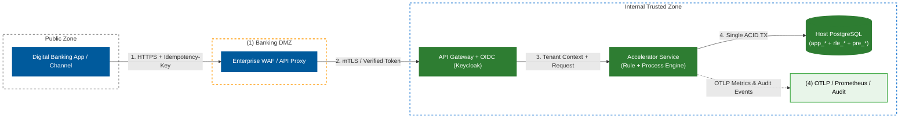

# C4 & Banking Integration Diagrams

Create clear, consistent visual diagrams that architects, banking security reviewers, engineers, and presales teams can understand in 10 seconds.

## When to Use
- Visualizing system context, module/container layout, or deployment shapes in `DESIGN.md`, `docs/02-landscape.md`, or `horus-Agentic-BPM/wiki/`.
- Illustrating banking integration zones (Public Zone → Enterprise DMZ/WAF → Internal Trusted Zone) for payments, eKYC, core banking, or `agentTask` adapters.
- Documenting complex multi-step runtime flows (Async Wait-State `agentTask`, Saga Reverse Compensation, Maker-Checker approval, `parallelGateway` fork/join).

---

## 1. Choosing the Right Diagram Type

| Question You Are Answering | Diagram Type | Standard |
|---|---|---|
| Who uses the system and what external systems does it talk to? | **C4 Level 1 (`C4Context`)** | Always required for every product |
| What deployable services, UIs, DBs, and queues exist? | **C4 Level 2 (`C4Container`)** | Always required for every product |
| What internal modules/SPIs live inside one container? | **C4 Level 3 (`C4Component`)** | Use for complex engines (`rule-engine`, `process-engine`) |
| How do network traffic and security boundaries cross DMZ → Internal? | **Banking Integration Zone Diagram (`flowchart LR`)** | Mandatory for Banking Accelerators & external integrations |
| What exact step-by-step protocol + transaction/failure branches occur? | **Sequence Diagram (`sequenceDiagram`)** | Mandatory for Async Wait-State, Idempotency, Saga Compensation |
| What are the valid states and transitions of an entity? | **State Diagram (`stateDiagram-v2`)** | Use for Version lifecycle, Instance lifecycle, Incident states |

**Rule of Thumb:** One diagram = one focus (5–9 primary nodes max). Split overcrowded diagrams into Context + Sequence rather than cramming 25 boxes into one chart.

---

## 2. Standard A: Banking Integration Zone Diagram (`flowchart LR`)
Use this exact zone grouping, numbered badges, and color palette whenever illustrating external/internal network boundaries in banking architectures:

- **Zones (Subgraphs):** `Public_Zone` (Mobile/Web/Partner) → `DMZ_Zone` (Enterprise WAF / Reverse Proxy / API Gateway) → `Internal_Zone` (Spring Services / Embedded BPM & Rule Engines / PostgreSQL / Kafka / Observability / WireMock).
- **Numbered Badges:** Prefix steps `(1)`, `(2)`, `(3a)`, `(3b)` in labels and edges (`-- "1. Request" -->` solid for runtime traffic, `-. "OTLP / Sync" .->` dotted for async/telemetry).
- **Standard Styles:**

---

## 3. Standard B: C4 Model Mermaid Conventions
- **Level 1 (`C4Context`)** & **Level 2 (`C4Container`)**: Always label technology (`"Java 21, Spring Boot 3.4"`, `"PostgreSQL 16"`, `"React 18 + Vite"`) and protocol (`"In-process JVM"`, `"Spring JDBC"`, `"JSON/HTTPS"`).
- **Keep Labels Escaped & Clean:** Quote node labels containing parentheses or brackets (`id["Label (Detail)"]`); avoid HTML tags (` `, `<b>`) inside Mermaid labels — use `\n` for line breaks so SVG renders cleanly across GitHub and `mmdc`.

---

## 4. Standard C: Sequence Diagrams for Concurrency & Failure Paths
Every integration or transaction boundary sequence diagram MUST show:
1. Transaction boundaries (`rect rgba(...) ... end` or `Note over Service,DB: TX 1: Claim & Commit`),
2. **Happy path**, AND
3. **Failure / Alternative branch** (`alt` / `else` for duplicate `Idempotency-Key`, guardrail violation → `route-to-human`, or step failure → reverse `compensate`).

---

## 5. Rendering Diagrams for GitHub & Wiki
In `horus-Agentic-BPM`:
- Keep diagram sources in `wiki/diagrams/*.mmd` and theme in `wiki/diagrams/theme.json`.
- Render deterministic `.svg` files into `wiki/images/*.svg` via `tools/render-diagrams.sh` and reference `` in Markdown wiki pages so GitHub Wiki renders consistently without client-side Mermaid glitches.

## HORUS Program Integration
- Used by `program-architect` and `tech-writer` when writing `horus-Agentic-BPM/wiki/` diagrams, `docs/02-landscape.md`, and product `DESIGN.md` files.
- Always verify every rendered `.mmd` / `.svg` builds cleanly with zero syntax errors.
