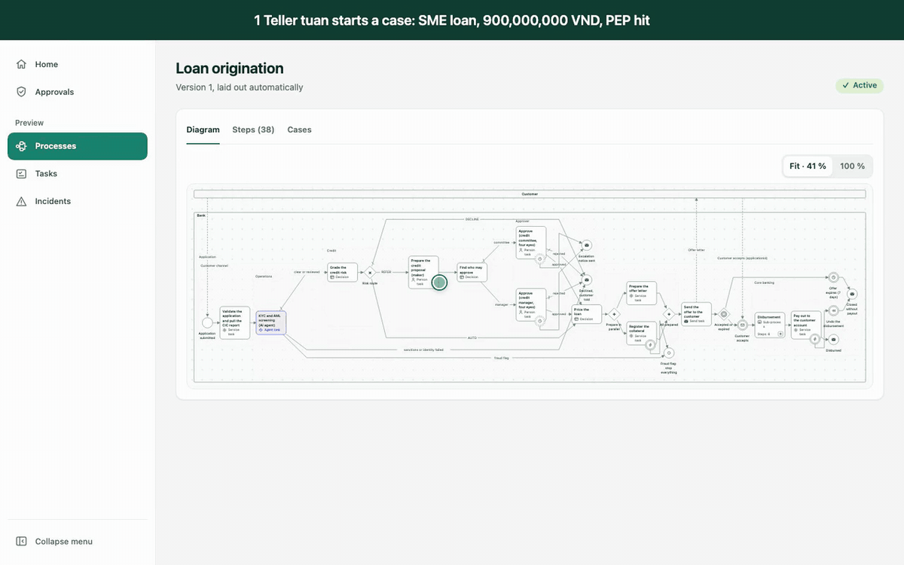

# HORUS Agentic BPM

Embeddable Process Engine and Rule Engine for Java and Spring Boot, with a cockpit, in which humans, services and AI agents take steps in the same governed process.

**Documentation: the [project wiki](../../wiki)** (source in [`wiki/`](wiki/)). A searchable site is built from it with `cd site && npm ci && npm run build` ([`site/README.md`](site/README.md)). First run in 30 minutes: [Getting Started](../../wiki/Getting-Started).




> Status: release candidate. The engines and the cockpit have passed acceptance testing; the 1.0 release is pending final acceptance, and the API may change until then.

**What it contains** ([roadmap](docs/product/roadmap.md)):

- Rule Engine: decision tables from YAML, JSON, CSV or DMN, a second approver (self-approval refused), effective dates, simulation and replay of past decisions, evaluation in your transaction, a decision log with masking, tenant isolation and idempotency keys.
- Process Engine: BPMN 2.0 import, execution and export; user, service, business rule and agent steps with output checks; timers, messages, signals, compensation and migration; approval of definitions by a second person.
- Cockpit: rule editing and approval, decision log, process diagrams, tasks, incidents and a merged inbox across services, embedded in your service or hosted standalone.
- Spring Boot starters and example hosts that run with Docker Compose.

Not built: application-level encryption of process variables (#594), connectors to outside systems, client libraries beyond Java, a graphical process modeller, an asynchronous decision log, and a built-in shadow mode for agent steps. See [Feature status](../../wiki/Feature-Status).

Requirements: Java 21 or 25, PostgreSQL 14 or later (15 or later from 1.0), and Spring Boot 4.x or 3.5.x ([ADR-0011](docs/adr/0011-spring-boot-4-baseline.md)).

## What it looks like

A decision table in `src/main/resources/rules/loan-eligibility.yaml`:

```yaml
ruleSet: loan-eligibility
hitPolicy: first
inputs:
  - { name: age,    type: integer }
  - { name: income, type: money }
outputs:
  - { name: eligible, type: boolean }
  - { name: reason,   type: string }
rules:
  - id: R1
    when: { age: "< 18" }
    then: { eligible: false, reason: "UNDER_AGE" }
  - id: R2
    when: { income: "< 5000000 VND" }
    then: { eligible: false, reason: "LOW_INCOME" }
  - id: R3
    when: {}
    then: { eligible: true, reason: "OK" }
```

Evaluated from your service:

```java
DecisionResult r = rules.evaluate("loan-eligibility",
    DecisionInput.of("age", 25, "income", Money.ofMinor("VND", 8_000_000)));
r.matchedRuleIds();                   // ["R3"]
r.output("eligible", Boolean.class);  // true
```

The decision, its inputs and the matched row are written to the decision log in your transaction. A second person must approve every rule change before it takes effect. The 30-minute walkthrough, from clone to a decision in the cockpit, is in [Getting Started](../../wiki/Getting-Started).

## Modules

| Module | What it does | Artifact |
|---|---|---|
| [`rule-engine/`](rule-engine/) | Decision tables (`first`, `unique` and `collect`), versioned rule sets with maker-checker and effective dates, a safe expression language, decision API, append-only decision log, simulation | `io.github.dhluong90.bpm:rule-engine-spring-boot-starter` |
| [`process-engine/`](process-engine/) | Versioned process definitions with user, service and agent tasks, gateways and timers; human task queues with SLA and escalation; idempotent starts, saga compensation, instance migration | `io.github.dhluong90.bpm:process-engine-spring-boot-starter` |
| [`cockpit/`](cockpit/) | React dashboard for both engines, served by the host or hosted standalone as static assets | `io.github.dhluong90.bpm:cockpit-spring-boot-starter` |
| [`examples/`](examples/) | Minimal host services showing each engine alone and both together | |

The engines are libraries, not servers. State lives in your PostgreSQL under the `rle_` and `pre_` prefixes, in your transactions. The Rule Engine never depends on the Process Engine. Decisions behind this are in [`docs/adr/`](docs/adr/).

Generic by design: every business behaviour is optional and configurable per host or tenant, with a safe default, and business logic enters through extension points, never as bank-specific code in the engines ([Principles](../../wiki/Principles), [Configuration and Extension Points](../../wiki/Configuration-and-Extension-Points)).

## Where to read next

| You want to | Read |
|---|---|
| Try it | [Getting Started](../../wiki/Getting-Started) |
| Run the example host in Docker with one command | [Deploying with Docker Compose](docs/DEPLOYING.md) |
| Know which versions are supported, what counts as breaking, and how to report a vulnerability | [Support and versioning policy](../../wiki/Support-and-Versioning-Policy) |
| Operate the engines: alerts, backup and restore, upgrade, seal key | [Operations runbook](../../wiki/Operations-Runbook) |
| Do a task: author a table, publish a version, simulate, read the log, use the cockpit | How-to guides listed on the wiki [Home](../../wiki) |
| Look up an endpoint, a property, an operator | [Decision API](../../wiki/Rule-Engine-Decision-API), [Configuration](../../wiki/Rule-Engine-Configuration), [Expression Language](../../wiki/Rule-Engine-Expression-Language) |
| Understand the design | [Concepts](../../wiki/Concepts), [Principles](../../wiki/Principles), [Architecture](../../wiki/Architecture), [Roadmap](../../wiki/Roadmap) |

## Out of scope

CMMN, a distributed job executor, a standalone server mode. See [FAQ](../../wiki/FAQ).

Full BPMN 2.0 and DMN are on the roadmap: 1.0 executes a published subset, and the releases after 1.0 extend it in stages to BPMN 2.0.2 execution conformance and DMN 1.5 Conformance Level 3, each with a published list of deviations ([ADR-0017](docs/adr/0017-full-bpmn-and-dmn-support-no-cmmn.md), [standards compliance](docs/architecture/standards-compliance.md)).

## Build from source

```bash
mvn -B verify
```

Needs JDK 21 or later and a running Docker for the Testcontainers tests. To run the example host, see [`examples/rule-engine-only/`](examples/rule-engine-only/README.md).

## Contributing

See [`CONTRIBUTING.md`](CONTRIBUTING.md). Security issues: [`SECURITY.md`](SECURITY.md).

## Licence

Licensed under the PolyForm Noncommercial License 1.0.0. For any other use, contact HORUS. See [`LICENSE`](LICENSE) and [`COMMERCIAL-LICENSE.md`](COMMERCIAL-LICENSE.md). Contributions are accepted under [`CLA.md`](CLA.md).
