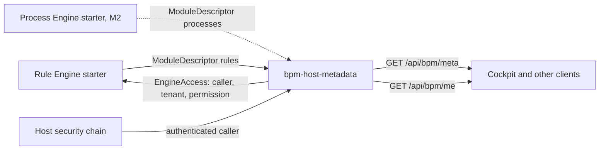

# Host metadata

Serves `GET /api/bpm/meta` and `GET /api/bpm/me` once per host, whatever engines the host runs (ADR-0014). Each engine starter contributes one `ModuleDescriptor` bean; the module turns them into the two responses defined by [`cockpit/api/schema/bpm-meta.v1.schema.json`](../cockpit/api/schema/bpm-meta.v1.schema.json) and [`bpm-me.v1.schema.json`](../cockpit/api/schema/bpm-me.v1.schema.json).

Hosts do not depend on this module directly: the engine starters bring it. User documentation is the wiki page Host Metadata and Permissions.



| Package | Contents |
|---|---|
| `com.horus.bpm.host.spi` | `ModuleDescriptor`, contributed by engine starters; its constructor checks every value against the published schema, so a wrong entry stops the start-up. `EngineAccess`, `EngineCaller` and `EngineAccessDeniedException`: the one caller, tenant and permission check that engine endpoints enforce with and `/api/bpm/me` reports from; a host may replace the default with its own bean. `TenantResolver` and `CallerContext`, which a host implements when its principal carries no tenant attribute. No header is offered to a resolver (PD-079) |
| `com.horus.bpm.host.autoconfigure` | `EngineAccessAutoConfiguration` (always on) and `HostMetadataAutoConfiguration` (the two endpoints), `horus.bpm.*` properties, the controller, the default `EngineAccess`, the default `TenantResolver` (the `tenancy.claim` attribute of the principal, session or token; `tenancy.dev-tenant` on `dev` only), a filter that marks `/api/bpm/rules/**` and `/api/bpm/processes/**` responses `no-store`, and `BpmProblemAuthenticationEntryPoint` and `BpmProblemAccessDeniedHandler` for the host's security chain |

The endpoints register only in a servlet host with Spring MVC and Spring Security, only when at least one engine has contributed an entry (so `/meta` never lists zero modules), and unless `horus.bpm.host-metadata.enabled=false`. That switch turns off the two endpoints only. The controls of `EngineAccessAutoConfiguration` stay on in every servlet host with an engine: the `no-store` filter, the default `TenantResolver` and `EngineAccess`, the problem entry point and access-denied handler beans, and the problem answer to an `EngineAccessDeniedException` (ADR-0024 decision 5). Whatever `TenantResolver` is active, a principal's tenant attribute must match the resolved tenant and `X-Tenant-Id` must match it too; mismatches are `403 TENANT_NOT_ALLOWED` and logged on `com.horus.bpm.security`. Spring MVC, Spring Security and Spring Security OAuth2 are optional dependencies. Main code uses no JSON library: responses go through the host's own message converters and problem bodies are written by a small writer, so the module works with either Jackson major.

## Contract

- OpenAPI 3.1: [`api/openapi.yaml`](api/openapi.yaml). It references the two schemas instead of copying them.
- `HostMetadataContractTest` validates responses for several callers and host configurations against the schemas, and the OpenAPI examples too.

Generate a TypeScript client and type-check it:

```bash
npx openapi-typescript@7 bpm-host-metadata/api/openapi.yaml -o host-contract.d.ts
npx -p typescript@5 tsc --strict --noEmit host-contract.d.ts
```

## Build and test

`mvn -B -pl bpm-host-metadata -am verify` from the repository root. The tests need no database and no identity provider; callers are set with Spring Security's test support.
