# Cockpit: Design

Status: architecture baseline (M0), updated 2026-11-18 for the cockpit direction (PD-032 to PD-042). Conforms to ADR-0005 as amended by ADR-0014 (multi-host federation), ADR-0013 (diagram notation and library), ADR-0017 (full BPMN 2.0 and DMN on the roadmap; do-now item DN-11 applied in section 10), ADR-0015 (read models and query limits), ADR-0010 (permissions), and [`docs/product/requirements.md`](../../docs/product/requirements.md). Release scope follows [`docs/product/roadmap.md`](../../docs/product/roadmap.md); every `CKP-*` statement carries its milestone.

UX source of truth: [`docs/product/ux-design.md`](../../docs/product/ux-design.md), the approved hybrid direction ([PD-056](../../docs/product/decisions.md#pd-056-rule-management-ux-direction), decided 2026-11-19), with the approved prototype, the screens and the persona each serves, the anti-clutter rules, the light and dark colour tokens with contrast ratios, the chart palette, accessibility, viewport checks and languages. This document covers how the cockpit is built; where it touches layout, colour, copy style or accessibility, ux-design.md wins and this document is corrected.

Contents: 1 Context and deployment options. 2 Modules and dependencies. 3 Screen hierarchy. 4 Host registry (`cockpit-hosts.json`). 5 Sign-in and host sessions. 6 Host metadata: `/api/bpm/meta` and `/api/bpm/me`. 7 Tenant switching. 8 Federated inbox and incidents. 9 Capacity math. 10 Diagrams. 11 Governed change from the cockpit. 12 State, validation, i18n and accessibility. 13 Security controls. 14 Delivery scope. 15 Open questions.

## 1. Context and deployment options

`horus-cockpit` is a stateless React 18 and TypeScript 5 application built to static assets. It has no server, database or user store of its own. Every security check (tenancy, permissions, maker-checker, four-eyes) is enforced by the host REST layers `/api/bpm/rules/v1` and `/api/bpm/processes/v1`; the cockpit hides what a user cannot do, and the API refuses it regardless.

| Option (PD-035) | How it works | Status |
|---|---|---|
| A. Embedded | `cockpit-spring-boot-starter` serves the assets at `horus.bpm.cockpit.path` (default `/bpm/cockpit`) under the host's authentication and generates a registry with one host | Supported, M1 |
| B. Standalone federating hosts | The static bundle on any web server; `cockpit-hosts.json` lists the hosts; the browser signs in once and calls each host; tasks and incidents merge in the browser | The product, M1 (one host at a time) and M2 (merged lists) |
| C. Read-side aggregator fed by engine events | A separate service with its own store | Rejected for now; reopened only with a paying customer (ADR-0014) |
| D. Bank API gateway in front of the hosts | The bank's existing gateway gives one origin and token exchange | Documented as a reference configuration, not built |

Option B, standalone federation:


Source: [`diagrams/context-federated.mmd`](diagrams/context-federated.mmd). Edges: 1 loads the bundle and the registry; 2 and 3 sign in once and obtain one token per host; 4 and 5 call each host through the bank's gateway with that host's token; 6 each host reads only its own database; 7 the cockpit never reaches the systems a host calls; 8 hosts log refused tenants and wrong audiences.

Option A, embedded:


Source: [`diagrams/context-embedded.mmd`](diagrams/context-embedded.mmd). Same origin as the host; the host's session cookie authenticates and the cockpit sends the CSRF token on every mutating request.

## 2. Modules and dependencies


Source: [`diagrams/components.mmd`](diagrams/components.mmd).

| Package | Responsibility |
|---|---|
| `app/config` | Loads `cockpit-hosts.json` with `cache: no-store` and validates it against [`api/schema/cockpit-hosts.v1.schema.json`](../api/schema/cockpit-hosts.v1.schema.json) |
| `app/auth` | `oidc-client-ts` user manager; one token store per host, in memory only |
| `app/hosts` | Host registry, the connection state machine of section 5.3, version skew rule |
| `app/tenant` | Selected tenant per host; adds `X-Tenant-Id` |
| `api` | `HostClient` port: `fetch` with bearer token or CSRF header, `If-None-Match` cache, RFC 9457 parsing; generated clients and `zod` schemas from the engines' OpenAPI documents |
| `features/rules` | Rule sets, version diff, simulation, approvals, decision log and explanation |
| `features/processes` | Definitions, instances, agent task inspector, compensation runs, migration |
| `features/inbox`, `features/incidents` | Merged lists across hosts (section 8) |
| `features/approvals`, `features/modeller` | Process approval with graph diff and the canvas (M3) |
| `diagram` | React Flow canvas, dagre layout, overlays and the node list; a separate chunk loaded on first use |
| `components` | Design tokens as CSS variables, light and dark themes, focus styles |

Runtime dependencies and their justification (licences re-checked at adoption; the build fails on any licence outside Apache 2.0, MIT and BSD, `TR-LIC-01`):

| Package | Licence | Why it is needed and why not something else |
|---|---|---|
| `react`, `react-dom` 18 | MIT | UI runtime; the cockpit's baseline since ADR-0005 |
| `@tanstack/react-query`, `@tanstack/react-table` | MIT | Server state with cancellation and per-host query keys; dense tables for logs and queues |
| `react-hook-form`, `zod` | MIT | Forms and runtime validation of every response against the generated schemas |
| `oidc-client-ts` | Apache 2.0 | Authorization code with PKCE, refresh grants and token expiry handling as a public client. Writing OAuth flows by hand is a common source of security defects; this library is the maintained successor of `oidc-client-js` and has no runtime dependencies of its own |
| `@xyflow/react` (React Flow) | MIT | Canvas for read-only diagrams in M2 and the modeller in M3: custom node types, viewport culling, keyboard focus hooks. `bpmn-js` and `diagram-js` fail `TR-LIC-01` (the bpmn.io licence requires a visible watermark); with full BPMN on the roadmap (ADR-0017) the licence is the remaining reason, and the BPMN symbol set is drawn as React Flow node types (section 10); JointJS (MPL-2.0) fails the licence rule. Fallback: maxGraph (Apache 2.0) |
| `@dagrejs/dagre` | MIT | Layered automatic layout for definitions without a stored layout. elkjs gives better layouts but is EPL-2.0 and fails `TR-LIC-01` |

## 3. Screen hierarchy


Source: [`diagrams/screen-hierarchy.mmd`](diagrams/screen-hierarchy.mmd). Numbered edges follow the operator's path from a workspace to a list to the screen where the action happens.

The lenses that fill these tiers (canvas home with the docked decision table, matrix editor, policy readings, change dossier, control tower with the guardrail inspector, And/Or builder) and the release each lands in are specified in [ux-design.md sections 2, 3 and 10](../../docs/product/ux-design.md#2-screen-hierarchy).

| Tier | Purpose | Screens | Rule |
|---|---|---|---|
| 1. Workspace and context | Where am I, for whom, in which environment | Top bar with host (or "All hosts" for merged lists), tenant, environment banner and user; workspaces Inbox, Incidents, Processes, Rules, Approvals | A workspace the user has no permission for on any host is hidden. There is no landing strip of key figures in 0.x (PD-016, decided 2026-11-19); each queue shows its own count in its header (pending approvals, open incidents, overdue tasks) and counts appear on diagrams, where the operator acts (PD-038); metrics stay in the host's monitoring through Micrometer. The KPI strip of the approved prototype is not built (CK-F-21, later) |
| Landing area | Where the cockpit opens | Host property `horus.bpm.cockpit.landing`, published as `cockpit.landing` in `/api/bpm/meta` settings, default `by-role` (PD-078): an approver opens on Changes (pending approvals), an author on Changes filtered to their own drafts and requests, an auditor or support user on Decisions, anyone else on the rule set list; from 0.2 the process canvas only where a Process Engine host is registered. A fixed value (`changes`, `decisions`, `rule-sets`, `processes`) overrides the role rule; a deep link always wins (`CKP-031`) |
| 2. Queues and lists | What needs attention, in order | Merged inbox by due date; merged incidents by age; definitions and instances per host; rule sets and decisions per host; pending approvals | Every list is a bounded API call with a cursor (ADR-0015); a count above 200 shows as "200+"; filters map one to one to API parameters |
| 3. Detail and action | Do the work, see the evidence | Task form, instance diagram with tokens and activities, incident detail with retry and resolve, version diff and simulation, definition diagram and graph diff, agent task inspector, modeller (M3) | Every action shows its outcome only after the API answers `200` or `201`; nothing is marked done optimistically |

## 4. Host registry (`cockpit-hosts.json`)

The cockpit reads its host list from one file, **`cockpit-hosts.json`**, served from the same directory as `index.html`. Its format is owned by [`api/schema/cockpit-hosts.v1.schema.json`](../api/schema/cockpit-hosts.v1.schema.json) (`urn:horus-bpm:schema:cockpit-hosts:v1`).

```json
{
  "schemaVersion": 1,
  "auth": {
    "mode": "oidc",
    "issuer": "https://idp.bank.example/realms/operations",
    "clientId": "horus-cockpit",
    "scopes": ["profile"],
    "tokenMode": "per-host",
    "redirectPath": "auth/callback"
  },
  "hosts": [
    { "id": "loans", "label": { "en": "Loan origination", "vi": "Khởi tạo khoản vay" },
      "baseUrl": "https://loans.api.bank.example", "scope": "loans-bpm", "environment": "production" },
    { "id": "kyc", "label": "KYC onboarding",
      "baseUrl": "https://kyc.api.bank.example", "scope": "kyc-bpm", "environment": "production" }
  ],
  "refresh": { "inboxSeconds": 30, "incidentsSeconds": 60, "hostTimeoutSeconds": 5 },
  "ui": { "defaultLocale": "vi", "environmentBanner": "PRODUCTION" }
}
```

| Key | Required | Default | Meaning |
|---|---|---|---|
| `schemaVersion` | yes | | `1` |
| `auth.mode` | yes | | `oidc` (standalone, or embedded behind a resource server) or `host-session` (embedded with the host's session cookie) |
| `auth.issuer`, `auth.clientId` | with `oidc` | | Issuer URL (https) and the public client id registered at the bank's identity provider |
| `auth.scopes` | no | `[]` | Extra sign-in scopes; `openid` is always added |
| `auth.tokenMode` | no | `per-host` | `per-host`: one access token per host, requested with the host's `scope`, so a token is valid at one host only. `shared`: one token for all hosts, audience lists every host |
| `auth.redirectPath`, `auth.postLogoutRedirectPath` | no | `auth/callback`, empty | Paths relative to the cockpit |
| `hosts[].id` | yes | | Kebab-case, unique; appears in merged lists and in URLs (`/hosts/loans/instances/...`) |
| `hosts[].label` | yes | | A string, or a map per locale with at least `en` |
| `hosts[].baseUrl` | yes | | `https://` origin plus optional path prefix, no trailing slash; `http://localhost` for development; empty string means same origin |
| `hosts[].scope` | with `per-host` | | Scope that yields a token with this host's audience |
| `hosts[].environment`, `hosts[].enabled` | no | none, `true` | Label shown next to the host; `false` keeps the entry but never calls it |
| `refresh.inboxSeconds`, `refresh.incidentsSeconds` | no | `30`, `60` | Polling while the tab is visible; minimum 15 and 30 |
| `refresh.hostTimeoutSeconds` | no | `5` | Per-host timeout for merged lists |
| `ui.defaultLocale`, `ui.environmentBanner` | no | `en`, none | `en` or `vi`; banner text on every screen |

Rules:

- An invalid file shows a configuration error screen naming the JSON Pointer of the first error, and the cockpit calls no host (`CKP-012`).
- Duplicate `id` or duplicate `baseUrl` is an error. More hosts than the supported envelope (proposed 15, pending PD-046) shows a warning on the host list, not an error.
- The file is security-relevant: whoever can change it can direct the browser to another origin. It is deployed with the bundle under the same change control, and the web server's `Content-Security-Policy` `connect-src` lists exactly the host origins and the issuer, so a changed file without a changed policy cannot reach a new origin.
- Embedded mode: the starter generates `{horus.bpm.cockpit.path}/cockpit-hosts.json` with one host (`id` from `horus.bpm.host-id`, default `self`; `label` from `horus.bpm.cockpit.host-label`, default the id; `environment` from `horus.bpm.cockpit.environment`; `baseUrl` empty), `auth.mode` from `horus.bpm.cockpit.auth-mode` (default `host-session`; `oidc` is refused at start-up until standalone sign-in ships, CK-F-23) and `ui.defaultLocale` from `horus.bpm.cockpit.default-locale`. The starter serves the bundle only to a request with an authenticated user (the host's security redirects first; the starter answers `401` as a second line) and adds the headers of section 13 to every cockpit file. The web application lives in `cockpit/web`; the starter packages its `dist/` as `META-INF/horus-cockpit/`, and the build fails when `dist/` is missing unless `-Dcockpit.bundle.skip=true` is given. Routing is history routing: any path under the cockpit path that names no file gets `index.html`.
- `host-session` tenant: the tenant comes from the host's session principal, through the host's `TenantResolver` bean, and never from a header the browser sets. `X-Tenant-Id` switching (section 7) applies to token callers only.

## 5. Sign-in and host sessions

### 5.1 Tokens

| Rule | Value |
|---|---|
| Flow | Authorization code with PKCE (`S256`), `state` and `nonce`; the cockpit is a public client with no secret |
| Storage | Access, ID and refresh tokens in memory only (`InMemoryWebStorage`), never `localStorage` or `sessionStorage`. A reload signs in again through the identity provider's session |
| Per-host tokens | One refresh grant per host with that host's `scope`; the identity provider maps the scope to the host's audience. A token leaked from one host's traffic is not accepted by another host |
| Lifetime | Access tokens of 5 to 10 minutes are recommended; the cockpit refreshes a host's token 60 s before expiry and only for hosts it is using |
| Host side | Each host validates the audience (`spring.security.oauth2.resourceserver.jwt.audiences`) and rejects a token whose audience is another host with `401`. When `rest.cors.allowed-origins` is set, the starter refuses to start outside `dev` without an audience configured (`TR-SEC-12`) |
| CORS | Off by default; the exact cockpit origin per host; bearer tokens, never cookies, so no credentials mode (`TR-SEC-09`) |

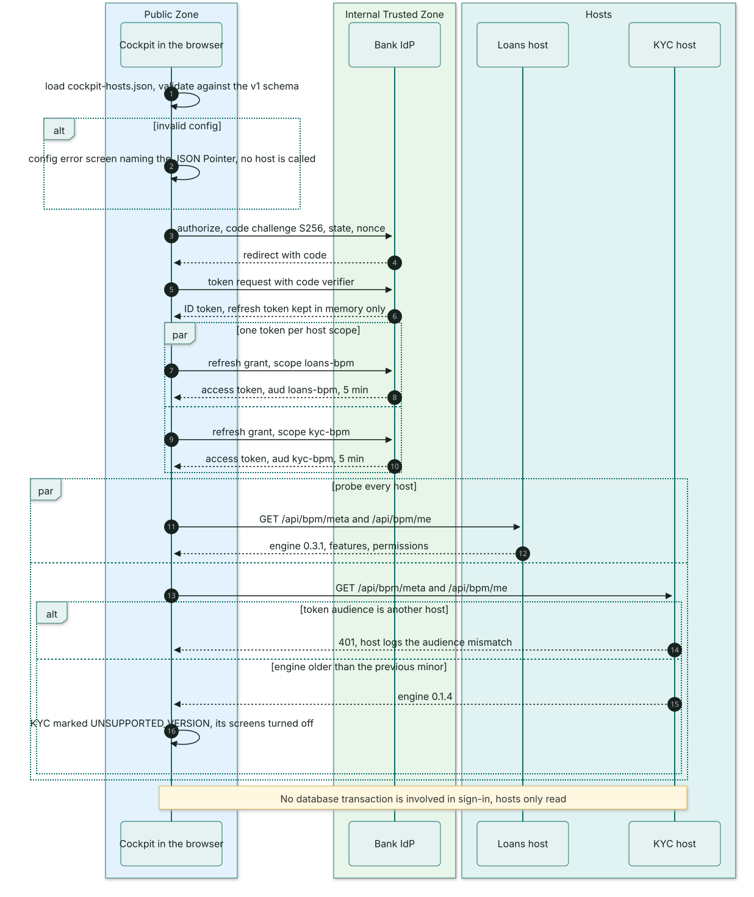

Source: [`diagrams/signin-sequence.mmd`](diagrams/signin-sequence.mmd).

### 5.2 Version skew

A cockpit release `0.N` supports hosts whose engine minor is `0.N` or `0.(N-1)`; from 1.0 the same rule applies to `1.N` (`TR-UI-08`). A host older than that is `UNSUPPORTED_VERSION`: it stays in the host list with its version and the supported range, and none of its screens are offered. Within the supported range, screens turn on by the feature flags in `/api/bpm/meta`, never by comparing version numbers, so a host that has not enabled a feature simply does not show it.

### 5.3 Host connection states


Source: [`diagrams/host-connection-states.mmd`](diagrams/host-connection-states.mmd).

| From | Trigger | To | What the user sees |
|---|---|---|---|
| none | Entry in `cockpit-hosts.json` | `CONFIGURED` | Host listed |
| `CONFIGURED` | Host selected, or a merged list needs it | `AUTHENTICATING` | Spinner on the host |
| `AUTHENTICATING` | Token for the host's scope | `PROBING` | |
| `AUTHENTICATING` | Identity provider refuses the scope | `FORBIDDEN` | "You have no access to this service" |
| `PROBING` | `/meta` and `/me` answered, version supported | `READY` | Host usable; screens per features and permissions |
| `PROBING` | Engine minor older than the previous one | `UNSUPPORTED_VERSION` | Version and supported range |
| `PROBING` | `401` or `403` on `/me` | `FORBIDDEN` | As above, with the `correlationId` |
| `PROBING` | Timeout, CORS refusal or network error | `UNREACHABLE` | "Cannot reach service"; retry time |
| `READY` | Token expires within 60 s | `AUTHENTICATING` | Nothing, unless the refresh fails |
| `READY` | Three failed calls in a row | `UNREACHABLE` | Banner on merged lists |
| `UNREACHABLE` | Backoff from 5 s doubling to 5 min | `PROBING` | |
| `UNSUPPORTED_VERSION` | Reload, or the host was upgraded | `PROBING` | |

In Cockpit 0.1 the user works with one host at a time and switches from the top bar (`CKP-015`); from 0.2 the inbox and incident workspaces use every `READY` host.

## 6. Host metadata: `/api/bpm/meta` and `/api/bpm/me`

Both endpoints are served once per host by a small shared module that both engine starters depend on, [`bpm-host-metadata`](../../bpm-host-metadata/README.md); each engine contributes its entry. The OpenAPI document is [`bpm-host-metadata/api/openapi.yaml`](../../bpm-host-metadata/api/openapi.yaml); it references the two schemas below. Both require an authenticated caller and no other permission, return an `ETag` (`304` on `If-None-Match`) and ship in M1 (X-F-22). `/meta` is `Cache-Control: private, max-age=60`; `/me` is `private, no-cache`, because it carries the caller's permissions and a revoked role must not be served from the browser cache.

| Endpoint | Schema | Content |
|---|---|---|
| `GET /api/bpm/meta` | [`api/schema/bpm-meta.v1.schema.json`](../api/schema/bpm-meta.v1.schema.json) | `modules[]` with `module`, `engineVersion`, `apiVersion`, `features[]`, `settings`; `tenancy.switching`; `limits.maxPageSize` |
| `GET /api/bpm/me` | [`api/schema/bpm-me.v1.schema.json`](../api/schema/bpm-me.v1.schema.json) | `user`, `tenant.current`, `tenant.allowed`, `permissions[]`, `roles[]`, `groups[]` for the tenant the request resolved to |

```json
{
  "schemaVersion": 1,
  "hostId": "loans",
  "modules": [
    { "module": "rules", "engineVersion": "0.2.0", "apiVersion": "v1",
      "features": ["rules.simulation", "rules.grid-editor"] },
    { "module": "processes", "engineVersion": "0.2.0", "apiVersion": "v1",
      "features": ["processes.diagram", "processes.node-stats.live", "processes.forms", "processes.definition-lifecycle"],
      "settings": { "authoring.cockpit-drafts": false } }
  ],
  "tenancy": { "switching": true },
  "limits": { "maxPageSize": 200 }
}
```

## 7. Tenant resolution and switching (PD-037, PD-079, ADR-0014)

| Rule | Detail |
|---|---|
| Source of the tenant | The `TenantResolver` extension point (PD-079). Its default reads the tenant from the authenticated principal in the host's security context: the `tenancy.claim` attribute (default `tenant_id`) of a server-side session principal, when the cockpit is embedded in a bank web application with its own login, or the claim of the same name in a validated token. A host may replace the resolver with its own bean, for example one that reads its user directory. A tenant in a request body is always ignored, and nothing else the browser sends selects a tenant except the switch request below (`TR-SEC-03`, `RLE-037`) |
| No tenant | A call whose principal yields no tenant is refused with `401 UNAUTHENTICATED`, and nothing is read or written |
| Switching | With `horus.bpm.tenancy.switching.enabled: true` the cockpit may send `X-Tenant-Id`; the host accepts it only if the value is in the token's allowed-tenants claim (`tenancy.allowed-tenants-claim`, default `allowed_tenants`, a JSON array of strings) |
| Refusal | A header naming a tenant outside that list, or any header that differs from the token tenant while switching is off, returns **`403 TENANT_NOT_ALLOWED`** with no data, and the host writes a security log entry `tenant.switch.refused` with user, requested tenant and `correlationId` |
| Why 403 and not 404 | The `404` rule hides whether another tenant's resource exists. This refusal reveals only that the caller's own token lacks the tenant, which the caller already knows; a `404` would make a misconfigured identity provider look like missing data |
| No trusted-header mode | The engines ship no resolver that trusts a header set by a gateway (PD-079 option 2, rejected): a misconfigured gateway would expose one tenant's data to another tenant's operator. A host that writes such a resolver owns that risk; the documentation says so |
| Development | In the `dev` profile only, `tenancy.dev-tenant` fixes the tenant for local work without an identity provider; start-up is refused when it is set outside `dev` (`TR-EXT-05`) |
| One tenant per screen | The cockpit keeps one selected tenant per host; changing it reloads every open list. No screen and no API call combines tenants; merged lists merge hosts, never tenants |

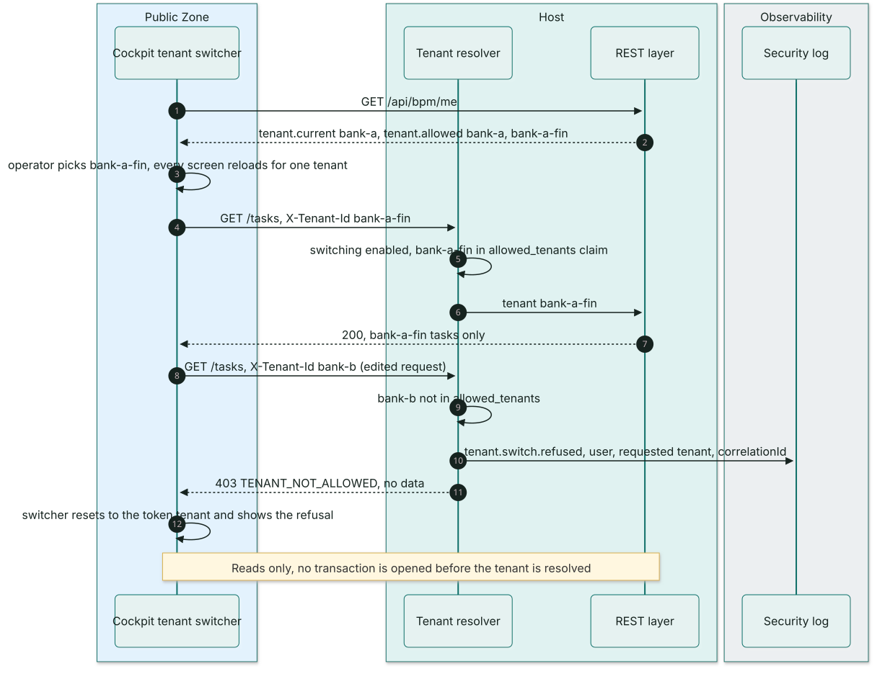

Source: [`diagrams/tenant-switch.mmd`](diagrams/tenant-switch.mmd).

## 8. Federated inbox and incidents (CK-F-28, CK-F-29, M2)

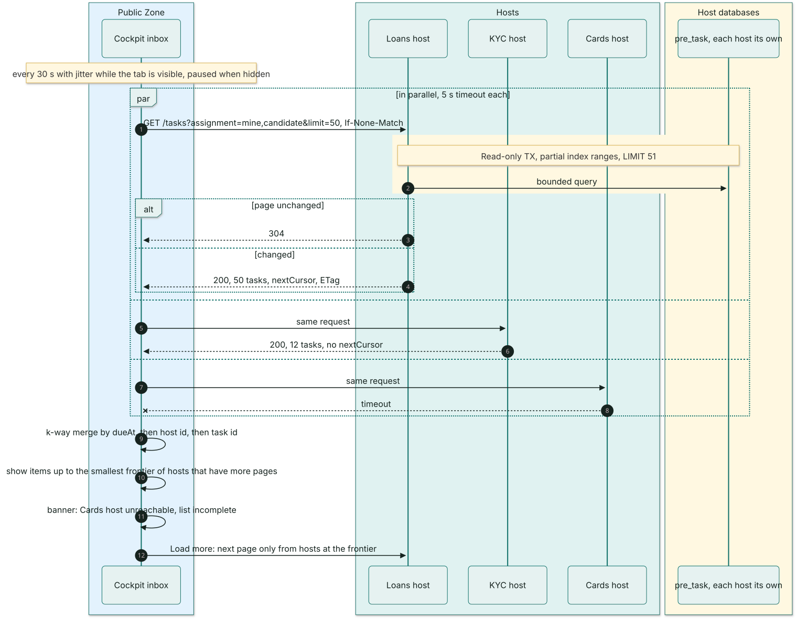

Source: [`diagrams/merged-inbox.mmd`](diagrams/merged-inbox.mmd).

| Step | Rule |
|---|---|
| Requests | For each `READY` host where `/me` lists `processes:task:work`: `GET /api/bpm/processes/v1/tasks?assignment=mine,candidate&status=OPEN,CLAIMED&limit=50` with `If-None-Match`, in parallel, each with `refresh.hostTimeoutSeconds` |
| Order | `(dueAt ascending, nulls last, hostId, taskId)`; every host returns the same order, so the merge is a k-way merge |
| Exact paging | The cockpit shows items up to the smallest `dueAt` frontier among hosts that still have a `nextCursor`; "Load more" fetches the next page only from hosts at that frontier. This gives the exact global order, not an approximation |
| Partial results | A host that times out or fails is listed in a banner ("KYC onboarding unreachable, list incomplete") and excluded from the frontier; the list never hides that it is incomplete |
| Refresh | Every `inboxSeconds` with plus or minus 10 percent jitter while the tab is visible (Page Visibility API), paused while hidden; a `304` keeps the cached page |
| Counts | The queue header shows the number loaded per host, "50+" when a host has more |
| Incidents | Same algorithm with `GET /incidents?status=OPEN&limit=50`, ordered by `(createdAt descending, hostId, incidentId)`, permission `processes:read`, refresh `incidentsSeconds` |

Completing a task is one sync transaction on the host; a stale form gets `409 VERSION_CONFLICT`, and a retried request with the same `Idempotency-Key` gets the stored result:

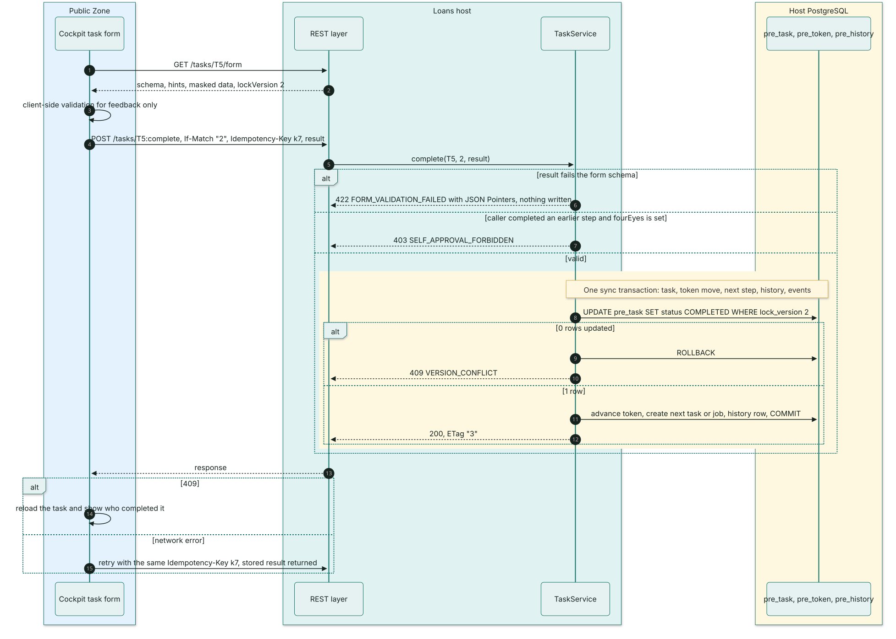

Source: [`diagrams/task-complete.mmd`](diagrams/task-complete.mmd).

Retrying an incident on an async step is a sync command that only schedules the job; the adapter call later runs outside any transaction, so the cockpit shows the result on its next refresh:

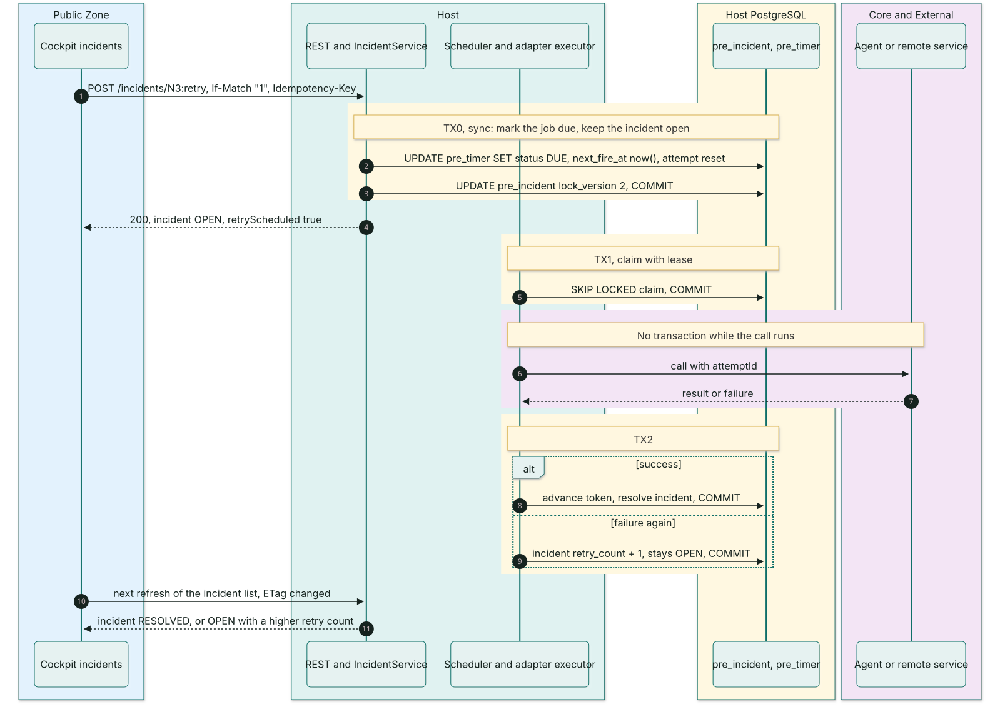

Source: [`diagrams/incident-retry.mmd`](diagrams/incident-retry.mmd).

## 9. Capacity math

Design targets, not measurements. Host-side database cost is in [`process-engine/docs/DESIGN.md`](../../process-engine/docs/DESIGN.md) section 8.2.

| Item | Baseline: 10 hosts, 500 active operators | Envelope proposed in PD-046: 15 hosts, 2,000 operators | Where it breaks |
|---|---|---|---|
| Inbox requests per host | 500 / 30 s = 17/s, plus incidents 500 / 60 s = 8/s | 2,000 / 30 s = 67/s plus 33/s | Host database: 0.06 and 0.2 busy connections; not the limit |
| Merged inbox latency | Slowest of 10 parallel calls. With a host p99 of 150 ms, `1 - 0.99^10` = 9.6 percent of loads see at least one call above 150 ms, so the merged p90 is about the host p99; merged p95 about 300 ms | 15 hosts: 14 percent above 150 ms; merged p95 about 300 ms if host p99.5 stays under 300 ms | Tail latency of the slowest host; the 5 s timeout caps it |
| Identity provider, `per-host` tokens | 10-minute tokens refreshed 60 s early: 500 x 10 / 540 s = 9 requests/s | 2,000 x 15 / 540 s = 56/s; with 5-minute tokens 125/s | The identity provider is the first shared component to saturate; the bank sizes it, or uses `shared` mode (2,000 / 540 = 4/s) and accepts weaker isolation |
| Browser | 20 requests per 30 s, 10 origins over HTTP/2; merge of 500 items under 5 ms | 30 requests, 750 items | Not the limit |
| Payload | 50 tasks x 600 bytes = 30 KB per host per full refresh; `304` about 300 bytes | Same per host | Bandwidth on mobile links; `304` keeps steady state small |
| Initial bundle | React 45 KB, TanStack 28 KB, forms and zod 23 KB, `oidc-client-ts` 20 KB, app 150 KB: about 270 KB gzipped (estimate) | Same | `TR-UI-06` target 500 KB; checked in CI |
| Diagram chunk | React Flow about 55 KB and dagre about 15 KB gzipped (estimate), loaded on first diagram | Same | |
| Diagram render | dagre on 200 nodes about 30 ms; first React Flow render of 200 nodes about 300 ms on a 4-core laptop | 500 nodes (the definition limit): dagre about 150 ms, viewport culling on | `TR-UI-07`: 200 nodes under 1 s |

Above the envelope the documented answers are one cockpit per group of hosts (option A or several B deployments) or the bank's gateway (option D). An aggregator (option C) is not planned.

## 10. Diagrams (ADR-0013)


Source: [`diagrams/diagram-render.mmd`](diagrams/diagram-render.mmd).

| Topic | Design |
|---|---|
| Source | `GET /definitions/{key}/versions/{v}?include=layout`. Immutable per version and layout revision, so the response is cached by `ETag` |
| Layout | Stored positions when the layout covers every node; when it covers some, dagre places the rest with the stored nodes fixed; with no layout (definitions kept in Git), dagre lays out everything, `rankdir LR`, node separation 40, rank separation 60 |
| Node types | Keyed by BPMN element type plus a HORUS subtype (M2, DN-11): `startEvent`, `endEvent`, `userTask`, `serviceTask`, `serviceTask:agentTask` (with its guardrail), `businessRuleTask`, gateways, `intermediateCatchEvent:timer`, `callActivity`, `transaction` (a group node for `saga`), `intermediateThrowEvent:compensate`. The cockpit maps the v1 step types onto these keys. A type the cockpit does not know renders as a labelled generic node with its BPMN type name, never as an error, so a newer host can be viewed by an older cockpit. The S1 to S3 symbols (events with every definition, boundary events, subprocesses, pools and lanes, data objects, artifacts) are added as node types per stage ([`standards-compliance.md`](../../docs/architecture/standards-compliance.md) section 6.1). The modeller (M3) offers only what the host lists in `/api/bpm/meta` `standards.bpmnExecutableElements` and its step catalogue |
| Edges | From `next`, `branches[].when` (label), `default` (marked), and `parallelGateway` lists |
| Definition view (M2) | Live counts per node from `node-stats?mode=live`, refreshed every 15 s, with `asOf` shown (CK-F-26, cut candidate) |
| Instance view (M2) | Token badges from `GET /instances/{id}`; per node when it ran, how long, attempts, who acted and incidents from `/activities` (CK-F-25); the existing timeline stays as a second tab (CK-F-12) |
| Heatmap (M3) | `node-stats?mode=window`, p50 and p95 per node, window up to 31 days (CK-F-27, cut candidate) |
| Migration (M3) | Source and target diagrams side by side with mapped steps linked (CK-F-33) |
| Accessibility | Status and counts are shown as text and icon as well as colour (WCAG 1.4.1, `TR-UI-03`). A keyboard-usable node list beside every diagram and the canvas exemption notice are proposed, pending PD-048 |
| Layout edits | Moving boxes and saving writes a new layout revision through `PUT .../layout` with `If-Match`; no approval, and allowed even when cockpit drafts are off (M3) |

## 11. Governed change from the cockpit (PD-033, PD-036)

| Screen | Behaviour | Milestone |
|---|---|---|
| Process approvals | Pending definition versions from every `READY` host; graph diff (`GET .../diff`) drawn on the diagram (added, removed, changed nodes and edges marked in text and colour) and as a list; Approve disabled with a tooltip when `/me` user equals `requestedBy`; the API returns `403 SELF_APPROVAL_FORBIDDEN` regardless (CK-F-31) | M3 |
| Content hash | Every version shows `definitionHash` and its source (`IMPORT`, `STARTUP`, `AUTHORED`, `BPMN`), so an operator can compare production with the hash a pipeline computed from Git | M2 |
| Cockpit drafts off | When `/meta` reports `processes.authoring.cockpit-drafts: false` (process definitions) or `rules.authoring.cockpit-drafts: false` (rule sets, from M1, PD-075; property `horus.bpm.rules.authoring.cockpit-drafts`), the cockpit hides "New draft", "Edit" and the modeller or cell editor for that host and shows "Changes to this environment arrive through your release pipeline". Approval, diff, hash and layout saving stay available | M2 (flag), M3 (screens) |
| Modeller | The palette lists only entries of `GET /step-catalogue`; property panels are forms generated from each entry's input schema; save calls `PUT .../versions/{v}` and shows the engine's validation problems on the nodes; the result is always a draft that needs approval (CK-F-32, first M3 cut, fallback 1.1) | M3 |

## 12. State, validation, i18n and accessibility

- Server state with `@tanstack/react-query`, query keys `[hostId, tenantId, resource, params]`, so switching host or tenant can never show another key's data. Mutations never update the cache optimistically for approvals, task completion or incident commands.
- Every response is validated with the generated `zod` schema; an unexpected shape is shown as an error with the `correlationId`, never rendered partially.
- RFC 9457 bodies map to field errors (by JSON Pointer) and to banners with `code` and `correlationId`.
- Settings that change behaviour come from the host's `/api/bpm/meta` settings, never from cockpit code: `cockpit.landing` (section 3, PD-078), `rules.authoring.cockpit-drafts` and `processes.authoring.cockpit-drafts` (section 11, PD-075, PD-036), `rules.readings.style` (`sentence` or `shorthand`, host property `horus.bpm.rules.readings.style`, PD-077) for rule readings in the change dossier and the version view, and `rules.lifecycle.retire-approval` (PD-080) for the retire dialog.
- Every mutating request carries an `Idempotency-Key` generated per user action and reused on retry, and `If-Match` where the API uses it.
- English and Vietnamese dictionaries with key parity checked in CI (`TR-UI-04`); keyboard navigation, visible focus and `axe-core` checks in Playwright in light and dark themes (`TR-UI-03`).
- Visual rules come from [ux-design.md](../../docs/product/ux-design.md): one token stylesheet in `cockpit/web` holds every colour, light and dark, with the values and contrast ratios of ux-design.md section 6; feature styles use the variables only. Money colours follow the bank's fee-income view (section 5); one language at a time and readings from the engine (section 9); 44 px targets and the 1440x900 above-the-fold and 1440x1200 checks in both themes (section 8).

## 13. Security controls

| Threat | Control | Verified by |
|---|---|---|
| Token theft by script injection | No `dangerouslySetInnerHTML`; strict CSP (`script-src 'self'`, no inline script); tokens only in memory | Playwright CSP test; lint rule |
| A token used at another host | Per-host tokens; hosts validate the audience | `CKP-013`; host test (`TR-SEC-12`) |
| Changed host registry | Same change control as the bundle; CSP `connect-src` limits origins | `CKP-012`; deployment guide |
| Cross-site request forgery in embedded mode | Host session cookie with `SameSite=Lax`. Contract for `host-session`: the host keeps its CSRF token in the readable cookie `XSRF-TOKEN` (`CookieCsrfTokenRepository.withHttpOnlyFalse()` with a token handler that accepts the raw value in the header, as `SpaCsrfTokenRequestHandler` in `examples/rule-engine-only` does on Spring Security 6.5 and 7); the starter loads the token whenever a cockpit file is served, so the cookie exists; the cockpit's host client sends the cookie value in `X-XSRF-TOKEN` on every request that changes data | `CockpitCsrfContractTest`, `hostClient.test.ts`, `CockpitEmbeddedIT` |
| Clickjacking | `frame-ancestors 'self'` and `X-Frame-Options: SAMEORIGIN` on every cockpit file. Framing inside the host's own admin UI on the same origin is supported; any other origin is refused. The starter holds `SAMEORIGIN` on cockpit paths in a filter ahead of the host's security, which otherwise writes `DENY` | `CockpitBehindHostSecurityTest`, `CockpitEmbeddedIT` |
| Tenant crossing | `X-Tenant-Id` checked by the host against the allowed-tenants claim; one tenant per screen | `CKP-022`, `PRE-038`, `RLE-018` |
| Self-approval through the UI | Disabled button; API refuses | `CKP-003`, `CKP-024` |
| Open redirect through a task form link | Links checked by the engine at import; the cockpit opens them with `rel="noopener noreferrer"` and only if relative or listed | `CKP-021`, `PRE-031` |
| Masked data shown in clear | The cockpit never receives clear values of masked fields | `CKP-005` |
| Cached sensitive responses | API responses `Cache-Control: no-store` except `/meta` and `/me` (`private`) | `TR-SEC-09` header tests |

## 14. Delivery scope

| Release | Scope |
|---|---|
| Cockpit 0.1 (M1, 15 Jan 2027) | Host registry with one host at a time, PKCE sign-in, `/meta` and `/me` gating (CK-F-23, X-F-22); landing area by role (PD-078); rule set browser, table viewer, import and export (`CKP-030`); minimal editing of a draft (CK-F-43, `CKP-032`, PD-075); version diff, simulation over sample inputs, maker-checker approvals, decision log and explanation |
| Cockpit 0.2 (M2, 26 Mar 2027) | Grid editor; definitions with diagrams and automatic layout (CK-F-24); instance diagram with tokens and activities (CK-F-25); live counts on the diagram (CK-F-26, cut candidate); merged inbox and incidents (CK-F-28, CK-F-29); task forms (CK-F-30); agent task inspector; compensation runs in the instance timeline (`CKP-033`); SLA breach filter of the task queue (`CKP-034`); diagram step lists (`CKP-035`); tenant switcher (X-F-23); content hash and cockpit-drafts flag |
| M3 (21 May 2027) | Process approvals with graph diff (CK-F-31); modeller (CK-F-32, first cut, fallback 1.1); heatmap (CK-F-27, cut candidate); migration wizard with side-by-side diagrams (CK-F-33); replay simulation (CK-F-11); business calendar editor (CK-F-18); simulation report on publication requests (CK-F-20) |

## 15. Open questions

| # | Question | Recommendation | Owner and gate |
|---|---|---|---|
| 15.1 | Supported federation envelope (15 hosts, 2,000 operators, merged p95 300 ms) | Decided (PD-046): the tested envelope, not a coded limit (`TR-UI-05`) | Closed |
| 15.2 | Some bank identity providers do not issue refresh tokens to browser clients | Fallback: one authorization request per host with `prompt=none` through a full-page redirect on first use; document the cost (one redirect per host per session). Ask the K17 pilot candidates in M1 | Architect, M1 |
| 15.3 | Keyboard node list and canvas exemption notice | Decided (PD-048): step list and text-not-only-colour on every diagram in M2 (`CKP-035`); the M3 canvas is exempt and names the import path on screen (`CKP-036`) | Closed |
| 15.4 | Landing strip of key figures | Decided (PD-016): none in 0.x; counts in queue headers | Closed |
| 15.5 | Reference gateway configuration for option D | Write it with the M2 documentation | Documentation, M2 |
