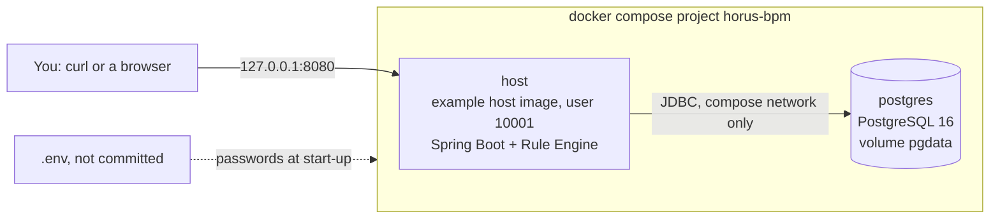

# Deploying with Docker Compose

From a fresh clone, one command builds the example host image and starts it beside PostgreSQL 16. The host is a Spring Boot service that embeds the Rule Engine ([`examples/rule-engine-only`](../examples/rule-engine-only/README.md)). This guide takes you from `git clone` to a priced transaction, with the exact commands and the output to expect.



| Service | Image | Reachable at | Data |
|---|---|---|---|
| `host` | built from [`deploy/docker/Dockerfile`](../deploy/docker/Dockerfile), tagged `horus-bpm/rule-engine-only:local` | `http://127.0.0.1:8080` (this machine only) | none; stateless |
| `postgres` | `postgres:16-alpine`, pinned by digest | the compose network only; no published port | volume `horus-bpm_pgdata` |

## Before you start

| You need | Check |
|---|---|
| Docker Engine 24 or later with Compose v2 | `docker compose version` prints `v2.x` or later |
| git, curl, openssl | `curl --version` |
| Free port 8080 on 127.0.0.1, or another port set in `.env` | `lsof -nP -iTCP:8080 -sTCP:LISTEN` prints nothing |
| Network access on the first build | Maven Central, the npm registry and GitHub (the JRE download) |

The image is `linux/amd64`. Its JRE, Temurin 21.0.13.1, carries the fix for a high-severity Java vulnerability (CVE-2026-114938) and is published for x64 only so far. On Apple silicon, Docker Desktop runs the image under emulation; the host still starts in about 5 seconds.

## 1. Start it

```bash
git clone https://github.com/dhluong90/horus-Agentic-BPM.git
cd horus-Agentic-BPM
cp .env.example .env
sed -i.bak "s/^HORUS_DB_PASSWORD=.*/HORUS_DB_PASSWORD=$(openssl rand -hex 16)/; s/^HORUS_DEMO_PASSWORD=.*/HORUS_DEMO_PASSWORD=$(openssl rand -hex 12)/" .env && rm .env.bak
docker compose up --build --wait
```

The first build downloads dependencies and takes 2 to 5 minutes; later builds reuse the cache. `--wait` returns when both containers report healthy:

```
 Image horus-bpm/rule-engine-only:local Built
 Network horus-bpm_default Created
 Volume horus-bpm_pgdata Created
 Container horus-bpm-postgres-1 Healthy
 Container horus-bpm-host-1 Healthy
```

Every secret comes from `.env`, which git ignores. Without `HORUS_DB_PASSWORD` compose stops before starting anything:

```
error while interpolating services.postgres.environment.POSTGRES_PASSWORD: required variable HORUS_DB_PASSWORD is missing a value: set HORUS_DB_PASSWORD in .env (see .env.example)
```

## 2. Check health

```bash
curl -s 127.0.0.1:8080/actuator/health
```

```
{"groups":["liveness","readiness"],"status":"UP"}
```

`docker compose ps` shows both services `(healthy)`. The image's own health check calls the same endpoint every 10 seconds.

## 3. Sign in

`.env.example` starts the host on the `dev` profile, which turns on demo users with the password in `HORUS_DEMO_PASSWORD`. The `dev` profile is for your own machine only; see [Run without demo users](#run-without-demo-users).

| User | Role | Engine permissions |
|---|---|---|
| `lan` | `PRICING_AUTHOR` | `rules:read`, `rules:author` |
| `minh` | `PRICING_APPROVER` | `rules:read`, `rules:approve` |

Load the passwords into this shell, then sign in as `lan` with the host's form. The session cookie is kept in `./cookies`:

```bash
set -a; . ./.env; set +a
CSRF=$(curl -s -c cookies -b cookies 127.0.0.1:8080/login | sed -n 's/.*name="_csrf" type="hidden" value="\([^"]*\)".*/\1/p')
curl -s -c cookies -b cookies -o /dev/null -w '%{http_code}\n' \
  --data-urlencode "username=lan" --data-urlencode "password=$HORUS_DEMO_PASSWORD" --data-urlencode "_csrf=$CSRF" \
  127.0.0.1:8080/login
curl -s -b cookies 127.0.0.1:8080/api/bpm/me
curl -s -b cookies 127.0.0.1:8080/api/bpm/meta
```

```
302
{"schemaVersion":1,"user":{"id":"lan"},"tenant":{"current":"bank-a","allowed":["bank-a"]},"permissions":["rules:read","rules:author"],"roles":["ROLE_PRICING_AUTHOR"],"groups":[]}
{"schemaVersion":1,"hostId":"rule-engine-only","modules":[{"module":"rules","engineVersion":"0.1.0-SNAPSHOT","apiVersion":"v1","features":[]}],"tenancy":{"switching":false},"limits":{"maxPageSize":200}}
```

Without a caller the engine API answers `401` with a problem document:

```bash
curl -s 127.0.0.1:8080/api/bpm/meta
```

```
{"type":"https://github.com/dhluong90/horus-Agentic-BPM/wiki/Common-Error-Codes#unauthenticated","title":"Authentication required","status":401,"code":"UNAUTHENTICATED","detail":"Sign in, or send a token issued for this host.","instance":"/api/bpm/meta","correlationId":"..."}
```

## 4. Import, approve and evaluate a rule set

> **Availability.** These steps need the rule lifecycle endpoints, which arrive with pull request [#87](https://github.com/dhluong90/horus-Agentic-BPM/pull/87). On a build without them, every call below answers a plain `404` (`{"timestamp":...,"status":404,"error":"Not Found",...}`), and the smoke test reports this step as `SKIP`. The output below was recorded on a build of that pull request with the same Dockerfile and compose file.

That build adds two demo users to the table above: `hoa` (author and approver) and `tuan` (teller, `rules:evaluate`). On the `dev` profile each call can carry Basic credentials instead of the session cookie.

```bash
H=127.0.0.1:8080/api/bpm/rules/v1
P=$HORUS_DEMO_PASSWORD
```

1. Hoa imports the card fee table, `examples/rule-engine-only/src/main/resources/rules/card-fee.yaml` on that build. It is stored as a draft:

   ```bash
   curl -s -u hoa:$P -X POST $H/rule-sets -H 'Content-Type: application/yaml' \
     -H 'Idempotency-Key: deploy-guide-1' \
     --data-binary @examples/rule-engine-only/src/main/resources/rules/card-fee.yaml
   ```

   ```
   201 {"ruleSet":"card-fee","version":1,"status":"DRAFT",...}
   ```

2. Hoa requests publication:

   ```bash
   curl -s -u hoa:$P -X POST $H/rule-sets/card-fee/versions/1:request-publish
   ```

   ```
   200 {...,"status":"PENDING_APPROVAL",...}
   ```

3. Hoa tries to approve her own request and is refused (maker-checker):

   ```bash
   curl -s -u hoa:$P -X POST $H/rule-sets/card-fee/versions/1:approve
   ```

   ```
   403 {...,"code":"SELF_APPROVAL_FORBIDDEN",...}
   ```

4. Minh approves. The version is published:

   ```bash
   curl -s -u minh:$P -X POST $H/rule-sets/card-fee/versions/1:approve \
     -H 'Content-Type: application/json' -d '{"comment":"Fees checked against the tariff"}'
   ```

   ```
   200 {...,"status":"PUBLISHED",...}
   ```

5. Tuan prices a Gold customer's card. Rule `R1` matches and the fee is 0 VND:

   ```bash
   curl -s -u tuan:$P -X POST $H/decisions/card-fee:evaluate \
     -H 'Content-Type: application/json' -d '{"inputs":{"tier":"GOLD","txCount":5}}'
   ```

   ```
   {"decisionId":"01M7S19X1M86EFT4YCY3GZ8FGF","ruleSet":"card-fee","version":1,"evaluatedAt":"2026-11-19T04:33:41.940342918Z","outcome":"MATCHED","matchedRuleIds":["R1"],"outputs":{"fee":{"currency":"VND","amount":0}}}
   ```

6. The decision is in the log:

   ```bash
   docker compose exec -T postgres psql -U horus -d horus \
     -c 'SELECT rule_set_name, version_num, outcome, matched_rule_ids, outputs, caller_id FROM rle_decision'
   ```

   ```
    rule_set_name | version_num | outcome | matched_rule_ids |                  outputs                  | caller_id
   ---------------+-------------+---------+------------------+-------------------------------------------+-----------
    card-fee      |           1 | OK      | ["R1"]           | {"fee": {"amount": 0, "currency": "VND"}} | tuan
   (1 row)
   ```

## 5. Run the smoke test

[`deploy/smoke-test.sh`](../deploy/smoke-test.sh) runs steps 2 to 4 and exits non-zero on the first failure. CI runs it on every pull request that changes the deployment files.

```bash
deploy/smoke-test.sh
```

On a build without the rule lifecycle endpoints:

```
PASS  health: {"groups":["liveness","readiness"],"status":"UP"}
PASS  anonymous GET /api/bpm/meta: 401 "code":"UNAUTHENTICATED"
PASS  GET /api/bpm/meta as lan: 200 {"schemaVersion":1,"hostId":"rule-engine-only",...}
SKIP  rule lifecycle: this host has no rule lifecycle endpoints yet (probe answered a plain 404)
Smoke test passed (rule lifecycle skipped).
```

On a build with them:

```
PASS  health: {"groups":["liveness","readiness"],"status":"UP"}
PASS  anonymous GET /api/bpm/meta: 401 "code":"UNAUTHENTICATED"
PASS  GET /api/bpm/meta as lan: 200 {"schemaVersion":1,"hostId":"rule-engine-only",...}
PASS  import card-fee as hoa: 201 "status":"DRAFT"
PASS  request publication as hoa: 200 "status":"PENDING_APPROVAL"
PASS  self-approval as hoa refused: 403 "code":"SELF_APPROVAL_FORBIDDEN"
PASS  approve as minh: 200 "status":"PUBLISHED"
PASS  evaluate card-fee as tuan: 200 {"decisionId":"...","outcome":"MATCHED","matchedRuleIds":["R1"],"outputs":{"fee":{"currency":"VND","amount":0}}}
Smoke test passed.
```

Run again on the same database, the test finds `card-fee` already published and only evaluates.

## 6. Check the image before you ship it

[`deploy/scan-image.sh`](../deploy/scan-image.sh) applies the release gates to the built image: no secret in any layer or in the image configuration, and no high or critical vulnerability (Grype, with the repository's [`.grype.yaml`](../.grype.yaml)).

```bash
deploy/scan-image.sh horus-bpm/rule-engine-only:local
```

```
PASS  no secrets in the image layers or config (1031 files checked)
NAME           INSTALLED   TYPE  VULNERABILITY   SEVERITY  EPSS         RISK
busybox        1.37.0-r31  apk   CVE-2025-60876  Medium    0.3% (24th)  0.2
busybox-binsh  1.37.0-r31  apk   CVE-2025-60876  Medium    0.3% (24th)  0.2
PASS  no high or critical vulnerability in horus-bpm/rule-engine-only:local (report: target/grype-image-horus-bpm_rule-engine-only_local.json)
```

## What the image contains

| Property | Value |
|---|---|
| Stages | Cockpit bundle (Node 22, only when the checkout has `cockpit/web`), Maven build (JDK 21), runtime file system, runtime image |
| Runtime | Alpine 3.24 reduced to musl and busybox (no package manager, no OpenSSL), Temurin JRE 21.0.13.1 checked against its published SHA-256 |
| User | `horus`, uid and gid 10001; the container runs with a read-only root file system, `/tmp` in memory, all capabilities dropped |
| Health check | `wget` on `http://127.0.0.1:$PORT/actuator/health` every 10 seconds, after a 60-second start period |
| Layers | one base layer, then the Spring Boot layers: dependencies, loader, snapshot dependencies, application |
| Secrets | none; `.dockerignore` keeps `.env`, keys and build output out of the build context |
| Size | about 82 MB |

Base images are pinned by digest. To update one, resolve the new digest, replace tag, digest and version comment together in [`deploy/docker/Dockerfile`](../deploy/docker/Dockerfile) or [`docker-compose.yml`](../docker-compose.yml), then rebuild and run steps 5 and 6. The JRE release, its file version and its SHA-256 (from the `.sha256.txt` file beside the archive on the Adoptium release page) change together.

## Configuration

All values live in `.env` ([`.env.example`](../.env.example) documents each one).

| Variable | Default | Meaning |
|---|---|---|
| `HORUS_DB_PASSWORD` | none, required | Password of the PostgreSQL user `horus`. PostgreSQL keeps the value from its first start; to change it, reset (below) |
| `SPRING_PROFILES_ACTIVE` | `dev` in `.env.example` | `dev` turns on the demo users. Empty: no demo users |
| `HORUS_DEMO_PASSWORD` | none | Password of the demo users on the `dev` profile. Empty: nobody can sign in |
| `HORUS_EXAMPLE` | `rule-engine-only` | Example host to build, a folder under `examples/` |
| `HORUS_HTTP_PORT` | `8080` | Port on 127.0.0.1 that serves the host |

The same image runs everywhere: configuration reaches it only through environment variables. The variables the host itself reads are listed in the [example host README](../examples/rule-engine-only/README.md#environment-variables).

### Run without demo users

Outside your own machine, leave `SPRING_PROFILES_ACTIVE` empty and let the host accept bearer tokens from your identity provider. Put the issuer and the audience in `docker-compose.override.yml` (git does not track it; compose reads it automatically):

```yaml
services:
  host:
    environment:
      SPRING_SECURITY_OAUTH2_RESOURCESERVER_JWT_ISSUER_URI: https://idp.example.com/realms/bank
      SPRING_SECURITY_OAUTH2_RESOURCESERVER_JWT_AUDIENCES: rule-engine-only
```

The host refuses to start with an issuer and no audience, and refuses the `dev` profile with an issuer that is not on this machine.

## Day-to-day commands

| Task | Command |
|---|---|
| Follow the host log | `docker compose logs -f host` |
| Stop, keep the data | `docker compose down` |
| Reset: stop and delete the database | `docker compose down -v` |
| Rebuild after a code change | `docker compose up --build --wait` |
| Run another example host | set `HORUS_EXAMPLE=<folder>` in `.env`, then `docker compose up --build --wait` |
| Open a SQL prompt | `docker compose exec postgres psql -U horus -d horus` |

## Troubleshooting

| Symptom | Cause | Fix |
|---|---|---|
| `required variable HORUS_DB_PASSWORD is missing a value` | No `.env`, or the value is empty | Step 1 |
| `Bind for 127.0.0.1:8080 failed: port is already allocated` | Another process uses 8080 | Set `HORUS_HTTP_PORT=18080` in `.env` and use that port in the commands |
| Host restarts; log shows `password authentication failed for user "horus"` | `HORUS_DB_PASSWORD` changed after the database was created | `docker compose down -v`, then start again |
| Sign-in redirects to `/login?error` | Wrong demo password, or the host is not on the `dev` profile | `grep -E 'SPRING_PROFILES_ACTIVE|HORUS_DEMO_PASSWORD' .env` |
| `No patched Temurin JRE for arm64 yet` during the build | The build was asked for `linux/arm64` | Build through compose, or add `--platform linux/amd64` to `docker build` |
| `docker compose up --wait` reports `host` unhealthy | The host did not start | `docker compose logs host` shows the reason, usually the database or a configuration check |
