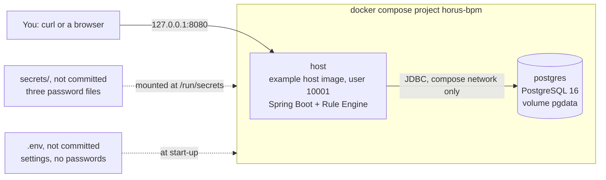

# Deploying with Docker Compose

> **Local evaluation, not production.** This compose file runs the example host on your own machine so you can try the engines. It is not a production deployment. Compared with one:
>
> - demo users share one password and may sign in with HTTP Basic, and `hoa` may both author and approve;
> - traffic is plain HTTP on 127.0.0.1, with no TLS;
> - the host connects as the database owner, which also runs the migrations (a role without superuser rights);
> - there is one instance of each service, and no backups.
>
> For anything shared, start from [Run without demo users](#run-without-demo-users). The host logs a `WARN` at start-up while demo users are on.

From a fresh clone, one command builds the example host image and starts it beside PostgreSQL 16. The host is a Spring Boot service that embeds the Rule Engine and the cockpit ([`examples/rule-engine-only`](../examples/rule-engine-only/README.md)). This guide takes you from `git clone` to a priced transaction, with the exact commands and the output to expect.



| Service | Image | Reachable at | Data |
|---|---|---|---|
| `host` | built from [`deploy/docker/Dockerfile`](../deploy/docker/Dockerfile), tagged `horus-bpm/rule-engine-only:local` | `http://127.0.0.1:8080` (this machine only) | none; stateless |
| `postgres` | `postgres:16-alpine`, pinned by digest | the compose network only; no published port | volume `horus-bpm_pgdata` |

## Before you start

| You need | Check |
|---|---|
| Docker Engine 24 or later with Compose v2 | `docker compose version` prints `v2.x` or later |
| git, curl, openssl | `curl --version`, `openssl version` |
| Free port 8080 on 127.0.0.1, or another port set in `.env` | `lsof -nP -iTCP:8080 -sTCP:LISTEN` prints nothing |
| Network access on the first build | Maven Central, the npm registry and GitHub (the JRE download) |

The image is `linux/amd64`. Its JRE, Temurin 21.0.13.1, carries the fix for a high-severity Java vulnerability (CVE-2026-114938) and is published for x64 only so far. On Apple silicon, Docker Desktop runs the image under emulation; the host still starts in about 5 seconds.

## 1. Start it

```bash
git clone https://github.com/dhluong90/horus-Agentic-BPM.git
cd horus-Agentic-BPM
cp .env.example .env
deploy/create-secrets.sh
docker compose up --build --wait
```

`deploy/create-secrets.sh` writes three random passwords, one file each, and never prints them:

```
created  /home/you/horus-Agentic-BPM/secrets/db_admin_password
created  /home/you/horus-Agentic-BPM/secrets/db_password
created  /home/you/horus-Agentic-BPM/secrets/demo_password
```

The first build downloads dependencies and takes 2 to 5 minutes; later builds reuse the cache. `--wait` returns when both containers report healthy:

```
 Image horus-bpm/rule-engine-only:local Built
 Network horus-bpm_default Created
 Volume horus-bpm_pgdata Created
 Container horus-bpm-postgres-1 Healthy
 Container horus-bpm-host-1 Healthy
```

The passwords reach the containers only as files mounted under `/run/secrets`, never as environment variables, so `docker inspect` and `/proc/1/environ` show none of them. `.env` holds settings only. git and the image build context ignore both `.env` and `secrets/`. When a secret file is missing, compose stops before any container starts and names the file:

```
 Container horus-bpm-postgres-1 Creating
level=warning msg="secret file horus-bpm_db_password does not exist"
Error response from daemon: invalid mount config for type "bind": bind source path does not exist: /home/you/horus-Agentic-BPM/secrets/db_password
```

Run `deploy/create-secrets.sh` and start again.

The host log names the demo users and warns that they are for local evaluation only:

```bash
docker compose logs host | grep 'Demo users'
```

```
host-1  | 2026-11-19T05:44:29.253Z  WARN 1 --- [rule-engine-only] [           main] c.h.b.e.r.HostSecurityConfiguration      : Demo users are on (dev profile): [lan, minh, hoa, tuan] share one password and may sign in with HTTP Basic. Local evaluation only, never a shared or production environment.
```

## 2. Check health

```bash
curl -s 127.0.0.1:8080/actuator/health
```

```
{"groups":["liveness","readiness"],"status":"UP"}
```

`docker compose ps` shows both services `(healthy)`. The image's own health check calls the same endpoint every 10 seconds.

## 3. Sign in

`.env.example` starts the host on the `dev` profile, which turns on demo users with the password in `secrets/demo_password`. The `dev` profile is for your own machine only; see [Run without demo users](#run-without-demo-users).

| User | Role | Engine permissions |
|---|---|---|
| `lan` | `PRICING_AUTHOR` | `rules:read`, `rules:author` |
| `minh` | `PRICING_APPROVER` | `rules:read`, `rules:approve` |
| `hoa` | `PRICING_AUTHOR`, `PRICING_APPROVER` | `rules:read`, `rules:author`, `rules:approve` |
| `tuan` | `TELLER` | `rules:evaluate` |

Read the demo password from its secret file into this shell and write one curl config file per demo user, so no password appears on a command line (where `ps` would show it). `printf` is a shell builtin, so it does not show either. Then sign in as `lan` with the host's form. The session cookie is kept in `./cookies`:

```bash
HORUS_DEMO_PASSWORD=$(cat secrets/demo_password)
C=$(mktemp -d); chmod 700 "$C"
for u in lan minh hoa tuan; do printf 'user = "%s:%s"\n' "$u" "$HORUS_DEMO_PASSWORD" > "$C/$u"; done
printf 'data-urlencode = "password=%s"\n' "$HORUS_DEMO_PASSWORD" > "$C/form"
CSRF=$(curl -s -c cookies -b cookies 127.0.0.1:8080/login | sed -n 's/.*name="_csrf" type="hidden" value="\([^"]*\)".*/\1/p')
curl -s -c cookies -b cookies -o /dev/null -w '%{http_code}\n' -K "$C/form" \
  --data-urlencode "username=lan" --data-urlencode "_csrf=$CSRF" 127.0.0.1:8080/login
curl -s -b cookies 127.0.0.1:8080/api/bpm/me
curl -s -b cookies 127.0.0.1:8080/api/bpm/meta
```

```
302
{"schemaVersion":1,"user":{"id":"lan"},"tenant":{"current":"bank-a","allowed":["bank-a"]},"permissions":["rules:read","rules:author"],"roles":["ROLE_PRICING_AUTHOR"],"groups":[]}
{"schemaVersion":1,"hostId":"rule-engine-only","modules":[{"module":"rules","engineVersion":"0.1.0-SNAPSHOT","apiVersion":"v1","features":[]}],"tenancy":{"switching":false},"limits":{"maxPageSize":200}}
```

Without a caller the engine API answers `401` with a problem document:

```bash
curl -s 127.0.0.1:8080/api/bpm/meta
```

```
{"type":"https://github.com/dhluong90/horus-Agentic-BPM/wiki/Common-Error-Codes#unauthenticated","title":"Authentication required","status":401,"code":"UNAUTHENTICATED","detail":"Sign in, or send a token issued for this host.","instance":"/api/bpm/meta","correlationId":"..."}
```

## 4. Import, approve and evaluate a rule set

On the `dev` profile each call can carry Basic credentials instead of the session cookie. The next steps read them from the config files of step 3 with `-K "$C/<user>"`.

```bash
H=127.0.0.1:8080/api/bpm/rules/v1
```

1. Hoa imports the card fee table, [`card-fee.yaml`](../examples/rule-engine-only/src/main/resources/rules/card-fee.yaml). It is stored as a draft:

   ```bash
   curl -s -K "$C/hoa" -X POST $H/rule-sets -H 'Content-Type: application/yaml' \
     -H 'Idempotency-Key: deploy-guide-1' \
     --data-binary @examples/rule-engine-only/src/main/resources/rules/card-fee.yaml
   ```

   ```
   201 {"ruleSet":"card-fee","version":1,"status":"DRAFT",...}
   ```

2. Hoa requests publication:

   ```bash
   curl -s -K "$C/hoa" -X POST $H/rule-sets/card-fee/versions/1:request-publish
   ```

   ```
   200 {...,"status":"PENDING_APPROVAL",...}
   ```

3. Hoa tries to approve her own request and is refused (maker-checker):

   ```bash
   curl -s -K "$C/hoa" -X POST $H/rule-sets/card-fee/versions/1:approve
   ```

   ```
   403 {...,"code":"SELF_APPROVAL_FORBIDDEN",...}
   ```

4. Minh approves. The version is published:

   ```bash
   curl -s -K "$C/minh" -X POST $H/rule-sets/card-fee/versions/1:approve \
     -H 'Content-Type: application/json' -d '{"comment":"Fees checked against the tariff"}'
   ```

   ```
   200 {...,"status":"PUBLISHED",...}
   ```

5. Tuan prices a Gold customer's card. Rule `R1` matches and the fee is 0 VND:

   ```bash
   curl -s -K "$C/tuan" -X POST $H/decisions/card-fee:evaluate \
     -H 'Content-Type: application/json' -d '{"inputs":{"tier":"GOLD","txCount":5}}'
   ```

   ```
   {"decisionId":"01M7S19X1M86EFT4YCY3GZ8FGF","ruleSet":"card-fee","version":1,"evaluatedAt":"2026-11-19T04:33:41.940342918Z","outcome":"MATCHED","matchedRuleIds":["R1"],"outputs":{"fee":{"currency":"VND","amount":0}}}
   ```

6. The decision is in the log:

   ```bash
   docker compose exec -T postgres psql -U horus -d horus \
     -c 'SELECT rule_set_name, version_num, outcome, matched_rule_ids, outputs, caller_id FROM rle_decision'
   ```

   ```
    rule_set_name | version_num | outcome | matched_rule_ids |                  outputs                  | caller_id
   ---------------+-------------+---------+------------------+-------------------------------------------+-----------
    card-fee      |           1 | OK      | ["R1"]           | {"fee": {"amount": 0, "currency": "VND"}} | tuan
   (1 row)
   ```

## 5. Open the cockpit

The image carries the cockpit when the checkout has `cockpit/web`: the build compiles it with Node 22 and packages it into the cockpit starter. Open <http://127.0.0.1:8080/bpm/cockpit/> in a browser and sign in as `lan`, `minh`, `hoa` or `tuan`. From the shell, with the session from step 3:

```bash
curl -s -b cookies -o /dev/null -w '%{http_code} %{content_type}\n' 127.0.0.1:8080/bpm/cockpit/
```

```
200 text/html;charset=UTF-8
```

## 6. Run the smoke test

[`deploy/smoke-test.sh`](../deploy/smoke-test.sh) runs steps 2 to 5 and exits non-zero on the first failure. CI runs it on every pull request that changes the deployment files. On a host built from an older commit without the rule lifecycle endpoints or the cockpit, the test reports those steps as `SKIP` instead of failing.

```bash
deploy/smoke-test.sh
```

```
PASS  health: {"groups":["liveness","readiness"],"status":"UP"}
PASS  anonymous GET /api/bpm/meta: 401 "code":"UNAUTHENTICATED"
PASS  GET /api/bpm/meta as lan: 200 {"schemaVersion":1,"hostId":"rule-engine-only",...}
PASS  import card-fee as hoa: 201 "status":"DRAFT"
PASS  request publication as hoa: 200 "status":"PENDING_APPROVAL"
PASS  self-approval as hoa refused: 403 "code":"SELF_APPROVAL_FORBIDDEN"
PASS  approve as minh: 200 "status":"PUBLISHED"
PASS  evaluate card-fee as tuan: 200 {"decisionId":"...","outcome":"MATCHED","matchedRuleIds":["R1"],"outputs":{"fee":{"currency":"VND","amount":0}}}
PASS  cockpit as lan: 200 <title>HORUS Cockpit</title>
Smoke test passed.
```

Run again on the same database, the test finds `card-fee` already published and only evaluates.

## 7. Check the image

[`deploy/scan-image.sh`](../deploy/scan-image.sh) applies the release gates to the built image: no secret in any layer or in the image configuration (it searches for the values in `secrets/`), and no high or critical vulnerability (Grype, with the repository's [`.grype.yaml`](../.grype.yaml)).

The secrets gate reads every layer, including files a later layer deletes, and unpacks every jar (and the jars nested in it), so a value inside a compressed jar entry is found too. It fails on:

- a key or keystore file by name (`.env`, `*.pem`, `*.key`, `*.p8`, `*.p12`, `*.pfx`, `*.jks`, `*.keystore`, `*.truststore`, `*.bcfks`, `cacerts`, `id_rsa` and the other SSH key names, in any letter case), in a layer or inside a jar. The only exception is an exact path: the JRE's public CA store `opt/java/openjdk/lib/security/cacerts`. The Alpine signing keys end in `.rsa.pub`, are public, and are not matched;
- a secret-like variable in the image configuration;
- the value of `HORUS_DB_ADMIN_PASSWORD`, `HORUS_DB_PASSWORD` or `HORUS_DEMO_PASSWORD` anywhere in the image. Each value is taken from the environment, else from its file in `secrets/`, else from `.env` if that file exists.

[`deploy/scan-image-canaries.sh`](../deploy/scan-image-canaries.sh) proves the gate on every Deploy run: it plants a `.pem` under `/usr/local/share` and a random value in a deflated entry of a jar in `BOOT-INF/lib`. Both must fail, the jar again when the value is read only from a secret file, while the image itself passes:

```bash
deploy/scan-image-canaries.sh horus-bpm/rule-engine-only:local
```

```
PASS  canary 1: a .pem under /usr/local/share fails the gate: usr/local/share/canary/canary.pem
PASS  canary 2: a value inside a deflated jar entry in BOOT-INF/lib fails the gate (not visible in the raw bytes)
PASS  canary 3: the same value read from a secret file (secrets/demo_password) fails the gate
PASS  the image horus-bpm/rule-engine-only:local passes: PASS  no secrets in the image layers, jars or config (...)
```

Both scripts need `unzip`; the canaries also need `zip`.

```bash
deploy/scan-image.sh horus-bpm/rule-engine-only:local
```

```
PASS  no secrets in the image layers, jars or config (... files and jar entries checked, ... jars unpacked, 3 password values searched)
NAME           INSTALLED   TYPE  VULNERABILITY   SEVERITY  EPSS         RISK
busybox        1.37.0-r31  apk   CVE-2025-60876  Medium    0.3% (24th)  0.2
busybox-binsh  1.37.0-r31  apk   CVE-2025-60876  Medium    0.3% (24th)  0.2
PASS  no high or critical vulnerability in horus-bpm/rule-engine-only:local (report: target/grype-image-horus-bpm_rule-engine-only_local.json)
```

## What the image contains

| Property | Value |
|---|---|
| Stages | Cockpit bundle (Node 22, skipped when the checkout has no `cockpit/web`), Maven build (JDK 21), runtime file system, runtime image |
| Runtime | Alpine 3.24 reduced to musl and busybox (no package manager, no OpenSSL), Temurin JRE 21.0.13.1 checked against the Adoptium GPG signature and a pinned SHA-256 |
| User | `horus`, uid and gid 10001; the container runs with a read-only root file system, `/tmp` in memory (64 MB, `noexec`, `nosuid`, `nodev`), all capabilities dropped, at most 512 processes |
| Health check | `wget` on `http://127.0.0.1:$PORT/actuator/health` every 10 seconds, after a 60-second start period |
| Layers | one base layer, then the Spring Boot layers: dependencies, loader, snapshot dependencies, application |
| Secrets | none; `.dockerignore` keeps `.env`, `secrets/`, keys and build output out of the build context |
| Size | about 82 MB |

Base images are pinned by digest. To update one, resolve the new digest, replace tag, digest and version comment together in [`deploy/docker/Dockerfile`](../deploy/docker/Dockerfile) or [`docker-compose.yml`](../docker-compose.yml), then rebuild and run steps 6 and 7.

### Updating the JRE

The build checks the JRE archive twice in a throwaway stage, so `gnupg` never reaches the runtime image:

1. **Provenance.** It verifies the archive's detached GPG signature (`.tar.gz.sig`, published beside the archive) against the Adoptium public key committed as [`deploy/docker/adoptium.asc`](../deploy/docker/adoptium.asc). The key's primary fingerprint must be `3B04D753C9050D9A5D343F39843C48A565F8F04B`, and the signature must be made by that key; the build stops otherwise.
2. **Integrity.** It checks the SHA-256 pinned in the Dockerfile.

To move to a new JRE release:

1. Set `JRE_RELEASE`, `JRE_FILE_VERSION` and the SHA-256 from the `.sha256.txt` beside the new archive on the [Adoptium release page](https://github.com/adoptium/temurin21-binaries/releases).
2. Build. The log must show both checks:

   ```
   GPG signature OK: signed by 3B04D753C9050D9A5D343F39843C48A565F8F04B
   /tmp/jre.tar.gz: OK
   ```

3. If Adoptium rotates its key, replace `adoptium.asc` and `ADOPTIUM_KEY_FINGERPRINT` only after checking the new fingerprint against the signing key that Adoptium publishes on adoptium.net, in the same pull request as the version bump.
4. Run steps 6 and 7.

## Configuration

Settings live in `.env` ([`.env.example`](../.env.example) documents each one); passwords live in `secrets/`.

| Variable in `.env` | Default | Meaning |
|---|---|---|
| `SPRING_PROFILES_ACTIVE` | `dev` in `.env.example` | `dev` turns on the demo users. Empty: no demo users |
| `HORUS_EXAMPLE` | `rule-engine-only` | Example host to build, a folder under `examples/` |
| `HORUS_HTTP_PORT` | `8080` | Port on 127.0.0.1 that serves the host |

| File in `secrets/` | Mounted in | Meaning |
|---|---|---|
| `db_admin_password` | `postgres` at `/run/secrets/db_admin_password` (`POSTGRES_PASSWORD_FILE`) | Password of the PostgreSQL superuser `postgres`, used only to create the database on the first start. The host never receives it |
| `db_password` | `postgres` at `/run/secrets/db_password`, read once by the init script; `host` at `/run/secrets/HORUS_DB_PASSWORD` | Password of `horus`, the role the host connects with. PostgreSQL keeps both database passwords from its first start; to change one, reset (below) |
| `demo_password` | `host` at `/run/secrets/HORUS_DEMO_PASSWORD` | Password of the demo users on the `dev` profile |

The host reads its two files through Spring Boot's config tree import (`SPRING_CONFIG_IMPORT=configtree:/run/secrets/`): each file becomes a property named after it, so the host's `${HORUS_DB_PASSWORD}` and `${HORUS_DEMO_PASSWORD}` resolve from the files. Nothing in the image changes: the same image runs everywhere, configured through environment variables and mounted files.

To bring your own values instead of random ones, write each file before the first start, with no trailing newline, and keep the directory private:

```bash
mkdir -p secrets && chmod 700 secrets
printf '%s' 'your-admin-password' > secrets/db_admin_password
printf '%s' 'your-app-password' > secrets/db_password
printf '%s' 'your-demo-password' > secrets/demo_password
chmod 644 secrets/*
```

The files are `0644` because compose bind-mounts them as they are and the container users (`postgres`, uid 70, and `horus`, uid 10001) must read them; the `0700` directory keeps other users of your machine out. A database created before secret files existed keeps its old passwords: write those into the files, or reset.

### Database roles

On its first start PostgreSQL runs [`deploy/postgres/initdb/10-application-role.sh`](../deploy/postgres/initdb/10-application-role.sh). It creates `horus`, which owns the database `horus` and its `public` schema, and is not a superuser: it cannot create roles or databases, read server files or run programs. The host connects as `horus`, and the host's and the engines' Flyway migrations run as that owner at start-up.

Beyond a local walkthrough, run the migrations as the schema owner in a separate step, and run the application with a second role that has only data rights (`SELECT`, `INSERT`, `UPDATE`, `DELETE` on the tables, `USAGE` on the sequences). Set `horus.bpm.rules.migrate-on-start=false` in the application ([configuration](../examples/rule-engine-only/README.md#rule-engine-properties)). The schema belongs to the host. The variables the host itself reads are listed in the [example host README](../examples/rule-engine-only/README.md#environment-variables).

### Run without demo users

Outside your own machine, leave `SPRING_PROFILES_ACTIVE` empty and let the host accept bearer tokens from your identity provider. Put the issuer and the audience in `docker-compose.override.yml` (git does not track it; compose reads it automatically):

```yaml
services:
  host:
    environment:
      SPRING_SECURITY_OAUTH2_RESOURCESERVER_JWT_ISSUER_URI: https://idp.example.com/realms/bank
      SPRING_SECURITY_OAUTH2_RESOURCESERVER_JWT_AUDIENCES: rule-engine-only
```

The host refuses to start with an issuer and no audience, and refuses the `dev` profile with an issuer that is not on this machine.

## Day-to-day commands

| Task | Command |
|---|---|
| Follow the host log | `docker compose logs -f host` |
| Stop, keep the data | `docker compose down` |
| Reset: stop and delete the database | `docker compose down -v` |
| Rebuild after a code change | `docker compose up --build --wait` |
| Run another example host | set `HORUS_EXAMPLE=<folder>` in `.env`, then `docker compose up --build --wait` |
| Open a SQL prompt | `docker compose exec postgres psql -U horus -d horus` |

## Troubleshooting

| Symptom | Cause | Fix |
|---|---|---|
| `bind source path does not exist: .../secrets/db_password` | The secret files were not created | `deploy/create-secrets.sh`, then start again |
| `Bind for 127.0.0.1:8080 failed: port is already allocated` | Another process uses 8080 | Set `HORUS_HTTP_PORT=18080` in `.env` and use that port in the commands |
| Host restarts; log shows `password authentication failed for user "horus"` | A database password changed after the database was created, or the volume is from a version of this guide before the `horus` role or the secret files existed | Write the old password into `secrets/db_password`, or `docker compose down -v` and start again |
| Sign-in redirects to `/login?error` | Wrong demo password, or the host is not on the `dev` profile | `grep SPRING_PROFILES_ACTIVE .env`; the password is in `secrets/demo_password` |
| `No patched Temurin JRE for arm64 yet` during the build | The build was asked for `linux/arm64` | Build through compose, or add `--platform linux/amd64` to `docker build` |
| `docker compose up --wait` reports `host` unhealthy | The host did not start | `docker compose logs host` shows the reason, usually the database or a configuration check |
