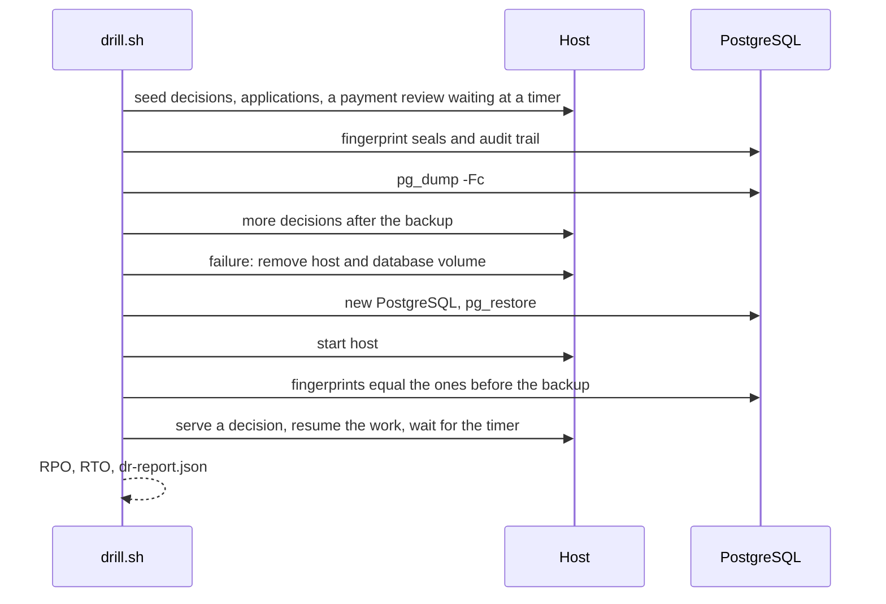

# Backup, restore and disaster recovery

The engines keep all their state in your PostgreSQL database and nowhere else: no files, no queue, no cache that matters. A backup of the database is a backup of the engines. They have no recovery point or recovery time of their own; they inherit those of your database, and after a restore they need no engine-specific step.

| You own | The engines do |
|---|---|
| Backups, point-in-time recovery, replication, retention | Start against a restored database with no extra step and add at most a few seconds to start-up |
| Reconciling side effects after a restore | Reclaim jobs and leases left from before the restore by themselves |
| Idempotent adapters (keyed by `attemptId`) and event consumers that tolerate events for state the restore removed | Re-run a step whose result was lost, with the same `attemptId` |

## Run the drill

The drill proves the claim above on the compose stack, with the `rule-and-process` example host.

```bash
deploy/dr/drill.sh
```

It needs Docker Compose, Python 3 and OpenSSL, and takes about 6 minutes the first time (the image build) and about 2 minutes after. It uses its own compose project, `horus-dr`, on port 18080, so it does not touch a stack you run for yourself, and it removes what it created. `DR_NO_BUILD=1` reuses an existing image.



What it checks after the restore, each of which fails the drill:

| Check | How |
|---|---|
| Seals verify | The five approval seals read from `rle_version` are byte for byte those from before the backup, and the restored host serves `card-fee` from a cold cache, which verifies the seal on load |
| Audit trail intact | The count and a digest of every row of `rle_version_history` and `pre_history` equal the values before the backup |
| In-flight instances resume | The 5 running instances are there; one waiting at a user task is completed and moves on |
| Timers fire | A payment review that waited at its timer when the backup was taken completes after the restore (the dev profile sets that timer to one minute) |
| Decisions are served | `card-fee` evaluates over HTTP |

The result is written to `dr-report.json` (`DR_REPORT` sets the path). The `DR drill` workflow runs it every night and on demand and attaches the report; `.github/workflows/dr-drill.yml`.

## What was measured

Two drills on a laptop (Docker Desktop, PostgreSQL 16, a database of about 230 KB dumped), 28 November 2026, backup with `pg_dump -Fc` taken 10 seconds before the failure:

| | Drill 1 | Drill 2 |
|---|---|---|
| Recovery point (failure minus the last decision that survived) | not recorded (the report step had a bug, fixed before drill 2) | 11.6 s; 5 decisions written after the backup were lost, as designed |
| Fresh PostgreSQL up | 5.8 s | 5.7 s |
| `pg_restore` | 0.3 s | 0.3 s |
| Host start until healthy | 6.2 s | 6.2 s |
| First decision served after the failure (recovery time) | not recorded | 14.6 s |
| Timer fired after the first decision | 34.0 s | 33.8 s |
| Seals, audit trail, in-flight instances | all match | all match |

Read these numbers as follows.

- **RPO** is the time since the last backup that survived, not a property of the engines. With a nightly `pg_dump` it is up to 24 hours. The drill shows the loss is exactly the work after the backup and nothing else.
- **RTO** is dominated by how long your database takes to restore. The drill database is tiny, so restore is 0.3 s; the engines' own part (host start) is 6.2 s. Measure the restore of your own data volume: run `pg_restore` of a production-size dump on your hardware and add about 10 seconds for host start and the first decision.
- The timer fires about 34 s after the first decision because it was due a minute after it was set, and the restore was quick. A timer that came due while the database was down fires on the first scan after the restore.

## Choose a backup method

| Method | Recovery point | Use when |
|---|---|---|
| `pg_dump -Fc` (the drill) | Time since the last dump | Evaluation, small databases, a nightly safety net, moving data between environments |
| Base backup plus WAL archiving (`pg_basebackup`, `archive_command`) | Seconds, and any point in time with `recovery_target_time` | Production. The right choice when losing a minute of decisions or process steps is not acceptable |
| A managed database's own snapshots and point-in-time restore | As the provider states | Production on a managed service |

For WAL archiving, set `wal_level = replica`, `archive_mode = on` and an `archive_command` that copies each segment to storage outside the database host. Take a base backup with `pg_basebackup -D <dir> -Ft -z -X none` on a schedule. To recover, unpack the base backup into an empty data directory, set `restore_command` and `recovery_target_time` in `postgresql.conf`, create `recovery.signal` and start PostgreSQL. Then run the checks below. Repeat the drill with this method on your own infrastructure before go-live: the scripted drill uses `pg_dump` because it needs no infrastructure beyond the compose stack.

## After a restore

1. Start one host and wait for `/actuator/health` to report `UP`. The engines run their schema check; no migration is needed when the restored schema matches the image.
2. Evaluate one decision per rule set you use. A refusal that names an integrity check means a seal does not match: stop and restore from an earlier backup.
3. Compare the open instances and incidents in the cockpit with what you expect from the time of the restore.
4. Reconcile side effects. Calls your adapters made after the restore point left no trace in the database: an adapter that is idempotent by `attemptId` is safe to re-run. Consumers of the events the engines published must tolerate an event for state the restore removed.
5. Start the other replicas.

The meters and alerts of the observability pack show jobs left over from before the restore as an old `horus.pre.jobs.due.oldest.age` that falls back to 0 within a minute.
