# ADR-0024: Configuration and extension points over built-in business logic

- Status: accepted, 2026-11-19
- Date: 2026-11-19
- Deciders: maintainers; direction set by the product owner on 2026-11-19 ("generic by design")
- Module: project

## Context
The engines are reused by many teams in many business contexts: lending, payments, onboarding, insurance, internal approvals, in banks of different sizes and jurisdictions. A behaviour written into the engine for one context becomes a constraint for every other, and the adopter's only way out is a fork, which ends upgrades and security fixes for that adopter. Earlier designs fixed some business values in the engine: a reason length, a sweep interval, batch and query ceilings, a token clean-up age, a tenant claim name, an English-only explanation, an adapter thread count. Other values were already properties (`cache.max-entries`, `jobs.lease-margin`, `definitions.max-nodes`). There was no rule saying which kind a new behaviour must be.

## Decision
1. **Optional and configurable.** Every business behaviour that an adopter may reasonably vary is a typed property with a safe default, an SPI with an engine default, a rule set or a process definition. Use cases are opt-in: a feature an adopter does not configure stays off or uses its documented default.
2. **Extension points.** An SPI is an interface in the engine's `spi` package with a Javadoc contract (thread safety, transaction, error codes). The starter registers the engine default with `@ConditionalOnMissingBean`, so a host bean of the same type replaces it without excluding auto-configuration. Hooks are of two kinds only: veto-only guards before a transition (`LifecycleGuard`), which may refuse with a code but never skip a built-in check; and events after each state change through the host's publisher.
3. **Typed configuration.** Properties live under `horus.bpm.rules.*` and `horus.bpm.processes.*` (shared ones under `horus.bpm.*`), bound to `@ConfigurationProperties` records with Bean Validation. An invalid value fails start-up naming the property. Every property has a description and a default in the Spring configuration metadata (`TR-DOC-03`). Limits that protect the host database (sizes, page sizes, ranges, batches) may be lowered, never raised.
4. **Nothing bank-specific in core.** No tenant, bank, product, jurisdiction, currency list, role name or wording in `*-core`. Numeric and duration defaults are declared once per engine in an `EngineDefaults` class and reach code through the settings record; core never reads environment variables or system properties. Permission names (`rules:approve`) and error codes are the engine's contract, not business values; hosts map them to their own roles.
5. **Controls are not options.** Maker-checker, the audit trail, idempotency, tenant isolation, masking and fail-closed guardrails can be tightened by configuration and never switched off outside the `dev` profile. A relaxation exists only where a recorded decision allows it, off by default and logged on every use (the PD-012 emergency path).
6. **Not a fork.** A host changes behaviour through 1 to 4 of the diagram below and upgrades the engine by changing a version number. A need that none of these can meet is raised as an issue for a new extension point, which is added in a minor release as an additive SPI method with a `default` implementation (ADR-0016).

Source: [`extension-points.mmd`](../architecture/diagrams/extension-points.mmd). Numbered edges: 1 and 2 bind properties into one settings record; 3 and 4 let a host bean replace a default; 5 is business logic as data under four-eyes; 6 shows that guards can only veto; 7 is the event hook.

## Options considered
1. Configuration and SPIs with safe defaults, controls fixed (chosen). One engine for every context; adopters upgrade without forks; each new behaviour costs a property or an interface, its validation, its documentation and a test that the default can be replaced.
2. Built-in business logic tuned for banking, with forks or patches for other contexts. Fastest for the first adopter; every other adopter forks, and fixes stop reaching them.
3. A general scripting hook (Groovy, JavaScript or SpEL) for anything not configurable. Maximum flexibility with little design work; arbitrary code execution inside the host, which `TR-SEC-01` and ADR-0003 forbid, and behaviour no reviewer can audit.
4. Everything configurable, including the controls. Simplest rule to state; a host can switch off four-eyes or masking, which removes the reason a bank adopts the engine.

## Consequences
- Requirements `TR-EXT-01` to `TR-EXT-06`.
- Both module DESIGN documents list their properties and SPIs; the business values they had fixed became properties or SPIs on 2026-11-19 (rule engine DESIGN 4.4, process engine DESIGN 6.5).
- ArchUnit rules: no `System.getenv` or `System.getProperty` in `*-core`; public static numeric or `Duration` constants in `..internal..` only in `EngineDefaults`; every `spi` interface has a default bean in the starter, checked by a context-runner test that replaces it.
- Design review checklist item: a literal business value in a DESIGN or a pull request is `SHOULD-FIX`, and `BLOCKING` when it weakens a control or forces a fork.
- Wiki page: Configuration and Extension Points.

## History
- 2026-11-19: decided by the maintainers after the product owner set the direction that the engines must be generic and reusable in many business contexts.
