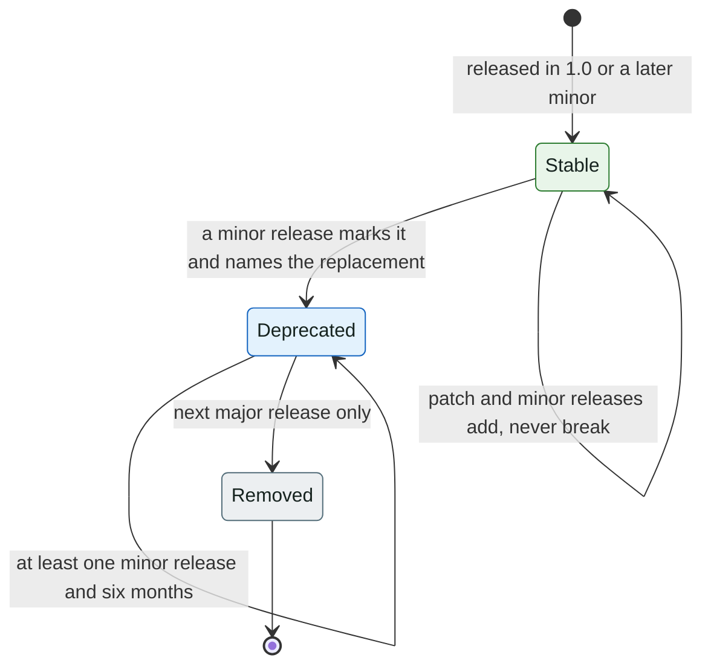

# Cross-cutting: Behaviour Specification

Behaviour that holds across every module is specified here as numbered, testable statements (`XCS-*`). Module behaviour stays in the module `SPEC.md` files (`RLE-*`, `PRE-*`, `CKP-*`). Each statement names the check that proves it; the check is named by the statement id.

This file holds the 1.0 API freeze and the compatibility promise (feature X-F-18, product decision PD-140). The freeze date is 5 February 2027 (PD-135). Until that date, 0.x releases may change contracts, as each release note states (PD-134).

---

## The 1.0 API freeze and the compatibility promise

### Life of a public API element

### XCS-001 The frozen surface is listed, and everything on the list is covered by the promise
- **Traces to:** `TR-API-07`, `TR-API-08`, X-F-05, X-F-07, X-F-18, PD-140
- **Milestone:** M3 (1.0)
- **Given:** The 1.0 release candidate.
- **When:** The API review for the freeze runs.
- **Then:** The API review report lists every element of the frozen surface, and each one is covered by `XCS-003` to `XCS-006`:
  1. **Java.** Every exported `api` and `spi` package of every published engine module (`TR-API-07`): types, methods, fields, constants, exceptions and their `code()` values, and the sealed result hierarchies.
  2. **REST.** Every operation in the published OpenAPI files of the Rule Engine (`/api/bpm/rules/v1`), the Process Engine (`/api/bpm/processes/v1`) and the host metadata endpoints (`/api/bpm/me`, `/api/bpm/meta`): method, path, parameters, request and response schemas, status codes, and the `Idempotency-Key`, `If-Match` and `ETag` headers.
  3. **Errors.** The Problem Details body (`type`, `title`, `status`, `code`, `correlationId` and the documented extension fields) and every error `code` with the HTTP status it answers with (X-F-05).
  4. **Events.** Every event type and version, the event envelope and the payload fields (X-F-07).
  5. **Definition formats.** The JSON Schemas `rule-set.v1` and `process-definition.v1`, the spreadsheet CSV layout (PD-107), and the BPMN and DMN elements that 1.0 imports, as listed in the standards coverage table.
  6. **Canonical hashes.** The canonical hash of a stored version never changes, and the same behaviour keeps one hash (`RLE-045`).
  7. **Configuration.** Every `horus.bpm.*` property: its name, type, default value and meaning.
  8. **Metrics.** Every metric name and tag key listed in the wiki.
- **Test ID:** `XCS_001_the_api_review_report_lists_every_frozen_element`

### XCS-002 What is not frozen is stated, so nobody builds on it by mistake
- **Traces to:** `TR-API-07`, X-F-18, PD-140
- **Milestone:** M3 (1.0)
- **Given:** The 1.0 release.
- **When:** A host developer reads the compatibility page of the wiki.
- **Then:** These are named as outside the promise and may change in any release:
  - `internal` packages, and any type not exported by `module-info`.
  - Database tables, columns, indexes and migration file names. A host reads engine data through the Java API or REST only. Upgrades follow the forward-only migration rule (X-F-09) and the one-minor schema tolerance (X-F-10).
  - The wording of `title`, `detail` and `message` texts. The `code` is the contract; texts may be improved.
  - Log lines, cockpit screens, layout and wording.
  - Any element documented as Preview. In OpenAPI a preview operation or field carries `x-horus-preview: true`; in Java a preview type says so in its Javadoc. A preview element becomes frozen only when a minor release removes the mark.
- **Test ID:** `XCS_002_the_compatibility_page_names_what_is_not_frozen`

### XCS-003 A patch release is fully compatible, a minor release only adds, and only a major release breaks
- **Traces to:** `TR-API-08`, ADR-0016, PD-140
- **Milestone:** M3 (1.0)
- **Given:** Release 1.0.0 as the baseline, then a candidate 1.0.1, 1.1.0 or 2.0.0.
- **When:** The compatibility checks of `XCS-007` compare the candidate with the last release.
- **Then:**
  - A patch release is binary and source compatible and changes no frozen element.
  - A minor release is binary compatible and additive. Allowed: new operations, new optional parameters and request fields, new response and event fields, new event types, new error codes for new behaviour, new `horus.bpm.*` properties whose default keeps today's behaviour, new SPI methods as `default` methods, new values in an enum whose description says values may be added.
  - Breaking, so only in a major release: removing or renaming a frozen element; adding a required parameter or field, or making an optional one required; narrowing accepted values; changing a type, a status code, or the error code of an existing case; changing what a field means; refusing a definition document that the previous release accepted; changing a canonical hash; adding an abstract SPI method; adding a permitted subtype to a sealed result type or a value to a closed enum; changing a default so that an unchanged deployment behaves differently.
  - A breaking REST change ships under a new path version (`/v2`) beside `/v1`; `/v1` follows `XCS-005`.
- **Test ID:** `XCS_003_patch_is_compatible_minor_is_additive_major_breaks`

### XCS-004 Clients that follow the tolerant-reader rules never break on a minor release
- **Traces to:** `TR-API-08`, PD-140
- **Milestone:** M3 (1.0)
- **Given:** A client written against 1.0 that ignores unknown JSON fields, treats an unknown error `code` by its HTTP status, ignores unknown event types, and handles open enums with a default branch.
- **When:** It runs against a 1.x minor release.
- **Then:** Every call it made against 1.0 gives the same result. The wiki states these four rules on the compatibility page, and the generated clients follow them.
- **Test ID:** `XCS_004_a_tolerant_client_written_for_1_0_runs_unchanged_on_a_minor`

### XCS-005 A deprecated element is marked on every surface, names its replacement, and stays at least one minor release and six months
- **Traces to:** `TR-API-09`, PD-054, PD-140
- **Milestone:** M3 (1.0)
- **Given:** Release 1.2.0 deprecates a frozen element in favour of a replacement.
- **When:** A host upgrades to 1.2.0, and later to every following release.
- **Then:**
  - **Java:** `@Deprecated(since = "1.2", forRemoval = true)` and a `@deprecated` Javadoc tag naming the replacement.
  - **REST:** `deprecated: true` in OpenAPI with the replacement named; every response of the operation carries a `Deprecation` header and a `Sunset` header with the earliest removal date.
  - **Configuration:** the old property is still read and start-up logs a warning naming the new one. If both are set with different values, start-up is refused naming both, so no bank runs on an ambiguous setting.
  - **Events:** a deprecated event type is still published, beside its replacement, until it is removed.
  - **Error codes and definition formats:** a deprecated code is still returned for its case; a deprecated schema version is still accepted.
  - The element stays for at least one minor release and at least six months after 1.2.0, and is removed only in a major release.
  - The release notes of 1.2.0 list it with its replacement and the earliest version that may remove it; the release notes of that major list every removal.
- **Test ID:** `XCS_005_a_deprecated_element_is_marked_names_its_replacement_and_stays`

### XCS-006 From the freeze date to 1.0.0 no frozen element changes, except for audit fixes that are recorded
- **Traces to:** X-F-18, PD-135, PD-140
- **Milestone:** M3 (1.0)
- **Given:** The API review is signed on the freeze date (PD-135) against a release candidate.
- **When:** Pull requests merge between the freeze and the 1.0.0 tag.
- **Then:**
  - The signed candidate's `api` and `spi` jars, OpenAPI files, JSON Schemas and the catalogues of error codes, configuration properties, event types and metrics are recorded as the 1.0 baseline.
  - No pull request breaks the baseline, as `XCS-003` defines breaking.
  - The only exception is a fix found by the security audit before 1.0 that cannot be made compatibly. Each such change is listed in the API review report and in the 1.0 release notes, and the baseline is recorded again.
- **Test ID:** `XCS_006_no_frozen_element_changes_between_freeze_and_1_0`

### XCS-007 Every pull request and release is checked against the last release
- **Traces to:** `TR-API-08`, `TR-API-09`, PD-140
- **Milestone:** M3 (1.0)
- **Given:** A pull request on `main` after the freeze, and every release after 1.0.0.
- **When:** CI runs.
- **Then:** Each check compares with the last release and fails the build on a break that the version number does not allow:
  - Java `api` and `spi`: the binary and source compatibility check of ADR-0016.
  - OpenAPI files: an OpenAPI compatibility check.
  - JSON Schemas: a schema compatibility check.
  - Catalogues: error codes with their status, configuration properties with their defaults, event types and metric names, each compared with the last release.
  - Release notes: every deprecation and removal is listed.
- **Test ID:** `XCS_007_ci_refuses_a_break_the_version_does_not_allow`

### XCS-008 A security or control fix may break compatibility only when no compatible fix exists, and says so
- **Traces to:** `TR-SEC-07`, PD-140
- **Milestone:** M3 (1.0)
- **Given:** A vulnerability rated high or critical, or a defect that lets a four-eyes, masking or audit guarantee be bypassed.
- **When:** The only fix changes a frozen element.
- **Then:** The fix ships in a patch or minor release. Its advisory and release notes name the changed element, why no compatible fix was possible, and what a host must do. Every other change follows `XCS-003`.
- **Test ID:** `XCS_008_a_breaking_security_fix_names_the_change_and_the_host_action`
