# Architecture overview

Status: architecture baseline (M0). This is the system-level technical design of HORUS Agentic BPM: how the engines are built, where state lives, how they behave under concurrency, load and failure, and which checks prove it. Read it before any module `DESIGN.md`.

| If you need | Read |
|---|---|
| Why a choice was made | The ADR linked next to it, in [`docs/adr/`](../adr/) |
| Table DDL, full API tables, module internals | The module `DESIGN.md` linked in section 13 |
| Testable behaviour | The module `SPEC.md` (`RLE-*`, `PRE-*`, `CKP-*`) |
| Requirement ids (`TR-*`) | [`docs/product/requirements.md`](../product/requirements.md) |
| To propose a feature beyond the roadmap | [`docs/proposals/`](../proposals/README.md) |

This document owns the cross-module facts: boundaries, the transaction model, runtime flows, cross-cutting rules, capacity math, failure handling and verification gates. It links to module documents for depth and does not repeat their DDL.

Contents: 1 Goals and constraints. 2 Context and boundaries. 3 Building blocks. 4 Runtime view. 5 Data view. 6 Cross-cutting concerns. 7 Trade-offs left open. 8 Scale and bottleneck math. 9 Failure modes and recovery. 10 Deployment. 11 Verification gates. 12 Open questions. 13 Where to go next.

## 1. Goals and constraints

### 1.1 Quality goals

| Priority | Goal | Measured by |
|---|---|---|
| 1 | Correctness under retries and concurrency: no duplicate instance, task completion, publication or join token | `TR-IDEM-01..05`, `TR-ASY-02`, `TR-ASY-03` |
| 2 | Determinism and auditability: the same version, inputs and clock give the same result, and every decision and transition leaves an append-only record | `TR-DET-01..05`, `TR-OBS-01` |
| 3 | Embeddability: one starter dependency, no extra process, no extra database, no network I/O in engine code | `TR-EMB-01..05` |
| 4 | Bounded resource use: slow external calls never hold a database connection or row lock | `TR-ASY-01` |
| 5 | Predictable latency: in-process evaluation p99 under 100 us on a 200-row table | `TR-PERF-01` |

### 1.2 Constraints

| Constraint | Source |
|---|---|
| Java 21 baseline (Java 25 in CI), framework-free `*-core`, PostgreSQL 14+, Spring JDBC, Flyway | [ADR-0001](../adr/0001-java-spring-boot-postgresql.md) |
| Spring Boot 4.x starters as the primary baseline; Spring Boot 3.5.x also tested until 1.0 | [ADR-0011](../adr/0011-spring-boot-4-baseline.md) |
| Contract conventions: permission names, `rle_decision` partitioned from the first migration, quoted string outputs, error `type` URIs, `422` for `UNIQUE_HIT_VIOLATION` | [ADR-0010](../adr/0010-engine-contract-conventions.md) |
| Engine state lives in the host database under prefixed tables, on the host `DataSource` and transactions; the engines never open connections | [ADR-0002](../adr/0002-state-in-host-database.md) |
| Closed expression grammar, hand-written parser, no scripting or reflection | [ADR-0003](../adr/0003-own-expression-language.md) |
| Libraries only, no standalone server | [ADR-0004](../adr/0004-no-standalone-server.md) |
| Cockpit is static assets with no state of its own | [ADR-0005](../adr/0005-cockpit-as-static-assets.md) |
| Idempotency keys, business keys and optimistic locking are enforced in the engine | [ADR-0006](../adr/0006-idempotency-and-business-keys.md) |
| Saga-style compensation; no two-phase commit | [ADR-0007](../adr/0007-compensation-instead-of-distributed-transactions.md) |
| External steps run as Async Wait-State with a lease of step timeout plus margin (proposed) | [ADR-0008](../adr/0008-async-wait-state-for-external-steps.md) |
| Compiled caches stay coherent through `LISTEN/NOTIFY` plus a `cache_epoch` sweep (proposed) | [ADR-0009](../adr/0009-cache-coherence-listen-notify-and-epoch.md) |
| Runtime dependencies carry Apache 2.0, MIT or BSD licences only | `TR-LIC-01` |

### 1.3 Non-goals

No standalone server, no engine-owned database or connection pool, no scripting engine or reflection in definitions, no two-phase commit, no required message broker or search index, no built-in identity provider, no full BPMN 2.0, CMMN or DMN FEEL.

## 2. Context and boundaries


The engines run inside the host's JVM. The host owns authentication, the database, the event sink and every adapter that talks to the outside world. The engines own their tables and their rules of state change.

| Aspect | Rule Engine | Process Engine | Cockpit |
|---|---|---|---|
| Inbound callers | Host code (`RuleEngine`), REST `/api/bpm/rules/v1`, cockpit, its scheduler thread | Host code (`ProcessEngine`, `TaskService`), REST `/api/bpm/processes/v1`, cockpit, its scheduler thread | Operators in a browser |
| Outbound dependencies | Host `DataSource` and transaction manager, `TenantResolver`, `CallerResolver`, `RuleEventPublisher`, `Clock`, `MeterRegistry` | The same, plus `AgentAdapter` and `ServiceAdapter` beans, `BusinessCalendar`, `OutputSchemaValidator`, optional `RuleEngine` | The two REST APIs only |
| State it owns | Tables `rle_*` and `rle_schema_history` | Tables `pre_*` and `pre_schema_history` | None |
| State it never touches | `pre_*`, host tables | `rle_*` (it calls the `RuleEngine` API), host tables | Any database |
| Network I/O | None (`TR-EMB-05`) | None in engine artifacts; adapters are host code and run outside engine transactions (`TR-ASY-01`) | HTTPS to the host |

Rules that follow from the table:

1. A module reads and writes only its own tables. The Process Engine reaches Rule Engine state only through `RuleEngine.evaluate`, never by SQL.
2. The cockpit has no privileged path. Every check it shows (tenancy, permissions, maker-checker) is enforced again by the API.
3. A host transaction that calls an engine includes the engine's writes. A host rollback rolls back the engine's rows too (`TR-EMB-04`).

## 3. Building blocks

### 3.1 Containers and module DAG



| Artifact | Role | Allowed dependencies | Verified by |
|---|---|---|---|
| `*-core` | Model, parser and compiler, evaluator, token runtime, lifecycles, inbound and outbound ports | Java 21, Jackson; Process Engine core also sees the `RuleEngine` interface | ArchUnit: no `org.springframework..`, `java.sql..`, `java.net..`, `javax.script..`, `java.lang.reflect.Method` (`TR-EMB-03`, `TR-SEC-01`) |
| `*-postgres` | Storage adapters on `JdbcClient`, Flyway migrations, `SKIP LOCKED` poller, `LISTEN/NOTIFY` listener | `*-core`, Spring JDBC, Flyway | ArchUnit: no HTTP clients, no `java.net.http..` (`TR-EMB-05`) |
| `*-rest` | Controllers, RFC 9457 problem responses, OpenAPI 3.1 document | `*-core`, Spring WebMvc | WebMvc contract tests |
| `*-spring-boot-starter` | Composition root: `@AutoConfiguration`, host `DataSource` binding, isolated Flyway run, scheduler thread lifecycle, Micrometer | `*-core`, `*-postgres`, optional `*-rest` | Starter boot test on a clean database (`TR-EMB-01`) |
| `*-test` | In-memory ports, fixed `Clock`, JUnit 5 extension, stub adapters | `*-core` | |
| `cockpit`, `cockpit-spring-boot-starter` | Static React build; the starter serves it under host authentication | REST contracts only | Playwright against an example host |
| `bpm-bom` | Pins every module version | | |

Dependencies point inward to `*-core`. The Rule Engine never depends on the Process Engine. The Process Engine starts without a `RuleEngine` bean when no definition uses a `decision` step or an `agentTask` guardrail. Build order: both `*-core` modules first, then `*-postgres`, `*-rest` and `*-test` of each engine in parallel, then the starters.

### 3.2 Ports and adapters inside each engine


Each engine is a functional core with an imperative shell. Domain code takes the current state, a command and a clock, and returns the new state, the events to emit and the outbound actions to perform. It never reads the system clock, opens a connection or calls the network.

| Port | Direction | Engine | Default adapter | Host override |
|---|---|---|---|---|
| `RuleEngine`, `VersionService` | Inbound | Rule | Core implementation | No |
| `ProcessEngine`, `TaskService`, `MigrationService` | Inbound | Process | Core implementation | No |
| Storage ports, one per aggregate | Outbound | Both | `*-postgres` | Not in 0.x (storage SPI kept for later backends, ADR-0001) |
| `CompiledCache` | Outbound | Both | Caffeine in the starter; small bounded LRU in `*-core` | Yes |
| `TenantResolver`, `CallerResolver` | Outbound | Both | JWT claim or trusted header; principal name | Yes |
| Event publisher (`RuleEventPublisher` and the process equivalent) | Outbound | Both | Spring `ApplicationEventPublisher` | Yes, for an outbox |
| `RuleFunctionRegistry` | Outbound | Rule | Built-in pure functions | Yes, pure functions only |
| `AgentAdapter`, `ServiceAdapter` | Outbound | Process | Stubs in `*-test` | Required for `agentTask` and remote `serviceTask` |
| `BusinessCalendar` | Outbound | Process | Reads `pre_calendar`, `pre_holiday`; 24x7 built in | Yes |
| `OutputSchemaValidator` | Outbound | Process | `networknt/json-schema-validator` in the starter | Yes |
| `Clock` | Outbound | Both | System UTC | Yes, for tests and replay |

All starter beans are `@ConditionalOnMissingBean`; the starter never component-scans the host. Port names marked as module-owned (storage ports) are fixed in the module `DESIGN.md`.

### 3.3 Aggregates and lifecycles

| Engine | Aggregates | Value objects and records |
|---|---|---|
| Rule Engine | `RuleSet` (per tenant), `RuleSetVersion` (immutable once published), `Decision` (append-only) | `Money(currency, minorUnits)`, `TenantId`, `DecisionInput`, `DecisionResult`, `Expr` (sealed tree), `CompiledRuleSet` |
| Process Engine | `ProcessDefinition` (versioned, immutable once deployed), `ProcessInstance`, `ExecutionToken`, `Task`, `Job` (timer, SLA escalation or async step), `Incident` | `BusinessKey`, `IdempotencyKey`, `AttemptId`, `Lease(lockedBy, lockedUntil)`, `CompensationEntry` |

Identifiers are ULIDs. Two numbers are never confused: `version` is the rule set or definition version number (1, 2, 3); `lockVersion` (column `lock_version`) is the optimistic lock, sent as `If-Match: "<lockVersion>"` and returned as `ETag`.

**Rule set versions.** The transition table with guards and events is owned by [`rule-engine/docs/DESIGN.md`](../../rule-engine/docs/DESIGN.md) section 3.3.


**Process instances and tokens.** Positions are rows in `pre_token`, not a column on the instance, because a `parallelGateway` creates several active positions. This document owns the transition table until the process engine `DESIGN.md` carries it.


| From (instance / token) | Event | Guard | To | Emitted event |
|---|---|---|---|---|
| none | `start(definition, businessKey, idempotencyKey)` | Unique `(tenant_id, definition_key, business_key)`; idempotency key new or same request hash | `RUNNING`; token `ACTIVE` at `start` | `processes.instance.started.v1` |
| token `ACTIVE` | Sync step done (`decision`, `exclusiveGateway`, local `serviceTask`) | Runs in the current transaction | Token `ACTIVE` at the next node | `processes.step.completed.v1` |
| token `ACTIVE` | Reaches `userTask` | Assignee resolved; SLA `due_at` computed through `BusinessCalendar` | Token `WAITING_USER`; `pre_task OPEN` | `processes.task.created.v1` |
| token `WAITING_USER` | `complete(taskId, lockVersion)` | `lock_version` matches; actor not in `forbidden_users` | Token `ACTIVE` | `processes.task.completed.v1` |
| token `ACTIVE` | Reaches `agentTask` or remote `serviceTask` | Job row claimed with lease; TX1 commits before the adapter call | Token `WAITING_ASYNC` | none |
| token `WAITING_ASYNC` | Adapter result in TX2 | Lease still held; output validates; guardrail `allow = true` | Token `ACTIVE` | `processes.step.completed.v1` |
| token `WAITING_ASYNC` | Guardrail `allow = false` with `onViolation: route-to-human` | | Token `WAITING_USER`; approval task created | `processes.task.created.v1` |
| token `WAITING_ASYNC` | Failure, retries left | Fewer than `1 + retry.max` attempts made | Token `WAITING_ASYNC`; job `DUE` at `now() + backoff` | none |
| token `WAITING_ASYNC` or `ACTIVE` | Failure, attempts exhausted, `onFailure: incident` | | Token paused; `pre_incident OPEN`; instance stays `RUNNING` | `processes.incident.raised.v1` |
| paused token | `incidents/{id}:retry` or `:resolve` | `lock_version` matches | Token `ACTIVE` (retry) or as resolved | `processes.incident.resolved.v1` |
| token `ACTIVE` | Reaches a `parallelGateway` join | `pre_instance` row locked `FOR UPDATE`; all sibling tokens in the scope `JOINED` | One new `ACTIVE` token; siblings `COMPLETED` | none |
| token `ACTIVE` | Reaches `timer` | Timer job `DUE` | Token `WAITING_TIMER` | none |
| `RUNNING` | Failure with `onFailure: compensate`, or `throwCompensation` | | `COMPENSATING` | `processes.compensation.started.v1` |
| `COMPENSATING` | Stack walked, or the manual compensation incident resolved | | `FAILED` (terminal, compensated) | `processes.instance.failed.v1` |
| `RUNNING` | Last token reaches `end` | No other active or waiting token | `COMPLETED` | `processes.instance.completed.v1` |
| `RUNNING` | `cancel` | | `CANCELLED` | `processes.instance.cancelled.v1` |

## 4. Runtime view

The engines have two kinds of work, and every flow below is one or the other:

| Kind | Runs in | Holds a connection during | Examples |
|---|---|---|---|
| Sync in-transaction | The caller's or the scheduler's current transaction | Milliseconds: the engine's own reads and writes | `evaluate`, `decision` steps, gateways, `userTask` state changes, a local `serviceTask` bean that writes only to the host database |
| Async Wait-State | TX1 (claim with lease, commit), the adapter call with no connection, TX2 (verify lease, record, advance or fail) | Never during the adapter call | `agentTask`, remote `serviceTask` (HTTP, MCP), compensation handlers |

Rule: no adapter, HTTP, MCP or model call runs inside an open engine transaction or while a row lock is held (`TR-ASY-01`, ADR-0008).

### 4.1 Evaluate a decision

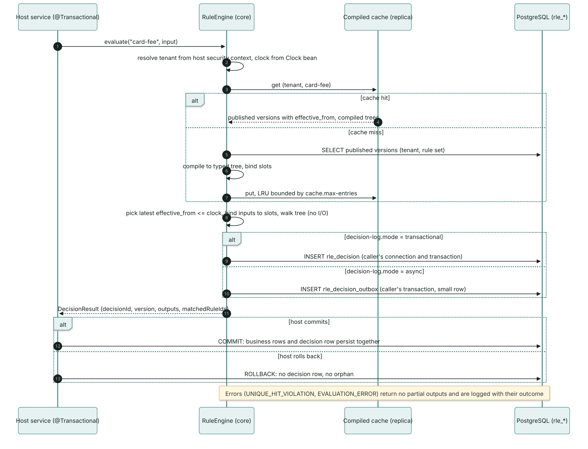

1. The host calls `RuleEngine.evaluate(ruleSet, input)`, usually inside its own `@Transactional` method.
2. The engine resolves the tenant from the host security context (never from the input) and the evaluation instant from the `Clock` bean or an explicit `clock` (which needs `rules:simulate` over REST).
3. The compiled cache returns the rule set's published versions with their `effective_from` and compiled trees. On a miss the engine reads the published versions once and compiles them (`TR-PERF-02`: under 500 ms for 1 000 rows).
4. The engine picks the version with the latest `effective_from <= clock`, binds inputs to slot indices and walks the typed tree. No I/O happens in this step.
5. The engine writes one `rle_decision` row in the caller's transaction (`decision-log.mode: transactional`, default), or one `rle_decision_outbox` row that the scheduler relays later (`async`).
6. It returns `DecisionResult` with `decisionId`, the version used, outputs and matched rule ids. `UNIQUE_HIT_VIOLATION` and `EVALUATION_ERROR` return no partial outputs, are logged with their outcome, and are `422` over REST (ADR-0010).
7. If the host rolls back, the decision row rolls back with it (`RLE-013`).

### 4.2 Publish a version with maker-checker

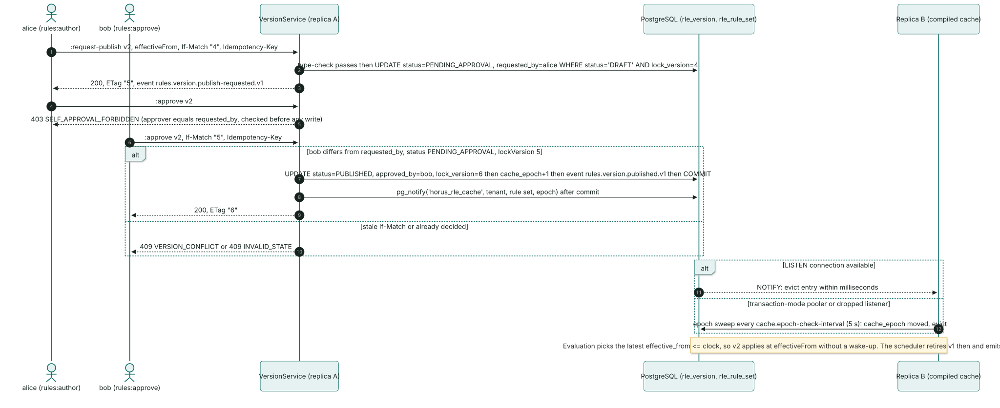

1. The author edits a `DRAFT` with `If-Match: "<lockVersion>"`; a stale value gives `409 VERSION_CONFLICT`.
2. `:request-publish` with `effectiveFrom` type-checks the whole version. Any parse or type error keeps it in `DRAFT` (`422 VALIDATION_FAILED`, `TR-DET-02`). Success records `requested_by`, moves to `PENDING_APPROVAL` and emits `rules.version.publish-requested.v1`.
3. `:approve` by the requester is refused with `403 SELF_APPROVAL_FORBIDDEN` in `VersionService`, before any write, so the Java API and REST behave the same (`RLE-009`, `TR-SEC-04`).
4. Approval by another identity with `rules:approve` runs one guarded `UPDATE ... WHERE status = 'PENDING_APPROVAL' AND lock_version = :v`. In the same transaction it increments `rle_rule_set.cache_epoch` and emits `rules.version.published.v1`. Zero rows updated gives `409 VERSION_CONFLICT` or `409 INVALID_STATE`.
5. After commit the engine calls `pg_notify('horus_rle_cache', ...)`. Replicas listening evict the entry within milliseconds. Every replica also sweeps `cache_epoch` every `cache.epoch-check-interval` (default 5 s), which is the staleness bound when NOTIFY is unavailable (`TR-ASY-04`, ADR-0009).
6. Evaluation selects by `effective_from`, so a future-dated version takes effect at its instant with no wake-up. At that instant the scheduler marks the superseded version `RETIRED` and emits `rules.version.retired.v1`.

### 4.3 Start an instance and complete a step in-transaction

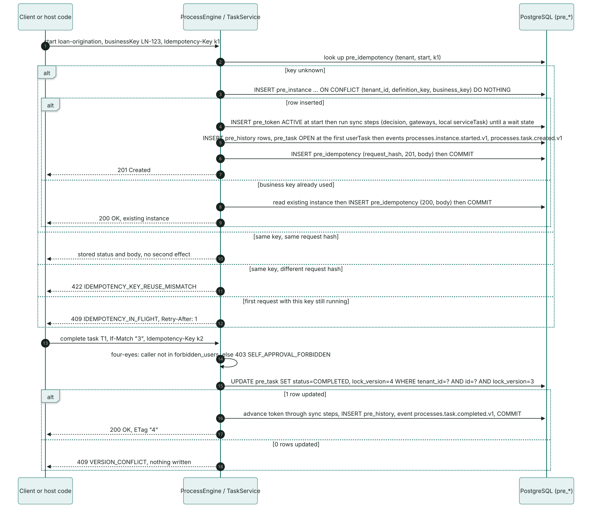

1. The caller starts a definition with a business key and an `Idempotency-Key`.
2. The engine looks up `(tenant_id, operation, idempotency_key)` in `pre_idempotency`. Same key and same request hash returns the stored status and body. Same key with a different hash returns `422 IDEMPOTENCY_KEY_REUSE_MISMATCH`. A key whose first request is still running returns `409 IDEMPOTENCY_IN_FLIGHT` with `Retry-After: 1`.
3. For a new key the engine inserts `pre_instance` with `ON CONFLICT (tenant_id, definition_key, business_key) DO NOTHING`, so a duplicate business key does not abort the transaction. If no row was inserted, the existing instance is returned with `200` (`PRE-002`).
4. The new instance pins the effective definition version (`PRE-001`), creates a token at `start` and runs sync steps in the same transaction until the first wait state (`userTask`, async step, timer or end). Each transition writes one `pre_history` row and hands its event to the host publisher in the same transaction.
5. The idempotency record with status and body is written in the same transaction, then the transaction commits. Engine state, host writes, history, events handed to the publisher and the idempotency record commit or roll back together.
6. Completing a task checks four-eyes first (`forbidden_users`, `403 SELF_APPROVAL_FORBIDDEN`, `PRE-007`), then runs `UPDATE pre_task ... WHERE lock_version = :v`. Zero rows gives `409 VERSION_CONFLICT` and nothing is written (`PRE-003`). One row advances the token through sync steps in the same transaction.

### 4.4 Async Wait-State protocol

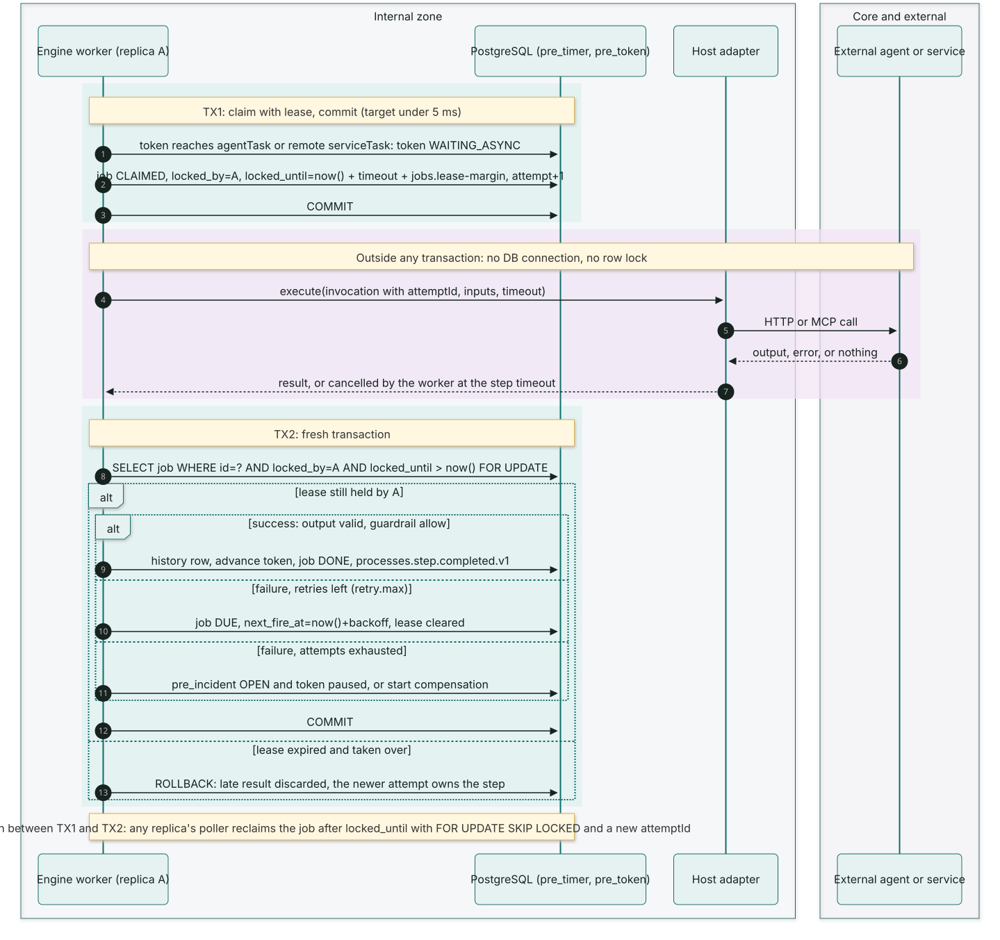

1. **TX1.** The transaction that moves a token to an `agentTask` or remote `serviceTask` sets the token to `WAITING_ASYNC` and writes the job row `CLAIMED` with `locked_by`, `locked_until = now() + timeout + jobs.lease-margin` and an incremented `attempt`, then commits. `now()` is the database clock, never the JVM clock.
2. **Call.** After commit the worker calls the adapter with no connection and no lock. The invocation carries `tenantId`, `instanceId`, `stepId`, a new `attemptId`, the bounded inputs and the timeout. The worker cancels the call when the step timeout elapses.
3. **TX2.** A fresh transaction re-reads the job `WHERE locked_by = me AND locked_until > now() FOR UPDATE`. If the lease is held, it records the result, validates output and guardrails (section 4.5) and either advances, schedules a retry (job `DUE` at `now() + backoff`), opens an incident, or starts compensation. If the lease was taken over, it rolls back and the late result is discarded.
4. **Recovery.** If the replica dies between TX1 and TX2, the scheduler poller on any replica reclaims the job after `locked_until` with `FOR UPDATE SKIP LOCKED`, increments `attempt` and issues a new `attemptId` (`TR-ASY-02`).

Lease rules (ADR-0008, `PRE-017`):

| Job kind | Lease | Example |
|---|---|---|
| `ASYNC_AGENT`, `ASYNC_SERVICE`, remote compensation | Step `timeout` plus `jobs.lease-margin` (default 30 s); `timeout` defaults to `adapters.default-timeout` (`PT30S`) | `PT5M` step: 5 min 30 s lease. No timeout declared: 60 s |
| `TIMER`, `SLA_ESCALATION` | Fixed `jobs.timer-lease` (default 60 s); no external call | `PRE-006` |

Because the call is cancelled at the timeout and TX2 needs about 5 ms, a live attempt finishes before its lease ends and is never taken over. A takeover happens only after a crash or a stall longer than the margin, so adapters must be idempotent by `attemptId` (`TR-IDEM-04`): the late result is discarded but its side effect may have happened.

### 4.5 Guardrail check on an agentTask

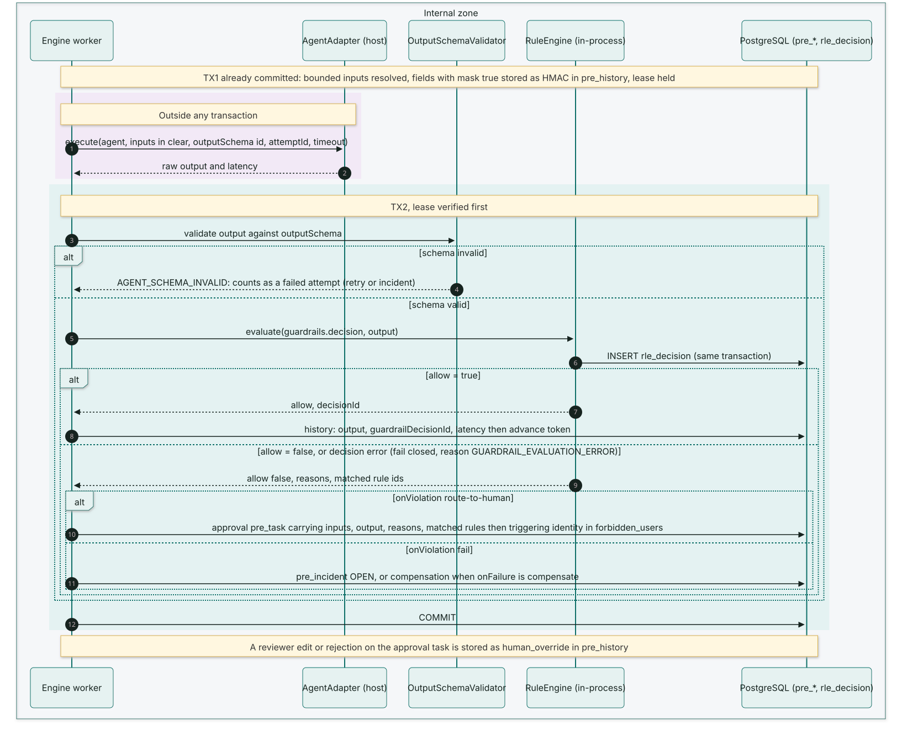

1. TX1 resolves the bounded inputs (`${instance.<path>}` references, `$defs/variableRef` in the process definition schema) and writes inputs marked `mask: true` to `pre_history` as keyed HMAC values. The adapter receives clear values (`TR-AGT-02`).
2. The `AgentAdapter` runs outside any transaction under the step `timeout` and returns raw output and latency. The engine never embeds a model or calls the network itself (`TR-AGT-03`).
3. TX2 verifies the lease, then validates the output against `outputSchema`. A failure is `AGENT_SCHEMA_INVALID` and counts as a failed attempt.
4. TX2 calls `RuleEngine.evaluate(guardrails.decision, output)` in-process. The decision row is written in the same transaction.
5. Guardrail contract: the rule set has hit policy `first` or `unique`, declares the output `allow: boolean`, and may declare `reasons: list<string>`; no other output is read. Deploy (`POST /definitions`) checks the effective version against this contract and rejects a missing or non-compliant rule set with `422 GUARDRAIL_CONTRACT_INVALID` (`PRE-016`).
6. `allow = true`: the token advances and `pre_history` records the output, `guardrailDecisionId` and latency.
7. `allow = false` with `onViolation: route-to-human`: an approval `userTask` carries inputs, output, `reasons` and matched rule ids; the identity that triggered the step is in `forbidden_users` (`PRE-010`). With `onViolation: fail`: an incident, or compensation when the step's failure policy says so.
8. Fail closed: a decision error (`UNIQUE_HIT_VIOLATION`, `EVALUATION_ERROR`) or a later version that no longer meets the contract counts as `allow = false` with reason `GUARDRAIL_EVALUATION_ERROR` and follows `onViolation`.
9. A reviewer's edit or rejection on the approval task is stored as `human_override` in `pre_history` for offline evaluation (`PRE-012`).

### 4.6 Parallel join across replicas

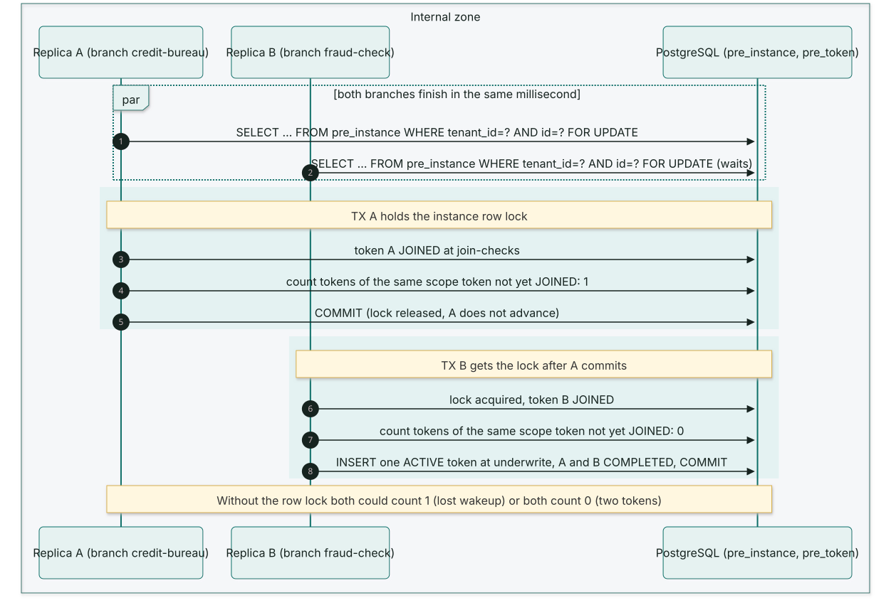

1. Each arriving branch locks the parent `pre_instance` row `FOR UPDATE`.
2. It marks its token `JOINED` and counts tokens in the join scope that are not yet `JOINED`.
3. The transaction that counts zero creates the single outgoing token and marks the siblings `COMPLETED`. The lock serialises the counts, so there is exactly one outgoing token, never zero and never two (`PRE-005`, `TR-ASY-03`).

### 4.7 Compensation

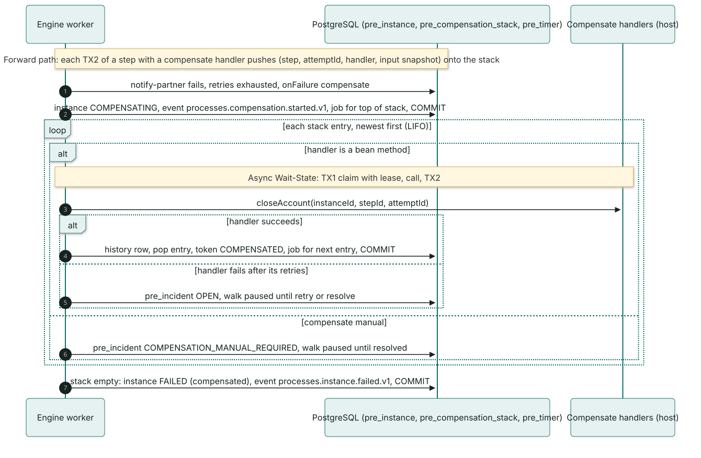

1. When a `serviceTask` or `agentTask` with a `compensate` handler completes, its TX2 pushes `(step_id, attempt_id, handler, input_snapshot)` onto `pre_compensation_stack` for the process or `saga` scope.
2. When a step with `onFailure: compensate` exhausts its retries, or a `throwCompensation` step runs, the instance moves to `COMPENSATING` and emits `processes.compensation.started.v1`.
3. The engine walks the stack newest first. Each handler runs as its own Async Wait-State job with lease, retry and incident handling, and receives `instanceId`, `stepId` and `attemptId` so it can be idempotent (`PRE-013`, `TR-IDEM-04`).
4. A handler that fails after its retries opens an incident and pauses the walk until the incident is retried or resolved. `compensate: manual` opens `COMPENSATION_MANUAL_REQUIRED` instead of skipping (`TR-COMP-03`).
5. Every compensation writes a history row. When the stack is empty the instance is `FAILED` (compensated) and `processes.instance.failed.v1` is emitted (ADR-0007).

### 4.8 Instance migration


1. `POST /migrations` creates a plan from a source to a target definition version.
2. `:validate` is a read-only dry run: instances per active step, and every instance on a step that has no same-id target. It changes zero rows (`PRE-014`).
3. `:execute` runs in batches of 100. Per instance it locks `pre_instance`, remaps tokens, pins the target version and writes a `MIGRATED` history row, each instance in its own transaction.
4. A failure on one instance raises an incident on that instance and the batch continues (`PRE-015`).
5. M2 maps steps with the same id only. Explicit `stepMappings` for renamed steps and cancellation of instances on removed steps are M3 (`TR-MIG-03`), as is the cockpit migration wizard.

## 5. Data view

### 5.1 Tables per engine

| Engine | Tables | Owner of the DDL |
|---|---|---|
| Rule Engine | `rle_rule_set`, `rle_version`, `rle_rule`, `rle_decision`, `rle_decision_outbox`, `rle_idempotency` | [`rule-engine/docs/DESIGN.md`](../../rule-engine/docs/DESIGN.md) section 5 |
| Process Engine | `pre_definition`, `pre_instance`, `pre_token`, `pre_task`, `pre_timer`, `pre_incident`, `pre_history`, `pre_compensation_stack`, `pre_idempotency`, `pre_calendar`, `pre_holiday` | [`process-engine/docs/DESIGN.md`](../../process-engine/docs/DESIGN.md) section 5 |

`pre_timer` holds timers, SLA escalations and async job leases in one queue, so one poller and one partial index serve all of them.

### 5.2 Rules for every table

| Rule | Detail | Verified by |
|---|---|---|
| Tenancy | `tenant_id TEXT NOT NULL` on every table, first in every primary key, unique constraint and query index; every repository method takes the tenant as a parameter | Schema lint (`TR-TEN-01`) |
| Keys | ULID `VARCHAR(26)`, generated in `*-core`; replica-safe without sequences and append-friendly in B-trees | |
| Time | `TIMESTAMPTZ` only; leases and due times use the database `now()` | |
| Money | `BIGINT` minor units plus a `CHAR(3)` ISO 4217 code where money is a column; JSON shape in JSONB (section 6.6) | |
| Definitions | Canonical JSONB; its SHA-256 is part of the version identity | |
| Optimistic lock | `lock_version BIGINT` on versions, instances, tasks and incidents | `PRE-003` |
| Migrations | Forward-only Flyway scripts in a history table per engine; expand then contract across one minor release; `CREATE INDEX CONCURRENTLY` on populated tables; `lock_timeout` set on DDL | `TR-OPS-01`, `TR-OPS-02` |

### 5.3 Append-only and partitioned tables

`rle_decision` and `pre_history` are append-only: the engine has no update or delete path for their rows (`TR-OBS-01`), verified by a SQL capture test that sees only `INSERT`. Both are range-partitioned by month from their first migration (`rle_decision` by `created_at`, `pre_history` by `occurred_at`), with the partition key in the primary key and a default partition for stragglers (ADR-0010). The scheduler creates partitions 7 days ahead. Configuration controls retention only: with `decision-log.retention` unset (the default) nothing is dropped; when set, the scheduler drops whole monthly partitions that lie entirely before `now() - retention`, so no row is deleted and no vacuum is needed.

### 5.4 Definition formats

| Format | Schema | Identifier |
|---|---|---|
| Rule set | [`rule-engine/api/schema/rule-set.v1.schema.json`](../../rule-engine/api/schema/rule-set.v1.schema.json) | `urn:horus-bpm:schema:rule-set:v1` |
| Process definition | [`process-engine/api/schema/process-definition.v1.schema.json`](../../process-engine/api/schema/process-definition.v1.schema.json) | `urn:horus-bpm:schema:process-definition:v1` |

Both are JSON Schema 2020-12, carry a `schemaVersion` field, and are the single owner of the definition format. Old schema versions import forever.

## 6. Cross-cutting concerns

### 6.1 Idempotency

| Mechanism | Scope | Behaviour |
|---|---|---|
| `Idempotency-Key` (REST header or Java parameter) | Start instance, complete task, deploy, publish operations, incident and migration commands, evaluate with logging | Record `(tenant_id, operation, idempotency_key, request_hash, status_code, response_body, expires_at)`; replay returns the stored result; `422 IDEMPOTENCY_KEY_REUSE_MISMATCH` on a different hash (a client bug, never retried); `409 IDEMPOTENCY_IN_FLIGHT` with `Retry-After: 1` while the first request runs. Retention `idempotency.retention`, default 24 h (ADR-0006) |
| Business key | Process instances | Unique per `(tenant_id, definition_key, business_key)`; a second start returns the existing instance |
| `attemptId` | Adapter and compensation calls | New per attempt; hosts use it to make external effects idempotent (`TR-IDEM-04`) |
| Event `eventId` | Every event | ULID; consumers deduplicate on it |

### 6.2 Locking and concurrency

| Contention point | Lock | Held for | Why it is safe |
|---|---|---|---|
| Task completion, draft edit, approval, incident command | Optimistic: `lock_version` predicate in the `UPDATE` | One statement | Zero rows means stale: `409 VERSION_CONFLICT`, nothing written |
| `parallelGateway` join, instance migration | Pessimistic: `pre_instance` row `FOR UPDATE` | About 2 ms | Per instance; no cross-instance contention |
| Job and timer claim | `FOR UPDATE SKIP LOCKED` plus lease columns | Claim transaction only (under 5 ms) | Replicas never block each other; a crashed claimant's lease expires |
| Async step completion | Lease check `locked_by = me AND locked_until > now()` | TX2 only | A taken-over attempt cannot write |

No row lock is ever held across an adapter call.

### 6.3 Caching and invalidation

| Cache | Key | Invalidation | Bound |
|---|---|---|---|
| Compiled rule sets | `(tenant, rule set)` with its published versions | `cache_epoch` incremented on approve and retire; `pg_notify` after commit when `cache.listen-notify` is `true`; epoch sweep every 5 s always | `cache.max-entries` (default 1 000), LRU |
| Compiled process definitions | `(tenant, key, version)` | None needed: a deployed version is immutable and instances pin it | Same LRU rule |

Hosts behind a transaction-mode pooler set `cache.listen-notify=false` and accept the 5 s bound. Decisions always log the version they used, so a stale window is auditable (ADR-0009).

### 6.4 Security and tenancy

| Control | Where | Verified by |
|---|---|---|
| Tenant from the host security context (JWT claim by default, trusted gateway header, or a host `TenantResolver`); a `tenantId` in a request body is ignored | `TenantResolver` port, REST layer | `RLE-011` (`TR-SEC-03`) |
| Another tenant's resource answers `404`, never `403` | Every query filters `tenant_id` | Two-tenant integration tests (`TR-TEN-02`) |
| One permission string per endpoint, named `<module>:<action>` or `<module>:<resource>:<action>` with modules `rules` and `processes` (`rules:approve`, `rules:log:read`, `processes:start`, `processes:task:work`, `processes:incident:manage`; full list in ADR-0010); the host maps strings to roles | `@PreAuthorize` in `*-rest` | REST tests |
| Maker-checker on publication and four-eyes on tasks, in the service layer | `VersionService`, `TaskService` | `RLE-009`, `PRE-007` |
| No code execution: closed grammar, no scripting, reflection or arbitrary deserialisation; host functions must be pure | `*-core` | ArchUnit, `RLE-004` (`TR-SEC-01`) |
| Bounded regex: 4 096-character input, 50 ms, nested quantifiers rejected at publish | Evaluator | `RLE-007` (`TR-SEC-02`) |
| Masking with HMAC-SHA256 and a host key of 32 bytes or more; start-up fails when masking is required and no key is set | Decision log, process history | `RLE-012`, `PRE-012` |
| No stack traces in responses; RFC 9457 bodies with `code` and `correlationId` | `*-rest` | `TR-SEC-08` |

The threat model (STRIDE) and cockpit headers are in [`wiki/Multi-Tenancy-and-Security.md`](../../wiki/Multi-Tenancy-and-Security.md).

### 6.5 Observability and audit

| Signal | Content |
|---|---|
| Audit records | `rle_decision` (version, clock, caller, masked inputs, outputs, matched rules, correlation id, duration) and `pre_history` (every transition, actor, `attemptId`, masked agent inputs, outputs, `guardrailDecisionId`, `human_override`) |
| Events | Envelope `eventId`, `eventType` with a `.v<N>` suffix, `occurredAt`, `tenantId`, `correlationId`, `causationId`, `producer`, `schemaVersion`, `payload` (`TR-OBS-06`). Types are `rules.<aggregate>.<pastTense>.v1` and `processes.<aggregate>.<pastTense>.v1`; the full lists are in the module designs. Each event is handed to the host publisher inside the transaction of the state change it reports |
| Metrics | Micrometer: evaluations, errors, durations, active instances, incidents, timer lag, cache hits and evictions (`TR-OBS-02`) |
| Traces | OpenTelemetry spans for evaluation and step execution when a tracer is present (`TR-OBS-03`) |

Because events are handed over inside the transaction, a host publisher must not do network I/O there. A host that forwards events to a broker writes them to its own outbox in the same transaction.

### 6.6 Money

Money is never a floating-point number. The canonical contract is [`rule-engine/docs/DESIGN.md`](../../rule-engine/docs/DESIGN.md) section 3.4, used by both engines and the cockpit. In short: JSON is always `{ "currency": "USD", "amount": 1250 }` with `amount` an integer in minor units within plus or minus 2^53 - 1 (12.50 USD here); Java uses `Money.ofMinor(currency, long)` or `Money.ofMajor(currency, String)`, never a `double`; expression literals are in major units (`12.50 USD`) and converted at compile time; the currency scale comes from ISO 4217; mixed currencies are an error; rounding is the rule set's `moneyRounding`, default `HALF_EVEN`, and part of the versioned definition.

### 6.7 Contracts and versioning

| Layer | Audience | Stability rule |
|---|---|---|
| Java API and SPIs | Host developers | Semver per module; deprecations overlap one minor release |
| REST `/api/bpm/rules/v1`, `/api/bpm/processes/v1` | Cockpit, remote callers | Major version in the path; additive changes stay in `v1`; OpenAPI 3.1 per release; errors are `application/problem+json` whose `code` is the contract and whose `type` is `https://github.com/dhluong90/horus-Agentic-BPM/wiki/Common-Error-Codes#<code in lower case>`; `409` only for state conflicts (ADR-0010) |
| Definition formats | Authors, tooling | `schemaVersion`; old versions import forever; a string literal output keeps inner quotes (`"'GOLD'"`) and a bare word is an identifier (ADR-0010) |
| Events | Host audit and analytics | Additive within a type version; a breaking payload change publishes `.v2` alongside `.v1` |

## 7. Trade-offs left open

| Choice | Option A | Option B | Default and why |
|---|---|---|---|
| Decision log write | `transactional`: one `INSERT` in the caller's transaction, no orphans | `async`: outbox row relayed by a `SKIP LOCKED` poller; lower latency on read paths, the log can lag | `transactional`; switch per host for read-heavy paths above about 2 000 decisions/s per replica |
| Cache coherence transport | `LISTEN/NOTIFY`: sub-second, one session-mode connection per replica | Epoch sweep only: works behind transaction-mode poolers, stale up to the interval | Both (ADR-0009) |
| Remote step execution | Async Wait-State with lease | Call inside the step transaction: simpler, one slow call per connection | Async Wait-State for every network call (ADR-0008) |
| Compiled cache implementation | Bounded LRU map in `*-core`, no dependency | Caffeine in the starter (Apache 2.0, weight-based eviction, metrics) | Caffeine behind the `CompiledCache` port; `*-core` ships the small default |

## 8. Scale and bottleneck math

Targets, not measurements. Assumptions: one host replica with a 20-connection pool, PostgreSQL on 4 vCPU, 1 ms round trip for a short write. Busy connections = rate x database time per operation.

| Resource | Baseline | Cost model | 10x | Where it breaks and what to do |
|---|---|---|---|---|
| Pool, sync transitions | 1 000 transitions/s per replica (`TR-PERF-04`) | About 2 ms each (lock, update, one history insert): 2 connections busy | 10 000/s: 20 busy, the whole pool | Saturates on one replica at 10x: run 3 replicas, or batch history inserts per transaction |
| Pool, async steps | 100 concurrent agent calls of 10 s = 10 steps/s | Wait-State: TX1 + TX2 about 10 ms per step = 0.1 connection busy. Held in a transaction: 100 connections, and a pool of 20 fails at 20 concurrent calls | 1 000 concurrent calls = 100 steps/s = 1 connection busy | 0 connections while waiting; the limit moves to the adapter executor and the external service |
| Pool, decision log | 2 000 decisions/s per replica | 1.5 ms per insert: 3 busy | 20 000/s: 30 busy, above the pool | Switch that path to `async` or add replicas |
| `pre_instance` row lock | 2 to 5 branches per join | About 2 ms per arrival: at most 500 arrivals/s per instance | Same per instance | Per-instance lock; no cross-instance contention |
| Job poller | 1 scheduler thread per replica, 500 ms poll, batch 50 = 100 jobs/s per replica | `SKIP LOCKED` on the partial index `(status, next_fire_at, locked_until)` | 10 replicas: 1 000 jobs/s | Partial-index bloat under churn: tune `autovacuum` per table; shorten the poll before adding threads. Retries and reclaims of async steps share this budget |
| Compiled cache memory | 50 tenants x 20 rule sets x 2 active versions = 2 000 entries; about 1.5 KB per compiled row x 50 rows = 75 KB per entry | 2 000 x 75 KB = 150 MB unbounded; with `cache.max-entries` 1 000: 75 MB | 20 000 entries = 1.5 GB unbounded; still 75 MB bounded | Eviction keeps the heap flat (`TR-PERF-06`); a miss costs one compile. Measure the per-row size in the M1 heap test |
| Cache invalidation | 50 tenants, 1 publish per minute | Sweep: one indexed read per cached tenant per 5 s = 10 reads/s per replica | 500 tenants x 10 replicas = 1 000 reads/s | Raise the interval, or sweep only tenants evaluated since the last sweep |
| Idempotency rows | 50 keyed mutating calls/s, 24 h retention | 4.3 million rows; about 1 KB each with the stored body = 4.3 GB | 43 million rows, about 43 GB | Shorten retention for high-volume operations, or store a resource reference instead of the full body. Cleanup by `expires_at` in batches of 10 000 on the scheduler thread |
| `pre_history` growth | 1 000 transitions/s at peak, about 500 bytes per row | 43 GB per day if the peak were sustained | 430 GB per day | Monthly partitions, retention by dropping partitions; size from the daily average, not the peak |

Latency budget per hot path (p50 / p99 targets after warm-up):

| Path | Steps | p50 | p99 |
|---|---|---|---|
| In-process `evaluate`, 200-row `first` table, cached | Slot binding, tree walk, result record | 20 us | 100 us (`TR-PERF-01`) |
| Same plus transactional decision log | Plus one `INSERT` | 1.5 ms | 5 ms |
| REST `:evaluate` | Auth, tenant, JSON, evaluate, log | 3 ms | 10 ms in the same data centre |
| Sync process transition | Lock, run step, history insert, commit | 3 ms | 25 ms |
| Async step, engine part only | TX1 and TX2 | 5 ms | 20 ms; adapter time is the host's budget |
| Timer firing lag | Poll interval plus claim | 300 ms | 1 s at the default 500 ms poll |

## 9. Failure modes and recovery

| Scenario | Blast radius | Detection | Recovery |
|---|---|---|---|
| Replica crashes after TX1, before TX2 | One step of one instance | `locked_until < now()` | Any replica reclaims with `SKIP LOCKED` after `timeout + lease margin`; `attempt` increments; incident after `retry.max` retries |
| Adapter returns after the lease was taken over | One step | TX2 lease check finds another owner | Late result discarded; the newer attempt owns the step; the host side is idempotent by `attemptId` |
| Adapter hangs | One step | Step `timeout` | Worker cancels the call; counts as a failed attempt (`AGENT_TIMEOUT`) |
| Agent output fails `outputSchema` | One step | Validator in TX2 | Counts as a failed attempt; incident `AGENT_SCHEMA_INVALID` when retries are exhausted (`PRE-011`) |
| Guardrail rule set errors or no longer meets the contract | One step | Decision outcome, contract check at evaluation | Fail closed: `allow = false`, reason `GUARDRAIL_EVALUATION_ERROR`, follows `onViolation` |
| Client retries a start or completion | One request | `pre_idempotency` key and `request_hash` | Stored result; `422` on a different payload; `409` with `Retry-After` while in flight |
| Two operators complete the same task | One task | `lock_version` predicate updates 0 rows | `409 VERSION_CONFLICT`; the client reloads |
| Two replicas finish both branches of a join | One instance | `pre_instance` row lock serialises them | Exactly one outgoing token (`TR-ASY-03`) |
| Replica holds a stale compiled version | One replica, up to 5 s | NOTIFY missed; the epoch sweep sees `cache_epoch` moved | Evict and recompile within the bound; decisions in between log the version they used |
| Listener connection dropped, or a transaction-mode pooler | All replicas | `LISTEN` unavailable | The epoch sweep alone gives the same 5 s bound |
| Step fails after earlier external effects | One instance | Retries exhausted with `onFailure: compensate` | Stack walked newest first; `compensate: manual` opens an incident instead of skipping (ADR-0007) |
| Adversarial regex input | One evaluation | Bounded matcher timeout | `422 EVALUATION_ERROR`, reason `REGEX_TIMEOUT`; the thread is released |
| Host event publisher throws | The calling transaction | Exception inside the transaction | The state change rolls back with it; the caller retries with the same idempotency key |
| Flyway migration fails mid-way | Host start-up | Engine history table shows the failed version | Fix forward with a new migration; applied scripts are never edited (`TR-OPS-01`) |
| Next month's partition missing | All inserts into that table | Insert fails for lack of a partition | Partitions created 7 days ahead; the default partition catches stragglers |
| Host rolls back after `evaluate` | That transaction | None needed | The decision row rolls back with it in `transactional` mode (`TR-EMB-04`) |
| Database clock and JVM clocks disagree | None | | Leases and due times use the database `now()` only |

## 10. Deployment


The engines keep no state outside the database. Replicas coordinate only through PostgreSQL: `SKIP LOCKED` leases for jobs, row locks for joins, `cache_epoch` plus NOTIFY for compiled caches. Each replica runs one scheduler thread per engine (`scheduler.enabled` turns it off for a replica). A standalone cockpit needs a CORS allowlist on each host it talks to (ADR-0005).

## 11. Verification gates

| Gate | Proves | Tooling |
|---|---|---|
| Module boundaries | `*-core` free of Spring, SQL, network, scripting and reflection; `*-postgres` free of HTTP | ArchUnit in every build (`TR-EMB-03`, `TR-EMB-05`, `TR-SEC-01`) |
| Determinism | Same version, inputs and clock give the same result | jqwik property tests (`TR-DET-01`), replay tests (`TR-DET-05`) |
| Async Wait-State | No connection held during adapter calls; lease is timeout plus margin; takeover exactly once | Testcontainers with a 2-connection pool and a 2 s stub adapter (`PRE-009`, `PRE-017`, `TR-ASY-01`, `TR-ASY-02`) |
| Guardrails | Contract checked at deploy; violation routes to a human; errors fail closed | `PRE-010`, `PRE-016` |
| Concurrency | Join without lost wakeup; stale completion rejected; duplicate-key semantics | Two-replica Testcontainers tests (`PRE-005`, `TR-ASY-03`, `TR-IDEM-03`, `TR-IDEM-05`) |
| Cache coherence | A replica serves the new version within the bound, with and without NOTIFY | Two-replica test, once direct and once through PgBouncer in transaction mode (`TR-ASY-04`, `RLE-010`) |
| Latency and memory | Evaluation p99, compile time, flat heap above the cache bound | JMH in CI with a published trend (`TR-PERF-01`, `TR-PERF-02`); heap test (`TR-PERF-06`) |
| Schema | `tenant_id` first in every index; forward-only migrations; adjacent module versions tolerate each other's schema | Schema lint, migration tests (`TR-TEN-01`, `TR-OPS-01`, `TR-OPS-02`) |
| Spec traceability | Every `RLE-*`, `PRE-*` and `CKP-*` statement has a test with that id | Coverage script (`TR-QA-01`) |

## 12. Open questions

Items the maintainers settle before the milestone named; each change lands in the owning module `DESIGN.md` or an ADR.

| Question | Why it matters | Gate |
|---|---|---|
| Scheduler indexes such as `idx_pre_timer_poll` and `idx_rle_idempotency_expiry` do not lead with `tenant_id`, because the poller and cleanup scan across tenants. Either the tenancy rule names engine-internal sweeps as the only exception, or the poller iterates tenants | `TR-TEN-01` as written forbids any cross-tenant read path | M1 |
| `rle_decision_outbox` has `idx_rle_outbox_poll (tenant_id, status, created_at)` but the relay polls across tenants, and the table has no `locked_by` | The index does not serve the relay query, and a takeover cannot be verified | M1 |
| `pre_idempotency` and `rle_idempotency` have no in-flight state (`status_code` and `response_body` are `NOT NULL`). The mechanism behind `409 IDEMPOTENCY_IN_FLIGHT` needs to be stated: a committed in-flight marker in a separate transaction, or waiting on the primary key with a `lock_timeout` | The contract exists; the storage cannot express it yet | M1 |
| A batch claim needs each job's lease length in SQL. `pre_timer` has no timeout or lease column, so `now() + timeout + margin` cannot be computed per row in the claim statement | ADR-0008 lease rule | M2 |
| The worker should claim an async job only when an adapter executor slot is free, so time spent queued in the JVM does not consume the lease | Otherwise a saturated executor turns live attempts into takeovers | M2 |
| Whether every transition takes the `pre_instance` row lock, or only joins, migration and compensation start. Recommendation: every transition, for one simple rule at about 2 ms per instance | Concurrent completion of two tasks of one instance writes `variables` | M2 |
| Which `attemptId` a compensate handler receives: the forward step's (from the stack) or a new one per compensation attempt; and the job kind for compensation jobs (`job_kind` lists no compensation value) | `TR-IDEM-04` keys idempotency on it | M2 |
| `pre_compensation_stack` has no DDL yet, and the migration plan has no table (`pre_migration` was listed earlier) | Section 5.1 lists only tables with DDL | M2 |
| Incident code for a guardrail violation with `onViolation: fail` | Operators filter incidents by code | M2 |
| Which Jackson major `*-core` uses, and how the starters bridge the other one: Spring Boot 4 defaults to Jackson 3, Spring Boot 3.5 uses Jackson 2 (ADR-0011) | `*-core` depends on Jackson; Jackson types must stay out of the public API | M1 start |
| Nested `callProcess` compensation propagation | Open in the process engine design | M2 start |

## 13. Where to go next

| Topic | Document |
|---|---|
| Rule Engine internals, money contract, DDL, REST table | [`rule-engine/docs/DESIGN.md`](../../rule-engine/docs/DESIGN.md) |
| Rule Engine behaviour (`RLE-001` to `RLE-016`) | [`rule-engine/docs/SPEC.md`](../../rule-engine/docs/SPEC.md) |
| Rule set definition format | [`rule-engine/api/schema/rule-set.v1.schema.json`](../../rule-engine/api/schema/rule-set.v1.schema.json) |
| Process Engine internals, guardrail contract, DDL, REST table | [`process-engine/docs/DESIGN.md`](../../process-engine/docs/DESIGN.md) |
| Process Engine behaviour (`PRE-001` to `PRE-017`) | [`process-engine/docs/SPEC.md`](../../process-engine/docs/SPEC.md) |
| Process definition format | [`process-engine/api/schema/process-definition.v1.schema.json`](../../process-engine/api/schema/process-definition.v1.schema.json) |
| Cockpit structure and release scope | [`cockpit/docs/DESIGN.md`](../../cockpit/docs/DESIGN.md) |
| Cockpit behaviour (`CKP-*`) | [`cockpit/docs/SPEC.md`](../../cockpit/docs/SPEC.md) |
| Decisions | [`docs/adr/`](../adr/): [0001](../adr/0001-java-spring-boot-postgresql.md), [0002](../adr/0002-state-in-host-database.md), [0003](../adr/0003-own-expression-language.md), [0004](../adr/0004-no-standalone-server.md), [0005](../adr/0005-cockpit-as-static-assets.md), [0006](../adr/0006-idempotency-and-business-keys.md), [0007](../adr/0007-compensation-instead-of-distributed-transactions.md), [0008](../adr/0008-async-wait-state-for-external-steps.md), [0009](../adr/0009-cache-coherence-listen-notify-and-epoch.md), [0010](../adr/0010-engine-contract-conventions.md), [0011](../adr/0011-spring-boot-4-baseline.md) |
| Requirements (`TR-*`) | [`docs/product/requirements.md`](../product/requirements.md) |
| Proposing a new feature | [`docs/proposals/README.md`](../proposals/README.md) |
| Diagram sources | [`diagrams/`](diagrams/), rendered to [`images/`](images/) with `wiki/diagrams/theme.json` |
