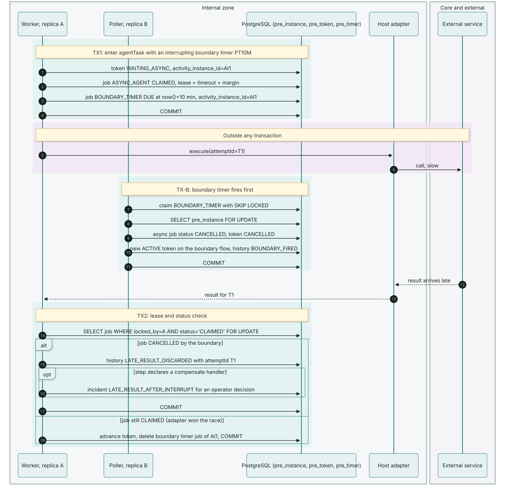
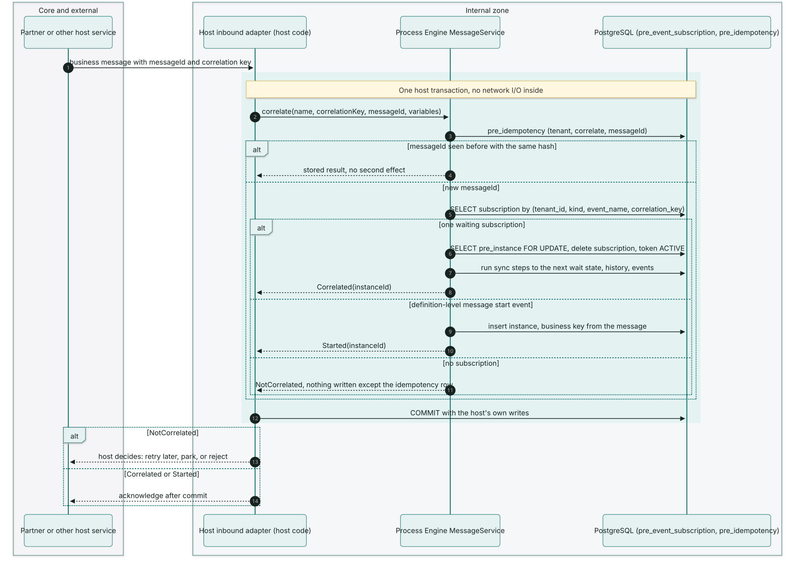
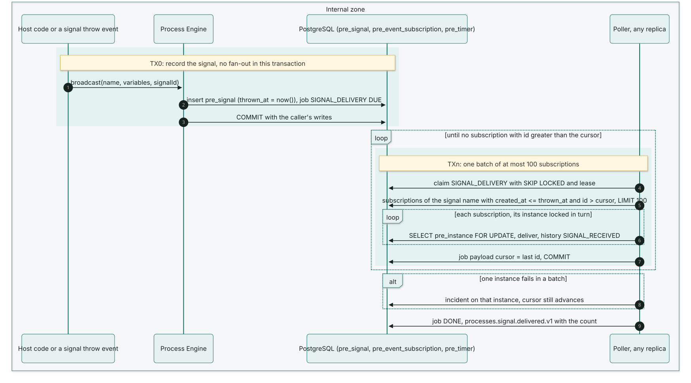

# Standards compliance: full BPMN 2.0 and DMN

Status: target architecture, 2026-11-18, updated 2026-11-19. The product owner decided on 2026-11-18 that BPMN 2.0 and DMN are fully supported on the roadmap, that CMMN is out of scope, and that full support is not required for M1 or M2 but the architecture must reach it without a rewrite ([ADR-0017](../adr/0017-full-bpmn-and-dmn-support-no-cmmn.md)). On 2026-11-19 the product owner decided P1 to P4 of section 9.2: FEEL null semantics from M1 (PD-058), scope tokens in M2 (PD-059, ADR-0020), the BPMN and DMN semantic models as the canonical model (PD-060, ADR-0018) and a HORUS-built FEEL (PD-061, ADR-0019). This document is the target, the staging and the list of changes the M1 and M2 designs need now. It is owned by architecture; requirement ids `TR-STD-*` are in [`docs/product/requirements.md`](../product/requirements.md).

**Product decisions of 2026-11-19 that change the staging.** The first release (reviewed 20 Nov, shipped by 22 Nov 2026) carries a first BPMN and DMN subset: BPMN 2.0 XML import of `startEvent`, `serviceTask`, `businessRuleTask`, `userTask`, `exclusiveGateway` and `endEvent`, and DMN 1.5 decision table import and export with a FEEL subset ([PD-084](../product/decisions.md#pd-084-first-bpmn-and-dmn-subset-in-the-first-release)). Full BPMN 2.0 and DMN is a target for Sun 22 Nov 2026, measured by daily DMN TCK, BPMN MIWG and executable-suite pass rates ([PD-085](../product/decisions.md#pd-085-target-full-bpmn-20-and-dmn-by-sun-22-nov-2026)); the DMN TCK test cases are build-time test data ([PD-086](../product/decisions.md#pd-086-dmn-tck-test-cases-as-build-time-test-data)). The staging in sections 6 and 11 is now the order of the conformance work, not a schedule after 1.0. `TR-STD-05` is unchanged: nothing is called conformant before its suites pass. The architect amends [ADR-0017](../adr/0017-full-bpmn-and-dmn-support-no-cmmn.md) decision 3 to match.

| If you need | Read |
|---|---|
| The decision and what it supersedes | [ADR-0017](../adr/0017-full-bpmn-and-dmn-support-no-cmmn.md) |
| Why the BPMN and DMN semantic models are canonical | [ADR-0018](../adr/0018-canonical-model-bpmn-and-dmn-semantic-models.md) (accepted) |
| Why FEEL is built here and how the current expression language maps to it | [ADR-0019](../adr/0019-feel-strategy-horus-built-deterministic-feel.md) (accepted) |
| The execution tree, scope tokens and event subscriptions | [ADR-0020](../adr/0020-execution-tree-scopes-and-event-subscriptions.md) (accepted) |
| The system-level design this extends | [`overview.md`](overview.md) |

Contents: 1 Scope. 2 Context. 3 Canonical internal model. 4 Expression strategy: FEEL. 5 Execution model changes. 6 Coverage by stage. 7 Principle conflicts. 8 Scale and bottleneck math. 9 Do now: changes to the M1 and M2 designs. 10 Conformance proof. 11 Staging after 1.0. 12 Deviation register. 13 Decisions needed and open questions.

## 1. Scope

### 1.1 What "full support" means

| Standard | Version | Target conformance | Verified by |
|---|---|---|---|
| BPMN | 2.0.2 (ISO/IEC 19510) | Process Modeling Conformance: import, display and export of every element of the process and collaboration diagrams (pools, lanes, message flows, artifacts, data objects and stores, BPMNDI) | BPMN MIWG reference models round trip (`TR-STD-10`) |
| BPMN | 2.0.2 | Process Execution Conformance: the operational semantics of every process element, including all event types and definitions, boundary events, event subprocesses, message correlation, signals, escalation, errors, compensation, transactions, multi-instance, loops, all gateways and data objects | HORUS executable conformance suite (`TR-STD-11`), with the deviations in section 12 |
| DMN | 1.5, the latest formal OMG version at the time of writing; later versions are tracked once the DMN TCK covers them | Conformance Level 3: decision requirements graphs (DRD), decision tables with every hit policy and aggregation, business knowledge models, decision services, every boxed expression, full FEEL | DMN TCK `compliance-level-2` (29 test folders) and `compliance-level-3` (122 test folders) (`TR-STD-20`, `TR-STD-21`) |

### 1.2 Out of scope

| Item | Treatment |
|---|---|
| CMMN | Not supported. A CMMN document is refused with `422 CMMN_UNSUPPORTED` (`TR-STD-26`). No case-management concepts enter the model |
| BPMN choreography and conversation diagrams | Not targeted for display or execution (Decision needed, section 13). A file that contains them is imported with the choreography kept byte for byte in the stored source document and a warning |
| BPEL Process Execution Conformance | Not targeted; BPMN 2.0.2 lists it as a separate conformance type |
| XPath, WSDL and XML Schema as the execution languages | Replaced by FEEL, registered host handlers and JSON Schema; listed as deviations in section 12 |

### 1.3 What does not change

The principles stay in force: the engines are libraries in the host JVM (ADR-0004), state lives in the host PostgreSQL (ADR-0002), evaluation is deterministic, definitions contain no code (ADR-0003 as superseded in part by ADR-0017 and ADR-0019), every network call is an Async Wait-State (ADR-0008), definitions are governed by maker-checker (ADR-0012). Full support is implemented inside these rules; where the standard and a principle collide, section 7 states the resolution.

## 2. Context



Source: [`diagrams/standards-context.mmd`](diagrams/standards-context.mmd).

1. Process and decision models arrive as BPMN XML or DMN XML from any modelling tool, or as JSON or YAML from Git.
2. The cockpit displays every BPMN and DMN symbol and edits within what the host can execute.
3. Import, display and export go through the host's engine REST layer behind the bank's gateway.
4. Parsing and conversion run outside any transaction; one short transaction stores the draft (unchanged from ADR-0013).
5. and 6. A business message reaches the host through the host's own inbound adapter (a REST endpoint or a broker consumer the host owns). The engine has no listener and no broker client.
7. The host adapter calls `correlateMessage` inside the host transaction; correlation is database work only.
8. A `businessRuleTask` calls a DMN decision or decision service through the `RuleEngine` API, in-process.
9. A message throw (send task, message end event, intermediate throw) is handed to the host outbox in the same transaction, through the `MessageAdapter` port.
10. and 11. The host relays it after commit; another host's consumer correlates it into the pool that host executes. Each pool of a collaboration is executed by the host that deployed it.
12. All state is in the host database through the host `DataSource`.
13. Events go to the host's event sink, as today.

## 3. Canonical internal model

### 3.1 Decision

The canonical model is the BPMN 2.0 and DMN semantic models (the OMG metamodels), held in `*-core` as sealed Java records. Our JSON is the canonical serialisation of that model: the form that is stored, hashed, diffed and approved. BPMN XML and DMN XML are first-class serialisations of the same model, read and written losslessly. The current `process-definition.v1` and `rule-set.v1` documents stay valid forever as a compact profile that a reader maps onto the model. Recorded as [ADR-0018](../adr/0018-canonical-model-bpmn-and-dmn-semantic-models.md), accepted on 2026-11-19 (PD-060 option 2); it replaces the notation part of PD-034. Verified by `TR-STD-28` (`RLE-024`, `PRE-043`).



Source: [`diagrams/standards-components.mmd`](diagrams/standards-components.mmd).

### 3.2 Why not keep our own model canonical with a lossless round trip

| Criterion | A. Our model canonical, lossless BPMN round trip | B. BPMN and DMN semantic models canonical, our JSON as serialisation (chosen) | C. BPMN or DMN XML text canonical, executed from the XML |
|---|---|---|---|
| Size of the model | Grows toward the BPMN metamodel anyway: about 60 element and event-definition kinds, plus our own names for each | One model, the standard's names; HORUS concepts are extension records | One model, but XML-shaped: namespaces, `xsi:type`, references by string |
| Mapping code | Two models and a two-way mapping per element; the mapping becomes the product and every BPMN feature is designed twice | One mapping per serialisation, mechanical: XML to model, model to XML, JSON to model, model to JSON | None for XML; JSON authoring needs a full mapping to XML |
| MIWG round trip | Every element must survive two translations; edge cases (multiple flows between the same nodes, event definitions shared by reference) need special fields | Model mirrors the XML; round trip is serialise and compare | Trivial for import and export |
| Hash, diff and approval | Unchanged from today | Hash and diff over the canonical JSON, which mirrors the model | Hash over XML is unstable (namespace prefixes, attribute order) unless we canonicalise XML |
| Our step types (`agentTask`, guardrails, async mode, forms, SLA) | Native | Extension records in a `horus` namespace, as in ADR-0013 today | Extension elements only |
| Cost before 1.0 | Lowest now, highest later | About 3 days in M1 and 5 days in M2 (decided as P3, section 9.2) | Rewrite of the M2 definition handling |

Option B wins because full BPMN means the model must be able to hold every element anyway; doing it once, in the standard's shape, removes a permanent translation layer. Option A remains possible but pays the design cost of every BPMN feature twice for as long as the product lives.

### 3.3 Model contents

| Package in `*-core` | Contents |
|---|---|
| `model.bpmn` | `Definitions`, `Process`, `Collaboration`, `Participant`, `MessageFlow`, `LaneSet` and `Lane`, sealed `FlowNode` (every task kind, `SubProcess`, `Transaction`, `AdHocSubProcess`, `CallActivity`, every gateway, `StartEvent`, `EndEvent`, `IntermediateCatchEvent`, `IntermediateThrowEvent`, `BoundaryEvent`), sealed `EventDefinition` (timer, message, signal, error, escalation, compensate, conditional, link, cancel, terminate), `SequenceFlow` with id, condition and default flag, `LoopCharacteristics` (standard, multi-instance), `IoSpecification`, `DataObject`, `DataObjectReference`, `DataStoreReference`, data associations, `Message`, `Signal`, `Error`, `Escalation`, artifacts |
| `model.dmn` | `Definitions`, `Decision`, `BusinessKnowledgeModel`, `DecisionService`, `InputData`, `KnowledgeSource`, `ItemDefinition`, information, knowledge and authority requirements, sealed `Expression` (literal, decision table, context, list, relation, invocation, function definition, conditional, iterator, filter) |
| `model.horus` | `AgentTaskSpec`, `GuardrailSpec`, `AsyncMode`, `FormSpec`, `SlaSpec`, `CompensateHandlerRef`, money type extension |
| `model.foreign` | Vendor extensions (for example `camunda:*`, `flowable:*`, `zeebe:*`) and unknown extension elements, kept as opaque, size-limited XML fragments keyed by element id. Never parsed beyond well-formedness, never executed, re-emitted on export |

### 3.4 Identity and hash rules

| Rule | Detail |
|---|---|
| Behaviour hash | `definition_hash` (processes) and `canonical_hash` (rule sets) stay the SHA-256 of the RFC 8785 form of the canonical JSON of the schema version the document is stored in, without the diagram part. The canonical JSON is written from the model, with every expression printed in its normal form (ADR-0026), so the same meaning gives the same hash in YAML, JSON, DMN XML and BPMN XML. Foreign extensions are excluded because they never change behaviour; layout is excluded as in ADR-0013 |
| Normal form | Only texts with the same behaviour are merged (ADR-0026 decision 2): non-integer numbers as strings with their scale kept, integers as JSON numbers within plus or minus 2^53 - 1, numbers never read or written through `double`; a `when` cell drops the column name only when it is the left operand; `, ` list separators; strings escaped (`'`, `\`, control and format characters as `\u` escapes), never Unicode-normalised, bidirectional controls refused; the M1 `datetime` in `Z`, zoned values keep their offset or zone; money at the currency scale. Printer and parser are frozen together per schema version (golden files in both directions with their hash pinned, a grammar coverage gate, property tests, a corpus of earlier versions). In `rule-set.v1` compound cells (arithmetic, `and`/`or`, function calls) keep their authored spacing, so they hash per text rather than per behaviour; a later schema version lifts this (ADR-0026) |
| Integrity | The engine compiles only from the stored canonical JSON; import checks `parse(print(model)) == model` (`422` otherwise); load checks the stored canonical JSON against `canonical_hash` and refuses to serve on a mismatch (ADR-0026 decision 4) |
| Git comparison | `source_hash` is the SHA-256 of the raw request bytes (UTF-8 only, no NUL, no byte order mark); a pipeline hashes the committed blob (`git show <commit>:<path> \| sha256sum`). It proves which file a version came from; `canonical_hash` means "same behaviour" (ADR-0026 decision 5, PD-036) |
| No re-hash on upgrade | A stored document is never re-serialised in a newer schema version. Upgrading a v1 definition to v2 is an author action that creates a new draft version with its own hash |
| Lowest expressible version | A BPMN or DMN import produces the lowest schema version that can express the model, so a definition exported from v1 and imported again keeps its v1 hash, whatever the authoring style of its expressions (`PRE-034`, `RLE-045`) |
| Source document | The bytes as received (JSON, YAML, BPMN XML or DMN XML) are stored with `source_format` and `source_hash`. The source document is provenance and lets a later engine version re-read what an earlier one could not represent; it is never executed |
| Node ids | BPMN ids are XML `ID` values. From M2 a step id may be any BPMN-style id (`^[A-Za-z_][A-Za-z0-9_.-]*$`, at most 100 characters); kebab-case stays the recommended style. Definition keys and rule set names stay kebab-case because they are URL path segments; the BPMN `process/@id` and the DMN `definitions/@name` are kept in the model |
| Flow ids | v1 has implicit sequence flows. The v1 reader generates flow ids deterministically: `<from>__<to>` for `next`, `<gateway>__b<i>` for branch `i`, `<gateway>__default`, `<gateway>__f<i>` for fork entry `i`. v2 and BPMN carry explicit flow ids. Graph diff, layout edges and history use flow ids from S1 |

### 3.5 v1 process documents in the model

| v1 step | BPMN model |
|---|---|
| `start`, `end` | `startEvent`, `endEvent` (none) |
| `userTask` | `userTask` with `horus` assignment, four-eyes, form and SLA records |
| `serviceTask` | `serviceTask` with `horus:handler` and `horus:mode` |
| `agentTask` | `serviceTask` with `horus:type="agentTask"` and the agent and guardrail records |
| `decision` | `businessRuleTask` with a decision reference |
| `exclusiveGateway` with `branches` and `default` | `exclusiveGateway` with conditional outgoing flows and a default flow |
| `parallelGateway` | `parallelGateway` |
| `timer` | `intermediateCatchEvent` with a timer definition |
| `callProcess` | `callActivity` |
| `saga` | `transaction` subprocess |
| `throwCompensation` | `intermediateThrowEvent` with a compensate definition |
| `compensate: bean.method` on a step | A compensation `boundaryEvent` on the step and a `serviceTask` with `isForCompensation="true"` and that handler, linked by an association (section 5.8) |

### 3.6 v1 rule sets in the model

A rule set is a DMN `definitions` named after the rule set, holding one `decision` with a `decisionTable`, one `inputData` per declared input, and an `itemDefinition` per declared type. Hit policies map `first` to `F`, `unique` to `U`, `collect` to `C` with the aggregator. The v1 per-output aggregate (`collect: sum` on one output and a plain list on another) has no single-table DMN form; DMN export writes an inner `C` table and an outer literal decision with a FEEL projection (`sum(for r in table return r.penalty)`), so the exported model evaluates to the same outputs.

Hit policy behaviour follows DMN 1.5 (PD-066, PD-088; `RLE-002`, `RLE-003`), checked against DMN 1.5 sections 8.2.11, 10.3.2.10 and 10.3.4.4. The export projection above therefore needs no null filter: FEEL `count` counts nulls as the engine does, and a null under `sum`, `min` or `max` fails in the engine before any export could differ.

| Case | Result |
|---|---|
| `unique`, no match | No match, as `first`: every output null; logged as outcome `OK` with no matched rule ids |
| `unique`, several matches | `UNIQUE_HIT_VIOLATION`: no outputs, every matched rule id logged |
| `collect` list output (no aggregator) | One entry per matched rule in `matchedRuleIds` order, `null` included, so lists stay aligned |
| `collect` with `count` | The number of matched rules, `null` values included (FEEL `count`, 10.3.4.4); not distinct values |
| `collect` with `sum`, `min`, `max` | Over the values of all matched rules, not distinct values (8.2.11). A `null` value is outside the domain of these functions: under `errorMode: strict`, the v1 default (PD-066), the decision is `EVALUATION_ERROR` naming the output and the rule, with no partial outputs and the matched rule ids logged. Under `errorMode: spec` (imported DMN, from S1) the result is `null` with a trace warning |
| Any hit policy, no match | Every output null, lists, aggregates and `count` included (10.3.2.10); logged as `OK` with no matched rule ids |
| `sum` of numbers | Exact; a sum that needs more than 34 significant digits is `EVALUATION_ERROR`, never rounded |
| `min`, `max` of strings | Unicode code point order, the order of `<` |

## 4. Expression strategy: FEEL

### 4.1 Decision

FEEL is the DMN expression language and becomes the engines' standard language. The engines get a HORUS-built, deterministic, sandboxed FEEL implementation in `rule-engine-core`, on the same typed tree, type checker and compiled evaluator as today's language. The current language (`horus-expr-v1`) stays as an authoring dialect, defined from M1 as a semantic subset of FEEL with a documented syntactic translation, so every v1 expression has a FEEL equivalent with the same result. Recorded as [ADR-0019](../adr/0019-feel-strategy-horus-built-deterministic-feel.md), accepted on 2026-11-19 (PD-061 option 1).

### 4.2 Options and licence check

Licences checked on 2026-11-18 from each project's repository licence file; they are checked again at adoption (`TR-LIC-01`).

| Option | Licence | For | Against | Verdict |
|---|---|---|---|---|
| 1. HORUS-built FEEL | Project licence | Determinism, sandboxing, money and slot-indexed compilation designed in; one typed tree for both dialects; no runtime dependency; the role rule that the Rule Engine is HORUS-built | About 22 engineer-weeks across S1 to S3 (assumption); a large specification to get right | Chosen |
| 2. `camunda/feel-scala` embedded | Apache 2.0; brings the Scala runtime (Apache 2.0) and `fastparse` (MIT) | Mature; a high DMN TCK score; permissive | It would be the product itself (the evaluator is the Rule Engine); adds about 6 MB of Scala runtime to every host classpath with Scala version conflicts; its own value model and clock handling; interprets per call, so the 100 us slot-indexed target is at risk; no money type; errors become `null` with no fail-closed mode | Rejected as a runtime dependency; used in test scope as a differential oracle (section 10.4) |
| 3. Apache KIE DMN and FEEL | Apache 2.0 | Complete DMN runtime; high TCK score | Large dependency tree with an ANTLR-generated parser; external Java functions by reflection exist in the runtime; same product-boundary objection | Rejected |
| 4. Keep only `horus-expr-v1` and translate a FEEL subset at import (ADR-0003 as written) | n/a | No new work | Cannot reach DMN Level 3; contradicts ADR-0017 | Superseded |

### 4.3 Semantic alignment of `horus-expr-v1` (must hold from M1)

| Topic | Rule in both dialects | Status |
|---|---|---|
| Null | Three-valued logic as in FEEL: `<`, `<=`, `>`, `>=`, arithmetic and functions on `null` give `null`; `=` and `!=` with `null` are two-valued (`null = null` is true, `5 != null` is true); `and`, `or`, `not` follow FEEL truth tables. A condition matches only when it evaluates to `true` | Decided (PD-058), from M1: `RLE-006` changes for `!=`, `not` and `not in` (rule engine DESIGN 3.2) |
| Numbers | One number type in evaluation: `BigDecimal` with `MathContext.DECIMAL128` (34 significant digits, `HALF_EVEN`), as FEEL specifies. `integer` and `decimal` are declared constraints on it. `7 / 2` is `3.5` | Applied (rule engine DESIGN 3.2) |
| `round(x, scale)` | Half-even, the FEEL `round half even` | Applied |
| `matches(s, p)` | Unanchored search with the XPath `fn:matches` flag set, no back-references or look-around, bounded as `TR-SEC-02` | Applied |
| Strings | Equality and ordering by Unicode code point | Applied |
| `datetime` | A FEEL `date and time` with offset `Z`; Java `Instant` | Applied |
| `today()`, `now()` | Read the evaluation clock in the rule set's `timeZone` (IANA, default `UTC`), recorded with the decision | Applied (`RLE-022`) |
| Money | A HORUS extension type in both dialects with the rules of rule engine DESIGN 3.4; DMN export marks money expressions as non-portable | Unchanged |

### 4.4 Translation table, `horus-expr-v1` to FEEL

| v1 | FEEL |
|---|---|
| `a == b`, `a != b` | `a = b`, `a != b` |
| `not x` | `not(x)` |
| `x in ['VN', 'SG']`, `x not in [...]` | `x in ["VN", "SG"]`, `not(x in [...])` |
| `x between a and b` | `x between a and b` |
| `x is null`, `x is not null` | `x = null`, `x != null` |
| `'GOLD'` or `"GOLD"` | `"GOLD"` |
| `5_000_000` | `5000000` |
| `date('2026-12-01')`, `datetime('2026-12-01T00:00:00Z')` | `date("2026-12-01")`, `date and time("2026-12-01T00:00:00Z")` |
| `12.50 USD` | `money(12.50, "USD")` (HORUS extension function) |
| `startsWith`, `endsWith`, `contains`, `matches` | `starts with`, `ends with`, `contains`, `matches` |
| `len(s)`, `lower(s)`, `upper(s)`, `trim(s)` | `string length(s)`, `lower case(s)`, `upper case(s)`, `replace(s, "^\s+|\s+$", "")` |
| `min(a, b)`, `max(a, b)`, `abs(x)`, `floor(x)`, `ceil(x)`, `round(x, n)` | `min(a, b)`, `max(a, b)`, `abs(x)`, `floor(x)`, `ceiling(x)`, `round half even(x, n)` (DMN 1.4 and later; `decimal(x, n)` in every DMN version, the same half-even rounding) |
| `coalesce(a, b)` | `if a != null then a else b` |
| `daysBetween(d1, d2)`, `monthsBetween(d1, d2)` | `(d2 - d1).days`, `years and months duration(d1, d2).years * 12 + years and months duration(d1, d2).months` |
| `addDays(d, n)`, `yearOf(d)`, `monthOf(d)` | `d + duration("P1D") * n`, `d.year`, `d.month` |
| `amount(m)`, `currency(m)` | `m.amount`, `m.currency` |
| `when` shorthand `"< 18"`, `"in ['VN', 'SG']"`, `"is null"`, `{}` | Unary tests `< 18`, `"VN", "SG"`, `null`, `-` |

Both dialects parse into the same `Expr` tree. Export to DMN writes FEEL text from the tree, so the translation is a printer, not a second parser.

### 4.5 FEEL implementation shape

| Part | Design |
|---|---|
| Parser | Hand-written recursive descent for the DMN 1.5 FEEL grammar. Names with spaces (`date and time`, `string length`) are resolved against the scope's known names during lexing, as the specification requires. Input limits: 64 KB per expression, nesting depth 64 |
| Types | `Type` sealed: number, string, boolean, date, time, date and time, days and time duration, years and months duration, list, context, range, function, any, null, and the HORUS money extension. Item definitions become context and constrained types. Static checks reject what is statically determinable; the rest is checked at run time (FEEL is dynamically typed) |
| Evaluator | Two profiles chosen at publish time per expression and recorded on the version: the compiled profile (S-FEEL: simple unary tests and simple arithmetic over slots, today's sub-100 us path) and the general profile (contexts, iteration, functions, filters) as a tree walk over immutable frames with a step budget |
| Built-in functions | Every DMN 1.5 built-in (conversion, boolean, string, list, numeric, date and time, temporal, range, context, sort). Implemented in Java without reflection; `sort` uses our own stable merge sort, so an inconsistent comparator cannot throw differently on different JVMs |
| User functions | FEEL function definitions and BKMs are pure closures over immutable frames; recursion depth at most 64 |
| External functions | `external` Java and PMML functions are refused at import (`422 DMN_EXTERNAL_FUNCTION_UNSUPPORTED`); host functions registered through `RuleFunctionRegistry` are callable by name and must be pure |
| Errors | FEEL defines many errors as `null`. Per decision model `errorMode`: `spec` (FEEL semantics, the error recorded as a warning in the decision trace, outcome `OK_WITH_WARNINGS`) or `strict` (today's `EVALUATION_ERROR`). Default `strict` for v1 rule sets and `spec` for imported DMN models; the TCK runs in `spec`. Guardrails fail closed in both modes (Decision needed P9) |
| SPI | `ExpressionLanguage` (language id, `compile(source, TypeEnvironment)`, `CompiledExpression.evaluate(EvaluationContext)`) in the `bpm-expression` library (ADR-0027), which also holds the HORUS FEEL engine. The Process Engine uses only this interface for gateway conditions, timer expressions, input and output mappings and script tasks |

### 4.6 Expression language ids

| Id | Meaning |
|---|---|
| `urn:horus-bpm:expr:v1` | `horus-expr-v1`; the only value accepted before S1 |
| `feel` | FEEL of the DMN version of the document; in BPMN and DMN XML the OMG FEEL namespace URI of that DMN version maps to it |
| Anything else (XPath, JavaScript, JUEL, Groovy) | Refused at import with `422 BPMN_EXPRESSION_LANGUAGE_UNSUPPORTED` or, for script tasks, `422 BPMN_SCRIPT_FORMAT_UNSUPPORTED` |

## 5. Execution model changes

The M2 runtime already has the right foundations: token rows, one `pre_instance` row lock per transition, a `SKIP LOCKED` job queue with leases, and the Async Wait-State. Full BPMN adds scope tokens, event subscriptions and cancellation. Recorded as [ADR-0020](../adr/0020-execution-tree-scopes-and-event-subscriptions.md), accepted on 2026-11-19 with scope tokens in M2 (PD-059 option 1). The M2 DDL of `pre_token` and `pre_compensation_stack` with `token_kind` and `scope_token_id` is in the process engine DESIGN section 7.

### 5.1 Execution tree and token states

Every scope (the process, a subprocess, a transaction, an event subprocess, a multi-instance body and each of its instances) is a token row of kind `SCOPE` or `MI_BODY`; flow positions are tokens of kind `FLOW` whose `scope_token_id` names their scope. Joins, compensation, cancellation and variable lookup walk this tree inside the instance lock.



Source: [`diagrams/execution-tree-states.mmd`](diagrams/execution-tree-states.mmd).

| From | Trigger | Guard | To | Stage |
|---|---|---|---|---|
| none | Scope entered (process start, subprocess, transaction, event subprocess, multi-instance body or instance) | Instance row locked | Scope token `WAITING_SCOPE`; start token `ACTIVE` | Root and `saga` scopes M2 (PD-059, `PRE-044`); others S1 |
| `ACTIVE` | Reaches a user task, async step or timer | As today | `WAITING_USER`, `WAITING_ASYNC`, `WAITING_TIMER`; boundary timers and subscriptions of the activity are created in the same transaction | Boundary parts S1 |
| `ACTIVE` | Reaches a message, signal or conditional catch, a receive task or an event-based gateway | Subscription written in the same transaction | `WAITING_EVENT` | S2 |
| any waiting status | Interrupting boundary event fires, terminate end event, instance cancel, migration off the node | Instance row locked | `CANCELLED`; open task `CANCELLED`; open job `CANCELLED` | `CANCELLED` and job cancellation M2 (applied, `PRE-041`); boundaries S1 |
| `WAITING_EVENT` | Another branch of the event-based gateway fired | Instance row locked | `CANCELLED`, its subscriptions deleted | S2 |
| `ACTIVE` | Reaches a parallel, inclusive or complex join | Instance row locked; join rule (5.9) | `JOINED`; the completing arrival creates one outgoing token | Parallel M2; inclusive S1; complex S3 |
| `WAITING_SCOPE` | Last child token completed | No live child | `COMPLETED`; the scope's outgoing flow continues in the parent scope | S1 |
| `WAITING_SCOPE` | Interrupting event subprocess or interrupting boundary on the scope | Instance row locked | Children `CANCELLED`, scope `CANCELLED` | S1 |
| `COMPLETED` | Compensation of its activity instances ran | | `COMPENSATED` | M2 |

### 5.2 Event subscriptions

Timers, including boundary and event-subprocess timers, stay in `pre_timer` as jobs; new job kinds are `BOUNDARY_TIMER`, `START_TIMER` and `SIGNAL_DELIVERY`. Message, signal and conditional waits are rows in a new table, created in S2 by an additive migration:

```sql
CREATE TABLE pre_event_subscription (
  tenant_id            TEXT        NOT NULL,
  id                   VARCHAR(26) NOT NULL,
  kind                 TEXT        NOT NULL CHECK (kind IN ('MESSAGE','SIGNAL','CONDITIONAL')),
  event_name           TEXT        NOT NULL,          -- message or signal name; conditional: node id
  correlation_key      TEXT,                          -- MESSAGE only; evaluated when the subscription is created
  definition_id        VARCHAR(26) NOT NULL,
  instance_id          VARCHAR(26),                   -- null for start events of an ACTIVE definition
  token_id             VARCHAR(26),                   -- waiting token, or the activity's token for a boundary
  activity_instance_id VARCHAR(26),                   -- the activation a boundary belongs to
  node_id              TEXT        NOT NULL,          -- catching element
  interrupting         BOOLEAN     NOT NULL DEFAULT TRUE,
  created_at           TIMESTAMPTZ NOT NULL,
  PRIMARY KEY (tenant_id, id),
  FOREIGN KEY (tenant_id, instance_id) REFERENCES pre_instance (tenant_id, id)
);
CREATE UNIQUE INDEX uq_pre_event_sub_message
  ON pre_event_subscription (tenant_id, event_name, correlation_key)
  WHERE kind = 'MESSAGE' AND instance_id IS NOT NULL;   -- one waiting receiver per key (5.4)
CREATE INDEX idx_pre_event_sub_signal
  ON pre_event_subscription (tenant_id, event_name, id) WHERE kind = 'SIGNAL';
CREATE INDEX idx_pre_event_sub_instance
  ON pre_event_subscription (tenant_id, instance_id);
CREATE INDEX idx_pre_event_sub_start
  ON pre_event_subscription (tenant_id, kind, event_name) WHERE instance_id IS NULL;

CREATE TABLE pre_signal (
  tenant_id   TEXT        NOT NULL,
  id          VARCHAR(26) NOT NULL,                   -- signalId, the idempotency key of the broadcast
  name        TEXT        NOT NULL,
  variables   JSONB       NOT NULL,
  thrown_at   TIMESTAMPTZ NOT NULL,
  thrown_by   TEXT,
  PRIMARY KEY (tenant_id, id)
);
```

Error and escalation need no stored subscription: the throwing transaction walks the execution tree upward under the instance lock to the nearest matching boundary event or event subprocess. Link events are resolved at compile time.

### 5.3 Boundary events on wait states

On entry to an activity with boundary events, the entering transaction creates the boundary timer jobs and subscriptions with the activity's `activity_instance_id`; the completing transaction deletes them. When an interrupting boundary fires on a `WAITING_ASYNC` step, the adapter call may still be running; it cannot be stopped from the database, so the rule is the same as instance cancel in M2:



Source: [`diagrams/boundary-interrupt-async.mmd`](diagrams/boundary-interrupt-async.mmd).

1. TX1 enters the step: token `WAITING_ASYNC`, async job `CLAIMED`, boundary timer job `DUE`, all with the same activity instance id.
2. The adapter runs outside any transaction.
3. The boundary timer fires first on any replica. Under the instance lock it sets the async job and the token to `CANCELLED` and starts a token on the boundary flow.
4. TX2 of the worker selects the job with `status = 'CLAIMED'` as well as the lease predicate. It finds `CANCELLED`, discards the result and writes `LATE_RESULT_DISCARDED` with the attempt id.
5. If the step declares a `compensate` handler, TX2 also opens incident `LATE_RESULT_AFTER_INTERRUPT`, because the external effect may have happened while BPMN considers the activity not completed and therefore not compensable. An operator decides.
6. If the adapter result wins the race, TX2 advances the token and deletes the boundary jobs of that activity instance; the timer claim then finds no job.

Non-interrupting boundaries (timer cycles, message, signal, escalation, conditional) create a new `ACTIVE` token in the parent scope and leave the activity running.

### 5.4 Message correlation



Source: [`diagrams/message-correlation.mmd`](diagrams/message-correlation.mmd).

| Topic | Design |
|---|---|
| API | As built (#491): `MessageService.correlate(messageName, correlationKey, payload, idempotencyKey)`; REST `POST /messages:correlate` (`processes:message:correlate`). It answers `DELIVERED` or `STARTED`; no waiting instance and no start definition is `422 MESSAGE_NOT_CORRELATED` |
| Transaction | Sync in-transaction: runs in the caller's transaction and does no network I/O. The host's consumer commits its offset or acknowledgement after the commit |
| Idempotency | As built (#491): the `Idempotency-Key` header is the key (operation `message-correlate`, ADR-0006): a redelivery returns the stored result and has no second effect (`TR-STD-13`). A refused message stores nothing, not even the key |
| Matching | One unique index probe on `(tenant_id, event_name, correlation_key)`. The correlation key is evaluated with FEEL or `horus-expr-v1` when the subscription is created, so correlation never evaluates expressions per waiting instance |
| One receiver per key | As built (#491): `pre_message_subscription` (V47) holds one row per waiting token, found by `(tenant_id, message_name, correlation_key)`. Two waiting tokens for one name and key are not refused when they subscribe; the correlate call answers `409 MESSAGE_CORRELATION_AMBIGUOUS` and nothing runs, never a silent choice. The boundary event stage keeps the unique-index design of the table above |
| Message start | A definition-level subscription of the effective version starts an instance; the business key can come from the message |
| Early messages | BPMN does not define buffering. Default: `NotCorrelated` with nothing stored, so the host retries or parks it. Optional per-host buffer with a time to live is an S3 feature (`messages.buffer-ttl`, default off) |
| Across services | Each pool runs in the service that deployed it. A message flow between pools in different services is a throw through `MessageAdapter` (outbox in the same transaction) and a correlate in the receiving host. The engine never consumes from a broker (section 7.5) |

### 5.5 Signal broadcast



Source: [`diagrams/signal-broadcast.mmd`](diagrams/signal-broadcast.mmd).

A broadcast writes `pre_signal` and, in one `INSERT .. SELECT` over the tenant's subscriptions of that name, one `SIGNAL_DELIVERY` job for each waiter in the caller's transaction, and returns (as built in #492; the job id is the subscription id, so a waiter is woken once). The poller fires each job in a transaction of its own that locks only that waiter, on any replica, so a broadcast to 100,000 waiting instances never becomes one long transaction and the thrower locks none of them. The batched keyset cursor in a single job, first designed here, trades one job row per waiter for one job per signal; it stays the option if the job rows of a very large broadcast become the cost. Delivery is exactly once per subscription: the subscription row is deleted (catch) or the boundary token created (non-interrupting) in the transaction that holds that instance's lock. Signal start events start one instance per definition subscribed, idempotent by `(signalId, definition)`. The signal scope is the tenant within one host; across hosts the host forwards the signal (section 7.5).

### 5.6 Event subprocesses

On scope entry the engine creates the timer jobs and subscriptions of the scope's event subprocess start events. Error and escalation start events are found by the upward walk of section 5.2. An interrupting event subprocess cancels every other child of the scope under the instance lock, then runs as a child scope; a non-interrupting one runs beside them, once per trigger.

### 5.7 Multi-instance and loops

| Topic | Design |
|---|---|
| Parallel | One `MI_BODY` token and `n` child scope tokens created in one transaction; `n` from `loopCardinality` or the size of `inputCollection`, at most `multi-instance.max` (default 1,000, may be lowered only). Each child has local variables `loopCounter` and the input element |
| Sequential | The body creates the next child when the previous completes |
| Completion | `nrOfInstances`, `nrOfActiveInstances`, `nrOfCompletedInstances` on the body token, updated under the instance lock; `completionCondition` evaluated after each child; remaining children `CANCELLED` |
| Output | `outputCollection` ordered by `loopCounter`, never by completion order, so the result is deterministic |
| Standard loop | `loopCondition` with `testBefore` and `loopMaximum` (required; default 1,000) |

### 5.8 Compensation and transactions

| Topic | Design |
|---|---|
| Mapping | Our `compensate` handler is BPMN compensation: a compensation boundary event on the activity and a compensation activity (`isForCompensation`). From S2 the compensation activity may be any activity or subprocess, not only a registered handler |
| Registration | Completing an activity instance with a compensation boundary pushes a row onto `pre_compensation_stack` for its scope, as in M2; from S2 the row also carries the activity instance id and the compensation activity's node id |
| Triggering | `throwCompensation` without `activityRef` compensates the scope, newest first (M2 behaviour); with `activityRef` only that activity's instances; `waitForCompletion` honoured; a compensation event subprocess replaces the default walk for its scope |
| Nested scopes | A completed subprocess keeps its compensation rows; compensating the parent compensates the child scope as a unit, newest first (answers overview open question on nested compensation for subprocesses; `callActivity` children stay separate instances and are compensated only through an explicit handler, as recommended for M2) |
| Transactions | Our `saga` is the BPMN `transaction` subprocess. S2 adds the cancel end event (compensate the transaction's activities, then leave through the cancel boundary) and hazards (an error boundary on the transaction leaves without compensation) |
| Handlers | Each compensation call stays an Async Wait-State job with its own retry, incident and a new attempt id, and receives the forward attempt id (`TR-IDEM-04`) |

### 5.9 Gateways

| Gateway | Rule |
|---|---|
| Exclusive | As M2; default flow; error `NO_OUTGOING_FLOW` incident when no condition holds and there is no default |
| Parallel | As M2 |
| Inclusive (S1) | Split: every flow whose condition is true, the default when none. Join: fires when no live token of the same scope can still reach it. The compiler stores per join the set of nodes that reach it without passing through it; under the instance lock the check scans the live tokens of the scope (typically under 20). The check runs on every arrival and every token end in the scope, so a token ending elsewhere cannot leave a join waiting (no lost wakeup) |
| Event-based (S2) | Subscriptions and timer jobs for every following catch event in one transaction; the first to fire cancels the others under the instance lock; instantiating event-based gateways at process start in S3 |
| Complex (S3) | `activationCondition` over `_activationCount` evaluated under the instance lock; reset semantics as in BPMN 2.0.2 section 13.4.4 |

### 5.10 Data, timers and other elements

| Element | Design |
|---|---|
| Data objects | Variables of their scope token (`local_variables` on the token, S1, nullable column added then). Lookup walks the scope chain to the instance variables |
| Data input and output associations | Input and output mappings evaluated by the expression SPI at activity start and end |
| Data stores | References only; reading or writing host data is a service task through a host handler. The engine never touches host tables (ADR-0002) |
| Timers | `timeDate`, `timeDuration` and `timeCycle` (ISO 8601 repeating intervals); expressions allowed; time zone from the definition (default `UTC`); due times use the database `now()` as today |
| Conditional events | Evaluated in the transaction that changes the instance's variables, for that instance's conditional subscriptions only; never by polling |
| Terminate end event | Cancels every token of its scope under the instance lock |
| Manual task, none task | Pass through, with a history row |
| Receive task, send task | As message catch and message throw (#491) |
| Script task | FEEL or `horus-expr-v1` only (section 7.1) |
| Lanes and pools | Display; lanes have no execution semantics in BPMN and assignment stays on the task. A user task with no `horus:assignee` takes the group named by its lane as a default (#497); an assignee the author wrote is never changed |
| Ad-hoc subprocess (S3) | Activities available in the scope; started by the host through `startAdHocActivity` or all at once for `ordering="Parallel"` with `cancelRemainingInstances` and `completionCondition` |

## 6. Coverage by stage

### 6.1 BPMN

"Import" means stored losslessly and displayed; "Execute" means approved definitions using it run. From S1 every element imports; activation of a definition with a non-executable element is refused with `422 BPMN_NOT_EXECUTABLE` naming the element, id and the stage that adds it.

| Element group | S0 (M3) | S1 (1.1) | S2 (1.2) | S3 (1.3) |
|---|---|---|---|---|
| Start, end (none), user, service, business rule tasks, exclusive and parallel gateways, timer catch, call activity, transaction as `saga`, compensate throw | Import, execute (ADR-0013 subset) | | | |
| Manual and none tasks | Execute (#485) | | | |
| Embedded subprocess | Execute (#486) | | | |
| Terminate end, link events (#493) | Execute (#493) | | | |
| Standard loop | Refused | Execute | | |
| Boundary timer, error, escalation (interrupting and non-interrupting); error and escalation end events, escalation throw event | Execute (#489, #493) | | | |
| Event subprocess with timer, error, escalation start | Refused | Execute | | |
| Inclusive gateway | Refused | Execute | | |
| Multi-instance (parallel, sequential) on tasks and subprocesses | Refused | Execute | | |
| Data objects, data associations, data stores (references) | Refused | Execute | | |
| Script task (FEEL or `horus-expr-v1`) | Execute with `horus-expr-v1` (#485) | Execute with FEEL | | |
| Message start, catch, boundary, throw and end; receive and send tasks | Refused | Import | Execute | |
| Signal start, catch, boundary, throw and end | Refused | Import | Execute | Start, intermediate catch, intermediate throw and end execute since 0.3.0 (#492); boundary with the boundary events |
| Conditional start (event subprocess), catch and boundary | Refused | Import | Execute | Intermediate catch and a process-level start execute since 0.3.0 (#492); the start of an event subprocess and the boundary come with them |
| Message start, intermediate catch and throw, end; receive and send tasks (#491) | Execute | | | |
| Message boundary | Refused | Execute | | |
| Signal start, catch, boundary, throw and end | Refused | Import | Execute | |
| Conditional start (event subprocess), catch and boundary | Refused | Import | Execute | |
| Event-based gateway | Refused | Import | Execute | Instantiating forms |
| Full compensation (compensation activities, `activityRef`, compensation event subprocess) and transaction cancel | Refused | Import | Execute | |
| Collaboration: pools, lanes, message flows, artifacts | Import, display and export (#497): one definition per executable pool, black-box pools kept | | Message flows execute between pools through 5.4 | |
| Complex gateway, ad-hoc subprocess, multiple and parallel multiple events | Refused | Import | Import | Execute |
| Message buffer with time to live | | | | Optional, off by default |
| MIWG round trip | Subset models | All reference models | | |
| Executable conformance suite | Subset scenarios | S1 scenarios 100 percent | S1 and S2 100 percent | All 100 percent |

### 6.2 DMN

| Feature | S0 (M1 to M3) | S1 (1.1) | S2 (1.2) | S3 (1.3) |
|---|---|---|---|---|
| Decision tables, hit policies `U`, `F`, `C` with `+ < > #` | M1 (v1 rule sets) | | | |
| Hit policies `A`, `P`, `R`, `O`; output values and priorities; input values | | Yes | | |
| Input expressions beyond input names; multiple outputs as compound outputs | | Yes | | |
| DMN XML import of a single decision table | M3 (RE-F-30, cut candidate) | | | |
| DRD: several decisions, input data, information requirements, knowledge sources (display), item definitions | | Yes | | |
| S-FEEL (Level 2) in the HORUS FEEL engine | | Yes | | |
| Full FEEL (Level 3): contexts, ranges, filters, paths, `for`, `some`, `every`, `if`, `instance of`, function definitions, every built-in | | | Yes | |
| Boxed expressions: literal, context, list, relation, invocation, function definition, conditional, iterator, filter | | Literal | All | |
| Business knowledge models, decision services (also callable from `businessRuleTask`) | | | Yes | |
| DMN `import` of other models, DMNDI round trip of every diagram element | | | | Yes |
| DMN TCK | | Level 2: 100 percent | Level 3: at least 95 percent | Level 3: 100 percent except policy exclusions |

## 7. Principle conflicts

Each conflict with its options and the recommendation. None needs a principle to be dropped; principle 9 changes wording (ADR-0017).

### 7.1 `scriptTask` versus principle 4 (no arbitrary code in definitions)

| Option | Consequence |
|---|---|
| A. Unsupported, refused with a clear error | Safe and simple; the most common migration blocker from other engines stays |
| B. Supported only through host-registered script handlers | Safe, but the script body in the file is then ignored or must match a registered name; reviewers read a script that is not what runs |
| C. Sandboxed script engine (JavaScript, Groovy, Python) | Breaks `TR-SEC-01` and determinism; GraalJS is UPL and Groovy brings reflection; a sandbox is a security product of its own |
| D. Script tasks whose `scriptFormat` is FEEL (or `horus-expr-v1`): the script is an expression, its value assigned to the result variable | Pure, deterministic, typed, reviewable as data; matches what current BPMN engines offer for script tasks |

**Recommendation: D, with A for every other format.** A script task with `scriptFormat` FEEL or `urn:horus-bpm:expr:v1` executes as an expression in the step transaction. Any other format is refused at import with `422 BPMN_SCRIPT_FORMAT_UNSUPPORTED` naming element, id, line and format, with the documented fix (replace by a service task bound to a registered handler). Listed as a deviation in section 12. Principle 4 holds unchanged.

### 7.2 `serviceTask` implementation attributes

BPMN uses `implementation` (default `##WebService`) and `operationRef` (a WSDL operation); vendor files carry `camunda:class`, `camunda:delegateExpression`, `camunda:expression`, `flowable:class` or `zeebe:taskDefinition`, several of which mean "load a class" or "evaluate a method-call expression".

**Recommendation.** A service task binds only to a handler registered through `StepRegistry`, by name: `horus:handler`, or `implementation="urn:horus-bpm:handler:<name>"`, or an `operationRef` whose operation name equals a registered handler. Importer options map vendor attributes to handler names as strings and never evaluate them: `delegateExpression="${kycCheck}"` becomes handler `kycCheck` if registered; a `zeebe:taskDefinition` or external task topic becomes a remote handler of that name; `camunda:class` and any method-call expression are refused (`422 BPMN_IMPLEMENTATION_UNSUPPORTED`). The import report lists every mapping for the approver. No reflection, no class loading (`TR-SEC-01`, `TR-STD-16`).

### 7.3 FEEL determinism

| Source of non-determinism | Resolution |
|---|---|
| `now()`, `today()` | Read the explicit evaluation clock, recorded with the decision (already `TR-DET-05`) |
| Time zones | The evaluation zone is the model's `timeZone` (default `UTC`), recorded; zoned date-times with IANA zone ids are computed with the JDK zone rules, and the decision log records the tz database version; replay with a different tz database version reports the difference instead of hiding it |
| Numeric functions (`sqrt`, `log`, `exp`, `power` with decimals) | `BigDecimal` with `DECIMAL128` where exact; `StrictMath` (bit-for-bit identical on every JVM) converted to `DECIMAL128` otherwise; documented precision |
| Sorting and context order | Own stable merge sort; context entries keep insertion order |
| External functions (Java, PMML) | Refused at import; host functions must be registered and pure |
| Non-termination (recursive functions, `for` over huge ranges) | Step budget per evaluation (`evaluation.feel-step-budget`, default 100,000) and recursion depth 64; exceeding either is `EVALUATION_BUDGET_EXCEEDED`, deterministic because steps are counted, not timed |
| Errors becoming `null` | `errorMode` `spec` or `strict` per model (section 4.5); a guardrail treats `null` as `allow = false` in both modes |

**Recommendation.** Full FEEL is deterministic by construction under these rules; principle 3 holds. Static typing becomes "everything statically determinable is checked at publish time" for FEEL, since FEEL is dynamically typed; `TR-DET-02` keeps its meaning for `horus-expr-v1`.

### 7.4 Performance targets under full FEEL

`TR-PERF-01` (p99 under 100 us for a 200-row `first` table) was set for a closed language. Full FEEL allows unbounded work in one expression.

**Recommendation.** Two published profiles, chosen at publish time and shown in the cockpit per decision. The compiled profile covers S-FEEL tables and keeps `TR-PERF-01` unchanged: a 200-row table with 5 simple unary tests per row is about 1,000 tests at about 50 ns each, 50 us. The general profile covers the rest, with a p99 target of 1 ms for a 10-decision DRG of S-FEEL tables and for a 20-entry boxed context with list functions over 100 items (about 3,000 steps at 100 to 300 ns), and a hard bound by the step budget (100,000 steps, about 10 to 30 ms). `TR-STD-24` records these as Should targets with the JMH suite of `TR-PERF-11` extended.

### 7.5 "A library, never a server" versus message correlation across services

Collaboration diagrams model pools in different services exchanging messages, and BPMN signals are broadcast "globally".

**Recommendation.** The principle holds without amendment. The engine offers `correlate` and `broadcast` as in-process, in-transaction APIs and a `MessageAdapter` port for throws, which the default implementation hands to the host's event publisher so the host writes it to its own outbox in the same transaction. The host owns every listener, broker client and HTTP endpoint (the optional engine REST module runs in the host JVM). Cross-service guarantees are at-least-once delivery from the host's transport plus exactly-once effect through `messageId` idempotency. Signal scope is one tenant in one host; a host that wants a wider scope forwards the signal, and the deviation register says so. Each pool is executed by the host that deployed it; the federated cockpit shows a conversation across hosts by correlation key, read from each host (ADR-0014), with no aggregator.

## 8. Scale and bottleneck math

Targets, not measurements, on the reference shape of [`overview.md`](overview.md) section 8: one replica with a 20-connection pool, PostgreSQL on 4 vCPU, 1 ms round trip.

| Resource | Baseline | Cost model | 10x | Where it breaks and what to do |
|---|---|---|---|---|
| Message correlation | 1,000 correlations/s per replica | Idempotency insert, one index probe, instance lock, token update, history insert, subscription delete: about 3 ms = 3 busy connections | 10,000/s = 30 busy, above the pool | Three replicas; correlation is per instance, so no cross-instance contention |
| Subscription table | 1 million waiting instances with one message subscription each | About 200 bytes per row plus about 100 bytes per index entry in 4 indexes: about 600 MB | 10 million: about 6 GB | Partial indexes keep each index to its kind; probe cost stays one B-tree descent |
| Boundary events | 1,000 transitions/s, 30 percent entering an activity with a boundary timer | One insert at entry and one delete at exit: about 0.4 ms each, 300 x 0.8 ms = 0.24 busy connections | 2.4 busy | `pre_timer` churn of about 600 dead tuples/s: per-table `autovacuum_vacuum_scale_factor = 0.01`; the poll index is partial |
| Signal broadcast | 10,000 subscribers | 100 batches x 100 deliveries x about 1.5 ms = 15 s on one connection, 1 busy connection during delivery | 100,000 subscribers: 150 s | Deliveries spread over time by design; above 100,000 subscribers split the cursor range across replicas (S3) and alert on `horus_pre_signal_delivery_lag_seconds` |
| Parallel multi-instance | 1,000 children | 1,000 token rows and up to 1,000 task rows inserted in batches: about 40 ms in one transaction holding the instance lock | `multi-instance.max` caps it | Child completions of one instance serialise on its row lock at about 2 ms each: 1,000 completions take at least 2 s; documented, and `lock_timeout` 5 s on the completion path makes a burst fail fast with `409 INSTANCE_BUSY` and `Retry-After` rather than queue |
| Inclusive join check | Up to 20 live tokens per scope | One in-memory scan per arrival or token end under the instance lock | 200 tokens: still under 0.1 ms | Bounded by the definition size limits (`TR-DEF-05`) |
| Compiled process model cache | 1,000 entries x about 50 KB for a 50-node definition | 50 MB | 500-node definitions: about 500 KB each, 500 MB unbounded | Weight-based bound in the cache (`cache.max-weight`), as `TR-PERF-06` does for rule sets |
| Source documents | 1,000 versions per tenant x 100 KB average BPMN XML | 100 MB, about 25 MB after TOAST compression | 1 GB | Not read on any request path except export and re-import |
| FEEL general profile | 200 decisions/s per replica using boxed contexts | 0.5 ms CPU each = 10 percent of one core | 2,000/s = one core | CPU only, no database cost; step budget caps the worst case at about 30 ms |

## 9. Do now: changes to the M1 and M2 designs

The test for "do now" is whether the change is expensive or impossible later. Adding a nullable column is a metadata-only change in PostgreSQL and is cheap later, so no column is reserved early. What is expensive later is data that was never stored, identities and hashes that change, semantics that logged decisions already depend on, and Java API shapes frozen at 1.0.

### 9.1 Applied now (small; milestone-tagged in the module documents)

| # | Change | Milestone | Where | Verified by |
|---|---|---|---|---|
| DN-01 | Keep the source document: `source_format`, `source_document`, `source_hash` on `rle_version` and `pre_definition` | M1 (rules), M2 (processes) | Rule engine DESIGN 5, process engine DESIGN 7 | `RLE-020`, `PRE-039` (`TR-STD-01`) |
| DN-02 | Expression language id per document: `expressionLanguage` in `rule-set.v1` and `process-definition.v1`, only `urn:horus-bpm:expr:v1` accepted | M1, M2 | Both schemas | Schema tests |
| DN-03 | Step ids in the BPMN id form (`^[A-Za-z_][A-Za-z0-9_.-]*$`, at most 100); kebab-case recommended; definition keys and rule set names unchanged | M2 | `process-definition.v1`, `definition-layout.v1` | `PRE-042` (`TR-STD-03`) |
| DN-04 | Hash identity rules of section 3.4: hash in the stored schema version, never re-hashed on upgrade, imports produce the lowest expressible schema version | M1, M2 | Rule engine DESIGN 3.1, process engine DESIGN 5.2 | `PRE-024`, `PRE-034`, `PRE-039` |
| DN-05 | `ExpressionLanguage` SPI as the only way the Process Engine evaluates expressions; Java value mapping documented with FEEL types reserved | M1 | Rule engine DESIGN 3.5, process engine DESIGN 2 | API review at Gate 1 |
| DN-06 | Rule set `timeZone` (IANA, default `UTC`), versioned; `today()` and `now()` in that zone; zone recorded | M1 | `rule-set.v1`, rule engine DESIGN 3.2 | `RLE-022` |
| DN-07 | Number, rounding, regex and string semantics of section 4.3 written down (they were unspecified) | M1 | Rule engine DESIGN 3.2 | `RLE-021` property tests |
| DN-08 | A rule set is a DMN decision model with one decision; `DecisionRequest` gets an optional `decision` id before the 1.0 freeze; M1 accepts only the rule set's own decision | M1 | Rule engine DESIGN 4.1 | API review |
| DN-09 | Handler results are sealed with a `BusinessError(code, message)` variant; before S1 it opens incident `UNHANDLED_BUSINESS_ERROR`; from S1 it routes to error boundaries | M2 | Process engine DESIGN 6.1 | `PRE-040` |
| DN-10 | Cancellation of in-flight async jobs: job status `CANCELLED`, TX2 requires `status = 'CLAIMED'`, token status `CANCELLED`; instance cancel and migration off a step use it; late results discarded and recorded. Needed in M2 for cancel; the same rule serves interrupting boundaries | M2 | Process engine DESIGN 3.4, 4, 7 | `PRE-041` |
| DN-11 | Cockpit node types keyed by BPMN element type plus HORUS subtype; an unknown type renders as a labelled generic node; `/api/bpm/meta` may carry a `standards` object per module so a federated cockpit knows what each host executes | M2 | Cockpit DESIGN 10, `bpm-meta.v1` | `CKP-029` |

### 9.2 Larger decisions for the product owner

P1 to P4 and P6 to P9 were decided on 2026-11-19; P5 (release dates) is with the product owner.

| # | Change | Milestone | Effort (assumption) | Cost if not done now | Recommendation or decision |
|---|---|---|---|---|---|
| P1 | FEEL null semantics for `horus-expr-v1`: `x != 'GOLD'` with `x` null becomes true and `not(x < 5)` with `x` null becomes null (not matched). Changes `RLE-006` in those two cases and for `x not in [...]`, which translates to `not(x in [...])` and so matches a null `x` like `!=`; the wiki expression page changes too | M1 | 1 day, plus 3 days for the differential test harness with a reference FEEL implementation in test scope | After M1 ships, logged decisions depend on today's semantics; aligning later breaks replay (`TR-DET-05`) or leaves v1 forever different from FEEL | **Decided** 2026-11-19: accepted (PD-058 option 1); `RLE-006`, `RLE-021`, `TR-STD-02` |
| P2 | Execution tree with scope tokens: a root scope token per instance and one per `saga`; `scope_token_id` replaces the text `scope_id`; joins and compensation keyed by scope token | M2 | About 4 days in M2 | Joins and compensation written for flat scopes are rewritten for subprocesses, event subprocesses and multi-instance in S1, and every in-flight instance needs a data migration | **Decided** 2026-11-19: accepted (PD-059 option 1, ADR-0020); `PRE-044`, `TR-STD-29` |
| P3 | Canonical semantic model in `*-core` (ADR-0018): the M1 rule set model shaped as DMN definitions, decision and decision table; the M2 process model as flow nodes and sequence flows with ids; the M3 BPMN subset reader built on it | M1, M2, M3 | About 3 days in M1 and 5 days in M2 | The M3 BPMN reader and every later stage map onto a model that cannot hold full BPMN; a rewrite of the definition layer in S1 | **Decided** 2026-11-19: accepted (PD-060 option 2, ADR-0018); supersedes the notation part of PD-034; `RLE-024`, `PRE-043`, `TR-STD-28` |
| P4 | HORUS-built FEEL (ADR-0019) | S1 to S3 | About 22 engineer-weeks: S-FEEL core 6, full FEEL 12, TCK completion 4 | n/a (after 1.0) | **Decided** 2026-11-19: accepted (PD-061 option 1); a reference FEEL engine in test scope only |
| P5 | Release targets and capacity for S1 (1.1), S2 (1.2), S3 (1.3) | After 1.0 | About 60 engineer-weeks in total for both engines and the cockpit symbols (section 11) | n/a | **Decision needed.** Dates by the product owner |
| P6 | Principle 9 wording, the vision non-goal "never a full BPMN 2.0 implementation" and the PRD non-goals | Now | Documentation | Public documents contradict ADR-0017 | **Decided** 2026-11-19 (PD-063) |
| P7 | Test-data licence: the BPMN MIWG reference models are CC BY 3.0, outside Apache 2.0, MIT and BSD. Used as test data fetched at build time with attribution, never shipped | S1 | None | No MIWG evidence | **Decided** 2026-11-19 (PD-064): allowed as test data fetched at build time with attribution, never shipped (`TR-LIC-01`) |
| P8 | Choreography and conversation diagrams not targeted | Now | None | | **Decided** 2026-11-19 (PD-065): not targeted; kept in the source document with a warning; deviation register row in section 12 |
| P9 | FEEL `errorMode` default: `spec` for imported DMN models, `strict` for v1 rule sets | S2 | None | | **Decided** 2026-11-19 (PD-066): error mode is a declared property of each decision model with these defaults, changed only by a new approved version (`TR-STD-23`) |

### 9.3 Deliberately not done now

| Item | Why later is cheap |
|---|---|
| `pre_event_subscription`, `pre_signal`, message buffer | New tables in S2; no existing row changes |
| `local_variables` and `activity_instance_id` on tokens | Nullable columns, metadata-only `ALTER TABLE`; tokens in flight at the upgrade get an activity instance id on their next transition |
| Wider `hit_policy` and `job_kind` check constraints | `ADD CONSTRAINT ... NOT VALID` then `VALIDATE CONSTRAINT`, which takes only `SHARE UPDATE EXCLUSIVE` |
| Decision trace column for DRGs on `rle_decision` | Nullable column on the partitioned parent, metadata-only |
| JSON schema v2 documents | New schema files; v1 imports forever |

## 10. Conformance proof

| Suite | What it proves | How it runs | Gate |
|---|---|---|---|
| 10.1 DMN TCK | DMN Level 2 and 3 behaviour | Module `rule-engine-tck` (test only, never published) runs the TCK at a pinned commit. The repository root carries an Apache 2.0 licence file while its README offers the test cases under a Creative Commons share-alike licence, so the stricter reading applies: the test cases are build-time test data, fetched with the archive's SHA-256 checked, never committed or shipped, with attribution (PD-086, `TR-LIC-01`). Results are written in the TCK results format so they can be submitted to the public TCK results site. Policy exclusions (external Java and PMML functions) are listed by test id | `TR-STD-20`, `TR-STD-21` |
| 10.2 BPMN MIWG round trip | Process Modeling Conformance: import and export of every element and its diagram | The 22 reference models (A, B and C series) at a pinned commit, fetched at build time (CC BY 3.0, pending P7). Import, export, then compare with the MIWG comparison approach (the MIWG tools are MIT): semantic equality of elements, attributes, references and BPMNDI, ignoring prefixes, order and whitespace; the export validates against the BPMN 2.0.2 XSD | `TR-STD-10` |
| 10.3 HORUS executable conformance suite | Process Execution Conformance | One BPMN file per behaviour and a scripted scenario (start, correlate, broadcast, complete, advance the `TestClock`), asserting token positions, history and variables; about 200 scenarios by S3, grouped by element and lifecycle; concurrency-sensitive scenarios also run on two replicas; published with the project | `TR-STD-11` |
| 10.4 Differential FEEL testing | v1 and HORUS FEEL agree with a reference FEEL | The project's seeded generator (PD-090) generates expressions and inputs, and a failure prints its seed; results compared with `camunda/feel-scala` (Apache 2.0) in test scope only. From M1 it checks that every v1 expression's FEEL translation gives the same result, null cases included (PD-058); from S1 it checks the HORUS FEEL engine | `TR-STD-02`, `TR-STD-27` |
| 10.5 Graph invariants | No lost tokens, joins fire exactly once, every token ends or waits | Property tests over generated BPMN graphs with all S1 to S3 elements | `TR-STD-11` |

## 11. Staging after 1.0



Source: [`diagrams/standards-staging.mmd`](diagrams/standards-staging.mmd).

| Stage | Release | Content | Gap after the stage | Effort (assumption) |
|---|---|---|---|---|
| S0 | M1 to M3 (before 1.0) | Section 9.1 and 9.2 P1 to P3 (decided 2026-11-19); ADR-0013 subset import and export; DMN single-table import (RE-F-30) | Everything in section 6 marked S1 to S3 is refused by name (`TR-STD-04`) | Inside M1 to M3 plus P1 to P3 |
| S1 | 1.1 | Scopes and errors: subprocess, boundary timer, error and escalation, event subprocess (timer, error, escalation), inclusive gateway, multi-instance, loops, data objects, terminate, link, script task with `horus-expr-v1`; full BPMN import and display with MIWG round trip; DMN Level 2, every hit policy, DRDs, item definitions, S-FEEL in the HORUS FEEL engine; cockpit BPMN and DMN symbol sets | No messages, signals or conditional events, no event-based gateway, compensation only through handlers, no transaction cancel; no full FEEL, BKMs or boxed expressions other than literal | BPMN about 12, DMN about 8, cockpit about 4 engineer-weeks |
| S2 | 1.2 | Events across instances: message events and tasks with correlation, signals with broadcast, conditional events, event-based gateway, full compensation, transaction cancel and hazards, message flows between pools through hosts, script tasks with FEEL; full FEEL, every boxed expression, BKMs, decision services | Complex gateway, ad-hoc subprocess, multiple events, instantiating event-based gateways, message buffer; DMN imports, remaining TCK cases | BPMN about 14, DMN about 12, cockpit about 2 engineer-weeks |
| S3 | 1.3 | Completeness: complex gateway, ad-hoc subprocess, multiple and parallel multiple events, instantiating event-based gateways, optional message buffer; conformance suite 100 percent; DMN TCK Level 3 100 percent except policy exclusions; DMN `import`; DMNDI | The deviations of section 12 only | BPMN about 6, DMN about 2 engineer-weeks |

Every stage is additive for the Java API, REST and definition formats: new interfaces (`MessageService`, `SignalService`), new endpoints, new schema versions, new enum values in result types that hosts read but do not switch on exhaustively, which ADR-0016 already requires to be documented.

## 12. Deviation register

Published per release (`TR-STD-05`). The claim is "BPMN 2.0.2 Process Execution Conformance and DMN 1.5 Conformance Level 3, with these deviations".

| Standard text | HORUS behaviour | Reason |
|---|---|---|
| BPMN default expression language XPath, default type language XML Schema | FEEL and `horus-expr-v1`; data types as JSON Schema and FEEL item definitions. XPath expressions refused | Principle 4 and a single expression language across both engines |
| BPMN service operations defined by WSDL (`##WebService`) | Bound to registered host handlers by name | No reflection, no engine network I/O (principles 1 and 4) |
| Script tasks in any `scriptFormat` | FEEL and `horus-expr-v1` only | Principle 4 (section 7.1) |
| Signal scope "global" | One tenant in one host; wider scope by host forwarding | Principle 1 (section 7.5) |
| Message arriving before its receiver | Not buffered by default; `NotCorrelated` returned | BPMN leaves it open; the host's transport keeps the message |
| DMN external functions (Java, PMML) | Refused; host functions through `RuleFunctionRegistry` | Principles 3 and 4 |
| FEEL evaluation without bounds | Step budget and recursion depth | Principle 3 |
| FEEL errors as `null` | Per-model `errorMode`; guardrails fail closed | Banking fail-closed rule |
| Choreography and conversation | Imported with that part kept untouched in the stored source document and a warning naming it; not displayed or executed | Not targeted (PD-065) |
| DMN vendor `extensionElements`, foreign attributes and DMNDI on export | Accepted on import and kept only in the stored source document; not read, never executed, and not written back by DMN export, so an exported file has no diagram and no vendor extensions | DMNDI round trip arrives in stage S3 (section 6.2); until then the source document (`?include=source`) keeps them byte for byte |

## 13. Decisions needed and open questions

| # | Question | Recommendation | Owner and gate |
|---|---|---|---|
| 13.1 | P5 of section 9.2 (the others decided on 2026-11-19) | As stated there | Product owner |
| 13.2 | `MESSAGE_KEY_AMBIGUOUS`: should a second instance waiting on the same message key be refused at its subscription instead of raising an incident? | Incident, because refusing would fail an unrelated business step | Architect, S2 design |
| 13.3 | Message flows between two pools deployed in the same host: deliver directly in the same transaction, or always through the outbox? | Through the outbox by default, so behaviour does not change when a pool moves to another host | Architect, S2 design |
| 13.4 | Error codes `BPMN_NOT_EXECUTABLE`, `BPMN_SCRIPT_FORMAT_UNSUPPORTED`, `BPMN_IMPLEMENTATION_UNSUPPORTED`, `BPMN_EXPRESSION_LANGUAGE_UNSUPPORTED`, `CMMN_UNSUPPORTED`, `DMN_EXTERNAL_FUNCTION_UNSUPPORTED`, `EVALUATION_BUDGET_EXCEEDED`, `409 INSTANCE_BUSY` and incident codes `UNHANDLED_BUSINESS_ERROR`, `LATE_RESULT_AFTER_INTERRUPT`, `MESSAGE_KEY_AMBIGUOUS` | Add to the wiki error-code page when their stage is designed; `UNHANDLED_BUSINESS_ERROR` with M2 | Documentation, M2 |
| 13.5 | DMN 1.6 or later published before S3 | Track it in S3 if the TCK covers it | Architect, S3 |
