# Product design review

| Field | Value |
|---|---|
| Type | Review summary |
| Owner area | Product |
| Last reviewed | 2026-11-19 |
| Status | Decided except PD-062 (standards track dates), which waits for the product owner |

## What the engine is

HORUS Agentic BPM is two Java libraries and a static cockpit that run inside a team's own Spring Boot service and PostgreSQL database, with no engine cluster, broker or separate login. The Rule Engine evaluates versioned decision tables in the service's transaction; business staff change them through simulation and a second approver, without a deployment. The Process Engine runs human, service, decision and AI agent steps with safe retries, compensation and SLAs; an agent's output must pass a JSON Schema and a deterministic guardrail rule set before the process moves, and on violation a person decides. The cockpit lets authors, approvers, operators and auditors do this work without SQL or scripts, and cannot weaken any engine control. Details: [vision](vision.md).

## Product principle: generic by design

The engines must serve many businesses and contexts, the way Camunda's embeddable engine does ([PD-074](decisions.md#pd-074-product-principle-generic-by-design), decided by the product owner on 2026-11-19; principle 13 in the [vision](vision.md#product-principles)).

- Every business behaviour is optional and configurable per host or tenant, with a safe default.
- Business logic enters through extension points (SPI interfaces, Spring beans, hooks), not as built-in behaviour.
- Nothing bank-specific is hard-coded: currencies, tiers, fee and reason codes, roles, languages, calendars and SLA periods come from definitions, configuration or host extensions.
- The core stays small.

Guarantees are not settings: tenant isolation, append-only audit, determinism, no code in definitions, fail-closed guardrails and the four-eyes rule on publication. A setting that relaxes a control is off by default, logged when used and visible in the host's settings. Kill assumptions K25 and K26 in the [roadmap](roadmap.md#kill-assumptions) test that the settings stay testable and that the defaults keep the newcomer path under 30 minutes.

Decision rights: since 2026-11-19 the product manager decides business and use-case questions for the engines under delegated authority; the product owner keeps release dates, licensing and commercial terms, and can overrule any entry ([PD-073](decisions.md#pd-073-decision-rights-for-business-and-use-case-questions)).

## The three modules

| Module | Job | First version | Users | PRD |
|---|---|---|---|---|
| Rule Engine | Evaluate governed decision tables in process; change them without a deployment | 0.1 in M1 | Host developer, rule author, approver and auditor ([eight bank roles](rule-engine-users-and-journeys.md)) | [prd-rule-engine.md](prd-rule-engine.md) |
| Process Engine | Run human, service, decision and agent steps with idempotency, compensation and SLAs | 0.1 in M2 | Host developer, operations team, agent step designer | [prd-process-engine.md](prd-process-engine.md) |
| Cockpit | Let people approve, simulate, investigate and operate both engines | 0.1 in M1, 0.2 in M2 | Author, approver, operator, auditor | [prd-cockpit.md](prd-cockpit.md) |

## Roadmap

| Milestone | Target date | Outcome | Features |
|---|---|---|---|
| M0 Architecture | 4 Dec 2026 | Contracts verified against a live PostgreSQL; this review decided | 3 |
| M1 Rule Engine 0.1, Cockpit 0.1 | 15 Jan 2027 | Business staff change governed rules without a deployment, from one cockpit that reaches every host | 57 |
| M2 Process Engine 0.1 with `agentTask`, Cockpit 0.2 | 26 Mar 2027 | Approvals, sagas and guarded AI agent steps inside the team's own service; every instance on its diagram; one inbox across services | 66 |
| M3 Agentic depth, compatibility, 1.0 | 21 May 2027 | Production use with offline evaluation of agent changes, governed process changes and a frozen API | 33 |
| S1 Standards 1.1 | Pending PD-062 (escalated to the product owner) | Any BPMN 2.0 model imported and shown in full; subprocesses, boundary events and multi-instance run; DMN Level 2 | 11 |
| S2 Standards 1.2 | Pending PD-062 | Messages and signals across services; full FEEL and DMN Level 3 | 5 |
| S3 Standards 1.3 | Pending PD-062 | BPMN 2.0.2 execution and DMN Level 3 conformance with published deviations | 2 |
| After 1.0 | Candidates | Agent-chosen steps, multi-agent planning, more databases, a hosted cockpit; the emergency approval path until its ADR sets a milestone; tenant exit and sealed audit months, targeted 1.1 | 13 |

Full plan: [roadmap.md](roadmap.md). M2 and M3 moved by two weeks each when the product owner accepted the cockpit direction on 2026-11-18 (PD-042). Date risk: M1 has about five working weeks after the year-end break and holds only with the pre-approved cuts in PD-031 (decided 2026-11-19); M2 has about nine working weeks after the Lunar New Year break and keeps six cut candidates; M3 carries 33 features in about seven working weeks, with ten cut candidates, and depends on two outside adopters (kill assumption K13). Agent-chosen steps moved from M3 to after 1.0 (PD-028, decided 2026-11-19).

## Feature map in numbers

| Module | Features | Specified | Spec gap | Design preview |
|---|---|---|---|---|
| Rule Engine | 49 | 18 | 22 | 9 |
| Process Engine | 66 | 21 | 34 | 11 |
| Cockpit | 45 | 12 | 28 | 5 |
| Cross-cutting | 30 | 12 | 12 | 6 |
| **Total** | **190** | **63** | **96** | **31** |

The standards direction (PD-057) added 27 features: 10 foundations before 1.0 (8 already specified) and 17 standards-track previews, with PE-F-40 moved into 1.2. 52 SPEC statements are indexed to a feature. The module SPECs hold 93; the 41 written since the last index (RLE-017 to RLE-019, PRE-018 to PRE-038, CKP-012 to CKP-028) are not yet mapped, so some features shown as spec gaps may already be specified. Mapping them is the next feature map update. PD-058 to PD-060 (decided 2026-11-19) added 3 foundation features, now counted: RE-F-41 and X-F-28 in M1, PE-F-58 in M2. PD-028 moved PE-F-39 from M3 to after 1.0. PD-043 (decided 2026-11-19) added 7 features (3 in M1, 3 in M2, 1 in M3) and moved batch evaluate from M1 to M2; PD-012 added the emergency path (RE-F-48) as later until its ADR. PD-056 (decided 2026-11-19) added 2 cockpit features: plain-language policy readings in M1 (CK-F-44) and the condition builder lens in M3 (CK-F-45). The delegated decisions of 2026-11-19 count CK-F-43 in M1 and move RE-F-15 to M2 (PD-075), move PE-F-23 to M2 (PD-014) and PE-F-43 to M3 (PD-015) out of design preview, add X-F-29 and X-F-30 as later, targeted 1.1 (PD-051, PD-052), and add RE-F-49 to M3 (PD-080). 26 M1 features have no SPEC statement in the map; closing them is an M0 exit criterion. 16 features are cut candidates (0 in M1, 6 in M2 and 10 in M3 under PD-042, PD-043, PD-056, PD-075 and PD-080); the M1 list holds only partial cuts; no standards feature is one. Details: [feature-map.md](feature-map.md).

## Decisions waiting for the product owner

Eighty entries are recorded. Seventy-nine are decided: forty-six by the product owner (PD-001 to PD-013, PD-019, PD-020, PD-028 to PD-043, PD-050, PD-056 to PD-061, PD-067 to PD-074) and thirty-three by the product manager under delegated authority on 2026-11-19 (PD-073), listed below. One waits for the product owner, because it sets public release dates:

| Id | Question | Recommendation |
|---|---|---|
| PD-062 | Dates for the standards releases 1.1 to 1.3 | Publish order, content and exit criteria now; set dates at the M3 exit review (21 May 2027) from measured team speed. Indicative only: 1.1 around August, 1.2 around November, 1.3 around December 2027 |

## Decided under delegated authority (2026-11-19)

Each entry applies the principle "generic by design" (PD-074): where a choice could become a setting with a safe default, it did. Full options and consequences: [decisions.md](decisions.md).

| Id | Decided | Configurable |
|---|---|---|
| PD-014 | Agent results carry optional labels in history from M2, with reserved keys for model and prompt version; the engine never acts on them | Yes |
| PD-015 | Shadow mode (rung 0) as a how-to guide in M3; no rung 4 before 1.0 | Yes, through guardrail versions, within the ceiling |
| PD-016 | No pulse strip before 1.0; counts in queue headers | No |
| PD-017 | If fewer than 9 of 17 Process Engine checks are green on 5 Mar 2027, the M2 cut list applies: async log first, then migration execution | No |
| PD-018 | Replay stays in M3; moves to M1 only if the week 3 approver session fails | Yes, replay limits |
| PD-021 | Every applicable Must gates its release, named per milestone | No |
| PD-022 | M1 approver runs the samples; stored reports in M3 | Yes, a host can require a report per rule set, off by default |
| PD-023 | Migration screen in M3; REST in M2 | No |
| PD-024 | Undo runs on the case timeline, overdue tasks as a queue filter, in M2 | Yes, SLA periods come from task definitions |
| PD-025 | Process Engine starts at 0.1 | No |
| PD-026 | Throughput reported, not gating; accessibility and two languages gate from M1 | Yes, language catalogues; accessibility no |
| PD-027 | Generated explanation in M1, gating; author templates in M3 | Yes, message catalogue per language |
| PD-044 | Recovery follows the bank's database; wording in M2, restore test gates 1.0 | No |
| PD-045 | Publish only measured capacity numbers, "tested, not a limit" | No |
| PD-046 | 15 hosts and 2,000 operators per standalone cockpit, tested in M2 | Host list yes; envelope is a statement |
| PD-047 | Three usability targets, reported not gating | No |
| PD-048 | Keyboard step list for every diagram; canvas exempt with an import path | No |
| PD-049 | WCAG, ASVS, coverage and zero-downtime upgrade gate 1.0 | No |
| PD-051 | Tenant export and governed purge, targeted 1.1 | Yes, purge off by default |
| PD-052 | Sealed monthly partitions, targeted 1.1 | Yes, manifest destination |
| PD-053 | Shipped code strictly permissive; named test and build tools allowed | No |
| PD-054 | Deprecated APIs stay one minor release and six months; removal only in a major release | No |
| PD-055 | PostgreSQL 14 tested until 1.0; 15 or later from 1.0 | No |
| PD-063 | Principle 9: BPMN 2.0 and DMN are the models | No |
| PD-064 | MIWG models as build-time test data only | No |
| PD-065 | Choreography and conversation diagrams kept untouched with a warning | No |
| PD-066 | FEEL error mode per decision model: `strict` for v1, `spec` for imported DMN; guardrails always fail closed | Yes, per model |
| PD-075 | Minimal cell and row editing in Cockpit 0.1 confirmed; async decision log to M2 | Yes, cockpit authoring per environment; log write mode |
| PD-076 | Condition builder lens stays the first M3 cut | Yes, off by default |
| PD-077 | M1 readings fall back to shorthand if the 8 Jan checkpoint fails | Yes, reading style and catalogue |
| PD-078 | 0.1 home follows the user's role; canvas home from 0.2 only where processes run | Yes, landing area |
| PD-079 | Tenant from a replaceable resolver, by default the session or token principal, never the browser | Yes, resolver bean |
| PD-080 | Manual retirement of a live rule version: one approver with a reason by default; a host can require a second approver (M3), separate from the PD-012 path | Yes, default `single` |

Effect on scope: M1 stays at 57, M2 from 65 to 66, M3 from 32 to 33, later from 11 to 13, total from 186 to 190. No date changes.

## Decided on 2026-11-19

In a decision session on 2026-11-19 the product owner accepted the product manager's recommendation on fourteen entries, decided three more differently from the recommendation (PD-012, PD-013, PD-050), held PD-018 for discussion, and accepted ADR-0008, ADR-0009, ADR-0016, ADR-0018, ADR-0019 and ADR-0020. The architect updates the ADR files. The [roadmap](roadmap.md), the [feature map](feature-map.md), both engine PRDs and the [vision](vision.md) apply the decisions.

| Id | Decided |
|---|---|
| PD-012 | Option 4, added for this decision: an emergency single-approver path, allowed only when the bank turns it on by configuration; off by default; every use logged and reviewed afterwards. The architect's ADR sets its milestone and controls (RE-F-48, later until then). Four-eyes stays engine-enforced unless a bank turns the path on |
| PD-013 | Option 4, "Both", added for this decision: import from the cockpit and authoring in the cockpit both gate M1. The minimal M1 editing on a draft (cells with the shorthand; add, copy, delete or move rows; validation on save) was confirmed under delegated authority in PD-075, with async decision log writing (RE-F-15) moved to M2 to hold 15 Jan 2027 |
| PD-019 | Option 1: North Star is governed decisions and process steps per week in adopters' services, adopter-reported from M3, with three early signals before that |
| PD-020 | Option 2: monthly partitioned decision log in M1 (January); retention setting and purge in M3 (May), together with the start-up check PD-050 requires |
| PD-028 | Option 1: agent-chosen steps (PE-F-39) move to after 1.0, with multi-agent planning; M3 agentic depth is the MCP adapter, reference adapters, bounded memory and the offline runner |
| PD-029 | Option 1: ADR-0008 (async wait-state for external steps) accepted |
| PD-030 | Option 1: ADR-0009 (cache coherence) accepted |
| PD-031 | Option 1, together with PD-028: M1 keeps 15 Jan 2027 with the pre-approved M1 cut list at the 8 Jan 2027 checkpoint; the never-cut list holds in every milestone. M2 and M3 rows stay as replaced by PD-042 |
| PD-043 | Option 3: in M1 business users export a rule table to Excel, edit it with plain shorthand and import it as a draft with plain errors; the grid editor with templates follows in M2, and batch evaluate moves to M2 |
| PD-050 | Option 3, the stricter option: retention is required; outside the `dev` profile the engine refuses to start until a period is set; the minimum is 12 months. Getting Started in `dev` is unaffected. With PD-020 the setting, the check and the purge arrive together in M3 |
| PD-058 | Option 1: FEEL null logic in our expression language from M1, with a differential test (RE-F-41 joins M1) |
| PD-059 | Option 1: scope tokens in the M2 execution tree (PE-F-58 joins M2) |
| PD-060 | Option 2: BPMN and DMN semantic models canonical, our JSON as their serialisation (X-F-28 joins M1 and M2); supersedes the notation part of PD-034 |
| PD-061 | Option 1: HORUS-built FEEL; an existing FEEL engine only as a test oracle |
| PD-070 | Option 1: `io.github.dhluong90.bpm` for the Maven `groupId` and the Java package root together, renamed before Sprint 1 code |
| PD-071 | Option 1 with its condition: Jackson 3 inside the cores only, provided the Spring Boot 3.5 test leg proves coexistence in the first parsing pull request; otherwise the architect returns with a neutral parsed-tree port before that merge |
| PD-072 | Option 1: the `schema-prefix` property is dropped and table names are fixed at `rle_`; a dedicated PostgreSQL schema is the stated path if an adopter needs isolation |

Effect on scope: M1 from 52 to 56 features, M2 from 60 to 65, M3 from 31 to 31 (PE-F-39 out, CK-F-38 in), after 1.0 from 9 to 11. No date changes. PD-063 (principle 9 wording) was decided later the same day under delegated authority, with option 1. Follow-ups outside the product documents: the emergency path ADR, SPEC `RLE-006`, `TR-DEF-01`, `TR-STD-02`, `TR-API-07` and `TR-OPS-04` wording, module DESIGN files, the package rename and Maven Central namespace, and the wiki pages each entry names.

## Cockpit UX direction (decided 2026-11-19)

The product owner approved the cockpit UI and UX on 2026-11-19 and asked for it to be applied to the project: [PD-056](decisions.md#pd-056-rule-management-ux-direction), option 4, the hybrid shown in the approved cockpit prototype and UX design document ([ux-design.md](ux-design.md)).

| Part | Lands |
|---|---|
| Process canvas as home, decision table docked below | Docked table in 0.1 (home follows the user's role, PD-078); canvas home in 0.2 where processes run |
| Dense grid or matrix editor for authors | Spreadsheet round-trip and minimal cell and row editing in 0.1 (PD-043, PD-075); dense matrix in 0.2 |
| Plain-language policy readings for approvers and support | Read only in 0.1 (CK-F-44); updating while editing in 0.2 |
| Change dossier: three-way diff (matrix, policy redline, process graph), four-eyes gate | Matrix and redline in 0.1; process graph diff in M3 |
| Control tower with an agent guardrail inspector | 0.2 |
| Nested And/Or condition builder lens | M3, first M3 cut, off by default (CK-F-45, PD-076) |

Visual rules from 0.1: specification ids hidden, one view at a time, one language at a time; the reviewed light and dark colour tokens; every screen checked at 1440x900 with the primary action and its result visible without scrolling, and at 1440x1200. Effect on scope: M1 from 56 to 57 features, M3 from 31 to 32; no date change. Kill test K24 runs in the week 2 M1 sessions. Decided under delegated authority on 2026-11-19: CK-F-43 confirmed (PD-075), the builder lens off by default (PD-076), the readings fallback (PD-077) and the 0.1 home screen (PD-078).

## Cockpit direction (decided 2026-11-18)

The product owner accepted the cockpit direction ("add it into the product roadmap") with the product manager's recommended variant of PD-032 to PD-042. The engines stay embedded libraries; the cockpit stays static and calls each host.

| Id | Decided |
|---|---|
| PD-032 | Read-only diagrams with token overlay in M2; modeller canvas in M3 as the first M3 cut (fallback 1.1); its engine APIs before the freeze |
| PD-033 | Maker-checker for process definitions in the engine in M2, screens in M3; `dev` may auto-approve |
| PD-034 | Own JSON canonical; BPMN subset import protected, export a cut candidate (superseded in part by PD-057: the subset is the M3 scope, not the end state; and in its notation part by PD-060: the BPMN and DMN semantic models are canonical) |
| PD-035 | Standalone cockpit federating hosts; registry, `/meta` and `/me` in M1; merged inbox and incidents in M2 |
| PD-036 | Git and cockpit both; imports arrive as drafts; cockpit authoring can be turned off per environment |
| PD-037 | Tenant switching only within the token's allowed tenants, in M2 |
| PD-038 | Live counts per node in M2, hourly rollup and heatmap in M3; no aggregator before a paying customer |
| PD-039 to PD-041 | Principle 9 reworded, principle 6 covers process definitions, vision and PRD modeller non-goals narrowed |
| PD-042 | M2 ends 26 Mar 2027, M3 ends 21 May 2027; M0 and M1 unchanged |

Effect: 24 new features, all spec gaps (2 in M1, 14 in M2, 8 in M3); calendar editor and replay simulation moved from M2 to M3. What "Camunda-like" means: diagrams, operations on the diagram, one inbox across services, governed process change. Not included: fleet analytics, and full BPMN 2.0 before the standards track. Details: [decision log](decisions.md#decided-cockpit-direction-camunda-like-cockpit), [roadmap](roadmap.md#what-camunda-like-means-here).

Wiki wording that follows PD-039 and PD-040 (Principles rows 6 and 9, Concepts, FAQ, Cockpit page) is with documentation.

## Standards direction (decided 2026-11-18)

The product owner decided that BPMN 2.0 and DMN are fully supported on the roadmap, that the architecture is designed for it now, that full support is not part of the MVP (M1, M2), and that CMMN is out of scope ([PD-057](decisions.md#pd-057-full-bpmn-20-and-dmn-support-no-cmmn), [ADR-0017](../adr/0017-full-bpmn-and-dmn-support-no-cmmn.md)). Target: BPMN 2.0.2 Process Modeling and Process Execution Conformance and DMN 1.5 Conformance Level 3, each with a published deviation register. Architecture: [standards compliance](../architecture/standards-compliance.md); requirements `TR-STD-01` to `TR-STD-27`.

| Stage | Release | Content | Effort (assumption) |
|---|---|---|---|
| S0 | M1 to M3 | Foundations DN-01 to DN-11 (source documents, stable hashes and ids, FEEL-aligned semantics, BPMN-typed cockpit nodes, job cancellation), FEEL null logic, scope tokens and the BPMN and DMN semantic models as the canonical model; BPMN subset and DMN single-table import in M3; CMMN and everything else refused by name | About 5.5 days in M1 and 6 in M2, plus 7 in M1 and 9 in M2 for PD-058 to PD-060 (decided 2026-11-19) |
| S1 | 1.1 | Subprocesses, boundary and event subprocesses, inclusive gateway, multi-instance; full BPMN display with the MIWG round trip; DMN Level 2 with S-FEEL | About 24 engineer-weeks |
| S2 | 1.2 | Messages, signals, conditional events, full compensation; full FEEL, boxed expressions, decision services; TCK Level 3 at least 95 percent | About 28 engineer-weeks |
| S3 | 1.3 | Complex gateway, ad-hoc subprocess, multiple events; conformance suite and TCK Level 3 at 100 percent | About 8 engineer-weeks |

Dates for S1 to S3 are pending (PD-062). The roadmap keeps M1 to M3 dates unchanged and never cuts a foundation item; kill assumption K19 tests whether they fit, K20 whether evaluators ask for conformance before S2 starts, K21 whether the FEEL core estimate holds. Positioning: "standard BPMN 2.0 and DMN models in and out, with a published deviation register"; no conformance claim before that stage's suites are green. Conformance removes a reason to lose; governed change in the host transaction and guarded agent steps remain the reasons to choose us.

PD-058 to PD-061 were decided by the product owner on 2026-11-19 ([Decided on 2026-11-19](#decided-on-2026-11-19)). PD-063 to PD-066 were decided by the product manager under delegated authority the same day ([Decided under delegated authority](#decided-under-delegated-authority-2026-11-19)). PD-062 (dates for S1 to S3) sets public release dates and waits for the product owner.

Applied with PD-057: roadmap standards track and do-now items, feature map rows, vision and PRD non-goals (full BPMN 2.0 and DMN after 1.0, CMMN never), cockpit PRD BPMN-typed node rendering. Wiki wording that follows (Principles row 9 under PD-063, Concepts, FAQ, Roadmap) is with documentation.

## Roadmap approval (decided 2026-11-19)

The product owner approved the [roadmap](roadmap.md) as of commit `54a7e95`: M0 to M3, the standards track 1.1 to 1.3, the do-now items and the cut lists ([PD-067](decisions.md#pd-067-product-roadmap-approved-sprint-planning-starts)). Sprint planning and the public project board start now, with the first five issues for the product owner's preview. The approval decided no pending entry; PD-058, PD-059 and PD-060, which gate M1 and M2 code, were decided on 2026-11-19.

## Who uses the Rule Engine and how

Eight roles in a bank or fintech use the Rule Engine. Details, permissions, six end-to-end journeys and the full catalogue: [rule-engine-users-and-journeys.md](rule-engine-users-and-journeys.md).

| Persona | Real role | Reads YAML | Main surface | Use cases (M1 / M2 / M3 / later / never, under the plan) |
|---|---|---|---|---|
| Pricing manager | Product manager for fees and pricing | No | Cockpit; spreadsheet round-trip (PD-043) | 7 / 0 / 2 / 2 / 1 |
| Credit risk analyst | Credit policy analyst | With help | Cockpit; spreadsheet; grid from M2 | 6 / 2 / 1 / 0 / 1 |
| Business analyst | Change or IT delivery team | Yes | Git and YAML; cockpit import | 3 / 0 / 2 / 0 / 1 |
| Compliance officer | Approver (checker) | No | Cockpit: Approvals; or the bank's ticket tool through REST | 7 / 0 / 1 / 2 / 0 |
| Support staff | Contact centre, branch or back office | No | The bank's case screen calling the explain API | 3 / 1 / 1 / 0 / 0 |
| Internal auditor | Internal audit | No | Cockpit: Decisions and versions; REST for evidence | 3 / 1 / 1 / 0 / 0 |
| Host-service developer | Java developer | Yes | Java API, REST, JUnit, Git | 9 / 2 / 0 / 0 / 0 |
| Platform administrator | IT operations, identity and access | Configuration | Configuration, IdP, monitoring | 4 / 1 / 3 / 2 / 0 |

Use cases per milestone (69 in total):

| Plan | M1 | M2 | M3 | Later | Never |
|---|---|---|---|---|---|
| Before PD-043 | 37 | 5 | 10 | 13 | 4 |
| Plan (PD-043 and PD-012 decided) | 43 | 6 | 11 | 6 | 3 |
| Plan (delegated decisions of 2026-11-19, PD-075) | 42 | 7 | 11 | 6 | 3 |

The main finding before PD-043: a pricing manager or credit risk analyst cannot change a table in M1 without a business analyst or developer writing YAML, so the M1 outcome "business staff change rules" holds only through intermediaries. Creating a new rule set always needs a developer, because the host must supply its inputs; most business changes are edits to existing tables.

**PD-043 (decided by the product owner, 2026-11-19, option 3).** In M1, a spreadsheet round-trip for existing rule sets (export rows as CSV, edit in Excel, import as a draft) with plain conditions such as `GOLD, PLATINUM`, `>= 50000000 VND` or `18 to 65`, and plain-language errors naming row and column; in M2, the grid editor gains templates, a "new rule set" flow and drop-downs. No grid in M1: it costs 2 to 3 weeks in a milestone with about five working weeks. "User-friendly" is defined as seven testable criteria: no YAML, no expression syntax for common conditions, templates, plain-language validation, preview with sample data, typed values, and requesting approval from the same screen. M1 date unchanged; batch evaluate moves to M2 to make room. Kill test (K3): two analysts reach `PENDING_APPROVAL` within 15 minutes without help in week 2 of M1. Details: [PD-043](decisions.md#pd-043-rule-authoring-for-business-users-without-yaml).

## Requirements review (decided 2026-11-19)

The architect reviewed the technical, non-functional and developer requirements on 18 Nov 2026. Correctness is well covered; operations, usability and developer experience are not. The gaps that are product choices are below. PD-050 (retention) was decided on 2026-11-19: retention is required outside `dev`, at least 12 months. The other entries below were decided by the product manager under delegated authority on 2026-11-19 (PD-073), each as recommended; the requirement changes they name are with the architect and QA. The architect's other proposals (availability, failover, cockpit read limits, alerts, log content, footprint, Java API, documentation and test kit standards) are not product choices and stay with the architect.

| Id | Question | Decided |
|---|---|---|
| PD-044 | RPO and RTO responsibility | The bank owns backup, RPO and RTO; the engines add no recovery step, at most 5 s to start-up, and reclaim unfinished work automatically. Publish the wording with the M2 documentation; the restore test gates 1.0 |
| PD-045 | Capacity limits we publish | Publish only the tested envelope on stated hardware (200 tenants, 100 rule sets each, 1 million active instances, 1,000 transitions/s, 2,000 decisions/s) as "tested, not a limit", from the first measurement; keep the 500-tenant design target internal |
| PD-046 | Federation limits | Support 15 hosts and 2,000 active operators per standalone cockpit, tested in M2 with simulated hosts; above that, a cockpit per host or the bank's gateway |
| PD-047 | Usability targets | Three Should targets reported at milestone exit: operator finds why an instance is stuck in 3 clicks (M2); analyst reaches `PENDING_APPROVAL` in 15 minutes unaided (M1); newcomer's first decision in 30 minutes (M1) |
| PD-048 | Diagram accessibility | A keyboard-usable node list for every diagram, state in text as well as colour; the canvas is exempt in M3 only because JSON or YAML import is an equivalent path |
| PD-049 | WCAG, ASVS, coverage at 1.0 | Must at 1.0 for `TR-UI-03`, `TR-SEC-07`, `TR-QA-03`, and `TR-OPS-02` (zero-downtime upgrade, promised by the M3 outcome) |
| PD-051 | Tenant exit | Export and a governed purge (second approver, purge record) in 1.1; not supported before, and documented as such |
| PD-052 | Tamper evidence | In 1.1; prefer sealing each closed monthly partition over a per-row chain; from 1.0 state that append-only protects against the engine's code, not against a database administrator |
| PD-053 | Licence rule for tests | Runtime and the shipped cockpit bundle stay Apache, MIT or BSD; JUnit Jupiter API as `provided` in `*-test` artifacts; JMH build-only; every exception named. jqwik removed by PD-090 |
| PD-054 | Deprecation length | One minor release and at least six months; removal only in a major release |
| PD-055 | PostgreSQL range | 14 tested until 1.0, 15 or later from 1.0; ask pilots for their version in M1 |

## Product documents

| File | Contents |
|---|---|
| [vision.md](vision.md) | Problem, who it is for and not for, differentiators, what the engines will never be |
| [rule-engine-users-and-journeys.md](rule-engine-users-and-journeys.md) | Rule Engine personas, surfaces, 69 use cases by milestone, six journeys with failure paths |
| [prd-rule-engine.md](prd-rule-engine.md), [prd-process-engine.md](prd-process-engine.md), [prd-cockpit.md](prd-cockpit.md) | What to build per module and why |
| [feature-map.md](feature-map.md) | Every feature with milestone, SPEC and TR ids and status; owner of feature scope and status |
| [roadmap.md](roadmap.md) | Milestones, dates, exit gates, sequencing, kill assumptions; owner of dates |
| [decisions.md](decisions.md) | Every product decision, with options and rationale |
| [requirements.md](requirements.md) | Numbered `TR-*` release requirements |
