# Feature Map

| Field | Value |
|---|---|
| Type | Reference |
| Owner area | Product |
| Last reviewed | 2026-11-19 |

Design preview: nothing is released. This file is the single owner of feature scope and status for the Rule Engine, the Process Engine, the Cockpit and cross-cutting capabilities until releases exist; after that, [Release Notes](https://github.com/dhluong90/horus-Agentic-BPM/wiki/Release-Notes) state what shipped. Other documents link to feature ids here instead of restating scope. Milestone dates are in the [product roadmap](roadmap.md); the reasons for scope choices are in the [decision log](decisions.md) (PD-002).

## How to read this map

| Column | Meaning |
|---|---|
| Id | `RE-F-nn` Rule Engine, `PE-F-nn` Process Engine, `CK-F-nn` Cockpit, `X-F-nn` cross-cutting. Ids are stable and never reused |
| Feature | The outcome for the persona, in one line |
| Persona | Rule Engine: S1 host developer, S2 rule author, S3 approver and auditor. Process Engine: S1 host developer, S2 operations team, S3 agent step designer. Cockpit: Author, Approver, Operator, Auditor. As defined in each PRD section 5 |
| Milestone | M0, M1, M2, M3, 1.1 (S1), 1.2 (S2), 1.3 (S3) for the standards track after 1.0 (dates pending PD-062), or later (after 1.0 or not scheduled). "If PD-nnn" means the milestone depends on a pending decision. "Cut candidate" means pre-approved to move out at the milestone checkpoint (see [Summary](#summary)) |
| PRD | Section of the module PRD: [RE](prd-rule-engine.md), [PE](prd-process-engine.md), [CK](prd-cockpit.md), [V](vision.md); `UJ` names use cases in [Rule Engine users and journeys](rule-engine-users-and-journeys.md) |
| SPEC | `RLE-*`, `PRE-*`, `CKP-*` statements in the module `SPEC.md` |
| TR | Release requirements in [requirements.md](requirements.md) |
| Status | **specified**: covered by at least one SPEC statement, or, for build, CI and documentation properties with no runtime behaviour, by the verification of its TR requirement or by the PRD text. **spec gap**: in scope for a milestone but no SPEC statement yet. **design preview**: described but on no milestone before 1.0, which includes the standards track |
| Depends on | Features or decisions that must exist first |
| Decisions | Entries in the [decision log](decisions.md) |

A PRD capability row that bundles several outcomes is split into several features that name the same PRD section and together cover it once. No feature repeats another.

## Rule Engine

| Id | Feature | Persona | Milestone | PRD | SPEC | TR | Status | Depends on | Decisions |
|---|---|---|---|---|---|---|---|---|---|
| RE-F-01 | Choose how matching rows combine, with DMN 1.5 behaviour: `first`; `unique` (no match gives null outputs, as with `first`; several matches an error with no partial outputs); `collect` with aggregation over all matched rows (DMN 1.5), keeping null outputs in step with the matched rows | S1, S2 | M1 | RE 7.2 Logic | RLE-001, RLE-002 (changes, PD-088), RLE-003 (changes, PD-088) | TR-DET-01, TR-DET-04 | specified | RE-F-02 | PD-008, PD-088 |
| RE-F-02 | An unparsable or ill-typed expression cannot be published; the error names the row and the fix | S2 | M1 | RE 7.2 Logic | RLE-004 | TR-DET-02, TR-SEC-01 | specified | | PD-005 |
| RE-F-03 | Money, dates and nulls behave predictably: cross-currency comparison fails; nulls follow FEEL logic, so an ordering comparison with a null does not match and `!=` against a missing value is true (RE-F-41) | S2 | M1 | RE 7.2 Logic | RLE-005, RLE-006 (null cases change, PD-058) | TR-DET-01, TR-DET-03 | specified | RE-F-02 | PD-058 |
| RE-F-04 | An adversarial regex cannot hang an evaluation | S1 | M1 | RE 7.2 Logic | RLE-007 | TR-SEC-02 | specified | | |
| RE-F-05 | Versions take effect on their effective date; any past decision replays to the same result; evaluation can pin a version | S1, S3 | M1 | RE 7.2 Logic, 7.3 | RLE-008 | TR-DET-01, TR-DET-05 | specified | RE-F-14 | |
| RE-F-06 | A requester can never approve their own publication, through Java or REST | S3 | M1 | RE 7.2 Logic | RLE-009 | TR-SEC-04 | specified | X-F-06 | PD-012 |
| RE-F-07 | Approver rejects a pending version; a holder of `rules:approve` retires a live version with a mandatory reason (one approver in the default mode); a version retires when a newer one becomes effective | S2, S3 | M1 | RE 7.3 | | TR-OBS-04 | spec gap | RE-F-06 | PD-080 |
| RE-F-08 | The engine API returns the row-level diff between two versions | S3 | M1 | RE 7.3 | | | spec gap | | |
| RE-F-09 | Every replica serves a newly published or retired version within 5 s, with or without `LISTEN/NOTIFY`, also behind a transaction-mode pooler | S1 | M1 | RE 7.2 API | RLE-010 | TR-ASY-04, TR-DET-01, TR-OBS-04 | specified (RLE-010 must add the `TR-ASY-04` trace and the pooler case) | ADR-0009 | PD-021, PD-030 |
| RE-F-10 | The compiled cache stays within `cache.max-entries`; heap stays flat when more versions rotate | S1 | M1 | RE 7.2 API | | TR-PERF-06 | spec gap | RE-F-09 | PD-021, PD-030 |
| RE-F-11 | A tenant never reads or evaluates another tenant's rule sets or decisions; a tenant in the request body is ignored | S1, S3 | M1 | RE 7.2 Data | RLE-011 | TR-SEC-03, TR-TEN-01, TR-TEN-02 | specified | | |
| RE-F-12 | Inputs marked for masking are stored and shown as keyed HMAC and stay searchable by exact match | S3 | M1 | RE 7.2 Data | RLE-012 | TR-SEC-05, TR-SEC-10 | specified | | |
| RE-F-13 | Start-up fails when a loaded definition masks a field and no key is set; the key never appears in logs or responses | S1 | M1 | RE 7.3 | | TR-SEC-10 | spec gap | RE-F-12 | |
| RE-F-14 | Each decision is logged in the host transaction with exactly one insert and rolls back with it | S1, S3 | M1 | RE 7.2 Data | RLE-013 | TR-EMB-04, TR-PERF-03, TR-OBS-01 | specified | X-F-01 | |
| RE-F-15 | The decision log can be written outside the host transaction for high-volume hosts, only with a design that loses no committed decision in a crash | S1 | Later | RE 7.3 | | TR-OBS-01 | spec gap | RE-F-14 | PD-031, PD-075, PD-122 |
| RE-F-16 | The decision log is range-partitioned by month from the first migration, with partitions created ahead | S1 | M1 | RE 7.3 | | TR-OPS-04 | spec gap | X-F-01 | PD-004, PD-020 |
| RE-F-17 | An auditor finds decisions by rule set, period, outcome, rule id or output value | S3 | M1 | RE 7.3 | | TR-OBS-01 | spec gap | RE-F-14 | PD-031 |
| RE-F-18 | A decision is explained in plain language generated from the log alone; the sentence patterns are a message catalogue per language that the host can override or extend | S3 | M1 | RE 7.3 | | TR-OBS-05 | spec gap | RE-F-14 | PD-027, PD-077 |
| RE-F-19 | Authors write explanation templates per row, with one sentence for no match | S2, S3 | M3 | RE 7.3, 8 | | TR-OBS-05 | spec gap | RE-F-18 | PD-027, PD-123 |
| RE-F-20 | A host evaluates and manages rules through the Java API and `/api/bpm/rules/v1`; every mutation and evaluate accepts an idempotency key, rejects a reused key with a different body and answers an in-flight duplicate with `409` | S1 | M1 | RE 7.2 API | RLE-014 | TR-IDEM-01, TR-IDEM-05, TR-SEC-08 | specified | X-F-05 | PD-021 |
| RE-F-21 | An author simulates a draft over sample inputs next to the effective version; nothing is logged | S2 | M1 | RE 7.2 Logic | RLE-016 | TR-OBS-01, TR-DET-01 | specified | RE-F-02 | |
| RE-F-22 | An author replays logged decisions through a draft and sees which outcomes change; nothing is logged | S2, S3 | M3 | RE 8 | RLE-015 | TR-OBS-01 | specified | RE-F-17 | PD-018, PD-031, PD-042 |
| RE-F-23 | A simulation report is attached to a publication request for the approver; a host can require one per rule set (off by default) | S3 | M3 | RE 7.3 | | | spec gap | RE-F-21, RE-F-22 | PD-022 |
| RE-F-24 | An author compares two versions over a past period (what-if) | S2 | M3 (cut candidate) | RE 7.3 | | | spec gap | RE-F-22 | PD-031 |
| RE-F-25 | An author imports and exports rule sets as YAML or JSON | S2 | M1 | RE 7.3 | | | spec gap | RE-F-02 | |
| RE-F-26 | A host evaluates up to 1 000 items in one batch call | S1 | M2 (cut candidate) | RE 7.3 | | TR-DET-01 | spec gap | RE-F-01 | PD-031, PD-043 |
| RE-F-27 | A host registers pure functions the expression language can call | S1, S2 | M1 | RE 7.3 | | TR-SEC-01 | spec gap | RE-F-02 | |
| RE-F-28 | A developer tests rule sets in JUnit and gets a row coverage report in CI | S1 | M1 | RE 7.3 | | TR-QA-01 | spec gap | RE-F-01 | |
| RE-F-29 | Hosts get metrics and events for evaluation, publish and retire | S1 | M1 | RE 7.2 Observability, 7.3 | RLE-010 (published event only) | TR-OBS-02, TR-OBS-04, TR-OBS-06 | spec gap | X-F-07 | |
| RE-F-30 | An author imports a DMN decision table | S2 | M3 (cut candidate) | RE 8 | | TR-STD-25 | spec gap | RE-F-25 | PD-031, PD-057 |
| RE-F-31 | The host must set decision log retention, at least 12 months in whole months; outside the `dev` profile the engine refuses to start until it is set; whole monthly partitions older than it are dropped | S3 | M3 (setting, start-up check and purge together, PD-020) | RE 8 | | TR-OPS-04 | spec gap | RE-F-16 | PD-004, PD-020, PD-050 |
| RE-F-32 | Evaluation adds little to the host transaction: p99 under 100 µs for a 200-row `first` table; a 1 000-row table compiles in under 500 ms | S1 | M1 | RE 4 KR3 | | TR-PERF-01, TR-PERF-02 | specified | RE-F-01 | |
| RE-F-33 | An author starts a new draft from any earlier version to roll back a change; history is never rewritten and the draft needs approval like any other | S2 | M1 | RE 7.3; UJ UC-RE-03, UC-RE-07 | | TR-SEC-04 | spec gap | RE-F-07 | PD-043 |
| RE-F-34 | Support and audit staff find decisions by correlation id (the host's application or case reference) or by an exact input value; masked inputs match by keyed hash | S3 | M2 (cut candidate) | RE 7.3; UJ UC-RE-41, UC-RE-46 | | TR-SEC-05 | spec gap | RE-F-17, RE-F-12 | PD-043 |
| RE-F-35 | A requester withdraws their own pending publication request with `rules:author`; the version returns to draft, nothing is published, and the withdrawal is logged as its own action | S2 | M1 | UJ UC-RE-10 | | | spec gap | RE-F-07 | PD-089 |
| RE-F-36 | A rule set can require approvals from two different roles (for example risk and compliance) before it is published | S3 | later | UJ UC-RE-36 | | TR-SEC-04 | design preview | RE-F-06 | PD-012 |
| RE-F-37 | Author and approve permissions can be limited to some rule sets (pricing staff edit only fee tables) | S1, S3 | later | UJ UC-RE-61 | | TR-SEC-04 | design preview | X-F-06 | PD-003 |
| RE-F-38 | An imported rule set keeps the file as received (format and SHA-256) beside the canonical version; a stored version's hash never changes when a newer schema version exists | S1, S3 | M1 | RE 8 | RLE-020 | TR-STD-01, TR-STD-03 | specified | RE-F-25 | PD-057 |
| RE-F-39 | A rule set declares its time zone; `today()` and `now()` use it and the zone is recorded with each decision | S1, S2 | M1 | RE 7.2 Logic | RLE-022 | TR-DET-01, TR-DET-05 | specified | RE-F-05 | PD-057 |
| RE-F-40 | Numbers, rounding, regex and string comparison follow FEEL rules (`DECIMAL128`, half-even rounding, unanchored regex, code-point order), so a v1 expression means the same in FEEL | S1, S2 | M1 | RE 7.2 Logic | RLE-021 | TR-STD-02, TR-DET-01 | specified | RE-F-02 | PD-057 |
| RE-F-41 | Null logic follows FEEL: every v1 expression has a FEEL translation with the same result, checked by a differential test against a reference FEEL implementation | S1, S2 | M1 | RE 7.2 Logic | RLE-021 (null cases) | TR-STD-02 | specified | RE-F-40 | PD-058 |
| RE-F-42 | The 1.0 API and formats are ready for DMN: each rule set names its expression language, is a DMN model with one decision, `DecisionRequest` accepts an optional decision id, and the Process Engine evaluates expressions only through the `ExpressionLanguage` SPI | S1 | M1 | RE 7.2 API | | TR-STD-03 | spec gap | RE-F-20 | PD-057 |
| RE-F-43 | Decision tables support every DMN hit policy with input values, output values and priorities | S2 | 1.1 (S1) | RE 8 | | TR-STD-22 | design preview | RE-F-01 | PD-057, PD-062 |
| RE-F-44 | An author imports and exports DMN 1.2 to 1.5 decision requirement graphs (several decisions, input data, knowledge sources, item definitions) with DMNDI kept | S2 | 1.1 (S1) | RE 8 | | TR-STD-25 | design preview | RE-F-30 | PD-057, PD-062 |
| RE-F-45 | S-FEEL runs in the HORUS FEEL engine on the compiled path; DMN TCK Level 2 passes 100 percent | S1, S2 | 1.1 (S1) | RE 8 | | TR-STD-20, TR-STD-23, TR-STD-24 | design preview | RE-F-40 | PD-057, PD-061, PD-062 |
| RE-F-46 | Full FEEL, every boxed expression, business knowledge models and decision services (also called from a `businessRuleTask`) run deterministically; DMN TCK Level 3 passes at least 95 percent | S1, S2 | 1.2 (S2) | RE 8 | | TR-STD-21, TR-STD-23, TR-STD-24, TR-STD-27 | design preview | RE-F-45 | PD-057, PD-061, PD-066 |
| RE-F-47 | DMN models import other models and keep DMNDI for every element; DMN TCK Level 3 passes 100 percent except the listed policy exclusions | S2 | 1.3 (S3) | RE 8 | | TR-STD-21 | design preview | RE-F-46 | PD-057, PD-062 |
| RE-F-48 | A bank that turns on the emergency path by configuration lets one approver publish an urgent change; the path is off by default, needs a reason, every use is logged and a second identity reviews it afterwards | S3 | later (milestone set by the architect's ADR) | RE 7.2 Logic; UJ UC-RE-37 | | TR-SEC-04 | design preview | RE-F-06 | PD-012 |
| RE-F-49 | A host that sets the retirement approval mode to `four-eyes` has every manual retirement of a rule set version or a process definition confirmed by a second approver (`rules:approve` or `processes:approve`), never the requester; the version keeps serving until then; the default mode is one approver with a reason; until this ships, setting `four-eyes` fails at start-up | S3 | M3 (cut candidate) | RE 7.2 Logic | | TR-SEC-04 | spec gap | RE-F-07 | PD-080, PD-101, PD-102 |

## Process Engine

| Id | Feature | Persona | Milestone | PRD | SPEC | TR | Status | Depends on | Decisions |
|---|---|---|---|---|---|---|---|---|---|
| PE-F-01 | Definitions are versioned (JSON or YAML); a running instance stays on its version; deploy creates a draft that needs approval (PE-F-45) | S1 | M2 | PE 7.2 Data | PRE-001 | TR-DET-01, TR-TEN-02 | specified | | PD-033, PD-034 |
| PE-F-02 | A retried start never creates a second instance; the business key is unique per tenant and definition | S1 | M2 | PE 7.2 Logic | PRE-002 | TR-IDEM-01, TR-IDEM-02, TR-IDEM-05 | specified | | |
| PE-F-03 | A stale task or instance update is rejected with a conflict, never applied twice | S1, S2 | M2 | PE 7.2 Logic | PRE-003 | TR-IDEM-03 | specified | | |
| PE-F-04 | An exclusive gateway routes to exactly one branch | S1 | M2 | PE 7.2 Logic | PRE-004 | TR-DET-01 | specified | | |
| PE-F-05 | A parallel join produces exactly one outgoing token under concurrent arrival on different replicas | S1 | M2 | PE 7.2 Logic | PRE-005 | TR-ASY-03, TR-PERF-05 | specified (PRE-005 should trace `TR-ASY-03`) | | |
| PE-F-06 | Timers fire once across replicas and recover after a crashed claimant | S1, S2 | M2 | PE 7.2 Logic | PRE-006 | TR-PERF-05, TR-ASY-02 | specified | | |
| PE-F-07 | Human tasks are assigned by user, role or group and can be claimed, completed, delegated and reassigned | S2 | M2 | PE 7.4 | | TR-IDEM-03 | spec gap | PE-F-03, X-F-06 | |
| PE-F-08 | Service steps run in the host transaction when local and through the `ServiceAdapter` SPI with the async protocol when remote | S1 | M2 | PE 7.2 API, 7.4 | | TR-ASY-01 | spec gap | PE-F-16 | |
| PE-F-09 | A `decision` step evaluates a rule set in the host transaction and routes on its outputs | S1 | M2 | PE 7.4 | | TR-EMB-04 | spec gap | RE-F-01, RE-F-20 | |
| PE-F-10 | Four-eyes: the requester or an earlier actor cannot complete an approval task | S2 | M2 | PE 7.2 Logic | PRE-007 | TR-SEC-04 | specified | PE-F-07 | |
| PE-F-11 | SLA deadlines respect working hours, holidays and time zone per tenant and do not move when the calendar changes | S2 | M2 | PE 7.2 Logic, 7.2 API | PRE-008 | TR-CAL-01, TR-CAL-02 | specified | | |
| PE-F-12 | A step starts a child process (`callProcess`) and waits for it | S1 | M2 (cut candidate) | PE 7.4 | | | spec gap | PE-F-26 | PD-031, PD-127 |
| PE-F-13 | An overdue task escalates to the configured user or role | S2 | M2 | PE 7.4 | | TR-CAL-01 | spec gap | PE-F-11 | |
| PE-F-14 | A tenant never reads or changes another tenant's definitions, instances, tasks or history | S1 | M2 | PE 7.4 | | TR-TEN-01, TR-TEN-02, TR-SEC-03 | spec gap | | |
| PE-F-15 | Every transition is recorded in append-only history | S2, S3 | M2 | PE 7.2 Data, 7.4 | | TR-OBS-01 | spec gap | | |
| PE-F-16 | Agent and remote steps never hold a database connection or lock during the call; the lease is the step timeout plus a margin | S1, S3 | M2 | PE 7.2 Logic | PRE-009, PRE-017 | TR-ASY-01, TR-AGT-03 | specified | ADR-0008 | PD-029 |
| PE-F-17 | A result that arrives after its lease expired is discarded and leaves no state change | S1 | M2 | PE 7.4 | | TR-ASY-02 | spec gap | PE-F-16 | PD-029 |
| PE-F-18 | Agent output advances the process only after it passes the JSON Schema and the guardrail rule set; a violation creates an approval task with output and fired rules | S3 | M2 | PE 7.2 Logic, 7.3 | PRE-010 | TR-AGT-01 | specified | RE-F-01, PE-F-16 | |
| PE-F-19 | Deploy rejects an `agentTask` whose guardrail rule set breaks the guardrail contract | S3 | M2 | PE 7.2 Logic | PRE-016 | TR-AGT-01 | specified | RE-F-20 | |
| PE-F-20 | `onViolation: fail` raises an incident; the escalation task refuses the identity that triggered the step | S3 | M2 | PE 7.4 | | TR-AGT-01, TR-SEC-04 | spec gap | PE-F-18, PE-F-10 | |
| PE-F-21 | Agent steps run under timeout and retry; exhausted retries raise an incident with cause and count | S2, S3 | M2 | PE 7.2 Logic | PRE-011 | TR-AGT-01, TR-AGT-03, TR-OPS-03 | specified | PE-F-16 | |
| PE-F-22 | History records masked agent inputs, output, schema result, guardrail decision id, latency and any human override | S3 | M2 | PE 7.2 Data | PRE-012 | TR-AGT-02, TR-OBS-01 | specified | PE-F-15 | |
| PE-F-23 | History records optional labels the adapter reports, with reserved keys for the model and the prompt version; the engine never acts on them | S3 | M2 | PE 7.3 | | TR-AGT-02 | spec gap | PE-F-22 | PD-014 |
| PE-F-24 | Hosts plug agents in through the `AgentAdapter` SPI, in process or over HTTP | S1, S3 | M2 | PE 7.2 API, 8 | | TR-AGT-03 | spec gap | PE-F-16 | |
| PE-F-25 | Operators retry an incident by API; resolving it with an output or a manual undo needs a second person | S2 | M2 | PE 7.4 | | TR-OPS-03 | spec gap | PE-F-21 | PD-126 |
| PE-F-26 | A failed saga undoes completed steps in reverse order with attempt ids; a failed or manual compensation raises an incident | S1, S2 | M2 | PE 7.2 Logic | PRE-013 | TR-COMP-01, TR-COMP-02, TR-COMP-03, TR-IDEM-04 | specified | PE-F-08 | |
| PE-F-27 | A `saga` block scopes compensation; `throwCompensation` starts it explicitly | S1 | M2 | PE 7.4 | | TR-COMP-01 | spec gap | PE-F-26 | |
| PE-F-28 | Hosts manage definitions, instances, task queues, incidents and history through `/api/bpm/processes/v1`; deploy creates a draft (PD-033) | S1, S2 | M2 | PE 7.2 API | | TR-SEC-08, TR-IDEM-01 | spec gap | X-F-05 | PD-033 |
| PE-F-29 | A migration plan is validated as a dry run that changes nothing | S2 | M2 | PE 7.2 Logic | PRE-014 | TR-MIG-01 | specified | PE-F-01 | PD-017 |
| PE-F-30 | A migration executes in batches; one instance's failure affects only that instance | S2 | M2 (cut candidate) | PE 7.2 Logic | PRE-015 | TR-MIG-02 | specified | PE-F-29 | PD-017, PD-031 |
| PE-F-31 | A migration maps renamed steps explicitly and cancels removed steps | S2 | M3 | PE 7.4, 8 | | TR-MIG-03 | spec gap | PE-F-30 | |
| PE-F-32 | Hosts get metrics for active instances, incidents and timer lag, and events for start, completion and incident | S1, S2 | M2 | PE 7.2 Observability | | TR-OBS-02, TR-OBS-04, TR-OBS-06 | spec gap | X-F-07 | |
| PE-F-33 | Throughput of 1 000 step transitions per second per replica is measured and reported | S1 | M2 | PE 7.4 | | TR-PERF-04 | spec gap | | PD-026 |
| PE-F-34 | An MCP tool adapter is available as an example outside the engine artifacts | S3 | M3 | PE 8 | | TR-AGT-04 | spec gap | PE-F-24 | |
| PE-F-35 | Reference adapters for common model APIs are available in `examples/` | S3 | M3 | PE 8 | | TR-AGT-04 | spec gap | PE-F-24 | |
| PE-F-36 | An agent receives bounded context from earlier steps as memory | S3 | M3 | PE 7.4, 8 | | | spec gap | PE-F-22 | |
| PE-F-37 | An offline runner replays recorded agent traces and human overrides against a changed guardrail or output schema; prompt changes are replayed through a host harness | S3 | M3 | PE 7.3, 7.4, 8 | | | spec gap | PE-F-22 | PD-014, PD-128 |
| PE-F-38 | Adopters follow the autonomy ladder (rungs 1 to 3) and eval bar to raise agent autonomy one guardrail version at a time | S3 | M2 | PE 7.3 | PRD 7.3 (guidance, no engine behaviour) | | specified | PE-F-18 | |
| PE-F-39 | An agent selects the next step among declared steps inside a bounded block, under the same guardrails | S3 | later | PE 7.4, 8 | | | design preview | PE-F-18 | PD-028 |
| PE-F-40 | Message events and receive and send tasks correlate messages to instances by name and key in the caller's transaction, idempotent by message id; message flows between pools run through each host's outbox | S1 | 1.2 (S2) | PE 8 | | TR-STD-13 | design preview | PE-F-58, PE-F-60 | PD-057, PD-062 |
| PE-F-41 | An architect imports a BPMN subset into a definition | S1 | M3 | PE 8 | PRE-033 | TR-DEF-01, TR-STD-04 | spec gap | PE-F-01 | PD-031, PD-034, PD-057 |
| PE-F-42 | Several agents plan and coordinate steps | S3 | later | PE 8 | | | design preview | PE-F-39 | PD-028 |
| PE-F-43 | Adopters run an agent in shadow (rung 0) from a how-to guide: output recorded, the process follows the human path; rung 3 stays the ceiling before 1.0 | S3 | M3 (documentation) | PE 7.3 | | | spec gap | PE-F-37 | PD-015 |
| PE-F-44 | A definition's diagram layout is stored apart from the definition hash, append-only, with who changed it; moving a box needs no approval | S1, S2 | M3 | PE | | TR-DET-01 | spec gap | PE-F-01 | PD-032, PD-040 |
| PE-F-45 | A process definition goes draft, pending approval, active, retired; a requester can never approve it; it takes effect on its effective date; an import arrives as a draft; the content hash shows whether it matches Git; a host can turn off draft creation from the cockpit per environment; `dev` may auto-approve | S1, S2 | M2 | PE 7.2 Logic | | TR-SEC-04, TR-OBS-04 | spec gap | PE-F-01, PE-F-28, X-F-06 | PD-033, PD-036, PD-040 |
| PE-F-46 | The engine API returns the graph diff between two definition versions: nodes and edges added, removed or changed | S2 | M2 | PE | | | spec gap | PE-F-45 | PD-033 |
| PE-F-47 | An instance's activity history (nodes run, when, how long, attempts, who acted) is read bounded by the instance start | S2 | M2 | PE 7.2 Data | | TR-OBS-01 | spec gap | PE-F-15 | PD-032 |
| PE-F-48 | Live counts of active tokens per node of a definition version, from an index, never from history | S2 | M2 | PE | | | spec gap | PE-F-01 | PD-038 |
| PE-F-49 | Hourly rollup of counts, incidents and p50 and p95 durations per node, filled by the scheduler with a watermark, a few minutes behind | S2 | M3 | PE | | | spec gap | PE-F-15, PE-F-48 | PD-038 |
| PE-F-50 | Tasks are queried by assignee, role, group, due date and SLA breach; the caller resolver supplies roles and groups | S2 | M2 | PE 7.4 | | TR-TEN-01 | spec gap | PE-F-07 | PD-035 |
| PE-F-51 | A `userTask` declares a form (JSON Schema with display hints) or a link to the host's own screen | S1, S2 | M2 | PE 7.4 | | | spec gap | PE-F-07 | PD-032 |
| PE-F-52 | The host publishes a step catalogue: registered service and agent adapters with input schemas, rule sets that meet the guardrail contract, calendars and roles | S1, S3 | M3 | PE | | TR-SEC-01 | spec gap | PE-F-08, PE-F-24, PE-F-19 | PD-032 |
| PE-F-53 | An architect exports a definition as a BPMN subset; elements outside the subset are named | S1 | M3 (cut candidate) | PE 8 | PRE-034 | TR-DEF-01 | spec gap | PE-F-41 | PD-034 |
| PE-F-54 | An imported or deployed definition keeps the file as received (JSON, YAML, from M3 BPMN XML) with format and SHA-256 and names its expression language; its hash is fixed in the stored schema version and never recomputed | S1 | M2 | PE 7.2 Data | PRE-039 | TR-STD-01, TR-STD-03 | specified | PE-F-01 | PD-057 |
| PE-F-55 | Step ids may use the BPMN id form and are kept unchanged in definitions, layouts, tokens and history | S1 | M2 | PE 7.2 Data | PRE-042 | TR-STD-03, TR-DEF-01 | specified | PE-F-01 | PD-057 |
| PE-F-56 | A handler can return a business error; until error events exist it opens incident `UNHANDLED_BUSINESS_ERROR` | S1, S2 | M2 | PE 7.2 Logic | PRE-040 | TR-OPS-03, TR-IDEM-04 | specified | PE-F-08, PE-F-25 | PD-057 |
| PE-F-57 | Cancelling an instance or migrating it off a step during an adapter call cancels the job; the late result is discarded and recorded with its attempt id | S1, S2 | M2 | PE 7.2 Logic | PRE-041 | TR-ASY-01, TR-ASY-02, TR-STD-12 | specified | PE-F-16 | PD-057 |
| PE-F-58 | Every instance and `saga` has a scope token; joins and compensation are keyed by it, so subprocesses and multi-instance arrive in 1.1 without migrating in-flight instances | S1 | M2 | PE 7.2 Data | | TR-STD-11 | spec gap | PE-F-05, PE-F-27 | PD-059 |
| PE-F-59 | Embedded subprocesses, terminate end events, manual and none tasks, link events and standard loops execute | S1 | 1.1 (S1) | PE 8 | | TR-STD-11, TR-STD-15 | design preview | PE-F-58 | PD-057, PD-062 |
| PE-F-60 | Boundary timer, error and escalation events (interrupting and non-interrupting) and event subprocesses with timer, error or escalation start execute; a handler business error routes to the error boundary | S1, S2 | 1.1 (S1) | PE 8 | | TR-STD-11, TR-STD-12 | design preview | PE-F-56, PE-F-57, PE-F-59 | PD-057, PD-062 |
| PE-F-61 | Inclusive gateways and parallel or sequential multi-instance on tasks and subprocesses execute, with bounded child counts and outputs ordered by loop counter | S1 | 1.1 (S1) | PE 8 | | TR-STD-11, TR-STD-15 | design preview | PE-F-58 | PD-057, PD-062 |
| PE-F-62 | Data objects and associations execute; script tasks run only our expression language (FEEL from 1.2); service tasks bind only to registered handlers and vendor class attributes are refused | S1 | 1.1 (S1) | PE 8 | | TR-STD-16 | design preview | PE-F-08 | PD-057, PD-062 |
| PE-F-63 | Every BPMN 2.0.2 element imports, is stored losslessly and exports again; every MIWG reference model round-trips; activating a definition with an element the release cannot run is refused naming the element and the stage that adds it | S1 | 1.1 (S1) | PE 8 | | TR-STD-04, TR-STD-10 | design preview | PE-F-41, PE-F-53 | PD-057, PD-062, PD-064, PD-065 |
| PE-F-64 | Signals broadcast to every waiting subscription exactly once in bounded batches; conditional events and event-based gateways execute | S1, S2 | 1.2 (S2) | PE 8 | | TR-STD-11, TR-STD-14 | design preview | PE-F-40 | PD-057, PD-062 |
| PE-F-65 | Full compensation (compensation activities, `activityRef`, compensation event subprocesses), transaction cancel and hazards execute; script tasks run FEEL | S1, S2 | 1.2 (S2) | PE 8 | | TR-STD-11 | design preview | PE-F-26, PE-F-60 | PD-057, PD-062 |
| PE-F-66 | Complex gateways, ad-hoc subprocesses, multiple and parallel multiple events and instantiating event-based gateways execute; an optional message buffer with a time to live; the conformance suite passes 100 percent | S1 | 1.3 (S3) | PE 8 | | TR-STD-11 | design preview | PE-F-64 | PD-057, PD-062 |

## Cockpit

| Id | Feature | Persona | Milestone | PRD | SPEC | TR | Status | Depends on | Decisions |
|---|---|---|---|---|---|---|---|---|---|
| CK-F-01 | The cockpit runs embedded in the host or standalone from one base URL, with security headers and a CORS allowlist | All | M1 | CK 7.2 | CKP-001 | TR-UI-01, TR-SEC-09 | specified | | PD-035 |
| CK-F-02 | An author lists rule sets, reads a version and imports or exports it | Author | M1 | CK 7.3, 8 | | TR-UI-02 | spec gap | RE-F-25 | PD-013 |
| CK-F-03 | An approver sees added, changed and removed rows and cells in the matrix diff of the change dossier | Approver | M1 | CK 7.2 | CKP-002 | TR-UI-02 | specified | RE-F-08 | PD-056 |
| CK-F-04 | An approver works the approvals queue and opens each change as one dossier (effective date, maker's note, diff, simulation, checks); Approve is unavailable to the requester; reject needs a comment. The cockpit opens on Home, where an approver sees the requests waiting for them first and an author their own drafts and requests; the host can fix the landing area to Rules or Approvals (PD-092) | Approver | M1 | CK 7.2 | CKP-003 | TR-SEC-04, TR-UI-02 | specified (dossier layout and landing rule not yet in CKP-003) | RE-F-06, RE-F-07 | PD-016, PD-056, PD-078, PD-092 |
| CK-F-05 | An author runs a sample simulation and sees changed outcomes | Author | M1 | CK 7.2 | CKP-004 | TR-UI-02 | specified | RE-F-21 | |
| CK-F-06 | An auditor filters decisions, opens one and sees the matched row, the explanation and masked inputs | Auditor | M1 | CK 7.2 | CKP-005 | TR-SEC-05, TR-OBS-05 | specified (filters not yet in CKP-005) | RE-F-17, RE-F-18 | PD-027 |
| CK-F-07 | Every error shows its code and `correlationId`; every mutation sends an idempotency key and `If-Match` | All | M1 | CK 7.2 API | CKP-008 (0.2 only) | TR-SEC-08, TR-IDEM-01 | spec gap | X-F-05 | |
| CK-F-08 | Every screen is keyboard operable with WCAG 2.1 AA contrast in light and dark themes using the reviewed colour tokens; the primary action and its result are visible without scrolling at 1440x900, and the screen is checked at 1440x1200 | All | M1 (re-run M2) | CK 7.2 | CKP-009 | TR-UI-03 | specified (tokens and viewport checks not yet in CKP-009) | | PD-026, PD-056 |
| CK-F-09 | Every screen is available in English and Vietnamese, one language at a time, chosen by the user | All | M1 (re-run M2) | CK 7.2 | CKP-010 | TR-UI-04 | specified | | PD-026, PD-056 |
| CK-F-10 | An author edits a table in a dense matrix inside the change dossier, with inline validation | Author | M2 | CK 7.2 | CKP-006 | TR-DET-02, TR-UI-02 | specified | RE-F-02 | PD-013, PD-056 |
| CK-F-11 | An author replays logged decisions through a draft in the cockpit | Author, Approver | M3 | CK 7.2 | CKP-011 | TR-UI-02 | specified | RE-F-22 | PD-018, PD-031, PD-042 |
| CK-F-12 | An operator browses definitions and opens an instance with its current step and history timeline; the diagram view is CK-F-25 | Operator, Auditor | M2 | CK 7.3, 8 | | | spec gap | PE-F-15, PE-F-28 | PD-032 |
| CK-F-13 | An operator works task queues: claim, complete, reassign | Operator | M2 | CK 7.3, 8 | | | spec gap | PE-F-07 | |
| CK-F-14 | A reviewer opens an escalated agent task from the control tower, sees masked inputs, the schema verdict and the guardrail row that fired, and approves or overrides it with a reason | Approver | M2 | CK 7.2 | CKP-007 | TR-AGT-01, TR-AGT-02 | specified | PE-F-18, PE-F-22 | PD-056 |
| CK-F-15 | An operator works the incident queue and retries or resolves an incident | Operator | M2 | CK 7.2 | CKP-008 | TR-OPS-03 | specified | PE-F-25 | PD-016 |
| CK-F-16 | An operator sees which compensation handlers ran, in which order, in the instance timeline | Operator | M2 | CK 7.3 | | TR-COMP-02 | spec gap | PE-F-26, CK-F-12 | PD-024 |
| CK-F-17 | An operator filters the task queue to SLA breaches, measured against each task definition's own deadline and calendar | Operator | M2 | CK 7.3 | | TR-CAL-01 | spec gap | PE-F-11, CK-F-13 | PD-024, PD-016 |
| CK-F-18 | An operator edits business calendars per tenant | Operator | M3 (cut candidate) | CK 7.3, 8 | | TR-CAL-01 | spec gap | PE-F-11 | PD-031, PD-042 |
| CK-F-19 | An operator plans, validates and runs an instance migration from the cockpit | Operator | M3 | CK 7.3, 8 | | TR-MIG-03 | spec gap | PE-F-31 | PD-023 |
| CK-F-20 | An approver reads the simulation report attached to a publication request | Approver | M3 | CK 7.3, 8 | | | spec gap | RE-F-23 | PD-022 |
| CK-F-21 | Landing views show a strip of key counts and health | Operator | later (not scheduled) | CK 7.3 | | | design preview | | PD-016 |
| CK-F-22 | A hosted cockpit | All | later | CK 8 | | | design preview | | |
| CK-F-23 | The standalone cockpit lists several hosts from its configuration, signs in once with OIDC PKCE, switches host, and hides screens a host or user cannot use | All | M1 | CK 7.2 | | TR-UI-01, TR-SEC-09 | spec gap | CK-F-01, X-F-22 | PD-035 |
| CK-F-24 | An operator or auditor sees a definition version as a diagram, laid out automatically when it has no stored layout; this canvas is the default home where a Process Engine host is registered (the host can set another landing area), and selecting a decision node docks its decision table below, read only | Operator, Auditor | M2 | CK 7.3 | | TR-UI-03 | spec gap | PE-F-01, CK-F-44 | PD-032, PD-056 |
| CK-F-25 | An operator sees an instance as a diagram with its current tokens and, per node, when it ran, how long, attempts and who acted | Operator, Auditor | M2 | CK 7.3 | | TR-UI-03 | spec gap | CK-F-24, PE-F-47, CK-F-12 | PD-032 |
| CK-F-26 | An operator sees live active-token and incident counts on each node of a definition diagram | Operator | M2 (cut candidate) | CK 7.3 | | | spec gap | CK-F-24, PE-F-48 | PD-038, PD-016 |
| CK-F-27 | A process owner sees a historical heatmap of counts and p50 and p95 durations per node for a chosen window | Operator | M3 (cut candidate) | CK 7.3 | | | spec gap | CK-F-24, PE-F-49 | PD-038 |
| CK-F-28 | An operator works one task inbox merged across hosts, ordered by due date | Operator | M2 | CK 7.3 | | | spec gap | CK-F-23, CK-F-13, PE-F-50 | PD-035 |
| CK-F-29 | An operator works one incident list merged across hosts | Operator | M2 | CK 7.3 | | TR-OPS-03 | spec gap | CK-F-23, CK-F-15 | PD-035 |
| CK-F-30 | An operator completes a task through its declared form, or follows the link to the host's screen | Operator, Approver | M2 | CK 7.3 | | TR-UI-03, TR-UI-04 | spec gap | PE-F-51, CK-F-13 | PD-032 |
| CK-F-31 | An approver reviews a process definition change as a graph diff and approves or rejects it; Approve is disabled for the requester | Approver | M3 | CK 7.2 | | TR-SEC-04, TR-UI-02 | spec gap | PE-F-45, PE-F-46, CK-F-24 | PD-033 |
| CK-F-32 | An author changes a process on a canvas using only steps from the host's step catalogue; the engine validates on save and the result is a draft | Author | M3 (cut candidate, fallback 1.1) | CK 7.3 | | TR-SEC-01, TR-UI-02 | spec gap | PE-F-44, PE-F-45, PE-F-52 | PD-032, PD-036 |
| CK-F-33 | An operator sees a migration plan as two diagrams side by side with the mapped steps | Operator | M3 | CK 7.3 | | TR-MIG-03 | spec gap | CK-F-19, CK-F-24 | PD-032, PD-023 |
| CK-F-34 | A host screen links to one decision in the cockpit by its id; the cockpit opens it after sign-in, with the same masking and permissions | Auditor, support staff | M1 | CK 7.3; UJ UC-RE-40 | | TR-SEC-05 | spec gap | CK-F-06 | PD-043 |
| CK-F-35 | An author exports a rule set's rows as CSV, edits them in a spreadsheet and imports the file as a new draft; cells accept the condition shorthand; errors name the row and column in plain language in English and Vietnamese; inputs and outputs cannot change through the file | Author | M1 | CK 7.3; UJ UC-RE-01, UC-RE-02, UC-RE-03, UC-RE-13, UC-RE-14, UC-RE-25 | | TR-DET-02, TR-UI-02, TR-UI-04 | spec gap | RE-F-25, RE-F-02 | PD-043, PD-013 |
| CK-F-36 | An author creates a new rule set in the grid from a template (fee by tier, eligibility with reason codes, limit by segment, blank): name, hit policy, inputs and outputs with types and allowed values, then rows | Author | M2 | CK 7.3; UJ UC-RE-15, UC-RE-16 | | TR-UI-02 | spec gap | CK-F-10 | PD-043 |
| CK-F-37 | Matrix cells accept the condition shorthand and offer allowed values as drop-downs, and each row's plain-language reading updates as the author edits; the read-only reading is CK-F-44 | Author | M2 | CK 7.3; UJ UC-RE-14 | | TR-UI-02, TR-UI-04 | spec gap | CK-F-10, CK-F-35, CK-F-44 | PD-043, PD-056 |
| CK-F-38 | An auditor sees a rule set's version history (author, requester, approver, comments, effective dates) and exports it with selected decisions as CSV or JSON evidence; masked inputs stay masked | Auditor | M3 (cut candidate) | CK 7.3; UJ UC-RE-45, UC-RE-47 | | TR-SEC-05, TR-OBS-01 | spec gap | RE-F-07, RE-F-17 | PD-043 |
| CK-F-39 | An author copies a rule set from one tenant into another as a draft ("fork from tenant default"); until then, export and import | Author | later | UJ UC-RE-21 | | TR-TEN-01 | design preview | RE-F-25, RE-F-11 | |
| CK-F-40 | Diagram nodes are drawn by BPMN element type plus HORUS subtype; a type the cockpit build does not know renders as a labelled generic node and the rest of the diagram stays intact; host details show the standards stage each host reports | Operator, Auditor | M2 | CK 7.3 | CKP-029 | TR-UI-07, TR-UI-08 | specified | CK-F-24, X-F-22 | PD-057 |
| CK-F-41 | Every BPMN 2.0 and DMN symbol is displayed (pools, lanes, message flows, artifacts, events, gateways, DRDs); editing stays limited to what the host can execute | Operator, Auditor, Author | 1.1 (S1) | CK 8 | | TR-STD-10 | design preview | CK-F-40, PE-F-63 | PD-057, PD-062 |
| CK-F-42 | An operator follows a conversation between pools in different hosts by correlation key, read from each host, and sees message and signal waits on the diagram | Operator | 1.2 (S2) | CK 8 | | TR-STD-13 | design preview | CK-F-41, PE-F-40 | PD-057, PD-062 |
| CK-F-43 | An author edits a draft of an existing rule set in the cockpit: changes a cell with the condition shorthand, adds, copies, deletes or moves a row, and saves with validation shown on each cell; follows the per-environment switch for cockpit authoring | Author | M1 | CK 7.3 | | TR-UI-02 | spec gap | CK-F-35, RE-F-02 | PD-013, PD-043, PD-056, PD-075 |
| CK-F-44 | Approvers, support staff and auditors read every row as a plain-language policy sentence in their language ("Balance is at least 50,000,000 VND"), read only, in the docked table, the change dossier (old reading struck, new reading added), the simulation and the decision page. The reading style (sentence or shorthand) is a host setting, sentence by default; if the 8 Jan 2027 checkpoint fails, M1 ships shorthand only | Approver, Auditor, support staff | M1 | CK 7.3; UJ UC-RE-30 | | TR-UI-02, TR-UI-04 | spec gap | CK-F-02, CK-F-03, RE-F-18 | PD-056, PD-043, PD-077 |
| CK-F-45 | An author edits one row's conditions as nested And, Or and Not groups with typed operators and values; the result is saved as a draft that the engine validates. An optional lens, off by default, that the host turns on | Author | M3 (cut candidate) | CK 7.3 | | TR-UI-02 | spec gap | CK-F-10, CK-F-37 | PD-056, PD-076 |

## Cross-cutting

| Id | Feature | Persona | Milestone | PRD | SPEC | TR | Status | Depends on | Decisions |
|---|---|---|---|---|---|---|---|---|---|
| X-F-01 | A host adds one starter and one configuration block; the engine's schema is created in its own Flyway history and the engine uses the host's `DataSource` and transactions | Host developer | M0 | V; RE 7.2 Data | RLE-013 | TR-EMB-01, TR-EMB-04, TR-EMB-06 | specified | | |
| X-F-02 | Runs on Java 21 and 25, Spring Boot 4.x (and 3.5.x until 1.0), PostgreSQL 15+ (14 tested until 1.0) | Host developer | M1 | V | | TR-EMB-02 | specified | Jackson 3 inside the cores, with the 3.5 coexistence test (PD-071) | PD-007, PD-071, PD-055 |
| X-F-03 | Core modules have no Spring dependency and perform no network I/O; the engines never call a model | Host developer | M1 | V | | TR-EMB-03, TR-EMB-05, TR-AGT-03 | specified | | |
| X-F-04 | No definition or input can execute code | Host developer, auditor | M1 | V; RE 7.2 Logic | RLE-004 | TR-SEC-01 | specified | | |
| X-F-05 | Every REST error is a Problem Details body with a stable `code`, a `correlationId` and a `type` URI to the wiki error-code page | Host developer | M1 (rules), M2 (processes) | RE 7.2 API | | TR-SEC-08 | spec gap | | PD-006 |
| X-F-06 | Hosts map their roles to the permission set `<module>:<action>` | Host developer, all cockpit personas | M1 (rules), M2 (processes) | CK 5 | | TR-SEC-04 | spec gap | | PD-003 |
| X-F-07 | Every event carries the standard envelope, a versioned type, and is published in the transaction that changes state | Host developer | M1 | RE 7.2 Observability | | TR-OBS-06 | spec gap | | |
| X-F-08 | The engines work behind a transaction-mode connection pooler | Host developer | M1 | RE 7.2 API | | TR-OPS-05 | specified | | PD-021 |
| X-F-09 | Engine migrations are forward-only and every release notes the ones it adds | Host developer | M1 | V | | TR-OPS-01 | specified | | |
| X-F-10 | Old and new module versions tolerate each other's schema for one minor release | Host developer | M3 | RE 8; PE 8 | | TR-OPS-02 | specified | X-F-09 | |
| X-F-11 | Evaluations and steps emit OpenTelemetry spans when a tracer is present | Host developer | M3 | RE 8 | | TR-OBS-03 | spec gap | | |
| X-F-12 | Every release ships an SBOM, blocks on high or critical vulnerabilities, ships only permissive third-party licences (named test and build tools that never ship are allowed) and carries the licence notice | Host developer, auditor | M0 | V | | TR-SEC-06, TR-LIC-01, TR-LIC-02 | specified | | PD-053 |
| X-F-13 | Every SPEC statement has a test named by its id; public API changes update the wiki in the same pull request | Contributor | M0 | V | | TR-QA-01, TR-QA-02, TR-QA-03 | specified | | |
| X-F-14 | `examples/rule-engine-only` boots against PostgreSQL (M0) and runs the full rule journey with Cockpit 0.1 (M1) | Host developer | M1 | RE 4 KR2 | | TR-EMB-01 | specified | X-F-01 | |
| X-F-15 | `examples/both` runs a process with a `decision` step and an `agentTask` guarded by a rule set and escalated to a person | Host developer, agent step designer | M2 | PE 4 KR1 | | TR-AGT-01 | specified | PE-F-18, PE-F-09 | |
| X-F-16 | A newcomer goes from an empty Spring Boot service to a first logged decision in under 30 minutes | Host developer | M1 | RE 4 KR1; V | | | spec gap (needs a timed newcomer protocol) | X-F-14 | PD-019 |
| X-F-17 | A documentation site is generated from the wiki | All | M3 (cut candidate) | V | | | spec gap | | PD-031 |
| X-F-18 | The public API is frozen at 1.0; a deprecated API stays at least one minor release and six months and is removed only in a major release | Host developer | M3 | V; RE 8; PE 8 | | | spec gap | | PD-054 |
| X-F-19 | The REST layer and cockpit are reviewed against OWASP ASVS level 2 per minor release | Auditor | M1 | V | | TR-SEC-07 | specified | | |
| X-F-20 | Other databases through a storage SPI | Host developer | later | V; PE 8 | | | design preview | | |
| X-F-21 | Jakarta EE integration | Host developer | later | V | | | design preview | | |
| X-F-22 | Each host answers `/api/bpm/meta` (engine and API versions, supported features, settings) and `/api/bpm/me` (tenant, user, permissions); the tenant comes from a resolver the host can replace, by default the authenticated principal of a session or a token, never from the browser; the cockpit supports the current and previous engine minor version | Host developer, all cockpit personas | M1 | CK 7.2 | | TR-SEC-08 | spec gap | X-F-06 | PD-035, PD-079 |
| X-F-23 | An operator switches tenant in the cockpit; the host accepts `X-Tenant-Id` only for a tenant in the token's allowed list; no screen combines tenants | Operator, Host developer | M2 | CK 5, PE 7.4 | | TR-TEN-01, TR-SEC-03 | spec gap | X-F-22 | PD-037 |
| X-F-24 | Every list API needs a tenant plus a bounded index or time range, pages hold at most 200 items, and a CI query-plan check enforces it | Host developer | M2 | V | | TR-PERF-07 | PRE-036 | | PD-038, PD-032 |
| X-F-25 | A CMMN document is refused with `CMMN_UNSUPPORTED`; any element, attribute or expression language the release cannot import or run is refused by name with its id, line and the stage that adds it | Host developer | M3 | V; PE 8 | | TR-STD-04, TR-STD-26 | spec gap | PE-F-41, RE-F-30 | PD-057 |
| X-F-26 | Each release publishes its deviation register against BPMN 2.0.2 and DMN, and `/api/bpm/meta` states the BPMN stage, the executable elements and the DMN conformance level | Host developer, auditor | 1.1 (S1) | V | | TR-STD-05 | design preview | X-F-22, CK-F-40 | PD-057, PD-062 |
| X-F-27 | Conformance evidence is published per release: DMN TCK results in the TCK format, MIWG round-trip results and the executable conformance suite | Host developer, auditor | 1.1 (S1) | V | | TR-STD-10, TR-STD-11, TR-STD-20 | design preview | X-F-26 | PD-057, PD-064 |
| X-F-28 | The engines hold rule sets and processes in the BPMN and DMN semantic models; our JSON is their canonical serialisation and v1 documents stay valid forever | Host developer | M1 (rules), M2 (processes) | V; RE 7.2 Data; PE 7.2 Data | | TR-DEF-01, TR-STD-03 | spec gap | RE-F-42, PE-F-54 | PD-034, PD-060 |
| X-F-29 | One tenant's data is exported in a documented format; a purge, off by default and turned on by the host, needs a second approver and leaves a permanent record | Host developer, auditor | later (targeted 1.1) | V | | | design preview | RE-F-11 | PD-051 |
| X-F-30 | Each closed monthly partition is sealed with a fingerprint; the manifest is kept in the host database or delivered to the bank's write-once storage through an extension point | Auditor | later (targeted 1.1) | V | | | design preview | RE-F-16 | PD-052 |

## SPEC statement to feature index

Every SPEC statement maps to one primary feature. A statement that also verifies part of another feature is listed in that feature's SPEC column too.

| SPEC | Feature | SPEC | Feature | SPEC | Feature |
|---|---|---|---|---|---|
| RLE-001 | RE-F-01 | PRE-001 | PE-F-01 | CKP-001 | CK-F-01 |
| RLE-002 | RE-F-01 | PRE-002 | PE-F-02 | CKP-002 | CK-F-03 |
| RLE-003 | RE-F-01 | PRE-003 | PE-F-03 | CKP-003 | CK-F-04 |
| RLE-004 | RE-F-02 | PRE-004 | PE-F-04 | CKP-004 | CK-F-05 |
| RLE-005 | RE-F-03 | PRE-005 | PE-F-05 | CKP-005 | CK-F-06 |
| RLE-006 | RE-F-03 | PRE-006 | PE-F-06 | CKP-006 | CK-F-10 |
| RLE-007 | RE-F-04 | PRE-007 | PE-F-10 | CKP-007 | CK-F-14 |
| RLE-008 | RE-F-05 | PRE-008 | PE-F-11 | CKP-008 | CK-F-15 |
| RLE-009 | RE-F-06 | PRE-009 | PE-F-16 | CKP-009 | CK-F-08 |
| RLE-010 | RE-F-09 | PRE-010 | PE-F-18 | CKP-010 | CK-F-09 |
| RLE-011 | RE-F-11 | PRE-011 | PE-F-21 | CKP-011 | CK-F-11 |
| RLE-012 | RE-F-12 | PRE-012 | PE-F-22 | | |
| RLE-013 | RE-F-14 | PRE-013 | PE-F-26 | | |
| RLE-014 | RE-F-20 | PRE-014 | PE-F-29 | | |
| RLE-015 | RE-F-22 | PRE-015 | PE-F-30 | | |
| RLE-016 | RE-F-21 | PRE-016 | PE-F-19 | | |
| | | PRE-017 | PE-F-16 | | |
| RLE-020 | RE-F-38 | PRE-039 | PE-F-54 | CKP-029 | CK-F-40 |
| RLE-021 | RE-F-40 | PRE-040 | PE-F-56 | | |
| RLE-022 | RE-F-39 | PRE-041 | PE-F-57 | | |
| | | PRE-042 | PE-F-55 | | |

## SPEC corrections already decided

These SPEC lines disagree with decided entries and are tracked here until the SPEC changes.

| SPEC | Current text | Decided | Owner |
|---|---|---|---|
| RLE-002 | `UNIQUE_HIT_VIOLATION` returns `409` | `422` (PD-008) | Architect |
| RLE-010 | Traces `TR-DET-01`, `TR-OBS-04`; "immediately (or within epoch fallback bound)" | Trace `TR-ASY-04`; assert the 5 s bound with and without `LISTEN/NOTIFY` (PD-021, pending) | Architect |
| PRE-005 | Traces `TR-PERF-05` | Trace `TR-ASY-03` | Architect |
| RLE-006 | A null comparison is false unless `is null`; `x != 'GOLD'` and `not(x < 5)` with `x` null do not follow FEEL | FEEL null logic: `x != 'GOLD'` with `x` null is true; `not(x < 5)` with `x` null is null and the condition does not match (PD-058) | Architect |

## Summary

Each cell: features (specified / spec gap / design preview). Generated from the tables above; regenerate when a row changes. Every feature on a milestone is counted; CK-F-43 is counted since the product manager confirmed the M1 editing scope under delegated authority ([PD-075](decisions.md#pd-075-minimal-cockpit-editing-in-m1-async-decision-log-to-m2)); the PD-043 features are counted since the product owner decided [PD-043](decisions.md#pd-043-rule-authoring-for-business-users-without-yaml) on 2026-11-19. RE-F-41, PE-F-58 and X-F-28 are counted since the product owner decided [PD-058 to PD-060](decisions.md#pending-standards-foundations-and-track) on 2026-11-19; X-F-28 spans M1 (rules) and M2 (processes) and is counted once, in M1. Columns 1.1 to 1.3 are the standards track after 1.0 (PD-057), dates pending PD-062.

| Module | M0 | M1 | M2 | M3 | 1.1 (S1) | 1.2 (S2) | 1.3 (S3) | Later | Total |
|---|---|---|---|---|---|---|---|---|---|
| Rule Engine | 0 | 31 (17 / 14 / 0) | 2 (0 / 2 / 0) | 7 (1 / 6 / 0) | 3 (0 / 0 / 3) | 1 (0 / 0 / 1) | 1 (0 / 0 / 1) | 4 (0 / 1 / 3) | 49 (18 / 23 / 8) |
| Process Engine | 0 | 0 | 44 (21 / 23 / 0) | 11 (0 / 11 / 0) | 5 (0 / 0 / 5) | 3 (0 / 0 / 3) | 1 (0 / 0 / 1) | 2 (0 / 0 / 2) | 66 (21 / 34 / 11) |
| Cockpit | 0 | 14 (7 / 7 / 0) | 16 (4 / 12 / 0) | 10 (1 / 9 / 0) | 1 (0 / 0 / 1) | 1 (0 / 0 / 1) | 0 | 3 (0 / 0 / 3) | 45 (12 / 28 / 5) |
| Cross-cutting | 3 (3 / 0 / 0) | 13 (7 / 6 / 0) | 3 (1 / 2 / 0) | 5 (1 / 4 / 0) | 2 (0 / 0 / 2) | 0 | 0 | 4 (0 / 0 / 4) | 30 (12 / 12 / 6) |
| **All** | 3 (3 / 0 / 0) | 58 (31 / 27 / 0) | 65 (26 / 39 / 0) | 33 (3 / 30 / 0) | 11 (0 / 0 / 11) | 5 (0 / 0 / 5) | 2 (0 / 0 / 2) | 13 (0 / 1 / 12) | 190 (63 / 97 / 30) |

The same counts as the table. Teal: engines; blue: cockpit; green: cross-cutting; purple: the standards track. Source: [diagrams/fm-features-per-module.mmd](diagrams/fm-features-per-module.mmd).

Totals: 190 features; 63 specified, 97 spec gaps, 30 design previews. PD-089 (2026-11-19) moved RE-F-35, withdrawing one's own pending request, from later to M1 as a spec gap: M1 from 57 to 58, later from 13 to 12. The cockpit direction (PD-032 to PD-042, decided 2026-11-18) added 24 features, all spec gaps: 2 in M1, 14 in M2 and 8 in M3. It moved RE-F-22, CK-F-11 and CK-F-18 from M2 to M3 and took PE-F-41 off the cut list.

The standards direction (PD-057, decided 2026-11-18) added 27 counted features. Foundations before 1.0: 10 (4 in M1, all Rule Engine; 5 in M2, 4 Process Engine and 1 Cockpit; 1 cross-cutting in M3), of which 8 are specified by SPEC statements already written and 2 are spec gaps. Standards track: 17 new design previews (11 in 1.1, 4 in 1.2, 2 in 1.3) and PE-F-40 moved from later to 1.2, for 18 in the track. No standards feature is a cut candidate: the foundations are the items that are expensive later.

PD-043 (decided 2026-11-19, option 3) added 7 features, all spec gaps: RE-F-33, CK-F-34 and CK-F-35 in M1; RE-F-34, CK-F-36 and CK-F-37 in M2; CK-F-38 in M3. It moved RE-F-26 (batch evaluate) from M1 to M2. After PD-043, M1 held 56, M2 65 and M3 31. PD-012 (decided 2026-11-19, option 4) added RE-F-48, the configurable emergency path, as later until the architect's ADR sets its milestone. PD-050 (decided 2026-11-19) reworded RE-F-31: retention is required outside `dev`, at least 12 months; with PD-020 (option 2) the setting, the start-up check and the purge arrive together in M3.

PD-056 (decided 2026-11-19, option 4, the hybrid cockpit direction) added 2 features, both spec gaps: CK-F-44 in M1, the read-only plain-language reading split out of CK-F-37, and CK-F-45 in M3, the nested And/Or condition builder lens, added at the head of the M3 cut list. It reworded CK-F-03, CK-F-04, CK-F-08, CK-F-09, CK-F-10, CK-F-14, CK-F-24 and CK-F-37 without changing their milestones. M1 holds 57, M2 65 and M3 32.

Decided by the product manager under delegated authority (PD-073) on 2026-11-19: CK-F-43, minimal editing in the cockpit, is counted in M1 and RE-F-15 (async decision log writing, now a write-mode setting) moves to M2 at the head of the M2 cut list (PD-075); M1 stays at 57 and M2 goes from 65 to 66. PE-F-23 (optional agent labels) moves from design preview to an M2 spec gap (PD-014), and PE-F-43 (shadow mode guide) from design preview to an M3 spec gap (PD-015). X-F-29 (tenant export and purge, PD-051) and X-F-30 (sealed monthly partitions, PD-052) are added as later, targeted 1.1, design previews, until PD-062 sets the 1.1 content and date. Reworded without a milestone change, under the generic-by-design principle (PD-074): RE-F-18, RE-F-23, CK-F-04, CK-F-17, CK-F-24, CK-F-44, CK-F-45, X-F-02, X-F-12, X-F-18 and X-F-22. PD-080 adds RE-F-49, the `four-eyes` mode for manual retirement, in M3 as a spec gap, last on the M3 cut list, and rewords RE-F-07. Net change: M2 from 65 to 66, M3 from 32 to 33, later from 11 to 13, total from 186 to 190; spec gaps from 92 to 96; design previews stay at 31.

Decided on 2026-11-19 and now counted: RE-F-41 (M1, PD-058, specified by RLE-021); PE-F-58 (M2, PD-059, spec gap); X-F-28 (M1 and M2, PD-060, spec gap, counted in M1). The same session moved PE-F-39 (agent-chosen steps) from M3 to later as a design preview (PD-028). Net change: M1 from 52 to 54, M2 from 60 to 61, M3 from 31 to 30, later from 9 to 10; total from 173 to 176. None of the three foundation features is a cut candidate.

### First release 0.1.0 (reviewed 20 Nov, shipped by 22 Nov 2026)

The first release ships part of M1, and a first BPMN and DMN subset, early ([PD-082](decisions.md#pd-082-first-release-reviewed-by-fri-20-nov-shipped-by-sun-22-nov-2026), [PD-084](decisions.md#pd-084-first-bpmn-and-dmn-subset-in-the-first-release)). Features keep their milestone in the tables above: a feature delivered in part keeps its milestone for the rest, and the milestone counts do not change. The label is `0.1.0` ([PD-083](decisions.md#pd-083-version-label-of-the-first-release)); M1 ships as `0.2.0`, M2 as `0.3.0` and M3 as `1.0.0` ([PD-087](decisions.md#pd-087-release-labels-after-010)).

| Group | Count | Features |
|---|---|---|
| Committed, whole | 12 | RE-F-06, RE-F-11, RE-F-14, RE-F-38, X-F-01, X-F-02, X-F-03, X-F-06 (rules), X-F-09, X-F-12, X-F-13, X-F-22 |
| Committed, in part | 5 | RE-F-01 (`first`; `unique` and `collect` in 0.1.0 if #132 meets the readiness bar), RE-F-20 (lifecycle endpoints and Java API), RE-F-25 (YAML import only), CK-F-01 (embedded only), X-F-14 (Docker Compose example, without the Cockpit 0.1 journey) |
| BPMN and DMN subset, if it passes the checklist | 10 | RE-F-30 (DMN 1.5 table import and export, FEEL subset), RE-F-04 (time limit on regular expressions), PE-F-41 (BPMN 2.0 XML subset import), PE-F-01, PE-F-02, PE-F-04, PE-F-07, PE-F-08 (local only), PE-F-09, CK-F-43. Process execution (PE-F-01 to PE-F-09) and its persistence in the host database are in 0.1.0 only if they meet the readiness bar; otherwise BPMN import ships alone. Either way the Process Engine is a preview in 0.1.0 (ADR-0027, process DESIGN 5.8): outside `dev`, imports stay drafts, activation is by the development auto-approve setting only, and there is no claim step; four-eyes activation of definitions (PE-F-45) and claiming (PE-F-07) arrive with 0.3.0 |
| **Total** | **27** | 17 committed and 10 conditional, out of 190 |

The full BPMN 2.0 and DMN target for 22 Nov 2026 ([PD-085](decisions.md#pd-085-target-full-bpmn-20-and-dmn-by-sun-22-nov-2026)) is measured by conformance pass rates; standards-track features move into a release only when their suites pass, so the 1.1 to 1.3 columns above are unchanged.

Cut candidates: 15 features (0 in M1, 5 in M2, 10 in M3).

| Milestone | Checkpoint | Cut, in this order | Decision |
|---|---|---|---|
| M1 | 8 Jan 2027 | Decision log filters beyond rule set and period, then CK-F-44 sentences fall back to shorthand (partial cuts; no whole feature is on the M1 list) | PD-031, PD-043, PD-075, PD-077 |
| M2 | 5 Mar 2027 | PE-F-30, CK-F-26, PE-F-12, RE-F-26, RE-F-34 | PD-017, PD-042, PD-043, PD-122 |
| M3 | 23 Apr 2027 | CK-F-45, CK-F-18, CK-F-32, CK-F-27, PE-F-53, RE-F-30, RE-F-24, X-F-17, CK-F-38, RE-F-49 (to 1.1) | PD-056, PD-042, PD-043, PD-080 |

PD-043 moved RE-F-26 from the M1 list to M2 up front, and PD-075 moved RE-F-15 to M2, so the M1 list keeps only partial cuts. PD-122 (2026-11-20) then moved RE-F-15 from the head of the M2 list to later: no decision log mode may lose a committed decision, so it returns only with a crash-safe design. M2 goes from 66 to 65 and later from 12 to 13.

Use case ids (`UC-RE-nn`) are defined in [Rule Engine users and journeys](rule-engine-users-and-journeys.md).
