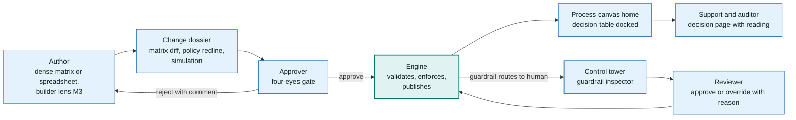

# PRD: Cockpit

| Field | Value |
|---|---|
| Type | Product requirements |
| Owner area | Product |
| Last reviewed | 2026-11-19 |

Design preview. Behaviour is specified in [`cockpit/docs/SPEC.md`](../../cockpit/docs/SPEC.md) (`CKP-*`); release requirements in [requirements.md](requirements.md) (`TR-*`); milestone dates in the [product roadmap](roadmap.md); feature scope and status in the [feature map](feature-map.md); decisions in the [decision log](decisions.md). Cockpit 0.1 ships in M1, Cockpit 0.2 in M2.

## 1. Summary

A React application built to static assets that lets people act on both engines: review and approve rule changes, simulate, investigate decisions, and from 0.2 edit tables and operate processes and agent steps. Its UX direction is the hybrid the product owner approved on 2026-11-19 ([PD-056](decisions.md#pd-056-rule-management-ux-direction), option 4): a process canvas as home with the decision table docked below, a dense matrix for authors, plain-language policy readings for approvers and support staff, a change dossier with a three-way diff and the four-eyes gate, a control tower with an agent guardrail inspector, and a nested And/Or condition builder lens (section 7.6). The approved cockpit prototype and UX design document is [ux-design.md](ux-design.md). It has no backend, database or login of its own; it calls the REST layers the host exposes, under the host's authentication ([ADR-0005](../adr/0005-cockpit-as-static-assets.md)). It is part of the product because principle 10 requires the engines to be operable from day one.

## 2. Maintainers

The maintainers own this PRD and decide its scope. Proposals arrive as issues labelled `type:proposal`.

## 3. Background

Governance that only exists in an API is used by developers, not by the people it is meant for. An approver must see what changed before approving; an auditor must find a decision without SQL; an operator must retry a failed step without a script. Building these screens per host repeats work and lets each host enforce controls differently. A shipped cockpit that only reflects engine-enforced rules (maker-checker, masking, tenancy) gives every host the same screens without moving any control into the browser.

## 4. Objective

Let non-developers perform the governance and operations tasks of both engines without leaving the cockpit or bypassing an engine control.

| # | Key result | Target | Source |
|---|---|---|---|
| KR1 | Approval without developer help | An approver who did not author a change reviews the diff and a sample simulation and approves or rejects it in Cockpit 0.1, with no REST call by hand | `TR-UI-02` (review and approve part), CKP-002 to CKP-004 |
| KR2 | Operations from the cockpit | An operator inspects an escalated `agentTask` and retries an incident in Cockpit 0.2 | CKP-007, CKP-008, `TR-OPS-03` |
| KR3 | Usable by every target user | Zero serious or critical WCAG 2.1 AA violations; English and Vietnamese with no missing keys | CKP-009, CKP-010 (both "should" in TR) |

## 5. Segments by job (personas)

For the Rule Engine, these four personas cover eight bank roles (pricing manager, credit risk analyst and business analyst as Author; compliance officer as Approver; support staff and internal auditor as Auditor; developers and administrators set the cockpit up). Roles, surfaces, use cases UC-RE-01 to UC-RE-69 and six journeys: [Rule Engine users and journeys](rule-engine-users-and-journeys.md).

| Persona | Job | Permissions |
|---|---|---|
| Author | Prepare a rule change and show its effect; from M3 change a process on the canvas | `rules:read`, `rules:author`, `rules:simulate`; `processes:author` for process definitions (PD-033) |
| Approver | Decide whether someone else's change goes live, for rule sets and, from M2 in the engine and M3 in the cockpit, process definitions | `rules:read`, `rules:approve`, `rules:simulate` to run a simulation; from 0.2 `processes:task:work` on approval tasks; `processes:approve` for process definitions ([PD-033](decisions.md#pd-033-maker-checker-for-process-definitions), [PD-040](decisions.md#pd-040-principle-6-extended-to-process-definitions)) |
| Operator | Keep instances moving: queues, SLAs, incidents, calendars | `processes:read`, `processes:task:manage`, `processes:incident:manage`, `processes:calendar:manage` (0.2); permission names per [PD-003](decisions.md#pd-003-permission-names-are-moduleaction) |
| Auditor | Reconstruct a past decision or step and who acted | `rules:log:read`, `processes:read` |

## 6. Value propositions

| Part | Author | Approver | Operator | Auditor |
|---|---|---|---|---|
| Why | Show a change is correct before it goes live | Approve only what they understand | Stuck work is invisible until a customer calls | Evidence must come from the system, not from memory |
| What before | Email a spreadsheet; ask a developer to run tests | Approve a ticket without seeing the rows | SQL against engine tables; log searches | Screenshots and change tickets |
| How | 0.1: spreadsheet round-trip into a draft, simulate sample inputs, request publication from the change dossier. 0.2: dense matrix with inline validation. M3: replay of logged decisions, condition builder lens | One change dossier: matrix diff, policy redline in plain language, sample simulation; Approve unavailable to the requester; reject needs a comment | 0.2: control tower with one inbox and one incident list across hosts, retry and resolve, agent guardrail inspector; M3: calendar editor | Decision page with the matched row, its plain-language reading, the trace and masked inputs |
| What after | Changes arrive with evidence of their effect | Self-approval impossible in UI and API | A failure is an incident with cause, retry count and an action | A decision is explained in one screen |
| Alternatives | Host-built admin pages; YAML in a pull request | Approval in a ticket tool, disconnected from the engine | BPM vendor operations tools, which need that vendor's runtime | Database exports |

Statement: for the people who govern and run the engines, the cockpit puts approvals, simulation, decision investigation and incident handling in one static UI that cannot weaken an engine control.

## 7. Solution

### 7.1 User journeys

The Rule Engine journeys in full, with failure paths and sequence diagrams, are in [Rule Engine users and journeys](rule-engine-users-and-journeys.md): a pricing manager changes a card fee (journey 1), a risk analyst creates a rule set (2), a compliance officer approves (3), a support agent explains a decision (4), an auditor reconstructs a decision (5). The table below is the short form.

| Persona | Journey (0.1 unless marked) | Hand-off |
|---|---|---|
| Author | Open rule set → view imported draft v2 → paste five sample rows → see two changed outcomes → request publication | Unblocks the approver |
| Approver | Open Changes → open the change dossier → read the matrix diff (R2 changed, R6 added) and the policy redline ("Gold card fee is 50,000 VND" struck, "Gold card fee is 45,000 VND" added) → approve, or reject with a comment | Approve publishes; reject returns the draft to the author |
| Operator (0.2) | Open the control tower → incident `AGENT_TIMEOUT`, retry count 2 → Retry; on `409` reload and retry | Unblocks the instance |
| Approver (0.2) | Open an escalated agent task from the control tower → guardrail inspector shows masked inputs, schema verdict, output and the guardrail row that fired (R2) → approve or override with a reason | Override recorded for evaluation |
| Auditor | Filter decisions by rule set and period → open one → see version, matched row, explanation; masked fields show as hash | None |

### 7.2 Must-have capabilities by platform layer

The cockpit lives in the application layer. Data, logic and observability belong to the engines; the cockpit only renders them.

| Layer | Capability | Version | SPEC | TR |
|---|---|---|---|---|
| Application | Boot embedded or standalone from one base URL | 0.1 | CKP-001 | TR-UI-01, TR-SEC-09 |
| Application | Version diff (matrix lens of the change dossier) | 0.1 | CKP-002 | TR-UI-02 |
| Application | Maker-checker reflected; API `403` surfaced | 0.1 | CKP-003 | TR-SEC-04 |
| Application | Simulation over sample rows (spreadsheet or CSV, no JSON) | 0.1 | CKP-004 | TR-UI-02 |
| Application | Decision explorer with masking and explanation | 0.1 | CKP-005 | TR-SEC-05, TR-OBS-05 |
| Application | Grid editor with inline validation | 0.2 | CKP-006 | TR-DET-02, TR-UI-02 |
| Application | Agent task inspector | 0.2 | CKP-007 | TR-AGT-01, TR-AGT-02 |
| Application | Incident queue with retry and resolve | 0.2 | CKP-008 | TR-OPS-03 |
| Application | Replay simulation | M3 (moved by PD-042) | CKP-011 | TR-UI-02 |
| Application | Accessibility with the reviewed light and dark colour tokens; checked at 1440x900 (primary action and result without scrolling) and 1440x1200; English and Vietnamese, one language at a time | 0.1, re-run 0.2 | CKP-009, CKP-010 (tokens, viewports and one language at a time not yet stated) | TR-UI-03, TR-UI-04 |
| Application | Diagram nodes drawn by BPMN element type plus HORUS subtype; unknown types as labelled generic nodes; standards stage per host shown | 0.2 | CKP-029 | TR-UI-07, TR-UI-08 |
| API (consumed) | Problem Details errors shown with `correlationId`; idempotency key and `If-Match` on every mutation | 0.1 | CKP-008 (0.2 only) | TR-SEC-08, TR-IDEM-01 |

### 7.3 Specification gaps

| Capability | Version | Source |
|---|---|---|
| Rule sets list, version view, import and export | 0.1 | Roadmap M1 |
| Process definitions, instance view with history timeline | 0.2 | Roadmap M2 |
| Human task queues: claim, complete, reassign | 0.2 | Roadmap M2 |
| Compensation runs in the instance timeline and an SLA breach filter on the task queue, measured against each task definition's own deadline | 0.2 | CK-F-16, CK-F-17 ([PD-024](decisions.md#pd-024-conflict-compensation-runs-view-and-sla-breach-list), decided 2026-11-19) |
| Business calendar editor | M3 (moved by PD-042) | Roadmap M3, `TR-CAL-01` |
| Host registry, single sign-in and host switching; `/meta` and `/me` | 0.1 | CK-F-23, X-F-22 ([PD-035](decisions.md#pd-035-multi-host-cockpit-model)) |
| Definition and instance diagrams with tokens, live node counts, merged task inbox and incident list, task forms, tenant switcher | 0.2 | CK-F-24 to CK-F-26, CK-F-28 to CK-F-30, X-F-23 (PD-032, PD-035, PD-037, PD-038) |
| Process definition approval with graph diff, modeller canvas, historical heatmap, migration plan as two diagrams | M3 | CK-F-31, CK-F-32, CK-F-27, CK-F-33 (PD-032, PD-033, PD-038) |
| Spreadsheet round-trip, decision deep link (0.1); templates, condition drop-downs (0.2); version history and evidence export (M3) | 0.1, 0.2, M3 | CK-F-34 to CK-F-38 ([PD-043](decisions.md#pd-043-rule-authoring-for-business-users-without-yaml), decided 2026-11-19) |
| Change dossier layout: header, effective date, maker's note, matrix diff, policy redline, simulation, four-eyes gate | 0.1 | CK-F-03, CK-F-04 ([PD-056](decisions.md#pd-056-rule-management-ux-direction)) |
| Plain-language policy reading of every row, read only, in the user's language; needs a reading per row from the engine (UX-API-01); reading style sentence or shorthand as a host setting, shorthand only in 0.1 if the 8 Jan 2027 checkpoint fails | 0.1 | CK-F-44 (PD-056, [PD-077](decisions.md#pd-077-fallback-for-plain-language-readings-in-m1)) |
| Landing area by role in 0.1 (Changes for approvers and authors, Decisions for auditors), set by the host if it wishes | 0.1 | CK-F-04 ([PD-078](decisions.md#pd-078-cockpit-home-screen-in-cockpit-01)) |
| Minimal cell and row editing on a draft, saved with validation on each cell | 0.1 | CK-F-43 ([PD-075](decisions.md#pd-075-minimal-cockpit-editing-in-m1-async-decision-log-to-m2)) |
| Process canvas as the default home where a Process Engine host is registered, with the decision table docked below | 0.2 | CK-F-24 (PD-056, PD-078) |
| Nested And/Or condition builder lens, optional and off by default | M3, cut candidate | CK-F-45 (PD-056, [PD-076](decisions.md#pd-076-placement-of-the-condition-builder-lens)); the mapping of nested groups to the canonical table is an architect question |
| Instance migration screen | M3 | CK-F-19, `TR-MIG-03` ([PD-023](decisions.md#pd-023-conflict-milestone-of-the-instance-migration-screen), decided 2026-11-19; the wiki row is corrected by documentation) |
| Simulation report attached to a publication request; a host can require one per rule set, off by default | M3 | CK-F-20 ([PD-022](decisions.md#pd-022-conflict-simulation-report-in-cockpit-01-approvals), decided 2026-11-19) |
| Tier-1 pulse strip of KPIs on landing views | not before 1.0 | CK-F-21 ([PD-016](decisions.md#pd-016-cockpit-pulse-strip), decided 2026-11-19: counts stay in queue headers) |

### 7.4 BPMN-typed node rendering (0.2)

The diagram views key every node by its BPMN element type plus a HORUS subtype, never by our step names: `startEvent`, `userTask`, `serviceTask:agentTask`, `businessRuleTask`, `exclusiveGateway`, `endEvent` (CK-F-40, DN-11 of the [standards compliance](../architecture/standards-compliance.md) page). This costs about a day in 0.2 (assumption) and avoids a rewrite of every diagram component when 1.1 adds the full symbol set. It also makes the federated cockpit safe across engine versions: a host on a newer engine may serve a node type an older cockpit build does not know. That node renders as a labelled generic node showing its type, and the rest of the diagram stays intact; it is never an error and never hidden. Each host reports what it executes in a `standards` object of `/api/bpm/meta`, shown in the host details.

| Persona | What they see | Why it matters |
|---|---|---|
| Operator | The same diagram on every host, with unknown nodes labelled by type | Works an instance on a newer host without waiting for a cockpit upgrade |
| Auditor | Element types named as in the BPMN standard | Reads a diagram the way the modelling tool drew it |
| Author (1.1) | Every BPMN and DMN symbol (CK-F-41); editing limited to what the host can execute | Brings models from other tools without losing what the engine cannot run yet |

### 7.5 Open questions

- Decided: `TR-UI-02` gates 0.1 for changes to existing rule sets, by import and by editing in the cockpit ([PD-013](decisions.md#pd-013-from-which-milestone-tr-ui-02-gates), 2026-11-19, "Both"). Confirmed under delegated authority ([PD-075](decisions.md#pd-075-minimal-cockpit-editing-in-m1-async-decision-log-to-m2), 2026-11-19): the smallest 0.1 editing (CK-F-43) is editing cells with the shorthand and adding, copying, deleting or moving rows on a draft, saved with validation; typed widgets, drop-downs and templates stay in 0.2. Cockpit editing follows the per-environment authoring switch of PD-036.
- Resolved: standalone mode lists several hosts and switches between them with one sign-in ([PD-035](decisions.md#pd-035-multi-host-cockpit-model), decided 2026-11-18).
- Decided: business users change existing tables without YAML in 0.1 through a spreadsheet round-trip with plain shorthand and plain errors, and get the grid with templates in 0.2 ([PD-043](decisions.md#pd-043-rule-authoring-for-business-users-without-yaml), 2026-11-19). PD-013, decided the same day, adds editing in the cockpit to the 0.1 gate (see the item above).
- Decided: the cockpit UX direction is the hybrid, option 4 ([PD-056](decisions.md#pd-056-rule-management-ux-direction), 2026-11-19); section 7.6.
- Decided: no pulse strip before 1.0; each queue shows its count in its header ([PD-016](decisions.md#pd-016-cockpit-pulse-strip), 2026-11-19).
- Decided: the tenant comes from a resolver the host can replace, by default the authenticated principal of the host's session or token, never from the browser ([PD-079](decisions.md#pd-079-tenant-resolution-when-the-cockpit-runs-inside-a-host-web-app), 2026-11-19; recorded by the architect in ADR-0014).
- Decided: under the principle "generic by design" ([PD-074](decisions.md#pd-074-product-principle-generic-by-design)), the cockpit's business behaviour is settings with safe defaults: landing area (PD-078), reading style and message catalogues (PD-077, PD-026), the builder lens (PD-076) and cockpit authoring per environment (PD-036). Accessibility, one language per screen and the four-eyes gate are not settings.

### 7.6 UX direction (PD-056)

The product owner approved option 4, the hybrid, on 2026-11-19. Each part does the job of one persona, and all parts share one set of components, so a later change removes or swaps a region, not a screen. Detail, screens and tokens: the approved cockpit prototype and UX design document, [ux-design.md](ux-design.md).

| Part | Job | 0.1 (M1) | 0.2 (M2) | M3 (1.0) | Features |
|---|---|---|---|---|---|
| Process canvas as home, decision table docked below | See where a rule acts in the flow, and the rule itself, on one screen | No Process Engine yet: home is changes and rule sets; a rule set shows its table in the docked layout, read only | Read-only canvas is home; selecting a decision node or a guardrail docks its table; tokens and path on instances | Duration heat on nodes; modeller link (both cut candidates) | CK-F-02, CK-F-24, CK-F-25, CK-F-26, CK-F-27, CK-F-32 |
| Dense grid or matrix editor | Change many rows fast | Spreadsheet round-trip; minimal cell and row editing on a draft (CK-F-43, PD-075) | Dense editable matrix with typed cells, drop-downs and templates | | CK-F-35, CK-F-43, CK-F-10, CK-F-36, CK-F-37 |
| Plain-language policy readings | Understand one row without reading conditions | Read only, everywhere a row appears | Update while editing | | CK-F-44, CK-F-37 |
| Change dossier, three-way diff, four-eyes gate | Approve only what you understand, never your own change | Matrix diff, policy redline, sample simulation, four-eyes gate | | Process graph diff, stored report, replay | CK-F-03, CK-F-04, CK-F-05, CK-F-44, CK-F-31, CK-F-20, CK-F-11 |
| Control tower, agent guardrail inspector | Clear escalated agent steps and tasks within SLA | | One inbox and one incident list across hosts; guardrail inspector with approve or override; override rate on the autonomy ladder | Offline evaluation results beside the ladder | CK-F-28, CK-F-29, CK-F-17, CK-F-14, PE-F-22, PE-F-38, PE-F-37 |
| Nested And/Or condition builder lens | Write a complex eligibility condition without expression syntax | | | Cut candidate | CK-F-45 |

Visual rules for every screen from 0.1:

- Uncluttered: specification ids hidden by default; one view at a time; one language at a time; no raw JSON on business screens; subtitles of ten words or fewer.
- Colour: the reviewed light and dark tokens. Each status colour has one meaning; money direction, diff marks and release stages have their own tokens; status always has a word and an icon as well as a colour.
- Viewports: at 1440x900 the primary action and its result are visible without scrolling; every screen is also checked at 1440x1200, in both themes.

Who acts where, and how a rule change and an escalated agent step travel between roles:

Not before 1.0: an assistant that drafts rows; after 1.0 only as suggestion, under the same checks and the same second approver.

### 7.7 Diagrams

Screen map in three tiers: the shell, the areas (each opens on a ranked queue, a list or the process canvas), and the detail and action screens, following the hybrid direction (PD-056). Version labels follow section 8.

One standalone cockpit across several hosts with no server of its own ([PD-035](decisions.md#pd-035-multi-host-cockpit-model)). The browser signs in once with OIDC and PKCE as a public client, calls each host directly, and merges tasks and incidents. Tenant switching sends `X-Tenant-Id` only within the token's allowed tenants ([PD-037](decisions.md#pd-037-tenant-switching-for-multi-tenant-operators)).

The instance diagram with its token overlay (0.2), and the governed change of a process definition: Git import or canvas draft, validation, request, graph diff, approval by a different identity ([PD-033](decisions.md#pd-033-maker-checker-for-process-definitions), [PD-036](decisions.md#pd-036-source-of-truth-for-process-definitions)).

Sources: [ck-screen-map.mmd](diagrams/ck-screen-map.mmd), [ck-multi-host-federation.mmd](diagrams/ck-multi-host-federation.mmd), [ck-diagram-overlay-approval.mmd](diagrams/ck-diagram-overlay-approval.mmd).

## 8. Release and scope

| Cockpit 0.1 (M1): viewer and approver | Cockpit 0.2 (M2): editor and operations |
|---|---|
| Rule sets with the docked table, read only; version view, import and export; spreadsheet round-trip with plain shorthand and plain errors; decision deep link | Dense matrix editor with type checks and expression validation; new rule set from a template; shorthand and drop-downs, with readings that update while editing |
| Change dossier: matrix diff, policy redline, sample simulation, four-eyes gate; plain-language reading of every row; decision page with trace and explanation | Process canvas as home with the decision table docked; process definitions, instances, task queues, incidents, compensation runs, SLA breaches |
| Embedded and standalone hosting; host registry with one sign-in across hosts; light and dark themes with the reviewed tokens; one language at a time | Definition and instance diagrams with tokens; live counts per node; control tower with one task inbox and one incident list across hosts; task forms; tenant switcher |
| | Agent guardrail inspector with approve or override |

M3: the nested And/Or condition builder lens (CK-F-45, first M3 cut); process graph diff as the third lens of the change dossier; replay simulation and the calendar editor (moved from 0.2 by PD-042); migration screen and migration plan as two diagrams; rule set version history and evidence export (CK-F-38, cut candidate); simulation reports on publication requests; process definition approval with graph diff; historical heatmap; modeller canvas limited to registered steps (first M3 cut, fallback 1.1). Standards track ([PD-057](decisions.md#pd-057-full-bpmn-20-and-dmn-support-no-cmmn), dates pending PD-062): every BPMN 2.0 and DMN symbol in 1.1 (CK-F-41); conversations across hosts by correlation key and message and signal waits on the diagram in 1.2 (CK-F-42). After 1.0 (candidate): hosted cockpit.

Non-goals: a backend-for-frontend, database or user store ([ADR-0005](../adr/0005-cockpit-as-static-assets.md)); any authorisation decided in the browser; BPMN 2.0 and DMN symbols beyond the engine's subset before 1.1 ([PD-057](decisions.md#pd-057-full-bpmn-20-and-dmn-support-no-cmmn)); any canvas element the engine cannot run, in any release ([PD-041](decisions.md#pd-041-conflict-vision-non-goal-diagram-modeller)); CMMN; a form designer; dashboards that replace the host's monitoring (metrics stay in Micrometer, `TR-OBS-02`); a full grid editor in 0.1 (the spreadsheet round-trip and minimal cell and row editing cover 0.1, PD-043, PD-075); an assistant that drafts rule rows before 1.0 (PD-056); specification ids, raw JSON or two languages on one screen (PD-056).

## Red-team

| # | Assumption | Fails if | Evidence | Kill criterion | Cheapest test |
|---|---|---|---|---|---|
| 1 | Approvers will approve in the cockpit | Compliance teams require approvals in their existing ticket or workflow tool | Ask three compliance contacts where they approve changes today and whether a second tool is acceptable | Two of three refuse a second approval tool | Three conversations in M1. If killed, document approval through the REST API and the `rules.version.publish-requested.v1` event as the primary path; keep the cockpit screen |
| 2 | Diff plus sample simulation is enough to approve in 0.1 | Approvers refuse to approve without the effect on real traffic, which arrives only with replay in 0.2 | Moderated session: an approver reviews a 20-row change with diff and five samples | The approver cannot state who is affected, or defers the decision | One session in week 3 of M1. If killed, move replay simulation (RLE-015, CKP-011) into M1 and cut REST filters (PD-018) |
| 3 | A stateless cockpit is enough for operators | Operators need notifications of breaches and new incidents, which a static UI cannot push | Ask two operations leads how they learn of a stuck case today | Both need push alerts from the BPM tool itself | Two conversations before M2. If killed, document alerting on engine metrics and events in the host's monitoring; keep the cockpit stateless |
| 4 | The change dossier with plain-language readings lets an approver understand a change in 0.1 (PD-056) | Approvers cannot tell who is affected from the matrix diff and the readings, or authors get lost in the dossier | Week 2 M1 sessions (roadmap K24) | An approver cannot say which customers are affected, or an author does not reach `PENDING_APPROVAL` within 15 minutes | Same sessions as K3. If killed, 0.1 ships the matrix without the dossier and the dossier moves to 0.2 |
