# PRD: Cockpit

| Field | Value |
|---|---|
| Type | Product requirements |
| Owner area | Product |
| Last reviewed | 2026-11-19 |

Design preview. Behaviour is specified in [`cockpit/docs/SPEC.md`](../../cockpit/docs/SPEC.md) (`CKP-*`); release requirements in [requirements.md](requirements.md) (`TR-*`); milestone dates in the [product roadmap](roadmap.md); feature scope and status in the [feature map](feature-map.md); decisions in the [decision log](decisions.md). Cockpit 0.1 ships in M1, Cockpit 0.2 in M2.

## 1. Summary

A React application built to static assets that lets people act on both engines: review and approve rule changes, simulate, investigate decisions, and from 0.2 edit tables and operate processes and agent steps. It has no backend, database or login of its own; it calls the REST layers the host exposes, under the host's authentication ([ADR-0005](../adr/0005-cockpit-as-static-assets.md)). It is part of the product because principle 10 requires the engines to be operable from day one.

## 2. Maintainers

The maintainers own this PRD and decide its scope. Proposals arrive as issues labelled `type:proposal`.

## 3. Background

Governance that only exists in an API is used by developers, not by the people it is meant for. An approver must see what changed before approving; an auditor must find a decision without SQL; an operator must retry a failed step without a script. Building these screens per host repeats work and lets each host enforce controls differently. A shipped cockpit that only reflects engine-enforced rules (maker-checker, masking, tenancy) gives every host the same screens without moving any control into the browser.

## 4. Objective

Let non-developers perform the governance and operations tasks of both engines without leaving the cockpit or bypassing an engine control.

| # | Key result | Target | Source |
|---|---|---|---|
| KR1 | Approval without developer help | An approver who did not author a change reviews the diff and a sample simulation and approves or rejects it in Cockpit 0.1, with no REST call by hand | `TR-UI-02` (review and approve part), CKP-002 to CKP-004 |
| KR2 | Operations from the cockpit | An operator inspects an escalated `agentTask` and retries an incident in Cockpit 0.2 | CKP-007, CKP-008, `TR-OPS-03` |
| KR3 | Usable by every target user | Zero serious or critical WCAG 2.1 AA violations; English and Vietnamese with no missing keys | CKP-009, CKP-010 (both "should" in TR) |

## 5. Segments by job (personas)

For the Rule Engine, these four personas cover eight bank roles (pricing manager, credit risk analyst and business analyst as Author; compliance officer as Approver; support staff and internal auditor as Auditor; developers and administrators set the cockpit up). Roles, surfaces, use cases UC-RE-01 to UC-RE-69 and six journeys: [Rule Engine users and journeys](rule-engine-users-and-journeys.md).

| Persona | Job | Permissions |
|---|---|---|
| Author | Prepare a rule change and show its effect; from M3 change a process on the canvas | `rules:read`, `rules:author`, `rules:simulate`; `processes:author` for process definitions (PD-033) |
| Approver | Decide whether someone else's change goes live, for rule sets and, from M2 in the engine and M3 in the cockpit, process definitions | `rules:read`, `rules:approve`, `rules:simulate` to run a simulation; from 0.2 `processes:task:work` on approval tasks; `processes:approve` for process definitions ([PD-033](decisions.md#pd-033-maker-checker-for-process-definitions), [PD-040](decisions.md#pd-040-principle-6-extended-to-process-definitions)) |
| Operator | Keep instances moving: queues, SLAs, incidents, calendars | `processes:read`, `processes:task:manage`, `processes:incident:manage`, `processes:calendar:manage` (0.2); permission names per [PD-003](decisions.md#pd-003-permission-names-are-moduleaction) |
| Auditor | Reconstruct a past decision or step and who acted | `rules:log:read`, `processes:read` |

## 6. Value propositions

| Part | Author | Approver | Operator | Auditor |
|---|---|---|---|---|
| Why | Show a change is correct before it goes live | Approve only what they understand | Stuck work is invisible until a customer calls | Evidence must come from the system, not from memory |
| What before | Email a spreadsheet; ask a developer to run tests | Approve a ticket without seeing the rows | SQL against engine tables; log searches | Screenshots and change tickets |
| How | 0.1: view the imported draft, simulate sample inputs, request publication. 0.2: grid editor with inline validation, replay of logged decisions | Side-by-side diff; Approve disabled for the requester; reject needs a comment | 0.2: task queues, incident queue with retry and resolve, agent task inspector, calendar editor | Decision explorer with matched row highlighted, explanation, masked inputs |
| What after | Changes arrive with evidence of their effect | Self-approval impossible in UI and API | A failure is an incident with cause, retry count and an action | A decision is explained in one screen |
| Alternatives | Host-built admin pages; YAML in a pull request | Approval in a ticket tool, disconnected from the engine | BPM vendor operations tools, which need that vendor's runtime | Database exports |

Statement: for the people who govern and run the engines, the cockpit puts approvals, simulation, decision investigation and incident handling in one static UI that cannot weaken an engine control.

## 7. Solution

### 7.1 User journeys

The Rule Engine journeys in full, with failure paths and sequence diagrams, are in [Rule Engine users and journeys](rule-engine-users-and-journeys.md): a pricing manager changes a card fee (journey 1), a risk analyst creates a rule set (2), a compliance officer approves (3), a support agent explains a decision (4), an auditor reconstructs a decision (5). The table below is the short form.

| Persona | Journey (0.1 unless marked) | Hand-off |
|---|---|---|
| Author | Open rule set → view imported draft v2 → paste five sample rows → see two changed outcomes → request publication | Unblocks the approver |
| Approver | Open Approvals → read diff (R2 changed, R6 added) → approve, or reject with a comment | Approve publishes; reject returns the draft to the author |
| Operator (0.2) | Open Incidents → read `AGENT_TIMEOUT`, retry count 2 → Retry; on `409` reload and retry | Unblocks the instance |
| Approver (0.2) | Open escalated agent task → read masked inputs, schema verdict, output, fired rule R2 → approve or override with a reason | Override recorded for evaluation |
| Auditor | Filter decisions by rule set and period → open one → see version, matched row, explanation; masked fields show as hash | None |

### 7.2 Must-have capabilities by platform layer

The cockpit lives in the application layer. Data, logic and observability belong to the engines; the cockpit only renders them.

| Layer | Capability | Version | SPEC | TR |
|---|---|---|---|---|
| Application | Boot embedded or standalone from one base URL | 0.1 | CKP-001 | TR-UI-01, TR-SEC-09 |
| Application | Version diff | 0.1 | CKP-002 | TR-UI-02 |
| Application | Maker-checker reflected; API `403` surfaced | 0.1 | CKP-003 | TR-SEC-04 |
| Application | Simulation over sample inputs | 0.1 | CKP-004 | TR-UI-02 |
| Application | Decision explorer with masking and explanation | 0.1 | CKP-005 | TR-SEC-05, TR-OBS-05 |
| Application | Grid editor with inline validation | 0.2 | CKP-006 | TR-DET-02, TR-UI-02 |
| Application | Agent task inspector | 0.2 | CKP-007 | TR-AGT-01, TR-AGT-02 |
| Application | Incident queue with retry and resolve | 0.2 | CKP-008 | TR-OPS-03 |
| Application | Replay simulation | M3 (moved by PD-042) | CKP-011 | TR-UI-02 |
| Application | Accessibility; English and Vietnamese | 0.1, re-run 0.2 | CKP-009, CKP-010 | TR-UI-03, TR-UI-04 |
| Application | Diagram nodes drawn by BPMN element type plus HORUS subtype; unknown types as labelled generic nodes; standards stage per host shown | 0.2 | CKP-029 | TR-UI-07, TR-UI-08 |
| API (consumed) | Problem Details errors shown with `correlationId`; idempotency key and `If-Match` on every mutation | 0.1 | CKP-008 (0.2 only) | TR-SEC-08, TR-IDEM-01 |

### 7.3 Specification gaps

| Capability | Version | Source |
|---|---|---|
| Rule sets list, version view, import and export | 0.1 | Roadmap M1 |
| Process definitions, instance view with history timeline | 0.2 | Roadmap M2 |
| Human task queues: claim, complete, reassign | 0.2 | Roadmap M2 |
| Compensation runs view and SLA breach list | 0.2 | wiki Cockpit page; scope pending as PD-024 |
| Business calendar editor | M3 (moved by PD-042) | Roadmap M3, `TR-CAL-01` |
| Host registry, single sign-in and host switching; `/meta` and `/me` | 0.1 | CK-F-23, X-F-22 ([PD-035](decisions.md#pd-035-multi-host-cockpit-model)) |
| Definition and instance diagrams with tokens, live node counts, merged task inbox and incident list, task forms, tenant switcher | 0.2 | CK-F-24 to CK-F-26, CK-F-28 to CK-F-30, X-F-23 (PD-032, PD-035, PD-037, PD-038) |
| Process definition approval with graph diff, modeller canvas, historical heatmap, migration plan as two diagrams | M3 | CK-F-31, CK-F-32, CK-F-27, CK-F-33 (PD-032, PD-033, PD-038) |
| Spreadsheet round-trip, decision deep link (0.1); templates, condition drop-downs (0.2); version history and evidence export (M3) | 0.1, 0.2, M3 | CK-F-34 to CK-F-38 ([PD-043](decisions.md#pd-043-rule-authoring-for-business-users-without-yaml), decided 2026-11-19) |
| Instance migration screen | M3 | Roadmap M3, `TR-MIG-03`; wiki says 0.2, pending as PD-023 |
| Simulation report attached to a publication request | M3 | Roadmap M3 |
| Tier-1 pulse strip of KPIs on landing views | not scheduled | `cockpit/docs/DESIGN.md` section 3 only; pending as PD-016 |

### 7.4 BPMN-typed node rendering (0.2)

The diagram views key every node by its BPMN element type plus a HORUS subtype, never by our step names: `startEvent`, `userTask`, `serviceTask:agentTask`, `businessRuleTask`, `exclusiveGateway`, `endEvent` (CK-F-40, DN-11 of the [standards compliance](../architecture/standards-compliance.md) page). This costs about a day in 0.2 (assumption) and avoids a rewrite of every diagram component when 1.1 adds the full symbol set. It also makes the federated cockpit safe across engine versions: a host on a newer engine may serve a node type an older cockpit build does not know. That node renders as a labelled generic node showing its type, and the rest of the diagram stays intact; it is never an error and never hidden. Each host reports what it executes in a `standards` object of `/api/bpm/meta`, shown in the host details.

| Persona | What they see | Why it matters |
|---|---|---|
| Operator | The same diagram on every host, with unknown nodes labelled by type | Works an instance on a newer host without waiting for a cockpit upgrade |
| Auditor | Element types named as in the BPMN standard | Reads a diagram the way the modelling tool drew it |
| Author (1.1) | Every BPMN and DMN symbol (CK-F-41); editing limited to what the host can execute | Brings models from other tools without losing what the engine cannot run yet |

### 7.5 Open questions

- Decided: `TR-UI-02` gates 0.1 for changes to existing rule sets, by import and by editing in the cockpit ([PD-013](decisions.md#pd-013-from-which-milestone-tr-ui-02-gates), 2026-11-19, "Both"). Proposed, awaiting the product owner's confirmation: the smallest 0.1 editing (CK-F-43) is editing cells with the shorthand and adding, copying, deleting or moving rows on a draft, saved with validation; typed widgets, drop-downs and templates stay in 0.2.
- Resolved: standalone mode lists several hosts and switches between them with one sign-in ([PD-035](decisions.md#pd-035-multi-host-cockpit-model), decided 2026-11-18).
- Decided: business users change existing tables without YAML in 0.1 through a spreadsheet round-trip with plain shorthand and plain errors, and get the grid with templates in 0.2 ([PD-043](decisions.md#pd-043-rule-authoring-for-business-users-without-yaml), 2026-11-19). PD-013, decided the same day, adds editing in the cockpit to the 0.1 gate (see the item above).
- Proposal: add the pulse strip to a milestone, or remove it from DESIGN. Pending as [PD-016](decisions.md#pd-016-cockpit-pulse-strip).

### 7.6 Diagrams

Screen map in three tiers: the shell, the areas (each opens on a ranked queue or list), and the detail and action screens. Version labels follow section 8.

One standalone cockpit across several hosts with no server of its own ([PD-035](decisions.md#pd-035-multi-host-cockpit-model)). The browser signs in once with OIDC and PKCE as a public client, calls each host directly, and merges tasks and incidents. Tenant switching sends `X-Tenant-Id` only within the token's allowed tenants ([PD-037](decisions.md#pd-037-tenant-switching-for-multi-tenant-operators)).

The instance diagram with its token overlay (0.2), and the governed change of a process definition: Git import or canvas draft, validation, request, graph diff, approval by a different identity ([PD-033](decisions.md#pd-033-maker-checker-for-process-definitions), [PD-036](decisions.md#pd-036-source-of-truth-for-process-definitions)).

Sources: [ck-screen-map.mmd](diagrams/ck-screen-map.mmd), [ck-multi-host-federation.mmd](diagrams/ck-multi-host-federation.mmd), [ck-diagram-overlay-approval.mmd](diagrams/ck-diagram-overlay-approval.mmd).

## 8. Release and scope

| Cockpit 0.1 (M1): viewer and approver | Cockpit 0.2 (M2): editor and operations |
|---|---|
| Rule sets, version view, import and export; spreadsheet round-trip with plain shorthand and plain errors; decision deep link | Grid editor with type checks and expression validation; new rule set from a template; shorthand, drop-downs and a plain reading of each condition |
| Diff, sample simulation, approvals, decision explorer with explanation | Process definitions, instances, task queues, incidents, compensation runs, SLA breaches |
| Embedded and standalone hosting; host registry with one sign-in across hosts | Definition and instance diagrams with tokens; live counts per node; one task inbox and one incident list across hosts; task forms; tenant switcher |
| | Agent task inspector with approve or override |

M3: replay simulation and the calendar editor (moved from 0.2 by PD-042); migration screen and migration plan as two diagrams; rule set version history and evidence export (CK-F-38, cut candidate); simulation reports on publication requests; process definition approval with graph diff; historical heatmap; modeller canvas limited to registered steps (first M3 cut, fallback 1.1). Standards track ([PD-057](decisions.md#pd-057-full-bpmn-20-and-dmn-support-no-cmmn), dates pending PD-062): every BPMN 2.0 and DMN symbol in 1.1 (CK-F-41); conversations across hosts by correlation key and message and signal waits on the diagram in 1.2 (CK-F-42). After 1.0 (candidate): hosted cockpit.

Non-goals: a backend-for-frontend, database or user store ([ADR-0005](../adr/0005-cockpit-as-static-assets.md)); any authorisation decided in the browser; BPMN 2.0 and DMN symbols beyond the engine's subset before 1.1 ([PD-057](decisions.md#pd-057-full-bpmn-20-and-dmn-support-no-cmmn)); any canvas element the engine cannot run, in any release ([PD-041](decisions.md#pd-041-conflict-vision-non-goal-diagram-modeller)); CMMN; a form designer; dashboards that replace the host's monitoring (metrics stay in Micrometer, `TR-OBS-02`); grid editing in 0.1 (the spreadsheet round-trip covers it, PD-043).

## Red-team

| # | Assumption | Fails if | Evidence | Kill criterion | Cheapest test |
|---|---|---|---|---|---|
| 1 | Approvers will approve in the cockpit | Compliance teams require approvals in their existing ticket or workflow tool | Ask three compliance contacts where they approve changes today and whether a second tool is acceptable | Two of three refuse a second approval tool | Three conversations in M1. If killed, document approval through the REST API and the `rules.version.publish-requested.v1` event as the primary path; keep the cockpit screen |
| 2 | Diff plus sample simulation is enough to approve in 0.1 | Approvers refuse to approve without the effect on real traffic, which arrives only with replay in 0.2 | Moderated session: an approver reviews a 20-row change with diff and five samples | The approver cannot state who is affected, or defers the decision | One session in week 3 of M1. If killed, move replay simulation (RLE-015, CKP-011) into M1 and cut REST filters (PD-018) |
| 3 | A stateless cockpit is enough for operators | Operators need notifications of breaches and new incidents, which a static UI cannot push | Ask two operations leads how they learn of a stuck case today | Both need push alerts from the BPM tool itself | Two conversations before M2. If killed, document alerting on engine metrics and events in the host's monitoring; keep the cockpit stateless |
