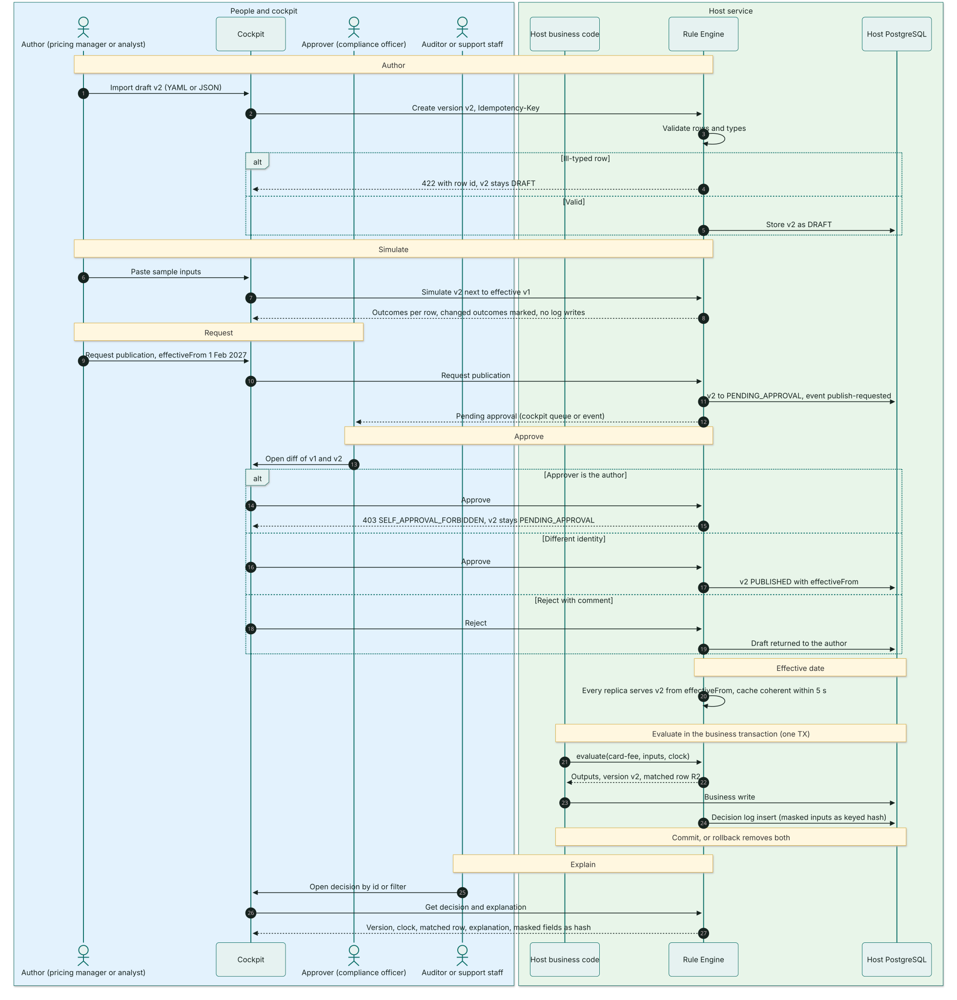

# PRD: Rule Engine

| Field | Value |
|---|---|
| Type | Product requirements |
| Owner area | Product |
| Last reviewed | 2026-11-18 |

Design preview. Behaviour is specified in [`rule-engine/docs/SPEC.md`](../../rule-engine/docs/SPEC.md) (`RLE-*`); release requirements in [requirements.md](requirements.md) (`TR-*`); milestone dates in the [product roadmap](roadmap.md); feature scope and status in the [feature map](feature-map.md); decisions in the [decision log](decisions.md). This PRD states what to build and why; SPEC and DESIGN refine it and never widen it.

## 1. Summary

A deterministic decision-table library that runs inside a Spring Boot service and writes its state and decision log to the service's PostgreSQL. Product, risk and compliance staff change rules through draft, simulation and a second approver, without a code deployment. It ships first (M1) because it is useful alone and because `agentTask` guardrails in M2 are rule sets.

## 2. Maintainers

The maintainers own this PRD and decide its scope. Proposals arrive as issues labelled `type:proposal`; accepted ones become ADRs and move into a milestone.

## 3. Background

Rules that decide fees, eligibility and limits change more often than the services that evaluate them. Teams either hard-code them (every change is a release, no audit of who changed what) or run a separate decision service (a network hop, state outside the business transaction, and approval left to the team). Regulated teams must also show, years later, which rule version decided a case and why. Principles 3 to 6 and [ADR-0003](../adr/0003-own-expression-language.md) set the constraints: deterministic evaluation, no code in definitions, immutable versions, governance enforced by the engine.

## 4. Objective

Let a host service evaluate governed decisions in process, and let business staff change them safely without a deployment.

| # | Key result | Target | Source |
|---|---|---|---|
| KR1 | Time from an empty Spring Boot service to a first logged decision | Under 30 minutes for a newcomer following Getting Started | Roadmap M1 exit |
| KR2 | A YAML change goes from import to effective through simulation, diff and approval by a second identity, with no code deployment | Demonstrated end to end in `examples/rule-engine-only` with Cockpit 0.1 by week 4 of M1 | Roadmap assumption 3 |
| KR3 | Evaluation cost inside the host transaction | p99 under 100 µs for a 200-row `first` table; exactly one log insert per decision | `TR-PERF-01`, `TR-PERF-03` |

## 5. Segments by job

The three segments below group eight roles found in a bank or fintech: pricing manager, credit risk analyst, business analyst (S2); compliance officer, support staff, internal auditor (S3); host-service developer and platform administrator (S1). Each role's skills, surface, permissions and use cases are in [Rule Engine users and journeys](rule-engine-users-and-journeys.md).

| Segment | Job | Constraints |
|---|---|---|
| S1 Host developer | Call a decision from Java or REST, in the same transaction as the business write, and test rule sets in CI | Java 21+, Spring Boot 4.x or 3.5.x until 1.0 (PD-007), PostgreSQL 14+; shared connection pool |
| S2 Rule author (product or risk analyst) | Change a fee, limit or eligibility table and see the effect before it goes live | Authors YAML or JSON in 0.1; grid editing arrives with Cockpit 0.2. Pricing managers and risk analysts work in Excel and do not write YAML; a spreadsheet round-trip in M1 is pending as [PD-043](decisions.md#pd-043-rule-authoring-for-business-users-without-yaml) |
| S3 Approver and auditor (compliance, internal audit) | Approve changes made by someone else, and reconstruct any past decision | Four-eyes required; personal data must stay masked |

## 6. Value propositions

| Part | S1 Host developer | S2 Rule author | S3 Approver and auditor |
|---|---|---|---|
| Why | Business logic changes faster than releases | Rule changes wait for a developer and a release window | Must prove who changed what, and which version decided a case |
| What before | Hard-coded `if` chains, or a remote decision service with a network hop and state outside the transaction | Ticket to engineering; change visible only after deployment | Change tickets and code history; no link from a past decision to the rule row that made it |
| How | One starter; `evaluate` in process; log insert in the host transaction; `rule-engine-test` in CI | Import a draft, simulate against sample inputs, see the diff, request publication with an effective date | Engine refuses self-approval in every API; append-only log with version, clock, matched rows and explain |
| What after | No new runtime to operate; rollback of the business write rolls back the decision record | A change goes live on its effective date without a release | Any decision replays to the same result from the log alone |
| Alternatives | Hand-coded rules; Drools (inference, no built-in approval flow); DMN engines in a BPMN platform (a change is a deployment) | Spreadsheet plus developer; DMN modeller plus deployment | Manual evidence packs; host-built approval screens |

Statement: for Java teams whose rules must change under a second approver, the Rule Engine evaluates versioned decision tables inside the service's own transaction and keeps an explainable, append-only record of every decision.

## 7. Solution

### 7.1 User journey

Six journeys with screens, calls, handoffs and failure paths, and a catalogue of 69 use cases (UC-RE-01 to UC-RE-69) with their milestone, are in [Rule Engine users and journeys](rule-engine-users-and-journeys.md). The summary journey:

Author imports draft v2 (YAML) → validation rejects ill-typed rows → author simulates v2 against sample inputs next to the effective v1 → author requests publication with `effectiveFrom` → a different identity reviews the diff and approves → every replica serves v2 from its effective date → host evaluates; each decision logs version, clock, matched rows → auditor opens a decision and reads the explanation, masked inputs stay masked.

Failure paths: self-approval refused (`403 SELF_APPROVAL_FORBIDDEN`); `unique` with zero or two matches returns an error and no outputs; a currency mismatch fails, never coerces; a retried request with the same idempotency key has no second effect.

The shaded block is the host's business transaction: the decision log insert commits or rolls back with the business write. Source: [diagrams/re-governance-flow.mmd](diagrams/re-governance-flow.mmd).

### 7.2 Must-have capabilities by platform layer

| Layer | Capability | SPEC | TR |
|---|---|---|---|
| Data | Rule sets, immutable versions and an append-only decision log in `rle_*` tables, per tenant | RLE-011, RLE-013 | TR-TEN-01, TR-TEN-02, TR-OBS-01, TR-EMB-06 |
| Data | Masked inputs stored as keyed HMAC, searchable by exact match | RLE-012 | TR-SEC-05, TR-SEC-10 |
| Logic | Hit policies `first`, `unique`, `collect` | RLE-001 to RLE-003 | TR-DET-01, TR-DET-04 |
| Logic | Closed expression language, publish-time type check, money safety, null semantics, bounded regex | RLE-004 to RLE-007 | TR-DET-02, TR-DET-03, TR-SEC-01, TR-SEC-02 |
| Logic | Version lifecycle with effective dates, explicit clock, replay | RLE-008 | TR-DET-05 |
| Logic | Maker-checker in the service layer | RLE-009 | TR-SEC-04 |
| Logic | Simulation of a draft over sample inputs, no log writes | RLE-016 | TR-OBS-01 |
| API | Java API and `/api/bpm/rules/v1`; idempotency keys on every mutation and on evaluate | RLE-014 | TR-IDEM-01, TR-IDEM-05, TR-SEC-08 |
| API | Compiled cache coherent across replicas within 5 s, bounded in size | RLE-010 | TR-ASY-04, TR-PERF-06, TR-OPS-05 |
| Application | Cockpit 0.1 screens over this API | See [prd-cockpit.md](prd-cockpit.md) | TR-UI-01 |
| Observability | Metrics and events for publish, retire, evaluation | RLE-010 (published event only) | TR-OBS-02, TR-OBS-04, TR-OBS-06 |

### 7.3 Specification gaps

Capabilities on the Roadmap or in TR with no `RLE-*` statement yet:

| Capability | Milestone | Requirement |
|---|---|---|
| YAML and JSON import and export | M1 | none |
| Batch evaluate (up to 1 000 items) and version pinning by number | M1 | TR-DET-01 |
| Host-registered pure functions | M1 | TR-SEC-01 |
| Version diff in the engine API (only the cockpit view, CKP-002, is specified) | M1 | none |
| Reject and retire transitions, and automatic retirement when a newer version becomes effective | M1 | TR-OBS-04 |
| Async decision-log mode | M1 | TR-OBS-01 |
| Decision log query and explain endpoint | M1 | TR-OBS-05 |
| `rule-engine-test` JUnit extension and row coverage report | M1 | TR-QA-01 |
| Start-up failure when masking is declared and no key is set | M1 | TR-SEC-10 |
| Metrics names and the full event list | M1 | TR-OBS-02, TR-OBS-04 |
| Monthly partitions of `rle_decision` created ahead by the scheduler (PD-004) | M1 | TR-OPS-04 |
| Compiled cache bounded by `cache.max-entries` | M1 | TR-PERF-06 |
| Decision log retention by configuration (PD-020, pending) | M3 | TR-OPS-04 |
| Explain templates; reports attached to publication requests; what-if over a period | M3 | TR-OBS-05 |

### 7.4 Assumptions and open questions

- [ASSUMPTION] Analysts can author YAML in 0.1. Tested in the red-team below.
- Open question: is an emergency change path (single approver, logged) ever allowed? Today none exists and principle 6 suggests none. Pending as [PD-012](decisions.md#pd-012-emergency-single-approver-path).
- Resolved: `rle_decision` is partitioned monthly from the first migration ([PD-004](decisions.md#pd-004-the-decision-log-is-partitioned-monthly-from-the-first-migration)). When retention ships is pending as PD-020.
- Pending: authoring without YAML for business users, and what "user-friendly" must mean (seven testable criteria U1 to U7), as [PD-043](decisions.md#pd-043-rule-authoring-for-business-users-without-yaml).
- Open question for the architect (gap G3 in the journeys page): what happens when a version is approved after its requested effective date.
- Open question for the architect (gap G4): a masked input used in a condition cannot be replayed from the log alone; should the validator warn?

## 8. Release and scope

| Milestone | In scope |
|---|---|
| M1 (Rule Engine 0.1) | Everything in 7.2; sample-input simulation; YAML and JSON authoring; decision log partitioned monthly from the first migration. If PD-043 is accepted: spreadsheet round-trip (CK-F-35), restore an earlier version as a draft (RE-F-33) |
| M2 | Grid editor in Cockpit 0.2 |
| M3 (1.0) | Replay of logged decisions through a draft (RLE-015), moved from M2 by [PD-042](decisions.md#pd-042-milestone-dates-if-the-cockpit-direction-is-accepted); explain templates; simulation reports on publication requests; what-if comparison; decision log retention by configuration (PD-020, pending); OpenTelemetry spans; DMN decision-table import; API freeze |
| 1.1 (S1, dates pending PD-062) | Every DMN hit policy; decision requirement graphs with input data and item definitions; DMN 1.2 to 1.5 import and export with DMNDI; S-FEEL in the HORUS FEEL engine; DMN TCK Level 2 at 100 percent (RE-F-43 to RE-F-45) |
| 1.2 (S2) | Full FEEL, every boxed expression, business knowledge models and decision services; DMN TCK Level 3 at least 95 percent (RE-F-46) |
| 1.3 (S3) | DMN `import` of other models, DMNDI for every element, TCK Level 3 at 100 percent except the policy exclusions (RE-F-47) |

Standards foundations in M1 ([PD-057](decisions.md#pd-057-full-bpmn-20-and-dmn-support-no-cmmn)): the imported file is kept as received with its hash (RE-F-38); the rule set time zone (RE-F-39); number, rounding, regex and string rules aligned with FEEL (RE-F-40); a rule set is a DMN model with one decision and names its expression language, and the decision request accepts an optional decision id before the 1.0 freeze (RE-F-42). Pending: FEEL null logic from M1 ([PD-058](decisions.md#pd-058-feel-null-semantics-in-the-expression-language-from-m1), RE-F-41) and the canonical model ([PD-060](decisions.md#pd-060-canonical-model-bpmn-and-dmn-semantic-models)); both gate M1 code.

Non-goals: DMN conformance before 1.1 (it arrives in stages after 1.0, [PD-057](decisions.md#pd-057-full-bpmn-20-and-dmn-support-no-cmmn)); DMN external Java and PMML functions, which are refused at import (principle 4); inference, rule chaining or complex event processing; scripting in expressions (principle 4); cross-tenant rule inheritance at evaluation time; any network I/O from the evaluator (`TR-EMB-05`); a standalone decision server ([ADR-0004](../adr/0004-no-standalone-server.md)).

## Red-team

| # | Assumption | Fails if | Evidence | Kill criterion | Cheapest test |
|---|---|---|---|---|---|
| 1 | Analysts author changes in YAML well enough for 0.1 (PD-043 would retarget this test to the spreadsheet round-trip) | Every change still needs a developer, so the M1 outcome ("without a code deployment") is true only for developers | Two moderated sessions: an analyst changes one row of `loan-eligibility` and requests publication | Neither analyst reaches `PENDING_APPROVAL` without help | The two sessions in week 2 of M1. If killed, restate the M1 outcome as developer-mediated and raise the grid editor's priority in M2 |
| 2 | The closed expression language covers real bank tables | Common tables need constructs outside the grammar, so adopters ask for scripting | Rewrite ten public sample fee, limit and eligibility tables in the grammar | More than two of ten need a host function or cannot be expressed | One afternoon of rewriting; extend the built-in function list before M1 exit, never add scripting |
| 3 | Mandatory four-eyes is a reason to adopt, not a blocker | Teams need same-day emergency changes and disable maker-checker, which the starter refuses outside `dev` | Ask three product or compliance contacts how an urgent fee change is approved today | Two of three require a single-person emergency path | Three conversations. If killed, decide by ADR between a logged emergency path and a documented non-goal (PD-012) |
