# Product Roadmap

| Field | Value |
|---|---|
| Type | Explanation and plan |
| Owner area | Product |
| Last reviewed | 2026-11-19 |

Design preview: nothing is released. This file owns milestones, dates and the order of work (PD-002). Feature scope and status are owned by the [feature map](feature-map.md); this roadmap names features by id. Reasons for scope choices are in the [decision log](decisions.md). The short public view is the wiki page [Roadmap](https://github.com/dhluong90/horus-Agentic-BPM/wiki/Roadmap). Dates are targets, not commitments; [Release Notes](https://github.com/dhluong90/horus-Agentic-BPM/wiki/Release-Notes) state what shipped.

Pending decisions that would change this roadmap are marked "(PD-nnn, pending)". Until a pending entry is decided, the roadmap shows the scope before that decision, and cut candidates stay in their milestone. The cockpit direction (PD-032 to PD-042) was decided by the product owner on 2026-11-18 and is part of this plan. The standards direction (PD-057, decided 2026-11-18: full BPMN 2.0 and DMN on the roadmap after 1.0, designed now, not in M1 or M2; no CMMN) adds foundation work to M1 and M2 and the [standards track](#standards-track-after-10-s1-to-s3) after 1.0. Business-user authoring (PD-043) was decided on 2026-11-19 (option 3) and is part of this plan. The cockpit UX direction (PD-056) was decided on 2026-11-19 (option 4, the hybrid of the approved cockpit prototype) and is part of this plan. The product owner approved this roadmap on 2026-11-19 (PD-067); sprint planning and the public project board start now. The approval did not decide any pending entry. On 2026-11-19 the product owner decided PD-012, PD-013, PD-019, PD-020, PD-028, PD-029, PD-030, PD-031, PD-043, PD-050, PD-058, PD-059, PD-060, PD-061, PD-070, PD-071 and PD-072 and accepted ADR-0008, ADR-0009, ADR-0016, ADR-0018, ADR-0019 and ADR-0020; this roadmap applies them. The decision gates on M1 and M2 code (PD-058, PD-059, PD-060) are met; the architect's DESIGN changes that follow them still gate the code they affect.

## At a glance

| Milestone | Dates (target) | Outcome | Features |
|---|---|---|---|
| M0 Architecture | 18 Nov to 4 Dec 2026 (2 weeks) | Contributors verify schema, transaction boundaries and module rules against a live PostgreSQL; the product design is decided | 3 |
| M1 Rule Engine 0.1, Cockpit 0.1 | 7 Dec 2026 to 15 Jan 2027 (6 weeks) | Business staff change governed rules without a deployment, from one cockpit that reaches every host | 57 |
| M2 Process Engine 0.1 with `agentTask`, Cockpit 0.2 | 18 Jan to 26 Mar 2027 (10 weeks) | Teams run approvals, sagas and guarded AI agent steps in their own service, and operators see and work every instance on its diagram from one inbox | 65 |
| M3 Agentic depth, compatibility, 1.0 | 29 Mar to 21 May 2027 (8 weeks) | Adopters run in production with evaluated agent changes, governed process changes and a frozen API | 32 |
| S1 Standards: scopes and errors (1.1) | Pending PD-062 | Teams bring any BPMN 2.0 model and see it in full; models with subprocesses, boundary events and multi-instance run; DMN decision models at Level 2 run | 11 |
| S2 Standards: events across instances (1.2) | Pending PD-062 | Processes in different services talk through messages and signals; full FEEL and DMN Level 3 | 5 |
| S3 Standards: completeness (1.3) | Pending PD-062 | BPMN 2.0.2 execution and DMN Level 3 conformance, with only the published deviations | 2 |
| After 1.0 | Candidates | Broader reach: agent-chosen steps, multi-agent planning, more databases, a hosted cockpit; the emergency approval path until its ADR sets a milestone | 11 |

Gates (green hexagons) must hold before the next milestone's code starts; checkpoints (grey) trigger the pre-approved cut list. The standards track has no dates until PD-062. Source: [diagrams/rm-milestones.mmd](diagrams/rm-milestones.mmd).

Counts come from the [feature map summary](feature-map.md#summary). PD-042 (decided) moved M2 and M3 by two weeks each to absorb the cockpit direction; M0 and M1 dates are unchanged. M1 keeps 15 Jan 2027 with a pre-approved cut list (PD-031, decided 2026-11-19). PD-043 (decided 2026-11-19) brings M1 to 56 features, M2 to 65 and M3 to 31, with no date change. PD-057 added 10 foundation features (4 in M1, 5 in M2, 1 in M3) and 18 standards-track features; PD-058 to PD-060 (decided 2026-11-19) added 3 more (RE-F-41 and X-F-28 in M1, PE-F-58 in M2), and PD-028 moved agent-chosen steps (PE-F-39) from M3 to after 1.0. PD-056 (decided 2026-11-19, option 4) adds the read-only plain-language readings to M1 (CK-F-44, split from CK-F-37) and the condition builder lens to M3 as its first cut (CK-F-45): M1 57, M2 65, M3 32, with no date change.

## Strategic context

### Who this serves

Java and Spring Boot teams, in banking and elsewhere, that need governed business rules, human approvals and bounded AI agents inside their own service and database, without a separate engine cluster.

### Why this order

| Choice | Reason |
|---|---|
| Rule Engine first | Useful alone; it is the guardrail mechanism `agentTask` needs and the `decision` step calls. It exercises storage, versioning and the cockpit contract on the smallest surface. Delaying it delays every Process Engine feature that depends on it (PE-F-09, PE-F-18, PE-F-19) |
| Cockpit 0.1 with Rule Engine 0.1 | The M1 outcome names business staff and approvers; without an approval screen the outcome is true only for developers |
| `agentTask` in M2, not M3 | It is a service step plus schema validation plus a guardrail decision; all three exist once the Process Engine core and the Rule Engine are in place. It is also the differentiator adopters evaluate first |
| Spreadsheet round-trip in M1, grid editor in Cockpit 0.2 | Pricing managers and risk analysts already work in Excel; exporting a table, editing it with plain shorthand and importing it as a draft gives them a path without YAML in M1 for about a week of work, while a grid would cost two to three weeks of a five-week milestone. The grid with templates follows in M2 (PD-043) |
| Change dossier with readings in Cockpit 0.1, dense matrix in 0.2, builder lens in M3 | The approver is the M1 bottleneck: one dossier with a matrix diff and a plain-language redline lets a compliance officer approve what they understand, and costs only read-only screens. Editing widgets wait for 0.2 and the builder lens for M3, behind decided scope. The process canvas becomes home in 0.2, when processes exist (PD-056) |
| Read-only diagrams in M2, modeller in M3 | Operators and auditors need "where is this instance now" daily; who would use a modeller in a bank is unproven (K16). The modeller's engine APIs land before the 1.0 freeze so the canvas can move to 1.1 without breaking the API (PD-032) |
| Maker-checker for process definitions in the M2 engine | The deploy contract changes shape; changing it after M2 adopters use it would cost more. Approval screens follow in M3 (PD-033) |
| Host registry in M1, merged inbox in M2 | One cockpit reaches every host without a server (PD-035); there is nothing to merge until processes exist |
| Agentic depth and compatibility in M3 | MCP and model adapters, the offline runner and import formats build on a stable core; the API freezes only after they have been used |
| Full BPMN 2.0 and DMN after 1.0, foundations in M1 and M2 | Full support cannot fit the PD-042 dates, and the MVP outcomes do not need it. What would be expensive later is done now: stored source documents, stable hashes and ids, FEEL-aligned semantics and API shapes frozen at 1.0 (PD-057, DN-01 to DN-11) |

Thick edges cross module boundaries: Rule Engine evaluation feeds the `decision` step and `agentTask` guardrails, and the M1 host registry feeds the M2 merged inbox. Edges come from the dependency tables in each milestone below and the "Depends on" column of the [feature map](feature-map.md). Source: [diagrams/rm-feature-dependencies.mmd](diagrams/rm-feature-dependencies.mmd).

### How scope is cut

Sequencing uses cost of delay across the features that wait on a dependency, and the Kano split between must-be qualities and differentiators.

| Class | Features | Rule |
|---|---|---|
| Must-be in a regulated service | Tenant isolation, idempotency, maker-checker, append-only audit, masking, the async wait-state protocol, the `agentTask` output gate | Never cut or deferred |
| Differentiators | Engine-enforced governance for rules and processes (RE-F-06, RE-F-07, RE-F-21, PE-F-45, PE-F-46), decision replay (RE-F-05), guarded agent steps (PE-F-16 to PE-F-22), read-only diagrams (CK-F-24, CK-F-25) | Protected; the milestone moves before these are cut |
| Breadth and convenience | Batch evaluate, async log mode, calendar editor screen, `callProcess`, migration execution, live counts and heatmap on the diagram, the modeller canvas, BPMN export, DMN import, what-if, documentation site | Cut first, in the order at each milestone checkpoint |

### What "Camunda-like" means here

The product owner asked for Camunda-like tools on top of embedded engines (PD-032 to PD-042). The plan delivers diagrams, operations on the diagram, a task inbox across hosts and governed process change. It does not deliver fleet analytics, and full BPMN 2.0 arrives only with the standards track after 1.0 (PD-057).

| Camunda tool | Included | Not included |
|---|---|---|
| Modeler | A diagram for every definition (M2); a browser modeller limited to our step types and to steps the host has registered (M3, cut candidate, fallback 1.1) | Full BPMN 2.0 symbols before 1.1 (S1 adds the BPMN and DMN symbol sets), a desktop modeller, scripts in any language other than FEEL or our expression language |
| Operate | Definition and instance diagrams with token overlay, node history, live counts per node (M2); migration shown as two diagrams (M3) | Moving a token by hand inside a running instance |
| Tasklist | Task query by user, role and group, task forms, one inbox across hosts (M2) | A form designer |
| Optimize | Counts, incidents and p50 and p95 durations per node from an in-host rollup (live M2, history M3) | Ad-hoc reports, process mining across services, BI; hosts send engine events to their own warehouse |
| Console and Identity | Host registry, `/meta` and `/me` (M1), tenant switcher (M2) | A user store, a login of our own, a control plane |

### Positioning

Say: diagrams for every process, operations on the diagram, one inbox across services, and rule and process changes approved by a second person, all inside the team's own service; standard BPMN 2.0 and DMN models in and out, on a published roadmap with a deviation register. Do not say: a Camunda replacement, process analytics, or "BPMN 2.0 and DMN conformant" before the suites of that stage are green (`TR-STD-05`). Conformance removes a reason to lose; it is not a reason to win, because every established vendor claims it. The comparison we can win is governed change on an embedded engine; the one we cannot win is modeller polish.

## M0: Architecture (18 Nov to 4 Dec 2026)

**Outcome.** Enable contributors and host-service architects to verify the storage schema, transaction boundaries, expression grammar and module dependency rules against a live PostgreSQL before engine code is written, so that M1 builds on decided contracts.

**Features.** X-F-01 (example host boots and creates `rle_*` tables), X-F-12 (SBOM, vulnerability and licence gates in CI), X-F-13 (spec-to-test coverage check). Also, not features: the two-day diagram spike (render `kyc-onboarding` with automatic layout and a token overlay in React Flow, kill assumption K18) and ADR-0012 to ADR-0015 drafted.

**Exit criteria.**

| Criterion | Verification |
|---|---|
| `TR-EMB-01`: `examples/rule-engine-only` boots in CI from a clean database and creates the `rle_*` tables, including the partitioned decision log (PD-004) | CI |
| `TR-LIC-01`, `TR-SEC-06`, `TR-QA-01` checks run in CI on every pull request | CI |
| The product design review is complete: PD-014 to PD-018 and PD-021 to PD-027 decided by the product owner (PD-032 to PD-042 decided on 2026-11-18; PD-012, PD-013, PD-019, PD-020, PD-028 to PD-031 and PD-043 on 2026-11-19); the M1 editing scope under PD-013 confirmed | [Decision log](decisions.md) |
| ADR-0008 and ADR-0009 accepted (PD-029, PD-030; decided by the product owner on 2026-11-19, the architect updates the ADR status) | ADR status |
| Standards gates for M1 code decided: PD-058 (FEEL null semantics) and PD-060 (canonical model), both decided on 2026-11-19; the architect has sized DN-01 to DN-11, RE-F-41, PE-F-58 and X-F-28 (kill assumption K19) | [Decision log](decisions.md) |
| Design questions that gate M1 code answered and applied: Jackson 3 inside the cores, with the Spring Boot 3.5 coexistence test in Sprint 1 (PD-071); `groupId` and Java package root `io.github.dhluong90.bpm`, renamed before Sprint 1 code (PD-070); Rule Engine table names fixed at `rle_` (PD-072). Standalone cockpit host switching is answered by PD-035; ADR-0014 and the `/meta` and `/me` contracts are written | Module DESIGN files, POMs, ADR status |
| ADR-0012 (process definition lifecycle), ADR-0013 (notation, layout, diagram library), ADR-0014 (multi-host cockpit) and ADR-0015 (read models and query limits) drafted; the diagram spike done | ADR status, spike report |
| Every M1 feature has at least one SPEC statement (26 M1 spec gaps in the feature map today) | [Feature map](feature-map.md) |

**Deferred.** Any evaluation code.

**Why first.** Contract changes are free before M1 and expensive after (PD-003 to PD-008 were decided for this reason).

## M1: Rule Engine 0.1 and Cockpit 0.1 (7 Dec 2026 to 15 Jan 2027)

**Outcome.** Enable product, risk and compliance staff to change decision tables through simulation, diff and a second approver, from one cockpit that reaches every host, and host services to evaluate them in process, so that rule changes no longer wait for a code deployment and every decision can be reconstructed. Business staff need no YAML: they export a table to Excel, edit it with plain shorthand such as `GOLD, PLATINUM` or `18 to 65`, and import it back as a draft with plain errors naming the row and column (PD-043, decided 2026-11-19). Approvers read each change as one dossier: the cell diff, every row as a plain-language sentence in their language, the sample simulation and the four-eyes gate (PD-056, decided 2026-11-19).

**Measures** (input measures for the North Star, PD-019, decided 2026-11-19): a newcomer reaches a first logged decision in under 30 minutes; an analyst who has not seen the product changes one value and adds one row through the spreadsheet round-trip and reaches `PENDING_APPROVAL` in under 15 minutes without help.

**Features.**

| Area | Features |
|---|---|
| Decision tables and expression language | RE-F-01, RE-F-02, RE-F-03, RE-F-04, RE-F-27 |
| Versions and governance | RE-F-05, RE-F-06, RE-F-07, RE-F-08 |
| Evaluation and cache | RE-F-09, RE-F-10, RE-F-20, RE-F-32 |
| Tenancy and masking | RE-F-11, RE-F-12, RE-F-13 |
| Decision log | RE-F-14, RE-F-15 (cut candidate), RE-F-16, RE-F-17, RE-F-18 |
| Authoring and simulation | RE-F-21, RE-F-25, RE-F-33 (restore an earlier version as a draft) |
| Testing and observability | RE-F-28, RE-F-29 |
| Cockpit 0.1: viewer and approver | CK-F-01, CK-F-02, CK-F-03, CK-F-04, CK-F-05, CK-F-06, CK-F-07, CK-F-08, CK-F-09, CK-F-23 (host registry, single sign-in, host switching), CK-F-34 (decision deep link), CK-F-35 (spreadsheet round-trip), CK-F-44 (plain-language policy readings, PD-056) |
| Cross-cutting | X-F-02, X-F-03, X-F-04, X-F-05, X-F-06, X-F-07, X-F-08, X-F-09, X-F-14, X-F-16, X-F-19, X-F-22 (`/api/bpm/meta`, `/api/bpm/me`) |
| Standards foundations (PD-057, PD-058, PD-060) | RE-F-38, RE-F-39, RE-F-40, RE-F-41 (FEEL null logic), RE-F-42, X-F-28 (rule set model) |

CK-F-23 and X-F-22 are sized at a few days (assumption until the architect sizes them) and are not part of the M2 estimate.

**Exit criteria.** Every Must that applies to the Rule Engine and Cockpit 0.1 is green in CI ([requirements](requirements.md), PD-021, pending):

| Group | Musts that gate M1 |
|---|---|
| Embedding | TR-EMB-01, TR-EMB-02, TR-EMB-03, TR-EMB-04, TR-EMB-05, TR-EMB-06 |
| Determinism | TR-DET-01, TR-DET-02, TR-DET-03, TR-DET-04, TR-DET-05 |
| Security | TR-SEC-01, TR-SEC-02, TR-SEC-03, TR-SEC-04, TR-SEC-05, TR-SEC-06, TR-SEC-08, TR-SEC-09, TR-SEC-10 |
| Retries (rules) | TR-IDEM-01, TR-IDEM-05 |
| Cache | TR-ASY-04, TR-PERF-06 |
| Tenancy | TR-TEN-01, TR-TEN-02 |
| Audit and events | TR-OBS-01, TR-OBS-02, TR-OBS-04, TR-OBS-06 |
| Performance | TR-PERF-01, TR-PERF-03 |
| Operability | TR-OPS-01, TR-OPS-05 |
| Cockpit | TR-UI-01; TR-UI-02 for changes to existing rule sets, by import and by editing in the cockpit (PD-013, decided 2026-11-19: "Both"; the minimal editing scope CK-F-43 awaits confirmation); TR-UI-03 and TR-UI-04 if PD-026 is decided as recommended; every Cockpit 0.1 screen checked at 1440x900 (primary action and result without scrolling) and 1440x1200, in light and dark with the reviewed colour tokens, one language at a time (PD-056) |
| Quality and licences | TR-QA-01, TR-QA-02, TR-LIC-01, TR-LIC-02 |
| Standards foundations | TR-STD-01, TR-STD-02, TR-STD-03 for rule sets |

And: `examples/rule-engine-only` runs the full journey with Cockpit 0.1 (import, simulate, request, approve by a second identity, evaluate, explain); a newcomer completes Getting Started in under 30 minutes. Reported, not gating: TR-PERF-02, TR-SEC-07, TR-OBS-05, TR-QA-03.

**Dependencies and sequencing.**

| Needs | Before | Why |
|---|---|---|
| ADR-0009 accepted (PD-030, decided 2026-11-19) | RE-F-09, RE-F-10 | One cache design to build |
| ADR-0014 and the `/meta` and `/me` contracts | CK-F-23, X-F-22 | Sign-in across hosts and version skew rules |
| Jackson major fixed (ADR-0011, PD-071: Jackson 3 inside the cores) | Any `*-core` code; the 3.5 coexistence test passes before the first parsing pull request merges | Spring Boot 4 and 3.5 use different Jackson majors; if the test fails, the architect returns with a neutral parsed-tree port before that merge |
| Package root renamed to `io.github.dhluong90.bpm` (PD-070) | Any Sprint 1 code | A package rename after the first publish breaks every adopter |
| PD-058 and PD-060 decided (2026-11-19) | Any `rule-engine-core` code | Null semantics and the shape of the rule set model are what logged decisions and hashes depend on |
| RE-F-02 validation | RE-F-25 import, RE-F-21 simulation, CK-F-02 | Import and simulation run validation first |
| RE-F-14 decision log | RE-F-05 replay, RE-F-17 query, RE-F-18 explain | All read the log |
| RE-F-06 and RE-F-07 version lifecycle | CK-F-04 approvals | The screen reflects engine states |
| Engine reading per row in each language (UX-API-01, architect), reusing the RE-F-18 explanation text | CK-F-44 | The engine decides and the cockpit shows (P1); a reading written in the browser would differ between hosts |
| Walking skeleton first | Everything else | Import, simulate, approve and evaluate one table end to end by week 3, then widen (kill assumption K12) |

**Standards foundations in M1 and M2 (do now).** These are the changes that would be expensive or impossible after the first adopter: data never stored, identities and hashes that change, semantics that logged decisions depend on, and Java API shapes frozen at 1.0 ([standards compliance](../architecture/standards-compliance.md) section 9). They are not cut candidates, because cutting them moves the cost to every adopter's upgrade. Effort per item is the product manager's assumption until the architect sizes them in M0 (kill assumption K19).

| Item | Change | Milestone | Feature | Verified by | Effort (assumption) |
|---|---|---|---|---|---|
| DN-01 | Keep the source document as received, with format and hash | M1 (rules), M2 (processes) | RE-F-38, PE-F-54 | RLE-020, PRE-039 | About 1 day per engine |
| DN-02 | Expression language id per document; only `urn:horus-bpm:expr:v1` accepted | M1, M2 | RE-F-42, PE-F-54 | Schema tests | Under half a day per schema |
| DN-03 | Step ids in the BPMN id form; kebab-case recommended | M2 | PE-F-55 | PRE-042 | About half a day |
| DN-04 | Hash in the stored schema version, never re-hashed; imports produce the lowest expressible version | M1, M2 | RE-F-38, PE-F-54 | PRE-024, PRE-034, PRE-039 | About half a day per engine |
| DN-05 | `ExpressionLanguage` SPI as the only way the Process Engine evaluates expressions | M1 | RE-F-42 | API review at Gate 1 | About 1 day |
| DN-06 | Rule set time zone; `today()` and `now()` in that zone, recorded | M1 | RE-F-39 | RLE-022 | About 1 day |
| DN-07 | Number, rounding, regex and string semantics written down, aligned with FEEL | M1 | RE-F-40 | RLE-021 | About 1.5 days with property tests |
| DN-08 | A rule set is a DMN model with one decision; `DecisionRequest` gets an optional decision id before the freeze | M1 | RE-F-42 | API review | About half a day |
| DN-09 | Sealed handler result with a `BusinessError` variant; incident `UNHANDLED_BUSINESS_ERROR` until error events exist | M2 | PE-F-56 | PRE-040 | About 1 day |
| DN-10 | Cancellation of in-flight async jobs; late results discarded and recorded | M2 | PE-F-57 | PRE-041 | About 2 days |
| DN-11 | Cockpit node types keyed by BPMN element type plus HORUS subtype; unknown types render as a labelled generic node; `standards` object in `/api/bpm/meta` | M2 | CK-F-40 | CKP-029 | About 1 day |

Totals (assumption): about 5.5 days in M1 and 6 days in M2 for DN-01 to DN-11. The decisions of 2026-11-19 add: PD-058 about 4 days in M1 (1 day plus a 3-day differential test harness, RE-F-41); PD-060 about 3 days in M1 and 5 days in M2 (X-F-28); PD-059 about 4 days in M2 (PE-F-58). M1 carries about 12.5 days and M2 about 15 days of standards work. The dates do not move: the plan relies on the pre-approved cut lists (PD-031, PD-042) if the checkpoints fail, and the standards items are never on those lists.

| Gate | Decides | Before | Status |
|---|---|---|---|
| PD-058 (P1) | FEEL null semantics in `horus-expr-v1` | M1 code, 7 Dec 2026 | Decided 2026-11-19, option 1 |
| PD-060 (P3) | Canonical model shaped as BPMN and DMN semantic models | M1 code (rule set model), M2 code (process model) | Decided 2026-11-19, option 2 |
| PD-059 (P2) | Execution tree with scope tokens | M2 code, 18 Jan 2027 | Decided 2026-11-19, option 1 |

**Deferred.**

| Item | To | Reason |
|---|---|---|
| Dense matrix editor (CK-F-10) with templates, drop-downs and readings while editing (CK-F-36, CK-F-37) | M2 | The spreadsheet round-trip covers the most frequent job in M1 (PD-043); the read-only readings stay in M1 (CK-F-44, PD-056) |
| Process canvas as home (CK-F-24) and control tower (CK-F-28, CK-F-29, CK-F-14) | M2 | There are no processes or agent steps before the Process Engine; in 0.1 the cockpit opens on changes and rule sets (PD-056) |
| Condition builder lens (CK-F-45) | M3, first cut | New and unsized; the mapping of nested groups to the canonical table needs the architect (PD-056) |
| Batch evaluate (RE-F-26) | M2 | Moved up front to make room for the round-trip; no business persona needs it in M1 (PD-043) |
| Replay simulation (RE-F-22, CK-F-11) | M3 | Needs a populated log; moved from M2 by PD-042; pulled into M1 only if K7 fails (PD-018, pending) |
| Explain templates (RE-F-19) | M3 | Generated explanation first (PD-027, pending) |
| Simulation reports on publication requests (RE-F-23, CK-F-20) | M3 | PD-022, pending |
| Decision log retention (RE-F-31) | M3 | Table is partitioned in M1; the purge waits for pilot volumes (PD-020, decided 2026-11-19, option 2). Retention is required outside `dev`, at least 12 months, and the engine refuses to start without it (PD-050); the setting, the start-up check and the purge arrive together in M3, and nothing is deleted before |
| DMN import (RE-F-30) | M3 | Compatibility after the core |
| Cut if the 8 Jan 2027 checkpoint fails | M2 | RE-F-15 async log, then decision log filters beyond rule set and period (PD-031, decided 2026-11-19; RE-F-26 already moved to M2 by PD-043) |

## M2: Process Engine 0.1 with `agentTask`, Cockpit 0.2 (18 Jan to 26 Mar 2027)

**Outcome.** Enable Java teams to orchestrate human approvals, compensating service sagas and bounded AI agent steps inside their own Spring Boot service and PostgreSQL, and operators to see every instance on its diagram and work tasks and incidents from one inbox across services, so that agent output passes deterministic rules before a process moves, no database connection is held during a slow model or HTTP call, and no process definition runs without a second approver.

**Measures** (input measures, PD-019): external teams running `examples/both`; share of escalated agent tasks completed by a person within SLA in pilot hosts; human override rate read from history.

**Features.**

| Area | Features |
|---|---|
| Definitions and execution | PE-F-01, PE-F-04, PE-F-05, PE-F-06, PE-F-08, PE-F-09, PE-F-12 (cut candidate), PE-F-14, PE-F-15 |
| Governed definitions | PE-F-45 (lifecycle with maker-checker, import as draft, content hash), PE-F-46 (graph diff) |
| Read models | PE-F-47 (activity history), PE-F-48 (live node counts), X-F-24 (bounded queries) |
| Retries and concurrency | PE-F-02, PE-F-03, PE-F-16, PE-F-17 |
| Rules from M1 (PD-043) | RE-F-26 (batch evaluate, cut candidate), RE-F-34 (find decisions by correlation id or input value, cut candidate) |
| Human tasks and SLA | PE-F-07, PE-F-10, PE-F-11, PE-F-13, PE-F-50 (task query), PE-F-51 (task forms) |
| Tenancy | X-F-23 (tenant switching within the token's allowed tenants) |
| `agentTask` | PE-F-18, PE-F-19, PE-F-20, PE-F-21, PE-F-22, PE-F-23 (if PD-014), PE-F-24, PE-F-38 |
| Incidents and compensation | PE-F-25, PE-F-26, PE-F-27 |
| Migration | PE-F-29, PE-F-30 (cut candidate) |
| API and observability | PE-F-28, PE-F-32, PE-F-33 |
| Cockpit 0.2: editor and operations | CK-F-10 (dense matrix), CK-F-36 (new rule set from a template), CK-F-37 (shorthand, drop-downs, readings while editing), CK-F-12, CK-F-13, CK-F-14 (agent guardrail inspector), CK-F-15, CK-F-16, CK-F-17 |
| Cockpit 0.2: process canvas and control tower (PD-056) | CK-F-24 (process canvas as home, decision table docked), CK-F-25 (instance diagram with tokens), CK-F-26 (live node counts, cut candidate), CK-F-28 and CK-F-29 (control tower: one inbox and one incident list across hosts), CK-F-30 (task forms) |
| Cross-cutting | X-F-15 |
| Standards foundations (PD-057, PD-059, PD-060) | PE-F-54, PE-F-55, PE-F-56, PE-F-57, PE-F-58 (scope tokens), CK-F-40, X-F-28 (process model) (see the do-now table in M1) |

**Exit criteria.** All M1 gates stay green, and every Must that applies to the Process Engine and Cockpit 0.2 is green:

| Group | Musts that gate M2 |
|---|---|
| Retries (processes) | TR-IDEM-01, TR-IDEM-02, TR-IDEM-03, TR-IDEM-04, TR-IDEM-05 |
| Async steps | TR-ASY-01, TR-ASY-02, TR-ASY-03 |
| Compensation | TR-COMP-01, TR-COMP-02, TR-COMP-03 |
| Calendars | TR-CAL-01, TR-CAL-02 |
| Migration | TR-MIG-01, TR-MIG-02 (moves to M3 if the PD-017 trigger fires) |
| Agents | TR-AGT-01, TR-AGT-02, TR-AGT-03 |
| Replicas and operations | TR-PERF-05, TR-OPS-03 |
| Untagged Musts, now also for processes | TR-TEN-01, TR-TEN-02, TR-SEC-03, TR-SEC-04, TR-SEC-05, TR-SEC-08, TR-OBS-01, TR-OBS-02, TR-OBS-04, TR-OBS-06, TR-OPS-05, TR-QA-01 |
| Cockpit | TR-UI-01, TR-UI-02 including new rule sets from templates (PD-013), TR-UI-03 and TR-UI-04 re-run on 0.2 screens (PD-026, pending); the 1440x900 and 1440x1200 checks in both themes re-run on 0.2 screens, including the process canvas and the control tower (PD-056) |
| Governed definitions | TR-SEC-04 for process definitions (PD-033) |
| Standards foundations | TR-STD-01, TR-STD-03 for process definitions; TR-STD-12 for instance cancel |

And: `examples/both` runs a process with a `decision` step and an `agentTask` guarded by a rule set and escalated to a person (X-F-15), and shows its instance as a diagram with the current token; a process definition imported from Git arrives as a draft and is approved by a second identity before it runs; a CI query-plan check proves the activity and task queries are bounded (X-F-24); the pool test of kill assumption K1 passes. Reported, not gating: TR-PERF-04 (PD-026, pending).

**Dependencies and sequencing.**

| Needs | Before | Why |
|---|---|---|
| Rule Engine 0.1 (RE-F-01, RE-F-20) | PE-F-09, PE-F-18, PE-F-19 | Decision steps and guardrails are rule set evaluations |
| ADR-0008 accepted (PD-029, decided 2026-11-19) | PE-F-16, PE-F-17 | One async protocol to build |
| PD-059 and PD-060 decided (2026-11-19); process DESIGN and token DDL updated by the architect | Any `process-engine-core` code | Token rows, scopes and the process model shape are what in-flight instances depend on |
| Child compensation question answered (process DESIGN, gate M2 start) | PE-F-12, PE-F-27 | Defines how `callProcess` and `saga` interact |
| PE-F-16 async wait-state | PE-F-08 remote, PE-F-18 to PE-F-24 | Every external call uses it |
| PE-F-15 history | PE-F-22, CK-F-12, CK-F-16, PE-F-47 | Agent audit, the timeline and the activity history read history |
| ADR-0012 and the ADR-0010 amendment | PE-F-45, PE-F-46 | Lifecycle states, `processes:author` and `processes:approve` |
| ADR-0013 and the M0 diagram spike | CK-F-24, CK-F-25 | Notation, layout storage, diagram library |
| ADR-0015 | PE-F-47, PE-F-48, X-F-24 | Read models, indexes and query limits |
| PE-F-50 task query | CK-F-28 | The merged inbox reads it on every host |
| Walking skeleton first | Everything else | Start, `userTask`, `decision`, `agentTask` with a stub adapter and `route-to-human`, end, by week 3; one instance drawn with its token by week 4; then compensation, timers, migration |

Effort: the architect estimates about 3 weeks for the cockpit direction in M2; moving CK-F-18, RE-F-22 and CK-F-11 to M3 removes about 1 week (assumption); the net 2 weeks are covered by the two-week date move (PD-042).

**Deferred.**

| Item | To | Reason |
|---|---|---|
| MCP and reference model adapters (PE-F-34, PE-F-35), agent memory (PE-F-36), offline runner (PE-F-37) | M3 | Build on recorded M2 history |
| Renamed-step migration and the migration screen (PE-F-31, CK-F-19) | M3 | PD-023, pending |
| Business calendar editor screen (CK-F-18), replay simulation (RE-F-22, CK-F-11) | M3 | Moved up front to make room for the diagrams and the lifecycle (PD-042); the calendar SPI and built-in calendar stay in M2 |
| Message correlation (PE-F-40) | 1.2 (S2) | Outside the single-service scope until 1.0; part of the standards track (PD-057) |
| Cut if the 5 Mar 2027 checkpoint fails (end of week 7; fewer than 9 of 17 `PRE-*` green) | M3 | In order: PE-F-30 migration execution (PD-017), CK-F-26 live counts on the diagram, PE-F-12 `callProcess` (PD-042), then RE-F-26 and RE-F-34 (PD-043) |

The Lunar New Year holidays fall in the first half of February 2027, inside M2; plan capacity for about nine working weeks.

## M3: Agentic depth, compatibility, 1.0 (29 Mar to 21 May 2027)

**Outcome.** Enable adopters to run multi-tenant workflows and agent steps in production, to evaluate a changed prompt or guardrail offline against recorded traces before it goes live, to approve process changes as a graph diff, and to upgrade without downtime on a frozen API, so that two teams outside the maintainers depend on the engines.

**Measures.** Two adopters outside the maintainers in production or pilot, at least one using `agentTask`; North Star reporting starts: governed decisions and process steps executed per week in adopters' services, adopter-reported (PD-019, decided 2026-11-19).

**Features.**

| Area | Features |
|---|---|
| Agentic depth | PE-F-34, PE-F-35, PE-F-36, PE-F-37, PE-F-43 (if PD-015) |
| Simulation and explanation | RE-F-19, RE-F-22 and CK-F-11 (replay, from M2), RE-F-23, RE-F-24 (cut candidate), CK-F-20 |
| Operations | RE-F-31, X-F-10, X-F-11, CK-F-18 (calendar editor from M2, first M3 cut) |
| Modeller | PE-F-44 (layout storage), PE-F-52 (step catalogue), CK-F-32 (canvas, cut candidate, fallback 1.1) |
| Governed change | CK-F-31 (definition approval screens with graph diff) |
| Analytics | PE-F-49 (hourly node rollup), CK-F-27 (historical heatmap, cut candidate) |
| Migration | PE-F-31, CK-F-19, CK-F-33 (migration plan as two diagrams) |
| Compatibility | RE-F-30 (cut candidate), PE-F-41 (protected by PD-034), PE-F-53 (BPMN export, cut candidate), X-F-25 (unsupported standards refused by name, CMMN refused) |
| 1.0 | X-F-17 (cut candidate), X-F-18 |
| Audit evidence | CK-F-38 (version history and evidence export, cut candidate, PD-043) |
| Rule authoring | CK-F-45 (nested And/Or condition builder lens, first M3 cut, PD-056) |

**Exit criteria.** Every Must green, including `TR-STD-04`, `TR-STD-26` and, if RE-F-30 is not cut, `TR-STD-25` for single decision tables. Reported: TR-OPS-02, TR-OPS-04, TR-OBS-03, TR-MIG-03, TR-AGT-04. API frozen with the deprecation policy published (X-F-18). Two adopters outside the maintainers in production or pilot, at least one using `agentTask` (kill assumption K13).

**Dependencies and sequencing.**

| Needs | Before | Why |
|---|---|---|
| M2 history with agent I/O and overrides (PE-F-22) | PE-F-37 offline runner, PE-F-36 memory | The runner replays what M2 recorded |
| PE-F-24 adapter SPI | PE-F-34, PE-F-35 | Adapters are examples on the SPI |
| PE-F-30 migration execution | PE-F-31, CK-F-19, CK-F-33 | Mapping extends execution |
| PE-F-44, PE-F-45, PE-F-52 | CK-F-32 canvas | The canvas stores layout, saves drafts and offers only catalogue steps |
| PE-F-48 | PE-F-49, CK-F-27 | The rollup extends the live counts |
| All features in | X-F-18 API freeze | Freeze last, after use |

**Deferred.** Agent-chosen steps (PE-F-39) and multi-agent planning (PE-F-42) after 1.0 (PD-028, decided 2026-11-19: the 1.0 agent story is guarded, evaluated steps, not planning). Cut if the 23 Apr 2027 checkpoint fails (end of week 4; API freeze candidate not ready, or fewer than two named pilot adopters), in order: CK-F-45 condition builder lens to after 1.0 (PD-056), CK-F-18 calendar editor to after 1.0, CK-F-32 modeller canvas to 1.1, CK-F-27 historical heatmap to after 1.0, PE-F-53 BPMN export, RE-F-30 DMN import, RE-F-24 what-if, X-F-17 documentation site (PD-042), CK-F-38 version history and evidence export (PD-043). Never cut in M3: the engine APIs that freeze at 1.0 (PE-F-44, PE-F-45, PE-F-46, PE-F-52), because adding them after the freeze would break the deprecation policy.

The April and May public holidays leave about seven working weeks. M3 is not estimated yet; at 32 features (PE-F-39 left with PD-028, CK-F-38 joined with PD-043, CK-F-45 with PD-056) it carries about 4.6 per working week against about 2.7 before the cockpit direction, which is why five of the new or moved features are cut candidates, and why CK-F-45 is cut first.

## Standards track after 1.0: S1 to S3

**Outcome.** Enable teams that hold BPMN 2.0 and DMN models from other tools to bring them, see them in full, run them and take them away again, inside their own service, so that the standards are never the reason an evaluation is lost and a model never locks a bank in. Decided by the product owner on 2026-11-18 (PD-057, ADR-0017). Content and exit criteria come from the architect's [standards compliance](../architecture/standards-compliance.md) sections 6 and 11; the requirements are `TR-STD-*` in [requirements.md](requirements.md).

**Dates.** Pending PD-062. Recommended: publish order, content and exit criteria now and fix dates at the M3 exit review from measured throughput. Each stage is additive for the Java API, REST and definition formats, so none of them waits for a major release.

| Stage | Release | Outcome | Content | Features | Effort (assumption) |
|---|---|---|---|---|---|
| S1 Scopes and errors | 1.1 (pending PD-062) | Teams bring any BPMN 2.0 model and see it in full; models with subprocesses, boundary events and multi-instance run; DMN decision models at Level 2 run | Embedded and event subprocesses (timer, error, escalation), boundary timer, error and escalation events, inclusive gateway, multi-instance and loops, data objects, terminate and link events, script tasks with our expression language, handler-bound service tasks; full BPMN import and display with the MIWG round trip; every DMN hit policy, DRDs and item definitions, S-FEEL in the HORUS FEEL engine; cockpit BPMN and DMN symbol sets; deviation register and conformance evidence published | PE-F-59 to PE-F-63, RE-F-43 to RE-F-45, CK-F-41, X-F-26, X-F-27 | About 24 engineer-weeks (BPMN 12, DMN 8, cockpit 4) |
| S2 Events across instances | 1.2 (pending PD-062) | Processes in different services talk through messages and signals without a broker in the engine; full FEEL and DMN Level 3 | Message events and tasks with correlation, signals with broadcast, conditional events, event-based gateway, full compensation, transaction cancel and hazards, message flows between pools through each host, script tasks with FEEL; full FEEL, every boxed expression, business knowledge models, decision services; conversations across hosts in the cockpit | PE-F-40, PE-F-64, PE-F-65, RE-F-46, CK-F-42 | About 28 engineer-weeks (BPMN 14, DMN 12, cockpit 2) |
| S3 Completeness | 1.3 (pending PD-062) | BPMN 2.0.2 execution and DMN Level 3 conformance with only the published deviations | Complex gateway, ad-hoc subprocess, multiple and parallel multiple events, instantiating event-based gateways, optional message buffer; DMN `import` and DMNDI for every element | PE-F-66, RE-F-47 | About 8 engineer-weeks (BPMN 6, DMN 2) |

Source: [diagrams/rm-standards-track.mmd](diagrams/rm-standards-track.mmd).

**Exit criteria.**

| Stage | Musts that gate the release | Also |
|---|---|---|
| S1 (1.1) | TR-STD-05 (deviation register and `standards` object in `/api/bpm/meta`), TR-STD-10 (every MIWG reference model round-trips), TR-STD-11 (S1 conformance scenarios 100 percent, also on two replicas), TR-STD-12 (interrupting boundary events), TR-STD-15 (multi-instance bounds), TR-STD-16 (script and service task binding), TR-STD-20 (DMN TCK Level 2 100 percent), TR-STD-22 (every hit policy), TR-STD-23 for S-FEEL, TR-STD-25 for DRDs | Every element outside S1 is refused by name with the stage that adds it (TR-STD-04); MIWG data allowed as test data (PD-064) |
| S2 (1.2) | TR-STD-11 (S1 and S2 scenarios 100 percent), TR-STD-13 (message correlation), TR-STD-14 (signal broadcast), TR-STD-21 (TCK Level 3 at least 95 percent), TR-STD-23 for full FEEL | Reported: TR-STD-24 (p99 under 1 ms for a 10-decision DRG), TR-STD-27 (differential FEEL test). FEEL error mode decided (PD-066) |
| S3 (1.3) | TR-STD-11 (all scenarios 100 percent), TR-STD-21 (TCK Level 3 100 percent except the policy exclusions, each listed by test id) | The deviation register lists only the deviations of the standards compliance page section 12 |

**Gates.**

| Gate | Before | Why |
|---|---|---|
| PD-062 (dates) decided; PD-061 (HORUS-built FEEL, ADR-0019) decided on 2026-11-19 | S1 planning | The DMN half of S1 is the S-FEEL core |
| PD-064 (MIWG licence) decided, after PD-053 | S1 code | No MIWG evidence without it |
| K20 holds (demand for conformance) | S2 start | S2 and S3 are 36 of the 60 engineer-weeks; they start only if evaluators ask for them |
| K21 holds (S-FEEL estimate and compiled-path latency) | Full FEEL in S2 | Re-open ADR-0019 before 12 weeks of full FEEL if the core misses |

**Not in the track.** CMMN (refused, `TR-STD-26`); choreography and conversation diagrams, kept in the source document only (PD-065, pending); BPEL execution; XPath, WSDL and any script language other than FEEL and our expression language (deviation register).

## After 1.0 (candidates)

PE-F-39 agent-chosen steps inside a bounded block (PD-028); PE-F-42 multi-agent planning; CK-F-21 pulse strip (PD-016, pending; the approved cockpit prototype places a KPI strip after 1.0); CK-F-22 hosted cockpit; X-F-20 other databases through a storage SPI; X-F-21 Jakarta EE integration. From the [Rule Engine use case catalogue](rule-engine-users-and-journeys.md): RE-F-35 withdraw a pending request, RE-F-36 two approvers from different roles, RE-F-37 permissions limited to some rule sets, CK-F-39 copy a rule set across tenants. Also: the modeller canvas (CK-F-32) if cut from M3; a read-side aggregator (PD-035 option C) only with a paying customer. Proposals are issues labelled `type:proposal`; accepted ones become ADRs and decision log entries and then move into a milestone.

## Kill assumptions

Load-bearing assumptions behind this roadmap, each with the cheapest test and the point at which the plan changes. Ranked by impact if wrong, likelihood of being wrong and cost of testing; the top seven are tested first.

### Test first

| Rank | Id | Claim | Fails if | Cheapest test | Kill criterion | Then |
|---|---|---|---|---|---|---|
| 1 | K13 | Two teams outside the maintainers adopt by 21 May 2027 | No named team has a use case, a host service and time for a pilot by M2 exit | List candidate teams now; two conversations per month from M1 | Fewer than two named pilot teams with a scheduled start by 26 Mar 2027 | Restate the M3 exit as "1.0 frozen, adopters in evaluation"; keep the date |
| 2 | K4 | Guardrail rules over structured output catch the agent errors that matter | Costly errors (a misread date with high confidence) pass schema and guardrail | KYC example with 30 labelled outputs, 10 with seeded critical errors, stub adapter, one day | More than 2 of 10 seeded critical errors pass | Publish rung 1 as the only guidance until the offline runner exists |
| 3 | K3 | Analysts change an existing table through the spreadsheet round-trip without help (rewritten by PD-043) | Every change still needs a business analyst or developer, so the M1 outcome holds only through intermediaries | Two moderated sessions in week 2 of M1 with the CSV path, including a quoting error (PD-005) | Neither analyst reaches `PENDING_APPROVAL` within 15 minutes without help | Move CK-F-10 and CK-F-37 to the start of M2 and protect them; restate the M1 outcome as analyst-mediated |
| 4 | K10 | The closed expression language covers real fee, limit and eligibility tables | Common tables need constructs outside the grammar | Rewrite ten public sample tables in the grammar, one afternoon in M0 | More than two of ten need a host function or cannot be expressed | Extend built-in functions before M1 exit; never add scripting |
| 5 | K16 | In banks, process owners or analysts, not only developers, change process definitions, so a modeller has users | Every process change goes through IT, so the canvas is used only by developers who prefer Git | Ask three process owners or operations leads who changes an approval flow today and how long it takes; during M1 | Two of three say only IT changes processes | Move CK-F-32 to after 1.0; keep diagrams, lifecycle and step catalogue |
| 6 | K18 | The architect's estimate of about 3 weeks for the cockpit direction in M2 holds | The diagram views or the lifecycle take longer than planned | Two-day spike in M0: render `kyc-onboarding` with automatic layout and a token overlay in React Flow | The spike takes more than four days or needs a library that fails `TR-LIC-01` | Drop CK-F-26 from M2 and keep only the instance diagram; try maxGraph |
| 7 | K11 | The M2 scope fits ten weeks with the Lunar New Year break | Async wait-state, compensation, migration and the diagram views slip together and `agentTask` lands late | Weekly count of `PRE-*` statements green | Fewer than 9 of 17 green at the end of week 7 (5 Mar 2027) | Apply the M2 cut list (PD-017, PD-042) |

### All assumptions

| Id | Claim | Fails if | Cheapest test | Kill criterion | Then |
|---|---|---|---|---|---|
| K1 | `agentTask` inside an embedded library does not exhaust the host's connection pool | A transaction wraps a slow model or HTTP call and starves the pool | M2 load test: 20 concurrent 5 s adapters on a 10-connection pool; 10 concurrent 2 s adapters on a 2-connection pool (`TR-ASY-01`) | Any pool timeout | Keep async wait-state mandatory; reject any synchronous path for remote adapters |
| K2 | Compiled rule caches stay coherent across replicas without a broker | A replica serves version 1 after version 2 is effective elsewhere | Two-replica test, direct and through a transaction-mode pooler (`TR-ASY-04`) | Stale beyond 5 s in either run | Default to the epoch check only where `LISTEN/NOTIFY` is unreliable |
| K3 | Analysts change existing tables through the spreadsheet round-trip | See "Test first" | | | |
| K4 | Guardrail rules catch the agent errors that matter | See "Test first" | | | |
| K5 | Evaluators accept the diagrams and a YAML or JSON definition subset without a modeller in M2 | Architects shortlist only engines with BPMN modelling | Three architect conversations during M1, with the spike screenshots | Two of three would not shortlist without a modeller | Move BPMN subset import (PE-F-41) ahead of agentic depth in M3; it is already off the cut list (PD-034) |
| K6 | Four-eyes enforced by default is a reason to adopt, and few banks need the configurable emergency path (PD-012, decided 2026-11-19: allowed by configuration, off by default, logged, reviewed afterwards) | Most banks turn the path on, so the default claim rarely holds in production | Three compliance conversations during M1: how an urgent fee change is approved today, and would you turn the path on | Two of three would turn it on | Ask the architect to schedule RE-F-48 before 1.0 in the ADR; lead positioning with the review afterwards rather than the default |
| K7 | Diff plus sample simulation is enough to approve in 0.1 | Approvers refuse without the effect on real traffic | One moderated approver session in week 3 of M1 with a 20-row change | The approver cannot say who is affected, or defers | Move replay simulation into M1 and cut decision log filters (PD-018) |
| K8 | Approvers will approve in the cockpit | Compliance requires approval in an existing ticket or workflow tool | Three compliance conversations in M1 | Two of three refuse a second approval tool | Document approval through the REST API and the publish-requested event as the primary path; keep the screen |
| K9 | A stateless cockpit is enough for operators | Operators need push alerts from the tool itself | Two operations lead conversations before M2 | Both need push alerts | Document alerting on engine metrics and events in the host's monitoring; keep the cockpit stateless |
| K10 | The closed expression language covers real tables | See "Test first" | | | |
| K11 | The M2 scope fits | See "Test first" | | | |
| K12 | Six weeks (about five working weeks) are enough for Rule Engine 0.1 | Authoring or approval friction, or editor scope creeps into Cockpit 0.1 | `examples/rule-engine-only` and the Cockpit 0.1 approval flow end to end by 8 Jan 2027 | Not end to end on that date | Apply the M1 cut list (PD-031) rather than slip past 15 Jan 2027 |
| K13 | Two outside teams adopt by 21 May 2027 | See "Test first" | | | |
| K14 | Established BPM vendors do not ship an embedded, cluster-free mode with built-in rule governance | A vendor releases an embeddable library with maker-checker rule governance | Review competitor releases quarterly | Such a release | Concentrate on deterministic `agentTask` guardrails, the offline runner and decision replay |
| K15 | A read-only diagram is what evaluators and operators need first, more than the modeller | Evaluators reject the product without editing in the browser | Show spike screenshots in the three K5 architect conversations and two operations lead conversations in M1 | Two of five require browser editing to shortlist | Bring CK-F-32 forward to the start of M3 and protect it; cut replay instead |
| K16 | Process owners, not only developers, change process definitions | See "Test first" | | | |
| K17 | Pilot banks run at most about 15 hosts and one IdP whose tokens every host accepts | A pilot cannot issue a token accepted across hosts, or runs more hosts | Ask the K13 pilot candidates for host count and IdP setup; during M1 | Either pilot cannot meet the condition | Run that pilot on option A (cockpit per host); document option D through its gateway |
| K18 | The M2 estimate for the cockpit direction holds | See "Test first" | | | |
| K19 | The standards foundations (DN-01 to DN-11 and PD-058 to PD-060) fit inside M1 and M2 without moving the dates | The architect's sizing in M0 exceeds about 12.5 days in M1 or 15 days in M2, or the 8 Jan and 5 Mar checkpoints fail with these items open | Architect sizes DN-01 to DN-11 and P1 to P3 in M0; weekly count at the checkpoints | Sizing more than 50 percent above these totals, or a checkpoint fails | Apply the existing cut lists first; never cut a do-now item; if still short, bring a date proposal to the product owner rather than drop a foundation |
| K20 | Bank evaluators ask for BPMN and DMN conformance, so S2 and S3 win evaluations the subset would lose | Evaluators are satisfied by import, display and the S1 execution set, so 36 engineer-weeks buy breadth nobody uses | Add one question to the K5 architect conversations and the K13 pilot calls in M1 and M2: is BPMN or DMN conformance (MIWG, TCK) a shortlist criterion, and which elements do your models use? | Fewer than two of five name conformance or an S2 element (messages, signals, full FEEL) | Ship S1; re-decide S2 and S3 at the S1 exit with the element usage found |
| K21 | The HORUS FEEL core reaches DMN Level 2 in about 6 engineer-weeks and keeps the compiled path under 100 us | The S-FEEL core takes much longer, or the compiled profile misses `TR-PERF-01` | The M1 differential harness (PD-058) and a JMH run of a 200-row S-FEEL table in the first two S1 weeks | S-FEEL core above 9 engineer-weeks, or p99 above 100 us on the reference table | Re-open ADR-0019 before full FEEL starts; keep S1 scope, move full FEEL out of S2 |
| K22 | Most business changes edit an existing rule set (PD-043, A1) | Business users mostly need new rule sets or new inputs, which the round-trip cannot do | Classify 12 months of rule changes from two pricing and two credit risk contacts, during M1 | More than one third need a new rule set or input | Raise CK-F-36 (templates) above CK-F-37 in M2 |
| K23 | Excel round-trips do not change values silently (PD-043, A3) | Locale separators, scientific notation, dropped leading zeros or reformatted dates pass validation as different values | Round-trip a 50-row `card-fee` table through Excel on Windows and macOS in English and Vietnamese locales, one day in week 1 of M1 | Any changed value passes validation | Require quoted text cells in the exported CSV and document the Excel import steps; reconsider `.xlsx` |
| K24 | Approvers understand a change from the change dossier with plain-language readings (PD-056) | The matrix diff and readings do not tell an approver who is affected, or the dossier slows the author down | Same moderated sessions as K3 in week 2 of M1, with one approver reading a 20-row change in the dossier | The approver cannot say which customers are affected, or the author does not reach `PENDING_APPROVAL` within 15 minutes | Ship 0.1 with the matrix and diff only (PD-056 option 1) and move the dossier to 0.2 |

### What holds up

- The order Rule Engine, then Process Engine with `agentTask`, then agentic depth follows real dependencies: guardrails and `decision` steps are rule set evaluations.
- The async wait-state protocol (ADR-0008) and the cache design (ADR-0009), both accepted on 2026-11-19, answer K1 and K2 by design; the tests confirm rather than discover.
- Contract decisions PD-003 to PD-008 were made before any adopter exists, when they cost nothing.
- The cockpit direction keeps ADR-0005: the standalone cockpit federates hosts from the browser, with no server of its own (PD-035).

- The standards track is additive: each stage adds interfaces, endpoints, schema versions and enum values, and the do-now items keep stored data, hashes and the frozen API valid (PD-057).

### What this roadmap cannot assess

- Team capacity per milestone: the dates assume full focus on the engines (PD-010) and no other commitments.
- Adopter demand: no adopter conversations are recorded yet; K13 is the first test for that reason.

## Pending decisions that affect this roadmap

PD-014 to PD-018 and PD-021 to PD-027 in the [decision log](decisions.md), summarised with recommendations in the [product design review](README.md). PD-018 (replay in M1) is held for discussion with the product owner. The M1 editing scope proposed under PD-013 (CK-F-43) awaits the product owner's confirmation. Standards: PD-062 to PD-066 shape the standards track, and PD-062 sets its dates; PD-063 (principle 9 wording) now resolves to its option 1, since PD-060 was decided with option 2. Decided on 2026-11-19 and applied above: PD-012, PD-013, PD-019, PD-020, PD-028 to PD-031, PD-043, PD-050, PD-056, PD-058 to PD-061 and PD-070 to PD-072. Proposed under PD-056 and not applied until the product owner confirms it with CK-F-43: if the 8 Jan 2027 checkpoint fails, the M1 readings (CK-F-44) show the condition shorthand instead of sentences.
