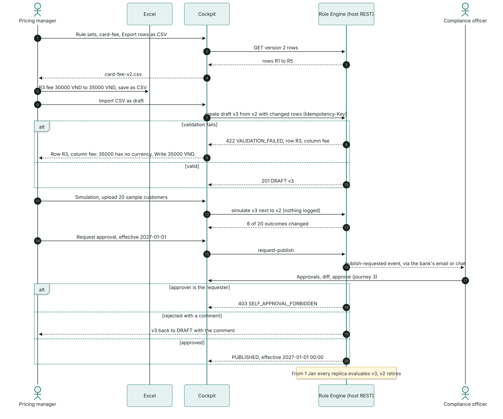
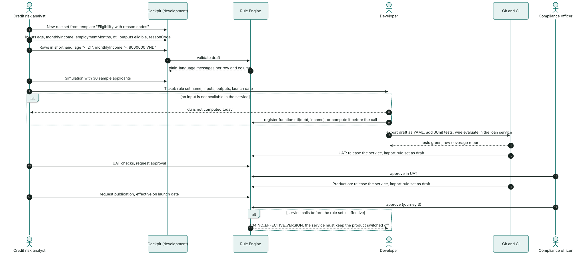
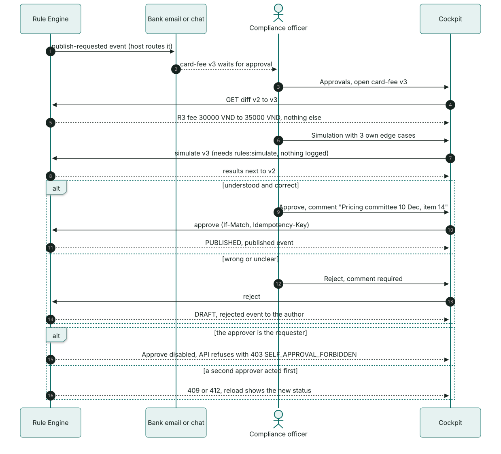
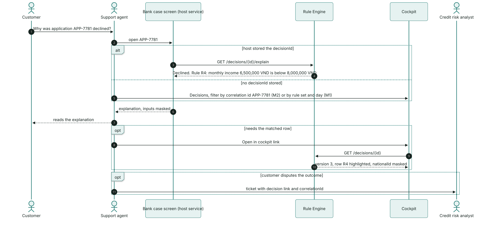
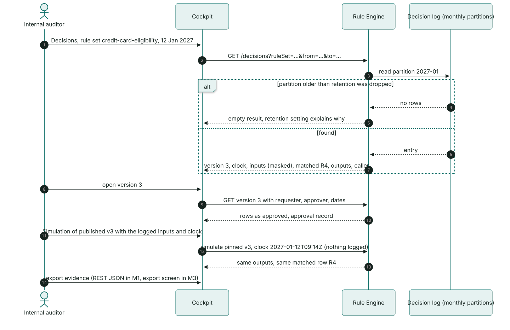
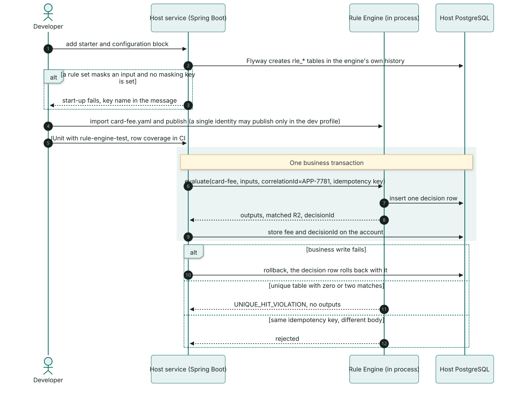

# Rule Engine: users, use cases and journeys

| Field | Value |
|---|---|
| Type | Explanation and reference |
| Owner area | Product |
| Last reviewed | 2026-11-18 |

Design preview: nothing is released. This page answers three questions about the Rule Engine: who uses it, what each of them can do and in which milestone, and how the work passes from one person to the next. Feature scope and status are owned by the [feature map](feature-map.md), dates by the [roadmap](roadmap.md), and reasons by the [decision log](decisions.md). The module requirements are in [prd-rule-engine.md](prd-rule-engine.md) and [prd-cockpit.md](prd-cockpit.md).

## Short answers

| Question | Answer |
|---|---|
| Who is the user? | Eight roles in a bank or fintech: two business authors (pricing manager, credit risk analyst), a business analyst who works in YAML and Git, an approver from compliance, support staff who explain decisions, an internal auditor, the developer of the host service and the platform administrator. Table: [Users](#users) |
| How do they interact with it? | Business users through the cockpit and, if PD-043 is accepted, a spreadsheet they export and import; the business analyst through YAML in Git; support staff mostly through the bank's own case screen, which calls the engine's REST API; developers through the Java API, REST and JUnit; administrators through configuration and monitoring. Table: [Surfaces](#surfaces) |
| How many use cases? | 69 catalogued for a real bank. Under today's plan 37 work in M1, 5 more in M2, 10 more in M3, 13 later and 4 never. With PD-043 as recommended: 43 in M1, 6 in M2, 11 in M3, 5 later, 4 never. Table: [Counts](#counts) |
| Is there a user-friendly UI for business users? | Not in M1 today: Cockpit 0.1 imports YAML or JSON, and the grid editor arrives in Cockpit 0.2 (M2). [PD-043](decisions.md#pd-043-rule-authoring-for-business-users-without-yaml) (pending) recommends a spreadsheet round-trip with plain conditions in M1 and a grid with templates in M2, and defines "user-friendly" as seven testable criteria |

## Users

| Persona | Real role | Goal | Reads YAML? | Uses Excel? | How often they touch the engine | Main surface | Permissions |
|---|---|---|---|---|---|---|---|
| Pricing manager | Product manager for card, account or payment fees and rates | Change a fee or rate for a date the pricing committee approved, and know it went live | No | Every day | A few changes a month, around committee dates | Cockpit; spreadsheet round-trip (PD-043) | `rules:read`, `rules:author`, `rules:simulate` |
| Credit risk analyst | Credit policy analyst in retail or SME lending; fraud and AML analysts work the same way | Keep eligibility, limit and scoring tables in line with credit policy, and see the effect before and after a change | With help; does not write it | Every day, large workbooks; some SQL | Monthly policy cycle; a new rule set a few times a year | Cockpit; spreadsheet round-trip (PD-043); grid (M2) | `rules:read`, `rules:author`, `rules:simulate`, `rules:log:read` |
| Business analyst | Analyst in the bank's change or IT delivery team who turns policy into tables for the business | Keep rule sets correct and reviewable in Git, on behalf of the business | Yes | Yes | Weekly | Git and YAML; cockpit import | `rules:read`, `rules:author`, `rules:simulate` |
| Compliance officer | Compliance or product control officer who signs off changes (the checker) | Approve only changes they understand, made by someone else | No | Yes | Per request, a few a week | Cockpit: Approvals; or the bank's ticket tool through REST | `rules:read`, `rules:approve` (also retires), `rules:simulate` |
| Support staff | Contact-centre, branch or back-office operations staff | Tell a customer why an application was declined or a fee charged, and pass disputes on | No | Sometimes | Many lookups a day | The bank's case screen (CRM or origination system) calling the explain API; cockpit Decisions as a second screen | `rules:log:read` (masked inputs only) |
| Internal auditor | Internal audit, also preparing evidence for external auditors and regulators | Reconstruct any past decision and prove four-eyes on every change | No | Yes | Quarterly reviews and ad-hoc investigations | Cockpit: Decisions and versions; REST for evidence | `rules:read`, `rules:log:read` |
| Host-service developer | Java developer of the service that embeds the engine | Call governed decisions inside the business transaction and test them in CI | Yes | No | Daily while building; per release after | Java API, REST, JUnit, Git | Service account with `rules:evaluate`; everything in the `dev` profile; nothing personal in production |
| Platform administrator | IT operations, identity and access, or platform team | Map roles, keep keys secret, set retention, watch health | Reads configuration | No | At go-live, at each upgrade, when alerts fire | Configuration, the bank's IdP and monitoring | None in the engine; maps IdP roles to the permissions above |

Permissions are the `<module>:<action>` set of [PD-003](decisions.md#pd-003-permission-names-are-moduleaction). They apply to every rule set of a tenant. A bank that wants pricing staff to edit only fee tables cannot express that today (UC-RE-61, RE-F-37, later).

## Surfaces

| Surface | Milestone | Who uses it | What it does |
|---|---|---|---|
| Cockpit: Rule sets | M1 | All except support | List rule sets, effective version, pending requests; read a version; import and export YAML or JSON |
| Cockpit: spreadsheet round-trip | M1 if PD-043 | Pricing manager, risk analyst, business analyst | Export rows as CSV, edit in Excel, import as a draft with plain-language errors (CK-F-35) |
| Cockpit: Simulation | M1; replay M3 | Authors, approvers, auditors | Run sample inputs on a draft or a pinned version; nothing is logged |
| Cockpit: Approvals and Diff | M1 | Compliance officer | Row diff, approve, reject with a comment; Approve disabled for the requester |
| Cockpit: Decisions | M1 | Risk analyst, support, auditor | Filter, open one decision, matched row and explanation, masked inputs |
| Cockpit: grid editor | M2 | Pricing manager, risk analyst | Typed cells, validation, templates and a "new rule set" flow (CK-F-36 if PD-043) |
| Git and YAML | M1 | Business analyst, developer | Rule sets as files, reviewed in pull requests, imported as drafts |
| Java API | M1 | Developer | `evaluate` in the host transaction, JUnit extension |
| REST `/api/bpm/rules/v1` | M1 | Developer; the bank's own screens and ticket tools | Every engine action, with idempotency keys and Problem Details errors |
| Events | M1 | Developer, administrator | `publish-requested`, `published`, `rejected`, `retired` and evaluation events for notifications, BI and monitoring |
| Configuration and metrics | M1 | Administrator | Masking key, log mode, retention (M3), metrics |

## Handoffs

| From | To | What is handed over | Where it can stall |
|---|---|---|---|
| Pricing manager or risk analyst | Compliance officer | A version in `PENDING_APPROVAL` with an effective date | The approver does not know it is waiting: the host must route the `publish-requested` event to email or chat, since the cockpit cannot push (K9) |
| Compliance officer | Author | Approval, or a rejection with a comment | A rejected draft has no owner if the author is away; the comment is the only record of why |
| Risk analyst | Developer | A new rule set's inputs and outputs, to wire into the service | The service does not have an input; the developer must compute it or register a function (journey 2) |
| Business analyst | Business user | A spreadsheet of the current rows (PD-043) or a draft to check | Without PD-043 every business change passes through this analyst |
| Engine | Support staff | A `decisionId` the host stores on the application, and an explanation | The host did not store the id; search by correlation id comes only in M2 (RE-F-34 if PD-043) |
| Support staff | Risk analyst | A disputed decision: link and `correlationId` | No ticket link in the product; the bank's ticket tool carries it |
| Engine | Auditor | Versions with requester and approver, and the decision log | Retention dropped the month (RE-F-31); masked inputs used in a condition cannot be replayed from the log alone (gap G4) |

## Use case catalogue

Each row is one thing a person in a bank or fintech does with the Rule Engine. "Today" is the milestone in which that persona can do it themselves on the stated surface under the current plan; "With PD-043" is the milestone if [PD-043](decisions.md#pd-043-rule-authoring-for-business-users-without-yaml) is accepted as recommended. `later` means after 1.0 or not scheduled; `never` means ruled out by a principle or a decision. Feature ids are in the [feature map](feature-map.md). The actor of each use case is the persona in the group heading; where another person is needed, the surface or the journey names them.

### Pricing manager (fees and pricing)

| Id | Goal | Trigger | Surface | Today | With PD-043 | Features |
|---|---|---|---|---|---|---|
| UC-RE-01 | Change a fee or rate in an existing table from a future date | Pricing committee approves a new fee schedule | CSV round-trip in the cockpit (M1); grid (M2) | M2 | M1 | CK-F-35, CK-F-10, RE-F-25, RE-F-02, RE-F-05 |
| UC-RE-02 | Add a row for a new tier, segment or channel | New card tier or channel launches | CSV round-trip (M1); grid (M2) | M2 | M1 | CK-F-35, CK-F-10, RE-F-02 |
| UC-RE-03 | Run a promotion for a fixed window (fee waived 1 to 31 Mar) | Marketing campaign approved | Two scheduled versions: one from 1 Mar, one from 1 Apr restoring the old rows | M2 | M1 | RE-F-05, RE-F-33, CK-F-35 |
| UC-RE-04 | Preview the change on sample customers before asking for approval | Draft ready | Cockpit: Simulation | M1 | M1 | CK-F-05, RE-F-21 |
| UC-RE-05 | Request approval with an effective date | Preview looks right | Cockpit: rule set version, Request approval | M1 | M1 | CK-F-04, RE-F-06, RE-F-07 |
| UC-RE-06 | Confirm the change is live and from when | Effective date reached | Cockpit: Rule sets; host notification from the `published` and `retired` events | M1 | M1 | CK-F-02, RE-F-29 |
| UC-RE-07 | Undo a wrong change | Complaint or wrong fee charged | Restore the earlier version as a draft, then approval (no single-person path, PD-012) | M1 | M1 | RE-F-33 (if PD-043), CK-F-02, RE-F-25, CK-F-04 |
| UC-RE-08 | See how many past decisions the change would have changed | Approver asks who is affected | Cockpit: Simulation, replay | M3 | M3 | RE-F-22, CK-F-11 |
| UC-RE-09 | Compare two versions over a past period (what-if) | Quarterly pricing review | Cockpit or REST | M3 | M3 | RE-F-24 |
| UC-RE-10 | Withdraw their own pending request to fix a mistake | Error found after requesting | Not planned; the approver rejects with a comment instead | later | later | RE-F-35 |
| UC-RE-11 | Fix a typo in a published version in place | Typo found after publication | None: versions are immutable (principle 5); the fix is a new version | never | never | none |
| UC-RE-12 | Edit the table as a native Excel workbook (`.xlsx`) | Prefers Excel formats over CSV | Not planned; CSV opens and saves in Excel | later | later | none |

### Credit risk analyst

| Id | Goal | Trigger | Surface | Today | With PD-043 | Features |
|---|---|---|---|---|---|---|
| UC-RE-13 | Tighten an eligibility threshold (minimum income, maximum debt-to-income) | Credit policy change approved by the credit committee | CSV round-trip (M1); grid (M2) | M2 | M1 | CK-F-35, CK-F-10, RE-F-02 |
| UC-RE-14 | Write conditions without expression syntax (equals, one of, between, at least, any) | Every edit | Cell shorthand in CSV (M1); drop-downs and plain-language reading in the grid (M2) | later | M1 | CK-F-35, CK-F-37 |
| UC-RE-15 | Create a new rule set from a template | New lending product | Cockpit grid: New rule set; then a developer wires it (journey 2) | later | M2 | CK-F-36, CK-F-10, RE-F-02 |
| UC-RE-16 | Create a new rule set from scratch: name, hit policy, inputs, outputs, allowed values | New product with no similar table | Cockpit grid, blank template; today only through a business analyst in YAML | later | M2 | CK-F-36, CK-F-10 |
| UC-RE-17 | Return every reason for a decline, not only the first | Customers and regulators ask why | `collect` hit policy with a reason code output | M1 | M1 | RE-F-01 |
| UC-RE-18 | Use a bank-specific calculation (age from birth date, debt-to-income) in a condition | Policy needs a derived value | Developer registers a pure function; the analyst uses it in a cell | M1 | M1 | RE-F-27 |
| UC-RE-19 | Replay last month's applications through a draft and see the approval-rate effect | Before requesting a policy change | Cockpit: Simulation, replay | M3 | M3 | RE-F-22, CK-F-11 |
| UC-RE-20 | Check decisions after go-live (how many declines by rule R4 this week) | First week after a change | Cockpit: Decisions filters; trends in the bank's BI from engine events | M1 | M1 | RE-F-17, CK-F-06, RE-F-29 |
| UC-RE-21 | Give one legal entity or tenant its own variant | Subsidiary has a different policy | Export and import under the other tenant (M1); copy screen later | M1 | M1 | RE-F-25, CK-F-39 |
| UC-RE-22 | Approval-rate dashboards inside the engine | Portfolio monitoring | None: the bank's BI reads engine events (PD-038 applies the same rule to processes) | never | never | none |

### Business analyst in the change team

| Id | Goal | Trigger | Surface | Today | With PD-043 | Features |
|---|---|---|---|---|---|---|
| UC-RE-23 | Keep rule sets as YAML in Git, review them in a pull request, import them as drafts | Change request from the business | Git and YAML; Cockpit: import | M1 | M1 | RE-F-25, CK-F-02, RE-F-02 |
| UC-RE-24 | Validate a file before import and fix the named errors | Every import | Cockpit import or REST `:validate` | M1 | M1 | RE-F-02 |
| UC-RE-25 | Hand business users a spreadsheet of the current rows and import their edited file | Business prefers Excel | CSV round-trip | later | M1 | CK-F-35 |
| UC-RE-26 | Bring a DMN decision table from a previous tool | Migration from another engine | Import | M3 | M3 | RE-F-30 |
| UC-RE-27 | Write customer-facing explanation wording per rule set | Support asks for plainer wording | Explanation templates | M3 | M3 | RE-F-19 |
| UC-RE-28 | Call an external service or run a script from a rule | Rule needs live data | None: inputs come from the host (principle 4, `TR-EMB-05`) | never | never | none |

### Compliance officer (approver)

| Id | Goal | Trigger | Surface | Today | With PD-043 | Features |
|---|---|---|---|---|---|---|
| UC-RE-29 | Learn that a change waits for approval | Author requests publication | Cockpit: Approvals; the bank's email or chat from the `publish-requested` event | M1 | M1 | CK-F-04, RE-F-29 |
| UC-RE-30 | Read a change as a row diff in business terms | Opens a pending request | Cockpit: Diff; plain-language conditions from M2 | M1 | M1 | CK-F-03, RE-F-08, CK-F-37 |
| UC-RE-31 | Try their own cases on the pending version | Doubt about an edge case | Cockpit: Simulation | M1 | M1 | CK-F-05, RE-F-21 |
| UC-RE-32 | Approve, confirming the effective date | Change is understood | Cockpit: Approvals | M1 | M1 | CK-F-04, RE-F-06 |
| UC-RE-33 | Reject with a reason that goes back to the author | Change is wrong or unclear | Cockpit: Approvals | M1 | M1 | CK-F-04, RE-F-07 |
| UC-RE-34 | Read a simulation report the author attached | Large change | Cockpit: Approvals | M3 | M3 | RE-F-23, CK-F-20 |
| UC-RE-35 | Approve from the bank's own ticket or workflow tool | Policy requires one approval tool (K8) | REST and events; integration is the host's | M1 | M1 | RE-F-20, RE-F-29 |
| UC-RE-36 | Require two approvers from different functions (risk and compliance) | Credit policy needs two sign-offs | Not planned | later | later | RE-F-36 |
| UC-RE-37 | Approve an urgent change alone | Fee charged in error, out of hours | None before 1.0 (PD-012, pending) | never | never | none |
| UC-RE-38 | Retire a rule set no longer used | Product withdrawn | Cockpit or REST `:retire` | M1 | M1 | RE-F-07 |

### Operations and customer support staff

| Id | Goal | Trigger | Surface | Today | With PD-043 | Features |
|---|---|---|---|---|---|---|
| UC-RE-39 | Explain a declined application to a customer from the bank's case screen | Customer calls or writes | Host screen calling `GET /decisions/{id}/explain` | M1 | M1 | RE-F-18, RE-F-20 |
| UC-RE-40 | Open the decision in the cockpit from a link in the case screen | Needs the matched row | Cockpit: Decisions, deep link | later | M1 | CK-F-34, CK-F-06 |
| UC-RE-41 | Find the decisions for one application or customer without the decision id | Host did not keep the id | Cockpit or REST: filter by correlation id or exact input | later | M2 | RE-F-34, RE-F-12 |
| UC-RE-42 | Give the customer the explanation in customer wording, in Vietnamese or English | Customer letter | Explanation templates; cockpit languages | M3 | M3 | RE-F-19, CK-F-09 |
| UC-RE-43 | Report a suspected wrong outcome to the rule owner | Customer disputes the outcome | Decision link and `correlationId` in the bank's ticket | M1 | M1 | CK-F-07, CK-F-06 |

### Internal auditor

| Id | Goal | Trigger | Surface | Today | With PD-043 | Features |
|---|---|---|---|---|---|---|
| UC-RE-44 | Reconstruct a decision from six months ago: version, inputs, matched row, explanation | Complaint, audit sample or regulator request | Cockpit: Decisions; simulation of the pinned version with the logged clock | M1 | M1 | RE-F-05, RE-F-14, RE-F-16, RE-F-18, CK-F-06 |
| UC-RE-45 | Show who requested and approved each version in a period | Audit of change control | REST and events (M1); history screen (M3) | M1 | M1 | RE-F-06, RE-F-07, RE-F-29, CK-F-38 |
| UC-RE-46 | Find all decisions about one person without reading their id | Data subject request or fraud case | Exact match on the keyed hash | later | M2 | RE-F-12, RE-F-34 |
| UC-RE-47 | Export version history and decisions as evidence | Audit file | Cockpit export (M3); REST JSON before that | later | M3 | CK-F-38 |
| UC-RE-48 | Confirm that nobody approved their own change | Segregation-of-duties test | Engine refusal (`TR-SEC-04`) plus the approval records | M1 | M1 | RE-F-06 |

### Host-service developer

| Id | Goal | Trigger | Surface | Today | With PD-043 | Features |
|---|---|---|---|---|---|---|
| UC-RE-49 | Add the engine to a service | New service or first adoption | Maven dependency, configuration block | M1 | M1 | X-F-01, X-F-02, X-F-14, X-F-16 |
| UC-RE-50 | Call a decision from Java inside the business transaction | Business logic needs a decision | Java API | M1 | M1 | RE-F-20, RE-F-14 |
| UC-RE-51 | Call a decision over REST with an idempotency key | Caller is another service | REST `/api/bpm/rules/v1` | M1 | M1 | RE-F-20 |
| UC-RE-52 | Wire a rule set the business designed: supply its inputs, use its outputs | Journey 2, step 5 | Java API, tests | M1 | M1 | RE-F-20, RE-F-28 |
| UC-RE-53 | Test rule sets in JUnit and report row coverage in CI | Every change | `rule-engine-test` | M1 | M1 | RE-F-28 |
| UC-RE-54 | Register a pure function for the expression language | Analyst needs a derived value | `RuleFunctionRegistry` SPI | M1 | M1 | RE-F-27 |
| UC-RE-55 | Evaluate up to 1 000 items in one call (nightly repricing) | Batch job | Java API, REST | M1 (cut candidate) | M2 | RE-F-26 |
| UC-RE-56 | Pin a version for a replay or for terms fixed at contract date | Contract terms fixed at signing | Java API, REST | M1 | M1 | RE-F-05 |
| UC-RE-57 | Promote rule sets from development to UAT to production | Release | Import as draft, approval in each environment | M1 | M1 | RE-F-25, RE-F-06 |
| UC-RE-58 | Handle decision errors (`UNIQUE_HIT_VIOLATION`, `INPUT_INVALID`, `NO_EFFECTIVE_VERSION`) | Every call | Java exceptions, Problem Details | M1 | M1 | X-F-05, RE-F-01 |
| UC-RE-59 | Call a rule set from a process `decision` step or an `agentTask` guardrail | Process Engine adoption | Process definition | M2 | M2 | PE-F-09, PE-F-18 |

### Platform administrator

| Id | Goal | Trigger | Surface | Today | With PD-043 | Features |
|---|---|---|---|---|---|---|
| UC-RE-60 | Map the bank's roles to engine permissions | Go-live, joiners and leavers | IdP role mapping | M1 | M1 | X-F-06 |
| UC-RE-61 | Limit who may author or approve each rule set (pricing edits only fee tables) | Security review | Not planned; permissions are per tenant | later | later | RE-F-37 |
| UC-RE-62 | Set the masking key; start-up fails without it | Go-live | Host configuration and secret store | M1 | M1 | RE-F-13, RE-F-12 |
| UC-RE-63 | Serve the cockpit embedded or standalone and register hosts | Go-live | Configuration | M1 | M1 | CK-F-01, CK-F-23, X-F-22 |
| UC-RE-64 | Monitor evaluation latency, errors and cache freshness | Daily operations | Metrics and events in the bank's monitoring | M1 | M1 | RE-F-29, RE-F-09, RE-F-10 |
| UC-RE-65 | Choose transactional or async decision logging | High-volume host | Configuration | M1 (cut candidate) | M1 (cut candidate) | RE-F-15 |
| UC-RE-66 | Set decision log retention | Records policy | Configuration | M3 | M3 | RE-F-31 |
| UC-RE-67 | Turn on OpenTelemetry spans | Tracing standard | Configuration | M3 | M3 | X-F-11 |
| UC-RE-68 | Upgrade the engine without downtime | New minor release | Rolling upgrade | M3 | M3 | X-F-10 |
| UC-RE-69 | Rotate the masking key and keep old decisions searchable | Key policy | Not designed | later | later | none |

### Counts

| Plan | M1 | M2 | M3 | Later | Never | Total |
|---|---|---|---|---|---|---|
| Today | 37 | 5 | 10 | 13 | 4 | 69 |
| With PD-043 as recommended | 43 | 6 | 11 | 5 | 4 | 69 |

Per persona, with PD-043 as recommended:

| Persona | M1 | M2 | M3 | Later | Never | Total |
|---|---|---|---|---|---|---|
| Pricing manager (fees and pricing) | 7 | 0 | 2 | 2 | 1 | 12 |
| Credit risk analyst | 6 | 2 | 1 | 0 | 1 | 10 |
| Business analyst in the change team | 3 | 0 | 2 | 0 | 1 | 6 |
| Compliance officer (approver) | 7 | 0 | 1 | 1 | 1 | 10 |
| Operations and customer support staff | 3 | 1 | 1 | 0 | 0 | 5 |
| Internal auditor | 3 | 1 | 1 | 0 | 0 | 5 |
| Host-service developer | 9 | 2 | 0 | 0 | 0 | 11 |
| Platform administrator | 5 | 0 | 3 | 2 | 0 | 10 |
## Journeys

Six journeys cover the most frequent and the most consequential use cases. Each step names the screen or call. The examples use the `card-fee` rule set from [the authoring guide](https://github.com/dhluong90/horus-Agentic-BPM/wiki/Rule-Engine-Authoring-Decision-Tables).

### Journey 1: a pricing manager changes a card fee for next month

Milestone: M1 if PD-043 is accepted (spreadsheet round-trip); otherwise steps 2 to 4 are done by a business analyst in YAML in M1, or by the pricing manager in the grid from M2. Use cases UC-RE-01, UC-RE-04, UC-RE-05, UC-RE-06.

The pricing committee approved on 10 Dec 2026 that the GOLD card monthly fee rises from 30,000 VND to 35,000 VND from 1 Jan 2027.

| Step | Who | Screen or call | What happens | Hands off to |
|---|---|---|---|---|
| 1 | Pricing manager | Cockpit, Rule sets, `card-fee` | Sees version 2 effective, no pending request | |
| 2 | Pricing manager | Export rows as CSV (CK-F-35) | Downloads `card-fee-v2.csv`: columns `id`, `tier`, `balance`, `txCount`, `fee`, `waived` | |
| 3 | Pricing manager | Excel | Changes row R3 `fee` from `30000 VND` to `35000 VND`; saves as CSV | |
| 4 | Pricing manager | Import CSV as draft | The engine creates draft version 3 from version 2 with the changed rows and validates it | |
| 5 | Pricing manager | Simulation (CK-F-05) | Uploads 20 sample customers; 6 outcomes change, all GOLD with a balance under 50,000,000 VND | |
| 6 | Pricing manager | Request approval, effective date 1 Jan 2027 | Version 3 is `PENDING_APPROVAL` and frozen; the host sends the `publish-requested` event to the approvers' channel | Compliance officer (journey 3) |
| 7 | Compliance officer | Approvals | Approves | Engine |
| 8 | Engine | All replicas | From 00:00 on 1 Jan every evaluation uses version 3; version 2 retires and the `retired` event fires | |
| 9 | Pricing manager | Rule sets | Sees version 3 effective from 1 Jan 2027 | |

Failure paths:

| At step | What goes wrong | What the user sees | Recovery |
|---|---|---|---|
| 4 | A fee without currency (`35000`) | "Row R3, column fee: 35000 has no currency. Write 35000 VND." Nothing is created | Fix the cell, import again |
| 4 | Excel changed a value (leading zero dropped, number shown as `3.5E+04`, date reformatted) | The cell is named with the value found and the value expected | Fix the cell, import again (assumption A3) |
| 4 | A column was added or renamed | "The file has a column segment that card-fee does not declare. Inputs and outputs change in the grid (Cockpit 0.2) or through your business analyst." | Remove the column, or ask for a schema change |
| 4 | Someone else changed the rule set since the export | `409` or `412` with who changed it | Export again and repeat the edit |
| 6 | The pricing manager tries to approve their own request | Approve is disabled; the API answers `403 SELF_APPROVAL_FORBIDDEN` | A second person approves |
| 7 | The approver rejects with a comment | Version 3 returns to `DRAFT` with the comment | Fix and request again |
| 7 | Approval happens after 1 Jan | Decisions before approval used version 2, and the log shows it | Open question G3: should the engine refuse an approval whose effective date has passed? |

### Journey 2: a credit risk analyst creates a new eligibility rule set

Milestone: M2 if PD-043 is accepted (grid with templates); today a business analyst writes the YAML in M1. Use cases UC-RE-15, UC-RE-16, UC-RE-52, UC-RE-57.

A new salaried personal loan launches on 1 Apr 2027. The analyst needs rule set `personal-loan-salaried-eligibility` with inputs `age`, `monthlyIncome`, `employmentMonths`, `dti` and outputs `eligible` and `reasonCode`.

| Step | Who | Screen or call | What happens | Hands off to |
|---|---|---|---|---|
| 1 | Risk analyst | Cockpit (development environment), New rule set, template "Eligibility with reason codes" (CK-F-36) | A draft with `first` hit policy, an `eligible` and `reasonCode` output and a default row | |
| 2 | Risk analyst | Grid: inputs and outputs | Declares `age` integer, `monthlyIncome` money in VND, `employmentMonths` integer, `dti` decimal; `reasonCode` with allowed values `AGE`, `INCOME`, `TENURE`, `DTI` | |
| 3 | Risk analyst | Grid: rows in shorthand (CK-F-37) | `age` `< 21` gives `AGE`; `monthlyIncome` `< 8000000 VND` gives `INCOME`; `employmentMonths` `< 6` gives `TENURE`; `dti` `> 0.5` gives `DTI`; default row eligible | |
| 4 | Risk analyst | Validate, then Simulation with 30 applicants from the risk data mart | Plain-language messages; outputs per applicant | |
| 5 | Risk analyst | The bank's ticket tool | Rule set name, inputs, outputs and launch date go to the service team | Developer |
| 6 | Developer | Git and CI | Exports the draft as YAML, commits it, adds JUnit tests (RE-F-28), wires `evaluate` into the loan origination service; CI reports row coverage | |
| 7 | Developer | Release to UAT | The service release and the rule set, imported as a draft | Risk analyst |
| 8 | Risk analyst and compliance officer | UAT cockpit | UAT cases; request and approval in UAT | Developer |
| 9 | Developer | Release to production | Service release; rule set imported as a draft | Risk analyst |
| 10 | Risk analyst | Production cockpit | Requests publication, effective 1 Apr 2027 | Compliance officer (journey 3) |

Why a developer is always in this journey: the host service must send `age`, `monthlyIncome`, `employmentMonths` and `dti` and must act on `eligible` and `reasonCode`. A business user can design the table alone; nobody can put it to use without a code change. This is why PD-043 puts changes to existing tables first.

Failure paths:

| At step | What goes wrong | Recovery |
|---|---|---|
| 3 | A row can never match (a `first` row below a broader one) | The validator warns about the unreachable row with its id |
| 5 | The service does not compute `dti` | The developer registers a pure function `dti(debt, income)` (RE-F-27) or computes it before the call; or the analyst redesigns the table |
| 9 | The service goes live before the rule set is effective | Calls get `404 NO_EFFECTIVE_VERSION`; the service must keep the product switched off until 1 Apr |
| 10 | The approver rejects | Back to step 3 in development, then the promotion again |

### Journey 3: a compliance officer reviews and approves

Milestone: M1. Use cases UC-RE-29 to UC-RE-33.

| Step | Who | Screen or call | What happens | Hands off to |
|---|---|---|---|---|
| 1 | Host service | `publish-requested` event to the bank's email or chat | "card-fee version 3 waits for approval" with a link | Compliance officer |
| 2 | Compliance officer | Cockpit, Approvals | Opens `card-fee` version 3: requester, effective date, comment | |
| 3 | Compliance officer | Diff (CK-F-03) | Row R3 `fee` changed from 30,000 VND to 35,000 VND; nothing else | |
| 4 | Compliance officer | Simulation (CK-F-05) | Runs three edge cases of their own | |
| 5a | Compliance officer | Approve with comment "Pricing committee 10 Dec, item 14" | `PUBLISHED`, effective 1 Jan 2027; `published` event | Engine |
| 5b | Compliance officer | Reject; a comment is required | `DRAFT`; `rejected` event to the author | Author |

Failure paths:

| What goes wrong | What the user sees | Recovery |
|---|---|---|
| The approver is the requester | Approve disabled; the API refuses with `403 SELF_APPROVAL_FORBIDDEN` | A different person with `rules:approve` |
| Two approvers act at once | The second gets `409` or `412`; reload shows the new status | None needed |
| The approver lacks `rules:simulate` | The Simulation button is hidden | Map the permission (administrator) |
| A 20-row change: the approver cannot say who is affected | Defers the decision | Replay is in M3 (PD-042). If kill assumption K7 fires in M1, replay moves earlier |
| The bank requires approval in its own ticket tool (K8) | | The ticket tool calls `:approve` through REST with the approver's identity; the same self-approval check applies |

### Journey 4: a support agent explains a declined application to a customer

Milestone: M1 (explain API); deep link M1 if PD-043; search by correlation id M2 if PD-043. Use cases UC-RE-39 to UC-RE-43.

A customer calls about credit card application `APP-7781`, declined on 12 Jan 2027.

| Step | Who | Screen or call | What happens | Hands off to |
|---|---|---|---|---|
| 1 | Support agent | The bank's case screen | Opens `APP-7781`; the host stored the `decisionId` when it called `evaluate` | |
| 2 | Host service | `GET /api/bpm/rules/v1/decisions/{id}/explain` | "Declined. Rule R4 applied: monthly income 6,500,000 VND is below 8,000,000 VND." | |
| 3 | Support agent | Case screen | Reads the explanation to the customer | |
| 4 | Support agent | Open in cockpit link (CK-F-34) | Cockpit Decisions: version 3, row R4 highlighted, `nationalId` masked | |
| 5 | Support agent | The bank's ticket tool | If the customer disputes it (income was updated), a ticket with the decision link and `correlationId` | Credit risk analyst or the operations team that re-runs the application |

Failure paths:

| What goes wrong | Recovery |
|---|---|
| The host did not store the `decisionId` | M1: filter Decisions by rule set and day and read the outputs. M2 (if PD-043): filter by correlation id `APP-7781` (RE-F-34) |
| The agent's screen gets `403` | The host's service account or the agent's role lacks `rules:log:read`; the error shows a `correlationId` for the administrator |
| The explanation is too technical for a customer | Explanation templates per rule set arrive in M3 (RE-F-19) |
| The decision was made by a version since retired | Nothing to do: the entry keeps its version and the explanation uses it |

Most banks keep support staff in their own case screen, so the explain API, not the cockpit, is the main surface for this persona ([ASSUMPTION] A4, below).

### Journey 5: an auditor reconstructs a decision from six months ago

Milestone: M1 capability, used in July 2027 for a January decision. Version history screen and evidence export M3 if PD-043. Use cases UC-RE-44, UC-RE-45, UC-RE-47, UC-RE-48.

| Step | Who | Screen or call | What happens |
|---|---|---|---|
| 1 | Auditor | Complaint file | Reference `APP-7781`, decided 12 Jan 2027 |
| 2 | Auditor | Cockpit, Decisions: rule set `credit-card-eligibility`, 12 Jan 2027 | The entry, read from the January 2027 partition |
| 3 | Auditor | Open the entry | Version 3, clock `2027-01-12T09:14Z`, inputs with `nationalId` masked, matched row R4, outputs, calling service |
| 4 | Auditor | Open version 3 | Rows as approved, requester, approver, dates and comments (REST in M1; history screen CK-F-38 in M3) |
| 5 | Auditor | Simulation of published version 3 with the logged inputs and clock | Same outputs and the same matched row; nothing is logged (RE-F-05) |
| 6 | Auditor | Evidence | REST JSON of the decision and the version in M1; CSV or JSON export in M3 (CK-F-38) |

Failure paths:

| What goes wrong | Recovery |
|---|---|
| The month is older than the retention setting and was dropped | Nothing to find; the retention setting (RE-F-31, M3) is the record. Retention must be set to the bank's records policy before go-live |
| The auditor has the customer's national id but not the application id | Search by the exact id: the engine hashes it with the masking key and matches (RE-F-12; filter RE-F-34, M2 if PD-043) |
| A masked input is used in a condition | The log holds only its hash, so step 5 cannot rerun the decision from the log alone (gap G4) |
| The auditor lacks `rules:read` | Can see the decision but not the version rows; map the permission |

### Journey 6: a developer adds the engine to a service and calls it

Milestone: M1. Use cases UC-RE-49 to UC-RE-53, UC-RE-58.

| Step | Who | Screen or call | What happens |
|---|---|---|---|
| 1 | Developer | Maven: `rule-engine-spring-boot-starter`, one configuration block | The engine uses the host's `DataSource` and transactions (X-F-01) |
| 2 | Developer | Start the service | Flyway creates the `rle_*` tables in the engine's own history |
| 3 | Developer | Import `card-fee.yaml` and publish | In the `dev` profile one identity may publish; outside `dev` the starter refuses to start with maker-checker off |
| 4 | Developer | JUnit with `rule-engine-test` | Tests per row; CI reports row coverage (RE-F-28) |
| 5 | Developer | `evaluate` inside the `@Transactional` business method | Outputs, matched rows and a `decisionId`; one decision row inserted in the same transaction; the service stores `decisionId` on the account or application |
| 6 | Developer | REST layer and role mapping | The cockpit and the bank's screens call `/api/bpm/rules/v1`; roles map to `rules:*` permissions (X-F-06) |
| 7 | Developer | Pipeline | Rule set files promoted to UAT and production as drafts, approved in each environment |

Failure paths:

| What goes wrong | What the developer sees |
|---|---|
| A rule set masks an input and no masking key is set | Start-up fails and names the missing key (RE-F-13) |
| The business write fails | The transaction rolls back and the decision row with it (RE-F-14) |
| A `unique` table matches zero or two rows | `UNIQUE_HIT_VIOLATION` (`422` over REST), no outputs |
| An input has the wrong type | `INPUT_INVALID` (`400`) or `DecisionInputException` |
| No version is effective at the decision's clock | `404 NO_EFFECTIVE_VERSION` |
| A retry reuses an idempotency key with a different body | Rejected; an in-flight duplicate gets `409` |

## Gaps found

| Id | Gap | Where | Proposed handling |
|---|---|---|---|
| G1 | No path without YAML for business users in M1 | UC-RE-01 to UC-RE-03, UC-RE-13 | PD-043 |
| G2 | The "Request approval" button and the "Restore as draft" and "Fork from tenant default" actions are described on the wiki but are not feature rows | Journey 1 step 6, UC-RE-07, UC-RE-21 | Request: covered by CK-F-04 and RE-F-07 until the cockpit SPEC names it. Restore: RE-F-33 (PD-043). Copy across tenants: CK-F-39, later; the wiki should say "export and import" until then |
| G3 | No rule for an approval that happens after the requested effective date | Journey 1 | Architect: refuse, or take effect at approval and log it |
| G4 | A masked input used in a condition cannot be replayed from the log alone | Journey 5 | Architect: the validator warns when a masked input appears in a condition |
| G5 | No search by correlation id or by input value | Journeys 4 and 5 | RE-F-34 (PD-043) |
| G6 | Permissions cannot be limited to some rule sets | UC-RE-61 | RE-F-37, later; to be raised with the security reviewer, since a bank's access review may ask for it before 1.0 |
| G7 | No two-approver rule for credit policy | UC-RE-36 | RE-F-36, later |
| G8 | Masking key rotation is not designed | UC-RE-69 | Architect, before 1.0 |

## Assumptions and tests

| Id | Assumption | Fails if | Cheapest test | Kill criterion | Then |
|---|---|---|---|---|---|
| K3 | Analysts change existing tables without help (revised by PD-043 to the spreadsheet path) | Every change still needs a business analyst or developer | Two moderated sessions in week 2 of M1 | Neither reaches `PENDING_APPROVAL` within 15 minutes | Move the grid (CK-F-10, CK-F-37) to the start of M2 and protect it |
| A1 | Most business changes edit an existing rule set | New rule sets or new inputs are common | Classify 12 months of changes from two pricing and two risk contacts | More than one third need a new rule set or input | Raise templates (CK-F-36) in M2 |
| A2 | Banks keep fee schedules and credit policy in Excel today | Pricing already lives in a product catalogue system | Two pricing and three compliance conversations in M1 | Three of five do not use spreadsheets | Drop CK-F-35 and integrate with the catalogue through REST |
| A3 | Excel does not change values silently in a CSV round-trip | A changed value passes validation | One-day test, Windows and macOS, English and Vietnamese locales | Any changed value accepted | Quote every exported cell and document the Excel steps; reconsider `.xlsx` |
| A4 | Support staff work in the bank's case screen, not in the cockpit | Banks want support to use the cockpit directly | Two operations lead conversations before M2 | Both want the cockpit | Move RE-F-34 out of the cut list and add a support view to Cockpit 0.2 |

## Related documents

- [PD-043](decisions.md#pd-043-rule-authoring-for-business-users-without-yaml): business-user authoring decision
- [prd-rule-engine.md](prd-rule-engine.md) and [prd-cockpit.md](prd-cockpit.md): module requirements
- [feature-map.md](feature-map.md): features RE-F-33 to RE-F-37 and CK-F-34 to CK-F-39 added from this catalogue
- Diagram sources: [`diagrams/`](diagrams/)
