# Cockpit UX design

| Field | Value |
|---|---|
| Type | Design specification |
| Owner area | Product |
| Last reviewed | 2026-11-19 |
| Status | Decided: the hybrid direction ([PD-056](decisions.md#pd-056-rule-management-ux-direction), option 4, 2026-11-19) |

This is the UX source of truth for the cockpit: the approved direction, the screens and who each one serves, the visual rules, the colour tokens, accessibility, languages and the release each screen lands in. The approved prototype is [`ux/cockpit-prototype.html`](ux/cockpit-prototype.html); open it in a browser, no build needed. The screenshots below are taken from it.

Scope and dates are owned by the [roadmap](roadmap.md) and the [feature map](feature-map.md); requirements by the [cockpit PRD](prd-cockpit.md) and [`cockpit/docs/SPEC.md`](../../cockpit/docs/SPEC.md); architecture by [`cockpit/docs/DESIGN.md`](../../cockpit/docs/DESIGN.md); people and journeys by [Rule Engine users and journeys](rule-engine-users-and-journeys.md); reasons by the [decision log](decisions.md). Where this document and those disagree on scope or dates, those win and this document is corrected. Where they disagree on layout, colour, wording style or accessibility, this document wins.

Design preview: the screens are specified, not built. The examples use the fictional tenant Sao Mai Bank, the `card-fee` rule set and the `kyc-onboarding` process. Every number in the prototype comes from one shared dataset, so the screens cross-check each other.

## Contents

1. [The hybrid direction](#1-the-hybrid-direction)
2. [Screen hierarchy](#2-screen-hierarchy)
3. [Lenses and screens](#3-lenses-and-screens)
4. [Anti-clutter rules](#4-anti-clutter-rules)
5. [Money colour semantics](#5-money-colour-semantics)
6. [Design tokens](#6-design-tokens)
7. [Chart palette](#7-chart-palette)
8. [Accessibility and viewport checks](#8-accessibility-and-viewport-checks)
9. [English and Vietnamese](#9-english-and-vietnamese)
10. [Releases](#10-releases)
11. [Prototype and screenshots](#11-prototype-and-screenshots)

## 1. The hybrid direction

Three directions were reviewed: a grid that works like a spreadsheet, rules read as sentences, and a change request that carries all the evidence on one page. The approved direction combines them, and adds operations views for processes and agent steps. Each part does one job for one persona. All parts share one set of components, so changing a part later swaps a region, not a screen.

| # | Part | Job it does | Main persona |
|---|---|---|---|
| 1 | Process canvas as home, decision table docked below | See where a rule acts in the flow, and the rule itself, on one screen | Operator, author, auditor |
| 2 | Dense matrix editor | Change many rows fast and see the money effect before sending | Author |
| 3 | Plain-language policy readings | Understand one row without reading conditions | Approver, support staff, auditor |
| 4 | Change dossier with a three-way diff and the four-eyes gate | Approve only what you understand, never your own change | Approver |
| 5 | Control tower with the guardrail inspector | Clear escalated agent steps and tasks within SLA | Operator, reviewer of agent steps |
| 6 | Nested And/Or builder lens | Write a complex eligibility condition without expression syntax | Author |

The engine decides; the cockpit shows. Validation, readings, four-eyes, money totals, SLA due times and guardrail verdicts all come from the engine API. The browser never computes a business rule, a calendar or a money amount, and never marks an action done before the API answers.

### People in the examples

| Name | Persona | Role at Sao Mai Bank | Lenses used most |
|---|---|---|---|
| Nguyễn Thị Linh | Author (maker) | Pricing manager, cards | Matrix editor, canvas, change dossier as maker |
| Trần Văn Minh | Approver (checker) | Compliance officer | Change dossier |
| Phạm Thu Hoa | Support staff | Contact-centre agent | Decision page, policy readings |
| Vũ Anh Tuấn | Operator and agent-step reviewer | Operations officer, back office | Control tower, canvas |
| Lê Minh Quân | Author of process changes | Credit risk analyst | Change dossier as maker of a process change |
| Đỗ Thị Lan | Auditor | Internal auditor | Decision page, audit trail |

How a rule change and an escalated agent step travel between these people:


## 2. Screen hierarchy

Three tiers. The shell is on every screen. Each lens opens on a list or a queue. Detail screens do the work. Solid lines are Cockpit 0.1 or 0.2; dotted lines are 1.0, cut candidates or proposed.


| Tier | Contents | Rule |
|---|---|---|
| 1. Shell | Product name, tenant and host, command search, EN or VI, light or dark, sign-in state; host bar with one sign-in (0.1); tenant switcher (0.2) | The host bar holds only service hosts and the tenant. Demo devices never sit in it |
| 2. Lenses | Left rail: Canvas, Matrix editor, Changes (War Room), Control tower, Decisions | Each lens has a title and a subtitle of ten words or fewer |
| 3. Detail and action | Docked table with Formula, Policy and Builder lenses; trace; dossier; guardrail inspector; decision page | The primary action of a screen is visible at 1440x900 without scrolling |

The prototype labels the lenses with working names: Terminal for the matrix editor and War Room for changes. The product uses the plain names in the table above.

## 3. Lenses and screens

Each screen below shows the approved prototype at 1440x900, light then dark.

### 3.1 Canvas with the docked table

| Light | Dark |
|---|---|
| 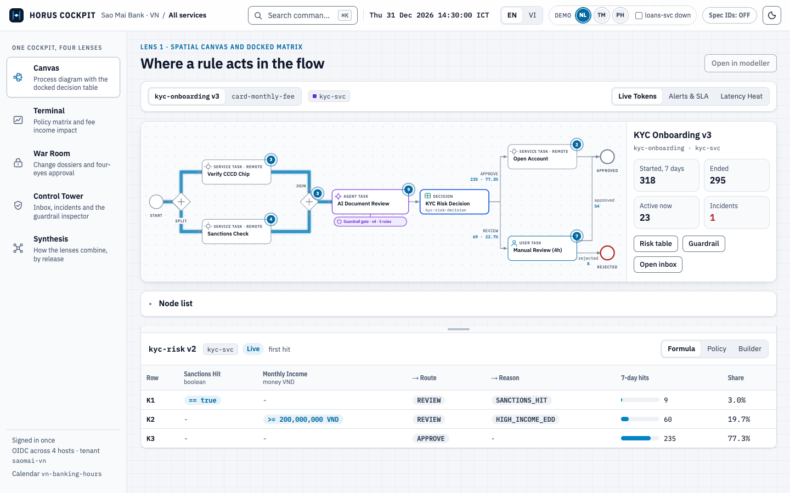 | 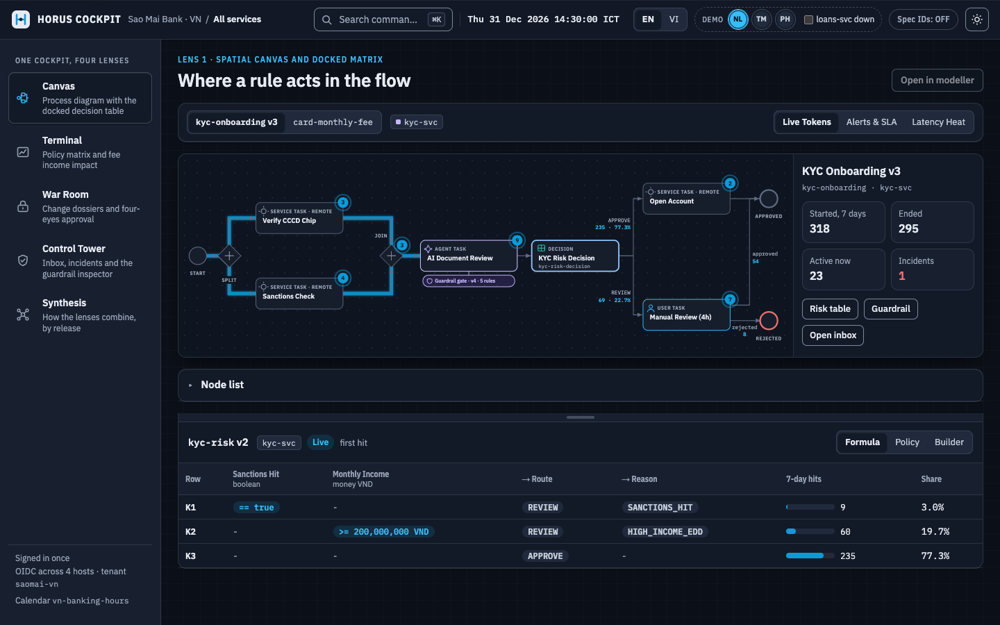 |

- **Serves:** Tuấn finds stuck work; Linh sees where her rule acts; auditors read a process.
- **Layout:** the process diagram on the left, a compact inspector on the right (four counts in a 2x2 grid and three actions), and the decision table docked below the diagram. Selecting a decision node, or the guardrail chip on an agent step, docks that table.
- **Diagram rules:** left to right; nodes drawn by BPMN element type with a small type label; edges route around nodes, never through them, with at least 24 px between an edge label and any badge; token badges use `--token`. Every diagram has a node list with the same data, for keyboard and screen reader users.
- **Layers:** one at a time: Live tokens (0.2, cut candidate), Alerts and SLA (0.2), Latency heat (1.0, cut candidate).
- **Docked table:** read only. Wildcard cells show a single quiet dash. Formula, Policy and Builder are three lenses over the same rows; only one shows at a time. A shadowed-row warning from the engine sits under the table, with "Fix row order" offering two choices and their impact; it never edits silently.
- **0.1 without the Process Engine:** home is changes and rule sets, and a rule set opens its table in the same docked layout.

### 3.2 Matrix editor

| Light | Dark |
|---|---|
| 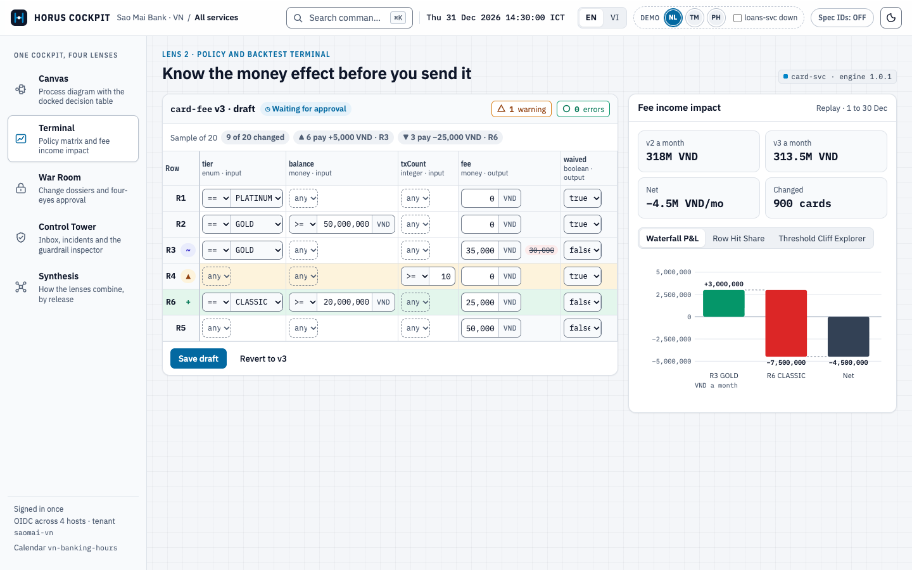 | 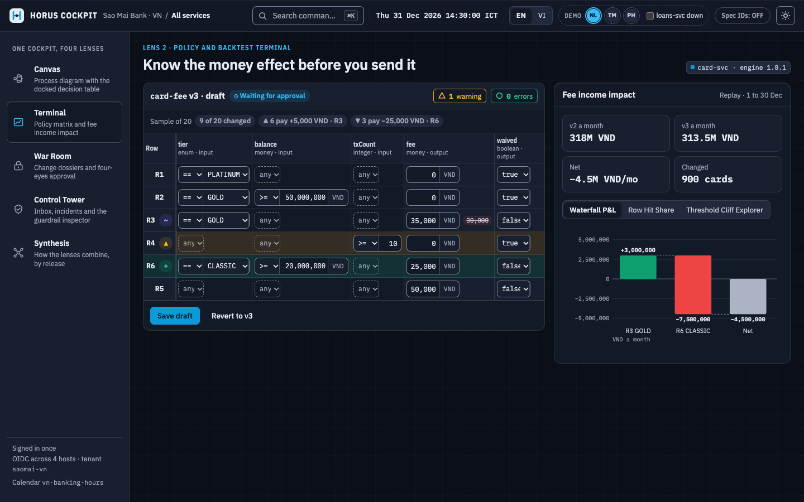 |

- **Serves:** Linh changing many rows.
- **Layout:** the editable matrix on the left; "Fee income impact" on the right with four figures (v2 a month, v3 a month, net, cards changed) and one chart at a time (waterfall, row hit share, threshold cliff explorer).
- **Cells:** typed. Operators are pick lists; money inputs show thousand separators while typing and the currency code at the trailing edge; changed cells keep the old value struck through on the same row height. Wildcards are a compact `any` control here because the matrix is in edit mode; in every read view they collapse to a dash.
- **Checks:** warning and error counts from the engine sit in the matrix header. A bad cell gets the engine's `422 VALIDATION_FAILED` message naming the row and column.
- **Impact:** recalculated by the engine after "Save draft", with an "Updating" label until the answer arrives. The browser never adds money. The panel is called fee income impact, not P&L, in product copy.
- **Primary action:** "Save draft", visible at 1440x900.

### 3.3 Policy readings

| Light | Dark |
|---|---|
| 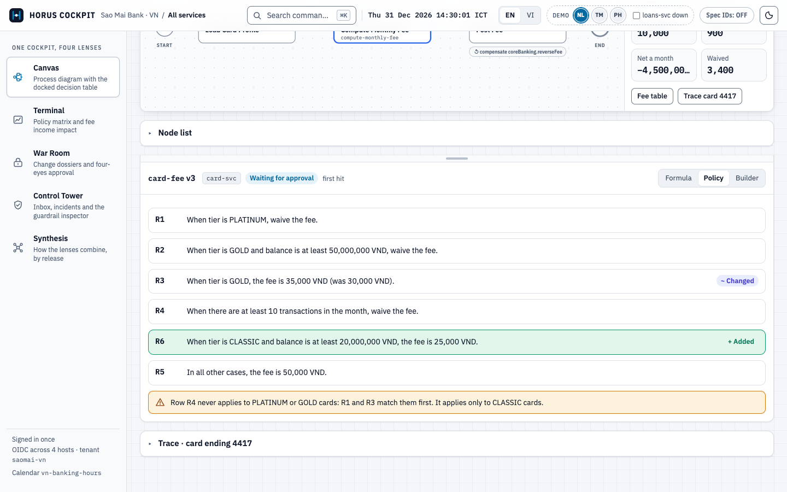 | 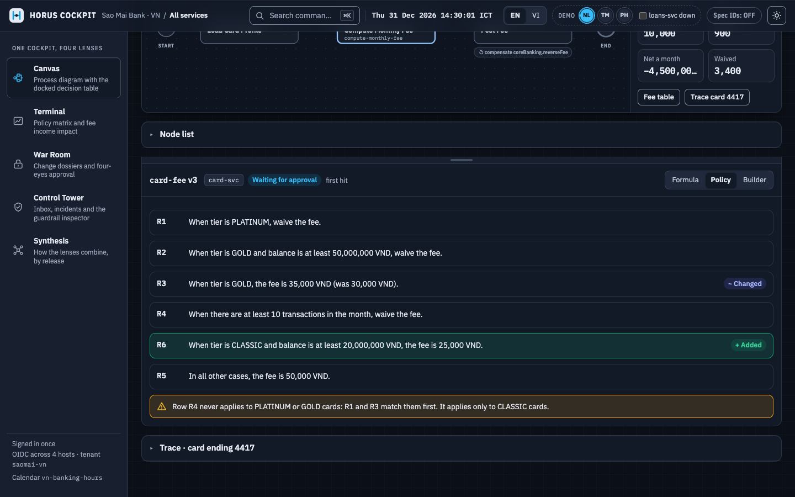 |

- **Serves:** Minh, Hoa and auditors, who must understand one row without reading conditions.
- **Content:** every row as one sentence in the user's language: "When tier is GOLD and balance is at least 50,000,000 VND, waive the fee." The engine returns each sentence per language; the cockpit never assembles sentences, because word order differs between English and Vietnamese.
- **Where it appears:** in the docked table (Policy lens), the change dossier (policy redline), the simulation and the decision page. Changed rows carry a "Changed" mark with the old value in brackets; added rows an "Added" mark.
- **Warnings:** the engine's shadowed-row warning appears under the readings, in plain words.

### 3.4 Change dossier, three-way diff and the four-eyes gate

| Light | Dark |
|---|---|
| 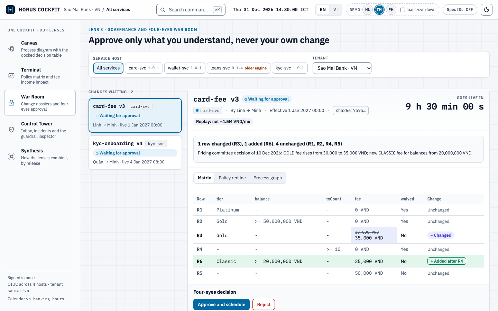 | 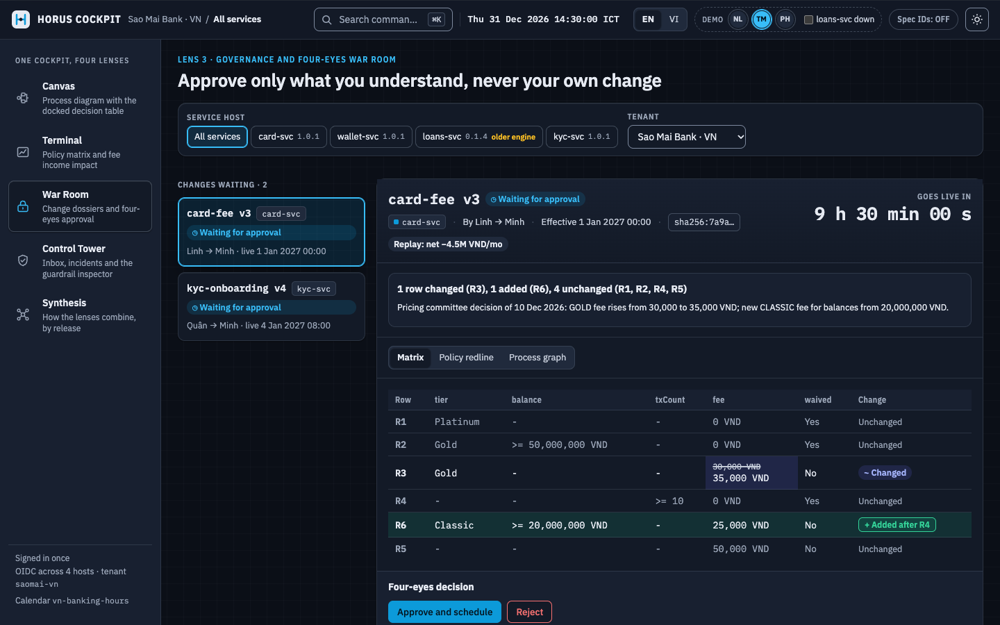 |

- **Serves:** Minh, the checker. Linh sees the same page as maker.
- **Layout:** queue of changes waiting on the left; the dossier on the right. Header: name and version, state, host, maker and checker, effective date, content hash, and a countdown to go-live. Then the diff summary from the engine and the maker's note.
- **Three lenses, one at a time:**
  - Matrix: cell diff with the same column labels and formatted values as the editor. Changed cells use `--diff-mod`, added rows `--diff-add`, removed values `--diff-del` with struck `--ink-2` text.
  - Policy redline: old reading struck, new reading added.
  - Process graph: two diagrams with added and changed nodes marked (1.0). For a rule change it says "No process change" and names the process that uses the rule set.
- **Four-eyes gate:** "Approve and schedule" and "Reject" for the checker. For the maker, Approve is replaced by "Approve is unavailable. You requested this change. Another approver must decide." The state comes from the engine's allowed actions; a stale click still gets `403 SELF_APPROVAL_FORBIDDEN`, shown with its code and correlation id. Reject needs a comment. Nothing changes state until the engine answers.
- **Audit trail:** collapsed under the gate, with its count.
- **States:**


### 3.5 Control tower and the guardrail inspector

| Light | Dark |
|---|---|
| 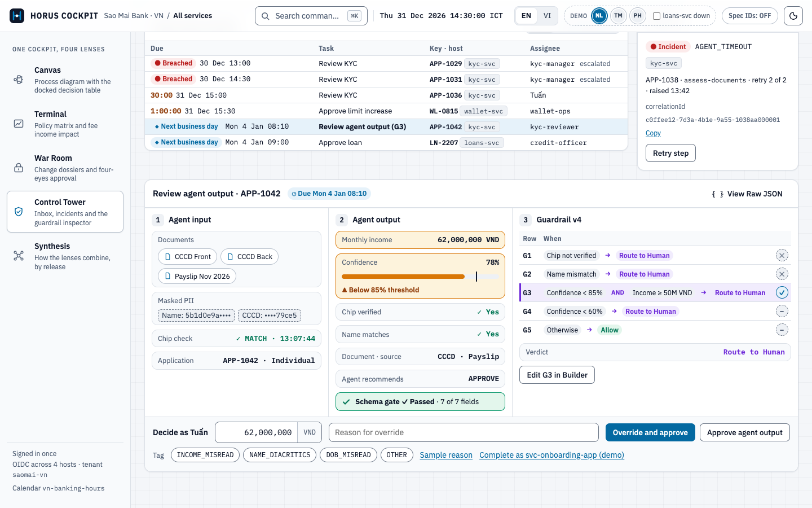 | 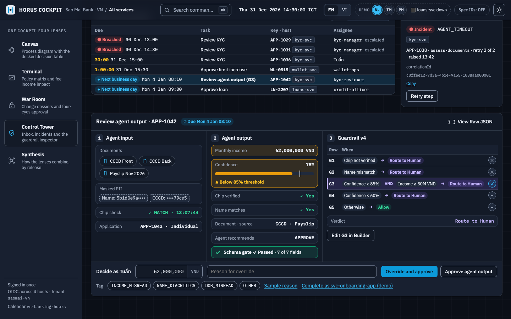 |

The screenshots are scrolled to the inspector. On first load the inbox and incidents sit above it.

- **Serves:** Tuấn, clearing escalated agent steps and tasks within SLA.
- **Inbox across services:** one list merged across hosts, ordered by due time. Every row shows the engine's due time and a state word (Breached, Due in 30 min, Next business day); a live countdown appears only within the current business day. A filter shows SLA breaches only. Incidents sit beside the inbox with code, retry count, host, correlation id with Copy, and "Retry step".
- **Guardrail inspector, three columns:**
  1. Agent input: documents, masked personal data shown as `*** (hmac:…)`, chip check, application.
  2. Agent output: field cards (monthly income, confidence with its threshold, chip verified, name matches, document and source, recommendation) and the schema gate verdict.
  3. Guardrail: every row with a plain condition, its outcome and a match mark. "No match" and "Not reached" are neutral; the matched row uses the selection colour; the escalation outcome is violet everywhere.
- **Action dock:** "Approve agent output" and "Override and approve", with the corrected value as a money input, a mandatory reason, and optional reason tags (proposed). The triggering service identity cannot complete the task.
- **Telemetry view:** the autonomy ladder with the current rung set by the bank on this guardrail version, the human override rate (0.2) and offline evaluation results (1.0). The ladder is adoption guidance; the engine stores no rung. See the [autonomy ladder](images/pe-autonomy-ladder.svg).
- **Keyboard:** J and K move through the queue; A approves, O opens override; Escape closes and returns focus to the row. Shortcuts are off while typing and listed under `?`.

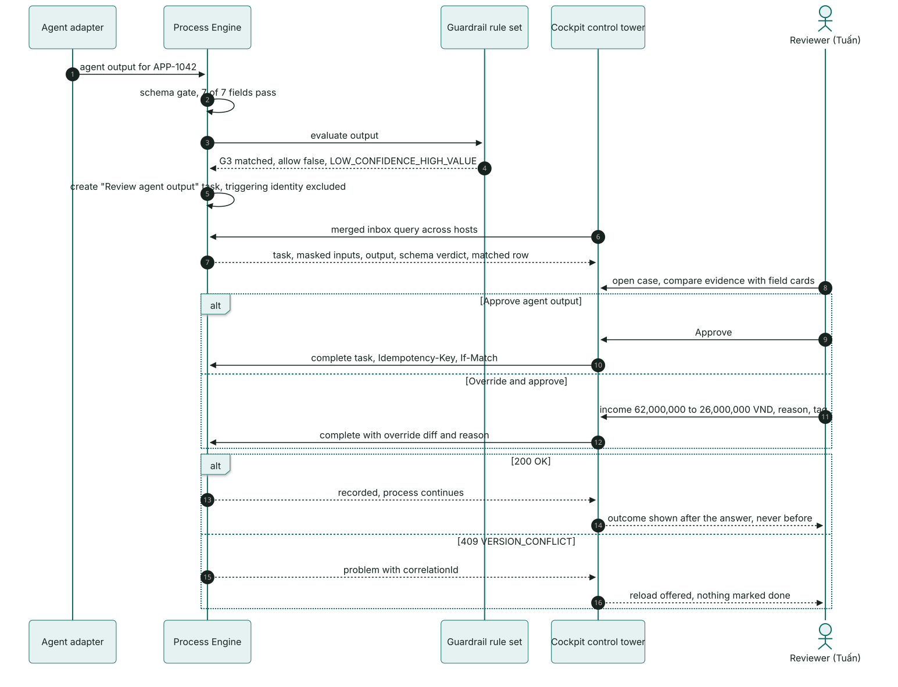

### 3.6 And/Or builder

| Light | Dark |
|---|---|
| 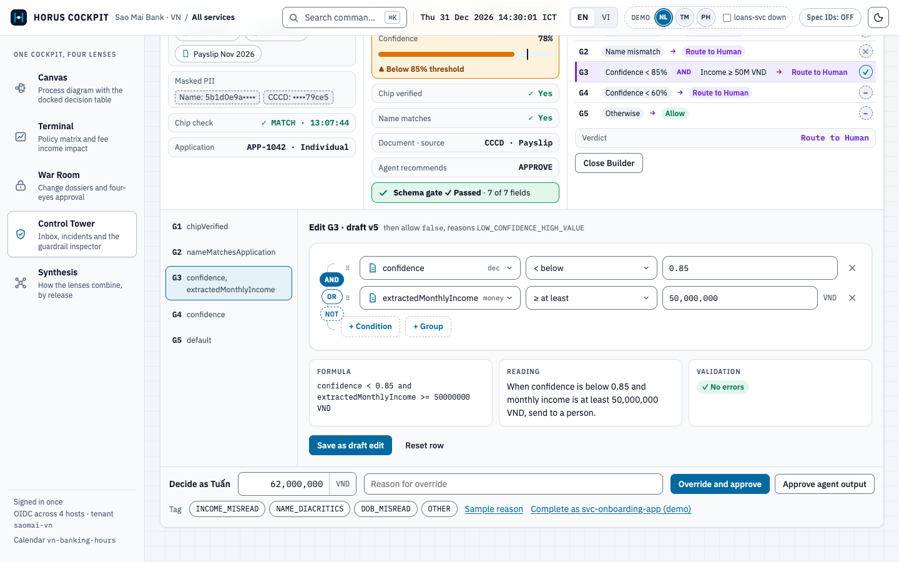 | 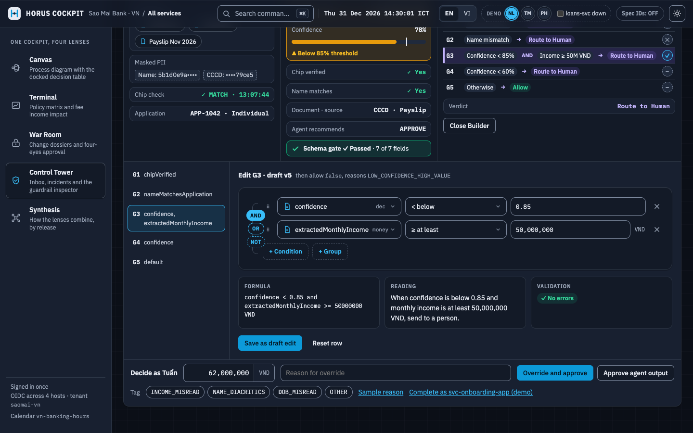 |

- **Serves:** an author writing a complex eligibility or guardrail condition.
- **Layout:** row list on the left; on the right one row's conditions as nested groups. Each group is And, Or or Not; each condition is attribute, operator and typed value (money with separators and currency, decimals, booleans as Yes or No). Below: the formula the engine will store, the reading, and the engine's validation.
- **Entry points:** the Builder lens of the docked table, and "Edit G3 in Builder" from the guardrail inspector.
- **Saving:** "Save as draft edit" creates a draft that the engine validates and that still needs a second approver.
- **Limits:** Or and Not need the expression form of a cell; the 0.2 matrix holds one And condition per column, and the builder says so.

### 3.7 Synthesis by release

| Light | Dark |
|---|---|
| 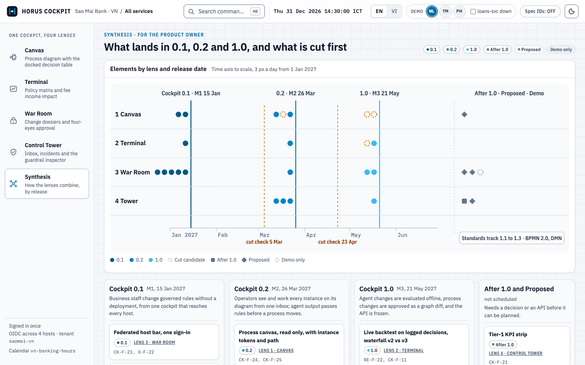 | 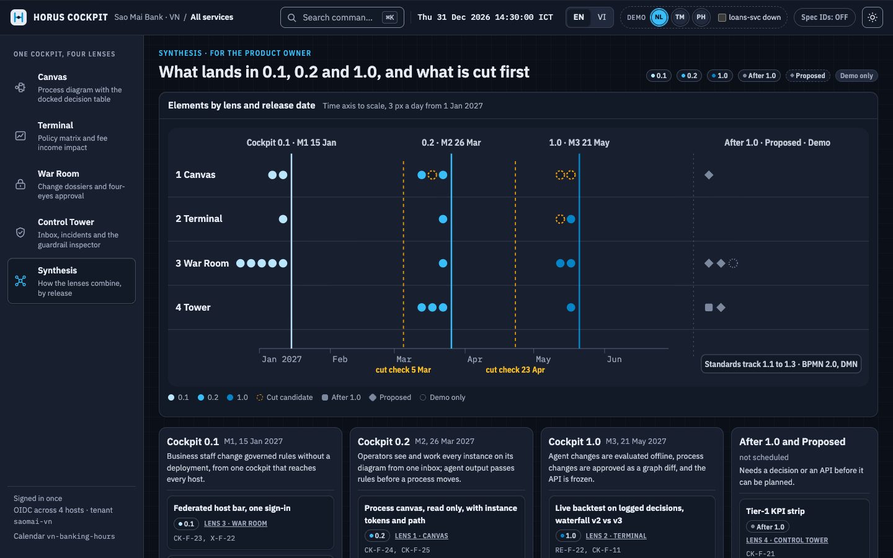 |

A planning view in the prototype, not a cockpit screen. It places every element of the four lenses on a time axis to scale (Cockpit 0.1 on 15 Jan 2027, 0.2 on 26 Mar 2027, 1.0 on 21 May 2027), marks cut candidates with a dashed ring and their checkpoint date, and groups the rest as After 1.0, Proposed or Demo only. Releases use the ordinal ramp `--rel-1` to `--rel-3`; later items are grey and keep their shapes (diamond, square, dotted ring). [Section 10](#10-releases) is the text form of this view.

## 4. Anti-clutter rules

Every cockpit screen follows these rules from 0.1.

| Rule | What it means on screen |
|---|---|
| Specification ids hidden | No feature, spec, requirement or decision id on any product surface. The prototype has a "Spec IDs" switch for design reviews, off by default; the product has none |
| Subtitles of ten words or fewer | Lens and card subtitles state the job, not the architecture. Card helper text stays under 15 words |
| One view at a time | Segmented controls switch lenses, charts, layers and diff modes; two lenses never stack on one screen |
| One language at a time | English or Vietnamese, chosen by the user; never mixed on one screen, including labels, data and messages |
| Field cards, not raw JSON | Agent inputs and outputs, events and errors show as labelled field cards with formatted values. Raw JSON stays behind an opt-in "View raw JSON" control for support engineers, off by default, with masked values still masked |
| Human labels | Column and attribute names, enum values and booleans show as labels (`Monthly income`, `Platinum`, `Yes`), never as code identifiers or `true` |
| Wildcards collapse | An `any` condition in a read view is one quiet dash, not an empty input |
| Pulse strip short | At most four operational counts; it is After 1.0 and unscheduled |
| No defensive prose | Architecture notes stay in design documents, not in cards |
| Demo devices apart | Identity switcher and "service down" toggles live in one utility pill marked Demo, never in the host bar |

## 5. Money colour semantics

One perspective for every money colour: the bank's fee income. Green means the bank earns more, red means it earns less. Customer impact is shown without colour.

| Element | Colour | Example (`card-fee` v3 against v2, a month) |
|---|---|---|
| Rule step that raises fee income | `--gain` | R3 GOLD +3,000,000 VND (600 cards pay 5,000 VND more) |
| Rule step that lowers fee income | `--loss` | R6 CLASSIC −7,500,000 VND (300 cards pay 25,000 VND less) |
| Net total bar | `--net`, a neutral total with a zero baseline | Net −4,500,000 VND |
| KPI values (v2, v3, net) | `--ink`, with the sign | −4.5M VND a month |
| Customer impact pills | Neutral (`--surface-3`, `--muted`) with ▲ or ▼ and the sign | ▲ 6 pay +5,000 VND, ▼ 3 pay −25,000 VND |
| Output values in tables | Neutral code pills | `REVIEW`, `APPROVE`, `0 VND` |

Rules:

- Money direction uses `--gain`, `--loss` and `--net` only, and only in charts. Status tokens (`--ok`, `--bad`) never colour money.
- Red text is for errors, breaches and incidents, never for a planned fee cut.
- Every amount is formatted by one tested formatter on integer minor units or decimal strings, with thousand separators in every editor, diff, chart, tooltip and log: `50,000,000 VND` in English, `50.000.000 VND` in Vietnamese. No floating-point arithmetic touches money.
- A waterfall keeps the gain and loss value labels with their sign, because the gain and loss pair is near the colour-vision limit in dark mode (section 7).

## 6. Design tokens

The tokens below are the only colour source. Feature styles use the variables, never raw colours. In the cockpit web application they live in one stylesheet with a light block and a dark block; dark applies with `data-theme="dark"` on the root element, and the same dark values apply to a dark system preference before the theme is set.

Contrast ratios are WCAG 2.x ratios measured by script, with translucent tokens composited onto their real surface. Thresholds: 4.5:1 for text under 24 px, 3:1 for control boundaries, focus indicators and chart marks, 2:1 for the light end of an ordinal ramp. "Decorative" means the token must never be the only boundary of a control.

### 6.1 Semantic roles

| Family | Means only |
|---|---|
| `--accent*` | Interactive, selected, live: primary action, tabs, live tokens, links, waiting for approval |
| `--ok*` | A check passed or an action completed |
| `--warn*` | Needs attention soon: threshold near, SLA near, cut-candidate risk |
| `--bad*` | Error, breach, incident, destructive action |
| `--violet*` | Agent work and route-to-human outcomes |
| `--teal` | Decision node outline on the canvas only |
| `--indigo*` | Changed values in a diff (through `--diff-mod`) |
| Info | `--accent-soft` with an icon; there is no separate info hue |

Every status also has a word and an icon, never colour alone: ● Healthy, ▲ Needs review, ✓ Matched, ✕ Rejected.

### 6.2 Surfaces, text and lines

| Token | Role | Light | Ratio, light | Dark | Ratio, dark | Measured against |
|---|---|---|---|---|---|---|
| `--bg` | Application background | `#F4F6F9` | | `#0B0F17` | | |
| `--surface` | Cards and drawers | `#FFFFFF` | 1.08 | `#131A27` | 1.10 | `--bg` |
| `--surface-2` | Table headers, rail, nested readouts | `#F8FAFC` | 1.05 | `#182030` | 1.07 | `--surface` |
| `--surface-3` | Neutral badges, segmented controls | `#EEF1F5` | 1.13 | `#202A3C` | 1.21 | `--surface` |
| `--glass` | Sticky top bar | `rgba(255,255,255,.88)` | | `rgba(19,26,39,.82)` | | |
| `--grid` | Background grid | `rgba(15,23,42,.035)` | decorative | `rgba(148,163,184,.035)` | decorative | |
| `--hi` | Inset top highlight | `rgba(255,255,255,1)` | decorative | `rgba(255,255,255,.06)` | decorative | |
| `--line` | Dividers | `#DCE1E8` | 1.31, decorative | `rgba(148,163,184,.18)` | 1.37, decorative | `--surface` |
| `--line-strong` | Stronger dividers | `#B8C1CD` | 1.82, decorative | `rgba(148,163,184,.34)` | 1.91, decorative | `--surface` |
| `--ink` | Body text, KPI values | `#0F172A` | 17.85 | `#E6EAF2` | 14.46 | `--surface` |
| `--ink` | Same, on the page | | 16.49 | | 15.91 | `--bg` |
| `--ink-2` | Secondary text, net bar | `#334155` | 10.35 | `#C5CCD9` | 10.80 | `--surface` |
| `--ink-2` | Same, in headers | | 9.90 | | 10.10 | `--surface-2` |
| `--muted` | Labels, helper text | `#526075` | 6.39 | `#9BA6B8` | 7.09 | `--surface` |
| `--muted` | Same, in headers and rail | | 6.10 | | 6.63 | `--surface-2` |
| `--muted` | Same, in neutral badges | | 5.64 | | 5.86 | `--surface-3` |
| `--muted` | Same, in a selected row | | 5.61 | | 5.93 | `--select` |
| `--control` | Boundary of inputs and buttons | `#6B7686` | 4.60 | `#7C889D` | 4.87 | `--surface` |
| `--focus` | Focus ring, 3 px | `#2563EB` | 5.17 | `#93C5FD` | 9.67 | `--surface` |
| `--focus` | Same, on the page | | 4.77 | | 10.64 | `--bg` |
| `--focus` | Same, in headers | | 4.94 | | 9.04 | `--surface-2` |
| `--select` | The one selected-row tint | `#E6F2FA` | | `rgba(14,165,233,.12)` | | |
| `--ink` on `--select` | Text in a selected row | | 15.68 | | 12.09 | `--select` |
| `--scrim` | Behind dialogs | `rgba(15,23,42,.40)` | | `rgba(2,6,12,.66)` | | |

### 6.3 Semantic colours

| Token | Role | Light | Ratio, light | Dark | Ratio, dark | Measured against |
|---|---|---|---|---|---|---|
| `--accent` | Links, eyebrow, primary button fill in light | `#0369A1` | 5.93 | `#38BDF8` | 8.14 | `--surface` |
| `--accent` | Eyebrow on the page | | 5.48 | | 8.95 | `--bg` |
| `--accent` | Pill text | | 5.21 | | 6.62 | `--accent-soft` |
| `--accent-fill` | Marks, dark primary button fill | `#0284C7` | 4.10 | `#0C9AD9` | 5.51 | `--surface` |
| `--accent-soft` | Pill background | `#E6F2FA` | | `rgba(14,165,233,.14)` | | |
| `--on-accent` | Text on `--accent` | `#FFFFFF` | 5.93 | `#04131D` | 8.78 | `--accent` |
| `--on-accent-fill` | Text on `--accent-fill` and `--token` | `#FFFFFF` | 5.93 on `--token` | `#04131D` | 5.95 | `--token`; dark also `--accent-fill` |
| `--teal` | Decision node outline | `#0F766E` | 5.47 | `#2DD4BF` | 9.36 | `--surface` |
| `--teal-soft` | Decision node tint | `#E0F2EF` | 4.72 with `--teal` | `rgba(45,212,191,.12)` | 7.44 with `--teal` | |
| `--ok` | Success text | `#047857` | 5.48 | `#34D399` | 9.07 | `--surface` |
| `--ok` | Success badge | | 4.87 | | 7.28 | `--ok-soft` |
| `--ok-fill` | Success marks | `#059669` | 3.77 | `#0E9F6E` | 5.15 | `--surface` |
| `--ok-soft` | Success badge background | `#E3F6EC` | | `rgba(16,185,129,.14)` | | |
| `--warn` | Warning text | `#92400E` | 7.09 | `#FBBF24` | 10.44 | `--surface` |
| `--warn` | Warning badge | | 6.43 | | 8.25 | `--warn-soft` |
| `--warn-fill` | Warning marks, threshold marker | `#D97706` | 3.19 | `#E89B0C` | 7.57 | `--surface` |
| `--warn-soft` | Warning badge background | `#FDF3DC` | | `rgba(245,158,11,.14)` | | |
| `--bad` | Error text | `#B91C1C` | 6.47 | `#F87171` | 6.30 | `--surface` |
| `--bad` | Error badge | | 5.61 | | 5.47 | `--bad-soft` |
| `--bad-fill` | Error marks, incident dot | `#DC2626` | 4.83 | `#EF4444` | 4.63 | `--surface` |
| `--bad-soft` | Error badge background | `#FCEBEB` | | `rgba(239,68,68,.15)` | | |
| `--indigo` | Changed value text | `#4338CA` | 6.72 | `#A5B4FC` | 7.37 | `--indigo-soft` |
| `--indigo-soft` | Changed value tint | `#E9ECFC` | | `rgba(99,102,241,.16)` | | |
| `--violet` | Agent and route-to-human | `#6D28D9` | 6.14 | `#C4B5FD` | 7.90 | `--violet-soft` |
| `--violet-soft` | Agent tint | `#F1ECFD` | | `rgba(139,92,246,.16)` | | |

In light mode white text goes on `--accent` or `--token`, never on `--accent-fill` (4.10:1).

### 6.4 Diagram, diff, money and release tokens

| Token | Role | Light | Ratio, light | Dark | Ratio, dark | Measured against |
|---|---|---|---|---|---|---|
| `--canvas` | Diagram background | `#FAFBFC` | | `#0F1520` | | |
| `--dot` | Canvas dot grid | `rgba(15,23,42,.09)` | decorative | `rgba(148,163,184,.12)` | decorative | |
| `--node` | Node fill | `#FFFFFF` | | `#161E2C` | | |
| `--node-stroke` | Node outline | `#7B879A` | 3.51 | `#5F6C84` | 3.45 | `--canvas` |
| `--edge` | Flow edges | `#7E8A9C` | 3.38 | `#5F6C84` | 3.45 | `--canvas` |
| `--edge-label` | Edge labels and counts | `#475569` | 7.31 | `#AAB4C5` | 8.75 | `--canvas` |
| `--glow` | Selected path glow | `rgba(2,132,199,.40)` | decorative | `rgba(56,189,248,.50)` | decorative | |
| `--token` | Live token badge fill | `#0369A1` | 5.93 | `#0C9AD9` | 5.51 | `--surface` |
| `--sh-node`, `--node-hover` | Node hover elevation | shadow | | 1 px ring plus shadow | | |
| `--diff-add` | Added row or value | `#E3F6EC` | 15.86 with `--ink` | `rgba(16,185,129,.14)` | 11.61 with `--ink` | |
| `--diff-del` | Removed value, struck | `#FCEBEB` | 8.98 with `--ink-2` | `rgba(239,68,68,.15)` | 9.38 with `--ink-2` | |
| `--diff-mod` | Changed value | `#E9ECFC` | 15.19 with `--ink` | `rgba(99,102,241,.16)` | 12.18 with `--ink` | |
| `--gain` | Fee income rises | `#059669` | 3.77 | `#0E9F6E` | 5.15 | `--surface` |
| `--loss` | Fee income falls | `#DC2626` | 4.83 | `#EF4444` | 4.63 | `--surface` |
| `--net` | Neutral total bar | `#334155` | 10.35 | `#AAB4C5` | 8.34 | `--surface` |
| `--ref` | Baseline series (v2) | `#8792A3` | 3.15 | `#5A677D` | 3.05 | `--surface` |
| `--spark-max` | Highest sparkbar | `#075985` | 7.56 | `#7DD3FC` | 10.45 | `--surface` |
| `--rel-1` | Release 0.1 | `#075985` | 7.56 | `#BAE6FD` | 13.14 | `--surface` |
| `--rel-2` | Release 0.2 | `#0284C7` | 4.10 | `#38BDF8` | 8.14 | `--surface` |
| `--rel-3` | Release 1.0 | `#38BDF8` | 2.14, ordinal light end | `#0284C7` | 4.26 | `--surface` |
| `--rel-later` | After 1.0, proposed, demo | `#64748B` | 4.76 | `#7C889D` | 4.87 | `--surface` |

### 6.5 Elevation, shape, space and type

| Token | Light | Dark |
|---|---|---|
| `--sh-1` | `0 1px 2px rgba(15,23,42,.06), 0 0 0 1px rgba(15,23,42,.02)` | `0 1px 0 rgba(255,255,255,.05) inset, 0 1px 2px rgba(0,0,0,.45)` |
| `--sh-2` | `0 6px 18px -8px rgba(15,23,42,.16), 0 1px 3px rgba(15,23,42,.06)` | `0 1px 0 rgba(255,255,255,.06) inset, 0 12px 28px -12px rgba(0,0,0,.75)` |
| `--sh-3` | `0 22px 56px -18px rgba(15,23,42,.30), 0 2px 8px rgba(15,23,42,.08)` | `0 1px 0 rgba(255,255,255,.07) inset, 0 28px 72px -20px rgba(0,0,0,.85)` |
| `--radius-s`, `-m`, `-l` | 6, 8, 12 px | same |
| `--space-1` to `--space-6` | 4, 8, 12, 16, 20, 24 px | same |

Type: the cockpit uses the system font stack (`system-ui`, `-apple-system`, `Segoe UI`, `Roboto`) for text and `ui-monospace` for machine artefacts only: ids, hashes, correlation ids and keyboard badges. The prototype loads IBM Plex for the preview; the cockpit ships no font files, and its content security policy allows fonts from its own origin only. Line height is at least 1.4 so Vietnamese stacked diacritics never clip. Every number that aligns in a column uses tabular figures.

Layout: Bento cards with 16 to 24 px gutters and 16 to 20 px padding; two or three cards per workspace. A workbench and its inspector stay side by side down to 1180 px wide and stack only below that.

## 7. Chart palette

Text on charts uses text tokens, never the series colour. Every chart with two or more series has a legend and direct labels. Money colours follow section 5.

| Chart | Slot | Light | Ratio on `#FFFFFF` | Dark | Ratio on `#131A27` |
|---|---|---|---|---|---|
| Waterfall | Gain step | `#059669` | 3.77 | `#0E9F6E` | 5.15 |
| Waterfall | Loss step | `#DC2626` | 4.83 | `#EF4444` | 4.63 |
| Waterfall | Net total | `#334155` | 10.35 | `#AAB4C5` | 8.34 |
| Waterfall | Connector | `--muted`, dashed | 6.39 | `--muted`, dashed | 7.09 |
| Row hit share | v2 baseline | `#8792A3` | 3.15 | `#5A677D` | 3.05 |
| Row hit share | v3 replay | `#0369A1` | 5.93 | `#38BDF8` | 8.14 |
| Sparkbars | Bar | `#0284C7` | 4.10 | `#0C9AD9` | 5.51 |
| Sparkbars | Highest bar | `#075985` | 7.56 | `#7DD3FC` | 10.45 |
| Autonomy ladder | Passed rung | `#059669` | 3.77 | `#0E9F6E` | 5.15 |
| Autonomy ladder | Current rung | `#0284C7` | 4.10 | `#0C9AD9` | 5.51 |
| Autonomy ladder | Future rung outline | `#6B7686` | 4.60 | `#7C889D` | 4.87 |
| Token badge | Fill and numeral | `#0369A1`, white numeral | 5.93 | `#0C9AD9`, `#04131D` numeral | 5.95 |
| Release ramp | 0.1 | `#075985` | 7.56 | `#BAE6FD` | 13.14 |
| Release ramp | 0.2 | `#0284C7` | 4.10 | `#38BDF8` | 8.14 |
| Release ramp | 1.0 | `#38BDF8` | 2.14, ordinal light end | `#0284C7` | 4.26 |
| Release ramp | After 1.0, proposed, demo | `#64748B` with shape | 4.76 | `#7C889D` with shape | 4.87 |
| Threshold cliff | Step line, 2 px | `#0284C7` | 4.10 | `#0C9AD9` | 5.51 |
| Threshold cliff | Marker | `#D97706` | 3.19 | `#E89B0C` | 7.57 |

Palette checks (lightness band, chroma floor, separation for normal and colour-deficient vision):

- Gain and loss pass in both modes. In dark mode the deutan separation sits at the edge of the target, so value labels with their sign stay on every bar.
- v2 against v3 pass in both modes. The baseline is deliberately grey: it is a reference, not a category.
- The release ramp is ordinal: lightness changes in one direction, adjacent steps differ enough, and the hue stays within about 10 degrees. Dark mode flips the anchor so the earliest release is the lightest.

## 8. Accessibility and viewport checks

Target: WCAG 2.2 AA in both themes and both languages, with zero serious or critical violations in the automated check.

| Area | Rule |
|---|---|
| Contrast | Text at least 4.5:1, control boundaries, focus rings and chart marks at least 3:1 (section 6) |
| Colour never alone | Every status has a word and an icon; every chart has labels |
| Keyboard | Everything is reachable with Tab and operable with Enter or Space. Matrix: arrow keys between cells, Enter to edit, Escape to cancel. Queues: J and K. Inspector: A approve, O override, R reject where offered, Escape closes and returns focus. Shortcuts are off while typing and listed under `?` |
| Focus | A visible 3 px `--focus` outline with a 2 px offset on every control, including builder fields |
| Targets | Primary actions and every control used on touch have a hit area of at least 44 by 44 px (`--target-min`). Dense table controls may draw at 32 px but extend their hit area to 44 px; no target is ever below the 24 px WCAG minimum |
| Semantics | Real buttons, tables with column headers, native dialogs with focus trap and Escape, `aria-live="polite"` for replay and approval results |
| Diagrams | Every diagram has a node list with the same data |
| Motion | Animations respect reduced motion |

Viewport checks, in both themes, before any screen is called done:

| Viewport | Check |
|---|---|
| 1440x900 | The primary action and its result are visible without scrolling: "Save draft", "Approve and schedule" or the maker's "Approve is unavailable" panel, the override and approve dock, "Retry step". Inspectors stay beside the workbench |
| 1440x1200 | The whole workbench, the docked table and the inspector fit; diagram edges and labels keep 24 px clearance; every amount shows separators |

Measured on the approved prototype at 1440x900:

| Screen | Primary action | Position | Result |
|---|---|---|---|
| Matrix editor | Save draft | 554 to 586 px | Pass |
| Change dossier, checker | Approve and schedule | 865 to 897 px | Pass, 3 px to spare |
| Control tower | Override and approve dock | 1061 to 1093 px | Fails on first load |
| Canvas | Inspector actions (Risk table, Guardrail, Open inbox) | 430 to 497 px | Pass |

What the build closes that the prototype leaves open:

1. Control tower: selecting a case opens the inspector in place of the inbox, or the inbox collapses to its selected row, so the action dock sits above 900 px.
2. Change dossier: the four-eyes gate becomes a sticky dock at the bottom of the dossier, so it never depends on 3 px of margin.
3. Canvas inspector: money values never truncate ("−4,500,00…" in the prototype); the card widens or the value wraps.
4. Targets: the prototype's buttons are 32 to 34 px tall and its demo links 18 to 21 px; the build applies `--target-min`.
5. Builder formula preview: amounts show in the grouped form the engine accepts, not `50000000`.
6. Language: the prototype translates data and readings but not the interface labels; the build translates every string (section 9).

## 9. English and Vietnamese

| Rule | Detail |
|---|---|
| One language at a time | The user picks EN or VI in the top bar. Every label, button, message, reading and data format switches together |
| No hard-coded strings | Every string comes from the message catalogue, with parameters for counts and amounts |
| Readings from the engine | Policy sentences come back from the engine per language; the cockpit never builds a sentence from parts |
| Money | `35,000 VND` and `50,000,000 VND` in English; `35.000 VND` and `50.000.000 VND` in Vietnamese. Decimals: `0.85` and `0,85` |
| Dates and times | `31 Dec 2026 14:30` and `31/12/2026 14:30`, always in the tenant's time zone |
| Width | Vietnamese labels run 20 to 30 % longer. No fixed-width buttons or headers; nothing truncates at 1440 px |
| Diacritics | Line height at least 1.4 on headings, pills and buttons |
| Review | A native writer from a bank reviews every Vietnamese message and reading template before Cockpit 0.2 |
| Tests | Every end-to-end check runs in both languages; a missing key fails the build |

## 10. Releases

The release of each screen matches the [cockpit PRD](prd-cockpit.md) section 7.6 and the [feature map](feature-map.md). Feature ids are listed for traceability; they never appear on screen.


| Screen or part | Cockpit 0.1 (M1, 15 Jan 2027) | Cockpit 0.2 (M2, 26 Mar 2027) | Cockpit 1.0 (M3, 21 May 2027) | Features |
|---|---|---|---|---|
| Shell | Host bar, one sign-in, EN or VI, light or dark | Tenant switcher | | CK-F-23, X-F-22, X-F-23 |
| Canvas with the docked table | No Process Engine yet: home is changes and rule sets; a rule set shows its table in the docked layout, read only; trace of one decision | Read-only process canvas is home; selecting a decision node or the guardrail chip docks its table; tokens and path on instances; live node counts (cut candidate) | Latency heat (cut candidate); modeller link (cut candidate, fallback 1.1) | CK-F-02, CK-F-06, CK-F-24, CK-F-25, CK-F-26, CK-F-27, CK-F-32 |
| Matrix editor | Spreadsheet round-trip with plain shorthand and plain errors. **Proposed, awaiting the product owner's confirmation:** a small in-cockpit editor on a draft: edit cells as plain text, add, delete and move rows, save with validation | Dense editable matrix with typed cells and drop-downs; new rule set from a template | Fee income impact from replay of logged decisions | CK-F-35, CK-F-43 (proposed), CK-F-10, CK-F-36, CK-F-37, CK-F-11 |
| Policy readings | Read only, everywhere a row appears | Readings update while the author edits | | CK-F-44, CK-F-37 |
| Change dossier | Matrix diff, policy redline, sample simulation, four-eyes gate, audit trail | | Process graph diff lens; stored simulation report; replay | CK-F-03, CK-F-04, CK-F-05, CK-F-44, CK-F-31, CK-F-20, CK-F-11 |
| Control tower | | One inbox and one incident list across hosts with SLA state; guardrail inspector with approve or override; override rate on the autonomy ladder | Offline evaluation results beside the ladder | CK-F-28, CK-F-29, CK-F-17, CK-F-14, PE-F-22, PE-F-38, PE-F-37 |
| And/Or builder | | | Cut candidate (checkpoint 23 Apr 2027) | CK-F-45 |
| Decision page | Matched row, reading, masked inputs, deep link from a host screen | | | CK-F-06, CK-F-34, CK-F-44 |

Not scheduled: the KPI pulse strip (After 1.0, pending PD-016). Proposed and not on any roadmap: row hit sparkbars (needs a row hit count API), override reason tags, a row-pinned reject comment, a content hash on rule set versions. Demo only: the identity switcher and the "service down" toggle.

## 11. Prototype and screenshots

The approved prototype is one self-contained HTML file: [`ux/cockpit-prototype.html`](ux/cockpit-prototype.html). It runs from disk, needs no build and loads only web fonts from the internet. Its data is fictional; masked values are demo hashes, not real identifiers.

Screenshots are in [`ux/images/`](ux/images/), named `cockpit-<view>-<theme>-1440x900.png`. They were rendered with Playwright on Chrome at 1440x900, device scale 1, theme set on the root element, after the view settled. Views: `canvas`, `policy-readings` (card-fee docked, Policy lens), `matrix-editor`, `change-dossier` (signed in as the checker), `control-tower` (scrolled to the inspector), `and-or-builder` (guardrail row G3), `synthesis`. Re-render them whenever the prototype changes, and check the 1440x1200 viewport at the same time.

Diagram sources (Mermaid, rendered to SVG with the repository theme):

- [ux-personas-lenses.mmd](ux/diagrams/ux-personas-lenses.mmd)
- [ux-screen-hierarchy.mmd](ux/diagrams/ux-screen-hierarchy.mmd)
- [ux-dossier-states.mmd](ux/diagrams/ux-dossier-states.mmd)
- [ux-guardrail-review.mmd](ux/diagrams/ux-guardrail-review.mmd)
- [ux-release-landing.mmd](ux/diagrams/ux-release-landing.mmd)
