# Product Vision

| Field | Value |
|---|---|
| Type | Explanation |
| Owner area | Product |
| Last reviewed | 2026-11-19 |

Design preview: nothing is released. Milestone dates are owned by the [product roadmap](roadmap.md) and feature scope by the [feature map](feature-map.md); this page links to them and never restates dates as commitments. Product decisions are in the [decision log](decisions.md).

## The problem

Java teams that build regulated services need three things that today come from three places. Business rules that product, risk and compliance staff can change under a second approver. Approval flows with human task queues, SLAs and compensation of earlier calls. And, increasingly, AI agents that take process steps whose output someone must be able to check and answer for.

The usual answers each cost something the team cannot pay:

| Today | What hurts |
|---|---|
| A separate BPM or decision cluster | A second system to operate, a network hop on every decision, engine state outside the business transaction |
| An embedded BPMN or DMN engine | Rule changes are deployments; a second approver and effective dates are left to the team |
| Hand-coded rules and status columns | Every team rebuilds versioning, audit and approval, differently |
| Prompt instructions as agent controls | An auditor cannot verify a prompt, and a crafted input can override it |

## Who it is for, and who it is not for

| For | Not for |
|---|---|
| Java 21 or 25 teams on Spring Boot 4.x (3.5.x supported until 1.0, PD-007) and PostgreSQL 15+ (14 tested until 1.0, [PD-055](decisions.md#pd-055-postgresql-version-range)) | Other languages, frameworks or databases before 1.0 |
| Services whose rules and process definitions change under four-eyes approval with effective dates | Teams that need CMMN; teams that need full BPMN 2.0 and DMN execution before 1.1, since it arrives in stages after 1.0 ([PD-057](decisions.md#pd-057-full-bpmn-20-and-dmn-support-no-cmmn)); a general-purpose diagram tool ([PD-041](decisions.md#pd-041-conflict-vision-non-goal-diagram-modeller)) |
| Approval flows, task queues with SLAs and compensating service steps inside one service | One central orchestration platform shared by many teams |
| AI agent steps that must pass rules a compliance team can read | Durable execution of arbitrary code across many services, or rule inference and chaining |

## One-liner

Decision tables and approval processes that run as a library inside your Spring Boot service, in its PostgreSQL transaction. Business users change rules, the engine enforces a second approver, and AI agent output must pass your deterministic rules before the process continues.

The first sentence alone is true of other embeddable engines. The line depends on all three clauses.

## Three differentiators

| # | Differentiator | Rests on |
|---|---|---|
| 1 | Runs inside the host service and its PostgreSQL transaction: no engine cluster, no broker, no separate identity | Principles 1 and 2, [ADR-0002](../adr/0002-state-in-host-database.md), [ADR-0004](../adr/0004-no-standalone-server.md) |
| 2 | Rule and process changes by business users with maker-checker, effective dates and simulation (validation and graph diff for processes) enforced in the service layer, not only in a UI. Four-eyes holds by default; a bank can turn on a logged emergency single-approver path by configuration, reviewed after every use, and only then is the claim weakened for that bank ([PD-012](decisions.md#pd-012-emergency-single-approver-path)) | Principles 5 and 6, `TR-SEC-04`, [PD-033](decisions.md#pd-033-maker-checker-for-process-definitions), [PD-040](decisions.md#pd-040-principle-6-extended-to-process-definitions) |
| 3 | Agent output validated by a JSON Schema and a guardrail rule set before the process continues; on violation, a human approves or the step fails | Principle 7, `TR-AGT-01`, [ADR-0008](../adr/0008-async-wait-state-for-external-steps.md) |

Source: [diagrams/vision-differentiators.mmd](diagrams/vision-differentiators.mmd).

## Product principles

The design principles are numbered on the wiki [Principles](https://github.com/dhluong90/horus-Agentic-BPM/wiki/Principles) page and cited by number across these documents. In short:

| # | Principle |
|---|---|
| 1 | A library, never a server |
| 2 | The host owns the data |
| 3 | Deterministic by construction |
| 4 | No arbitrary code in definitions |
| 5 | Everything versioned, nothing rewritten |
| 6 | Governance built in, for rule sets and process definitions |
| 7 | Agents are participants with obligations |
| 8 | Small surface, stable contracts |
| 9 | BPMN 2.0 and DMN are the models; our JSON is their canonical serialisation and always has a diagram; what each release executes is exactly what the standards compliance page lists ([PD-063](decisions.md#pd-063-principle-9-wording-and-the-standards-non-goals)) |
| 10 | Operable from day one |
| 11 | Permissive dependencies, explicit licence |
| 12 | Documentation precedes code |
| 13 | **Generic by design** ([PD-074](decisions.md#pd-074-product-principle-generic-by-design)). Every business behaviour is optional and configurable per host or tenant, with a safe default. Business logic enters through extension points (SPI interfaces, Spring beans, hooks), not as built-in behaviour. Nothing bank-specific is hard-coded. The core stays small, like Camunda's embeddable engine |

Principle 13 is what lets one library serve a bank, a fintech, an insurer or a public agency: a customer need becomes a setting or an extension, never a fork. Its limit is principles 2 to 7: tenant isolation, append-only audit, determinism, no code in definitions, fail-closed guardrails and the four-eyes rule are guarantees, not settings. A setting that relaxes a control, such as the emergency approval path (PD-012), is off by default, logged when used and visible in the host's settings.

## What the engine will never be

| Never | Why |
|---|---|
| A standalone server or shared engine service | Principle 1, [ADR-0004](../adr/0004-no-standalone-server.md). Remote access is the host's optional REST layer |
| The owner of a separate data store | Principle 2, [ADR-0002](../adr/0002-state-in-host-database.md) |
| A host for scripts or arbitrary code in definitions | Principle 4, [ADR-0003](../adr/0003-own-expression-language.md), `TR-SEC-01`. BPMN script tasks run only FEEL or our expression language, and service tasks bind only to handlers the host registered (`TR-STD-16`) |
| A model runtime: it never embeds or calls a model | Principle 7, `TR-AGT-03`, `TR-EMB-05` |
| A CMMN implementation | [PD-057](decisions.md#pd-057-full-bpmn-20-and-dmn-support-no-cmmn), [ADR-0017](../adr/0017-full-bpmn-and-dmn-support-no-cmmn.md): case management would be a second execution model with little use in the target banks. A CMMN file is refused by name (`TR-STD-26`) |
| A distributed transaction coordinator | [ADR-0007](../adr/0007-compensation-instead-of-distributed-transactions.md). Compensation, not two-phase commit |
| A cockpit with its own backend, database or login | [ADR-0005](../adr/0005-cockpit-as-static-assets.md) |
| A product with one customer's business rules built in | Principle 13, [PD-074](decisions.md#pd-074-product-principle-generic-by-design). Currencies, tiers, fee and reason codes, roles, languages, calendars and SLA periods come from definitions, configuration or host extensions |

## Standards: BPMN 2.0 and DMN

BPMN 2.0 and DMN are fully supported on the roadmap, and CMMN never is ([PD-057](decisions.md#pd-057-full-bpmn-20-and-dmn-support-no-cmmn), decided by the product owner on 2026-11-18). The target is BPMN 2.0.2 Process Modeling and Process Execution Conformance and DMN 1.5 Conformance Level 3, each with a published list of deviations ([standards compliance](../architecture/standards-compliance.md)).

| When | What a team gets |
|---|---|
| M1 to M3 (before 1.0) | Rule sets and process definitions in JSON or YAML; a documented BPMN subset imported and exported in M3; DMN single decision tables imported in M3; anything else refused by name with the release that adds it. Foundations are built in now so that later stages need no rewrite and no data migration |
| 1.1, 1.2, 1.3 (after 1.0) | Every BPMN element imported, displayed and exported; execution added in three stages; DMN Level 2, then full FEEL and Level 3. Dates are pending ([PD-062](decisions.md#pd-062-release-targets-for-the-standards-track)); content and exit criteria are in the [roadmap](roadmap.md#10-baseline-scope-pd-149-to-pd-151) |

The standards are implemented inside the principles, not beside them: the engines stay libraries in the host JVM with no listener or broker client, state stays in the host database, evaluation stays deterministic, definitions contain no code, and every network call is an Async Wait-State. Where the standard and a principle collide, the deviation is published. What is supported is exactly what is published. The BPMN and DMN semantic models are the engines' canonical model, with our JSON as their canonical serialisation ([PD-060](decisions.md#pd-060-canonical-model-bpmn-and-dmn-semantic-models), decided 2026-11-19). Principle 9 now reads: "BPMN 2.0 and DMN are the models. Our JSON is their canonical serialisation and always has a diagram. What each release executes is exactly what the standards compliance page lists" ([PD-063](decisions.md#pd-063-principle-9-wording-and-the-standards-non-goals), decided 2026-11-19).

Conformance is not a differentiator: established BPM and decision engines already claim it. It removes a reason to lose an evaluation and lets a team take its models away. The three differentiators above are why a team chooses these engines.

## Product shape

Two libraries and one cockpit. The Rule Engine is useful alone and is also the guardrail mechanism for `agentTask`. The Process Engine depends on the Rule Engine API; the Rule Engine never depends on the Process Engine. The cockpit is static assets that talk only to the REST layers the host exposes.

Numbered edges follow one request: the channel or cockpit reaches the host through its gateway (1, 2), the host calls the engines in process (3, 4), engine state is written in the host's transaction (5), and external and agent calls run outside any transaction (6). Source: [diagrams/vision-architecture.mmd](diagrams/vision-architecture.mmd).

## How the pieces fit

| Module | Job it does | First version | Artifact | PRD |
|---|---|---|---|---|
| Rule Engine | Evaluate governed decision tables in process; change them without a deployment | 0.1 in M1 | `rule-engine-spring-boot-starter` | [prd-rule-engine.md](prd-rule-engine.md) |
| Process Engine | Run human, service, decision and agent steps with idempotency, compensation and SLAs | 0.1 in M2 | `process-engine-spring-boot-starter` | [prd-process-engine.md](prd-process-engine.md) |
| Cockpit | Let authors, approvers, operators and auditors act on both engines, see processes as diagrams and work one inbox across services | 0.1 in M1, 0.2 in M2 | `cockpit-spring-boot-starter` and a static archive | [prd-cockpit.md](prd-cockpit.md) |

Who uses the Rule Engine, through which surface, and the use cases per milestone: [rule-engine-users-and-journeys.md](rule-engine-users-and-journeys.md). Release requirements are in [requirements.md](requirements.md); system design is in [architecture/overview.md](../architecture/overview.md).

## Success measures for 1.0

| Measure | Target | Source |
|---|---|---|
| External adoption | Two adopters outside the maintainers in production or pilot, at least one using `agentTask` | Roadmap M3 exit |
| Release gates | Every "must" requirement green in CI | Roadmap M3 exit, [requirements.md](requirements.md) |
| Time to first decision | A newcomer completes Getting Started in under 30 minutes | Roadmap M1 exit, kept through 1.0 |
| Contract stability | API frozen at 1.0; a deprecated API stays at least one minor release and six months and is removed only in a major release ([PD-054](decisions.md#pd-054-deprecation-length)) | Roadmap M3, principle 8 |

North Star: governed decisions and process steps executed per week in adopters' services, reported by adopters from M3, since the engine sends no telemetry. Before M3 three early signals stand in for it: time to a first logged decision for a newcomer, external teams running an example host, and `agentTask` escalations completed by a person in pilot hosts ([PD-019](decisions.md#pd-019-north-star-metric), decided 2026-11-19).
