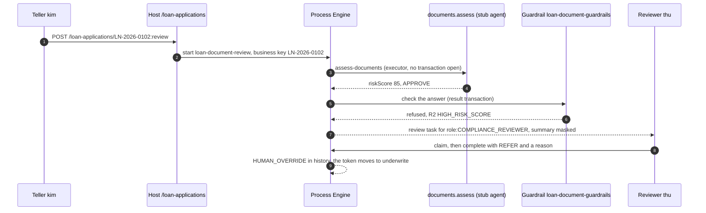

# Example: guarded agent process

A loan document review in which an AI agent step assesses each application, a Rule Engine guardrail checks every answer, and a refused answer goes to a second person. The host uses the engine APIs only, with no cockpit dependency, and it comes with seed data and a scripted demo.



## What it shows

- **Agent step with a guardrail.** Step `assess-documents` in [`loan-document-review.bpmn`](src/main/resources/processes/loan-document-review.bpmn) calls agent `documents.assess`. Every answer is checked in the result transaction against [`loan-document-guardrails`](src/main/resources/rules/loan-document-guardrails.yaml): rule R1 always allows a `DECLINE`, rule R2 refuses any other answer with a risk score of 70 or more (`HIGH_RISK_SCORE`), and rule R3 allows the rest. Rules are evaluated in order, first match wins.
- **A refused answer goes to a person.** With `onViolation: route-to-human`, nothing of a refused answer is kept. A four-eyes review task goes to `role:COMPLIANCE_REVIEWER`, and the identity that started the case can never review it (`403 SELF_APPROVAL_FORBIDDEN`).
- **Deterministic agent.** [`DocumentAssessor`](src/main/java/io/github/dhluong90/bpm/examples/guardedagent/DocumentAssessor.java) is a stub with no model behind it. An incomplete file (fewer than 3 documents) gets `REFER` with a score of 55. A complete file gets `APPROVE`, scoring 85 from 1,000,000,000 VND and 20 below that. To use a real model, swap it for an adapter from [`model-adapters/`](../model-adapters/README.md).
- **Money in minor units.** The application amount is a `long` in minor units, together with its currency.
- **Tenant from the caller.** `/loan-applications` takes the tenant from the authenticated context, never from the request.

## Seed data

| Application | Applicant | Amount | Documents | Agent answer | Guardrail | Outcome |
|---|---|---|---|---|---|---|
| `LN-2026-0101` | Nguyen Van An | 250,000,000 VND | 3 | `APPROVE`, risk 20 | Allowed | Waits on `underwrite` |
| `LN-2026-0102` | Tran Thi Binh | 1,500,000,000 VND | 3 | `APPROVE`, risk 85 | Refused, R2 | Review task for `role:COMPLIANCE_REVIEWER` |
| `LN-2026-0103` | Le Van Cuong | 600,000,000 VND | 2 | `REFER`, risk 55 | Allowed | Waits on `underwrite` |

All rows belong to tenant `bank-a`. On the `dev` profile, the seeder publishes the guardrail through maker-checker and imports the process.

## Run locally

```bash
docker run -d --name horus-pg -e POSTGRES_USER=horus -e POSTGRES_PASSWORD="$HORUS_DB_PASSWORD" -e POSTGRES_DB=horus -p 5432:5432 postgres:16-alpine
mvn -B -pl examples/guarded-agent-process -am install -DskipTests
HORUS_DB_PASSWORD=... HORUS_DEMO_PASSWORD=... \
  mvn -B -pl examples/guarded-agent-process spring-boot:run -Dspring-boot.run.profiles=dev
```

| Variable | Default | Meaning |
|---|---|---|
| `HORUS_DB_URL` | `jdbc:postgresql://localhost:5432/horus` | Host database; the engines' tables live in it with `rule_` and `pre_` prefixes |
| `HORUS_DB_USERNAME` | `horus` | Database user |
| `HORUS_DB_PASSWORD` | none | Database password, from the environment only |
| `HORUS_DEMO_PASSWORD` | none | Password of the demo users on the `dev` profile; start-up fails without it |
| `HORUS_DECISION_LOG_RETENTION` | `keep-forever` | Decision-log retention in whole months, at least 12 |
| `PORT` | `8080` | HTTP port |

Demo users (on the `dev` profile only, all with `HORUS_DEMO_PASSWORD`): `kim` (teller), `thu` (compliance reviewer), `an` (underwriter) and `pia` (process deployer).

## Demo script

```bash
P="$HORUS_DEMO_PASSWORD"; B=http://localhost:8080; API=$B/api/bpm/processes/v1
# 1. The three seeded applications
curl -s -u kim:$P $B/loan-applications
# 2. Send each one to review; the agent step runs on the executor
for id in LN-2026-0101 LN-2026-0102 LN-2026-0103; do curl -s -u kim:$P -X POST "$B/loan-applications/$id:review"; done
# 3. LN-2026-0102 was refused by R2 and waits for a reviewer: read its task (summary masked)
curl -s -u thu:$P "$API/instances/<instance-id>"
curl -s -u thu:$P "$API/tasks/<task-id>"
# 4. thu claims it and refers it with a reason
curl -s -u thu:$P -X POST "$API/tasks/<task-id>:claim" -H 'If-Match: "0"' -H 'Idempotency-Key: thu-claims-1'
curl -s -u thu:$P -X POST "$API/tasks/<task-id>:complete" -H 'If-Match: "1"' -H 'Idempotency-Key: thu-refers-1' \
  -H 'Content-Type: application/json' \
  -d '{"result":{"riskScore":85,"recommendation":"REFER"},"reason":"Income for 1.5 billion VND needs a second look"}'
# 5. Draw the case: the BPMN export and the instance with its history
curl -s -u thu:$P "$API/definitions/loan-document-review/versions/1/export?format=bpmn"
curl -s -u thu:$P "$API/instances/<instance-id>"
```

Sending an application again returns the instance it already has, because the application id is the business key.

## Tests

`GuardedAgentJourneyIT` runs the whole journey over HTTP on Testcontainers PostgreSQL, with digest-pinned images and an injected clock. It covers `PRE-185` (guardrail routing and four eyes) and `PRE-186` (diagram and history from the engine APIs).

```bash
mvn -B -pl examples/guarded-agent-process -am verify
```
