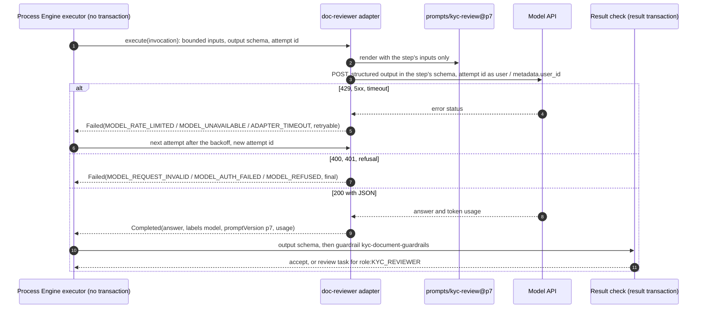

# Example: model API adapters

Two reference agent adapters you can copy as your first adapter: one for **OpenAI-compatible Chat Completions**, which hosted vendors and self-hosted servers (vLLM, Ollama and similar) accept, and one for **Anthropic Messages**, a second request shape. Both implement the engine's `AgentAdapter` interface on the JDK HTTP client, with no vendor SDK. Nothing here is part of an engine artifact, and the engine itself never calls a model.



## How it works

- **The host chooses the vendor.** Step `assess-documents` in [`kyc-document-review.bpmn`](src/main/resources/processes/kyc-document-review.bpmn) names the adapter (`horus:agent="doc-reviewer"`) and nothing else about the model. Which API, address, model, prompt version and key it uses is host configuration. [`kyc-document-review-anthropic.bpmn`](src/main/resources/processes/kyc-document-review-anthropic.bpmn) is the same step on `doc-reviewer-anthropic`.
- **The prompt is versioned and carries only the step's inputs.** `prompts/kyc-review@p7` is the resource [`prompts/kyc-review/p7.txt`](src/main/resources/prompts/kyc-review/p7.txt). It may use `{{input.<name>}}`, `{{inputs}}` and `{{memory}}`; any other placeholder stops start-up. Its version, `p7`, is the `promptVersion` label of every answer.
- **Structured output.** The adapter asks for JSON in the step's output schema (`invocation.outputSchema()`, without the engine's `mask` annotations): `response_format` of type `json_schema` for Chat Completions, `output_config.format` for Messages. With `structured-output: false` it asks for a JSON object only. The engine checks every answer against the full schema and the guardrail [`kyc-document-guardrails`](src/main/resources/rules/kyc-document-guardrails.yaml) in the result transaction; the adapter's own reading never replaces that check.
- **Keyed by the attempt id.** A model call changes nothing on the far side, so each attempt is a fresh call: the attempt id goes in `user` (Chat Completions) or `metadata.user_id` (Messages), and a retry sends a new one. The adapters have no side effect that the job id would have to key.
- **Labels.** `model` (as the API reports it, else the configured one), `promptVersion`, `usage.inputTokens` and `usage.outputTokens`.
- **Nothing sensitive leaves or is logged.** No tenant id, instance id or job id is sent to the vendor. The step's inputs reach the model only as the rendered prompt; masked inputs reach the adapter as the engine gives them, and your host decides whether a masked field may go to an external API at all. Logs show the adapter, the attempt id, the HTTP status, the code and the latency, never the prompt, an input, the answer or the key. No API error text is kept: the detail holds at most the status and the `Retry-After` seconds.
- **No call inside a transaction.** The engine calls the adapter on its executor with no connection held (ADR-0008).

| API answer | Code | Retried |
|---|---|---|
| HTTP 400, 404, 413 or 422 | `MODEL_REQUEST_INVALID` | no |
| HTTP 401 or 403 | `MODEL_AUTH_FAILED` | no |
| HTTP 429 | `MODEL_RATE_LIMITED` | yes, after the step's backoff |
| HTTP 408, 5xx or 529, a broken connection | `MODEL_UNAVAILABLE` | yes |
| No answer within `request-timeout` | `ADAPTER_TIMEOUT` | yes |
| A refusal (`refusal`, `stop_reason: refusal`) or `finish_reason: content_filter` | `MODEL_REFUSED` | no |
| Prose, or JSON that is not an object | `AGENT_SCHEMA_INVALID`, from the engine's result check | yes, once (schema retry) |
| JSON the guardrail refuses, such as `confidence: 0.72` | `GUARDRAIL_VIOLATION` with `LOW_CONFIDENCE`; the step goes to its reviewer | n/a |

## Configuration

One entry per adapter under `example.model-adapters.adapters.<name>`; the name is what a step uses in `horus:agent`.

| Property | Environment variable in `application.yml` | Default | Meaning |
|---|---|---|---|
| `api` | | none, required | `OPENAI_COMPATIBLE` or `ANTHROPIC_MESSAGES` |
| `base-url` | `OPENAI_BASE_URL`, `ANTHROPIC_BASE_URL` | none, required | The part before `/chat/completions` (for example `https://api.openai.com/v1`, `http://localhost:11434/v1`), or before `/v1/messages` (`https://api.anthropic.com`) |
| `model` | `OPENAI_MODEL`, `ANTHROPIC_MODEL` | none, required | The model id sent with every request |
| `prompt` | | none, required | `<path>@<version>`, read as `<path>/<version>.txt` from the classpath |
| `api-key` | `OPENAI_API_KEY`, `ANTHROPIC_API_KEY` | empty | The key; required for `ANTHROPIC_MESSAGES`, optional for a self-hosted OpenAI-compatible server. Masked in `toString()`, never logged |
| `max-tokens` | | `1024` | The longest answer |
| `request-timeout` | | `PT30S` | Longest single HTTP request; the engine abandons the attempt at the step's `horus:timeout` |
| `structured-output` | | `true` | Ask for the step's output schema; turn off for a server that refuses it |
| `anthropic-version` | | `2023-06-01` | The `anthropic-version` header |
| `spring.datasource.*` | `HORUS_DB_URL`, `HORUS_DB_USERNAME`, `HORUS_DB_PASSWORD` | local PostgreSQL | The host database the engines keep their state in |

The shipped `application.yml` registers both adapters, so start-up needs `ANTHROPIC_API_KEY`; remove the entry you do not use. The host's sign-in, which gives the engines their caller and tenant, is left out of this example; the [`rule-and-process`](../rule-and-process/README.md) example shows it.

## Run the demo

The tests run both adapters against a local stub of the two APIs with recorded responses, so they need no network and no key. `ModelAdaptersIT` runs the whole scenario on PostgreSQL in a container (Docker needed), with both engines:

```bash
mvn -B -pl examples/model-adapters -am verify -Dcockpit.bundle.skip=true
```

`ModelAdaptersIT` starts KYC application `KYC-2026-0101`, has the stub answer the first call with `429` and `Retry-After: 2`, and shows attempt 1 failing with `MODEL_RATE_LIMITED` and attempt 2, with a new attempt id, accepted with labels `model` and `promptVersion: p7`; the application moves on to `open-account`. The same step on the Anthropic Messages adapter is accepted on its first call. The other tests cover prose refused by the result check, a `0.72` confidence routed to the KYC reviewer, a refusal that fails the step for good, and another tenant refused. `ModelAdapterTest` covers each code for both APIs without the engines, and `EngineIndependenceTest` checks that no engine module depends on the example and that it uses no vendor SDK.

To try one adapter against the real API with your own key (never in CI):

```bash
MODEL_SMOKE_API=ANTHROPIC_MESSAGES MODEL_SMOKE_BASE_URL=https://api.anthropic.com \
  MODEL_SMOKE_MODEL=claude-opus-5-5 MODEL_SMOKE_API_KEY=... examples/model-adapters/smoke.sh
```

The script prints the outcome's code and labels, for example `smoke: completed, fields [documentType, nameMatches, expiryDate, tamperingSuspected, confidence], labels {model=..., promptVersion=p7, usage.inputTokens=..., usage.outputTokens=...}`. Its header lists the OpenAI-compatible and self-hosted forms.

## Files

- [`ModelApiAdapter`](src/main/java/io/github/dhluong90/bpm/examples/models/ModelApiAdapter.java): what both adapters share (prompt, call, error codes, labels, logs)
- [`OpenAiCompatibleAdapter`](src/main/java/io/github/dhluong90/bpm/examples/models/OpenAiCompatibleAdapter.java) and [`AnthropicMessagesAdapter`](src/main/java/io/github/dhluong90/bpm/examples/models/AnthropicMessagesAdapter.java): the two request shapes
- [`ModelAdapterSettings`](src/main/java/io/github/dhluong90/bpm/examples/models/ModelAdapterSettings.java): `example.model-adapters.*`
- [`PromptTemplate`](src/main/java/io/github/dhluong90/bpm/examples/models/PromptTemplate.java): versioned prompt templates
- [`StubModelServer`](src/test/java/io/github/dhluong90/bpm/examples/models/StubModelServer.java) and [`recorded/`](src/test/resources/recorded): the local stub API, for the tests only
