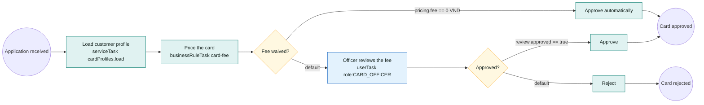
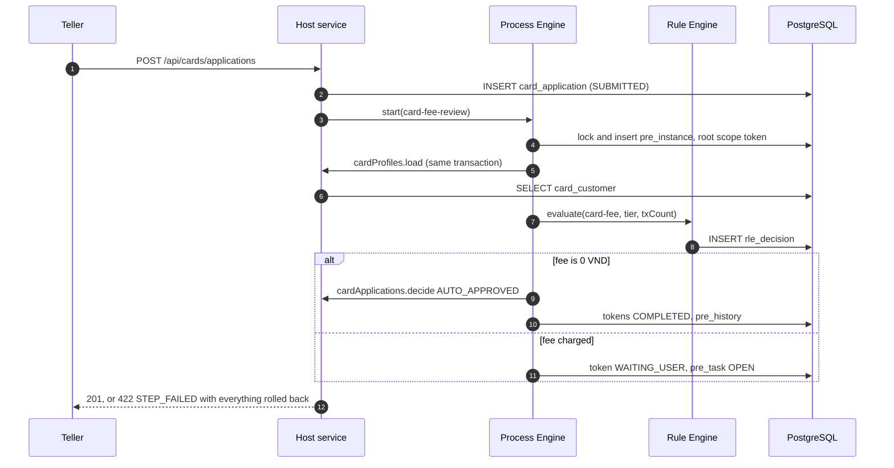

# Example host: Rule Engine and Process Engine

A Spring Boot 4 service that embeds both engines on its own PostgreSQL database. A teller submits a card application; a BPMN process loads the customer's profile, prices the card with the `card-fee` rule set, approves a zero fee automatically and sends any other fee to a card officer.



The process is [`processes/card-fee-review.bpmn`](src/main/resources/processes/card-fee-review.bpmn), a BPMN 2.0 file with diagram interchange, so it opens in BPMN modellers. Engine settings are attributes and elements of the namespace `urn:horus-bpm:bpmn:extensions:v1`: `horus:handler`, `horus:ruleSet`, `horus:assignee`, `horus:resultVariable` and `horus:input`. Conditions are in `urn:horus-bpm:expr:v1`.

What the host adds:

1. Three dependencies: `rule-engine-spring-boot-starter`, `process-engine-spring-boot-starter` and `cockpit-spring-boot-starter` (the cockpit at `/bpm/cockpit`, behind the host's own sign-in).
2. One configuration block, `horus.bpm` in [`application.yml`](src/main/resources/application.yml): role-to-permission mappings for both engines, the BPMN file to import and the cockpit's name for this service.
3. Two `ServiceTaskHandler` beans, the only code the process calls: [`CardProfileHandler`](src/main/java/io/github/dhluong90/bpm/examples/ruleandprocess/CardProfileHandler.java) (`cardProfiles.load`) and [`CardDecisionHandler`](src/main/java/io/github/dhluong90/bpm/examples/ruleandprocess/CardDecisionHandler.java) (`cardApplications.decide`). The engine finds them by name, never by reflection.
4. Its own use case, [`CardApplicationService`](src/main/java/io/github/dhluong90/bpm/examples/ruleandprocess/CardApplicationService.java), which stores the application and starts the process in one `@Transactional` method.

## One transaction per call

Every step up to the first wait state runs in the caller's transaction: the host's insert, the profile query, the rule evaluation and its `rle_decision` row, the engine's `pre_*` rows. If any step fails, all of it rolls back. A handler's business error is not a failure: the step waits with an incident, and the work before it commits.



## Run locally

Needs JDK 21 or later, Maven, Node 22 or later (for the cockpit bundle) and Docker. Run every command from the repository root.

```bash
# 1. The cockpit bundle, once (or add -Dcockpit.bundle.skip=true to the build and run without the cockpit)
(cd cockpit/web && npm ci && npm run build)

# 2. PostgreSQL
docker run -d --name horus-pe-pg -e POSTGRES_DB=horus -e POSTGRES_USER=horus \
  -e POSTGRES_PASSWORD=change-me -p 5432:5432 postgres:16-alpine

# 3. Build the host and the engines it embeds
mvn -B -pl examples/rule-and-process -am package -DskipTests

# 4. Start it with the demo users, on http://localhost:8080
SPRING_PROFILES_ACTIVE=dev HORUS_DEMO_PASSWORD=demo-pass HORUS_DB_PASSWORD=change-me \
  java -jar examples/rule-and-process/target/example-rule-and-process-1.0.0.jar
```

Open `http://localhost:8080/` and sign in as one of the demo users below; the browser lands on the cockpit. Stop with Ctrl-C, and remove the database with `docker rm -f horus-pe-pg`.

### Demo users

The `dev` profile creates these users, all with the password from `HORUS_DEMO_PASSWORD` (form sign-in, or HTTP Basic for curl). Makers and checkers are different people: the engines refuse an approval by the person who made the change, whatever roles they hold.

| User | Roles | What the user does in the demo |
|---|---|---|
| `tuan` | `TELLER` | Submits card applications and starts processes; the maker of an application |
| `an` | `CARD_OFFICER`, `KYC_OFFICER`, `DISPUTES_OFFICER`, `PAYMENT_OFFICER`, `PRICING_OFFICER` | Works the officer tasks (fee review, credit review form, sign-offs) and the task roles of the demo models; the checker of a fee. The four-eyes review refuses anyone on work they started |
| `lan` | `PRICING_AUTHOR`, `PROCESS_DEPLOYER`, `PROCESS_APPROVER` | The maker: authors rule sets, simulates, imports and drafts process definitions in the cockpit and requests approval. She cannot approve rule sets: she lacks the rule-approve permission, so she gets `PERMISSION_DENIED`. She does hold `PROCESS_APPROVER`, so approving a process definition she requested gives `SELF_APPROVAL_FORBIDDEN`. May switch between the tenants `bank-a` and `bank-b` |
| `minh` | `PRICING_APPROVER`, `PROCESS_APPROVER` | The checker: approves rule sets and process definitions that someone else requested; simulates and replays selected decisions from the decision log; clears incidents |
| `hoa` | `TELLER`, `CARD_OFFICER`, `BRANCH_SUPERVISOR`, `DISPUTES_SENIOR` | Cancels instances, reassigns tasks, clears incidents, correlates messages and broadcasts signals; the second holder who approves the migration and calendar changes that `hung` proposes |
| `hung` | `OPERATIONS_OFFICER`, `OPS`, `AML_OFFICER`, `SANCTIONS_OFFICER` | Runs live cases: correlates messages, broadcasts signals, works tasks and incidents, proposes instance migrations and calendar changes |
| `quynh` | `AUDITOR` | Reads rule sets, definitions, instances and the decision log; changes nothing |

Permissions by role are in [`application.yml`](src/main/resources/application.yml) (`horus.bpm.rules.security` and `horus.bpm.processes.security`; the `dev` profile adds `rules:evaluate` and `rules:simulate` for the author and the approver, so `lan` or `minh` can replay selected decisions (`minh` also holds `rules:log:read`), and `role:` task roles for the demo models, in [`application-dev.yml`](src/main/resources/application-dev.yml)). Cockpit draft editing (`authoring.cockpit-drafts`, off by default) and the tenant switch (`horus.bpm.tenancy.switching.enabled`) are on for the `dev` profile only. `lan` carries `allowed_tenants: [bank-a, bank-b]` from the host's user store, so the switcher offers `bank-b`, an empty tenant that shows the isolation; every other user has `bank-a` only.

### Demo models

The `dev` profile imports every BPMN file under `src/main/resources/processes` for `bank-a` as `ACTIVE`, with auto-approval, so each scene runs on the default start:

| Area | Files |
|---|---|
| Card application with a rule set and a four-eyes review | `card-fee-review` |
| Transaction with compensation and cancel | `fund-transfer` |
| Live undo: compensation boundaries and a compensation event sub-process, chosen by a start variable | `loan-payout` |
| Showcase: agent with guardrail, four rule sets, four-eyes approval, parallel work, compensation | `loan-origination` (imported by the dev seeder, see below) |
| Complex gateway, two of three sign-offs | `payment-approval` |
| User task with a declared form | `credit-review-form` (the form is `src/main/resources/forms/credit-review.form.json`) |
| Ad-hoc sub-process, call activity, terminate end | `customer-onboarding` (calls `card-welcome`) |
| Sub-process, timer, error and link events, multi-instance | `card-delivery`, `card-dispute`, `card-limit-check`, `card-welcome` |
| Messages, signals, event-based and inclusive gateways, pools | `order-payment`, `order-payment-pools`, `payment-review`, `payment-screening`, `rate-card-watch`, `fee-routing-feel` |
| Conformance models: compensation, data objects and stores, gateways, multiple events, parallel and event-gateway starts | `conformance/*.bpmn` |

The service steps these models call are registered by the host in [`DemoStepHandlers`](src/main/java/io/github/dhluong90/bpm/examples/ruleandprocess/DemoStepHandlers.java), the data stores (`credit-limits`, `score-ledger`, `ledger-notes`) by [`DemoDataStores`](src/main/java/io/github/dhluong90/bpm/examples/ruleandprocess/DemoDataStores.java), and the messages a process sends are written to the host's `event_outbox` by [`DemoMessageAdapter`](src/main/java/io/github/dhluong90/bpm/examples/ruleandprocess/DemoMessageAdapter.java). They are simple local steps for the demo; a real host registers its own under the same names. Two models start by message or signal and are not started from `POST /instances`: `loan-intake` (message `loan-application`) and `onboarding` (message `kyc-documents`, then signal `sanction-screening-done`). Deliver the message first: a signal alone cannot start `onboarding`, because its message catch needs a correlation key. Models in the Camunda Modeler open with their diagram; the engine's settings are the `horus:` attributes.

| Variable | Default | Meaning |
|---|---|---|
| `HORUS_DB_URL` | `jdbc:postgresql://localhost:5432/horus` | Host database; both engines use it with their own tables |
| `HORUS_DB_USERNAME` | `horus` | Database user |
| `HORUS_DB_PASSWORD` | empty | Database password; never in a file |
| `HORUS_DEMO_PASSWORD` | empty | Password of the demo users, `dev` profile only |
| `PORT` | `8080` | HTTP port |
| `HORUS_BPM_PROCESSES_HANDLERS_SLOW_CALL_WARNING` | `200ms` | A local handler or decision slower than this is logged at WARN as `process.step.slow`: it holds the instance row lock and a connection, which usually means a network call in a handler |
| `HORUS_BPM_PROCESSES_QUERY_MAX_PAGE_SIZE` | `200` | Most items per page of the process lists; may be lowered, never raised |
| `HORUS_BPM_PROCESSES_QUERY_MAX_RANGE` | `P31D` | Longest start-time range of `GET /api/bpm/processes/v1/instances`; may be lowered, never raised |
| `SPRING_PROFILES_ACTIVE` | none | `dev` turns on the demo users, the fixed tenant `bank-a`, the tenant switch, the start-up import of every demo model and auto-approval |

At start-up the log shows, in order: the host's own migration, the Rule Engine schema (`rle_schema_history`), the Process Engine schema (`pre_schema_history`), every demo model imported as version 1 `ACTIVE` for `bank-a` (the line shown is the first), and the `card-fee` rule set published by two seed identities (one requests, the other approves).

```
Rule Engine schema at version 1 (1 migration(s) applied)
Process Engine schema at version 1 (1 migration(s) applied)
Process definition card-fee-review v1 ACTIVE for tenant bank-a from classpath:processes/card-fee-review.bpmn (hash 3fa54143...)
Rule set card-fee v1 PUBLISHED (requested by seed-author, approved by seed-approver)
```

### Showcase: loan origination, three scenarios

`loan-origination` is the larger model: 30 steps plus a disbursement sub-process, five lanes and a customer pool. An AI agent screens KYC and AML behind a guardrail rule set, credit grades the risk, a four-eyes approval escalates on an SLA timer, the offer is prepared in parallel with collateral registration, the customer's reply or a timer decides the next step, and a failed pay-out reverses the booking newest first. Its four rule sets (`kyc-loan-guardrails`, `credit-risk-grade`, `approval-authority`, `loan-pricing`) are in [`rules/`](src/main/resources/rules), its steps in [`LoanOriginationSteps`](src/main/java/io/github/dhluong90/bpm/examples/ruleandprocess/LoanOriginationSteps.java). On the `dev` profile [`DevLoanOriginationSeeder`](src/main/java/io/github/dhluong90/bpm/examples/ruleandprocess/DevLoanOriginationSeeder.java) publishes the rule sets (one identity requests, another approves) and then imports the process, because a process whose guardrail rule set is not published is refused.

Two things to know before a demo:

- **Every demo switch must be in the start payload.** `simulatePepHit`, `simulateFraud`, `simulateCollateralFraud`, `simulateLedgerFailure` (booleans) and `simulateDebtGroup` (1 to 5) are read as start variables, and a variable that is missing is not treated as false. Send all five, with only the one you want turned on. The `start` function below does this.
- **The SLA timers are wall-clock.** There is no business calendar, so a real 4-hour or 1-day SLA would also run overnight and at weekends. The `dev` profile shortens them: `manager-sla` `PT20S`, `committee-sla` `PT40S` and `offer-expired` `PT60S` (`horus.demo.timers.<event id>` in `application-dev.yml`). A real host would model working hours itself.

`P` is `HORUS_DEMO_PASSWORD`. `tuan` starts the case, `hung` reviews the KYC guardrail and sends the customer's reply, `an` writes the credit proposal and `hoa` approves.

```bash
P=...   # HORUS_DEMO_PASSWORD
API=localhost:8080/api/bpm/processes/v1
# start <application id> <product family> <secured> <amount in minor units>; turn a switch on with PEP=true, COLLATERAL=true, LEDGER=true
start() {
  curl -s -u tuan:$P -H 'Content-Type: application/json' -H "Idempotency-Key: start-$1" \
    -d "{\"definitionKey\":\"loan-origination\",\"businessKey\":\"$1\",\"variables\":{\"applicationId\":\"$1\",
    \"customerId\":\"CUS-100245\",\"productFamily\":\"$2\",\"secured\":$3,\"amountMinor\":$4,\"currency\":\"VND\",
    \"tenorMonths\":36,\"channel\":\"DIGITAL\",\"simulatePepHit\":${PEP:-false},\"simulateFraud\":false,
    \"simulateCollateralFraud\":${COLLATERAL:-false},\"simulateLedgerFailure\":${LEDGER:-false},
    \"simulateDebtGroup\":1}}" $API/instances
}
accept() {  # the customer accepts the offer: $1 application id
  curl -s -u hung:$P -H 'Content-Type: application/json' -H "Idempotency-Key: accept-$1" \
    -d "{\"messageName\":\"offer-accepted\",\"correlationKey\":\"$1\",\"payload\":{}}" $API/messages:correlate
}
```

1. **Automatic approval, then disbursement.** `start LA-1 RETAIL_PERSONAL false 250000000`. The case grades B (rule R5), is priced P2, prepares the offer and collateral in parallel, and waits for the customer. `accept LA-1` books the loan, pays it out and ends with the disbursed notice. If nobody accepts, the offer timer ends the case after one minute.
2. **PEP hit, guardrail review, slow approval.** `PEP=true start LA-2 SME_TERM true 900000000`. The guardrail refuses the agent's answer and opens a four-eyes task for `hung`. After it is completed, `an` writes the credit proposal, the authority matrix asks a manager, and after 20 seconds the escalation notice is sent while the approval task stays open. `an` cannot approve their own proposal (`403 SELF_APPROVAL_FORBIDDEN`); `hoa` can. Above 3 billion VND the committee approves instead.
3. **Ledger rejection.** `LEDGER=true start LA-3 RETAIL_PERSONAL false 180000000`, then `accept LA-3`. The pay-out is rejected and the compensation runs newest first: the booking is reversed, then the limit is released, the customer is told, and no incident stays open. `GET $API/instances/{id}/activities` shows the order.

A fourth switch shows a terminate end: `COLLATERAL=true start LA-4 RETAIL_SECURED true 250000000` ends the whole case at once while the parallel preparation runs. [`LoanOriginationIT`](src/test/java/io/github/dhluong90/bpm/examples/ruleandprocess/LoanOriginationIT.java) runs all of these. The stored drawing (five lanes, customer pool) is for the Camunda Modeler and bpmn.io; the cockpit lays out its own view and does not read the stored positions yet.

### Live demo paths: error, compensation, timers

Three scenes that a presenter drives on the default `dev` start. `P` is `HORUS_DEMO_PASSWORD`; `hoa` starts the instances, and `an` (a `DISPUTES_OFFICER`) works the dispute task in the cockpit's task list.

**Business error.** Start `card-dispute` with a refund above the officer's limit of 5,000,000 VND, then complete the `assess` task as `an`. The refund step answers `REFUND_LIMIT_EXCEEDED`, the error boundary takes it, and the `senior-approval` task opens for `hoa` (role `DISPUTES_SENIOR`) with no incident. With `"amountMinor": 1000000` the refund posts and the dispute closes after the customer notification.

```bash
curl -s -u hoa:$P -H 'Content-Type: application/json' \
  -d '{"definitionKey":"card-dispute","businessKey":"DISPUTE-1","variables":{"amountMinor":6000000}}' \
  localhost:8080/api/bpm/processes/v1/instances
```

**Compensation.** `loan-payout` reserves funds and posts a debit in a sub-process, then credits the customer. The start variable `failCredit` picks the path. With `false` the payout completes and nothing is undone. With `true` the credit step answers `CREDIT_REJECTED`, the error boundary reaches a compensation throw, and the instance is `COMPENSATING` while the undo runs newest first: the compensation event sub-process reverses the disbursement, the debit boundary credits the debit back, the reservation boundary releases the hold. The instance then tells the customer and ends on `Payout undone`. The timeline (`GET /instances/{id}/activities`, or the cockpit) lists each undo.

```bash
curl -s -u hoa:$P -H 'Content-Type: application/json' \
  -d '{"definitionKey":"loan-payout","businessKey":"PAYOUT-1","variables":{"failCredit":true,"amountMinor":90000000,"currency":"VND","sourceAccount":"ACC-9"}}' \
  localhost:8080/api/bpm/processes/v1/instances
```

**Timers.** The models keep their real durations (`card-dispute` two days, `payment-review` two hours, `sub-process-and-timer` 24 hours). The `dev` profile shortens them for the demo through `horus.demo.timers.<event id>` in [`application-dev.yml`](src/main/resources/application-dev.yml), `PT1M` each: `assess-overdue`, `two-hours` and `cooling-off`. Start a `card-dispute` and leave `assess` open: after one minute the non-interrupting boundary fires, the reminder runs, and the task stays open. Change a value with an environment variable, for example `HORUS_DEMO_TIMERS_ASSESS_OVERDUE=PT10S`, or delete the key to keep the model's own duration. The override is applied only when the model is imported at start-up, and only on the `dev` profile; other profiles and the files on disk keep the real durations. A timer is at least `PT1S`.

## Walkthrough

Demo users are listed under Run locally. The walkthrough signs them in with HTTP Basic; `P` is the password from `HORUS_DEMO_PASSWORD`.

On the `dev` profile the author and the approver may also evaluate, so the cockpit's Try it works for them ([`application-dev.yml`](src/main/resources/application-dev.yml)).

Smoke check: sign in at `http://localhost:8080/` as each of `tuan`, `an`, `lan`, `minh`, `hoa`, `hung` and `quynh`. The browser lands on the cockpit (`/bpm/cockpit/`), and no call the cockpit makes answers 403 or 404.

Seed customers of `bank-a`: `C-001` (GOLD, 0 VND), `C-002` (STANDARD with 5 transactions, 10,000 VND), `C-003` (STANDARD with 1 transaction, 50,000 VND).

A gold customer is approved automatically:

```bash
P=demo-pass
curl -s -u tuan:$P -H 'Content-Type: application/json' \
  -d '{"applicationId":"APP-1001","customerId":"C-001"}' localhost:8080/api/cards/applications
# {"instanceStatus":"COMPLETED","instanceId":"01M7S2PPN8A0AHH84EQRT3N0HP","applicationId":"APP-1001"}

curl -s -u tuan:$P localhost:8080/api/cards/applications/APP-1001
# {"applicationId":"APP-1001","customerId":"C-001","status":"AUTO_APPROVED","fee":{"currency":"VND","amount":0}}
```

A charged fee waits for a card officer. The instance shows the execution tree (the root scope token and the flow token at the user task) and the open task:

```bash
curl -s -u tuan:$P -H 'Content-Type: application/json' \
  -d '{"applicationId":"APP-1002","customerId":"C-002"}' localhost:8080/api/cards/applications
# {"instanceStatus":"RUNNING","instanceId":"01M7S2PPTM395C88YQ14BX2E6F","applicationId":"APP-1002"}

curl -s -u an:$P localhost:8080/api/bpm/processes/v1/instances/01M7S2PPTM395C88YQ14BX2E6F
# {"id":"01M7S2PPTM395C88YQ14BX2E6F","definitionKey":"card-fee-review","definitionVersion":1,"businessKey":"APP-1002",
#  "status":"RUNNING","variables":{"pricing":{"fee":{"currency":"VND","amount":10000},"decisionId":"01M7S2PPTQSV0G0CEY4FYJB1S5"},...},
#  "tokens":[{"kind":"SCOPE","nodeId":"card-fee-review","status":"WAITING_SCOPE",...},
#            {"kind":"FLOW","nodeId":"officer-review","status":"WAITING_USER",...}],
#  "tasks":[{"id":"01M7S2PPTM395C88YQ14000005","nodeId":"officer-review","assignee":"role:CARD_OFFICER","status":"OPEN","lockVersion":0,...}],...}
```

Only a card officer may work it, and never the person who submitted it: the review is a four-eyes task (`horus:fourEyes="true"`). The officer claims the task, then completes it. Each call sends the task's `lockVersion` as `If-Match` (the `ETag` of `GET /tasks/{id}`, not the instance `ETag`) and an `Idempotency-Key` that makes a retry safe; both are required (`428 PRECONDITION_REQUIRED` without them):

```bash
T=01M7S2PPTM395C88YQ14000005
curl -s -u an:$P "localhost:8080/api/bpm/processes/v1/tasks/${T}"
# {"id":"01M7S2PPTM395C88YQ14000005",...,"assignee":"role:CARD_OFFICER","fourEyes":true,"status":"OPEN","lockVersion":0,
#  "claimedBy":null,...,"allowedActions":["claim"]}

curl -s -u tuan:$P -X POST -H 'If-Match: "0"' -H 'Idempotency-Key: claim-tuan' \
  "localhost:8080/api/bpm/processes/v1/tasks/${T}:claim"
# {"status":403,"code":"PERMISSION_DENIED","detail":"Needs processes:task:work",...}

curl -s -u an:$P -X POST -H 'If-Match: "0"' -H 'Idempotency-Key: claim-1002' \
  "localhost:8080/api/bpm/processes/v1/tasks/${T}:claim"
# {...,"status":"CLAIMED","lockVersion":1,"claimedBy":"an",...,"allowedActions":["unclaim","complete"]}

curl -s -u an:$P -H 'Content-Type: application/json' -H 'If-Match: "1"' -H 'Idempotency-Key: review-1002' \
  -d '{"result":{"approved":true}}' "localhost:8080/api/bpm/processes/v1/tasks/${T}:complete"
# {...,"status":"COMPLETED","tokens":[{"kind":"SCOPE",...,"status":"COMPLETED"},{"kind":"FLOW","nodeId":"end-approved","status":"COMPLETED"}],
#  "tasks":[{...,"status":"COMPLETED","lockVersion":2,"claimedBy":"an","completedBy":"an"}],...}

curl -s -u hoa:$P -H 'Content-Type: application/json' -H 'If-Match: "1"' -H 'Idempotency-Key: review-1002b' \
  -d '{"result":{"approved":true}}' "localhost:8080/api/bpm/processes/v1/tasks/${T}:complete"
# {"status":409,"code":"VERSION_CONFLICT","detail":"Task 01M7S2PPTM395C88YQ14000005 is at lock version 2",...}
```

A claimed task goes back to the queue with `:unclaim` (claimant only, same headers). Completing a task nobody claimed is `409 INVALID_STATE`; completing one another officer claimed is `403 TASK_NOT_ASSIGNED`.

```bash
curl -s -u tuan:$P localhost:8080/api/cards/applications/APP-1002
# {"applicationId":"APP-1002","customerId":"C-002","status":"APPROVED","fee":{"currency":"VND","amount":10000}}
```

`POST /api/bpm/processes/v1/instances` needs a `businessKey` or an `Idempotency-Key` (`428` without either), so a client retry can never start a second instance. Starting again with the same `businessKey` returns the existing instance with `200` (a new instance is `201`), and a retry with the same `Idempotency-Key` returns the first answer, also when the two requests run at the same time.

List what is running and what is deployed. Pages carry `nextCursor`; pass it back unchanged as `cursor`:

```bash
curl -s -u an:$P "localhost:8080/api/bpm/processes/v1/instances?definitionKey=card-fee-review&limit=2"
# {"data":[{"id":"01M7S2PPTM395C88YQ14BX2E6F","definitionKey":"card-fee-review","definitionVersion":1,"businessKey":"APP-1002",
#   "status":"RUNNING","lockVersion":1,"startedBy":"tuan","startedAt":"2027-02-01T09:00:00.120Z","endedAt":null}],
#  "nextCursor":null,"hasNext":false}
curl -s -u an:$P "localhost:8080/api/bpm/processes/v1/instances?status=COMPLETED,CANCELLED&startedFrom=2027-02-01T00:00:00Z"
curl -s -u an:$P localhost:8080/api/bpm/processes/v1/definitions
# {"data":[{"key":"card-fee-review","name":"Card fee review","latestVersion":1,"latestStatus":"ACTIVE","effectiveVersion":1,
#   "lastChangedAt":"2027-02-01T08:59:58.004Z"}],"nextCursor":null,"hasNext":false}
curl -s -u an:$P "localhost:8080/api/bpm/processes/v1/instances?limit=500"
# {"status":400,"code":"QUERY_INVALID","detail":"limit must be 1 to 200 (query.max-page-size)",...}
```

A branch supervisor may cancel a running application: cancelling needs `processes:cancel`, which starting (`processes:start`) does not grant. The reason is required, at most 2,000 characters, and is recorded on the history entry and the `processes.instance.cancelled.v1` event with the actor. `If-Match` carries the instance `ETag` (its `lockVersion`), and `Idempotency-Key` makes a retry safe:

```bash
curl -s -u tuan:$P -H 'Content-Type: application/json' \
  -d '{"applicationId":"APP-1003","customerId":"C-002"}' localhost:8080/api/cards/applications
# {"instanceStatus":"RUNNING","instanceId":"01M7S2Q4B1XWJ3T7N9D2E5K8H0",...}
I=01M7S2Q4B1XWJ3T7N9D2E5K8H0
curl -s -u tuan:$P -H 'Content-Type: application/json' -H 'If-Match: "1"' -H 'Idempotency-Key: cancel-1003t' \
  -d '{"reason":"Customer withdrew the card application"}' "localhost:8080/api/bpm/processes/v1/instances/${I}:cancel"
# {"status":403,"code":"PERMISSION_DENIED","detail":"Needs processes:cancel",...}
curl -s -u hoa:$P -H 'Content-Type: application/json' -H 'If-Match: "1"' -H 'Idempotency-Key: cancel-1003' \
  -d '{"reason":"Customer withdrew the card application"}' "localhost:8080/api/bpm/processes/v1/instances/${I}:cancel"
# {"id":"01M7S2Q4B1XWJ3T7N9D2E5K8H0",...,"status":"CANCELLED","tasks":[{...,"status":"CANCELLED"}],"lockVersion":2,...}
curl -s -u hoa:$P -H 'Content-Type: application/json' -H 'If-Match: "2"' -H 'Idempotency-Key: cancel-1003b' \
  -d '{"reason":"Duplicate"}' "localhost:8080/api/bpm/processes/v1/instances/${I}:cancel"
# {"status":409,"code":"INVALID_STATE","detail":"Instance 01M7S2Q4B1XWJ3T7N9D2E5K8H0 is CANCELLED",...}
```

For an unknown customer, the first step's handler answers with a business error. The application is saved, and the instance waits on that step with an incident for an operator. The incident keeps the business code but not the handler's message:

```bash
curl -s -u tuan:$P -H 'Content-Type: application/json' \
  -d '{"applicationId":"APP-1099","customerId":"C-404"}' localhost:8080/api/cards/applications
# {"applicationId":"APP-1099","instanceId":"01M7...","instanceStatus":"RUNNING"}

docker exec horus-pe-pg psql -U horus -d horus -tAc \
  "SELECT error_code, cause_summary FROM pre_incident WHERE status='OPEN'"
# UNHANDLED_BUSINESS_ERROR|Business error CUSTOMER_NOT_FOUND has no path in the process
```

## Change the fee in the cockpit, then run the process

Sign in at `http://localhost:8080/bpm/cockpit` as `lan`, open the `card-fee` rule set, change row `R1` (gold customers) from `0 VND` to `5000 VND`, try it, and request publication. Sign in as `minh` and approve it; `lan` cannot approve. The next application is priced by version 2. The same steps through the REST API the cockpit uses:

```bash
sed 's/then: { fee: "0 VND" }/then: { fee: "5000 VND" }/' \
  examples/rule-and-process/src/main/resources/rules/card-fee.yaml > /tmp/card-fee-v2.yaml
R=localhost:8080/api/bpm/rules/v1/rule-sets/card-fee
curl -s -u lan:$P -H 'Content-Type: application/yaml' --data-binary @/tmp/card-fee-v2.yaml $R/versions
# {"ruleSet":"card-fee","version":2,"status":"DRAFT","createdBy":"lan",...}
curl -s -u lan:$P -X POST $R/versions/2:request-publish
# {"version":2,"status":"PENDING_APPROVAL","requestedBy":"lan",...}
HASH=$(curl -s -u minh:$P $R/versions/2 | jq -r .canonicalHash)   # what the approver reviewed
curl -s -u lan:$P -X POST $R/versions/2:approve -H 'If-Match: "1"' -H 'Content-Type: application/json' \
  -d '{"expectedCanonicalHash":"'$HASH'"}'
# {"status":403,"code":"PERMISSION_DENIED","detail":"The caller lacks permission rules:approve",...}
curl -s -u minh:$P -X POST $R/versions/2:approve -H 'If-Match: "1"' -H 'Content-Type: application/json' \
  -d '{"expectedCanonicalHash":"'$HASH'"}'
# {"version":2,"status":"PUBLISHED","requestedBy":"lan","approvedBy":"minh",...}

curl -s -u tuan:$P -H 'Content-Type: application/json' \
  -d '{"applicationId":"APP-2002","customerId":"C-001"}' localhost:8080/api/cards/applications
# {"applicationId":"APP-2002","instanceStatus":"RUNNING",...}   before the change, C-001 completed automatically
# GET the instance: pricing.fee is {"currency":"VND","amount":5000} and the token waits at officer-review;
# rle_decision holds the evaluation with version_num 2.
```

## Approve a process definition change with four eyes

The `dev` profile of this sample auto-approves imports; start it with `--horus.bpm.processes.definitions.auto-approve=false` to see the lifecycle every other profile has. An imported definition is then a draft, and the effective version changes only when a second person approves it. `lan` and `minh` both hold `processes:approve`; the one who requests can never approve:

```bash
D=localhost:8080/api/bpm/processes/v1/definitions
sed 's/Officer reviews the fee/Officer reviews the fee and the limit/' \
  examples/rule-and-process/src/main/resources/processes/card-fee-review.bpmn > /tmp/card-fee-review-v2.bpmn
curl -s -u lan:$P -H 'Content-Type: application/xml' --data-binary @/tmp/card-fee-review-v2.bpmn $D
# {"key":"card-fee-review","version":2,"status":"DRAFT","source":"IMPORT","lockVersion":0,...}
curl -s -u lan:$P -H 'If-Match: "0"' -H 'Content-Type: application/json' \
  -d '{"effectiveFrom":"2027-04-01T00:00:00+07:00"}' -X POST $D/card-fee-review/versions/2:request-approval
# {"version":2,"status":"PENDING_APPROVAL","requestedBy":"lan","lockVersion":1,...}
curl -s -u lan:$P -H 'If-Match: "1"' -X POST $D/card-fee-review/versions/2:approve
# {"status":403,"code":"SELF_APPROVAL_FORBIDDEN",...}
curl -s -u minh:$P -H 'If-Match: "1"' -X POST $D/card-fee-review/versions/2:approve
# {"version":2,"status":"ACTIVE","approvedBy":"minh","effectiveFrom":"2027-03-31T17:00:00Z",...}
curl -s -u minh:$P $D/card-fee-review/versions/2/history
# {"items":[{"action":"IMPORTED",...},{"action":"REQUESTED","actor":"lan",...},{"action":"APPROVED","actor":"minh",...}]}
```

Version 1 stays the effective version until 1 April 00:00 (+07:00); then the effective-date job retires it once, whichever copy of the host runs the job, and publishes `processes.definition.retired.v1` with `supersededBy: 2`. A reject (`:reject` with `{"reason":"missing fraud check"}`) returns a version to draft; approving an older version while a newer one is active is `409 VERSION_SUPERSEDED`.

The supervisor `hoa` may submit and may review, but not both on one application:

```bash
curl -s -u hoa:$P -H 'Content-Type: application/json' \
  -d '{"applicationId":"APP-3001","customerId":"C-002"}' localhost:8080/api/cards/applications
# take the task id from GET /api/bpm/processes/v1/instances/<instanceId>, then:
curl -s -u hoa:$P -X POST -H 'If-Match: "0"' -H 'Idempotency-Key: claim-3001' \
  "localhost:8080/api/bpm/processes/v1/tasks/<taskId>:claim"
# {"status":403,"code":"SELF_APPROVAL_FORBIDDEN",...}
```

Engine events (`processes.instance.started.v1` and the others) are handed to the host inside the transaction of the state change. [`ProcessEventOutbox`](src/main/java/io/github/dhluong90/bpm/examples/ruleandprocess/ProcessEventOutbox.java) shows both kinds of listener. Its in-transaction listener writes the host's `event_outbox` row, with the event's `eventId` (unique per tenant, for deduplication) and the payload as JSON, scoped by the event's tenant; the row commits or rolls back with the step, which makes it the durable path for integration. An idempotent replay publishes nothing. Its `@TransactionalEventListener(phase = AFTER_COMMIT)` notification runs at most once, and never for rolled-back work. A plain listener does no network I/O, and an exception it throws rolls the step back.

## Import a BPMN file

`lan` may import BPMN files. The same document again creates no new version and returns the existing one, still with `201`; an unsupported element is refused with its id and line; a `DOCTYPE` is refused before anything is resolved.

```bash
curl -s -u lan:$P -H 'Content-Type: application/xml' \
  --data-binary @examples/rule-and-process/src/main/resources/processes/card-fee-review.bpmn \
  localhost:8080/api/bpm/processes/v1/definitions
# {"key":"card-fee-review","version":1,"status":"ACTIVE","definitionHash":"3fa54143...","sourceFormat":"BPMN_XML",...}
```

Which BPMN elements the engine runs is listed in the wiki page Process Engine Importing BPMN (BPMN 2.0 element coverage); an element outside it is refused by name, with its id and line. Files must be UTF-8; bodies above `definitions.max-bytes` (1 MB) are refused with `413` before they are read.

Conditions follow the Rule Engine's rules: null follows FEEL three-valued logic (`income < 5000000 VND` is null when `income` is unset, `tier != 'GOLD'` is true), only a true condition is taken, otherwise the default flow; numbers are decimals; money compares only within one currency, and a type error fails the step.

Each version runs from its stored source document. Before a version is compiled, the source must still match its source hash and give the recorded definition hash; otherwise it is refused with `DEFINITION_INTEGRITY_FAILED`.

## Tests

```bash
mvn -B -pl examples/rule-and-process -am verify
```

`RuleAndProcessIT` runs on PostgreSQL in Testcontainers: the start-up import, the automatic and the officer path over HTTP, a stale completion (`PRE-003`), four-eyes over REST and Java (`PRE-007`), two concurrent starts with one idempotency key doing the work once, the rollback of host and engine rows with no event emitted, a decision the caller may not evaluate, a tampered stored definition refused, `413` and `428`, and tenant isolation (a second tenant cannot read the instance, complete its task, or start the process it has not imported).
