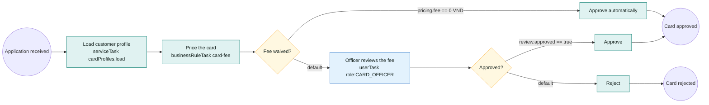
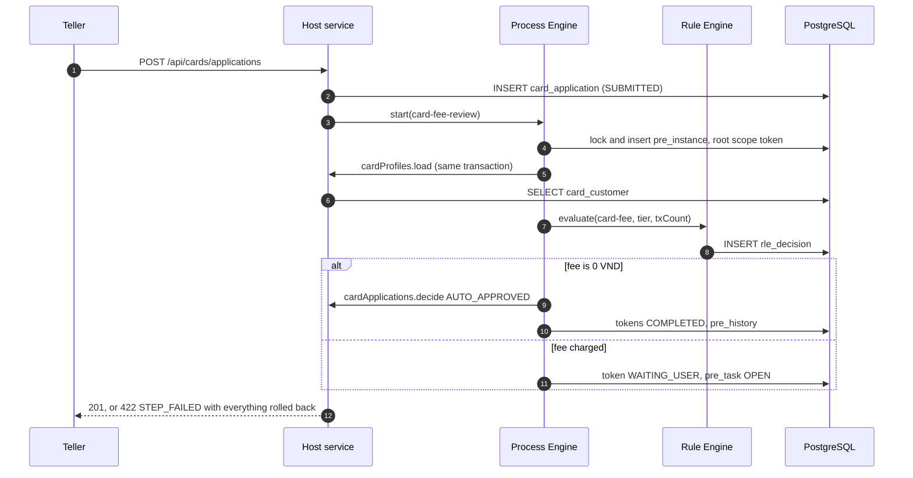

# Example host: Rule Engine and Process Engine

A Spring Boot 4 service that embeds both engines on its own PostgreSQL database. A teller submits a card application; a BPMN process loads the customer's profile, prices the card with the `card-fee` rule set, approves a zero fee automatically and sends any other fee to a card officer.



The process is [`processes/card-fee-review.bpmn`](src/main/resources/processes/card-fee-review.bpmn), a BPMN 2.0 file with diagram interchange, so it opens in BPMN modellers. Engine settings are attributes and elements of the namespace `urn:horus-bpm:bpmn:extensions:v1`: `horus:handler`, `horus:ruleSet`, `horus:assignee`, `horus:resultVariable` and `horus:input`. Conditions are in `urn:horus-bpm:expr:v1`.

What the host adds:

1. Three dependencies: `rule-engine-spring-boot-starter`, `process-engine-spring-boot-starter` and `cockpit-spring-boot-starter` (the cockpit at `/bpm/cockpit`, behind the host's own sign-in).
2. One configuration block, `horus.bpm` in [`application.yml`](src/main/resources/application.yml): role-to-permission mappings for both engines, the BPMN file to import and the cockpit's name for this service.
3. Two `ServiceTaskHandler` beans, the only code the process calls: [`CardProfileHandler`](src/main/java/io/github/dhluong90/bpm/examples/ruleandprocess/CardProfileHandler.java) (`cardProfiles.load`) and [`CardDecisionHandler`](src/main/java/io/github/dhluong90/bpm/examples/ruleandprocess/CardDecisionHandler.java) (`cardApplications.decide`). The engine finds them by name, never by reflection.
4. Its own use case, [`CardApplicationService`](src/main/java/io/github/dhluong90/bpm/examples/ruleandprocess/CardApplicationService.java), which stores the application and starts the process in one `@Transactional` method.

## One transaction per call

Every step up to the first wait state runs in the caller's transaction: the host's insert, the profile query, the rule evaluation and its `rle_decision` row, the engine's `pre_*` rows. If any step fails, all of it rolls back.



## Run locally

Needs JDK 21 or later, Node 22 or later (for the cockpit bundle) and Docker.

```bash
(cd cockpit/web && npm ci && npm run build)                         # once; or build with -Dcockpit.bundle.skip=true
docker run -d --name horus-pe-pg -e POSTGRES_DB=horus -e POSTGRES_USER=horus \
  -e POSTGRES_PASSWORD=change-me -p 5432:5432 postgres:16-alpine

mvn -B -pl examples/rule-and-process -am package -DskipTests      # from the repository root
SPRING_PROFILES_ACTIVE=dev HORUS_DEMO_PASSWORD=demo-pass HORUS_DB_PASSWORD=change-me \
  java -jar examples/rule-and-process/target/example-rule-and-process-0.1.0-SNAPSHOT.jar
```

| Variable | Default | Meaning |
|---|---|---|
| `HORUS_DB_URL` | `jdbc:postgresql://localhost:5432/horus` | Host database; both engines use it with their own tables |
| `HORUS_DB_USERNAME` | `horus` | Database user |
| `HORUS_DB_PASSWORD` | empty | Database password; never in a file |
| `HORUS_DEMO_PASSWORD` | empty | Password of the demo users, `dev` profile only |
| `PORT` | `8080` | HTTP port |
| `HORUS_BPM_PROCESSES_HANDLERS_SLOW_CALL_WARNING` | `200ms` | A local handler or decision slower than this is logged at WARN as `process.step.slow`: it holds the instance row lock and a connection, which usually means a network call in a handler |
| `HORUS_BPM_PROCESSES_QUERY_MAX_PAGE_SIZE` | `200` | Most items per page of the process lists; may be lowered, never raised |
| `HORUS_BPM_PROCESSES_QUERY_MAX_RANGE` | `P31D` | Longest start-time range of `GET /api/bpm/processes/v1/instances`; may be lowered, never raised |
| `SPRING_PROFILES_ACTIVE` | none | `dev` turns on the demo users, the fixed tenant `bank-a`, the start-up import and auto-approval of the sample process |

At start-up the log shows, in order: the host's own migration, the Rule Engine schema (`rle_schema_history`), the Process Engine schema (`pre_schema_history`), the sample process imported as version 1 `ACTIVE` for `bank-a`, and the `card-fee` rule set published by two seed identities (one requests, the other approves).

```
Rule Engine schema at version 2 (2 migration(s) applied)
Process Engine schema at version 1 (1 migration(s) applied)
Process definition card-fee-review v1 ACTIVE for tenant bank-a from classpath:processes/card-fee-review.bpmn (hash 3fa54143...)
Rule set card-fee v1 PUBLISHED (requested by seed-author, approved by seed-approver)
```

## Walkthrough

Demo users on the `dev` profile, all with the password from `HORUS_DEMO_PASSWORD`, using HTTP Basic:

| User | Role | Engine permissions |
|---|---|---|
| `tuan` | `TELLER` | `processes:start`, `processes:read`, `rules:evaluate` |
| `an` | `CARD_OFFICER` | `processes:read`, `processes:task:work`, `rules:evaluate` |
| `lan` | `PRICING_AUTHOR`, `PROCESS_DEPLOYER` | `rules:read`, `rules:author`, `processes:deploy`, `processes:read`; `rules:evaluate` on `dev` only |
| `minh` | `PRICING_APPROVER` | `rules:read`, `rules:approve`; `rules:evaluate` on `dev` only |
| `hoa` | `TELLER`, `CARD_OFFICER`, `BRANCH_SUPERVISOR` | both of the above sets plus `processes:cancel`; the four-eyes review refuses her on applications she submitted |

On the `dev` profile the author and the approver may also evaluate, so the cockpit's Try it works for them ([`application-dev.yml`](src/main/resources/application-dev.yml)).

Seed customers of `bank-a`: `C-001` (GOLD, 0 VND), `C-002` (STANDARD with 5 transactions, 10,000 VND), `C-003` (STANDARD with 1 transaction, 50,000 VND).

A gold customer is approved automatically:

```bash
P=demo-pass
curl -s -u tuan:$P -H 'Content-Type: application/json' \
  -d '{"applicationId":"APP-1001","customerId":"C-001"}' localhost:8080/api/cards/applications
# {"instanceStatus":"COMPLETED","instanceId":"01M7S2PPN8A0AHH84EQRT3N0HP","applicationId":"APP-1001"}

curl -s -u tuan:$P localhost:8080/api/cards/applications/APP-1001
# {"applicationId":"APP-1001","customerId":"C-001","status":"AUTO_APPROVED","fee":{"currency":"VND","amount":0}}
```

A charged fee waits for a card officer. The instance shows the execution tree (the root scope token and the flow token at the user task) and the open task:

```bash
curl -s -u tuan:$P -H 'Content-Type: application/json' \
  -d '{"applicationId":"APP-1002","customerId":"C-002"}' localhost:8080/api/cards/applications
# {"instanceStatus":"RUNNING","instanceId":"01M7S2PPTM395C88YQ14BX2E6F","applicationId":"APP-1002"}

curl -s -u an:$P localhost:8080/api/bpm/processes/v1/instances/01M7S2PPTM395C88YQ14BX2E6F
# {"id":"01M7S2PPTM395C88YQ14BX2E6F","definitionKey":"card-fee-review","definitionVersion":1,"businessKey":"APP-1002",
#  "status":"RUNNING","variables":{"pricing":{"fee":{"currency":"VND","amount":10000},"decisionId":"01M7S2PPTQSV0G0CEY4FYJB1S5"},...},
#  "tokens":[{"kind":"SCOPE","nodeId":"card-fee-review","status":"WAITING_SCOPE",...},
#            {"kind":"FLOW","nodeId":"officer-review","status":"WAITING_USER",...}],
#  "tasks":[{"id":"01M7S2PPTM395C88YQ14000005","nodeId":"officer-review","assignee":"role:CARD_OFFICER","status":"OPEN","lockVersion":0,...}],...}
```

Only a card officer may work it, and never the person who submitted it: the review is a four-eyes task (`horus:fourEyes="true"`). The officer claims the task, then completes it. Each call sends the task's `lockVersion` as `If-Match` (the `ETag` of `GET /tasks/{id}`, not the instance `ETag`) and an `Idempotency-Key` that makes a retry safe; both are required (`428 PRECONDITION_REQUIRED` without them):

```bash
T=01M7S2PPTM395C88YQ14000005
curl -s -u an:$P "localhost:8080/api/bpm/processes/v1/tasks/${T}"
# {"id":"01M7S2PPTM395C88YQ14000005",...,"assignee":"role:CARD_OFFICER","fourEyes":true,"status":"OPEN","lockVersion":0,
#  "claimedBy":null,...,"allowedActions":["claim"]}

curl -s -u tuan:$P -X POST -H 'If-Match: "0"' -H 'Idempotency-Key: claim-tuan' \
  "localhost:8080/api/bpm/processes/v1/tasks/${T}:claim"
# {"status":403,"code":"PERMISSION_DENIED","detail":"Needs processes:task:work",...}

curl -s -u an:$P -X POST -H 'If-Match: "0"' -H 'Idempotency-Key: claim-1002' \
  "localhost:8080/api/bpm/processes/v1/tasks/${T}:claim"
# {...,"status":"CLAIMED","lockVersion":1,"claimedBy":"an",...,"allowedActions":["unclaim","complete"]}

curl -s -u an:$P -H 'Content-Type: application/json' -H 'If-Match: "1"' -H 'Idempotency-Key: review-1002' \
  -d '{"result":{"approved":true}}' "localhost:8080/api/bpm/processes/v1/tasks/${T}:complete"
# {...,"status":"COMPLETED","tokens":[{"kind":"SCOPE",...,"status":"COMPLETED"},{"kind":"FLOW","nodeId":"end-approved","status":"COMPLETED"}],
#  "tasks":[{...,"status":"COMPLETED","lockVersion":2,"claimedBy":"an","completedBy":"an"}],...}

curl -s -u hoa:$P -H 'Content-Type: application/json' -H 'If-Match: "1"' -H 'Idempotency-Key: review-1002b' \
  -d '{"result":{"approved":true}}' "localhost:8080/api/bpm/processes/v1/tasks/${T}:complete"
# {"status":409,"code":"VERSION_CONFLICT","detail":"Task 01M7S2PPTM395C88YQ14000005 is at lock version 2",...}
```

A claimed task goes back to the queue with `:unclaim` (claimant only, same headers). Completing a task nobody claimed is `409 INVALID_STATE`; completing one another officer claimed is `403 TASK_NOT_ASSIGNED`.

```bash
curl -s -u tuan:$P localhost:8080/api/cards/applications/APP-1002
# {"applicationId":"APP-1002","customerId":"C-002","status":"APPROVED","fee":{"currency":"VND","amount":10000}}
```

`POST /api/bpm/processes/v1/instances` needs a `businessKey` or an `Idempotency-Key` (`428` without either), so a client retry can never start a second instance. Starting again with the same `businessKey` returns the existing instance with `200` (a new instance is `201`), and a retry with the same `Idempotency-Key` returns the first answer, also when the two requests run at the same time.

List what is running and what is deployed. Pages carry `nextCursor`; pass it back unchanged as `cursor`:

```bash
curl -s -u an:$P "localhost:8080/api/bpm/processes/v1/instances?definitionKey=card-fee-review&limit=2"
# {"data":[{"id":"01M7S2PPTM395C88YQ14BX2E6F","definitionKey":"card-fee-review","definitionVersion":1,"businessKey":"APP-1002",
#   "status":"RUNNING","lockVersion":1,"startedBy":"tuan","startedAt":"2027-02-01T09:00:00.120Z","endedAt":null}],
#  "nextCursor":null,"hasNext":false}
curl -s -u an:$P "localhost:8080/api/bpm/processes/v1/instances?status=COMPLETED,CANCELLED&startedFrom=2027-02-01T00:00:00Z"
curl -s -u an:$P localhost:8080/api/bpm/processes/v1/definitions
# {"data":[{"key":"card-fee-review","name":"Card fee review","latestVersion":1,"latestStatus":"ACTIVE","effectiveVersion":1,
#   "lastChangedAt":"2027-02-01T08:59:58.004Z"}],"nextCursor":null,"hasNext":false}
curl -s -u an:$P "localhost:8080/api/bpm/processes/v1/instances?limit=500"
# {"status":400,"code":"QUERY_INVALID","detail":"limit must be 1 to 200 (query.max-page-size)",...}
```

A branch supervisor may cancel a running application: cancelling needs `processes:cancel`, which starting (`processes:start`) does not grant. The reason is required, at most 2,000 characters, and is recorded on the history entry and the `processes.instance.cancelled.v1` event with the actor. `If-Match` carries the instance `ETag` (its `lockVersion`), and `Idempotency-Key` makes a retry safe:

```bash
curl -s -u tuan:$P -H 'Content-Type: application/json' \
  -d '{"applicationId":"APP-1003","customerId":"C-002"}' localhost:8080/api/cards/applications
# {"instanceStatus":"RUNNING","instanceId":"01M7S2Q4B1XWJ3T7N9D2E5K8H0",...}
I=01M7S2Q4B1XWJ3T7N9D2E5K8H0
curl -s -u tuan:$P -H 'Content-Type: application/json' -H 'If-Match: "1"' -H 'Idempotency-Key: cancel-1003t' \
  -d '{"reason":"Customer withdrew the card application"}' "localhost:8080/api/bpm/processes/v1/instances/${I}:cancel"
# {"status":403,"code":"PERMISSION_DENIED","detail":"Needs processes:cancel",...}
curl -s -u hoa:$P -H 'Content-Type: application/json' -H 'If-Match: "1"' -H 'Idempotency-Key: cancel-1003' \
  -d '{"reason":"Customer withdrew the card application"}' "localhost:8080/api/bpm/processes/v1/instances/${I}:cancel"
# {"id":"01M7S2Q4B1XWJ3T7N9D2E5K8H0",...,"status":"CANCELLED","tasks":[{...,"status":"CANCELLED"}],"lockVersion":2,...}
curl -s -u hoa:$P -H 'Content-Type: application/json' -H 'If-Match: "2"' -H 'Idempotency-Key: cancel-1003b' \
  -d '{"reason":"Duplicate"}' "localhost:8080/api/bpm/processes/v1/instances/${I}:cancel"
# {"status":409,"code":"INVALID_STATE","detail":"Instance 01M7S2Q4B1XWJ3T7N9D2E5K8H0 is CANCELLED",...}
```

An unknown customer fails the first step, and the host's row rolls back with the engine's:

```bash
curl -s -u tuan:$P -H 'Content-Type: application/json' \
  -d '{"applicationId":"APP-1099","customerId":"C-404"}' localhost:8080/api/cards/applications
# {"status":422,"code":"STEP_FAILED","detail":"Step load-profile failed (UNHANDLED_BUSINESS_ERROR): CUSTOMER_NOT_FOUND: No customer C-404 in this tenant","nodeId":"load-profile","reason":"UNHANDLED_BUSINESS_ERROR"}

docker exec horus-pe-pg psql -U horus -d horus -tAc \
  "SELECT count(*) FROM card_application WHERE application_id='APP-1099'"   # 0
```

## Change the fee in the cockpit, then run the process

Sign in at `http://localhost:8080/bpm/cockpit` as `lan`, open the `card-fee` rule set, change row `R1` (gold customers) from `0 VND` to `5000 VND`, try it, and request publication. Sign in as `minh` and approve it; `lan` cannot approve. The next application is priced by version 2. The same steps through the REST API the cockpit uses:

```bash
sed 's/then: { fee: "0 VND" }/then: { fee: "5000 VND" }/' \
  examples/rule-and-process/src/main/resources/rules/card-fee.yaml > /tmp/card-fee-v2.yaml
R=localhost:8080/api/bpm/rules/v1/rule-sets/card-fee
curl -s -u lan:$P -H 'Content-Type: application/yaml' --data-binary @/tmp/card-fee-v2.yaml $R/versions
# {"ruleSet":"card-fee","version":2,"status":"DRAFT","createdBy":"lan",...}
curl -s -u lan:$P -X POST $R/versions/2:request-publish
# {"version":2,"status":"PENDING_APPROVAL","requestedBy":"lan",...}
curl -s -u lan:$P -X POST $R/versions/2:approve
# {"status":403,"code":"PERMISSION_DENIED","detail":"The caller lacks permission rules:approve",...}
curl -s -u minh:$P -X POST $R/versions/2:approve
# {"version":2,"status":"PUBLISHED","requestedBy":"lan","approvedBy":"minh",...}

curl -s -u tuan:$P -H 'Content-Type: application/json' \
  -d '{"applicationId":"APP-2002","customerId":"C-001"}' localhost:8080/api/cards/applications
# {"applicationId":"APP-2002","instanceStatus":"RUNNING",...}   before the change, C-001 completed automatically
# GET the instance: pricing.fee is {"currency":"VND","amount":5000} and the token waits at officer-review;
# rle_decision holds the evaluation with version_num 2.
```

The supervisor `hoa` may submit and may review, but not both on one application:

```bash
curl -s -u hoa:$P -H 'Content-Type: application/json' \
  -d '{"applicationId":"APP-3001","customerId":"C-002"}' localhost:8080/api/cards/applications
# take the task id from GET /api/bpm/processes/v1/instances/<instanceId>, then:
curl -s -u hoa:$P -X POST -H 'If-Match: "0"' -H 'Idempotency-Key: claim-3001' \
  "localhost:8080/api/bpm/processes/v1/tasks/<taskId>:claim"
# {"status":403,"code":"SELF_APPROVAL_FORBIDDEN",...}
```

Engine events (`processes.instance.started.v1` and the others) are handed to the host inside the transaction of the state change. [`ProcessEventOutbox`](src/main/java/io/github/dhluong90/bpm/examples/ruleandprocess/ProcessEventOutbox.java) shows both kinds of listener. Its in-transaction listener writes the host's `event_outbox` row, with the event's `eventId` (unique per tenant, for deduplication) and the payload as JSON, scoped by the event's tenant; the row commits or rolls back with the step, which makes it the durable path for integration. An idempotent replay publishes nothing. Its `@TransactionalEventListener(phase = AFTER_COMMIT)` notification runs at most once, and never for rolled-back work. A plain listener does no network I/O, and an exception it throws rolls the step back.

## Import a BPMN file

`lan` may import BPMN files. The same document again creates no new version and returns the existing one, still with `201`; an unsupported element is refused with its id and line; a `DOCTYPE` is refused before anything is resolved.

```bash
curl -s -u lan:$P -H 'Content-Type: application/xml' \
  --data-binary @examples/rule-and-process/src/main/resources/processes/card-fee-review.bpmn \
  localhost:8080/api/bpm/processes/v1/definitions
# {"key":"card-fee-review","version":1,"status":"ACTIVE","definitionHash":"3fa54143...","sourceFormat":"BPMN_XML",...}

curl -s -u lan:$P -H 'Content-Type: application/xml' \
  --data-binary @process-engine/process-engine-bpmn/src/test/resources/bpmn/unsupported.bpmn \
  localhost:8080/api/bpm/processes/v1/definitions
# {"status":422,"code":"BPMN_UNSUPPORTED_ELEMENT","problems":[
#   {"element":"boundaryEvent","elementId":"be-timeout","line":6,...},
#   {"element":"inclusiveGateway","elementId":"ig-1","line":7,...},
#   {"element":"endEvent with terminateEventDefinition","elementId":"end","line":8,...}],...}
```

Supported in this release: none start and end events, `serviceTask` (local), `businessRuleTask`, `userTask` (with `horus:resultVariable`; `horus:fourEyes` optional), `exclusiveGateway` with conditions and a default flow. Everything else is refused by name with the stage that adds it. Files must be UTF-8; bodies above `definitions.max-bytes` (1 MB) are refused with `413` before they are read.

Conditions follow the Rule Engine's rules: null follows FEEL three-valued logic (`income < 5000000 VND` is null when `income` is unset, `tier != 'GOLD'` is true), only a true condition is taken, otherwise the default flow; numbers are decimals; money compares only within one currency, and a type error fails the step.

Each version runs from its stored source document. Before a version is compiled, the source must still match its source hash and give the recorded definition hash; otherwise it is refused with `DEFINITION_INTEGRITY_FAILED`.

## Tests

```bash
mvn -B -pl examples/rule-and-process -am verify
```

`RuleAndProcessIT` runs on PostgreSQL in Testcontainers: the start-up import, the automatic and the officer path over HTTP, a stale completion (`PRE-003`), four-eyes over REST and Java (`PRE-007`), two concurrent starts with one idempotency key doing the work once, the rollback of host and engine rows with no event emitted, a decision the caller may not evaluate, a tampered stored definition refused, `413` and `428`, and tenant isolation (a second tenant cannot read the instance, complete its task, or start the process it has not imported).
