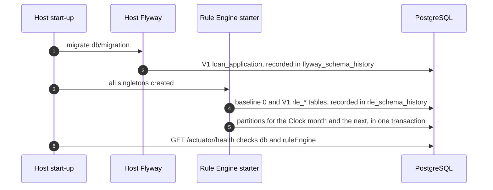

# Example host: Rule Engine only

A minimal Spring Boot 4 service with its own table (`loan_application`) and its own Flyway history that embeds the Rule Engine. It shows the three things a host adds:

1. One dependency, `com.horus.bpm:rule-engine-spring-boot-starter`.
2. One configuration block, `horus.bpm` in [`application.yml`](src/main/resources/application.yml): the host id and the mapping of the host's roles to engine permissions.
3. Its own security chain, [`HostSecurityConfiguration`](src/main/java/com/horus/bpm/examples/ruleengineonly/HostSecurityConfiguration.java), with the engine's two problem handlers so that `401` and `403` are RFC 9457 problem details.

On start-up the host's Flyway applies `db/migration` to `flyway_schema_history`. Then the engine applies its own `rle_*` migrations to `rle_schema_history`, on the host's `DataSource` and transaction manager, with no pool of its own. The decision log `rle_decision` is partitioned by month: the migration creates the parent and a default partition. A start-up step then creates the partitions for the current and the next month, read from the host's `Clock` (UTC months).



## Run locally

Needs JDK 21 or later and Docker.

```bash
docker run -d --name horus-pg -e POSTGRES_DB=horus -e POSTGRES_USER=horus \
  -e POSTGRES_PASSWORD=change-me -p 5432:5432 postgres:16-alpine

mvn -B -pl examples/rule-engine-only -am package -DskipTests      # from the repository root
HORUS_DB_PASSWORD=change-me java -jar examples/rule-engine-only/target/example-rule-engine-only-0.1.0-SNAPSHOT.jar
```

Check it (health is public; everything else needs a caller):

```bash
curl -s localhost:8080/actuator/health
# {"status":"UP"}   component names are shown to authorised callers only (show-components: when-authorized)

docker exec horus-pg psql -U horus -d horus -c '\dt'
# flyway_schema_history, loan_application, rle_decision (partitioned), rle_decision_YYYY_MM (this month and next),
# rle_decision_default, rle_decision_outbox, rle_idempotency, rle_rule, rle_rule_set, rle_schema_history, rle_version

docker exec horus-pg psql -U horus -d horus -c 'SELECT version, script FROM rle_schema_history ORDER BY installed_rank'
#  0       | Rule Engine baseline
#  1       | V1__rle_baseline.sql
```

### Host metadata with two demo users

On the `dev` profile the host has two demo users over HTTP basic: Lan, a pricing analyst, and Minh, a pricing approver. A basic-auth user has no token to carry a tenant, so on `dev` the tenant comes from the `X-Tenant-Id` header ([`application-dev.yml`](src/main/resources/application-dev.yml)).

```bash
SPRING_PROFILES_ACTIVE=dev HORUS_DB_PASSWORD=change-me java -jar examples/rule-engine-only/target/example-rule-engine-only-0.1.0-SNAPSHOT.jar

curl -s -u lan:lan -H 'X-Tenant-Id: bank-a' localhost:8080/api/bpm/me
# {"schemaVersion":1,"user":{"id":"lan"},"tenant":{"current":"bank-a","allowed":["bank-a"]},"permissions":["rules:read","rules:author"],"roles":["ROLE_PRICING_ANALYST"],"groups":[]}

curl -s -u minh:minh -H 'X-Tenant-Id: bank-a' localhost:8080/api/bpm/me
# {"schemaVersion":1,"user":{"id":"minh"},"tenant":{"current":"bank-a","allowed":["bank-a"]},"permissions":["rules:read","rules:approve"],"roles":["ROLE_PRICING_APPROVER"],"groups":[]}

curl -s -u lan:lan -H 'X-Tenant-Id: bank-a' localhost:8080/api/bpm/meta
# {"schemaVersion":1,"hostId":"rule-engine-only","modules":[{"module":"rules","engineVersion":"0.1.0-SNAPSHOT","apiVersion":"v1","features":[]}],"tenancy":{"switching":false},"limits":{"maxPageSize":200}}

curl -s -i localhost:8080/api/bpm/meta
# HTTP/1.1 401
# WWW-Authenticate: Basic realm="rule-engine-only"
# Content-Type: application/problem+json;charset=UTF-8
# {"type":"https://github.com/dhluong90/horus-Agentic-BPM/wiki/Common-Error-Codes#unauthenticated","title":"Authentication required","status":401,"code":"UNAUTHENTICATED","detail":"Sign in, or send a token issued for this host.","instance":"/api/bpm/meta","correlationId":"01M7RR0S1MJ2AFNEK9G00A9E1N"}
```

The demo users exist only on the `dev` profile. Without it the host accepts bearer tokens when an issuer is configured (see the environment variables below); token claim `roles` becomes `ROLE_*` authorities and claim `tenant_id` the tenant.

To see the `ruleEngine` component locally, start with `--management.endpoint.health.show-components=always`. It reports the schema version, `pendingMigrations`, and whether next month's partition exists.

## Environment variables

| Variable | Default | Meaning |
|---|---|---|
| `HORUS_DB_URL` | `jdbc:postgresql://localhost:5432/horus` | JDBC URL of the host database |
| `HORUS_DB_USERNAME` | `horus` | Database user |
| `HORUS_DB_PASSWORD` | none | Database password. Never put it in a file in the repository |
| `PORT` | `8080` | HTTP port |
| `SPRING_SECURITY_OAUTH2_RESOURCESERVER_JWT_ISSUER_URI` | none | Issuer of the bearer tokens the host accepts. Unset: no bearer tokens, so only health answers outside `dev` |
| `SPRING_SECURITY_OAUTH2_RESOURCESERVER_JWT_AUDIENCES` | none | Audience this host requires in a token; set it whenever a cockpit calls the host from another origin (TR-SEC-12) |
| `SPRING_PROFILES_ACTIVE` | none | `dev` turns on the two demo users and the `X-Tenant-Id` tenant header. Never in production |

## Rule Engine properties

| Property | Default | Meaning |
|---|---|---|
| `horus.bpm.rules.enabled` | `true` | `false` switches the engine off entirely |
| `horus.bpm.host-id` | unset; `rule-engine-only` here | Id returned by `GET /api/bpm/meta` |
| `horus.bpm.rules.security.role-permissions` | empty; two roles here | Host role to `rules:*` permissions, listed by `GET /api/bpm/me` |
| `horus.bpm.rules.migrate-on-start` | `true` | `false` for hosts that run the `rle_*` migrations in a separate job. If the schema is not current, the `ruleEngine` health contributor is down and partitions are not created until it is |

The full list of properties is on the wiki page Rule Engine Configuration. The starter adds them with the features that use them.

## Run in CI

`.github/workflows/ci.yml` runs `mvn -B verify` on every pull request on Java 21 and Spring Boot 4.x. In this module, Failsafe runs four Testcontainers suites on `postgres:16-alpine`. `RuleEngineOnlyHostIT` fixes the host's clock at 26 January 2027.

| Test | Proves |
|---|---|
| `RuleEngineOnlyHostIT.TR_EMB_01_*` | The host boots healthy on a clean database and the `rle_*` tables accept writes |
| `RuleEngineOnlyHostIT.TR_OPS_04_*` | Start-up creates `rle_decision_2027_01` and `rle_decision_2027_02` from the host's clock |
| `RuleEngineOnlyHostIT.TR_EMB_06_*` | Engine migrations are recorded only in `rle_schema_history`; the host's history holds only its own migration |
| `RuleEngineOnlyHostIT.TR_EMB_04_*` | The engine uses the host's only `DataSource` and the transaction manager that manages it, and the host's Flyway bean is still the Spring Boot one |
| `HostMetadataIT.RLE_019_*` | Lan's and Minh's bearer tokens get different permission lists through the role mapping; `/meta` names this host and engine version with `Cache-Control: private, max-age=60`; no token or an unknown token gets a `401` problem |
| `DevUsersIT.RLE_019_*` | The curl demo above on the `dev` profile, including the `401` without credentials |
| `HostRestartIT.TR_EMB_06_*` | On restart, and after a new host migration, the engine's history is unchanged and the host's history is never touched by the engine |

Run only this module's tests: `mvn -B -pl examples/rule-engine-only -am verify`.

To add the engine to a host that already has a database, or to add Flyway to a host after the engine, see "Install order" on the wiki page Getting Started.
