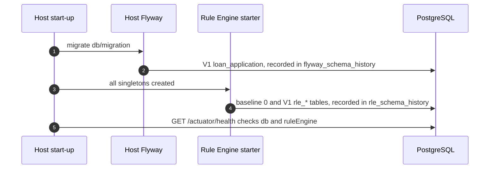

# Example host: Rule Engine only

A minimal Spring Boot 4 service with its own table (`loan_application`) and its own Flyway history that embeds the Rule Engine. It shows the two things a host adds:

1. One dependency, `com.horus.bpm:rule-engine-spring-boot-starter`.
2. One configuration block, `horus.bpm.rules` in [`application.yml`](src/main/resources/application.yml).

On start-up the host's Flyway applies `db/migration` to `flyway_schema_history`. Then the engine applies its own `rle_*` migrations to `rle_schema_history`, on the host's `DataSource` and transaction manager, with no pool of its own. The decision log `rle_decision` is partitioned by month, and the partitions for the current and the next month are created by the first migration.



## Run locally

Needs JDK 21 or later and Docker.

```bash
docker run -d --name horus-pg -e POSTGRES_DB=horus -e POSTGRES_USER=horus \
  -e POSTGRES_PASSWORD=change-me -p 5432:5432 postgres:16-alpine

mvn -B -pl examples/rule-engine-only -am package -DskipTests      # from the repository root
HORUS_DB_PASSWORD=change-me java -jar examples/rule-engine-only/target/example-rule-engine-only-0.1.0-SNAPSHOT.jar
```

Check it:

```bash
curl -s localhost:8080/actuator/health
# {"components":{"db":{"status":"UP"}, ... "ruleEngine":{"status":"UP"}, ...},"status":"UP"}

docker exec horus-pg psql -U horus -d horus -c '\dt'
# flyway_schema_history, loan_application, rle_decision (partitioned), rle_decision_YYYY_MM (this month and next),
# rle_decision_default, rle_decision_outbox, rle_idempotency, rle_rule, rle_rule_set, rle_schema_history, rle_version

docker exec horus-pg psql -U horus -d horus -c 'SELECT version, script FROM rle_schema_history ORDER BY installed_rank'
#  0       | Rule Engine baseline
#  1       | V1__rle_baseline.sql
```

## Environment variables

| Variable | Default | Meaning |
|---|---|---|
| `HORUS_DB_URL` | `jdbc:postgresql://localhost:5432/horus` | JDBC URL of the host database |
| `HORUS_DB_USERNAME` | `horus` | Database user |
| `HORUS_DB_PASSWORD` | none | Database password. Never put it in a file in the repository |
| `PORT` | `8080` | HTTP port |

## Rule Engine properties

| Property | Default | Meaning |
|---|---|---|
| `horus.bpm.rules.enabled` | `true` | `false` switches the engine off entirely |
| `horus.bpm.rules.schema.migrate` | `true` | `false` when the `rle_*` migrations are applied by a separate deployment step. The `ruleEngine` health contributor is then down until they are |

The full list of properties for 0.1 is in `rule-engine/docs/DESIGN.md` section 4.4. Properties are added to the starter with the features that use them.

## Run in CI

`.github/workflows/ci.yml` runs `mvn -B verify` on every pull request on Java 21 and Spring Boot 4.x. In this module, Failsafe runs two Testcontainers suites on `postgres:16-alpine`:

| Test | Proves |
|---|---|
| `RuleEngineOnlyHostIT.tr_emb_01_*` | The host boots healthy on a clean database and the `rle_*` tables accept writes |
| `RuleEngineOnlyHostIT.tr_emb_06_*` | Engine migrations are recorded only in `rle_schema_history`; the host's history holds only its own migration |
| `RuleEngineOnlyHostIT.tr_emb_04_*` | The engine uses the host's only `DataSource` and transaction manager, and the host's Flyway bean is still the Spring Boot one |
| `HostRestartIT.tr_emb_06_*` | On restart, and after a new host migration, the engine's history is unchanged and the host's history is never touched by the engine |

Run only this module's tests: `mvn -B -pl examples/rule-engine-only -am verify`.

## Adding the engine to an existing host

The engine baselines its own history at version 0, so it installs on a database that already has host tables. The reverse order needs one host setting. If the host adds Flyway after the engine's tables exist, Flyway refuses a schema that is not empty but has no history. Set `spring.flyway.baseline-on-migrate=true` (and `spring.flyway.baseline-version=0` if the host's first migration is `V1`) for that first run.
