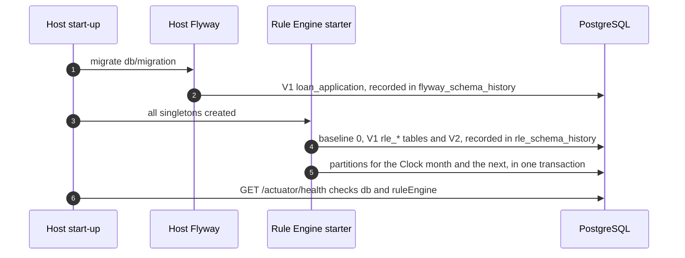

# Example host: Rule Engine only

A minimal Spring Boot 4 service with its own table (`loan_application`) and its own Flyway history that embeds the Rule Engine. It shows the two things a host adds:

1. One dependency, `com.horus.bpm:rule-engine-spring-boot-starter`.
2. One configuration block, `horus.bpm.rules` in [`application.yml`](src/main/resources/application.yml).
3. A `TenantResolver` bean that reads the tenant from the authenticated user ([`ExampleSecurity.java`](src/main/java/com/horus/bpm/examples/ruleengineonly/ExampleSecurity.java)). The caller and its `rules:*` permissions come from Spring Security.

On start-up the host's Flyway applies `db/migration` to `flyway_schema_history`. Then the engine applies its own `rle_*` migrations to `rle_schema_history`, on the host's `DataSource` and transaction manager, with no pool of its own. The decision log `rle_decision` is partitioned by month: the migration creates the parent and a default partition. A start-up step then creates the partitions for the current and the next month, read from the host's `Clock` (UTC months).



## Run locally

Needs JDK 21 or later and Docker.

```bash
docker run -d --name horus-pg -e POSTGRES_DB=horus -e POSTGRES_USER=horus \
  -e POSTGRES_PASSWORD=change-me -p 5432:5432 postgres:16-alpine

mvn -B -pl examples/rule-engine-only -am package -DskipTests      # from the repository root
HORUS_DB_PASSWORD=change-me java -jar examples/rule-engine-only/target/example-rule-engine-only-0.1.0-SNAPSHOT.jar
```

Check it:

```bash
curl -s localhost:8080/actuator/health
# {"status":"UP"}   component names are shown to authorised callers only (show-components: when-authorized)

docker exec horus-pg psql -U horus -d horus -c '\dt'
# flyway_schema_history, loan_application, rle_decision (partitioned), rle_decision_YYYY_MM (this month and next),
# rle_decision_default, rle_decision_outbox, rle_idempotency, rle_rule, rle_rule_set, rle_schema_history, rle_version

docker exec horus-pg psql -U horus -d horus -c 'SELECT version, script FROM rle_schema_history ORDER BY installed_rank'
#  0       | Rule Engine baseline
#  1       | V1__rle_baseline.sql
#  2       | V2__rle_version_created_by.sql
```

To see the `ruleEngine` component locally, start with `--management.endpoint.health.show-components=always`. It reports the schema version, `pendingMigrations`, and whether next month's partition exists.

## Demo: import, approve as a second person, evaluate

The host has five demo users for this walkthrough, all with the password in `HORUS_DEMO_PASSWORD`:

| User | Tenant | Permissions |
|---|---|---|
| `alice` | `bank-a` | `rules:author`, `rules:approve`, `rules:read`, `rules:evaluate` |
| `bob` | `bank-a` | `rules:approve`, `rules:read`, `rules:evaluate` |
| `teller` | `bank-a` | `rules:evaluate` |
| `carol`, `dave` | `tenant-b` | as `alice` and `bob` |

Start PostgreSQL as above, then start the host with demo users:

```bash
HORUS_DB_PASSWORD=change-me HORUS_DEMO_PASSWORD=demo-only \
  java -jar examples/rule-engine-only/target/example-rule-engine-only-0.1.0-SNAPSHOT.jar
H=localhost:8080/api/bpm/rules/v1
```

1. Alice imports the card fee table from [`rules/card-fee.yaml`](src/main/resources/rules/card-fee.yaml). It is stored as a draft with the file kept byte for byte:

   ```bash
   curl -s -u alice:demo-only -X POST $H/rule-sets -H 'Content-Type: application/yaml' \
     -H 'Idempotency-Key: demo-import-1' --data-binary @examples/rule-engine-only/src/main/resources/rules/card-fee.yaml
   # 201 {"ruleSet":"card-fee","version":1,"status":"DRAFT","sourceFormat":"YAML",
   #      "canonicalHash":"596414cd75b2ef85719562ae8014a3f26bad0527ee2d6ef191377aec572f9142",...}
   ```

   Sending the same request again with the same `Idempotency-Key` returns the same `201` and creates nothing. The same key with a changed file returns `422 IDEMPOTENCY_KEY_REUSE_MISMATCH`.

2. Alice requests publication:

   ```bash
   curl -s -u alice:demo-only -X POST $H/rule-sets/card-fee/versions/1:request-publish
   # 200 {"status":"PENDING_APPROVAL","requestedBy":"alice",...}
   ```

3. Alice tries to approve her own request and is refused:

   ```bash
   curl -s -u alice:demo-only -X POST $H/rule-sets/card-fee/versions/1:approve
   # 403 {"code":"SELF_APPROVAL_FORBIDDEN","detail":"The requester of card-fee v1 cannot approve it",...}
   ```

4. Bob approves; the version is published and takes effect now:

   ```bash
   curl -s -u bob:demo-only -X POST $H/rule-sets/card-fee/versions/1:approve \
     -H 'Content-Type: application/json' -d '{"comment":"Fees checked against the tariff"}'
   # 200 {"status":"PUBLISHED","requestedBy":"alice","approvedBy":"bob",...}
   ```

5. A teller prices a Gold customer's card. Rule `R1` matches and the fee is 0 VND:

   ```bash
   curl -s -u teller:demo-only -X POST $H/decisions/card-fee:evaluate \
     -H 'Content-Type: application/json' -d '{"inputs":{"tier":"GOLD","txCount":5}}'
   # 200 {"decisionId":"01M7RVDNER5T0V2T4QH6SE2C25","ruleSet":"card-fee","version":1,"outcome":"MATCHED",
   #      "matchedRuleIds":["R1"],"outputs":{"fee":{"currency":"VND","amount":0}},...}
   ```

6. The decision is in the log, written in the same transaction as the request:

   ```bash
   docker exec horus-pg psql -U horus -d horus -c \
     'SELECT rule_set_name, version_num, outcome, matched_rule_ids, outputs, caller_id FROM rle_decision'
   #  card-fee | 1 | OK | ["R1"] | {"fee": {"amount": 0, "currency": "VND"}} | teller
   ```

7. A user of another tenant cannot reach the rule set, even when the body names the tenant:

   ```bash
   curl -s -u carol:demo-only -X POST $H/decisions/card-fee:evaluate \
     -H 'Content-Type: application/json' -d '{"tenantId":"bank-a","inputs":{"tier":"GOLD"}}'
   # 404 {"code":"RULE_SET_NOT_FOUND",...}
   ```

8. The original file, comments included, is returned with `?include=source`:

   ```bash
   curl -s -u alice:demo-only "$H/rule-sets/card-fee/versions/1?include=source"
   # {..., "sourceDocument":"# Monthly card fee, the rule set of the Rule Engine walking skeleton (RLE-001).\n...", ...}
   ```

The same path in Java, inside the host's own transaction:

```java
@Transactional
public Money cardFee(String tier, int txCount) {
    DecisionResult result = ruleEngine.evaluate("card-fee", DecisionInput.of(Map.of("tier", tier, "txCount", txCount)));
    return (Money) result.outputs().get("fee");   // rolls back with the host's work; one rle_decision row on commit
}
```

## Environment variables

| Variable | Default | Meaning |
|---|---|---|
| `HORUS_DB_URL` | `jdbc:postgresql://localhost:5432/horus` | JDBC URL of the host database |
| `HORUS_DB_USERNAME` | `horus` | Database user |
| `HORUS_DB_PASSWORD` | none | Database password. Never put it in a file in the repository |
| `PORT` | `8080` | HTTP port |
| `HORUS_DEMO_PASSWORD` | none | Password of the demo users. Without it there are no demo users and every API call returns `401` |

## Rule Engine properties

| Property | Default | Meaning |
|---|---|---|
| `horus.bpm.rules.enabled` | `true` | `false` switches the engine off entirely |
| `horus.bpm.rules.migrate-on-start` | `true` | `false` for hosts that run the `rle_*` migrations in a separate job. If the schema is not current, the `ruleEngine` health contributor is down and partitions are not created until it is |

The full list of properties is on the wiki page Rule Engine Configuration. The starter adds them with the features that use them.

## Run in CI

`.github/workflows/ci.yml` runs these tests on every pull request on Java 21 and 25, Spring Boot 4.x and 3.5.x, and PostgreSQL 14 and 18 (see [Technical Requirements](https://github.com/dhluong90/horus-Agentic-BPM/wiki/Technical-Requirements) on the wiki). In this module, Failsafe runs four Testcontainers suites on the image in `bpm.test.postgres.image` (`postgres:16-alpine` locally). On Spring Boot 3.5 the host uses `spring-boot-starter-web` and `flyway-core` (profile `host-spring-boot-3.5`); the code is the same. To run that leg locally: `mvn -B install -DskipTests`, then `mvn -B -Dspring-boot.line=3.5 surefire:test failsafe:integration-test failsafe:verify`. The host's clock is fixed at 26 January 2027.

| Test | Proves |
|---|---|
| `RuleEngineOnlyHostIT.TR_EMB_01_*` | The host boots healthy on a clean database and the `rle_*` tables accept writes |
| `RuleEngineOnlyHostIT.TR_OPS_04_*` | Start-up creates `rle_decision_2027_01` and `rle_decision_2027_02` from the host's clock |
| `RuleEngineOnlyHostIT.TR_EMB_06_*` | Engine migrations are recorded only in `rle_schema_history`; the host's history holds only its own migration |
| `RuleEngineOnlyHostIT.TR_EMB_04_*` | The engine uses the host's only `DataSource` and the transaction manager that manages it, and the host's Flyway bean is still the Spring Boot one |
| `HostRestartIT.TR_EMB_06_*` | On restart, and after a new host migration, the engine's history is unchanged and the host's history is never touched by the engine |
| `RuleLifecycleIT.RLE_020_*`, `RLE_009_*`, `RLE_001_*`, `RLE_011_*`, `RLE_014_*` | The demo above over HTTP: import with the source kept, self-approval refused, evaluation of `R1` at 0 VND, the body tenant ignored, idempotent import. The host runs with `spring.jackson.property-naming-strategy=SNAKE_CASE`, and engine responses stay camelCase |

Run only this module's tests: `mvn -B -pl examples/rule-engine-only -am verify`.

To add the engine to a host that already has a database, or to add Flyway to a host after the engine, see "Install order" on the wiki page Getting Started.
