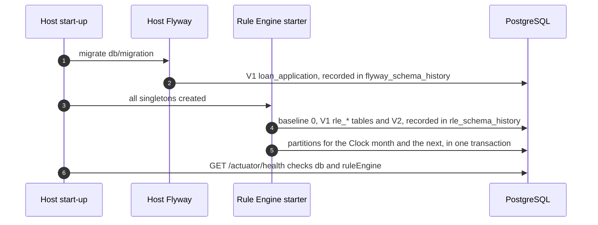

# Example host: Rule Engine only

A minimal Spring Boot 4 service with its own table (`loan_application`) and its own Flyway history that embeds the Rule Engine. It shows the three things a host adds:

1. One dependency, `com.horus.bpm:rule-engine-spring-boot-starter`.
2. One configuration block, `horus.bpm` in [`application.yml`](src/main/resources/application.yml): the host id and the mapping of the host's roles to engine permissions.
3. Its own security chain, [`HostSecurityConfiguration`](src/main/java/com/horus/bpm/examples/ruleengineonly/HostSecurityConfiguration.java), with the engine's two problem handlers so that `401` and `403` are RFC 9457 problem details.

On start-up the host's Flyway applies `db/migration` to `flyway_schema_history`. Then the engine applies its own `rle_*` migrations to `rle_schema_history`, on the host's `DataSource` and transaction manager, with no pool of its own. The decision log `rle_decision` is partitioned by month: the migration creates the parent and a default partition. A start-up step then creates the partitions for the current and the next month, read from the host's `Clock` (UTC months).



## Run locally

Needs JDK 21 or later and Docker.

```bash
docker run -d --name horus-pg -e POSTGRES_DB=horus -e POSTGRES_USER=horus \
  -e POSTGRES_PASSWORD=change-me -p 5432:5432 postgres:16-alpine

mvn -B -pl examples/rule-engine-only -am package -DskipTests      # from the repository root
HORUS_DB_PASSWORD=change-me java -jar examples/rule-engine-only/target/example-rule-engine-only-0.1.0-SNAPSHOT.jar
```

Check it (health is public; everything else needs a caller):

```bash
curl -s localhost:8080/actuator/health
# {"status":"UP"}   component names are shown to authorised callers only (show-components: when-authorized)

docker exec horus-pg psql -U horus -d horus -c '\dt'
# flyway_schema_history, loan_application, rle_decision (partitioned), rle_decision_YYYY_MM (this month and next),
# rle_decision_default, rle_decision_outbox, rle_idempotency, rle_rule, rle_rule_set, rle_schema_history, rle_version,
# rle_version_history, rle_engine_key

docker exec horus-pg psql -U horus -d horus -c 'SELECT version, script FROM rle_schema_history ORDER BY installed_rank'
#  0       | Rule Engine baseline
#  1       | V1__rle_baseline.sql
#  2       | V2__rle_version_created_by.sql
#  3       | V3__rle_version_history.sql
#  4       | V4__rle_version_history_append_only.sql
#  5       | V5__rle_engine_key.sql
```

### The cursor key

At start-up, after the migrations, the engine creates its list-cursor key in `rle_engine_key` if it is missing and reads it, so the runtime database user needs `SELECT` and `INSERT` on that table; without them start-up stops with a message naming the table. Requests only use the key in memory.

### Protect the audit tables

`rle_version_history` is append-only: migration `V4` adds triggers that refuse `UPDATE`, `DELETE` and `TRUNCATE`. A role that owns the table can still drop a trigger, so if you run migrations with one role and the application with another, also take the rights away from the application role:

```sql
REVOKE UPDATE, DELETE, TRUNCATE ON rle_version_history FROM horus_app;   -- your runtime role
```

### Upgrading to the release with lifecycle history

Migration `V3` creates the history table and gives every existing version one `CREATED` row. During a rolling upgrade, replicas still on the old release keep serving request-publish and approve but write no history rows, so those transitions are missing from `GET .../history` for good. If that matters, hold lifecycle commands (imports, requests, approvals) until every replica runs the new release; evaluation is unaffected.

### Host metadata with two demo users

On the `dev` profile the host has two demo users, Lan (role `PRICING_AUTHOR`) and Minh (role `PRICING_APPROVER`), with the password from `HORUS_DEMO_PASSWORD`. They sign in with the host's form at `/login`, the same sign-in the embedded cockpit uses, and the engine endpoints then answer for the session ([`HostSecurityConfiguration`](src/main/java/com/horus/bpm/examples/ruleengineonly/HostSecurityConfiguration.java)). A form user carries no tenant attribute, so [`application-dev.yml`](src/main/resources/application-dev.yml) sets `horus.bpm.tenancy.dev-tenant: bank-a`, which the engines accept on the `dev` profile only. A header never chooses the tenant.

```bash
SPRING_PROFILES_ACTIVE=dev HORUS_DEMO_PASSWORD=choose-one HORUS_DB_PASSWORD=change-me \
  java -jar examples/rule-engine-only/target/example-rule-engine-only-0.1.0-SNAPSHOT.jar

# sign in as lan with the form, keeping the session cookie in ./jar
CSRF=$(curl -s -c jar -b jar localhost:8080/login | sed -n 's/.*name="_csrf" type="hidden" value="\([^"]*\)".*/\1/p')
curl -s -c jar -b jar -o /dev/null -d "username=lan&password=choose-one&_csrf=$CSRF" localhost:8080/login

curl -s -b jar localhost:8080/api/bpm/me
# {"schemaVersion":1,"user":{"id":"lan"},"tenant":{"current":"bank-a","allowed":["bank-a"]},"permissions":["rules:read","rules:author"],"roles":["ROLE_PRICING_AUTHOR"],"groups":[]}

curl -s -b jar localhost:8080/api/bpm/meta
# {"schemaVersion":1,"hostId":"rule-engine-only","modules":[{"module":"rules","engineVersion":"0.1.0-SNAPSHOT","apiVersion":"v1","features":[]}],"tenancy":{"switching":false},"limits":{"maxPageSize":200}}

curl -s -i localhost:8080/api/bpm/meta
# HTTP/1.1 401
# WWW-Authenticate: Bearer
# Content-Type: application/problem+json;charset=UTF-8
# {"type":"https://github.com/dhluong90/horus-Agentic-BPM/wiki/Common-Error-Codes#unauthenticated","title":"Authentication required","status":401,"code":"UNAUTHENTICATED","detail":"Sign in, or send a token issued for this host.","instance":"/api/bpm/meta","correlationId":"01M7RR0S1MJ2AFNEK9G00A9E1N"}
```

Repeat the sign-in with `username=minh` to see `["rules:read","rules:approve"]`. Calls that change state with the session need the CSRF token: the host sets it in the `XSRF-TOKEN` cookie and expects it back as `X-XSRF-TOKEN`.

The demo users exist only on the `dev` profile, and the host refuses to start on `dev` beside another profile (other than `test`) or with a token issuer that is not on this machine. Without `dev` the user store is empty. The host accepts bearer tokens when an issuer, JWK set or public key is configured, and then requires its own audience; token claim `roles` becomes `ROLE_*` authorities and claim `tenant_id` the tenant.

To see the `ruleEngine` component locally, start with `--management.endpoint.health.show-components=always`. It reports the schema version, `pendingMigrations`, and whether next month's partition exists.

## Demo: import, approve as a second person, evaluate

This walkthrough uses the demo users of the `dev` profile, in tenant `bank-a` (the profile's `dev-tenant`), with the password in `HORUS_DEMO_PASSWORD`. Their roles reach engine permissions through `horus.bpm.rules.security.role-permissions` in [`application.yml`](src/main/resources/application.yml), the same mapping `GET /api/bpm/me` lists. On the `dev` profile only they may also send HTTP Basic credentials, which keeps the curl steps short.

| User | Roles | Engine permissions |
|---|---|---|
| `hoa` | `PRICING_AUTHOR`, `PRICING_APPROVER` | `rules:read`, `rules:author`, `rules:approve` |
| `minh` | `PRICING_APPROVER` | `rules:read`, `rules:approve` |
| `tuan` | `TELLER` | `rules:evaluate` |

Start PostgreSQL as above, then start the host on the `dev` profile:

```bash
SPRING_PROFILES_ACTIVE=dev HORUS_DB_PASSWORD=change-me HORUS_DEMO_PASSWORD=demo-only \
  java -jar examples/rule-engine-only/target/example-rule-engine-only-0.1.0-SNAPSHOT.jar
H=localhost:8080/api/bpm/rules/v1
```

1. Hoa imports the card fee table from [`rules/card-fee.yaml`](src/main/resources/rules/card-fee.yaml). It is stored as a draft with the file kept byte for byte:

   ```bash
   curl -s -u hoa:demo-only -X POST $H/rule-sets -H 'Content-Type: application/yaml' \
     -H 'Idempotency-Key: demo-import-1' --data-binary @examples/rule-engine-only/src/main/resources/rules/card-fee.yaml
   # 201 {"ruleSet":"card-fee","version":1,"status":"DRAFT","sourceFormat":"YAML",
   #      "canonicalHash":"596414cd75b2ef85719562ae8014a3f26bad0527ee2d6ef191377aec572f9142",...}
   ```

   Sending the same request again with the same `Idempotency-Key` returns the same `201` and creates nothing. The same key with a changed file returns `422 IDEMPOTENCY_KEY_REUSE_MISMATCH`.

2. Hoa requests publication:

   ```bash
   curl -s -u hoa:demo-only -X POST $H/rule-sets/card-fee/versions/1:request-publish
   # 200 {"status":"PENDING_APPROVAL","requestedBy":"hoa",...}
   ```

3. Hoa tries to approve her own request and is refused:

   ```bash
   curl -s -u hoa:demo-only -X POST $H/rule-sets/card-fee/versions/1:approve
   # 403 {"code":"SELF_APPROVAL_FORBIDDEN","detail":"The requester of card-fee v1 cannot approve it",...}
   ```

4. Minh approves; the version is published and takes effect now:

   ```bash
   curl -s -u minh:demo-only -X POST $H/rule-sets/card-fee/versions/1:approve \
     -H 'Content-Type: application/json' -d '{"comment":"Fees checked against the tariff"}'
   # 200 {"status":"PUBLISHED","requestedBy":"hoa","approvedBy":"minh",...}
   ```

5. Tuan, a teller, prices a Gold customer's card. Rule `R1` matches and the fee is 0 VND:

   ```bash
   curl -s -u tuan:demo-only -X POST $H/decisions/card-fee:evaluate \
     -H 'Content-Type: application/json' -d '{"inputs":{"tier":"GOLD","txCount":5}}'
   # 200 {"decisionId":"01M7RVDNER5T0V2T4QH6SE2C25","ruleSet":"card-fee","version":1,"outcome":"MATCHED",
   #      "matchedRuleIds":["R1"],"outputs":{"fee":{"currency":"VND","amount":0}},...}
   ```

6. The decision is in the log, written in the same transaction as the request:

   ```bash
   docker exec horus-pg psql -U horus -d horus -c \
     'SELECT rule_set_name, version_num, outcome, matched_rule_ids, outputs, caller_id FROM rle_decision'
   #  card-fee | 1 | OK | ["R1"] | {"fee": {"amount": 0, "currency": "VND"}} | tuan
   ```

7. A user of another tenant cannot reach the rule set, even when the body names the tenant. The `dev` profile has one tenant, so this step runs with bearer tokens for `bank-a` and `tenant-b` in `RuleLifecycleIT.RLE_011_*`: the answer is `404 RULE_SET_NOT_FOUND` and no decision row.

8. The original file, comments included, is returned with `?include=source`:

   ```bash
   curl -s -u hoa:demo-only "$H/rule-sets/card-fee/versions/1?include=source"
   # {..., "sourceDocument":"# Monthly card fee, the rule set of the Rule Engine walking skeleton (RLE-001).\n...", ...}
   ```

9. Lists for an editor: rule sets by name and versions newest first, a page at a time (`limit` 1 to 200, default 50; pass `nextCursor` back as `cursor`). Each version carries `allowedActions` for the caller:

   ```bash
   curl -s -u minh:demo-only "$H/rule-sets?limit=2"
   # {"data":[{"ruleSet":"card-fee","latestVersion":2,"latestStatus":"PENDING_APPROVAL","publishedVersion":1,
   #           "lastChangedAt":"..."},{"ruleSet":"fx-margin",...}],"nextCursor":"cnVsZS1zZXRzOmZ4LW1hcmdpbg","hasNext":true}
   curl -s -u minh:demo-only "$H/rule-sets/card-fee/versions"
   # {"data":[{"version":2,"status":"PENDING_APPROVAL","createdBy":"hoa","requestedBy":"hoa",
   #           "allowedActions":["approve","reject"],...},{"version":1,"status":"PUBLISHED","approvedBy":"minh",...}],...}
   ```

10. Minh sends a pending version back with a reason; it is a draft again and the reason is in its history:

    ```bash
    curl -s -u minh:demo-only -X POST $H/rule-sets/card-fee/versions/2:reject -H 'Content-Type: application/json' \
      -H 'Idempotency-Key: demo-reject-1' -H 'If-Match: "1"' -d '{"reason":"R2 waiver needs pricing committee minutes"}'
    # 200 {"status":"DRAFT","lockVersion":2,"requestedBy":null,...}
    curl -s -u hoa:demo-only $H/rule-sets/card-fee/versions/2/history
    # {"data":[{"action":"CREATED",...},{"action":"REQUESTED",...},
    #          {"action":"REJECTED","actor":"minh","reason":"R2 waiver needs pricing committee minutes",...}]}
    ```

11. A file with mistakes is refused whole, each problem on its rule and column. A `money` output without a currency (`fee: "30000"`) is one of them:

    ```bash
    # 422 {"code":"VALIDATION_FAILED","violations":[
    #   {"ruleId":"R2","column":"balance","message":"compares a money with a number"},
    #   {"ruleId":"R3","column":"fee","message":"output fee is money and needs a currency: write 30000 followed by its ISO 4217 currency code"}]}
    ```

The same path in Java, inside the host's own transaction:

```java
@Transactional
public Money cardFee(String tier, int txCount) {
    DecisionResult result = ruleEngine.evaluate("card-fee", DecisionInput.of(Map.of("tier", tier, "txCount", txCount)));
    return (Money) result.outputs().get("fee");   // rolls back with the host's work; one rle_decision row on commit
}
```

## Environment variables

| Variable | Default | Meaning |
|---|---|---|
| `HORUS_DB_URL` | `jdbc:postgresql://localhost:5432/horus` | JDBC URL of the host database |
| `HORUS_DB_USERNAME` | `horus` | Database user |
| `HORUS_DB_PASSWORD` | none | Database password. Never put it in a file in the repository |
| `PORT` | `8080` | HTTP port |
| `SPRING_SECURITY_OAUTH2_RESOURCESERVER_JWT_ISSUER_URI` | none | Issuer of the bearer tokens the host accepts. Unset: no bearer tokens, so only health answers outside `dev` |
| `SPRING_SECURITY_OAUTH2_RESOURCESERVER_JWT_AUDIENCES` | none | Audience this host requires in every token, for example `rule-engine-only`. Required whenever an issuer, JWK set or public key is set: without it the host does not start (TR-SEC-12) |
| `SPRING_PROFILES_ACTIVE` | none | `dev` turns on the two demo users. Never in a shared environment |
| `HORUS_DEMO_PASSWORD` | none | Password of the demo users `lan` and `minh` on the `dev` profile. Without it nobody can sign in |

## Open the cockpit

The host serves the cockpit at `/bpm/cockpit` behind its own form sign-in (`HostSecurityConfiguration`), on the `dev` profile with the demo users. Build the cockpit bundle before packaging:

```bash
npm --prefix cockpit/web ci && npm --prefix cockpit/web run build      # from the repository root
mvn -B -pl examples/rule-engine-only -am package -DskipTests
SPRING_PROFILES_ACTIVE=dev HORUS_DB_PASSWORD=change-me HORUS_DEMO_PASSWORD=choose-one \
  java -jar examples/rule-engine-only/target/example-rule-engine-only-0.1.0-SNAPSHOT.jar
```

Open `http://localhost:8080/bpm/cockpit` and sign in as `lan` (role `PRICING_AUTHOR`) or `minh` (role `PRICING_APPROVER`). The header shows the service `Loan origination` (`horus.bpm.cockpit.host-label`), the tenant `bank-a` and the user. The cockpit sends the `XSRF-TOKEN` cookie back as `X-XSRF-TOKEN` on calls that change data.

### Edit rules in the cockpit

The cockpit lists rule sets, shows a version as a decision table, edits a draft, sends it for approval and lets a second person approve or reject it. "Try it" runs sample inputs; it needs `rules:evaluate`, which the demo roles do not hold, so add it on the command line for this walkthrough:

```bash
SPRING_PROFILES_ACTIVE=dev HORUS_DB_PASSWORD=change-me HORUS_DEMO_PASSWORD=choose-one \
  java -jar examples/rule-engine-only/target/example-rule-engine-only-0.1.0-SNAPSHOT.jar \
  '--horus.bpm.rules.security.role-permissions[ROLE_PRICING_AUTHOR]=rules:read,rules:author,rules:evaluate' \
  '--horus.bpm.rules.security.role-permissions[ROLE_PRICING_APPROVER]=rules:read,rules:approve,rules:evaluate'
```

1. As `lan`, open Rule sets, choose **Import file** and pick [`rules/card-fee.yaml`](src/main/resources/rules/card-fee.yaml). Version 1 opens as a draft table. Choose **Request publish**: the dock shows "Approve is unavailable. You requested this change. Another approver must decide."
2. In a private window, sign in as `minh` and open the same address (the link in the address bar works as is). Version 1 opens on Changes. Add a comment and choose **Approve and publish**.
3. Back as `lan`, reload, choose **New draft**. Type `== GOLD` (without quotes) in row R1's tier cell, then **Save draft**: the engine's error appears on that cell and the other edits stay. Put the quotes back (`== 'GOLD'`), change R2 to `>= 5`, add a row, move it with the arrows, and save again. Version 2 opens as a draft. **Request publish**.
4. As `minh`, open version 2: Changes lists the added and changed rows with the same labels and amounts as the table. Write a reason and choose **Reject**: version 2 goes back to `lan` as a draft, and **History** under the approval dock shows who rejected it and why. As `lan`, **Request publish** again; as `minh`, approve it.
5. As either user, use **Try it**: tier `GOLD` matches R1 and the table marks the row.

To bring in a file prepared elsewhere, open the rule set and choose **Import new version**: the file becomes the next draft. Only a person other than the author and the requester can approve or reject a version; a requester withdraws through the engine's withdraw action once it ships. A host that keeps rule changes in Git sets `horus.bpm.rules.authoring.cockpit-drafts: false`; the cockpit then hides New draft and Edit draft and keeps Import new version.

A save creates a new draft version each time, because the engine has no endpoint to replace a draft yet (issue #165). A `.json` file is sent as JSON; this engine release imports YAML only and answers so.

The same journey runs as a Playwright test against this host: `LIVE_HOST_URL=http://localhost:8080 LIVE_PASSWORD=choose-one npm --prefix cockpit/web run e2e:live`. Started without the two properties, as the Docker Compose deployment is, the host gives the demo roles no `rules:evaluate`: Try it then says "You cannot run rules on this service", and the test checks that and skips the Try it step with a note.

## Rule Engine properties

| Property | Default | Meaning |
|---|---|---|
| `horus.bpm.rules.enabled` | `true` | `false` switches the engine off entirely |
| `horus.bpm.host-id` | unset; `rule-engine-only` here | Id returned by `GET /api/bpm/meta` |
| `horus.bpm.rules.security.role-permissions` | empty; `ROLE_PRICING_AUTHOR` and `ROLE_PRICING_APPROVER` here | Host role to `rules:*` permissions, listed by `GET /api/bpm/me` |
| `horus.bpm.rules.migrate-on-start` | `true` | `false` for hosts that run the `rle_*` migrations in a separate job. If the schema is not current, the `ruleEngine` health contributor is down and partitions are not created until it is |
| `horus.bpm.rules.query.max-page-size` | `200` | Largest `limit` of `GET /rule-sets` and `GET .../versions`, 1 to 200; may be lowered, never raised |
| `horus.bpm.rules.lifecycle.reason-max-length` | `2000` | Longest `:reject` reason in characters, 1 to 2000; may be lowered, never raised |

The full list of properties is on the wiki page Rule Engine Configuration. The starter adds them with the features that use them.

## Run in CI

`.github/workflows/ci.yml` runs these tests on every pull request on Java 21 and 25, Spring Boot 4.x and 3.5.x, and PostgreSQL 14 and 18 (see [Technical Requirements](https://github.com/dhluong90/horus-Agentic-BPM/wiki/Technical-Requirements) on the wiki). In this module, Surefire runs `HostSecurityConfigurationTest` (start-up guards) and Failsafe runs five Testcontainers suites on the image in `bpm.test.postgres.image` (`postgres:16-alpine` locally). On Spring Boot 3.5 the host uses `spring-boot-starter-web` and `flyway-core` (profile `host-spring-boot-3.5`); the code is the same. To run that leg locally: `mvn -B install -DskipTests`, then `mvn -B -Dspring-boot.line=3.5 surefire:test failsafe:integration-test failsafe:verify`. `RuleEngineOnlyHostIT` fixes the host's clock at 26 January 2027.

| Test | Proves |
|---|---|
| `RuleEngineOnlyHostIT.TR_EMB_01_*` | The host boots healthy on a clean database and the `rle_*` tables accept writes |
| `RuleEngineOnlyHostIT.TR_OPS_04_*` | Start-up creates `rle_decision_2027_01` and `rle_decision_2027_02` from the host's clock |
| `RuleEngineOnlyHostIT.TR_EMB_06_*` | Engine migrations are recorded only in `rle_schema_history`; the host's history holds only its own migration |
| `RuleEngineOnlyHostIT.TR_EMB_04_*` | The engine uses the host's only `DataSource` and the transaction manager that manages it, and the host's Flyway bean is still the Spring Boot one |
| `HostMetadataIT.RLE_019_*` | Bearer tokens validated by Spring Boot with an RSA public key and the audience `rule-engine-only`: Lan and Minh get different permission lists through the role mapping; `/meta` names this host and engine version; no token, a malformed token or a token for another audience gets a `401` problem |
| `HostMetadataIT.TR_SEC_03_*`, `HostMetadataIT.demo_users_*` | A bearer token for `bank-a` with `X-Tenant-Id: bank-b` gets `403`; on the default profile the demo users cannot sign in even with `HORUS_DEMO_PASSWORD` set |
| `SessionSignInIT.RLE_019_*` | The curl demo above on the `dev` profile: form sign-in, then `200` from `/meta` and `/me` with the session for both users |
| `SessionSignInIT.TR_SEC_03_*`, `SessionSignInIT.session_*` | A session caller cannot choose its tenant with a header; a state-changing call with the session needs the CSRF token; other pages still redirect to `/login` |
| `CockpitEmbeddedIT.TR_SEC_09_*` | Without a session the cockpit path redirects to the host's sign-in and serves no file; the cockpit page carries the strict CSP and `X-Frame-Options: SAMEORIGIN` |
| `CockpitEmbeddedIT.CKP_001_*` | On the `dev` profile: form sign-in, the cockpit page and its one-host registry, then `200` from `/api/bpm/meta` and `/api/bpm/me` with the session, valid against the cockpit schemas; a call that changes data needs `X-XSRF-TOKEN` from the cookie |
| `HostRestartIT.TR_EMB_06_*` | On restart, and after a new host migration, the engine's history is unchanged and the host's history is never touched by the engine |
| `RuleLifecycleIT.RLE_020_*`, `RLE_009_*`, `RLE_001_*`, `RLE_011_*`, `RLE_014_*` | The demo above over HTTP: import with the source kept, self-approval refused, evaluation of `R1` at 0 VND, the body tenant ignored, idempotent import. The host runs with `spring.jackson.property-naming-strategy=SNAKE_CASE`, and engine responses stay camelCase |

Run only this module's tests: `mvn -B -pl examples/rule-engine-only -am verify`.

To add the engine to a host that already has a database, or to add Flyway to a host after the engine, see "Install order" on the wiki page Getting Started.
