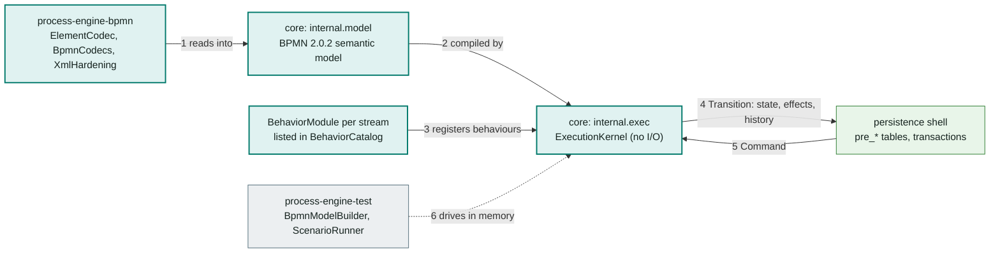

# Process Engine

Code: `PRE` · Version: 0.1.0-SNAPSHOT · Status: pre-alpha

Embeddable workflow library: process definitions, human tasks, gateways, timers, maker-checker, history.

Documents: `docs/DESIGN.md`, `docs/SPEC.md`, `docs/TEST-PLAN.md`, `docs/adr/`. Public documentation is in the project wiki.

## Code layout and contracts

The process engine is split so that the BPMN model, the XML codecs and the behaviours of each element family can be built in parallel without editing a shared file.

1. A BPMN 2.0.2 document is read through one `ElementCodec` per element family; `BpmnCodecs` is the fixed dispatch table and `XmlHardening` the only place that creates XML readers.
2. The model in `internal.model.bpmn` is the canonical model (ADR-0018): sealed roots `RootElement`, `FlowElement` (`FlowNode` with `Activity`, `Gateway` and `Event`), `EventDefinition`, `LoopCharacteristics`, `Artifact`, one record per element, each with typed `horus` extensions, opaque foreign fragments and other attributes.
3. Each element family's semantics is a `FlowNodeBehavior`, registered by a `BehaviorModule`. An element with no behaviour is refused as not executable at activation.
4. `ExecutionKernel.apply(state, command, clock)` returns the new state, the effects and the history. It performs no network, adapter or database call; every external action is an `Effect`.
5. The persistence shell applies the effects in the caller's transaction, except `InvokeService` in `ASYNC` mode, which runs outside any transaction (ADR-0008), and feeds results back as commands.
6. Behaviours and scenarios are tested in memory with `BpmnModelBuilder`, `RecordingExecutionContext`, `ScenarioRunner` and `TestClock`.

New code uses the package root `io.github.dhluong90.bpm.process` (ADR-0022).

## Walking skeleton

`process-engine-postgres` (the `pre_*` tables and `pre_schema_history`), `process-engine-rest` (`/api/bpm/processes/v1`) and `process-engine-spring-boot-starter` form the persistence shell around the kernel. The first executable subset is none start and end events, local `serviceTask`, `businessRuleTask` (through `RuleEngine.evaluate`), `userTask` and `exclusiveGateway`, read from BPMN 2.0 XML. The runnable sample is [`examples/rule-and-process`](../examples/rule-and-process/README.md).

## Timers across replicas

An intermediate timer catch event (`timeDuration` such as `P3D`, or `timeDate` with an offset) waits in `WAITING_TIMER` and schedules one row in `pre_timer`. Every copy of the host runs one poller thread that claims due rows with `FOR UPDATE SKIP LOCKED` and a lease, then fires each in its own transaction only while it still holds the claim, so a timer fires once however many copies run, and a crashed copy's timers are taken over after the lease (PRE-006, DESIGN section 4.4).

| Property | Default | Meaning |
|---|---|---|
| `horus.bpm.processes.jobs.enabled` | `true` | Run the poller in this copy; at least one copy must |
| `horus.bpm.processes.jobs.replica-id` | host name plus a random suffix | Name this copy claims under; set it from the pod name in Kubernetes |
| `horus.bpm.processes.jobs.timer-lease` | `60s` | How long a claim holds before another copy may take it |
| `horus.bpm.processes.jobs.poll-interval`, `batch-size` | `1s`, `32` | Idle poll pause and rows per claim |
| `horus.bpm.processes.jobs.max-attempts`, `retry-backoff` | `3`, `10s` | Retries of a failing firing, then `FAILED` |

The proof is `ExactlyOnceTimersTest` in `process-engine-postgres`: four replicas on one PostgreSQL database fire 120 due timers, each exactly once, while a fifth replica that stalled past its lease fires none of its old claims.
