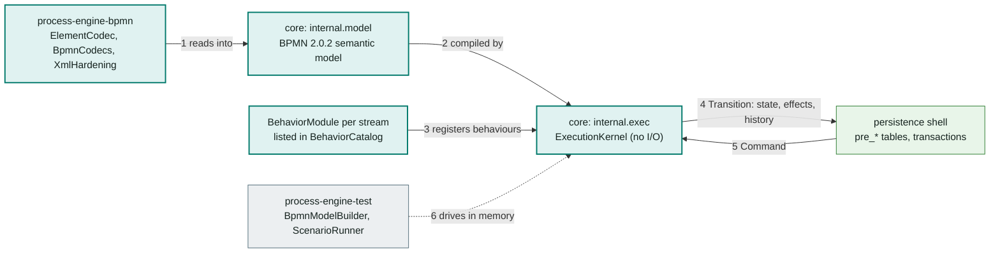

# Process Engine

Code: `PRE` · Version: 0.2.0 · Status: pre-alpha

Embeddable workflow library: process definitions, human tasks, gateways, timers, maker-checker, history.

Documents: `docs/DESIGN.md`, `docs/SPEC.md`, `docs/TEST-PLAN.md`, `docs/adr/`. Public documentation is in the project wiki.

## Code layout and contracts

The process engine is split so that the BPMN model, the XML codecs and the behaviours of each element family can be built in parallel without editing a shared file.



1. A BPMN 2.0.2 document is read through one `ElementCodec` per element family; `BpmnCodecs` is the fixed dispatch table and `XmlHardening` the only place that creates XML readers.
2. The model in `internal.model.bpmn` is the canonical model (ADR-0018): sealed roots `RootElement`, `FlowElement` (`FlowNode` with `Activity`, `Gateway` and `Event`), `EventDefinition`, `LoopCharacteristics`, `Artifact`, one record per element, each with typed `horus` extensions, opaque foreign fragments and other attributes.
3. Each element family's semantics is a `FlowNodeBehavior`, registered by a `BehaviorModule`. An element with no behaviour is refused as not executable at activation.
4. `ExecutionKernel.apply(state, command, clock)` returns the new state, the effects and the history. It performs no network, adapter or database call; every external action is an `Effect`.
5. The persistence shell applies the effects in the caller's transaction, except `InvokeService` in `ASYNC` mode, which runs outside any transaction (ADR-0008), and feeds results back as commands.
6. Behaviours and scenarios are tested in memory with `BpmnModelBuilder`, `RecordingExecutionContext`, `ScenarioRunner` and `TestClock`.

New code uses the package root `io.github.dhluong90.bpm.process` (ADR-0022).

## Walking skeleton

`process-engine-postgres` (the `pre_*` tables and `pre_schema_history`), `process-engine-rest` (`/api/bpm/processes/v1`) and `process-engine-spring-boot-starter` form the persistence shell around the kernel. The first executable subset is none start and end events, local `serviceTask`, `businessRuleTask` (through `RuleEngine.evaluate`), `userTask`, `exclusiveGateway` and `parallelGateway` (fork and join), read from BPMN 2.0 XML. The runnable sample is [`examples/rule-and-process`](../examples/rule-and-process/README.md).

## Timers across replicas

An intermediate timer catch event (`timeDuration` such as `P3D`, or `timeDate` with an offset) waits in `WAITING_TIMER` and schedules one row in `pre_timer`. Every copy of the host runs one poller thread that claims due rows with `FOR UPDATE SKIP LOCKED` and a lease, then fires each in its own transaction only while it still holds the claim, so a timer fires once however many copies run, and a crashed copy's timers are taken over after the lease (PRE-006, DESIGN section 4.4).

| Property | Default | Meaning |
|---|---|---|
| `horus.bpm.processes.jobs.enabled` | `true` | Run the poller in this copy; at least one copy must |
| `horus.bpm.processes.jobs.replica-id` | host name plus a random suffix | Name this copy claims under; set it from the pod name in Kubernetes |
| `horus.bpm.processes.jobs.timer-lease` | `60s` | How long a claim holds before another copy may take it |
| `horus.bpm.processes.jobs.poll-interval`, `batch-size` | `1s`, `32` | Idle poll pause and rows per claim |
| `horus.bpm.processes.jobs.max-attempts`, `retry-backoff` | `3`, `10s` | Retries of a failing firing, then `FAILED` |

The poller survives an `Error` in one poll and logs it; a `VirtualMachineError` stops it and turns the `processEngineJobs` health contributor `DOWN` (details: replica id, last successful poll), so the orchestrator restarts the host.

The proof is `ExactlyOnceTimersTest` in `process-engine-postgres`: four replicas on one PostgreSQL database fire 120 due timers, each exactly once, while a fifth replica that stalled past its lease fires none of its old claims.

## Remote steps (Async Wait-State)

Messages: a send task, a message throw or end event hands its message to your `MessageAdapter` bean inside the step transaction (write it to your outbox table there; the message id is the idempotency key), and your inbound consumer delivers each message it receives with `POST /api/bpm/processes/v1/messages:correlate` (`processes:message:correlate`, `Idempotency-Key` required). The engine never listens, and a message with no waiting instance is refused with `422 MESSAGE_NOT_CORRELATED`. No new environment variable.

A `serviceTask` with `horus:mode="remote"` calls a `ServiceAdapter` bean (named by `horus:handler`) with no database connection and no row lock held (ADR-0008). The step stores a job; the poller claims it when an adapter slot is free, with a lease of the step's `horus:timeout` plus `jobs.lease-margin`; the adapter runs on the adapter executor; the result is recorded in a second short transaction only while the attempt still holds its lease. The remote side deduplicates by `call.idempotencyKey()`, the job id, which stays the same when a timeout, a crash or a retryable failure makes the engine call again; the `attemptId` changes on every attempt and only fences late results. An adapter may answer `Accepted` and let the remote side report the result later through `POST /api/bpm/processes/v1/async-steps/{jobId}:complete` with the `attemptId` and the attempt's `completionToken`. The token is 256 random bits, new for each attempt; the engine keeps only its SHA-256 and compares it in constant time, so a client that can derive an attempt id still cannot complete the step. The caller needs `processes:step:complete` and one of the roles listed for the step's adapter in `adapters.completer-roles`, so the bureau's callback client cannot complete a sanctions step.

```java
@Bean
ServiceAdapter creditBureau(BureauClient client) {
    return new ServiceAdapter() {
        public String name() { return "creditBureau.score"; }
        public AdapterResult execute(AdapterCall call) {
            return AdapterResult.completed(client.score(call.inputs(), call.idempotencyKey()));
        }
    };
}
```

| Property | Default | Meaning |
|---|---|---|
| `horus.bpm.processes.adapters.default-timeout` | `PT30S` | Timeout of a remote step without `horus:timeout`; the engine abandons the call then |
| `horus.bpm.processes.adapters.executor-threads` | `16` | Adapter calls in flight per copy; size this, not the connection pool, for slow partners |
| `horus.bpm.processes.runners.<kind>.slots` | `adapters.executor-threads` | Calls of one async kind (`async-service`, `async-agent`) in flight per copy; each kind has its own slots and claim, so one never delays the other |
| `horus.bpm.processes.runners.<kind>.default-timeout`, `.max-attempts`, `.retry-backoff` | `adapters.default-timeout`, `jobs.max-attempts`, `jobs.retry-backoff` | Timeout, attempts and back-off of that kind |
| `horus.bpm.processes.runners.<kind>.guard-budget` | `500ms` | Longest output-schema and guardrail check of an agent result in its result transaction; a slower check refuses the result |
| `horus.bpm.processes.runners.<kind>.schema-retries` | `1` (agent), `0` (service) | Fresh attempts for a result that breaks its output schema before it is refused with `AGENT_SCHEMA_INVALID`; counted apart from `max-attempts`, `0` to `5` |
| `horus.bpm.processes.adapters.completer-roles` | none | Per adapter name, the roles that may complete its steps through the completion API, for example `completer-roles: { "[creditBureau.score]": [ROLE_BUREAU_CALLBACK] }`. An adapter without an entry cannot be completed from outside; a name that is no registered adapter stops start-up |
| `horus.bpm.processes.jobs.lease-margin` | `30s` | Added to the timeout to give the lease, so a live attempt is never taken over |

The proof is `AsyncWaitStateTest`: ten bureau calls in flight on a 2-connection pool with no connection active, a crashed attempt reclaimed exactly at the end of its lease, late and duplicate results that change nothing, a cancelled loan whose late answer is recorded as discarded once however often it is repeated, and a forged completion with a derived attempt id, a token of another job or a client of another adapter refused. `AsyncStepCompletionIT` in `examples/rule-and-process` runs the completion API over HTTP. `RunnerPerKindIT` proves the runner per kind and the result check: an agent backlog that leaves the bureau call unaffected, and refused answers through both paths, with the review task and the fail-closed cases.

## Guarded agent steps

A `serviceTask` with `horus:type="agentTask"` asks an `AgentAdapter` bean (named by `horus:agent`) and lets its answer move the process on only after two checks in the result transaction: the step's output schema and the guardrail rule set. A refused answer opens a four-eyes review task for the named reviewer, or fails the step with `onViolation="fail"`. The guard spec lives in the definition, so the definition hash and its approval cover it; an invalid spec is refused at import with problems naming the step. See the wiki page Guarded Agent Steps and process DESIGN section 4.1. How much freedom to give a step, and how to measure it, is in the wiki pages Agent Autonomy Ladder and Eval Guide and Agent Shadow Mode.

```xml
<bpmn:serviceTask id="assess-documents" horus:type="agentTask" horus:agent="documents.assess" horus:resultVariable="assessment">
  <bpmn:extensionElements>
    <horus:input name="applicationId" value="${instance.applicationId}"/>
    <horus:outputSchema>{"type": "object", "required": ["riskScore", "recommendation"],
      "properties": {"riskScore": {"type": "integer", "minimum": 0, "maximum": 100},
                     "recommendation": {"type": "string", "enum": ["APPROVE", "REFER", "DECLINE"]}}}</horus:outputSchema>
    <horus:guardrail decision="agent-output-guardrails" onViolation="route-to-human" reviewer="role:COMPLIANCE_REVIEWER"/>
  </bpmn:extensionElements>
</bpmn:serviceTask>
```

```java
@Bean
AgentAdapter documentAssessor(AssessorClient client) {
    return new AgentAdapter() {
        public String name() { return "documents.assess"; }
        public AdapterResult execute(AgentInvocation call) {
            // A retry is a new generation: key the model call by the attempt id, side effects by the job id.
            // outputSchema() is the step's schema without its mask annotations, for structured output.
            Assessment answer = client.assess(call.inputs(), call.outputSchema(), call.modelCallKey());
            return AdapterResult.completed(answer.output(), Map.of("model", answer.model(),
                    "usage.inputTokens", answer.inputTokens(), "usage.outputTokens", answer.outputTokens()));
        }
    };
}
```

The agent runs on its own runner (`runners.async-agent.*` above). An answer that breaks the schema is asked again once (`schema-retries`, default 1) and then refused with `AGENT_SCHEMA_INVALID`. The history keeps the answer masked: a value is kept only where the schema declares the field and does not mark it `mask: true`. The review task carries why the answer was refused, the inputs and the masked answer (`review` in the task view). The guardrail rule set must be published before the process is deployed: import, request-approval and approval refuse a guardrail that is missing in the tenant or breaks the contract (`422 GUARDRAIL_CONTRACT_INVALID`, PRE-016). A step may declare `<horus:retry max="2" backoff="PT1S"/>`; when no retry is left (a timeout is `AGENT_TIMEOUT`), the job fails and an incident opens in `pre_incident` (V13), read with `IncidentService.openIncidents`. An input marked `mask="true"` reaches the agent but history and the review task keep only its keyed fingerprint, made with the Rule Engine's masking key (`horus.bpm.masking.hmac-key`, from an environment variable or secret store) or `***` without one. The labels of `AdapterResult.completed(output, labels)` are recorded in history, bounded by `agents.labels.max-count` (16), `max-key-length` (64) and `max-value-length` (256). A reviewer's answer is recorded as `HUMAN_OVERRIDE` with the reason and what changed. A step may declare `<horus:memory from="extract-id" fields="fullName,dob" as="applicant"/>`, so that its agent receives, as `invocation.memory()`, only those fields of an earlier agent step's recorded result in the same instance. Memory is resolved once when the step is reached and kept in `pre_step_result` (V14). It is bounded by `agents.memory.max-entries` (16) and `agents.memory.max-bytes` (16384), and a masked field needs `includeMasked="true"`. `StubAgentAdapter` in `process-engine-test` answers with canned outputs for tests and demos, and `AgentInvocations.builder()` builds an invocation for your adapter's own tests. The proof is `AgentTaskIT` and, end to end over HTTP, `GuardedAgentTaskIT` in `examples/rule-and-process`.
