# Process Engine: Design

Status: architecture baseline (M0), updated 2026-11-18 for the cockpit direction (PD-032 to PD-042) and 2026-11-19 for the accepted ADR-0008, ADR-0009, ADR-0016, ADR-0018, ADR-0020 and ADR-0021. Conforms to ADR-0001 to ADR-0016, ADR-0017 (full BPMN 2.0 on the roadmap; the do-now items of [`standards-compliance.md`](../../docs/architecture/standards-compliance.md) section 9 are applied below and tagged with their milestone), ADR-0018 (the BPMN semantic model is canonical), ADR-0020 (execution tree with scope tokens from M2), ADR-0021 (Jackson 3 inside the core), ADR-0022 (package root), and [`docs/product/requirements.md`](../../docs/product/requirements.md). Money values follow the canonical contract in [`rule-engine/docs/DESIGN.md`](../../rule-engine/docs/DESIGN.md) section 3.4. Cross-module facts (transaction model, capacity baseline, failure table) are owned by [`docs/architecture/overview.md`](../../docs/architecture/overview.md); this document owns the Process Engine's model, DDL, APIs and read models.

Contents: 1 Context and boundaries. 2 Modules, ports and adapters. 3 Domain model and state machines. 4 Transaction model. 5 Definitions: notation, hash, diff, layout, BPMN, forms, step catalogue. 6 Java API and REST contract. 7 Storage model. 8 Read models, query limits and capacity math. 9 Failure modes. 10 Security controls. 11 Open questions.

## 1. Context and boundaries


Source: [`diagrams/security-zones.mmd`](diagrams/security-zones.mmd). Numbered edges: 1 to 4 enter through the bank's gateway; 6 to 8 run inside the host transaction; 9 to 11 are the Async Wait-State (ADR-0008), where the adapter call in 11 runs with no database connection held; 12 and 13 are events and telemetry.

`horus-process-engine` is an embeddable workflow library for Java 21 and Spring Boot 4.x hosts (3.5.x tested until 1.0, ADR-0011) on the host's PostgreSQL 14 or later (the range from 1.0 is pending PD-055). Humans (`userTask`), host services (`serviceTask`), rule-based decisions (`decision`, through the Rule Engine API) and AI agents (`agentTask`) take part in one process under explicit transaction, concurrency and compensation rules.

| Boundary | Rule |
|---|---|
| Rule Engine | `process-engine-core` depends only on the `RuleEngine` API interface, an optional bean needed only when a definition has a `decision` step or an `agentTask` guardrail. The Rule Engine never depends on the Process Engine |
| Host data | The engine owns tables prefixed `pre_` and its Flyway history `pre_schema_history`. It never reads or writes host tables |
| Network | Engine code does no network I/O (`TR-EMB-05`). Adapter calls are host code, invoked outside any engine transaction |
| Identity | Tenant from the `TenantResolver`, caller, roles and groups from the `CallerResolver`. A tenant in a request body is ignored (`TR-SEC-03`) |

Non-goals: no engine server (ADR-0004), no Elasticsearch or other secondary store, no XA or two-phase commit (ADR-0007), no CMMN; full BPMN 2.0 is not an M2 goal but a staged target after 1.0 that this design must allow without a rewrite (ADR-0017), no `GROUP BY` over history on a request path (ADR-0015), no modification of a running instance's token positions by hand.

## 2. Modules, ports and adapters


Source: [`diagrams/components.mmd`](diagrams/components.mmd).

| Module | Contents | May depend on |
|---|---|---|
| `process-engine-core` | `api`, `spi` and `internal` packages: domain model, lifecycle, graph diff, validation, ports | JDK, Jackson 3 in `internal` only (ADR-0021, `TR-EMB-07`), `bpm-expression` (value types and the `ExpressionLanguage` SPI, the only way gateway conditions are compiled and evaluated, DN-05, ADR-0027); the Rule Engine only through the `DecisionPort` for `businessRuleTask`, adapted in the starter when a `RuleEngine` bean exists |
| `process-engine-bpmn` | BPMN subset reader and writer (section 5.5) | `process-engine-core`, JDK `javax.xml.stream` only |
| `process-engine-postgres` | `JdbcClient` adapters for every driven port, Flyway scripts, `SKIP LOCKED` poller, rollup job | core, Spring JDBC, Flyway |
| `process-engine-rest` | Controllers under `/api/bpm/processes/v1`, RFC 9457 errors, ETag, idempotency filter | core, bpmn, Spring WebMvc |
| `process-engine-test` | In-memory adapters that pass the same storage contract suite, `TestClock`, `StubAgentAdapter`, `@ProcessTest` | core |
| `process-engine-spring-boot-starter` | Auto-configuration, profile guards (`TR-SEC-11`), scheduler lifecycle, Micrometer, OpenTelemetry hooks | all of the above |

ArchUnit rules in every build: core imports no `org.springframework..`, `java.sql..`, `java.net..`, `javax.script..` or `java.lang.reflect..` (`TR-EMB-03`, `TR-EMB-05`, `TR-SEC-01`); no adapter port (`ServiceAdapter`, `AgentAdapter`) is called from a class that runs inside a transaction (`TR-ASY-01`); public signatures in `..api..` and `..spi..` use only JDK, engine and JSpecify types (ADR-0016); `tools.jackson..` is allowed in `..internal..` of the core only and `com.fasterxml.jackson.databind..` nowhere in the core (ADR-0021).

## 3. Domain model and state machines

### 3.1 Aggregates

| Aggregate | Root and invariants | Table |
|---|---|---|
| Definition version | `DefinitionVersion(key, version, status, document, hash, effectiveFrom)`. Content is immutable once `PENDING_APPROVAL`; only `DRAFT` content changes. The requester never approves. Approval requires `version` greater than every `ACTIVE` version of the key | `pre_definition` |
| Layout | `LayoutRevision(definitionId, revision, layout)`. Append-only; never part of the definition hash; node ids must exist in the definition | `pre_definition_layout` |
| Instance | `ProcessInstance` with its execution tree: one root scope token, one scope token per entered `saga`, and flow tokens that name their scope token (ADR-0020). Pinned to one definition version until migrated. All transitions of one instance serialise on the `pre_instance` row lock | `pre_instance`, `pre_token` |
| Task | `HumanTask(status, assignment, form, forbiddenUsers, lockVersion)`. Four-eyes is checked in `TaskService`, so Java and REST behave the same | `pre_task` |
| Incident | `Incident(status, errorCode, retryCount, lockVersion, pendingResolution, retrying)`. One unresolved incident per waiting token: a retried step that fails again updates it. A resolution with an operator's output is a proposal that a second holder of `processes:incident:manage`, never the proposer, approves (PD-126); the proposer and the resolver differ in the table too (section 3.6) | `pre_incident` |
| Job | Timer, SLA escalation, async step attempt, compensation attempt or definition effective-date job, with a lease | `pre_timer` |

Value objects: `TenantId`, `DefinitionKey`, `BusinessKey`, `IdempotencyKey`, `AttemptId`, `Money`, `ContentHash`, `NodeId`. All are records with validating constructors.

### 3.2 Definition lifecycle (ADR-0012)


Source: [`diagrams/definition-lifecycle.mmd`](diagrams/definition-lifecycle.mmd).

| From | Command | Permission | Guard | To | Side effect and event |
|---|---|---|---|---|---|
| none | `importDefinition` (`POST /definitions`, start-up classpath import) | `processes:deploy` | Schema valid, size limits (`TR-DEF-05`), step registry, guardrail contract | `DRAFT` | Next `version_num`, canonical JSON and hash stored, `diagram` part split into layout revision 1, `source` recorded |
| none | `createDraft` (`POST /definitions/{key}/drafts`) | `processes:author` | `authoring.cockpit-drafts` is `true`, else `403 DRAFT_AUTHORING_DISABLED` | `DRAFT` | Copy of the chosen version, or a minimal start-end graph |
| `DRAFT` | `updateDraft` | `processes:author` | Same setting; `If-Match` equals `lock_version` | `DRAFT` | Content and hash replaced; `updated_by` recorded |
| `DRAFT` | `validate` | `processes:author` or `processes:deploy` | None | `DRAFT` | Report only |
| `DRAFT` | `requestApproval(effectiveFrom)` | `processes:author` or `processes:deploy` | Zero validation errors; `effectiveFrom` absent (means at approval) or not in the past | `PENDING_APPROVAL` | `requested_by`, `requested_at`; `processes.definition.publish-requested.v1` |
| `PENDING_APPROVAL` | `approve(expectedDefinitionHash, comment)` | `processes:approve` | `expectedDefinitionHash` names the content reviewed: missing is `400 CONTENT_HASH_REQUIRED` while `approval.require-content-hash` is on (the default; `false` on the `dev` profile only), another hash than the stored one is `409 CONTENT_CHANGED` with `currentDefinitionHash` (PRE-177, PD-139); caller is no maker of the version under `lifecycle.approver-must-differ-from` (default `makers`: not the importer or creator, not any editor of the draft, not `requested_by`; PD-096), else `403 SELF_APPROVAL_FORBIDDEN`; no `ACTIVE` version with a higher number (`409 VERSION_SUPERSEDED`); guardrail contract re-checked | `ACTIVE` | `approved_by`, `approved_at`; job `DEFINITION_EFFECTIVE` at `effective_from`; `processes.definition.approved.v1` |
| `PENDING_APPROVAL` | `reject(reason)` | `processes:approve` | Caller is not `requested_by` (`403 SELF_APPROVAL_FORBIDDEN`, detail pointing to `:withdraw`; PD-097); reason not blank | `DRAFT` | `decision_comment`; `processes.definition.rejected.v1` |
| `PENDING_APPROVAL` | `withdraw(reason?)` (`POST .../versions/{v}:withdraw`, 0.3.0; PD-097) | `processes:author`; caller is `requested_by`, anyone else gets `403 PERMISSION_DENIED`; `If-Match`; `Idempotency-Key`; reason optional (at most 2,000 characters) | `DRAFT` | Request cleared; history row `WITHDRAWN`; `processes.definition.withdrawn.v1`; nothing published (`PRE-052`) |
| `DRAFT` | `importDefinition` in the `dev` profile with `definitions.auto-approve: true` | `processes:deploy` | Profile `dev` active and no other profile, else start-up fails (`TR-SEC-11`) | `ACTIVE` | `approved_by = system:dev-auto-approve`; `approved.v1` |
| `ACTIVE` | Effective-date job finds a newer `ACTIVE` version effective | scheduler | `effective_from <= now()` of the newer version | `RETIRED` | `processes.definition.retired.v1`. Running instances keep their version |
| `ACTIVE` | `retire(reason, confirmNoVersionInEffect)` with `horus.bpm.lifecycle.retire-approval: single` (default, PD-102) | `processes:approve` | `reason` not blank; not superseded: when a higher-numbered `ACTIVE` version of the key has `effective_from <= now` (its effective-date job has not run yet), `409 INVALID_STATE` naming that version, and the job retires this one as `system:effective-date`, as the Rule Engine does (RLE-026); if it is the last version in effect of the key (the effective version at that instant is this one or there is none), `horus.bpm.lifecycle.retire-last-version` (PD-101): `confirm` (default) needs `confirmNoVersionInEffect: true`, else `409 LAST_VERSION_IN_EFFECT` naming what stops; `refuse` always refuses | `RETIRED` | History row `RETIRED` with reason, `approvalMode: single` and `noVersionInEffect`; `retired.v1` with the same fields. Only new starts stop (`404 NO_EFFECTIVE_VERSION` when nothing else is in effect); running instances keep their version. A version retired before its start date has its `DEFINITION_EFFECTIVE` job cancelled in the same transaction. A version is the last in effect when the effective version of the key at that instant is this one or there is none; older versions it supersedes do not count. In one transaction under the key lock the retire checks the request, computes "last" from the selected version and answers `409` where required, so a refusal writes nothing; only then does it retire the versions the selected one supersedes (`retired_by = system:effective-date`, `superseded_by`) and then this one, as the Rule Engine does (#269). The last-version check runs under the key lock, and the `409` carries `definitionKey`, `version`, `setting` and `nextEffectiveFrom` (`PRE-053`). `four-eyes` for either setting is refused at start-up in this release |
| `ACTIVE` | `retire(reason)` with `lifecycle.retire-approval: four-eyes`, or the last version in effect with `lifecycle.retire-last-version: four-eyes` (with RE-F-49; until then start-up refuses `four-eyes`) | `processes:approve` | As above; no pending request | `ACTIVE`, retirement pending | The request is recorded with its requester and reason; the version keeps serving. A second `processes:approve` holder, never the requester (`403 SELF_APPROVAL_FORBIDDEN`), confirms it to `RETIRED` with `approvalMode: four-eyes`, or cancels it with a reason, as in Rule Engine DESIGN 3.3 |
| `DRAFT` | `retire` (withdraw a draft) | `processes:author` | None | `RETIRED` | `retired.v1` |

The effective version of a key is the `ACTIVE` version with the highest `version_num` whose `effective_from <= now()`. `POST /instances` resolves it with one lookup on `idx_pre_definition_effective`.

How the slice of #47 implements the table (0.2.0):

- Every command locks all version rows of its key (`SELECT ... FOR UPDATE` in version order), then checks status, four eyes, lock version and supersession, in that order, so a refused command writes nothing. Imports take the same lock, so a concurrent import and approval of one key serialise.
- Each transition writes one row in the append-only `pre_definition_history` (action, from and to status, actor, comment, details such as the approved `source_hash` and reader version) and hands its event to the host publisher in the same transaction; the event id derives from the version id and its new lock version. A publisher that throws rolls the transition back (`PRE-037`).
- An approval whose `effective_from` has come retires the older active versions at once. A later date schedules one `DEFINITION_EFFECTIVE` job in `pre_timer`; the replica-safe job protocol of section 4.4 fires it once, under the key lock, and it retires the versions the approved one supersedes (`retired_by = system:effective-date`, `superseded_by`). The previous version stays effective until then because selection reads `effective_from`, not the job.
- `pre_definition_history` is append-only in the database too: triggers refuse `UPDATE`, `DELETE` and `TRUNCATE` (SQLSTATE 55000), as on `rle_version_history` (`TR-OBS-01`).
- The four-eyes `CHECK` exempts the literal approver `system:dev-auto-approve`. That id is written only by the dev auto-approval and by a self-approval with maker-checker off, and the starter refuses both settings outside the `dev` profile (`PRE-022`). No caller may act under an id starting with `system:` at any entry point: import, lifecycle commands, reads, instance start and task work all answer `403 PERMISSION_DENIED`. So the exemption cannot be reached by naming a user that way, and history and events never credit the engine with a person's work. The engine's own paths (start-up import, job firing) resolve no caller.
- `maker-checker.enabled: false` (accepted on the `dev` profile only) lets a requester approve their own version; the approval is recorded with approver `system:dev-auto-approve`, so the table's four-eyes `CHECK` still holds, and the history row names the person.
- A reject clears the request (`requested_by`, `requested_at`, `effective_from`) and keeps the reason in `decision_comment`; the next request records a new requester. The requester cannot reject their own request: `403 SELF_APPROVAL_FORBIDDEN`, pointing to withdraw (PD-097, withdraw is #271), as in the Rule Engine.
- The approval is bound to the content reviewed (PRE-177, PD-139, #406). The client sends `expectedDefinitionHash`, the `definitionHash` the approver saw; without it the approval is refused before anything is read, and under the key lock, after the status, four-eyes and lock-version checks, a hash that is not the stored one is `409 CONTENT_CHANGED` with the hash and lock version stored now. The hash joins the idempotency request hash, so the same key with another hash is a key reuse. The `APPROVED` history row and `processes.definition.approved.v1` record `reviewedDefinitionHash`. A lock version alone does not bind the approval: a version number can carry other content over time (reject, edit, request again), and a client that refreshed the lock version can still hold a decision made on older content. This mirrors the Rule Engine (RLE-084).
- The approver differs from every maker of the version (PD-096): the importer or creator (`created_by`), every editor once draft editing exists, and the requester. `horus.bpm.lifecycle.approver-must-differ-from: requester` (the shared host setting) relaxes this to the requester only; the requester can never approve under either value.

A version that a newer version in effect already supersedes is never retired by hand: under the key lock, after the status, permission, reason and lock-version checks, the retire answers `409 INVALID_STATE` with a detail naming the superseding version, and writes nothing. Its effective-date job retires it as usual (`retired_by = system:effective-date`, `superseded_by`), so a caller and a reason are never recorded on that transition (PD-102, as Rule Engine DESIGN 3.3.4).

A version is the last in effect when, at the retirement instant, the version selected for new starts is this one or there is none (PD-101, PD-102). The lower-numbered versions it supersedes are retired in the same transaction, before it, so they do not count; a version approved with a later start does not count either. The `409 LAST_VERSION_IN_EFFECT` problem body carries:
- `definitionKey` and `version`;
- `setting`;
- `nextEffectiveFrom`, the later start, or null;
- a detail such as "No version of loan-review will be in effect. New starts will fail until a new version is approved."

The check runs under the key lock that every definition command takes, so two concurrent retirements of the last two versions run one after the other and the second one sees the result of the first. The confirmation flag is needed on the call that makes the version retire while it is the last in effect: the `single` retire, the four-eyes request, or the four-eyes confirmation if the version has become the last since the request (Rule Engine DESIGN 3.3.4). Retiring a definition never touches running instances (`PRE-053`).

Approval sequence, with the self-approval and supersession refusals:

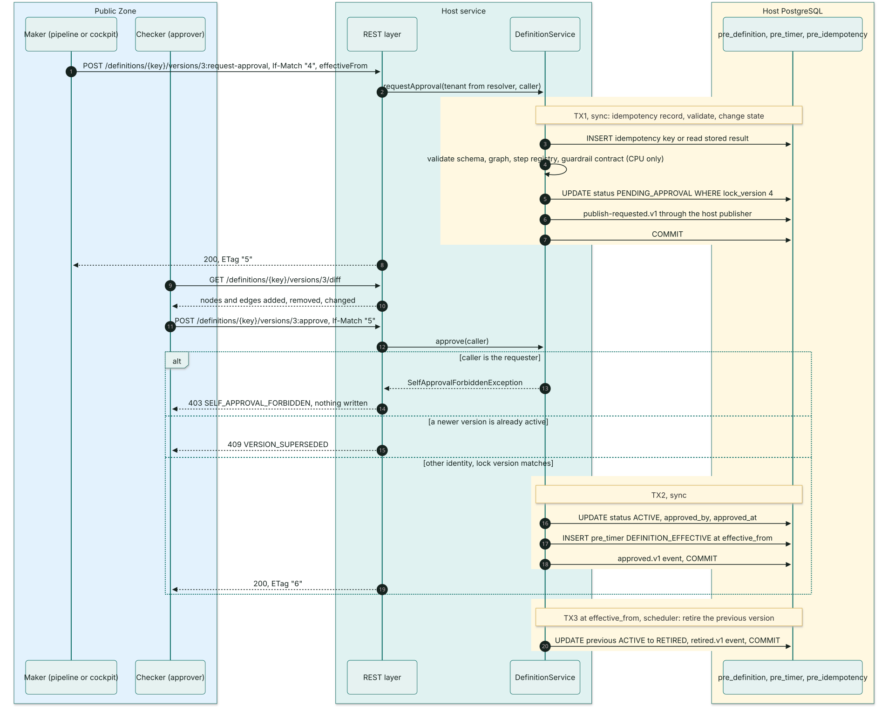

Source: [`diagrams/definition-approval.mmd`](diagrams/definition-approval.mmd).

### 3.3 Instance states


Source: [`diagrams/instance-states.mmd`](diagrams/instance-states.mmd).

| From | Trigger | Guard | To | Event |
|---|---|---|---|---|
| none | `start` | Effective version exists; business key unused for `(tenant, key)`, else the existing instance is returned (`TR-IDEM-02`) | `RUNNING` | `processes.instance.started.v1` |
| `RUNNING` | Step transition, incident retry, migration | `pre_instance` row lock | `RUNNING` | `processes.step.completed.v1` |
| `RUNNING` | Last token reaches an `end` step | None | `COMPLETED` | `processes.instance.completed.v1` |
| `RUNNING` | `cancel(reason)` | `processes:cancel` (PD-103; `processes:start` no longer grants it); `reason` not blank, at most 2,000 characters | `CANCELLED` | Under the `pre_instance` row lock, open tasks, jobs and timers are cancelled (ADR-0020). History row `INSTANCE_ENDED` whose `details` holds the actor, the reason and `CANCELLED`. `processes.instance.cancelled.v1` carries `cancelledBy` and `reason`. Running a compensation on cancel is not part of 0.2.0 (PE-F-65, 1.2) (`PRE-054`) |
| `RUNNING` | A step with `onFailure: compensate` fails for good (business error, not retryable, or its last attempt), or `throwCompensation` runs (#67) | None: an empty stack ends at once | `COMPENSATING` | `processes.compensation.started.v1` with the scope token and the stack depth. Every live flow token of the instance is cancelled with its task or job (`PRE-073`) |
| `COMPENSATING` | `cancel(reason)` | Refused: `409 INVALID_STATE`, the detail says a compensation is running; nothing is written (`PRE-076`) | `COMPENSATING` | None |
| `COMPENSATING` | Stack of the scope walked to the bottom | Every entry `DONE`, by its job or by an approved resolution | `FAILED` | `processes.instance.failed.v1`; the scope token is `COMPENSATED`, other scope tokens `CANCELLED` |

An open incident does not change the instance status; the affected token stays in its waiting status and the incident row records the cause.

### 3.4 Token states

Processes fork at a `parallelGateway`, so positions live in `pre_token` rows, not in a column of `pre_instance`. Every token has a kind (ADR-0020, PD-059, `TR-STD-29`):

| Kind | Created | `scope_token_id` | `current_node_id` |
|---|---|---|---|
| `SCOPE` | One root scope token at instance start; one per entry into a `saga` block | Null for the root; the enclosing scope token for a `saga` | The definition key for the root; the `saga` block id |
| `FLOW` | At start, at a fork, after a join, at the first step inside a `saga` | The scope token the position belongs to | The step the token is on |
| `MI_BODY` | From S1, for a multi-instance body | The enclosing scope token | The multi-instance activity |

Joins count only tokens of one scope token, and compensation walks only the stack of one scope token, so subprocesses, event subprocesses and multi-instance (S1) add `SCOPE` and `MI_BODY` rows without changing this table or the join and compensation code ([`standards-compliance.md`](../../docs/architecture/standards-compliance.md) section 5.1).


Source: [`diagrams/token-states.mmd`](diagrams/token-states.mmd).

| From | Trigger | To | Note |
|---|---|---|---|
| none | Instance start, or a `saga` block entered | `WAITING_SCOPE` | `SCOPE` token; the first `FLOW` token of the scope is created `ACTIVE` in the same transaction |
| `WAITING_SCOPE` | The last live `FLOW` token under the scope token completes (an `end` step for the root; the end of the block's `steps` for a `saga`) | `COMPLETED` | Root: the instance completes. `saga`: a new `FLOW` token continues at the block's `next` in the enclosing scope |
| `WAITING_SCOPE` | A step under the scope failed with `onFailure: compensate`, or `throwCompensation` ran, and the scope's stack was walked to the bottom | `COMPENSATED` | Live `FLOW` tokens under it are `CANCELLED` when the walk starts |
| `WAITING_SCOPE` | Instance cancelled, or migrated off the `saga` block | `CANCELLED` | Every live `FLOW` token under it is cancelled in the same transaction |
| none | Start, or fork at a `parallelGateway` | `ACTIVE` | `FLOW` token; one per outgoing branch, under the scope token of the gateway |
| `ACTIVE` | `userTask` reached | `WAITING_USER` | Task row created in the same transaction |
| `WAITING_USER` | Task completed | `ACTIVE` | Moves to the next step in the same transaction |
| `ACTIVE` | Async step reached | `WAITING_ASYNC` | Job row created; TX1 claims it later (section 4) |
| `WAITING_ASYNC` | TX2 accepts the result | `ACTIVE` | Guardrail and schema checks in TX2 |
| `WAITING_ASYNC` | A local handler returns a business error, or an agent step's memory fails before any call | `WAITING_ASYNC` | Stays on the step, and an incident opens in the same transaction (#55 `PRE-040`, #101 `PRE-101`) |
| `ACTIVE` | `timer` step | `WAITING_TIMER` | Job `TIMER` at the due time |
| `WAITING_TIMER` | Timer fires | `ACTIVE` | |
| `ACTIVE` | Arrives at a converging `parallelGateway` | `JOINED` | Under the `pre_instance` row lock; the last arrival among the tokens of the same scope token creates the post-join `ACTIVE` token (`TR-ASY-03`) |
| `JOINED` | The arrival that brings the `JOINED` tokens of the same scope token on the gateway to its number of incoming flows | `COMPLETED` | Same transaction as that arrival; the first tokens in creation order are spent, so a further arrival over a loop waits for the next set. Tokens of other scope tokens are never counted (`PRE-044`) |
| `ACTIVE` | `end` step, or the end of a `saga` block's `steps` | `COMPLETED` | The scope token is checked for completion in the same transaction |
| `COMPLETED` | Compensation of the token's steps ran (for a `SCOPE` token: a later `throwCompensation` walked its stack) | `COMPENSATED` | |
| `ACTIVE`, `WAITING_USER`, `WAITING_ASYNC`, `WAITING_TIMER`, `WAITING_EVENT` | Instance cancelled, or migrated off the node | `CANCELLED` | Under the `pre_instance` row lock: open task `CANCELLED`, open job `CANCELLED`, event subscriptions of the token deleted (S2). An adapter call already running is not stopped; its TX2 finds the job `CANCELLED` and writes only `LATE_RESULT_DISCARDED` (M2, DN-10, `PRE-041`). From S1 interrupting boundary events and terminate end events use the same transition |

Every token row carries `definition_id`, copied from the instance and changed with it by migration, so live counts per node read one index (section 8.2).

Cost of scope tokens: one extra row per instance and one per `saga` entry, about 150 bytes each; at 1 million instances a month with one `saga` each, about 300 MB a month (section 8.4). The `WAITING_SCOPE` status is outside the `idx_pre_token_live` predicate, so live counts per node are unchanged.

### 3.5 Task states


Source: [`diagrams/task-states.mmd`](diagrams/task-states.mmd).

| From | Command | Permission | Guard | To |
|---|---|---|---|---|
| none | Token reaches a `userTask`, or a guardrail routes to a human | engine | None | `OPEN` |
| `OPEN` | `claim` | `processes:task:work` | Caller matches the user, one of the roles or one of the groups; not in `forbidden_users` | `CLAIMED` |
| `CLAIMED` | `unclaim` | `processes:task:work` | Caller is the claimant | `OPEN` |
| `CLAIMED` | `delegate(user)` | `processes:task:manage` | Target not in `forbidden_users` | `CLAIMED` |
| `OPEN` | `reassign(user)` | `processes:task:manage` | Target not in `forbidden_users` | `CLAIMED` |
| `CLAIMED` | `complete(result)` | `processes:task:work` | Caller is the claimant; four-eyes (`403 SELF_APPROVAL_FORBIDDEN`); result valid against the form (`422 FORM_VALIDATION_FAILED`); `If-Match` matches | `COMPLETED` |

Guards run in this order under the `pre_instance` row lock, and a refused command writes nothing: the task's `lockVersion` against `If-Match` (`409 VERSION_CONFLICT`), the status (`409 INVALID_STATE`), the claimant or the candidate (`403 TASK_NOT_ASSIGNED`), then four eyes (`403 SELF_APPROVAL_FORBIDDEN`). The change itself is a conditional `UPDATE pre_task ... WHERE lock_version = :v AND status = ...` (and `claimed_by = :caller` for unclaim and complete), so a concurrent change that slipped past the read still changes zero rows and is `409`. Claim and unclaim write a `TASK_CLAIMED` or `TASK_UNCLAIMED` history entry and hand their event to the host publisher in the same transaction (section 6.4). `GET /tasks/{id}` answers `allowedActions` for the caller, computed at read time from these guards and never stored with an idempotent answer. Claims do not expire in 0.2.0; delegate, reassign and the form check follow with their slices.
| `OPEN`, `CLAIMED` | Instance cancelled, or migrated off the step | engine | None | `CANCELLED` |

### 3.6 Incident states (#68, PD-126)


Source: [`diagrams/incident-states.mmd`](diagrams/incident-states.mmd).

| From | Command | Permission | Guard | To | Side effect and event |
|---|---|---|---|---|---|
| none | A step fails for good: its job is `FAILED` (retries used, not retryable, a business error, an answer refused with `onViolation: fail`, claimed too often), a local handler returns a business error, or an agent step's memory fails | engine | None | `OPEN` | `INCIDENT_RAISED`; `processes.incident.raised.v1`. The token stays on the step |
| `OPEN` | `retry(reason)` | `processes:incident:manage` | `If-Match`; no retry in flight; the step's job is `FAILED` (`DUE` or `CLAIMED` is `409 INVALID_STATE`); not an `AGENT_MEMORY_*` failure | `OPEN`, `retrying` | The job is `DUE` now with `max_attempts = attempt + 1` and keeps its id, so the remote side deduplicates; a local step's handler runs again in this transaction. `retryCount + 1`; `INCIDENT_RETRIED`; `processes.incident.retried.v1` (`PRE-077`) |
| `OPEN`, `retrying` | The retried step is accepted, or its refused answer is routed to a reviewer | engine | The result transaction | `RESOLVED`, `RETRY_SUCCEEDED` | `INCIDENT_RESOLVED`; `processes.incident.resolved.v1` |
| `OPEN`, `retrying` | The retried step fails for good again | engine | The result transaction | `OPEN` | The same row takes the new code and cause; `INCIDENT_RAISED` with `failedAgain: true`; `processes.incident.raised.v1` |
| `OPEN` | `resolve(output, reason)` under `incidents.resolve-approval: four-eyes` (default) | `processes:incident:manage` | `If-Match`; no retry in flight; reason 1 to `lifecycle.reason-max-length`; the output passes the step's output schema (`422 OUTPUT_INVALID` with paths, never values); the guardrail is not run on a person's answer | `RESOLUTION_PENDING` | Proposal, proposer and mode stored; `INCIDENT_RESOLUTION_PROPOSED`; `processes.incident.resolution-proposed.v1`. The token does not move (`PRE-078`) |
| `RESOLUTION_PENDING` | `approve-resolution(comment)` | `processes:incident:manage` | Caller is not the proposer (`403 SELF_APPROVAL_FORBIDDEN`); `If-Match` | `RESOLVED`, `COMPLETED_MANUALLY` | The step completes with the proposed output as any result does, and the token moves on; `INCIDENT_RESOLVED` with proposer, approver, reason and output; `processes.incident.resolved.v1` with `resolvedBy` and `proposedBy` |
| `RESOLUTION_PENDING` | `reject-resolution(reason)` | `processes:incident:manage` | Caller is not the proposer; `If-Match` | `OPEN` | Proposal cleared; `INCIDENT_RESOLUTION_REJECTED`; `processes.incident.resolution-rejected.v1` |
| `OPEN` | `resolve(output, reason)` under `single` (`dev` profile only; start-up refuses it elsewhere) | `processes:incident:manage` | As the proposal | `RESOLVED`, `COMPLETED_MANUALLY` | Proposed and approved in one transaction, recorded with `approvalMode: single` |
| `OPEN`, `RESOLUTION_PENDING` | `cancel` of the instance | `processes:cancel` | The cancel transaction | `RESOLVED`, `INSTANCE_CANCELLED` | `INCIDENT_RESOLVED` with the canceller; `processes.incident.resolved.v1` (`PRE-079`) |

How the slice of #68 implements the table (0.3.0):

- Every command reads the incident in the caller's tenant (another tenant's is `404 INCIDENT_NOT_FOUND` and nothing is written), then locks the `pre_instance` row and the incident row in that order, the order every instance transition takes, and checks status, four eyes, lock version, the retry flag and the instance status, so a refused command writes nothing. Each takes a required `Idempotency-Key` and `If-Match`; a replay answers the stored incident and the caller's `allowedActions` are computed again.
- A retry keeps the job id, so the adapter's idempotency key (`AdapterCall.idempotencyKey()`, `TR-IDEM-04`) is the same and a remote side effect is never repeated; each claim has a new attempt id and completion token. One more attempt, not a new policy: a retry is one person's action because it runs the same step again and decides nothing (PD-126). A local step has no job: the kernel's `RetryStep` command sends the waiting token into its step again.
- The output a person proposes is checked against the step's output schema (an agent step's `<horus:outputSchema>`; a service step without one only needs a JSON object of at most 256 KB). The proposal row keeps it unmasked, because the step needs it on approval; the incident view and history keep an agent step's output masked by its schema's policy, as its answers are (section 4.1). A service step has no masking policy, so its operator output is recorded as given.
- The table keeps the control as a second line: `ck_pre_incident_four_eyes` refuses a `four-eyes` resolution whose resolver is its proposer, and `ck_pre_incident_proposal` refuses a pending state without proposer, time and reason (V29).
- Undo incidents (`COMPENSATION_FAILED`, `COMPENSATION_MANUAL_REQUIRED`, #67) hold the compensation walk, not a step: their token is the scope token being walked, and they are commanded while the instance is `COMPENSATING`. A retry of `COMPENSATION_FAILED` runs the undo's job again under the same job id. A `COMPENSATION_MANUAL_REQUIRED` incident has nothing to run, so it offers `resolve` only. An approved resolution of either marks the undo done by hand with the same proposal and approval, and the walk goes on (`PRE-074`, `PRE-075`). A host `LifecycleGuard` veto of an incident transition (`TR-EXT-06`) is called before any write once the guard SPI exists.

## 4. Transaction model

| Step kind | Transaction | Why |
|---|---|---|
| `decision`, gateways, `userTask` state changes, `timer` scheduling, `serviceTask` with `mode: local` | Sync: inside the caller's or the scheduler's transaction | Writes only to the host database; atomic with business state |
| `agentTask`, `serviceTask` with `mode: remote`, remote compensation handlers | Async Wait-State: TX1 claim, call with no connection, TX2 complete | A network call must never hold a connection or a row lock (ADR-0008, `TR-ASY-01`) |
| Local compensation handlers (#67) | Sync, in the result transaction of their own `COMPENSATION` job | Each undo commits on its own, after the one before it is `DONE` |
| Definition lifecycle commands, layout writes | Sync, one short transaction each | Database only; validation runs before the transaction opens |
| BPMN import and export | Parse and convert outside any transaction; one insert transaction | CPU work on up to 1 MB of XML must not hold a connection |
| Rollup of node statistics | One short scheduler transaction per slice | Database only, no network; bounded by `statement_timeout` |

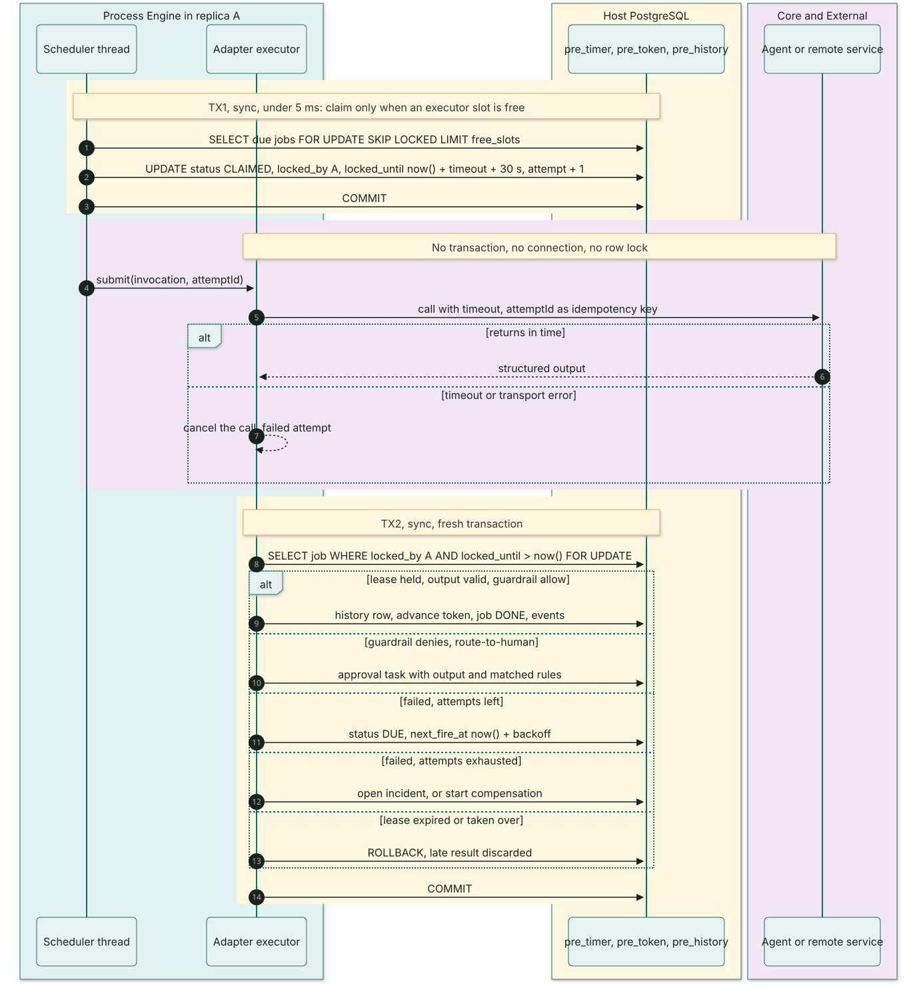

Source: [`diagrams/async-wait-state.mmd`](diagrams/async-wait-state.mmd). TX2 requires `status = 'CLAIMED'` as well as the lease, so a job cancelled meanwhile is never completed (DN-10). The worker claims a job only when an adapter executor slot is free, so time spent queued inside the JVM never consumes the lease. The lease is the step timeout plus `jobs.lease-margin` (default 30 s), stored per row in `pre_timer.lease_duration` so a batch claim computes `locked_until` per job in SQL.

#### Async steps as built in 0.2.0 (#51, #363, `PRE-009`, `PRE-017`, `PRE-041`, `PRE-057` to `PRE-060`, `TR-ASY-01`, `TR-ASY-02`)

The first async step is the remote `serviceTask` (`horus:mode="remote"`, optional `horus:timeout`, default `adapters.default-timeout`); the agent step (`horus:type="agentTask"`, #52, section 4.1) runs on the same executor with its own job kind, `ASYNC_AGENT`.

- **Park.** The step transaction moves the token to `WAITING_ASYNC` and inserts one `ASYNC_SERVICE` job, `DUE` now, whose id is the token's activity instance id, with `lease_duration = timeout + jobs.lease-margin` and a payload of the adapter name, the timeout, the business key and the bounded inputs. History records `ASYNC_STEP_SCHEDULED`. Cancelling the token cancels the job in the same transaction. Nothing is called.
- **TX1.** `AsyncStepExecutor` claims due async jobs, `FOR UPDATE SKIP LOCKED`, one job kind at a time and at most as many as that kind's runner has free slots (see "Runner per job kind" below); the timer claim of section 4.4 never returns async jobs. Each claim increments `attempt`, and the attempt id is derived from the job id and the attempt number, so every claim has a new one. The attempt id is a correlation id and the history key, not a credential: anyone who can read an instance can derive it. TX1 therefore also issues each claim a completion token, 256 random bits from `SecureRandom`, and stores only its SHA-256 in `pre_timer.completion_token_hash` (migration V8).
- **Call.** `ServiceAdapter.execute(AdapterCall)` runs on the adapter executor with no transaction (the executor refuses to call when one is active, and an ArchUnit rule allows no other caller). The call carries tenant, instance, node, business key, job id, attempt id, completion token, attempt number and deadline. The remote side deduplicates by the job id (`AdapterCall.idempotencyKey()`, `TR-IDEM-04`), which every retry of the step keeps; the attempt id changes on each attempt and is never an idempotency key. `AdapterCall.toString()` masks the token. The guard counts the engine's own transactions on the thread through `TransactionRunner.tracked`, whatever the runner, and also asks the runner (Spring: `TransactionSynchronizationManager`) about a host transaction; a host transaction a non-Spring runner cannot see is not detected. At the deadline the executor interrupts the call and records `ADAPTER_TIMEOUT`.
- **TX2.** `ProcessServices.recordAttempt` locks the instance row, then the job row, and accepts the result only when the job is `CLAIMED` under that attempt with an unexpired lease. A completed result appends `ASYNC_RESULT_ACCEPTED`, delivers the result to the token and marks the job `DONE`. A failed result appends `ASYNC_ATTEMPT_FAILED` with the code, `retryable` and the reporter (never the detail) and sets the job `DUE` after `jobs.retry-backoff` times the attempt, or `FAILED` when it is not retryable, is a business error, or used `jobs.max-attempts`; the token stays on the step and the same transaction opens an incident (#58, `pre_incident`, V13): one `OPEN` row with the code (`UNHANDLED_BUSINESS_ERROR` for a business error), a cause built from codes only, never from the detail, and `retry_count`, the attempts after the first, plus `INCIDENT_RAISED` in history and `processes.incident.raised.v1`. `IncidentService.openIncidents(instanceId)` reads them in the caller's tenant; an operator retries or resolves them as section 3.6 describes (#68). The incident row, `INCIDENT_RAISED` and the event carry the business code as `businessCode` (#55, `PRE-111`). A job claimed more often than `jobs.max-attempts` (its attempts kept dying with their replica) is failed without a call and records `ASYNC_ATTEMPT_FAILED` with `MAX_ATTEMPTS_REACHED`.
- **Hand-off.** An adapter may answer `Accepted`: the slot is freed, no thread waits, and the job keeps its lease while the remote side works. The remote side reports the result through `AsyncStepService.complete(jobId, attemptId, completionToken, result)` or `POST /async-steps/{jobId}:complete`, on any replica. The tenant comes from the resolver and another tenant's job is `404 ASYNC_STEP_NOT_FOUND` with nothing written. The caller needs `processes:step:complete` and one of the roles `adapters.completer-roles` lists for the job's adapter (the adapter scope, checked before any lock); an adapter without an entry cannot be completed from outside. When the attempt id is the job's latest claim, the presented token is hashed and compared with the stored hash in constant time (`MessageDigest.isEqual`); a mismatch is `403 PERMISSION_DENIED` and writes nothing. The scope is a role list per adapter rather than a permission per adapter because permissions are a closed list that host metadata validates at start-up, while roles are what the identity provider already assigns to a callback client. If no result arrives before the lease ends, the job is claimed again and the adapter called with a new attempt id.
- **Outcomes.** `REFUSED` for a result its kind's check refused (section 4.1; nothing of it is accepted); `ACCEPTED`; `DUPLICATE` for a repeat of an attempt that is already `DONE` (writes nothing); `DISCARDED` for a lease that ended or an attempt that was taken over (writes nothing) and for a cancelled job (writes `LATE_RESULT_DISCARDED` with the attempt id once per job, fenced by `pre_timer.late_result_at`; repeats are logged at DEBUG only).
- **Late results after a timeout (#55, `PRE-112`).** The attempt check runs before anything else in TX2, so a result for an attempt that is not the job's current claim never reaches the guard, the kernel or the incident code. That covers an attempt whose lease ended, one taken over by a later attempt, a step that completed, and a job that failed with an incident. The result is `DISCARDED` with no row written (`TR-ASY-02`: no state change), only an INFO log line without the result. A repeat gets the same outcome, so a late result is idempotent and can neither reopen a finished step nor close an incident. Only a cancelled job records the late result in history, because the cancel is a state change the caller must be able to correlate (`TR-STD-12`).
- **Business error of a local step (#55, `PRE-040`).** A `serviceTask` handler that returns `HandlerResult.BusinessError` runs inside the step transaction, so it has no job. The kernel keeps the token on the step in `WAITING_ASYNC` and emits `Effect.RaiseIncident`. The shell opens the incident in the same transaction, after the instance row is saved: `UNHANDLED_BUSINESS_ERROR`, the business code in `cause_summary` and as `businessCode`, `retry_count` 0, and no `jobId`. The call that reached the step (a start, a task completion, a timer or a result) succeeds, and the work done before the step in that transaction is kept. Nothing is retried, and the handler's message stays in the engine log. Before #55 the error rolled the whole transaction back as `STEP_FAILED`, so the start or completion failed and nothing was recorded. Error boundary events (S1) will catch the error before it becomes an incident.

- **Runner per job kind (#363, `PRE-057`).** Each async job kind has its own runner (`AsyncStepRunner`): `ServiceStepRunner` calls the host's `ServiceAdapter` for `ASYNC_SERVICE`, `AgentStepRunner` calls the host's `AgentAdapter` for `ASYNC_AGENT` (#52), and a second `ServiceStepRunner` runs the undos of a compensation walk (`COMPENSATION`, #67, section 4.2). Each runner has its own slots, default timeout, attempts, back-off and guard budget (`runners.<kind>.*`, section 6.5), and every unset value falls back to `adapters.executor-threads`, `adapters.default-timeout`, `jobs.max-attempts` and `jobs.retry-backoff`, so a host that sets nothing runs as before. The executor claims each kind in its own statement (`job_kind = ?`, index `idx_pre_timer_poll_kind`, V9) up to that kind's free slots, so a backlog of agent calls never takes the claims or the slots of remote service calls, and the other way round. The adapter pool has as many threads as all runners have slots. Timers are not a runner of this executor: the timer poller of section 4.4 runs them with `jobs.*`. A runner holds no engine logic: the executor applies the timeout, the transaction guard and the error mapping around it, and a runner never checks its own result.
- **Result check (#363, `PRE-058` to `PRE-060`).** `recordAttempt` (TX2) checks a completed result before it accepts it, with the guard of the job's kind (section 4.1). The executor and the completion API both reach the engine through `recordAttempt`, so a result reported from outside passes the same check, and no other path accepts a result. Remote service results have no guard. A malformed result gets a fresh attempt while `schema-retries` last (answer `ACCEPTED`) and is refused after that; a refused one is never accepted, and the step goes to a review task or its job fails (answer `REFUSED`, always final).

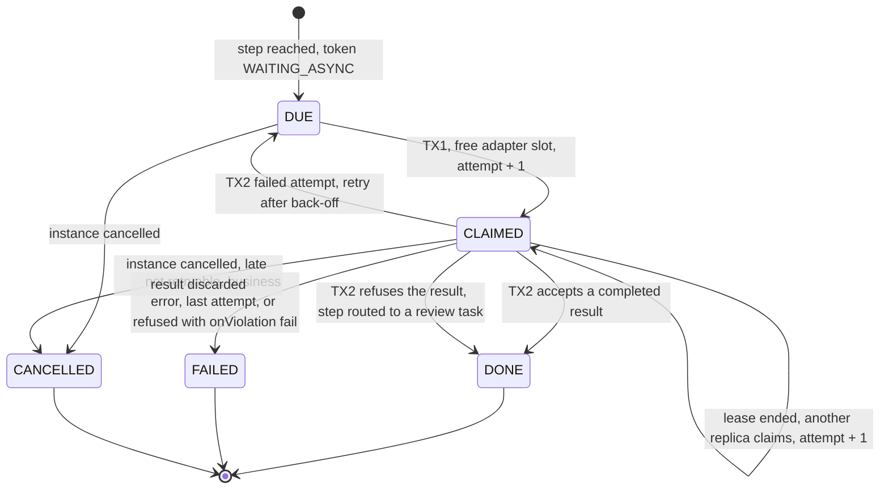

### 4.1 `agentTask` guardrail pipeline (`TR-AGT-01` to `TR-AGT-03`)

**As built in 0.2.0 (#52, `PRE-010`, `PRE-061` to `PRE-063`).** The agent step is a `serviceTask` with `horus:type="agentTask"`, `horus:agent` (the host's `AgentAdapter`), optional `horus:timeout` and `horus:resultVariable`, `horus:input` elements, one `<horus:outputSchema>` element holding a JSON object, and one `<horus:guardrail decision="…" onViolation="route-to-human|fail" reviewer="role:…"/>`:

```xml
<bpmn:serviceTask id="assess-documents" horus:type="agentTask" horus:agent="documents.assess"
                  horus:timeout="PT30S" horus:resultVariable="assessment">
  <bpmn:extensionElements>
    <horus:input name="applicationId" value="${instance.applicationId}"/>
    <horus:outputSchema>{"type": "object", "required": ["riskScore", "recommendation"], "additionalProperties": false,
      "properties": {"riskScore": {"type": "integer", "minimum": 0, "maximum": 100},
                     "recommendation": {"type": "string", "enum": ["APPROVE", "REFER", "DECLINE"]},
                     "summary": {"type": "string", "maxLength": 500, "mask": true}}}</horus:outputSchema>
    <horus:guardrail decision="agent-output-guardrails" onViolation="route-to-human" reviewer="role:COMPLIANCE_REVIEWER"/>
  </bpmn:extensionElements>
</bpmn:serviceTask>
```

- **Import.** The reader checks the guard spec's shape and refuses each fault as `422 VALIDATION_FAILED` with a problem naming the step (`GUARD_SPEC_INVALID`, `AGENT_MISSING`, `AGENT_TASK_INVALID`, `TIMEOUT_INVALID`); `onViolation` defaults to `route-to-human`, which needs a reviewer; `fourEyes` may be given only as `true`. The engine then checks the host side: the agent adapter is registered (`AGENT_NOT_REGISTERED`), the host's `OutputSchemaValidator.checkSchema` accepts the schema (the engine default refuses any keyword outside the subset of step 3, so an unsupported schema is refused here rather than failing closed on every answer), and the Rule Engine is present (`BPMN_NOT_EXECUTABLE`). The schema is stored as canonical JSON inside the definition, and the canonical form prints `agent`, `outputSchema`, `guardrails` and `timeout`, so the definition hash and its approval cover the whole guard spec. The guardrail rule set's contract is checked at import, at request-approval and at approval by `PRE-016` (#53): the engine reads the signature of the rule set's version in effect in the caller's tenant through `DecisionPort.signature` (the starter asks the Rule Engine's tenant-scoped entry point, which returns hit policy, inputs and outputs and writes nothing), and `GuardrailContract` checks hit policy `first` or `unique`, output `allow: boolean`, optional `reasons` (`string`; `list<string>` is also accepted), and that every input of the rule set is a field of `outputSchema` with a compatible type (`integer` takes `integer` or `decimal`, `number` takes `decimal`, `string` takes `string`, `date` or `datetime`, `array` takes a list of a compatible type, `object` takes `money`); when the Rule Engine refuses undeclared inputs, every schema field must be declared and `additionalProperties` must be false. A failure is `422 GUARDRAIL_CONTRACT_INVALID` with one problem per failed check naming the step; nothing is written. A port that cannot describe a rule set refuses the definition (fail closed).
- **Park.** The step transaction stores one `ASYNC_AGENT` job like a remote step (section 4), with the agent runner's settings (`runners.async-agent.*`), or the step's own `<horus:retry max="2" backoff="PT1S"/>` (#58, canonical `retry`, covered by the hash: `max` retries after the first attempt, 0 to 20, and the same `backoff` before each retry; without it the runner's `max-attempts` and `retry-backoff` times the attempt), an `auditInputs` copy of the inputs in which every input the step marks `mask="true"` (#59, canonical `maskedInputs`) is replaced by what the host's `InputMasker` returns, and a `guard` payload built by `AgentGuardSpecs` from the node of the version being run, which was approved and hash-checked before it runs (`fourEyes: true` always). Nothing of the spec comes from a request.
- **Call.** `AgentStepRunner` calls `AgentAdapter.execute(AgentInvocation)`. The invocation carries `outputSchema()`, the step's schema from the job's guard spec with the `mask` annotations removed, so the adapter can ask its model for structured output; the guardrail never reaches the adapter. A completed result may carry `labels()` (reserved keys `model`, `promptVersion`, `usage.inputTokens`, `usage.outputTokens`), which the agent history records (#59). The engine builds `AgentInvocation` and `AdapterCall` and may add components in a minor release; hosts read them through accessors, and tests build them with `AgentInvocations.builder()` and `AdapterCalls.builder()` from the test-support module. `AgentInvocation.modelCallKey()` is the attempt id: key the model call, and any cache of model answers, by it, so the one schema retry is a fresh generation. `AgentInvocation.idempotencyKey()` is the job id, for side effects outside the model. Only the agent runner calls the adapter (ArchUnit). The test-support module ships `StubAgentAdapter` (canned answers or a function, every invocation recorded).
- **Timeout.** An attempt the executor abandons at the step timeout fails with `AGENT_TIMEOUT` (`ADAPTER_TIMEOUT` for remote service steps) and is retried by the policy above; when no retry is left the job fails and an incident is opened (section 4, `PRE-011`).
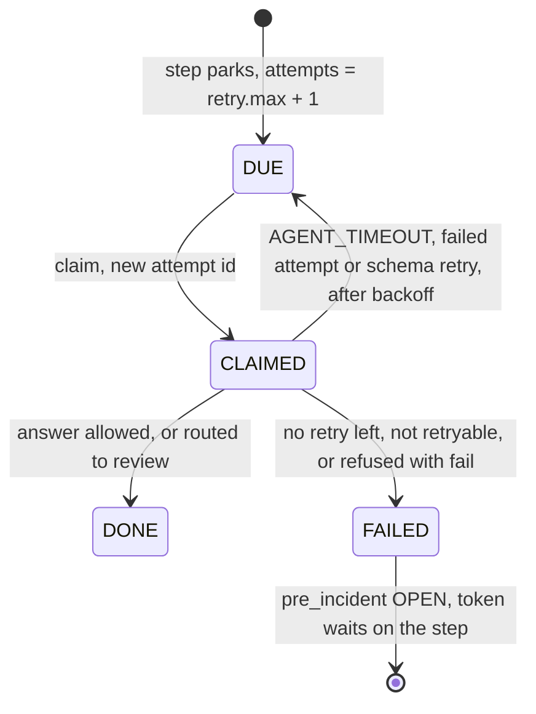

- **History and review.** `ASYNC_RESULT_ACCEPTED` and `ASYNC_RESULT_REFUSED` of an agent job are the history row of the answer (#59, `PRE-012`): `inputs` (the `auditInputs` copy), the answer masked by the policy of step 5 with `outputFields`, `guardrailDecisionId` and the matched rule ids, `latencyMs` from the claim to the result on the engine clock, and `labels` as reported. A review task carries a `review` object (`pre_task.review`, V10; `TaskView.review`; `Task.review` in the REST contract): the code, reasons, matched rule ids, guardrail decision id, the refused `attemptId`, who reported it (`reportedBy`), the masked inputs and the masked answer. Every other task has none.
- **Masking.** The engine never keeps a masked input in plain text in history or on a review task; the agent still receives it. The starter's default `InputMasker` uses the Rule Engine's masking key of the tenant (`MaskingPolicy.hmacKey`), so the token equals the decision log's for the same value (`hmac:<keyId>:<hex>`, `TR-SEC-05`); a tenant without a key, or a host without the Rule Engine, gets `***`. A masker that fails or returns the plain value gives `***` (fails closed). The plain inputs stay in the job payload, which the adapter call needs.

The numbered pipeline below is the full design; items marked with a later issue are not built yet.

1. Bounded inputs: `${instance.<path>}` references (schema `$defs/variableRef`) resolve into an explicit input map; inputs marked `mask="true"` are replaced by their keyed fingerprint before any history write (input masking: #59, `PRE-012`).
2. TX1 claims; the adapter `AgentAdapter.execute(AgentInvocation)` runs with no connection, under the step `timeout`. The engine never embeds a model SDK. The agent runner may pre-check the answer for early feedback; that check is never the authoritative one.
3. TX2 (`recordAttempt`, for the executor and the completion API alike) checks the answer with `AgentResultGuard`, as built in 0.2.0 (#363). The step's guard spec travels in the job payload, written when the step parks: `guard.outputSchema`, `guard.decision` (the guardrail rule set), `guard.onViolation` (`route-to-human`, the default, or `fail`), and `guard.reviewer` (`role:`, `user:` or `group:` and a name). A review task is always four-eyes: a spec that sets `guard.fourEyes` to anything but `true` is `GUARD_SPEC_INVALID` (when #52 writes the spec, it is built from the published definition only and validated at import). The answer is validated against `outputSchema` by the `OutputSchemaValidator` (the engine default is a JSON Schema subset: `type`, `properties`, `required`, `additionalProperties` true or false, `enum`, `const`, the numeric bounds, `minLength`, `maxLength`, `items`, `minItems`, `maxItems`; any other keyword is a violation, never skipped). A violation is retried at most `runners.async-agent.schema-retries` times (default 1, 0 allowed), counted apart from `max-attempts`: each retry gives the job back `DUE` with one more allowed attempt and increments `schemaRetries` in its payload, and the completion API answers `ACCEPTED` because the step is not decided yet. When the schema retries are used up, the answer is refused with `AGENT_SCHEMA_INVALID` and follows the step's `onViolation` route, recorded in `ASYNC_RESULT_REFUSED`. A model's output varies, so one fresh generation often repairs a malformed answer; for that, the agent runner of #52 keys the model call by the attempt id, while the job id stays the key for side effects outside the model. Remote service steps have no guard; a guard added there later defaults to no schema retries. The result may carry optional labels (PD-014, M2): a `Map<String, String>` recorded in history and never acted on; `model` and `promptVersion` are reserved and documented, a host may add its own keys; at most `agents.labels.max-count` (16) entries, keys up to `agents.labels.max-key-length` (64) and values up to `agents.labels.max-value-length` (256) characters, which may be lowered only; a result above the bounds is a failed attempt with `AGENT_LABELS_INVALID`, retried like any failed attempt and never recorded (`TR-AGT-02`, #59). The adapter returns them on `AdapterResult.Completed.labels()` (#53; reserved keys `model`, `promptVersion`, `usage.inputTokens`, `usage.outputTokens`), and the executor and the completion API turn a completed adapter result into the engine's step result in one place (`AnswerLabels`), so both record the same labels.
4. TX2 then evaluates `guard.decision` through the in-process `DecisionPort`, in the tenant of the locked instance row, as engine work (`system:async-step`), with the answer as inputs; the `rle_decision` row commits with TX2. Contract: hit policy `first` or `unique`, output `allow: boolean`, optional `reasons` (a `string`; the Rule Engine allows a list output only under `collect`, which the contract refuses), and inputs the output schema declares. Checked at import, at request-approval and at approval (`422 GUARDRAIL_CONTRACT_INVALID`, #53). At run time the check fails closed: no match, a decision error, a missing Rule Engine, an `allow` that is not a boolean, an exception, or a check slower than the runner's `guard-budget` (default 500 ms, measured on the engine clock; checked after the schema check, so a slow schema check never reaches the decision, and again after the decision) refuses the answer with `GUARDRAIL_EVALUATION_ERROR` and the cause as reason. A missing or malformed guard spec refuses it with `GUARD_SPEC_INVALID` and fails the job. The check calls nothing outside the JVM (an ArchUnit rule, ADR-0008). An in-process decision cannot be interrupted while it runs, so a slow decision holds the instance row lock until it returns; the budget only decides that its answer is refused.
5. `allow == true` advances and records `guardrailDecisionId` and the matched rule ids on `ASYNC_RESULT_ACCEPTED`. A refusal (`GUARDRAIL_VIOLATION` for `allow == false`, or a fail-closed code) records `ASYNC_RESULT_REFUSED` with the code, `reasons`, matched rule ids, `guardrailDecisionId`, the route and the refused output, and nothing of the answer is accepted. The history is immutable, so the refused output is masked first (`ResultGuard.auditOutput`): a value is kept only where `outputSchema` declares the field and does not mark it `mask: true`; undeclared fields, which may carry injected text, are `***`; strings are cut at 200 characters, lists and nested objects at 20 entries, nesting at 4 levels, top-level fields at 50, and `outputFields` records the count. With `route-to-human` and a reviewer, the kernel command `RouteToReview` moves the token from `WAITING_ASYNC` to `WAITING_USER` on the same step with a four-eyes review task and the job is `DONE`. The reporters of refused results (the actors of `ASYNC_RESULT_REFUSED`) are four-eyes participants like the starter and earlier completers, so the identity that submitted a refused result through the completion API cannot claim or complete its review even when it holds the reviewer role. The reviewer's answer is validated against `outputSchema` (`422 FORM_VALIDATION_FAILED`, the task stays claimed), then it is the step's result and the instance moves on. When creating the review task fails, its transaction rolls back with the refusal record; a second transaction records `ASYNC_RESULT_REFUSED` again with route `incident` and `routeError`, fails the job and answers `REFUSED`, so a refusal is never lost and never turns into a retry. With `fail`, or without a reviewer, the job is `FAILED`, an incident is opened with the refusal code (#58) and the token stays on the step for an operator (#68), or compensation once it exists; the same holds for the second transaction after a review task could not be created.
6. A reviewer's answer is a person's output that replaces the agent's (#59, `PRE-012`): it passes the output schema (the guardrail is not run on a person's answer), the review is four-eyes (the starter, earlier completers and the reporter of the refused answer cannot complete it; there is no single-person mode), and the completion records `HUMAN_OVERRIDE` with the reviewer as actor and `reviewedBy`, `refusedReportedBy`, `refusedAttemptId`, the refusal `code`, `guardrailDecisionId`, the optional `reason` (`TaskService.complete` with a reason; `reason` in the REST body), the reviewer's answer masked by the step 5 policy and `changes`, per changed field `from` and `to`, for offline evaluation (PD-128). A field masked in both answers shows as unchanged, because neither plain value is kept.

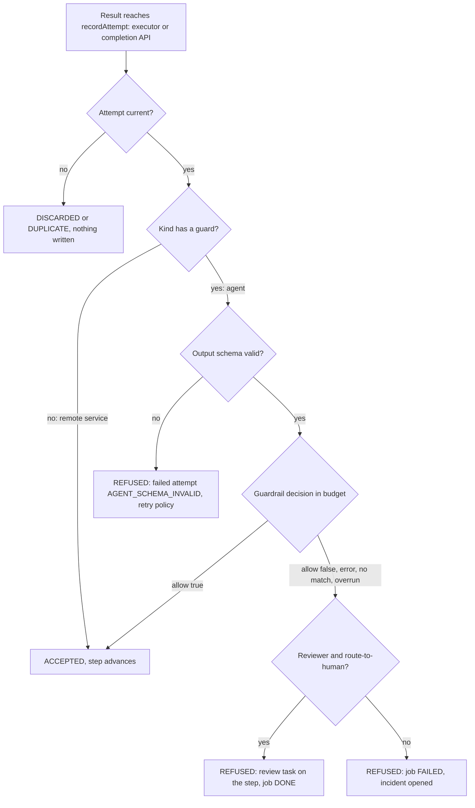

#### Memory from earlier steps (#101, `PRE-100` to `PRE-102`)

An `agentTask` may declare `<horus:memory from="extract-id" fields="fullName,dob" as="applicant" required="true" includeMasked="false"/>`, one element per entry (`MemoryEntry`; canonical `memory`, covered by the hash, the diff and the approval).
- **Import.** The reader checks each entry's shape (`AGENT_MEMORY_INVALID`): `from` is an id and never an expression, `as` is an identifier unique on the step, fields are paths of identifiers, at most four levels and 32 fields, and wildcards are never allowed. `AgentMemory.check` then checks it against the whole definition and the host's bounds. `from` must be an agent step upstream of the step (a path of sequence flows leads from it to the step; the step itself is not). Each field must be declared in that step's output schema. A field the schema marks `mask: true`, itself or through an object above it, needs `includeMasked` (`AGENT_MEMORY_MASKED_FIELD`). A step has at most `agents.memory.max-entries` entries. Every problem names the step and the entry, and the import writes nothing.
- **Recorded results.** The kernel emits `Effect.RecordResult` when a step stores its result: an accepted answer, a local step's output, or a reviewer's answer that replaced a refused one. A refused answer never produces it. The shell keeps the result in `pre_step_result` (V14) only for steps that some step of the definition names in `memory` (`Compiled.memorySources`). It keeps one row per instance and step, replaced on a loop, written after the instance row.
- **Resolve at park.** In the step transaction that parks the agent job, the shell reads the rows of the step's sources by `(tenant, instance, node)`, with results recorded earlier in the same run taking precedence. `AgentMemory.resolve` copies only the declared fields, nested as declared. An optional field the answer left out is skipped. The result goes into the job payload as `memory`, with `auditMemory`, in which every masked field is the `InputMasker`'s keyed fingerprint. `ASYNC_STEP_SCHEDULED` records `memory` (the audit copy), `memoryBytes` and `memoryMissing`. The answer's history row repeats `memory`, so the trace is complete for offline replay (PD-128).
- **Call.** `AgentStepRunner` passes the payload's `memory` as `AgentInvocation.memory()`. It is the same on every attempt, because it is never resolved again. The model call stays keyed by the attempt id and side effects by the job id. The guardrail and the schema check stay in `recordAttempt`, and memory never reaches them.
- **Failures.** When the canonical JSON of the memory is larger than `agents.memory.max-bytes` (`AGENT_MEMORY_TOO_LARGE`), or a `required` entry has no row (`AGENT_MEMORY_MISSING`, for example a branch this instance did not take), the step fails before any call. The job is inserted `FAILED` with attempt 0, so it is never claimed. `ASYNC_ATTEMPT_FAILED` records `final: true`, `retryable: false` and the entry, and an incident opens in the same transaction. The token waits on the step for #68.
- **Tenancy.** Every read is keyed by the locked instance's tenant and id, so memory never crosses instances or tenants. There is no long-term or vector memory, and memory is data for the model, never instructions to the engine.

```mermaid
sequenceDiagram
    autonumber
    participant K as Kernel
    participant S as Shell (step transaction)
    participant R as pre_step_result
    participant J as pre_timer and pre_history
    participant A as AgentAdapter
    K->>S: RecordResult(screen-sanctions, accepted or reviewed answer)
    S->>R: upsert (tenant, instance, screen-sanctions) when a later step reads it
    K->>S: InvokeService(assess-risk, ASYNC)
    S->>R: read sources of assess-risk in this tenant and instance
    alt within bounds and every required entry recorded
        S->>J: job DUE with memory and auditMemory; ASYNC_STEP_SCHEDULED with the audit copy
        J-->>A: every attempt: invocation.memory() is the same, model call key = attempt id
    else too large or a required entry missing
        S->>J: job FAILED at attempt 0, ASYNC_ATTEMPT_FAILED final, incident OPEN
        Note over A: never called
    end
```

#### Offline replay of agent answers (#98, `PRE-092` to `PRE-095`, PD-128)

A changed guardrail, or a changed output schema, is tested against the answers a step already recorded before it goes live. `AgentReplayService` (REST `POST /agent-replays`) takes the step (`definitionKey`, `nodeId`), a period of whole UTC days (`from` and `to` inclusive, at most `query.max-range`) and a candidate rule set version in any status, usually a draft, plus an optional candidate output schema. PD-128 scopes it to guardrail and schema changes: a prompt or model change is replayed by a host harness, because masked inputs are kept only as keyed hashes and the engine never calls a model for a test.

- **Start.** In one transaction, with the tenant from the resolver and `processes:agent:replay`: the period is checked (`400 QUERY_INVALID`), the recorded answers counted (`422 REPLAY_TOO_LARGE` over `replay.max-cases`), the candidate described through `DecisionPort.signature(tenant, ruleSet, version)` (`404 RULE_SET_NOT_FOUND` when the tenant has no such version) and checked by `GuardrailContract` against the candidate schema or the latest recorded one (`422 GUARDRAIL_CONTRACT_INVALID`, nothing written), and a `QUEUED` run stored in `pre_agent_replay` (V17). An optional `Idempotency-Key` returns the original run on a repeat.
- **Replay.** The job poller's `AgentReplays.pollOnce()` locks the oldest open run with `FOR UPDATE SKIP LOCKED`, reads one page of `replay.page-size` answers (`ASYNC_RESULT_ACCEPTED` and `ASYNC_RESULT_REFUSED` rows of the step, keyset over `(occurred_at, id)` of `pre_history`, joined to their job's guard spec), and writes one report line per answer to `pre_agent_replay_case` with the cursor and counts, in one transaction; the last page completes the run. A page that fails marks the run `FAILED` with the exception class. The same call deletes runs past `replay.retention`.
- **Check.** Each answer runs through `AgentResultGuard`, the result check of the result transaction, with the candidate in place of the recorded rule set and the candidate schema in place of the recorded one, on a fixed clock at the answer's recorded time, so `today()` is the day it was checked. The decision port is wrapped so the guardrail goes through `DecisionPort.simulate`, which the starter maps to the Rule Engine's simulation path (`TenantScopedRuleEngine.simulate`, `RLE-015`): no decision row, idempotency record or event. A schema violation is final (schema retries are generations of the model). Top-level fields recorded as `***` were never kept: they are left out of the check and out of `required`, and the line counts them. When a rule of the candidate rule set version reads a masked field in a condition or an output (`DecisionSignature.readInputs`, from `RuleSetSignature.readInputs` of the Rule Engine; a declared input that no rule reads does not count), or the schema could test it differently (it fails closed: the candidate output schema differs from the recorded one anywhere except in the definitions of unmasked properties; or the recorded refusal was `AGENT_SCHEMA_INVALID`), the check would not have seen that input, so the line is `NOT_REPLAYED` with `MASKED_INPUT_REQUIRED` and is never `UNCHANGED` or a change. A job without a guard spec is `NOT_REPLAYED` with `GUARD_SPEC_INVALID`. The summary counts the two apart: `notReplayed` and `maskedInputRequired`; V18 adds `masked_input_required` to `pre_agent_replay`.
- **Report.** Outcomes `ALLOWED`, `REVIEW` and `REFUSED` (the refusal follows the job's recorded route), changes `UNCHANGED`, `NEWLY_ALLOWED`, `NEWLY_REFUSED`, `NEWLY_ROUTED_TO_REVIEW` and `NOT_REPLAYED`, the matched rule ids on both sides, and `OVERRIDDEN_BY_REVIEWER` when a `HUMAN_OVERRIDE` of that attempt changed a field whose value was kept. Lines hold ids, outcomes and rule ids, never values; `GET /agent-replays/{id}/cases/{attemptId}/answer` opens one recorded answer as history keeps it. Reports are test aids, not audit records.
- **Isolation.** No adapter, runner, executor or network call is reachable from the replay classes (ArchUnit, `PRE-092`); nothing writes `pre_history`, `pre_timer`, `rle_decision` or an instance.

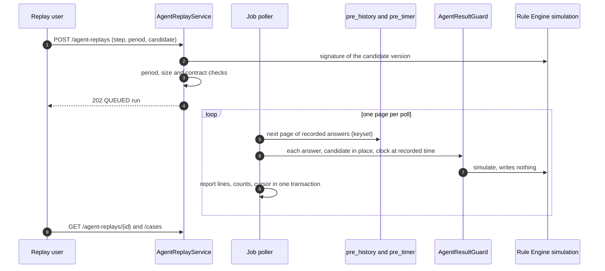

### 4.2 Saga compensation (ADR-0007, `TR-COMP-01` to `TR-COMP-03`)

Implemented in 0.3.0 (#67, `PRE-013`, `PRE-044`, `PRE-073` to `PRE-076`).

- **Model.** A `saga` block is a BPMN `transaction` with its own none start event, steps and end events; its incoming and outgoing flows are in the enclosing container, and no sequence flow crosses its boundary (`FLOW_CROSSES_SAGA`). A step names its undo with `horus:compensate` (a registered name, or `manual`) and its failure action with `horus:onFailure="compensate"`. `throwCompensation` is an `intermediateThrowEvent` with one `compensateEventDefinition` and no `activityRef`, inside a `saga` only (`THROW_COMPENSATION_OUTSIDE_SAGA`). The canonical form nests a block's steps under a `saga` step and writes `compensate` and `onFailure` only when declared, so the hash of a definition without them is unchanged. A local step's undo is a `ServiceTaskHandler` and a remote or agent step's undo a `ServiceAdapter`; both names are checked at `:request-approval` and `:approve` like `PRE-072`.
- **Scope tokens.** Entering a block creates a `SCOPE` token under the arriving token's scope (ADR-0020); the arriving token ends and a `FLOW` token enters the block's start event. When the last live flow token of the block ends, the scope token is `COMPLETED` and a new flow token leaves the block in the enclosing scope.
- **Stack.** A completed `serviceTask` or `agentTask` with an undo pushes one `pre_compensation_stack` row (V31) under its scope token before the token moves on, so `seq` is completion order. The row keeps the forward job id (a remote or agent step's job, null for a local step), the accepted forward attempt id, the undo's name and mode (`local`, `remote` or `manual`), and the input snapshot: the forward inputs and, under `forwardResult`, the forward result.
- **Start.** A step with `onFailure: compensate` whose failure is final, or a `throwCompensation`, starts the compensation of its scope token instead of the incident of `PRE-040`. In the same transaction every live flow token is cancelled with its task or job, the instance is `COMPENSATING`, history records `COMPENSATION_STARTED`, and `processes.compensation.started.v1` carries the scope token and the number of entries to undo. Entries of other scope tokens are never walked (`PRE-044`).
- **Walk.** Under the `pre_instance` row lock, the walk takes the highest `PENDING` entry of the scope and gives it a `COMPENSATION` job, keyed by its own job id on every retry, with the `runners.compensation` settings. The job runs on the async lane of section 4: a remote undo calls its adapter with no transaction open and receives `idempotencyKey` (the undo's job id), `forwardJobId` and `forwardAttemptId` on `AdapterCall`; a local undo calls no adapter, and its handler runs in the job's result transaction with `forwardAttemptId` on `ServiceCall`. A completed undo is `DONE` (`COMPENSATION_STEP_COMPLETED`) and the next entry follows in the same transaction, so one undo runs at a time, newest first. With no entry left the scope token is `COMPENSATED`, other live tokens are `CANCELLED`, and the instance ends `FAILED` with `processes.instance.failed.v1`.
- **Failure.** A failed undo is retried like any job of its lane. When it fails for good, the entry is `FAILED` (`COMPENSATION_STEP_FAILED`) and an incident `COMPENSATION_FAILED` names the entry, the forward job and the cause code; the walk pauses and keeps what it undid. `compensate: manual` sets the entry `MANUAL` and opens `COMPENSATION_MANUAL_REQUIRED`; history records `COMPENSATION_STEP_MANUAL` with the forward ids and the input snapshot, masked inputs as keyed hashes. Section 3.6 describes how both are retried and resolved.
- **Out of scope.** Compensation of a called child process (#92, PD-127: a completed child is undone only by its call step's own handler), compensation on cancel (PE-F-65, 1.2), and BPMN compensation events beyond `throwCompensation` (S2). A definition with a `saga` block is not yet exported back to BPMN.

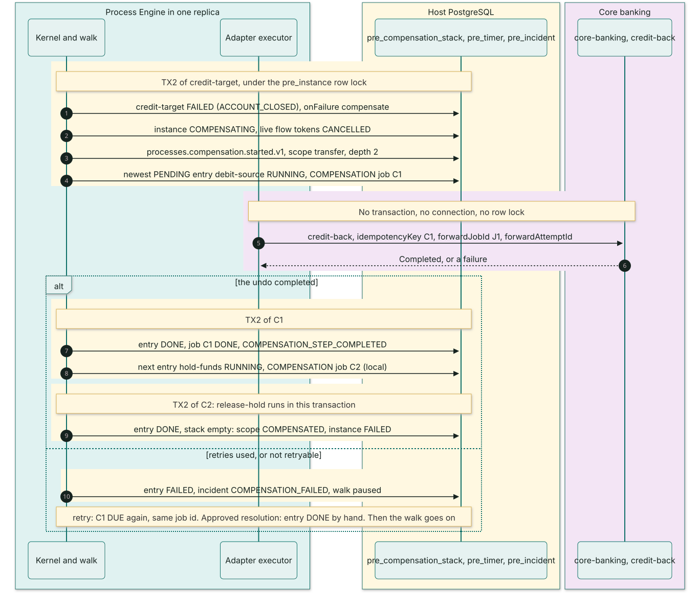

Source: [`diagrams/saga-compensation.mmd`](diagrams/saga-compensation.mmd).

### 4.3 Business calendars and migration

`BusinessCalendar` (`add`, `isBusinessTime`) computes `due_at` from working hours, time zone and holidays per tenant (`TR-CAL-01`, `TR-CAL-02`). Implemented in 0.3.0 (#72, `PRE-008`, `PRE-114`):

- A `userTask` declares `horus:sla` (a positive ISO 8601 duration of working time, at most 366 days) and optionally `horus:calendar` (a calendar key), checked at import (`SLA_INVALID`) and kept in the canonical form only when present, so the hash of a definition without an SLA is unchanged.
- When the shell creates the task, inside the step transaction, it calls the SPI once with the tenant of the locked instance row (never a request value), the engine clock's time and the duration, and stores the answer in `pre_task.due_at`; `dueAt` is on the task and on task list items. Nothing recomputes it, so a later calendar change never moves an existing deadline. Without `horus:calendar` the SPI counts elapsed time. A calendar the tenant does not have, or one with no working time within 3,660 days, fails the step (`422 STEP_FAILED`, reason `CALENDAR_NOT_FOUND` or `CALENDAR_NO_WORKING_TIME`) and nothing is written.
- The arithmetic is the value type `WorkingCalendar`: a zone, working-hour ranges per weekday to the minute (`08:00-17:00`, up to `24:00`, at most 8 ranges a day, no overlap), and holiday dates. It walks local days in the calendar's zone and converts each range to instants with the zone rules, so working time is real elapsed time across a clock change and the JVM's default zone never matters. It is pure and deterministic; a seeded property checks it over five default zones.
- The engine's default `BusinessCalendar` reads the tenant's calendar from `pre_calendar` and `pre_holiday` in the step transaction. A host that keeps calendars elsewhere registers its own bean, and the stored calendars are then not consulted.
- Calendars are created and changed through `CalendarService`, with four eyes by default (PD-118 as amended by PD-131). A holder of `processes:calendar:manage` proposes the whole calendar against the version it read (0 for a new one) with a reason; a second holder approves or rejects it. Only the approval applies it, under the calendar row lock and only when the version is still the one proposed against (`409 VERSION_CONFLICT` otherwise); the proposer is refused (`403 SELF_APPROVAL_FORBIDDEN`). Approval emits `processes.calendar.changed.v1` with both people. `pre_calendar_change` is the record: reason, proposer, decider, old and new value; its `CHECK` refuses an approved four-eyes row whose decider is its proposer, whoever writes it. `calendar.approval=single` lets the proposer apply a change alone and is refused at start-up unless the `dev` profile is active on its own. The REST endpoints below (0.3.0, #409) are on this service; the `/meta` flag and the cockpit editor follow with #125.

- Calendar REST (#409, `PRE-181`, `PRE-182`): `GET /calendars`, `GET /calendars/{key}` (`ETag` is the version), `POST /calendars/{key}/changes` (`If-Match` is the version proposed against, `"0"` for a new calendar, `201` with the change), `GET /calendar-changes?status=`, `GET /calendar-changes/{id}`, `POST /calendar-changes/{id}:approve` and `:reject`. Every write needs an `Idempotency-Key` (`428` without) and is done once per key: the key is claimed first in `pre_idempotency` under the tenant and the operation (`calendar-propose`, `calendar-approve`, `calendar-reject`), the whole change is stored with the answer in the transaction of the work, a repeat returns that answer and writes nothing, the same key with another request is `422 IDEMPOTENCY_KEY_REUSE_MISMATCH`, and a failed request leaves no claim. An approval or rejection takes no `If-Match`: a change cannot be edited, and the calendar version it was proposed against is checked under the calendar row lock. The two lists are registered bounded queries (`calendars`, `calendar-changes`, keyset, at most 200, signed cursors bound to the tenant and the status).
- Escalation (#73, `PRE-178` to `PRE-180`, V32): a `userTask` with `horus:sla` declares `horus:escalation`, up to three levels `<target>[|<duration>];...` with a target of `user:`, `role:` or `group:` and a wait of zero or more (positive after the first level), and `horus:onClaimed` (`release`, the default, or `keep`); checked at import (`ESCALATION_INVALID`) and kept in the canonical form only when present. When the task is created, the shell works out the fire time of every level from the due time and the calendar of the SLA, once, and stores them with the task (`escalation_json`, `escalation_level`, `next_escalation_at`), so a later calendar change moves nothing. The job poller of every replica then runs the sweep: the bounded query `escalations-due` (`EngineSweep`, at most `jobs.batch-size` open or claimed tasks of every tenant whose `next_escalation_at` has passed on the engine clock, on the partial index `idx_pre_task_escalation_due`), and for each task, in its own transaction as `system:timer`, the instance row lock, a reread and the change. A level is applied once however many replicas sweep: the second finds `escalation_level` already counted. The task keeps its `forbidden` participants because four eyes is computed from the instance's history at claim and completion, so escalation cannot remove one; a `user:` target who is a participant is refused and recorded (`ESCALATION_REFUSED`, incident `ESCALATION_TARGET_FORBIDDEN`) and the level is counted so it is not retried. A claimant whose claim was kept (`onClaimed: keep`) still completes the task. The sweep is not a timer job, so it needs no `pre_timer` row, no lease and no cancellation when a task is completed or its instance cancelled: those tasks leave the partial index. The host turns `processes.task.escalated.v1` into a notification.

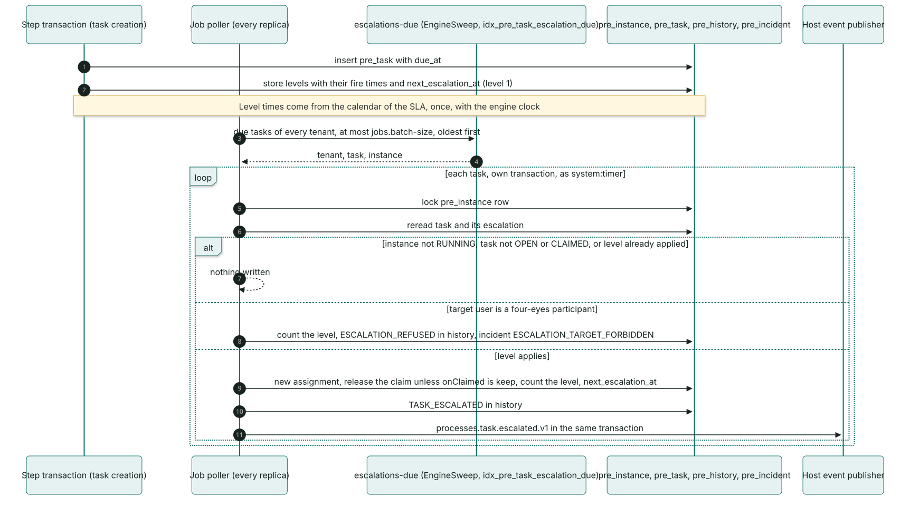

Source: [`diagrams/task-escalation.mmd`](diagrams/task-escalation.mmd).

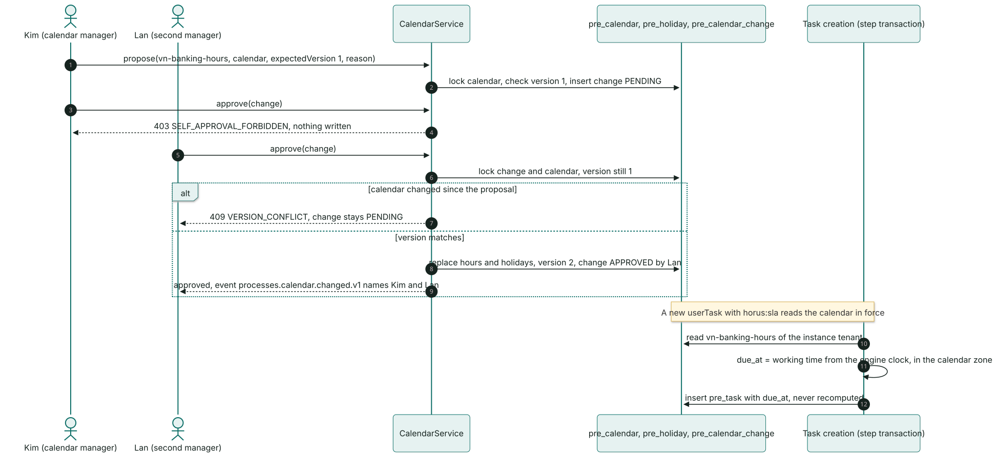

Source: [`diagrams/calendar-change.mmd`](diagrams/calendar-change.mmd).

`MigrationService` (#74) works in three steps; the first two ship in 0.3.0.

1. **Plan.** `plan(key, sourceVersion, targetVersion)` checks that the target is `ACTIVE` and the source `ACTIVE` or `RETIRED` in the caller's tenant, reads both models through the stored-source integrity check, and writes one `pre_migration` row, one `PLANNED` row of `pre_migration_history` and `processes.migration.planned.v1` in one transaction, idempotent on its key. The plan records `planHash` (SHA-256 over the key and both definition ids and hashes) and the approval its execution needs, fixed at creation from `migration.approval`: `four-eyes` by default; `single` only when the `dev` profile is active on its own, otherwise start-up is refused (PD-114 as amended by PD-131, `PRE-174`). Planning moves nothing.
2. **Dry run.** `validate(id)` only reads; it writes no row of any table and needs no approval (`PRE-014`). It reads the live tokens per step of the source version from `idx_pre_token_live`, maps each step onto the target by identical id (`SAME_ID`, `STEP_NOT_IN_TARGET`, or `STEP_TYPE_CHANGED` when the id is kept for another step type), and for each conflicting step counts the waiting running instances and lists the first `migration.dry-run-sample-size` ids in id order on `idx_pre_token_live_node_instance` (V24). A target no longer `ACTIVE` is the conflict `TARGET_NOT_ACTIVE`. It counts the running instances and lists those that would move on `idx_pre_instance_running_definition` (V25). The report carries `planHash` and `validUntil` (`migration.dry-run-validity` after `checkedAt`), which a later execution is bound to.
3. **Execute** (M2, `PRE-015`, `PRE-195` to `PRE-198`, #90). `MigrationExecutionService` has three commands and a runner.
   - `propose(id, reason)` (`:execute`): the holder of `processes:migration:manage` proposes. The engine runs the dry run itself in the same transaction and the plan must have no conflict, otherwise `409 DRY_RUN_REQUIRED`; the result is never a claim of the client, because the report is not stored (`PRE-014` writes nothing). The proposal records proposer, reason and the time of its dry run, one `PROPOSED` history row and `processes.migration.proposed.v1`.
   - `approve(id, lockVersion)` (`:approve`): a second holder, never the proposer (`SELF_APPROVAL_FORBIDDEN`), approves with the proposal's lock version. The dry run is repeated and must pass, and the proposal's dry run must be no older than `migration.dry-run-validity`, otherwise `409 DRY_RUN_REQUIRED` and the proposer proposes again. The plan becomes `APPROVED`. `reject(id, lockVersion, reason)` returns it to a state that may be proposed again. With `migration.approval=single` (the `dev` profile alone) the proposal is approved by the proposer at once and recorded as `single`. The table refuses `APPROVED`, `RUNNING` and completed plans without an approver and a four-eyes approver equal to the proposer (`ck_pre_migration_approved`, `ck_pre_migration_four_eyes`), whoever writes the row.
   - `MigrationRunner.runDue(maxBatches)`: a sweep like the job claim, run by the job poller on every replica. It claims one `APPROVED` or `RUNNING` plan whose lease is free or expired with `FOR UPDATE SKIP LOCKED` and leases it to the replica (`migration.lease`, default two minutes). The tenant is read from the plan row. It reads the next `migration.batch-size` running instances of the source version after the plan's cursor on `idx_pre_instance_running_definition` (V25), in id order, and moves each in **its own transaction**: lock the `pre_instance` row with `NOWAIT`, check that every live token waits at a step the target keeps with the same type, update `definition_id` and `definition_ver` of the instance and `definition_id` of its tokens, open tasks, due jobs, recorded step results and unresolved incidents (history rows keep the version they were written under), insert the outcome row, append `MIGRATED` to `pre_history` with approver as actor and proposer, reason and both versions in the details, and in the same transaction pass the cursor, add to the counts and extend the lease **only while this replica still holds it** (`UPDATE ... WHERE lease_owner = ? AND lease_until > now`). A runner whose update changes no row has lost the plan: its transaction rolls back and it stops. The primary key of `pre_migration_instance` makes a repeat harmless.
   - A failure is isolated: an instance with a token at a step the target lacks (`STEP_NOT_IN_TARGET`, `STEP_TYPE_CHANGED`), or whose row another transaction holds (`LOCK_CONFLICT`), is rolled back alone, then recorded `FAILED` in a second transaction with one `OPEN` incident `MIGRATION_FAILED` on its step, and the batch goes on. An instance that ended or moved on since the batch was read is `SKIPPED`. When no instance is left the plan becomes `COMPLETED` or `COMPLETED_WITH_FAILURES`, with `processes.migration.completed.v1`. A poll runs at most ten batches of one plan and gives the lease back so plans take turns.
   - Explicit step mappings are M3 (`TR-MIG-03`).

   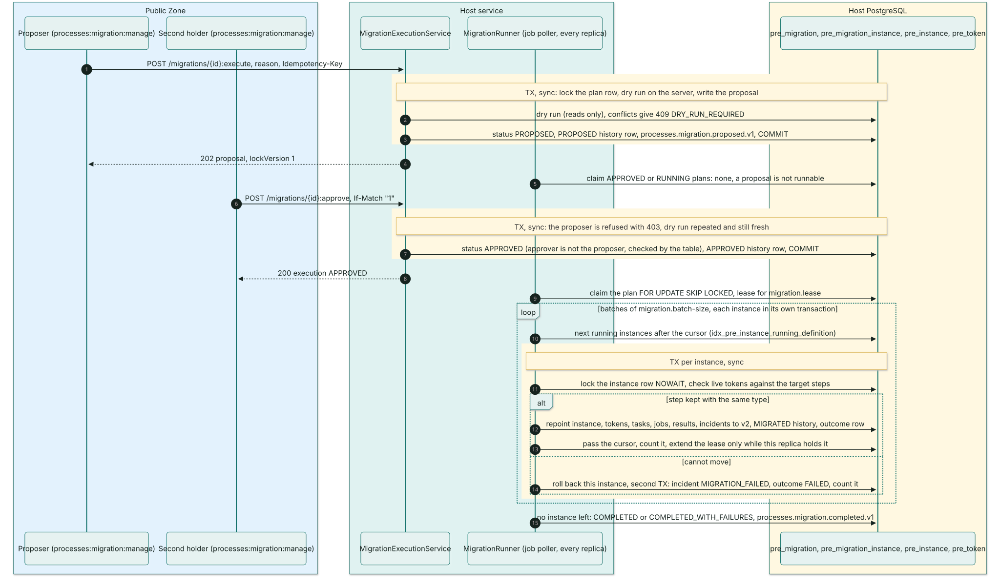

   Source: [`diagrams/migration-execute.mmd`](diagrams/migration-execute.mmd).

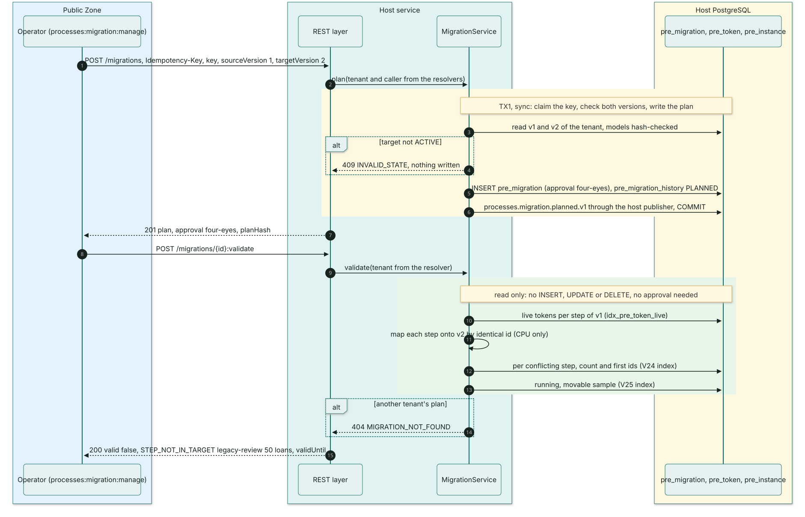

Source: [`diagrams/migration-dry-run.mmd`](diagrams/migration-dry-run.mmd).

### 4.4 Jobs and timers across replicas (`PRE-006`, `TR-PERF-05`, `TR-ASY-02`)

Every replica runs one poller thread. A poll is two kinds of short transaction, and no network call happens in either:

1. **Claim.** One statement selects due rows of every tenant (`DUE` with `next_fire_at <= now`, or `CLAIMED` with an expired `locked_until`) `ORDER BY next_fire_at LIMIT jobs.batch-size FOR UPDATE SKIP LOCKED`, and updates them to `CLAIMED`, `locked_by = jobs.replica-id`, `locked_until = now + lease_duration`, `attempt + 1`. It commits at once, so every replica sees the lease. Rows another replica is claiming are skipped, never waited for.
2. **Fire, one transaction per job.** The handler locks its aggregate first (the `pre_instance` row for a timer, the same order as every user command, so the two never deadlock), then locks the job row and checks that it is still `CLAIMED` by this replica with the same `attempt` and an unexpired lease. Only then does it apply `JobDue` to the waiting token and run the synchronous steps that follow; the job becomes `DONE` in that same transaction.

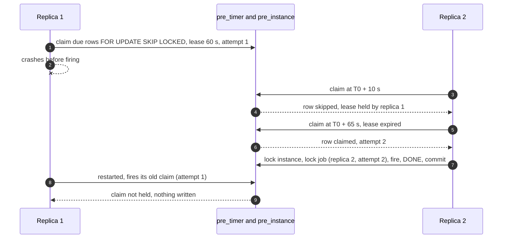

Because the firing and `DONE` commit together and the attempt number fences an old claim, a timer fires at most once; because a dead replica's lease expires, it fires at least once. A failing firing rolls back and the job is released to `DUE` after `jobs.retry-backoff` times the attempt, or `FAILED` after `jobs.max-attempts`. A timer whose instance ended, or whose token moved on, is marked `DONE` without firing. A cancelled job is never fired. The poller loop never ends silently: any `Throwable` from one poll, an `Error` included, is logged once for that poll (replica and exception class, no payload) and the next poll runs after `jobs.poll-interval`; a `VirtualMachineError` is logged, marks the `processEngineJobs` health contributor `DOWN` and stops the loop, so the orchestrator restarts the host. The health details carry the replica id and the time of the last successful poll. The intermediate timer catch event of this release takes `timeDuration` (days, hours, minutes, seconds) or `timeDate` (with an offset); cycles, calendar durations, boundary timers and the rest of the event set follow with the events stream. A step reached after a timer runs with no caller. The fire transaction acts for the job's tenant as `system:timer`, and a decision step that follows is evaluated through the `DecisionPort` in the tenant of the locked `pre_instance` row, as `system:process-engine`, through the Rule Engine's tenant-scoped entry point (ADR-0027, `PRE-055`). That entry point is not reachable by host code: it lives in the engine-to-engine package `rules.embedded`, the `RuleEngine` bean does not implement it, and the decision port of the process starter (`process.autoconfigure.RuleEngineDecisionPort`, package-private, ADR-0027 keeps Rule Engine types out of `process-engine-core`) claims it once from the Rule Engine's `EmbeddedEngineGrant`, as the registered claimant of `system:process-engine`, and keeps it to itself. The process starter builds the port while its beans are created (the services bean is never lazy) and fails start-up if the claim did not happen; the Rule Engine starter then closes any identity left unclaimed. `DecisionCaller.Engine` has a package-private constructor, so only the timer path asks for engine work. `process.internal.service` is a sealed package in `process-engine-core` and `process.autoconfigure` in the process starter jar, so host code cannot add a class beside the port or the engine caller to reach these package-private members (#336). The identity is fixed when it is built and must be a registered engine identity; any other `system:` id is refused. That context is a parameter of the fire transaction, built only by the job handler, never a thread-local and never taken from a request, so it cannot outlive the transaction or reach another call. The caller-tenant guard for requests stays: a decision inside a request runs only when the caller's tenant is the instance's. A rule set that exists only in another tenant, or a host Rule Engine without the tenant-scoped entry point, fails the step closed and the firing rolls back (`PRE-056`). A decision row the Rule Engine has already written, for example on no match, rolls back with the firing.

**The decision port's data (ADR-0027, `PRE-046`, `PRE-047`).** `DecisionPort.evaluate(tenantId, caller, decisionRef, inputs, evaluationTime, idempotencyKey, correlationId)`. Every decision step, inside a request or after a timer, is evaluated through the tenant-scoped entry point as `system:process-engine`, on behalf of `DecisionCaller.onBehalfOf()`: the request's user, read from the engine's `CallerResolver`, or null for engine work. Both go to `rle_decision` (`caller_id`, `on_behalf_of`), so a task worker needs no `rules:evaluate`. The evaluation time is the engine clock at the step. The idempotency key is `pe:<instance>:<node>:<attempt>` (the node id hashed when the key would pass 200 characters); attempt ids are deterministic children of the instance id and its sequence, so a step retried from the same state has the same key and the Rule Engine replays the logged decision, with its original evaluation time, instead of writing a second row; neither the time nor `onBehalfOf` is part of the Rule Engine's request hash. The adapter in the process starter refuses a request whose tenant (from the engine's `TenantResolver`) is not the instance's with `403 TENANT_NOT_ALLOWED` before any rule set is read, and writes one security log line (`security.decision.tenant_refused`, tenants, decision, user and correlation id, never inputs).

A failed decision is never replayed. A refusal (`RULE_SET_NOT_FOUND`, `NO_EFFECTIVE_VERSION`, `INPUT_INVALID`) records nothing, and a logged failure or no match fails the step; either way the step's transaction rolls back with the decision row and the idempotency record, so a retry with the same key evaluates again, for example once the missing version is approved (`DecisionAfterTimerIT`).

Two layers keep a business rule task from running without the Rule Engine. At activation, a definition with a `businessRuleTask` is refused with `BPMN_NOT_EXECUTABLE` when the host has no decision port (section 5.8). At run time, the port fails the step closed with `TENANT_NOT_ALLOWED` when the Rule Engine offered no grant, and `LocalServiceInvoker` fails it with `BPMN_NOT_EXECUTABLE` when no port exists; neither happens to an activated definition on a correctly wired host, but neither falls back to evaluating as the caller.

## 5. Definitions: notation, hash, diff, layout, BPMN, forms, step catalogue

### 5.1 Notation and canonical model (ADR-0013, ADR-0018, `TR-DEF-01`, `TR-STD-28`)

The canonical model in `process-engine-core` is the BPMN 2.0.2 semantic model: sealed records for flow nodes and sequence flows with ids, HORUS extension records for `agentTask`, guardrails, async mode, forms and SLA, and opaque foreign extensions (ADR-0018, PD-060). Our JSON (or YAML) is its canonical serialisation: the form that is stored, hashed, diffed and approved. The v1 reader maps a `process-definition.v1` document onto the model, and the canonical writer prints the model back; reading and writing a v1 document gives its RFC 8785 form unchanged, so its hash is unchanged (`PRE-043`). The format is owned by [`api/schema/process-definition.v1.schema.json`](../api/schema/process-definition.v1.schema.json). It may carry an optional `diagram` part (node positions, edge waypoints, lanes; schema [`api/schema/definition-layout.v1.schema.json`](../api/schema/definition-layout.v1.schema.json)). On import the engine stores the `diagram` part as a layout revision and removes it from `definition_json`.

Standards foundations (ADR-0017):

| Rule | Milestone |
|---|---|
| The document as received (JSON, YAML, or from M3 BPMN XML) is stored in `source_document` with `source_format` and `source_hash`; it is never executed (DN-01, `PRE-039`) | M2 |
| `expressionLanguage` names the language of every condition; only `urn:horus-bpm:expr:v1` before S1 (DN-02) | M2 |
| Step ids accept the BPMN id form `^[A-Za-z_][A-Za-z0-9_.-]*$` (at most 100), so imported BPMN ids are kept; kebab-case stays the recommended style; definition keys stay kebab-case (DN-03, `PRE-042`) | M2 |
| The v1 reader generates sequence flow ids deterministically (`<from>__<to>`, `<gateway>__b<i>`, `<gateway>__default`, `<gateway>__f<i>`); they are not part of the hash because they are derived | M2 |
| The in-memory model is the BPMN semantic model (flow nodes and sequence flows with ids, HORUS extensions for our step types); a `saga` is a `transaction` subprocess and a `callProcess` a `callActivity` in the model; the M3 BPMN subset reader and writer are built on it ([`standards-compliance.md`](../../docs/architecture/standards-compliance.md) section 3; decided 2026-11-19, PD-060) | M2 (model, `PRE-043`), M3 (BPMN reader) |

### 5.2 Content hash (`TR-DEF-04`)

`definition_hash` is the lowercase hex SHA-256 of the RFC 8785 (JSON Canonicalization Scheme) serialisation of the canonical document written from the model, with expressions printed in their normal form through the `ExpressionLanguage` printer and the `diagram` member removed (ADR-0026). It is computed in the schema version the document is stored in and never recomputed when a later schema version exists; a BPMN import produces the lowest schema version that can express the model, which keeps `PRE-034` true (DN-04). YAML is converted to JSON first. The canonicaliser is about 150 lines in `process-engine-core`, with the RFC 8785 test vectors in CI; no dependency. A pipeline compares `source_hash`, the SHA-256 of the raw bytes as received, with the SHA-256 of the committed blob (`git show <commit>:<path> | sha256sum`), so "does production match Git" is one string comparison (ADR-0026); the cockpit shows the hash on every version (PD-036).

### 5.3 Graph diff (PE-F-46)

`GraphDiffs.diff(base, target)` is a pure function of the two models (`PRE-025`, `PRE-176`). Nodes are matched by BPMN id and compared on their canonical form, the form that is hashed and approved, without the members that name the following step (`next`, `default`, a branch's `next`); a changed value is one entry with its JSON Pointer path inside the step and its old and new value, so a changed branch condition is `/branches/i/when` on the gateway. Edges are matched by `(from, to, kind)` where kind is `next`, `branch[i]` (the i-th conditional branch of an exclusive gateway, from 0, in document order), `default` or `fork`. Output: `nodesAdded`, `nodesRemoved` (id, name, type), `nodesChanged` (id, name, type, path, from, to), `edgesAdded`, `edgesRemoved` (sequence flow id, both step ids and names, kind), all sorted, and `truncated` when more than 1,000 changed values were found. Layout is not in the model, so it is never part of the diff, and no XML is returned. `DefinitionService.diff(base, target)` and `diffFromEffective(target)` read both versions of one key in the caller's tenant, of any lifecycle status, through the stored-source integrity check, and write nothing; the REST `ETag` is derived from both definition hashes. Complexity O(N + E) apart from sorting; a 500-node definition diffs in under 5 ms. A diff that is `truncated` carries no hash that may be approved (PRE-177, PD-139): the REST answer then omits `definitionHash` on both sides and its `approvableHash` is null; a complete diff sets `approvableHash` to the target's `definitionHash`, which `approve` checks against the stored content. `approve` refuses with `409 CHANGE_SET_TRUNCATED`, writing nothing, when the diff from the effective version to the version approved is truncated, so an approval can never rest on a change list that was cut off. Until the diff is paged, a version with more than 1,000 changed values against the effective one cannot be approved outside the `dev` profile (`approval.require-content-hash=false`); paging the diff lifts this limit.

### 5.4 Layout (ADR-0013, `TR-DEF-02`, M3)

Layout revisions are append-only rows with author and time (V33, #102; the table's triggers refuse `UPDATE`, `DELETE` and `TRUNCATE`). Saving needs `processes:author` and `If-Match: "<revision>"`, and no approval, because layout never changes behaviour (principle 6 wording, PD-040). A layout may list a subset of nodes; the cockpit places the rest with automatic layout. A revision referring to a node id that is not in the definition is `422 LAYOUT_INVALID`. Size limit 256 KB. Layout writes stay allowed when `authoring.cockpit-drafts` is `false`.

### 5.5 BPMN subset import and export (ADR-0013, PE-F-41 M3, PE-F-53 M3 cut candidate)


Source: [`diagrams/bpmn-import.mmd`](diagrams/bpmn-import.mmd).

| BPMN 2.0 element | Our step | Notes |
|---|---|---|
| `startEvent` (none) | `start` | One per process |
| `endEvent` (none) | `end` | |
| `userTask` | `userTask` | `horus:assignee`, `horus:fourEyes`, `horus:form`, `horus:sla` extension attributes |
| `serviceTask` | `serviceTask` | `horus:handler`, `horus:mode`, `horus:compensate` |
| `serviceTask` with `horus:type="agentTask"` | `agentTask` | `horus:agent`, a `<horus:outputSchema>` element (JSON object) and a `<horus:guardrail>` element are required; `horus:timeout`, `horus:input`, `horus:resultVariable` optional (0.2.0, #52, section 4.1) |
| `businessRuleTask` | `decision` | `horus:ruleSet` |
| `exclusiveGateway` with `conditionExpression` and `default` | `exclusiveGateway` | Conditions in our expression language, `language="urn:horus-bpm:expr:v1"` |
| `parallelGateway` | `parallelGateway` | |
| `intermediateCatchEvent` with `timerEventDefinition` (`timeDuration` or `timeDate`) | `timer` | |
| `callActivity` | `callProcess` | `calledElement` is the definition key |
| `transaction` subprocess | `saga` | |
| `intermediateThrowEvent` with `compensateEventDefinition` | `throwCompensation` | |
| `sequenceFlow` | `next`, `branches[]` | |
| `bpmndi:BPMNShape`, `bpmndi:BPMNEdge` | layout revision 1 | Bounds and waypoints |
| Anything else (message, signal, error and boundary events, inclusive and event-based gateways, lanes with semantics, scripts, multi-instance markers) | rejected in M3 | `422 BPMN_UNSUPPORTED_ELEMENT` naming element, `id`, line and the stage that adds it ([`standards-compliance.md`](../../docs/architecture/standards-compliance.md) section 6.1, `TR-STD-04`). From S1 every element is imported and displayed, and activation of a definition with an element not yet executable is `422 BPMN_NOT_EXECUTABLE` |
| A CMMN document | rejected | `422 CMMN_UNSUPPORTED` (ADR-0017, `TR-STD-26`) |

The reader uses `XMLInputFactory` with `SUPPORT_DTD=false` and `IS_SUPPORTING_EXTERNAL_ENTITIES=false`; any `DOCTYPE` is `422 BPMN_UNSAFE_XML`. Limits: 1 MB, nesting depth 32, 5,000 elements. Export writes the same subset with the `horus` namespace and BPMNDI from the latest layout (or from an automatic layout computed by the cockpit and sent with the request). Until layout revisions are stored (PRE-026), `SubsetBpmnWriter` generates a left-to-right layout: columns by shortest distance from the start event, rows in document order, back edges routed below the diagram. The export reads the stored source again and checks the recorded `definition_hash` before writing, the same integrity check as execution. Round trip: export then import of a definition gives the same `definition_hash`; CI checks this for every example definition and validates exported XML against the BPMN 2.0 XSD.

### 5.6 Task forms (PE-F-51, M2)

A `userTask` declares `form` as one of: a form key registered by the host through `FormRegistry`; an object `{ "schema": "<path of a JSON Schema>", "hints": { ... } }`; or `{ "link": "<URL template>" }` for the host's own screen. `GET /tasks/{id}/form` returns the resolved form ([`api/schema/task-form.v1.schema.json`](../api/schema/task-form.v1.schema.json)): JSON Schema 2020-12 limited to `string`, `integer`, `number`, `boolean`, `enum`, `date`, `datetime` and the money object; display hints (`order`, `widgets`, `labels` per locale, `readOnly`); prefilled data from declared variables, masked fields still masked; or the link. `:complete` validates the result against the same schema in the service layer (`422 FORM_VALIDATION_FAILED` with JSON Pointers). A link must be relative or match `tasks.form-link-origins`, checked at import; otherwise the import fails with a `FORM_LINK_NOT_ALLOWED` problem inside `422 VALIDATION_FAILED`.

### 5.7 Step catalogue (PE-F-52, M3)

`GET /step-catalogue` returns what an author may place on the canvas: service handlers and agent adapters registered through `StepRegistry` (name, mode, input schema, compensable), rule sets usable as `decision` steps (name, effective version, inputs, outputs), rule sets that meet the guardrail contract, calendars, form keys, and roles and groups when the host provides a `RoleCatalogue`. Handlers are registered as typed functional interfaces under a name; the engine never invokes a method by reflection (`TR-SEC-01`). Import validation uses the same registry, so a step the catalogue does not offer cannot be imported either.

### 5.8 First executable slice (0.1.0): decisions of 19 Nov 2026

The first Process Engine slice (pull request #149, on the contract of #139) settles these points. Each one stays until the slice named in its last column replaces it.

| Topic | Decision | Until |
|---|---|---|
| HORUS extension namespace | BPMN: `urn:horus-bpm:bpmn:extensions:v1`, prefix `horus`. DMN uses the same pattern: `urn:horus-bpm:dmn:extensions:v1`. A new major version of the extension vocabulary is a new URI; readers keep reading every earlier URI | Permanent |
| Behaviour registration | `BehaviorRegistry` keys behaviours by node class plus event-definition type: no definition, exactly one definition class, or `MULTIPLE` (S3). Lookup is exact; a node with no registered key is `422 BPMN_NOT_EXECUTABLE` at activation, naming the element, its id and the stage that adds it. This is the only change to the kernel contract of #139 | Permanent |
| Kernel ids | Child ids derive from the instance id and `pre_instance.seq`, so `apply` is deterministic and a replay gives the same ids. `seq` is incremented only under the instance row lock, in the transaction of the tokens it numbers. Derived ids are predictable within a tenant, so no read or write relies on id secrecy: the assignment and tenant checks are the control | Permanent |
| Import status | An import creates a `DRAFT`. It becomes `ACTIVE` only through `definitions.auto-approve`, which applies to start-up and `POST /definitions` imports alike and which start-up refuses unless `dev` is the only active profile (besides `test`). Request-publish, approve and reject arrive with the definition lifecycle slice (`PRE-018` to `PRE-021`). Until then a draft cannot be started outside `dev`, so the Process Engine in 0.1.0 is a preview for evaluation, and the release notes say so | Definition lifecycle slice (#47, 0.2.0): replaced by section 3.2 |
| Task completion | **Replaced in 0.2.0 by the task slice (#49, `PRE-051`).** In 0.1.0 `POST /tasks/{id}:complete` needed no prior claim. Since 0.2.0 only the claimant completes a `CLAIMED` task: an `OPEN` task is `409 INVALID_STATE` (claim it first) and a task claimed by another user is `403 TASK_NOT_ASSIGNED`; the regression tests are `TaskLifecycleIT.PRE_003_an_open_task_must_be_claimed_before_it_is_completed_and_nothing_is_written` and `PRE_003_a_task_claimed_by_another_officer_is_refused_with_403`. Still enforced: the caller must be a candidate (the task's user, role or group), the tenant comes from `EngineAccess`, `Idempotency-Key` and `If-Match` are required (`428`), and four eyes refuses the starter and every earlier completer at claim and at completion (`403 SELF_APPROVAL_FORBIDDEN`, `PRE-007`) | Closed |
| What is compiled | The kernel is compiled from the stored source document. The approval binds it: `source_hash` and the BPMN reader version are recorded in `processes.definition.approved.v1` (and in the dev auto-approval) and in the history row of the approval transaction. Before compiling, the engine compares the SHA-256 of the stored source with the **approved** `source_hash`; on a mismatch it refuses to start or advance that version, raises an incident on each affected instance, writes an audit entry and alerts. A reader version different from the approved one is logged at WARN with the definition and both versions. This is the interim form of ADR-0026 decision 4 (pull request #150). `definition_hash` is not presented as a behaviour hash until the canonical writer of the v1 profile exists; from then on the kernel compiles only from the stored canonical JSON, as for rule sets | Canonical writer (`PRE-043`) |
| Events | **Decided for 0.1.0 (19 Nov): handover inside the transaction.** The engine hands each event to the host's `ProcessEventPublisher` inside the transaction of the state change it reports (section 6.4), so a host can write its own outbox row atomically with the change; the engine has no outbox table. The default publisher is Spring `ApplicationEventPublisher` called in that transaction. Listener contract, also stated on the SPI: a listener that needs the event durably writes an outbox row in that transaction; a listener that only notifies (mail, UI refresh) registers with `@TransactionalEventListener(phase = AFTER_COMMIT)`, so rolled-back work never emits and delivery is at most once; a plain `@EventListener` runs in the transaction, an exception it throws rolls the state change back, and it must not do network I/O (the rule of `ServiceTaskHandler`). The audit trail (`pre_history`) is written by the engine itself and never depends on a listener. Release notes: in 0.1.0 events are durable only through a host outbox. A `pre_outbox` relayed by the engine, as the Rule Engine's `rle_decision_outbox`, is a later option and would be additive | Permanent; `pre_outbox` optional later |
| Gateway conditions | Compiled at import through an internal `ExpressionEvaluator` port with a comparison subset of `horus-expr-v1`, under the decided semantics: FEEL null logic (PD-058), `DECIMAL128` numbers, instance variables bound from JSON as `BigDecimal` and never through `double`, money compared only within one currency (number against money is a type error), and a type error failing the step. A condition that evaluates to `null` is not `true`: if no outgoing flow is selected the default flow is taken, and without one the step fails with an incident; never the first flow in document order. The parser applies the `horus-expr-v1` length, depth and node limits at import | `bpm-expression` and the `ExpressionLanguage` SPI (ADR-0027) |
| Local handlers and decisions | Run inside the caller's transaction (section 4). Each call is timed, and above `handlers.slow-call-warning` (default 200 ms) a `process.step.slow` warning names the step, the target and the elapsed time, never the inputs. The no-network rule is stated on `ServiceTaskHandler` | Permanent |
| Dependency on the Rule Engine | `process-engine-core` depends on `bpm-expression` and not on `rule-engine-core` (ADR-0027, 0.2.0). Gateway conditions compile through the `ExpressionLanguage` SPI in an untyped environment. A `businessRuleTask` calls the `DecisionPort` with the instance's tenant, a `DecisionCaller`, the engine clock and the step key (section 4.4); the adapter lives in the process starter, which declares `rule-engine-core` optional and builds it only when the Rule Engine is on the class path and a `RuleEngine` bean exists. Without one, a definition with a `businessRuleTask` is refused at activation with `BPMN_NOT_EXECUTABLE` naming the step | ADR-0027 (0.2.0) |

### 5.9 Local and remote service steps (#63)

A `serviceTask` chooses its mode with `horus:mode`: none or `local` calls a `ServiceTaskHandler` in the step transaction; `remote` parks the token on the Async Wait-State of section 4 and runs a `ServiceAdapter` on the async executor. Any other value is `MODE_INVALID` at import, and `horus:timeout` on a local step is `TIMEOUT_INVALID`; both name the step and its line (`PRE-072`). The handler or adapter name is resolved against the host's typed beans, never by reflection, and only when the version is about to become active (request-approval and approval, or a dev auto-approved import), so a pipeline can import a draft before the host registers the bean.

```mermaid
sequenceDiagram
    autonumber
    participant C as Caller
    participant E as Engine (step TX)
    participant H as limits.reserve (local)
    participant DB as Host PostgreSQL
    participant X as Async executor (no TX)
    participant A as core-banking adapter (remote)
    C->>E: POST /instances (LN-2026-0042, 50,000,000 VND)
    E->>DB: lock pre_instance
    E->>H: handle(ServiceCall: tenant from the instance row, attempt id, bounded inputs)
    H->>DB: insert reservation (same TX)
    E->>DB: token WAITING_ASYNC + ASYNC_SERVICE job, commit together
    E-->>C: 201 RUNNING
    X->>DB: TX1 claim job, lease, store token hash; commit
    X->>A: execute(AdapterCall: idempotencyKey = job id, new attempt id)
    A-->>X: Completed { postingRef: FT26324001 }
    X->>DB: TX2 ASYNC_RESULT_ACCEPTED, store postingRef, INSTANCE_ENDED
    alt handler throws
        H--xE: exception
        E->>DB: rollback (no instance, no reservation, no history)
        E-->>C: 500 INTERNAL with correlationId only
    end
```

| Concern | Local step | Remote step |
|---|---|---|
| Transaction | The caller's or the firing's; the handler's writes commit or roll back with the step | None open during the call; TX1 claims, TX2 records |
| Key | None needed: nothing outlives a rollback. The attempt id correlates only | The job id (`AdapterCall.idempotencyKey()`), the same on every retry; the attempt id fences late results |
| Failure | A throw rolls back; a request is `500 INTERNAL`, a firing retries after its backoff; a returned `Failed` is `422 STEP_FAILED` | `ASYNC_ATTEMPT_FAILED`; retry after back-off up to `jobs.max-attempts`; `ADAPTER_TIMEOUT` at `horus:timeout` |
| Tenant | The locked `pre_instance` row's | The locked `pre_instance` row's; a completion for another tenant's job is `404` |
| Slow call | `process.step.slow` above `handlers.slow-call-warning`, never the inputs | Bounded by `horus:timeout` |

## 6. Java API and REST contract

### 6.1 Java API (`io.github.dhluong90.bpm.process.api`, ADR-0022)

Entry points follow ADR-0016: one interface per job, request records with builders, sealed result types, unchecked exceptions with `code()`.

```java
public interface DefinitionService {
  DefinitionVersion importDefinition(ImportRequest request);              // processes:deploy, creates DRAFT
  DefinitionVersion createDraft(DraftRequest request);                    // processes:author
  DefinitionVersion updateDraft(DefinitionRef ref, long expectedLockVersion, DefinitionDocument document);
  ValidationReport validate(DefinitionRef ref);
  // 0.2.0 (#47): each lifecycle command takes the idempotency key last; null means none.
  DefinitionVersion requestApproval(DefinitionRef ref, long expectedLockVersion, @Nullable Instant effectiveFrom,
      @Nullable String idempotencyKey);
  DefinitionVersion approve(DefinitionRef ref, long expectedLockVersion, @Nullable String expectedDefinitionHash,
      @Nullable String comment, @Nullable String idempotencyKey);   // 0.3.0 (#406): hash of the content reviewed
  DefinitionVersion reject(DefinitionRef ref, long expectedLockVersion, String reason, @Nullable String idempotencyKey);
  DefinitionVersion retire(DefinitionRef ref, long expectedLockVersion, @Nullable String idempotencyKey);
  Optional<DefinitionVersion> find(DefinitionRef ref);                    // processes:read
  List<DefinitionHistoryEntry> history(DefinitionRef ref);                // processes:read, oldest first
  GraphDiff diff(DefinitionRef base, DefinitionRef target);                // processes:read, read-only (#76)
  GraphDiff diffFromEffective(DefinitionRef target);                       // base: the effective version
  LayoutRevision saveLayout(DefinitionRef ref, int expectedRevision, Layout layout);
  Optional<LayoutRevision> latestLayout(DefinitionRef ref);
}

public interface MigrationService {                                        // #74
  MigrationPlan plan(MigrationPlanRequest request);                        // processes:migration:manage
  MigrationPlan find(String migrationId);                                  // processes:migration:manage or processes:read
  MigrationDryRun validate(String migrationId);                            // processes:migration:manage, read-only
}

public interface IncidentService {                                        // 0.3.0 (#68), section 3.6
  List<Incident> openIncidents(String instanceId);                        // processes:read; OPEN and RESOLUTION_PENDING
  Page<Incident> incidents(IncidentQuery query);                          // processes:read; one status, newest first
  Incident incident(String incidentId);                                   // processes:read
  Incident retry(String incidentId, long expectedLockVersion, String reason, String idempotencyKey);
  Incident resolve(String incidentId, long expectedLockVersion, Map<String, Object> output, String reason,
      String idempotencyKey);
  Incident approveResolution(String incidentId, long expectedLockVersion, @Nullable String comment, String idempotencyKey);
  Incident rejectResolution(String incidentId, long expectedLockVersion, String reason, String idempotencyKey);
}

public interface ProcessQueryService {
  Page<Activity> activities(InstanceId id, @Nullable Cursor cursor, int limit);
  NodeCounts liveNodeCounts(DefinitionRef ref);
  NodeStats windowNodeStats(DefinitionRef ref, Instant from, Instant to);
  Page<TaskSummary> tasks(TaskQuery query);
}
```

Handler results are sealed so that BPMN error events (S1) need no SPI change after the 1.0 freeze (M2, DN-09, `PRE-040`):

```java
public sealed interface HandlerResult permits HandlerResult.Completed, HandlerResult.BusinessError, HandlerResult.Failed {
  record Completed(Map<String, Object> output) implements HandlerResult {}
  record BusinessError(String code, String message) implements HandlerResult {}   // M2: incident UNHANDLED_BUSINESS_ERROR; S1: error boundary or error event subprocess
  record Failed(String errorCode, String detail, boolean retryable) implements HandlerResult {}  // technical failure: retry policy, then incident or compensation
}
```

`ProcessEngine` (start, cancel), `TaskService` (claim, unclaim, complete, delegate, reassign, form), `IncidentService`, `MigrationService` and `StepCatalogue` complete the API. The tenant and caller come from the resolvers; no method takes a tenant parameter except the batch-only `TenantScoped` variants used by host jobs.

### 6.2 REST endpoints (`/api/bpm/processes/v1`)

| Endpoint | Permission | Purpose | Idempotency and concurrency | Errors beyond the common set | Milestone |
|---|---|---|---|---|---|
| `POST /definitions` | `processes:deploy` | Import a full JSON or YAML document as the next `DRAFT`; optional `requestApproval` and `effectiveFrom` in the body | `Idempotency-Key` | `422 VALIDATION_FAILED`, `422 GUARDRAIL_CONTRACT_INVALID`, `422 DEFINITION_TOO_LARGE` | M2 |
| `POST /definitions:import-bpmn` | `processes:deploy` | Import a BPMN subset file as a `DRAFT` | `Idempotency-Key` | `422 CMMN_UNSUPPORTED`, `422 BPMN_UNSUPPORTED_ELEMENT`, `422 BPMN_UNSAFE_XML`, `422 VALIDATION_FAILED` | M3 |
| `GET /definitions` | `processes:read` | Keys with effective version, pending count, last change | Cursor, at most 200 | | M2 |
| `GET /approvals` | `processes:read` | The pending approvals queue of the tenant (#31, `PRE-190`): every `PENDING_APPROVAL` definition version across all keys, including one that is not the latest, oldest request first, keyset on `(requested_at, id)`. Items: `key`, `name`, `version`, `definitionHash` (what a reviewer sends back as `expectedDefinitionHash`, `PRE-177`, PD-139), `lockVersion` (the `If-Match`), `requestedBy`, `requestedAt`, `allowedActions` and `deniedActions`, for `approve` and `reject` only, as `PERMISSION_REQUIRED` or `SELF_APPROVAL_FORBIDDEN`: the requester may do neither, the maker (importer or creator) may reject but not approve under the default `approver-must-differ-from: makers`. Never the definition, the source or a variable. Read permission, not `processes:approve`, so the cockpit shows a reader why they cannot decide; the decision commands stay the authority. Same shape as `GET /approvals` of the Rule Engine (`RLE-190`) | Signed cursor bound to the tenant and the list (`pending-approvals`), at most 200 | `400 QUERY_INVALID` | M2 (0.3.0, #31) |
| `POST /definitions/{key}/drafts` | `processes:author` | New draft from `fromVersion` or blank | `Idempotency-Key` | `403 DRAFT_AUTHORING_DISABLED` | M2 |
| `GET /definitions/{key}/versions/{v}` | `processes:read` | Document, status, hash, approval fields; `?include=layout` adds the latest layout; `?include=source` adds `sourceFormat`, `sourceDocument` and `sourceHash` (DN-01) | `ETag` from hash and layout revision | `404 DEFINITION_NOT_FOUND` | M2 |
| `PUT /definitions/{key}/versions/{v}` | `processes:author` | Replace draft content | `If-Match: "<lockVersion>"` | `403 DRAFT_AUTHORING_DISABLED`, `409 VERSION_CONFLICT`, `409 INVALID_STATE` | M2 |
| `POST /definitions/{key}/versions/{v}:validate` | `processes:author` or `processes:deploy` | Validation report | None | | M2 |
| `POST /definitions/{key}/versions/{v}:request-approval` | `processes:author` or `processes:deploy` | To `PENDING_APPROVAL` | `Idempotency-Key`, `If-Match` | `422 VALIDATION_FAILED`, `409 INVALID_STATE` | M2 |
| `POST /definitions/{key}/versions/{v}:approve` | `processes:approve` | To `ACTIVE`; body `expectedDefinitionHash` (required by default, PD-139) and `comment` | `Idempotency-Key`, `If-Match` | `400 CONTENT_HASH_REQUIRED`, `409 CONTENT_CHANGED`, `403 SELF_APPROVAL_FORBIDDEN`, `409 VERSION_SUPERSEDED`, `409 INVALID_STATE` | M2 |
| `POST /definitions/{key}/versions/{v}:reject` | `processes:approve` | Back to `DRAFT`, reason required | `Idempotency-Key`, `If-Match` | `409 INVALID_STATE` | M2 |
| `GET /definitions/{key}/versions/{v}/history` | `processes:read` | Lifecycle history, oldest first: action, statuses, actor, comment, time | None | `404 DEFINITION_NOT_FOUND` | M2 |
| `POST /definitions/{key}/versions/{v}:retire` | `processes:approve` (`ACTIVE`), `processes:author` (`DRAFT`) | To `RETIRED`; body `{ "reason": "...", "confirmNoVersionInEffect": true }`, reason required for `ACTIVE` (PD-102), the flag only for the last version in effect (PD-101) | `Idempotency-Key`, `If-Match` | `400 INPUT_INVALID`, `409 INVALID_STATE`, `409 LAST_VERSION_IN_EFFECT` | M2 |
| `GET /definitions/{key}/versions/{v}/diff?base=` | `processes:read` | Graph diff of two stored versions (section 5.3); `base` defaults to the effective version | `ETag`, `If-None-Match` answers `304` | `404 DEFINITION_NOT_FOUND`, `404 NO_EFFECTIVE_VERSION` | M2 (0.3.0, #76) |
| `GET /definitions/{key}/versions/{v}/export?format=json\|yaml\|bpmn` | `processes:read` | Export; `bpmn` is M3 | | | M2, M3 |
| `GET`, `PUT /definitions/{key}/versions/{v}/layout` | `processes:read`, `processes:author` | Latest layout; save a new revision | `If-Match: "<revision>"` on `PUT` | `409 VERSION_CONFLICT`, `422 LAYOUT_INVALID` | M3 |
| `GET /definitions/{key}/versions/{v}/layout/revisions` | `processes:read` | Revision list with author and time | Cursor | | M3 |
| `GET /definitions/{key}/versions/{v}/node-stats?mode=live` | `processes:read` | Active tokens and open incidents per node | `ETag`, `asOf` | | M2 |
| `GET /definitions/{key}/versions/{v}/node-stats?mode=window&from=&to=` | `processes:read` | Counts, p50, p95, SLA breaches per node from the rollup; window at most 31 days | `ETag`, `asOf` | `400 QUERY_INVALID` | M3 |
| `GET /step-catalogue` | `processes:author` | Section 5.7 | `ETag` | | M3 |
| `POST /instances` | `processes:start` | Start on the effective version | `Idempotency-Key`, business key | `404 NO_EFFECTIVE_VERSION` | M2 |
| `GET /instances?status=&definitionKey=&startedFrom=&startedTo=` | `processes:read` | List; `status` defaults to `RUNNING`; the range is at most 31 days | Cursor, at most 200 | `400 QUERY_INVALID` | M2 |
| `GET /instances/{id}` | `processes:read` | State, tokens, masked variables | `ETag` | `404 INSTANCE_NOT_FOUND` | M2 |
| `GET /instances/{id}/activities` | `processes:read` | Per node: entered, completed, duration, attempts, actor, incident; bounded by the instance's lifetime | Cursor, at most 200, `ETag` | `404 INSTANCE_NOT_FOUND` | M2 |
| `POST /instances/{id}:cancel` | `processes:cancel` (PD-103) | Cancel; body `{ "reason": "..." }`, required, at most 2,000 characters | `Idempotency-Key`, `If-Match` | `400 INPUT_INVALID`, `409 INVALID_STATE` | M2 |
| `GET /tasks?assignment=&status=&role=&group=&dueBefore=&slaBreached=` | `processes:task:work`; `any` needs `processes:task:manage` | Task query (section 8.2, `PRE-030`): `assignment` is one or more of `mine` (declared to the caller or claimed by them), `candidate` (open tasks of the caller's roles and groups), `any` (the tenant), default `mine,candidate`; `status` one or more of `OPEN`, `CLAIMED`, default both; `role` and `group` narrow `candidate` and `any` (with `mine` alone `400`); `slaBreached=true` keeps tasks due before the engine clock; ordered by `(dueAt, id)`, tasks without a due time last by `id`; items carry no variables and no review | Cursor, at most 200 | `400 QUERY_INVALID`, `403 PERMISSION_DENIED` | M2 (0.3.0, #70) |
| `GET /tasks/{id}`, `GET /tasks/{id}/form` | `processes:task:work` | Task context and resolved form | `ETag` | `404 TASK_NOT_FOUND` | M2 |
| `POST /tasks/{id}:claim`, `:unclaim`, `:complete` | `processes:task:work` | Section 3.5 | `Idempotency-Key`, `If-Match` | `403 SELF_APPROVAL_FORBIDDEN`, `422 FORM_VALIDATION_FAILED` | M2 |
| `POST /async-steps/{jobId}:complete` | `processes:step:complete` | Report the result of a remote step attempt whose adapter answered `Accepted`; body `attemptId`, `completionToken`, `status` (`COMPLETED`, `FAILED`, `BUSINESS_ERROR`), `output` or `errorCode` and `retryable`; answers `outcome` `ACCEPTED`, `DUPLICATE` or `DISCARDED` (section 4); the caller also needs a completer role of the step's adapter | A repeat is `DUPLICATE`; the lease fences late results; the remote call is deduplicated by the job id | `403 PERMISSION_DENIED` (no completer role, wrong token), `404 ASYNC_STEP_NOT_FOUND` | M2 (0.2.0) |
| `POST /agent-replays` | `processes:agent:replay` | Replay one agent step's recorded answers over a period against a candidate guardrail version and optional output schema (section 4.1); `202` with the queued run | Optional `Idempotency-Key` returns the original run | `400 QUERY_INVALID` (period), `404 RULE_SET_NOT_FOUND`, `422 REPLAY_TOO_LARGE`, `422 GUARDRAIL_CONTRACT_INVALID` | M3 (#98) |
| `GET /agent-replays/{id}` | `processes:agent:replay` | Read a run and its summary | Read only | `404 REPLAY_NOT_FOUND` | M3 (#98) |
| `GET /agent-replays/{id}/cases` | `processes:agent:replay` | Read report lines in recorded order, keyset-paged, `limit` 1 to 500 | Read only | `404 REPLAY_NOT_FOUND`, `400 QUERY_INVALID` | M3 (#98) |
| `GET /agent-replays/{id}/cases/{attemptId}/answer` | `processes:agent:replay` | Open one case's recorded answer as history keeps it (masked fields stay masked) | Read only | `404 REPLAY_NOT_FOUND` | M3 (#98) |
| `POST /tasks/{id}:delegate`, `:reassign` | `processes:task:manage` | Section 3.5 | `Idempotency-Key`, `If-Match` | | M2 |
| `GET /incidents?status=` | `processes:read` | Incident list of one status (`OPEN` by default, `RESOLUTION_PENDING`, `RESOLVED`), newest first, with `allowedActions` for the caller; filters by definition key and step follow with the cockpit incident screen | Cursor, at most 200 | `400 QUERY_INVALID` | M2 (0.3.0, #68) |
| `GET /incidents/{id}` | `processes:read` | One incident, with the pending resolution | `ETag` from `lockVersion` | `404 INCIDENT_NOT_FOUND` | M2 (0.3.0, #68) |
| `POST /incidents/{id}:retry` | `processes:incident:manage` | Run the failed step again, section 3.6; `202` | `Idempotency-Key`, `If-Match`, both required | `409 INVALID_STATE`, `400 INPUT_INVALID` | M2 (0.3.0, #68) |
| `POST /incidents/{id}:resolve` | `processes:incident:manage` | Propose the step's output with a reason (PD-126) | `Idempotency-Key`, `If-Match`, both required | `422 OUTPUT_INVALID`, `409 INVALID_STATE`, `400 INPUT_INVALID` | M2 (0.3.0, #68) |
| `POST /incidents/{id}:approve-resolution`, `:reject-resolution` | `processes:incident:manage` | A second person approves (the token moves on) or rejects (the incident is open again) | `Idempotency-Key`, `If-Match`, both required | `403 SELF_APPROVAL_FORBIDDEN`, `409 INVALID_STATE` | M2 (0.3.0, #68) |
| `GET /calendars`, `GET /calendars/{key}` | `processes:read` | The tenant's calendars by key as summaries; one calendar with its hours and holidays | Cursor, at most 200; `ETag` is the calendar version | `404 CALENDAR_NOT_FOUND`, `400 QUERY_INVALID` | M2 (0.3.0, #409) |
| `POST /calendars/{key}/changes` | `processes:calendar:manage` | Propose a new calendar or a change; `201`, `PENDING` under four eyes (section 4.3) | `Idempotency-Key` and `If-Match` (calendar version, `"0"` for new), both required | `409 VERSION_CONFLICT`, `400 INPUT_INVALID` | M2 (0.3.0, #409) |
| `GET /calendar-changes?status=`, `GET /calendar-changes/{id}` | `processes:read` | The changes of one status (`PENDING` by default), newest first, with the old and the new value | Cursor, at most 200 | `404 CALENDAR_NOT_FOUND`, `400 QUERY_INVALID` | M2 (0.3.0, #409) |
| `POST /calendar-changes/{id}:approve`, `:reject` | `processes:calendar:manage` | A second person applies the change or rejects it; the proposer may withdraw their own | `Idempotency-Key` required | `403 SELF_APPROVAL_FORBIDDEN`, `409 INVALID_STATE`, `409 VERSION_CONFLICT` | M2 (0.3.0, #409) |
| `POST /migrations` | `processes:migration:manage` | Create a plan; records the approval its execution needs (section 4.3) | `Idempotency-Key` | `404 DEFINITION_NOT_FOUND`, `409 INVALID_STATE` | M2 (0.3.0, #74) |
| `GET /migrations/{id}` | `processes:migration:manage` or `processes:read` | Read a plan | Read only | `404 MIGRATION_NOT_FOUND` | M2 (0.3.0, #74) |
| `POST /migrations/{id}:validate` | `processes:migration:manage` | Dry run; reads only, so no idempotency key and no approval | Read only | `404 MIGRATION_NOT_FOUND` | M2 (0.3.0, #74) |
| `POST /migrations/{id}:execute` | `processes:migration:manage` | Propose an execution with a reason; the engine runs the dry run (PD-114) | `Idempotency-Key` | `409 DRY_RUN_REQUIRED`, `409 INVALID_STATE` | M2 (0.3.0, #90) |
| `POST /migrations/{id}:approve`, `:reject` | `processes:migration:manage`, a second holder | Approve or reject the proposal (PD-131) | `If-Match` lock version, `Idempotency-Key` | `403 SELF_APPROVAL_FORBIDDEN`, `409 DRY_RUN_REQUIRED`, `409 VERSION_CONFLICT` | M2 (0.3.0, #90) |
| `GET /migrations/{id}/execution`, `/instances` | `processes:migration:manage` or `processes:read` | Exact progress; the outcome of each instance, keyset-paged | Read only | `404 MIGRATION_NOT_FOUND` | M2 (0.3.0, #90) |

Implemented in 0.2.0 (`PRE-049`, `PRE-050`, `PRE-051`), with `GET /tasks` (#70, `PRE-030`) and `dueAt` on `GET /tasks/{id}` (#72) in 0.3.0: `GET /tasks/{id}`, `POST /tasks/{id}:claim` and `:unclaim` (`If-Match` and `Idempotency-Key` required), `GET /definitions`, `GET /definitions/{key}/versions/{v}` without `include` (its `ETag` is the definition hash), `GET /instances`, `POST /instances/{id}:cancel` (`processes:cancel`; both `If-Match` and `Idempotency-Key` required, `428` without; reason required), besides the import, start, read and complete of 0.1.0. List cursors are signed with HMAC-SHA256 over tenant, filters and the last key, with one random key per database in `pre_engine_key` (section 7), so a cursor issued to another tenant or for other filters is `400 QUERY_INVALID`.

Common set on every endpoint: `400 INPUT_INVALID`, `401`, `403 FORBIDDEN` (permission), `403 TENANT_NOT_ALLOWED` (ADR-0014), `409 VERSION_CONFLICT` where `If-Match` applies, `422 IDEMPOTENCY_KEY_REUSE_MISMATCH` and `409 IDEMPOTENCY_IN_FLIGHT` with `Retry-After: 1` where `Idempotency-Key` applies (ADR-0006), `500 INTERNAL` with `correlationId` only. Bodies are RFC 9457 with `code`; `type` URIs follow ADR-0010. `lockVersion` travels as `If-Match: "<lockVersion>"` and `ETag`; `version` always means the definition version number. `/api/bpm/meta` and `/api/bpm/me` are host-level endpoints owned by [`cockpit/docs/DESIGN.md`](../../cockpit/docs/DESIGN.md) section 6; this engine contributes its feature flags there.

### 6.3 Permissions

From ADR-0010 as amended by ADR-0012: `processes:read`, `processes:deploy` (import a complete definition as a draft, the Git and pipeline path), `processes:author` (create and edit drafts, request approval, save layout, read the step catalogue), `processes:approve` (approve, reject, retire), `processes:start` (start instances), `processes:cancel` (cancel a running instance with a reason; PD-103, so starting a case and stopping one are separate duties), `processes:task:work`, `processes:task:manage`, `processes:step:complete` (report the result of a remote step attempt, for the integration that receives a partner's callback; 0.2.0), `processes:agent:replay` (replay recorded agent answers against a candidate guardrail and read the reports; held by no role by default, PD-128, #98), `processes:incident:manage` (retry an incident, propose a resolution, and approve or reject another person's proposal; 0.3.0, #68), `processes:migration:manage`, `processes:calendar:manage`.

### 6.4 Events

Types follow `processes.<aggregate>.<pastTense>.v<N>`. Each is handed to the host publisher inside the transaction of the state change it reports, under the listener contract of section 5.8 (a host outbox for durable delivery, `AFTER_COMMIT` listeners for notifications); additive changes stay in `.v1`.

| Event | Payload beyond the envelope |
|---|---|
| `processes.definition.publish-requested.v1` | `definitionKey`, `version`, `definitionHash`, `requestedBy`, `effectiveFrom`, `source` |
| `processes.definition.approved.v1` | Same plus `approvedBy`, `approvedAt`, `sourceHash`, `readerVersion` (5.8), and `reviewedDefinitionHash` when the approval named one (0.3.0, PD-139) |
| `processes.definition.rejected.v1` | `definitionKey`, `version`, `rejectedBy`, `reason` |
| `processes.definition.retired.v1` | `definitionKey`, `version`, `retiredBy` or `supersededBy`; for a manual retirement also `reason`, `approvalMode` (`single` or `four-eyes`), `requestedBy` in `four-eyes` mode, and `noVersionInEffect` (PD-101, PD-102) |
| `processes.migration.proposed.v1`, `.approved.v1`, `.rejected.v1` | `migrationId`, `definitionKey`, `sourceVersion`, `targetVersion`, the actor (`proposedBy`, `approvedBy` or `rejectedBy`), `reason`, `planHash`, the counts of the dry run (#90) |
| `processes.migration.completed.v1` | `migrationId`, `definitionKey`, both versions, `status`, `migrated`, `failed`, `skipped`, `proposedBy`, `approvedBy` (#90) |
| `processes.definition.layout-saved.v1` | `definitionKey`, `version`, `revision`, `layoutHash`, `definitionHash`, `createdBy`; the event id is derived from the version row and the revision (#102) |
| `processes.migration.planned.v1` | `migrationId`, `definitionKey`, `sourceVersion`, `targetVersion`, `planHash`, `approval` (`four-eyes` or `single`), `createdBy` (#74); the event id is derived from the plan id |
| `processes.instance.cancelled.v1` | `instanceId`, `definitionKey`, `version`, `businessKey`, `cancelledBy`, `reason` (PD-103) |
| `processes.instance.started.v1`, `.completed.v1`, `.failed.v1` | `instanceId`, `definitionKey`, `version`, `businessKey` |
| `processes.step.completed.v1` | `instanceId`, `nodeId`, `attemptId`, `durationMs` |
| `processes.task.created.v1`, `processes.task.completed.v1` | `taskId`, `instanceId`, `nodeId`, assignment, `completedBy` |
| `processes.task.claimed.v1`, `processes.task.unclaimed.v1` | `taskId`, `instanceId`, `nodeId`, `assignee`, `claimedBy` or `unclaimedBy`, `definitionKey`, `version`, `businessKey`; the event id is derived from the task id and the lock version the change reaches (0.2.0) |
| `processes.incident.raised.v1`, `processes.incident.resolved.v1` | `incidentId`, `instanceId`, `nodeId`, `errorCode`, `retryCount`, `status`, `definitionKey`, `version`, `businessKey`; `businessCode` when the code is `UNHANDLED_BUSINESS_ERROR` (#55); `resolved.v1` adds `resolution` and `resolvedBy`, and `proposedBy` and `approvalMode` for `COMPLETED_MANUALLY` (0.3.0, #68) |
| `processes.incident.retried.v1`, `.resolution-proposed.v1`, `.resolution-rejected.v1` | The incident fields above, plus `retriedBy` and `reason`, `proposedBy` and `approvalMode`, or `rejectedBy` and `proposedBy` (0.3.0, #68). The event id derives from the incident id and the lock version the change reaches |
| `processes.compensation.started.v1` | `instanceId`, `scopeId` (the scope token), `depth` (entries to undo), `nodeId` and `cause` (the failing step and its code) |
| `processes.task.escalated.v1` | `taskId`, `instanceId`, `nodeId`, `level`, `from`, `to`, `dueAt`, `releasedClaimant` when a claim was released, `definitionKey`, `version`, `businessKey`; the event id derives from the task id and the lock version the change reaches (0.3.0, #73) |
| `processes.calendar.changed.v1` | `calendarKey`, `changeId`, `version`, `proposedBy`, `approvedBy`, `approval` (`FOUR_EYES` or `SINGLE`); the event id is the change id with `:approved` (0.3.0, #72) |

**Envelope (#86, `PRE-085`).** Every event is handed to the publisher as `ProcessEventPublisher.Event` and serialised by `Event.envelope()` into nine members: `eventId` (26 characters, stable for the transition), `eventType`, `occurredAt` (engine clock), `tenantId`, `correlationId`, `causationId`, `producer` (`horus-process-engine`), `schemaVersion` (`1`) and `payload`. `correlationId` is the `X-Correlation-Id` of the request, set by `EventScopeFilter` for the REST API or by a host through `EventScope.open(...)`; work a job starts uses the request's id when the job was handed to the engine inside one, and otherwise the job id; with no scope it is the `eventId`, so the event starts its own chain. `causationId` is the request's `Idempotency-Key`, or the job id for work a job starts, or null. A correlation stored with a parked job would need a column on `pre_timer`; that is not part of this slice. The Rule Engine puts the event's own fields next to the envelope members; the Process Engine nests them under `payload`, and both carry the same eight envelope members. Each type has a JSON Schema in `process-engine/api/events/` (`additionalProperties: true`), and `EventSchemaCompatibilityTest` compares the files with the baseline copy of the previous release: nothing removed, retyped or newly required.

`processes.step.completed.v1` is published once per node a transition completes, inside the step's transaction, with `durationMs` from the token's entry at the node (the entry in the same transition, or `pre_token.entered_at` for a step that waited). `processes.incident.resolved.v1`, `processes.instance.failed.v1` and `processes.compensation.started.v1` have schemas and are emitted when the engine has a resolve operation, a path to `FAILED` and compensation.

**Metrics (#86, `PRE-084`).** The starter binds `horus.pre.*` meters to the host's `MeterRegistry` when Micrometer is present. The core calls the `ProcessMetrics` SPI only after the transaction commits (`TransactionRunner.afterCommit`), so a rolled-back start or step is never counted; a failed step is the one exception, reported at once. Tag values are checked against fixed sets (`stepKind`: `START`, `COMPLETE_TASK`, `JOB_DUE`, `ASYNC_RESULT`, `CANCEL`; `outcome`; job `kind`; the engine error codes) and anything else is `OTHER`. Gauges (`instances.active`, `incidents.open`, `jobs.due.oldest.age{kind}`) are read by one bounded query set per `metrics.gauge-refresh` on each replica, never per scrape: the counts are index-only scans of the partial indexes `idx_pre_instance_running_definition` (V25, #401) and `idx_pre_incident_open`, and the oldest due job is the first entry of `idx_pre_timer_poll_kind` per kind. They count every tenant together, so a shared registry leaks no tenant's volume.

`processes.definition.deployed.v1` from the earlier baseline is removed: deploy now creates a draft, and no release has shipped.

### 6.5 Configuration (`horus.bpm.processes.*`)

| Property | Default | Meaning |
|---|---|---|
| `definitions.locations` | empty | Classpath locations imported at start-up through the `importDefinition` path, as drafts |
| `definitions.startup-tenants` | empty | Tenants the start-up import runs for; there is no principal at start-up, so the tenant is explicit. Empty means no start-up import |
| `definitions.auto-approve` | `false` | Approve imported drafts automatically, for start-up imports and for `POST /definitions` imports alike; each auto-approved import is logged at WARN with tenant and definition key. Start-up fails unless `dev` is the only active profile besides `test`, and fails whenever the removed key `definitions-auto-approve` is set at all (`TR-SEC-11`, `PRE-022`) |
| `lifecycle.approver-must-differ-from` (host property `horus.bpm.lifecycle.approver-must-differ-from`, shared with the Rule Engine) | `makers` | Shared by both engines: host property `horus.bpm.lifecycle.approver-must-differ-from` (PD-096), published as `lifecycle.approver-must-differ-from` in each engine module's `/api/bpm/meta` settings. `makers` (default): the approver differs from every maker of the version, that is the importer or creator, every editor of the draft and the requester. `requester`: the approver differs from the requester only; this relaxes a control, so it is never the default, it is logged at WARN at start-up and recorded on every approval history row. The requester can never approve under either value (`403 SELF_APPROVAL_FORBIDDEN`, with a detail naming why). Implementation: read by `ApproverMustDifferFrom` in `bpm-host-metadata` (the Rule Engine starter can read it too, #273); recorded on the history row as `details.approverMustDifferFrom` |
| `calendar.approval` | `four-eyes` | PD-131: a business calendar is created or changed only when a second holder of `processes:calendar:manage` approves the proposal (section 4.3). `single` lets the proposer apply it alone, is refused at start-up unless `dev` is the only active profile besides `test`, is logged at WARN and is recorded on every change as `SINGLE` |
| `approval.require-content-hash` | `true` | PD-139: an approval of a definition version names `expectedDefinitionHash`, the hash of the content reviewed (`400 CONTENT_HASH_REQUIRED` without). `false` is refused at start-up outside the `dev` profile; published as `approval.require-content-hash` in `/api/bpm/meta` |
| `incidents.resolve-approval` | `four-eyes` | PD-126: resolving an incident with an operator's output is a proposal that a second holder of `processes:incident:manage` approves. `single` applies the proposer's resolution at once and is refused at start-up outside the `dev` profile; published as `incidents.resolve-approval` in `/api/bpm/meta` |
| `maker-checker.enabled` | `true` | `false` is refused outside the `dev` profile (`TR-SEC-11`); on `dev` it lets a requester approve their own definition version, recorded as approver `system:dev-auto-approve` (section 3.2) |
| `horus.bpm.lifecycle.retire-approval` (shared host key) | `single` | PD-102: retiring an active definition needs one `processes:approve` holder and a reason; recorded on the history row and `retired.v1`. `four-eyes` is refused at start-up until the four-eyes retirement mode is built. Published as `lifecycle.retire-approval` in `/api/bpm/meta`; read by `RetireApproval` in `bpm-host-metadata` |
| `horus.bpm.lifecycle.retire-last-version` (shared host key) | `confirm` | PD-101: retiring the last version in effect of a key needs `confirmNoVersionInEffect: true` (`confirm`) or is refused (`refuse`); `four-eyes` is refused at start-up in this release. Published as `lifecycle.retire-last-version` in `/api/bpm/meta`; read by `RetireLastVersion` in `bpm-host-metadata` |
| `lifecycle.reason-max-length` | `2000` | Longest reason (reject, retire, cancel) or approval comment; all land in the immutable history. 1 to 2,000; may be lowered, never raised (PD-103) |
| `authoring.cockpit-drafts` | `true` | `false` refuses draft creation and draft edits through `processes:author` endpoints with `403 DRAFT_AUTHORING_DISABLED`; imports with `processes:deploy`, approvals and layout writes still work (PD-036) |
| `definitions.max-nodes`, `definitions.max-bytes` | `500`, `1MB` | May be lowered, never raised (`TR-DEF-05`) |
| `tasks.form-link-origins` | empty | Origins allowed in form links; relative links are always allowed |
| `stats.live-cache-ttl`, `stats.live-cache-ttl-large` | `PT5S`, `PT15S` | Live count cache per replica; the large TTL applies when the last count exceeded `stats.live-cache-large-threshold` |
| `stats.rollup-interval`, `stats.rollup-lag`, `stats.rollup-max-slice` | `PT5M`, `PT5M`, `PT1M` | Rollup cadence, safety lag, history time per transaction |
| `stats.rollup-retention` | `P13M` | Drops whole monthly partitions of the derived rollup table |
| `query.max-page-size`, `query.statement-timeout` | `200`, `PT2S` | Page size may be lowered only; timeout per read transaction |
| `jobs.lease-margin`, `adapters.default-timeout` | `30s`, `PT30S` | ADR-0008 |
| `history.retention` | none; required outside `dev` | Whole months; drops whole monthly partitions of `pre_history` older than the period. Outside the `dev` profile start-up is refused until it is set, and a value below `history.retention-floor` or not in whole months is refused (PD-050). The process history ships in M2 and retention applies with the rule engine's in M3; before M3 nothing is deleted |
| `history.retention-floor` | `P12M` | Shortest `history.retention` accepted; a host may raise it, never lower it below the engine floor (ADR-0024, `TR-EXT-05`) |
| `jobs.timer-lease` | `60s` | Lease of timer, SLA and effective-date jobs, which make no external call (ADR-0008) |
| `jobs.enabled`, `jobs.poll-interval`, `jobs.batch-size` | `true`, `1s`, `32` | Job poller of this replica (section 4.4): one daemon thread, polls again at once while a poll fired a job; at least one replica must poll |
| `jobs.replica-id` | host name plus a random suffix | Name a replica claims jobs under (`pre_timer.locked_by`); must differ between running copies |
| `jobs.max-attempts`, `jobs.retry-backoff` | `3`, `10s` | A firing that fails rolls back and is due again after the back-off times the attempt number; after the last attempt the job is `FAILED` (it opens an incident, section 3.6) |
| `adapters.executor-threads` | `16` | Adapter executor size per replica; a job is claimed only when a slot is free (section 4) |
| `runners.async-service.slots`, `runners.async-agent.slots`, `runners.compensation.slots` | `adapters.executor-threads` | Calls of that kind in flight per replica; a job of the kind is claimed only when one of its own slots is free, so one kind never takes another's (#363, section 4) |
| `runners.<kind>.default-timeout` | `adapters.default-timeout` | Timeout of a step of that kind that declares none; its lease is this plus `jobs.lease-margin` |
| `runners.<kind>.max-attempts`, `runners.<kind>.retry-backoff` | `jobs.max-attempts`, `jobs.retry-backoff` | Attempts and back-off of that kind's jobs |
| `runners.<kind>.guard-budget` | `500ms` | Longest result check (output schema and guardrail) in the result transaction; a slower check refuses the result. At most `10s` |
| `runners.<kind>.schema-retries` | `1` for `async-agent`, `0` for `async-service` | Fresh attempts for a result that breaks its output schema before it is refused with `AGENT_SCHEMA_INVALID`; counted apart from `max-attempts`. `0` to `5` |
| `adapters.completer-roles` | none | Per adapter name, the roles that may complete its steps through the completion API on top of `processes:step:complete` (section 4); an adapter without an entry cannot be completed from outside; a name that is no registered adapter stops start-up |
| `migration.batch-size` | `100` | Instances per migration batch, one instance lock at a time (section 4.3); 1 to 100, may be lowered only |
| `migration.lease` | `PT2M` | How long a runner holds a plan without renewing it (every moved instance renews it); `PT10S` to `PT10M`. A crashed replica's plan is taken over after it |
| `migration.approval` | `four-eyes` | The approval a new migration plan records for its execution (PD-131): `four-eyes`, a second holder of `processes:migration:manage` approves; `single` is accepted only when the `dev` profile is active on its own, otherwise start-up is refused, and is logged at WARN. Published as `migration.approval` in `/api/bpm/meta` |
| `migration.dry-run-sample-size` | `100` | Most instance ids a dry run lists per conflict and for the instances that would move, 1 to 500; may be lowered only |
| `migration.dry-run-validity` | `PT1H` | How long an execution may rely on a dry run of the same plan (PD-114); at most `PT1H`, may be lowered only |
| `tokens.cleanup-after`, `tokens.cleanup-batch` | unset (keep), `10000` | When set, the scheduler deletes `pre_token` rows of instances ended longer ago, in batches; history keeps every transition (open question 11.3) |
| `stats.live-cache-large-threshold` | `100000` | Token count above which `stats.live-cache-ttl-large` applies |
| `stats.rollup-enabled` | `true` | This replica runs the hourly node statistics rollup (`PRE-029`); at least one replica must. Several may: one writer takes each slice |
| `stats.rollup-interval`, `stats.rollup-lag` | `PT5M`, `PT5M` | Time between runs, and how far behind now the rollup stays so slow step transactions have committed; the statistics are at most lag plus interval behind (10 minutes) |
| `stats.rollup-max-slice`, `stats.rollup-max-run` | `PT1M`, `PT60S` | History one slice transaction reads (1 second to 10 minutes), and how long a run takes slices before the next run continues from the watermark (1 second to 10 minutes) |
| `stats.rollup-initial-backfill` | `PT1H` | How far back the first run starts on a database with no watermark (0 to 31 days) |
| `metrics.enabled` | `true` | Bind the `horus.pre.*` meters when Micrometer is present |
| `metrics.gauge-refresh` | `PT30S` | How often each replica reads the gauges; 1 second to 1 hour |
| `metrics.definition-key-tag` | `false` | Tag the instance counters with `definitionKey`; off because the number of keys is the host's |
| `query.max-range` | `P31D` | Longest time range of a list query (ADR-0015); may be lowered only |
| `idempotency.retention` | `PT24H` | How long an idempotency record answers replays |
| `lifecycle.reason-max-length` | `2000` | Longest reason a cancellation accepts (PD-103); may be lowered, never raised |
| `agents.labels.max-count`, `agents.labels.max-key-length`, `agents.labels.max-value-length` | `16`, `64`, `256` | Bounds of agent result labels (section 4.1, PD-014); may be lowered only |
| `agents.memory.max-entries`, `agents.memory.max-bytes` | `16`, `16384` | Bounds of an agent step's memory (section 4.1, #101): entries per step, checked at import (0 refuses every step that declares memory), and bytes of the resolved memory as canonical JSON, checked when the step is reached; may be lowered only, and start-up refuses a higher value |
| `replay.page-size`, `replay.max-cases`, `replay.retention` | `500`, `50000`, `P30D` | Offline agent replay (section 4.1, #98): answers per worker transaction (1 to 1,000), most answers per run (may be lowered, never raised), how long a run and its report are kept (1 hour to 366 days) |
| `tenancy.claim`, `tenancy.dev-tenant` | `tenant_id`, unset | Shared with the Rule Engine under `horus.bpm.*`; session-principal default resolver (ADR-0014 decision 6, PD-079) |

Extension points (ADR-0024, `TR-EXT-02`), each with an engine default registered `@ConditionalOnMissingBean`: `TenantResolver`, `CallerResolver`, `BusinessCalendar` (default: the stored calendars of section 4.3; a task without `horus:calendar` counts elapsed time), `StepRegistry`, `FormRegistry`, `RoleCatalogue` (default none), `AgentAdapter` and `ServiceAdapter` (no default; required only by definitions that use them), `OutputSchemaValidator` (default: the JSON Schema subset of section 4.1, #363), `MessageAdapter` (S2), the process event publisher, and `LifecycleGuard` (default allows everything; a host guard may veto a definition, task or incident transition with its own code and can never make a refused transition succeed, `TR-EXT-06`). Approval rules, assignees, SLA durations, escalation targets, retries, timeouts and guardrails are per definition, not engine settings.

## 7. Storage model (`process-engine-postgres`)

Every table has `tenant_id` first in its primary key, unique constraints and query indexes (`TR-TEN-01`); foreign keys include `tenant_id`, so a row can never reference another tenant's row. Ids are ULIDs (`VARCHAR(26)`), times are `TIMESTAMPTZ`. Engine-internal sweeps (job poller, effective-date jobs, rollup, partition maintenance) are the only reads across tenants, and they never return rows to a caller; the tenancy rule for sweeps is the open M1 question in the architecture overview section 12.

```sql
CREATE TABLE pre_definition (
  tenant_id         TEXT        NOT NULL,
  id                VARCHAR(26) NOT NULL,
  key_name          TEXT        NOT NULL,
  version_num       INT         NOT NULL,
  status            TEXT        NOT NULL CHECK (status IN ('DRAFT','PENDING_APPROVAL','ACTIVE','RETIRED')),
  schema_version    INT         NOT NULL,
  definition_json   JSONB       NOT NULL,        -- canonical document without the diagram part
  definition_hash   CHAR(64)    NOT NULL,        -- SHA-256 of the RFC 8785 form of definition_json, in its schema version (DN-04)
  source_format     TEXT        NOT NULL CHECK (source_format IN ('JSON','YAML','BPMN_XML')),   -- M2, DN-01
  source_document   TEXT        NOT NULL,        -- as received, at most 1 MB, never executed (TR-STD-01)
  source_hash       CHAR(64)    NOT NULL,        -- SHA-256 of the source bytes
  node_count        INT         NOT NULL CHECK (node_count <= 500),
  source            TEXT        NOT NULL CHECK (source IN ('IMPORT','STARTUP','AUTHORED','BPMN')),
  effective_from    TIMESTAMPTZ,
  lock_version      BIGINT      NOT NULL DEFAULT 0,
  created_by        TEXT        NOT NULL,
  created_at        TIMESTAMPTZ NOT NULL,
  updated_by        TEXT        NOT NULL,
  updated_at        TIMESTAMPTZ NOT NULL,
  requested_by      TEXT,
  requested_at      TIMESTAMPTZ,
  approved_by       TEXT,
  approved_at       TIMESTAMPTZ,
  decision_comment  TEXT,
  retired_by        TEXT,
  retired_at        TIMESTAMPTZ,
  PRIMARY KEY (tenant_id, id),
  UNIQUE (tenant_id, key_name, version_num),
  CHECK (status <> 'ACTIVE' OR (approved_by IS NOT NULL AND effective_from IS NOT NULL)),
  CHECK (approved_by IS NULL OR approved_by <> requested_by OR approved_by = 'system:dev-auto-approve')
);
CREATE INDEX idx_pre_definition_effective
  ON pre_definition (tenant_id, key_name, status, effective_from DESC);
CREATE INDEX idx_pre_definition_pending
  ON pre_definition (tenant_id, requested_at) WHERE status = 'PENDING_APPROVAL';
-- 0.2.0 (#47, migration V7) adds requested_by, requested_at, decision_comment, retired_by, retired_at and
-- superseded_by (INT, the version that took over) as nullable columns; updated_by and updated_at come with draft
-- editing. The four-eyes CHECK is ck_pre_definition_four_eyes.

CREATE TABLE pre_definition_history (           -- append-only; one row per lifecycle transition
  tenant_id      TEXT        NOT NULL,
  id             VARCHAR(26) NOT NULL,
  definition_id  VARCHAR(26) NOT NULL,
  action         TEXT        NOT NULL CHECK (action IN ('IMPORTED','REQUESTED','APPROVED','REJECTED','RETIRED')),
  from_status    TEXT,
  to_status      TEXT        NOT NULL,
  actor_id       TEXT        NOT NULL,
  comment        TEXT,
  details        JSONB       NOT NULL DEFAULT '{}',   -- approved source_hash and reader version, supersededBy
  occurred_at    TIMESTAMPTZ NOT NULL,
  PRIMARY KEY (tenant_id, id),
  FOREIGN KEY (tenant_id, definition_id) REFERENCES pre_definition (tenant_id, id)
);
CREATE INDEX idx_pre_definition_history ON pre_definition_history (tenant_id, definition_id, occurred_at, id);

CREATE TABLE pre_definition_layout (
  tenant_id         TEXT        NOT NULL,
  definition_id     VARCHAR(26) NOT NULL,
  revision          INT         NOT NULL CHECK (revision >= 1),
  layout_json       JSONB       NOT NULL,        -- definition-layout.v1: nodes, edges, lanes
  layout_hash       CHAR(64)    NOT NULL,
  definition_hash   CHAR(64)    NOT NULL,        -- hash of the definition the layout was drawn for
  source            TEXT        NOT NULL CHECK (source IN ('IMPORT','BPMN','COCKPIT','API')),
  created_by        TEXT        NOT NULL,
  created_at        TIMESTAMPTZ NOT NULL,
  PRIMARY KEY (tenant_id, definition_id, revision),
  FOREIGN KEY (tenant_id, definition_id) REFERENCES pre_definition (tenant_id, id)
);
-- Append-only: the engine issues INSERT only. Latest = backward scan of the primary key.
-- A save inserts revision = expected + 1; a duplicate key means a concurrent save (409 VERSION_CONFLICT).

CREATE TABLE pre_instance (
  tenant_id       TEXT        NOT NULL,
  id              VARCHAR(26) NOT NULL,
  definition_id   VARCHAR(26) NOT NULL,
  definition_key  TEXT        NOT NULL,
  definition_ver  INT         NOT NULL,
  business_key    TEXT,
  status          TEXT        NOT NULL CHECK (status IN ('RUNNING','COMPLETED','COMPENSATING','CANCELLED','FAILED')),
  variables       JSONB       NOT NULL,
  seq             BIGINT      NOT NULL DEFAULT 0,   -- kernel id counter, incremented only under this row's lock and written in the transaction of the tokens it numbers (5.8)
  lock_version    BIGINT      NOT NULL DEFAULT 0,
  started_by      TEXT,
  started_at      TIMESTAMPTZ NOT NULL,
  ended_at        TIMESTAMPTZ,
  PRIMARY KEY (tenant_id, id),
  FOREIGN KEY (tenant_id, definition_id) REFERENCES pre_definition (tenant_id, id)
);
CREATE UNIQUE INDEX uq_pre_instance_business_key
  ON pre_instance (tenant_id, definition_key, business_key) WHERE business_key IS NOT NULL;
CREATE INDEX idx_pre_instance_status
  ON pre_instance (tenant_id, status, started_at DESC);
CREATE INDEX idx_pre_instance_definition
  ON pre_instance (tenant_id, definition_key, status, started_at DESC);

CREATE TABLE pre_token (
  tenant_id       TEXT        NOT NULL,
  id              VARCHAR(26) NOT NULL,
  instance_id     VARCHAR(26) NOT NULL,
  definition_id   VARCHAR(26) NOT NULL,          -- copy of pre_instance.definition_id, updated by migration
  parent_token_id VARCHAR(26),                    -- token that forked or created this one (lineage)
  token_kind      TEXT        NOT NULL CHECK (token_kind IN ('SCOPE','FLOW','MI_BODY')),  -- MI_BODY from S1 (ADR-0020)
  scope_token_id  VARCHAR(26),                    -- enclosing scope token; null only for the root scope token
  current_node_id TEXT        NOT NULL,          -- step id; definition key for the root scope; saga block id for a saga scope
  status          TEXT        NOT NULL CHECK (status IN ('ACTIVE','WAITING_USER','WAITING_ASYNC','WAITING_TIMER','WAITING_EVENT','WAITING_SCOPE','JOINED','COMPLETED','COMPENSATED','CANCELLED')),  -- WAITING_EVENT used from S2
  activity_instance_id VARCHAR(26),              -- one activation of an activity; boundary jobs and subscriptions key on it (ADR-0020)
  locals          JSONB,                          -- scope-local variables and data objects; null when none; same size limit, masking and retention as variables (5.8)
  entered_at      TIMESTAMPTZ NOT NULL,          -- when the token reached current_node_id
  created_at      TIMESTAMPTZ NOT NULL,
  PRIMARY KEY (tenant_id, id),
  FOREIGN KEY (tenant_id, instance_id) REFERENCES pre_instance (tenant_id, id),
  FOREIGN KEY (tenant_id, scope_token_id) REFERENCES pre_token (tenant_id, id),
  CHECK ((token_kind = 'SCOPE' AND status IN ('WAITING_SCOPE','COMPLETED','COMPENSATED','CANCELLED'))
      OR (token_kind = 'FLOW' AND status <> 'WAITING_SCOPE' AND scope_token_id IS NOT NULL)
      OR token_kind = 'MI_BODY')
);
CREATE INDEX idx_pre_token_instance ON pre_token (tenant_id, instance_id, status);
CREATE INDEX idx_pre_token_scope ON pre_token (tenant_id, scope_token_id, status);   -- join counts and scope completion
CREATE UNIQUE INDEX uq_pre_token_root
  ON pre_token (tenant_id, instance_id) WHERE token_kind = 'SCOPE' AND scope_token_id IS NULL;   -- one root per instance
CREATE INDEX idx_pre_token_live
  ON pre_token (tenant_id, definition_id, status, current_node_id)
  WHERE status IN ('ACTIVE','WAITING_USER','WAITING_ASYNC','WAITING_TIMER','WAITING_EVENT');

CREATE TABLE pre_task (
  tenant_id       TEXT        NOT NULL,
  id              VARCHAR(26) NOT NULL,
  instance_id     VARCHAR(26) NOT NULL,
  token_id        VARCHAR(26) NOT NULL,
  definition_id   VARCHAR(26) NOT NULL,
  node_id         TEXT        NOT NULL,
  task_kind       TEXT        NOT NULL CHECK (task_kind IN ('USER_TASK','APPROVAL_TASK')),
  assignee_user   TEXT,                          -- declared user, or the claimant
  assignee_role   TEXT,
  assignee_group  TEXT,
  forbidden_users JSONB       NOT NULL DEFAULT '[]',
  form_ref        JSONB,                         -- resolved form key, schema path and hints, or link
  context_payload JSONB       NOT NULL,          -- masked fields stored as keyed hashes
  review          JSONB,                         -- 0.2.0 (#52, V10): review context of a refused agent answer, masked
  status          TEXT        NOT NULL CHECK (status IN ('OPEN','CLAIMED','COMPLETED','CANCELLED')),
  due_at          TIMESTAMPTZ,
  lock_version    BIGINT      NOT NULL DEFAULT 0,
  completed_by    TEXT,
  created_at      TIMESTAMPTZ NOT NULL,
  completed_at    TIMESTAMPTZ,
  PRIMARY KEY (tenant_id, id),
  FOREIGN KEY (tenant_id, instance_id) REFERENCES pre_instance (tenant_id, id),
  FOREIGN KEY (tenant_id, token_id) REFERENCES pre_token (tenant_id, id)
);
-- 0.3.0 (#72, V21): due_at; (#70, V22, built CONCURRENTLY): one partial index per range of the task query
CREATE INDEX idx_pre_task_mine
  ON pre_task (tenant_id, assignee_user, due_at, id) WHERE status IN ('OPEN','CLAIMED') AND assignee_user IS NOT NULL;
CREATE INDEX idx_pre_task_claimed
  ON pre_task (tenant_id, claimed_by, due_at, id) WHERE status = 'CLAIMED';
CREATE INDEX idx_pre_task_role_due   -- replaces V1's idx_pre_task_role, which ordered by created_at
  ON pre_task (tenant_id, assignee_role, due_at, id) WHERE status = 'OPEN' AND assignee_role IS NOT NULL;
CREATE INDEX idx_pre_task_group
  ON pre_task (tenant_id, assignee_group, due_at, id) WHERE status = 'OPEN' AND assignee_group IS NOT NULL;
CREATE INDEX idx_pre_task_open_due
  ON pre_task (tenant_id, due_at, id) WHERE status IN ('OPEN','CLAIMED');
-- 0.3.0 (#73, V32; the columns are metadata-only, the index is built CONCURRENTLY): the escalation a task declared,
-- resolved at creation: escalation_json {onClaimed, levels: [{to, at}]}, escalation_level levels applied (null is 0),
-- next_escalation_at the next level's time (null when none is left). The sweep (section 4.3) reads this index.
ALTER TABLE pre_task ADD COLUMN escalation_json JSONB, ADD COLUMN escalation_level INTEGER,
  ADD COLUMN next_escalation_at TIMESTAMPTZ;
CREATE INDEX idx_pre_task_escalation_due
  ON pre_task (next_escalation_at, tenant_id, id) WHERE status IN ('OPEN','CLAIMED') AND next_escalation_at IS NOT NULL;

CREATE TABLE pre_timer (
  tenant_id       TEXT        NOT NULL,
  id              VARCHAR(26) NOT NULL,
  instance_id     VARCHAR(26),                   -- null for DEFINITION_EFFECTIVE jobs
  definition_id   VARCHAR(26),
  token_id        VARCHAR(26),
  job_kind        TEXT        NOT NULL CHECK (job_kind IN ('TIMER','SLA_ESCALATION','ASYNC_AGENT','ASYNC_SERVICE','COMPENSATION','DEFINITION_EFFECTIVE')),
  node_id         TEXT,
  status          TEXT        NOT NULL CHECK (status IN ('DUE','CLAIMED','DONE','FAILED','CANCELLED')),   -- CANCELLED: M2, DN-10
  next_fire_at    TIMESTAMPTZ NOT NULL,
  lease_duration  INTERVAL    NOT NULL,          -- step timeout + jobs.lease-margin, or jobs.timer-lease
  locked_by       TEXT,
  locked_until    TIMESTAMPTZ,
  attempt         INT         NOT NULL DEFAULT 0,
  max_attempts    INT         NOT NULL DEFAULT 3,
  attempt_id      VARCHAR(26),
  payload         JSONB       NOT NULL DEFAULT '{}',
  created_at      TIMESTAMPTZ NOT NULL,
  completed_at    TIMESTAMPTZ,                   -- DONE, FAILED or CANCELLED
  completion_token_hash BYTEA,                   -- 0.2.0 (#51, V8): SHA-256 of the latest claim's completion token
  late_result_at  TIMESTAMPTZ,                   -- 0.2.0 (#51, V8): first late result of a cancelled job, so history gets one row
  PRIMARY KEY (tenant_id, id),
  FOREIGN KEY (tenant_id, instance_id) REFERENCES pre_instance (tenant_id, id),
  FOREIGN KEY (tenant_id, definition_id) REFERENCES pre_definition (tenant_id, id),
  CHECK (status <> 'CLAIMED' OR (locked_by IS NOT NULL AND locked_until IS NOT NULL)),
  CHECK (job_kind = 'DEFINITION_EFFECTIVE' OR (instance_id IS NOT NULL AND token_id IS NOT NULL))
);
CREATE INDEX idx_pre_timer_poll
  ON pre_timer (next_fire_at, locked_until) WHERE status IN ('DUE','CLAIMED');   -- engine sweep, crosses tenants
CREATE INDEX idx_pre_timer_poll_kind                                            -- 0.2.0 (#363, V9): claim per async kind
  ON pre_timer (job_kind, next_fire_at, id) WHERE status IN ('DUE','CLAIMED');
CREATE INDEX idx_pre_timer_instance
  ON pre_timer (tenant_id, instance_id) WHERE status IN ('DUE','CLAIMED');

CREATE TABLE pre_incident (                                                     -- 0.2.0 (#58, V13); 0.3.0 (#68, V29)
  tenant_id       TEXT        NOT NULL,
  id              VARCHAR(26) NOT NULL,
  instance_id     VARCHAR(26) NOT NULL,
  definition_id   VARCHAR(26) NOT NULL,
  token_id        VARCHAR(26),
  node_id         TEXT        NOT NULL,
  error_code      TEXT        NOT NULL,
  cause_summary   TEXT        NOT NULL,
  retry_count     INT         NOT NULL DEFAULT 0,
  status          TEXT        NOT NULL,          -- ck_pre_incident_status: OPEN, RESOLUTION_PENDING, RESOLVED (V29)
  lock_version    BIGINT      NOT NULL DEFAULT 0,
  created_at      TIMESTAMPTZ NOT NULL,
  resolved_at     TIMESTAMPTZ,
  resolution      TEXT,                          -- RETRY_SUCCEEDED, COMPLETED_MANUALLY, INSTANCE_CANCELLED (V29)
  resolved_by     TEXT,                          -- approver, canceller, or system:process-engine for a retry
  approval_mode   TEXT,                          -- four-eyes or single (dev profile only)
  proposed_by     TEXT,
  proposed_at     TIMESTAMPTZ,
  proposal_reason TEXT,
  proposal_output JSONB,                         -- the output the step completes with on approval
  retrying        BOOLEAN     NOT NULL DEFAULT false,
  PRIMARY KEY (tenant_id, id),
  FOREIGN KEY (tenant_id, instance_id) REFERENCES pre_instance (tenant_id, id),
  CONSTRAINT ck_pre_incident_four_eyes CHECK (approval_mode IS DISTINCT FROM 'four-eyes' OR resolved_by IS NULL
    OR resolved_by <> proposed_by),
  CONSTRAINT ck_pre_incident_proposal CHECK (status <> 'RESOLUTION_PENDING' OR (proposed_by IS NOT NULL
    AND proposed_at IS NOT NULL AND proposal_reason IS NOT NULL))
);
CREATE INDEX idx_pre_incident_open ON pre_incident (tenant_id, created_at DESC, id) WHERE status = 'OPEN';
CREATE INDEX idx_pre_incident_node ON pre_incident (tenant_id, definition_id, node_id) WHERE status = 'OPEN';
CREATE INDEX idx_pre_incident_instance ON pre_incident (tenant_id, instance_id, created_at, id) WHERE status = 'OPEN';
-- 0.3.0 (#68, V30, built CONCURRENTLY outside a transaction): the list by status and the unresolved incidents of one
-- instance. The V13 partial indexes stay for replicas of 0.2.0 during a rolling upgrade.
CREATE INDEX idx_pre_incident_status ON pre_incident (tenant_id, status, created_at DESC, id DESC);
CREATE INDEX idx_pre_incident_unresolved ON pre_incident (tenant_id, instance_id, created_at, id)
  WHERE status IN ('OPEN','RESOLUTION_PENDING');
-- 0.3.0 (#31, V35, built CONCURRENTLY outside a transaction): the pending approvals list, oldest request first. The V7
-- index idx_pre_definition_pending (tenant_id, requested_at) stays for replicas of the previous release; it has no id
-- tie-break for the keyset.
CREATE INDEX idx_pre_definition_pending_page ON pre_definition (tenant_id, requested_at, id)
  WHERE status = 'PENDING_APPROVAL';

CREATE TABLE pre_step_result (                                                  -- 0.2.0 (#101, V14): agent memory
  tenant_id            TEXT        NOT NULL,
  instance_id          VARCHAR(26) NOT NULL,
  node_id              TEXT        NOT NULL,          -- a step some later agent step names in <horus:memory>
  definition_id        VARCHAR(26) NOT NULL,
  result_json          JSONB       NOT NULL,          -- the accepted answer or the reviewer's answer, never a refused one
  source               TEXT        NOT NULL CHECK (source IN ('ANSWER','REVIEW')),
  activity_instance_id VARCHAR(26) NOT NULL,          -- the accepted attempt or the review task
  recorded_at          TIMESTAMPTZ NOT NULL,
  PRIMARY KEY (tenant_id, instance_id, node_id),      -- the latest result per step; memory reads by this key only
  FOREIGN KEY (tenant_id, instance_id) REFERENCES pre_instance (tenant_id, id)
);

CREATE TABLE pre_agent_replay (                                                 -- M3 (#98, V17): offline replay runs
  tenant_id TEXT NOT NULL, id VARCHAR(26) NOT NULL,
  status TEXT NOT NULL CHECK (status IN ('QUEUED','RUNNING','COMPLETED','FAILED')),
  definition_key TEXT NOT NULL, node_id TEXT NOT NULL, period_from DATE NOT NULL, period_to DATE NOT NULL,
  candidate_rule_set TEXT NOT NULL, candidate_version INT NOT NULL, candidate_schema JSONB,
  idempotency_key TEXT, request_hash CHAR(64), cursor_at TIMESTAMPTZ, cursor_id VARCHAR(26),
  cases INT, unchanged INT, newly_allowed INT, newly_refused INT, newly_reviewed INT, overridden INT,
  not_replayed INT, with_masked_fields INT, masked_input_required INT, failure_code TEXT,   -- the last count is V18
  created_by TEXT NOT NULL, created_at TIMESTAMPTZ NOT NULL, completed_at TIMESTAMPTZ, expires_at TIMESTAMPTZ NOT NULL,
  PRIMARY KEY (tenant_id, id)
);
CREATE UNIQUE INDEX uq_pre_agent_replay_idempotency ON pre_agent_replay (tenant_id, idempotency_key)
  WHERE idempotency_key IS NOT NULL;
CREATE INDEX idx_pre_agent_replay_open ON pre_agent_replay (created_at, id)        -- worker claim, crosses tenants
  WHERE status IN ('QUEUED','RUNNING');
CREATE INDEX idx_pre_agent_replay_expiry ON pre_agent_replay (expires_at);         -- retention purge

CREATE TABLE pre_agent_replay_case (                                            -- M3 (#98, V17): one line per answer
  tenant_id TEXT NOT NULL, replay_id VARCHAR(26) NOT NULL, seq INT NOT NULL,
  attempt_id VARCHAR(26) NOT NULL, instance_id VARCHAR(26) NOT NULL, recorded_at TIMESTAMPTZ NOT NULL,
  recorded_outcome TEXT NOT NULL, candidate_outcome TEXT NOT NULL, change TEXT NOT NULL,
  recorded_rule_ids JSONB NOT NULL, candidate_rule_ids JSONB NOT NULL, code TEXT,
  overridden BOOLEAN NOT NULL, masked_fields INT NOT NULL,                     -- ids, outcomes, rule ids; never values
  PRIMARY KEY (tenant_id, replay_id, seq),
  FOREIGN KEY (tenant_id, replay_id) REFERENCES pre_agent_replay (tenant_id, id) ON DELETE CASCADE
);

CREATE TABLE pre_history (
  tenant_id       TEXT        NOT NULL,
  occurred_at     TIMESTAMPTZ NOT NULL,
  id              VARCHAR(26) NOT NULL,
  instance_id     VARCHAR(26) NOT NULL,
  definition_id   VARCHAR(26) NOT NULL,
  event_type      TEXT        NOT NULL,          -- INSTANCE_STARTED, NODE_ENTERED, NODE_COMPLETED, NODE_FAILED,
                                                 -- TASK_CLAIMED, TASK_COMPLETED, INCIDENT_RAISED, INCIDENT_RESOLVED,
                                                 -- SLA_BREACHED, COMPENSATION_STARTED, COMPENSATED, MIGRATED, INSTANCE_ENDED,
                                                 -- TOKEN_CANCELLED, LATE_RESULT_DISCARDED (M2, DN-10)
  node_id         TEXT,
  actor_id        TEXT,
  attempt_id      VARCHAR(26),
  duration_ms     BIGINT,                        -- set on NODE_COMPLETED and NODE_FAILED
  details         JSONB       NOT NULL,          -- masked agent inputs and outputs, decision id, override diff
  PRIMARY KEY (tenant_id, occurred_at, id)
) PARTITION BY RANGE (occurred_at);
CREATE TABLE pre_history_default PARTITION OF pre_history DEFAULT;
CREATE TABLE pre_history_2027_01 PARTITION OF pre_history
  FOR VALUES FROM ('2027-01-01 00:00:00+00') TO ('2027-02-01 00:00:00+00');   -- created by the scheduler 7 days ahead
CREATE INDEX idx_pre_history_instance ON pre_history (tenant_id, instance_id, occurred_at, id);
CREATE INDEX idx_pre_history_time_brin ON pre_history USING brin (occurred_at);   -- rollup slices (#110, V27: parent ON ONLY, built CONCURRENTLY and attached on every existing partition; new partitions inherit it)

CREATE TABLE pre_node_stats_hourly (                                              -- #110, V26
  tenant_id         TEXT        NOT NULL,
  definition_id     VARCHAR(26) NOT NULL,
  bucket_start      TIMESTAMPTZ NOT NULL,        -- hour, UTC
  node_id           TEXT        NOT NULL,
  entered_count     BIGINT      NOT NULL DEFAULT 0,
  completed_count   BIGINT      NOT NULL DEFAULT 0,
  failed_count      BIGINT      NOT NULL DEFAULT 0,
  incident_count    BIGINT      NOT NULL DEFAULT 0,
  sla_breach_count  BIGINT      NOT NULL DEFAULT 0,
  duration_sum_ms   BIGINT      NOT NULL DEFAULT 0,
  duration_hist     INT[]       NOT NULL,        -- 64 buckets, bucket k covers [10 ms * 2^(k/2), 10 ms * 2^((k+1)/2))
  updated_at        TIMESTAMPTZ NOT NULL,
  PRIMARY KEY (tenant_id, definition_id, bucket_start, node_id),
  CHECK (cardinality(duration_hist) = 64)
) PARTITION BY RANGE (bucket_start);
CREATE TABLE pre_node_stats_hourly_default PARTITION OF pre_node_stats_hourly DEFAULT;

CREATE TABLE pre_engine_watermark (            -- #110, V26: engine-internal, one row per sweep job, no tenant data
  job_name        TEXT        PRIMARY KEY,       -- 'node-stats'
  watermark       TIMESTAMPTZ NOT NULL,
  updated_by      TEXT        NOT NULL,
  updated_at      TIMESTAMPTZ NOT NULL
);

CREATE TABLE pre_compensation_stack (          -- #67, V31
  tenant_id          TEXT        NOT NULL,
  id                 VARCHAR(26) NOT NULL,
  instance_id        VARCHAR(26) NOT NULL,
  scope_token_id     VARCHAR(26) NOT NULL,       -- saga scope token, or the root scope token (ADR-0020)
  seq                INT         NOT NULL CHECK (seq >= 1), -- push order within the scope token; walked in descending order
  step_id            TEXT        NOT NULL,
  forward_job_id     VARCHAR(26),                -- the forward step's job (remote or agent step); null for a local step
  forward_attempt_id VARCHAR(26) NOT NULL,
  handler            TEXT        NOT NULL,       -- registered handler or adapter name, or 'manual'
  mode               TEXT        NOT NULL CHECK (mode IN ('local','remote','manual')),
  input_snapshot     JSONB       NOT NULL,       -- forward inputs, and the forward result under forwardResult
  status             TEXT        NOT NULL CHECK (status IN ('PENDING','RUNNING','DONE','FAILED','MANUAL')),
  job_id             VARCHAR(26),                -- the undo's own COMPENSATION job, its idempotency key
  pushed_at          TIMESTAMPTZ NOT NULL,
  completed_at       TIMESTAMPTZ,
  PRIMARY KEY (tenant_id, id),
  CONSTRAINT uq_pre_compensation_stack_seq UNIQUE (tenant_id, instance_id, scope_token_id, seq),
  FOREIGN KEY (tenant_id, instance_id) REFERENCES pre_instance (tenant_id, id),
  FOREIGN KEY (tenant_id, scope_token_id) REFERENCES pre_token (tenant_id, id),
  CHECK ((handler = 'manual') = (mode = 'manual')),
  CHECK (status <> 'RUNNING' OR job_id IS NOT NULL)
);

CREATE TABLE pre_idempotency (
  tenant_id       TEXT        NOT NULL,
  operation       TEXT        NOT NULL,
  idempotency_key TEXT        NOT NULL,
  request_hash    CHAR(64)    NOT NULL,
  status_code     INT         NOT NULL,
  response_body   JSONB       NOT NULL,
  expires_at      TIMESTAMPTZ NOT NULL,
  PRIMARY KEY (tenant_id, operation, idempotency_key)
);

-- Engine secrets, one row per purpose; 'cursor-hmac' signs list cursors (section 6.2). Not tenant data: the MAC
-- covers the tenant. Created at start-up after the migrations; never returned or logged.
CREATE TABLE pre_engine_key (
  name        TEXT        NOT NULL PRIMARY KEY,
  key_bytes   BYTEA       NOT NULL CHECK (octet_length(key_bytes) >= 32),
  created_at  TIMESTAMPTZ NOT NULL
);

-- 0.3.0 (#74, V23 to V25): migration plans. A plan moves nothing; the dry run only reads. Execution states follow.
CREATE TABLE pre_migration (
  tenant_id            TEXT        NOT NULL,
  id                   VARCHAR(26) NOT NULL,
  definition_key       TEXT        NOT NULL,
  source_definition_id VARCHAR(26) NOT NULL,
  source_version       INT         NOT NULL CHECK (source_version >= 1),
  target_definition_id VARCHAR(26) NOT NULL,
  target_version       INT         NOT NULL CHECK (target_version >= 1),
  plan_hash            CHAR(64)    NOT NULL,     -- key, both definition ids and hashes
  approval             TEXT        NOT NULL CHECK (approval IN ('four-eyes','single')),
  status               TEXT        NOT NULL CHECK (status IN ('PLANNED')),
  created_by           TEXT        NOT NULL,
  created_at           TIMESTAMPTZ NOT NULL,
  lock_version         BIGINT      NOT NULL DEFAULT 0,
  PRIMARY KEY (tenant_id, id),
  FOREIGN KEY (tenant_id, source_definition_id) REFERENCES pre_definition (tenant_id, id),
  FOREIGN KEY (tenant_id, target_definition_id) REFERENCES pre_definition (tenant_id, id),
  CHECK (source_definition_id <> target_definition_id)
);
CREATE INDEX idx_pre_migration_definition ON pre_migration (tenant_id, definition_key, created_at DESC, id);

CREATE TABLE pre_migration_history (            -- append-only, triggers refuse UPDATE, DELETE and TRUNCATE
  tenant_id    TEXT        NOT NULL,
  id           VARCHAR(26) NOT NULL,
  migration_id VARCHAR(26) NOT NULL,
  action       TEXT        NOT NULL CHECK (action IN ('PLANNED')),
  actor_id     TEXT        NOT NULL,
  details      JSONB       NOT NULL DEFAULT '{}',
  occurred_at  TIMESTAMPTZ NOT NULL,
  PRIMARY KEY (tenant_id, id),
  FOREIGN KEY (tenant_id, migration_id) REFERENCES pre_migration (tenant_id, id)
);

-- V24 and V25, each CREATE INDEX CONCURRENTLY outside a transaction, re-runnable after a failed build:
CREATE INDEX idx_pre_token_live_node_instance ON pre_token (tenant_id, definition_id, current_node_id, instance_id)
  WHERE status IN ('ACTIVE','WAITING_USER','WAITING_ASYNC','WAITING_TIMER','WAITING_EVENT');
CREATE INDEX idx_pre_instance_running_definition ON pre_instance (tenant_id, definition_id, id)
  WHERE status = 'RUNNING';

-- 0.3.0 (#72, V20). Changed only through pre_calendar_change (section 4.3).
CREATE TABLE pre_calendar (
  tenant_id       TEXT        NOT NULL,
  id              VARCHAR(26) NOT NULL,
  calendar_key    TEXT        NOT NULL,
  timezone        TEXT        NOT NULL,
  weekly_hours    JSONB       NOT NULL,          -- {"MONDAY": ["08:00-17:00"], ...}
  lock_version    BIGINT      NOT NULL,          -- 1 after creation, one more per approved change
  updated_by      TEXT        NOT NULL,          -- proposer of the change in force
  approved_by     TEXT        NOT NULL,          -- its approver
  updated_at      TIMESTAMPTZ NOT NULL,
  PRIMARY KEY (tenant_id, id),
  UNIQUE (tenant_id, calendar_key)
);

CREATE TABLE pre_holiday (
  tenant_id       TEXT        NOT NULL,
  id              VARCHAR(26) NOT NULL,
  calendar_id     VARCHAR(26) NOT NULL,
  holiday_date    DATE        NOT NULL,
  description     TEXT,
  PRIMARY KEY (tenant_id, id),
  UNIQUE (tenant_id, calendar_id, holiday_date),
  FOREIGN KEY (tenant_id, calendar_id) REFERENCES pre_calendar (tenant_id, id)
);

CREATE TABLE pre_calendar_change (
  tenant_id        TEXT        NOT NULL,
  id               VARCHAR(26) NOT NULL,
  calendar_key     TEXT        NOT NULL,
  status           TEXT        NOT NULL CHECK (status IN ('PENDING','APPROVED','REJECTED')),
  approval         TEXT        NOT NULL CHECK (approval IN ('FOUR_EYES','SINGLE')),
  base_version     BIGINT      NOT NULL,         -- 0 for a new calendar
  previous_value   JSONB,                        -- zone, week, holidays before; null for a new calendar
  proposed_value   JSONB       NOT NULL,
  reason           TEXT        NOT NULL,
  proposed_by      TEXT        NOT NULL,
  proposed_at      TIMESTAMPTZ NOT NULL,
  decided_by       TEXT,
  decided_at       TIMESTAMPTZ,
  decision_comment TEXT,
  PRIMARY KEY (tenant_id, id),
  CHECK ((status = 'PENDING') = (decided_by IS NULL AND decided_at IS NULL)),
  CONSTRAINT ck_pre_calendar_change_four_eyes CHECK (status <> 'APPROVED' OR approval = 'SINGLE' OR decided_by <> proposed_by)
);
CREATE INDEX idx_pre_calendar_change_key ON pre_calendar_change (tenant_id, calendar_key, proposed_at, id);
-- 0.3.0 (#409, V32): the change list of one status, newest first.
CREATE INDEX idx_pre_calendar_change_status ON pre_calendar_change (tenant_id, status, proposed_at DESC, id DESC);
```

Migration rules (`TR-OPS-01`, `TR-OPS-02`): forward-only scripts in `pre_schema_history`; every DDL statement runs with `SET lock_timeout = '5s'`; indexes on populated tables are created `CONCURRENTLY` in their own script; columns are added nullable or with a constant default, back-filled in batches of 10,000, then constrained in the next minor release. Partition creation creates the monthly table standalone with a matching `CHECK` constraint and then runs `ATTACH PARTITION`, which takes only `SHARE UPDATE EXCLUSIVE` on the parent.

Migrations must run on a direct database connection, not through PgBouncer or another pooler in transaction mode: the Flyway migration lock is a session advisory lock (needed by the `CONCURRENTLY` scripts such as V9), and a transaction-mode pooler loses session locks between transactions. During a long concurrent index build, a replica waiting for that lock can run out of Flyway's lock retries (50 by default, one second apart), fail to start and be restarted by its orchestrator; it migrates normally once the build ends. On hosts with a large `pre_timer`, expect these restarts during the upgrade, or run the migration from a single replica or job before rolling out the others.

## 8. Read models, query limits and capacity math (ADR-0015)

Targets, not measurements, on the reference shape of the architecture overview section 8: one replica with a 20-connection pool, PostgreSQL on 4 vCPU, 1 ms round trip.

### 8.1 Rules for every read

| Rule | Detail | Verified by |
|---|---|---|
| Tenant and a bound | Every list query has `tenant_id` and either a leading-index equality (instance, definition, assignee) or a time range of at most 31 days | CI query-plan check: `EXPLAIN (FORMAT JSON)` of every registered query on a seeded database fails on a sequential scan of a table above 10,000 rows or on more partitions than the bound allows (`TR-PERF-07`) |
| Pages | Keyset cursor, default 50, at most 200; `limit` above 200 is `400 QUERY_INVALID`; no `OFFSET`; no exact totals, a count is shown as "200+" | REST tests |
| Time per read | Read-only transaction with `SET LOCAL statement_timeout = '2s'` | Fault test with a slowed database |
| History | `pre_history` is read only for one instance, bounded by its lifetime, or by the rollup job in one-minute slices. Never `GROUP BY` over history on a request path | ArchUnit rule on the query registry; query-plan check |
| Registered queries | Every multi-row read is a `ListQuery` in `ProcessListQueries` with its bound: `Page` (`ORDER BY ... LIMIT ?`), `ParentKey` (`tenant_id = ?` and the parent key), `ParentKeys` (`tenant_id = ?` and `key = ANY (?)`), or `EngineSweep` for the engine's own scheduled reads across tenants (the rollup slice and the metric gauges), which takes no tenant from a caller, returns nothing to one, and carries a time range on both ends, a `LIMIT`, or a single count. The constructor refuses SQL that does not keep its bound | ArchUnit: no multi-row `JdbcClient` read outside `ListQuery` (`BoundedListQueriesTest`); `ListQueryPlanCheckTest`: `EXPLAIN` of each registered query on a seeded database with sequential scans off shows no sequential scan and the index condition its bound needs; the rollup slice has an index condition on both ends of `occurred_at` (`PRE-036`) |
| Counters | No counter is updated inside a step transaction | Code review rule; SQL capture test of a transition shows no `UPDATE` of a statistics table |


Source: [`diagrams/cockpit-reads.mmd`](diagrams/cockpit-reads.mmd).

### 8.2 Read model math

| Read | Path | Cost model | Baseline | 10x and what to do |
|---|---|---|---|---|
| Activities of one instance | PK lookup of `pre_instance`, then `idx_pre_history_instance` in the partitions between `started_at` and `ended_at` | About 3 buffer reads per partition probed | Instance alive 3 months: 4 partitions, 12 buffer reads, under 5 ms. Unbounded with 24 months kept: 24 probes and planning over 24 partitions, about 15 ms; with 10 years kept, 120 probes, 50 ms or more | Bound is mandatory (`TR-PERF-08`); 10x the history volume does not change the per-instance cost |
| Live counts per node | Index-only scan of `idx_pre_token_live` for one `(tenant, definition)` | About 90 bytes per entry: 100,000 live tokens = 9 MB, 1,100 index pages; 20 to 60 ms when pages are all-visible, up to about 150 ms with heap fetches | 500 operators, 20 percent on a diagram, 15 s refresh = 7 requests/s per host; 5 s cache per `(tenant, version)` and about 20 distinct versions in view: at most 4 queries/s x 60 ms = 0.24 busy connections | Above 100,000 tokens the cache TTL becomes 15 s and the response carries `asOf` (`TR-PERF-09`); at 1 million tokens a scan is about 600 ms, so the 15 s TTL limits it to 0.04 busy connections per version |
| Open incidents per node | `idx_pre_incident_node` | Small: open incidents are hundreds | Under 2 ms | Unchanged |
| Incident list of one status | `idx_pre_incident_status` range for `(tenant, status)`, `LIMIT 201` ordered by `(created_at DESC, id DESC)`, keyset | About 3 buffer reads per page | Under 2 ms | 10x incidents does not change a page; `RESOLVED` grows with history, and the keyset never scans past one page |
| Unresolved incidents of one instance | `idx_pre_incident_unresolved` for `(tenant, instance)` | At most one per waiting token | Under 1 ms; also read by every accepted async result to close a retried incident | Unchanged |
| Pending approvals list | `idx_pre_definition_pending_page` for `(tenant)` over `PENDING_APPROVAL`, `LIMIT 201` already in `(requested_at, id)` order, keyset | About 3 buffer reads per page | Under 2 ms | 10x pending versions does not change a page; the partial index holds only versions that wait |
| Window stats per node | PK range on `pre_node_stats_hourly` for `(tenant, definition, bucket_start range)` | 20 nodes x 720 hours (31 days) = 14,400 rows, histograms merged in SQL | About 15 ms | 500 nodes x 720 hours = 360,000 rows, about 200 ms: the 31-day cap holds this; longer windows need a daily rollup (open question 11.4) |
| Task query, one user | `idx_pre_task_mine` and `idx_pre_task_claimed` for the user, `idx_pre_task_role_due` per role, `idx_pre_task_group` per group, `idx_pre_task_open_due` for `any`; each range `LIMIT page + 1` ordered by `(due_at, id)` after the cursor, then its undated part by id while the page is short, merged in Java (0.3.0, #70) | About 0.3 ms per index range | User with 5 roles and 3 groups: 10 ranges, about 3 ms | 10x open tasks does not change it: each range stops after one page. When one role holds nearly all open tasks the planner may read `idx_pre_task_open_due` and filter by role: still an ordered range scan under the `Limit`, checked in `TaskQueryPostgresIT` |
| SLA breaches | The same indexes with `due_at < now()` | Same | Same | Same |
| Federated cockpit load | 10 hosts, 500 operators, inbox refresh 30 s, incidents 60 s | 500 / 30 = 17 inbox and 8 incident requests/s per host; about 3 ms and 1 ms of database time | 0.06 busy connections per host. `ETag` and `304` save payload and serialisation, not the query | 2,000 operators: 67 inbox requests/s, 0.2 busy connections. The limit is the identity provider and the browser, see the cockpit design section 9 |


Source: [`diagrams/task-query.mmd`](diagrams/task-query.mmd).

### 8.3 Rollup job math (PE-F-49, `TR-PERF-10`)


Source: [`diagrams/rollup-job.mmd`](diagrams/rollup-job.mmd).

| Item | Baseline: 1,000 transitions/s sustained | 10x |
|---|---|---|
| Rows read per slice of `stats.rollup-max-slice` (1 min) | About 60,000 `NODE_COMPLETED` and related rows, about 30 MB of recently written heap, found through the BRIN index | 600,000 rows, 300 MB |
| Time per slice transaction | About 0.2 s, one connection | About 2 s, inside the 10 s `statement_timeout` |
| Load per 5-minute run | 5 slices, about 1 s of one connection: 0.3 percent of the pool's time | 10 s of one connection: 3 percent |
| Rows written per slice | One upsert per `(tenant, definition, node, hour)` touched: about 1,000 | About 10,000 |
| Lag | `stats.rollup-lag` 5 min plus up to one interval of 5 min: at most 10 min behind | Same, while a run finishes inside its interval; a run that does not stops after 60 s and the next continues from the watermark |
| Storage | 50 versions x 20 nodes active = 1,000 rows/hour x about 420 bytes = 10 MB/day, 3.7 GB/year | 37 GB/year; retention `P13M` by dropping monthly partitions |

The rollup only adds counts and histogram buckets, so a repeated slice after a crash would double-count; the watermark update in the same transaction prevents that. A history row from a transaction that stays open longer than the 5-minute safety lag is not counted; the rollup is an operational view, and the audit record remains `pre_history`. Percentiles come from the merged histogram: bucket boundaries grow by a factor of the square root of 2, so a reported p50 or p95 is within 19 percent of the true value.

### 8.4 Write path and storage math

| Resource | Baseline | 10x | Action |
|---|---|---|---|
| Sync transitions | 1,000/s x about 2 ms = 2 busy connections (`TR-PERF-04`) | 20 busy: the whole pool | 3 replicas, or batch history inserts |
| Escalation sweep | One read of at most `jobs.batch-size` (32) entries of `idx_pre_task_escalation_due` per poll and replica, about 0.2 ms; one transaction per task that fires | 10x overdue tasks at once: 10 polls to drain, in order, oldest first | Raise `jobs.batch-size` or add replicas; the partial index holds only tasks that declared an escalation and are open |
| `pre_history` | 1,000 rows/s x 500 bytes = 43 GB/day at a sustained peak | 430 GB/day | Monthly partitions; size from the daily average; retention pending PD-050 |
| `pre_token` | 1 million instances/month x (10 flow tokens + 1 root scope token + 1 `saga` scope token) x 150 bytes = 1.8 GB/month, mostly ended; scope tokens add 300 MB/month (ADR-0020) | 18 GB/month | The partial index holds live tokens only; removal of tokens of ended instances is open question 11.3 |
| Definition validation | 500 nodes, 1 MB: parse about 10 ms, graph checks under 5 ms, one Rule Engine lookup per guardrail | Same per definition | Runs before the transaction opens |
| Layout | 200 nodes x 60 bytes = 12 KB per revision; 100 revisions = 1.2 MB per version | Same | 256 KB cap per revision |
| Async steps | 100 concurrent 10 s calls = 0 connections while waiting | 1,000 concurrent: still 0; the adapter executor (16 threads by default) is the limit | Claim only when a slot is free |

Latency budget per cockpit read (`TR-PERF-08`, p99 150 ms per host): authentication and tenant resolution 5 ms, query 30 ms, serialisation 5 ms, the rest is network and queueing.

## 9. Failure modes

| Scenario | Blast radius | Detection | Recovery |
|---|---|---|---|
| Two approvers approve the same version at once | One version | `lock_version` predicate updates 0 rows for the second | `409 VERSION_CONFLICT`; the first approval stands |
| Approver is the requester, through any API | None | Service-layer check, and the table `CHECK` as a second line | `403 SELF_APPROVAL_FORBIDDEN`; nothing written |
| An older draft is approved after a newer version went live | One key | Approval guard | `409 VERSION_SUPERSEDED`; the author creates a new draft from the effective version |
| Replica dies before the effective-date job runs | One key, until the lease expires | Lease on `pre_timer` | Another replica claims the job after `jobs.timer-lease`; the previous version stays effective until then because effective selection reads `effective_from`, not the job |
| Concurrent layout saves | One layout | Duplicate primary key on `revision` | `409 VERSION_CONFLICT`; the cockpit reloads and shows the newer revision |
| Malicious BPMN (entity expansion, deep nesting) | One request | Reader limits, DTD refused | `422 BPMN_UNSAFE_XML`; no transaction was opened |
| Host database restored to an earlier point in time (PD-044, `TR-DR-01`, `TR-DR-02`) | Every instance changed after the restore point | Jobs `CLAIMED` with `locked_until` from before the restore; adapter calls whose TX2 was lost | No engine step: start-up adds at most 5 s; expired leases are reclaimed by the normal poller and retried with a new `attemptId` and the same job id, so adapters must be idempotent by the job id (`AdapterCall.idempotencyKey()`, section 4, `TR-IDEM-04`); the host reconciles side effects and consumers tolerate events for state the restore removed. Proven by the 1.0 restore test |
| A local handler throws (`PRE-071`) | One step | The exception leaves `ServiceTaskHandler.handle` | The step transaction rolls back with every row the handler and the earlier steps wrote; a request answers `500 INTERNAL` with a `correlationId` only; a job firing is due again after `jobs.retry-backoff` times the attempt and `FAILED` after `jobs.max-attempts`. The attempt id derives from the committed instance state, so a repeated firing presents the same one |
| Instance cancelled while an adapter call runs | One step | TX2 finds the job `CANCELLED` | Result discarded and recorded once as `LATE_RESULT_DISCARDED` with the attempt id; the external effect, if any, is the host's to reconcile by the job id (DN-10) |
| Handler returns a business error before S1 | One step | `HandlerResult.BusinessError` | Incident `UNHANDLED_BUSINESS_ERROR` with the code; retry or resolve as any incident (DN-09) |
| Two operators retry or decide one incident at once | One incident | The second waits on the instance row lock, then sees the new lock version or status | `409 VERSION_CONFLICT` or `409 INVALID_STATE`; the first command stands |
| A retried step fails again | One step | The result transaction finds the open incident of the token | The same incident takes the new cause and can be retried or resolved again; no second incident |
| Rollup slice times out | Statistics only | `statement_timeout` | Rollback; watermark unchanged; next run repeats; metric `horus_pre_rollup_lag_seconds` alerts above 15 min |
| Rollup partition for next month missing | Rollup inserts | Default partition receives rows | Partition job creates months 7 days ahead and moves stragglers |
| Cockpit drafts turned off in production | Authoring endpoints | Setting | `403 DRAFT_AUTHORING_DISABLED`; imports from the pipeline still create drafts |
| Unbounded list query added by a contributor | Host database | CI query-plan check | Build fails before merge |
| Host database fails over | All engine work in flight | Transactions roll back | Callers retry with the same idempotency key; jobs resume after their leases expire (`TR-ASY-02`) |

## 10. Security controls

| Control | Where | Verified by |
|---|---|---|
| Maker-checker for definitions: requester never approves; outside `dev` the starter refuses auto-approve and disabled maker-checker | `DefinitionService`, starter | `PRE-019`, `PRE-022` (`TR-SEC-04`, `TR-SEC-11`) |
| An approval binds to the content reviewed: no hash, or a hash of other content, is refused; outside `dev` the starter refuses the relaxation | `DefinitionService`, starter | `PRE-177` (PD-139) |
| An operator's output for a failed step needs a second person; the proposer never approves; the table refuses it too; outside `dev` the starter refuses `single`; outputs are schema-checked and named by path, never by value | `IncidentService`, `pre_incident`, starter | `PRE-078` (PD-126) |
| Cockpit draft authoring can be turned off per environment | `DefinitionService` | `PRE-023` (`TR-DEF-04`) |
| Tenant from the resolver; `X-Tenant-Id` accepted only within the token's allowed tenants | Shared tenant resolver (ADR-0014) | `PRE-038` (`TR-SEC-03`) |
| Another tenant's resource answers `404`; composite foreign keys forbid cross-tenant references | Every query and table | Two-tenant tests (`TR-TEN-01`, `TR-TEN-02`) |
| XML hardening for BPMN | `process-engine-bpmn` | `PRE-033` (`TR-DEF-01`) |
| Form links restricted to relative paths or listed origins | Import validation | `PRE-031` |
| Masked variables stay masked in activities, task context and forms | Query service | `PRE-012`, `PRE-027` (`TR-SEC-05`) |
| Step catalogue needs `processes:author`; it lists names and schemas, never configuration values or secrets | REST | `PRE-032` |
| Bounded reads and statement timeouts limit the cost any caller can impose | Query registry | `PRE-030` (`TR-PERF-07`) |
| No reflection: handlers are registered typed functions | `StepRegistry` | ArchUnit (`TR-SEC-01`) |

## 11. Open questions

| # | Question | Recommendation | Owner and gate |
|---|---|---|---|
| 11.1 | Nested `callProcess` compensation: does a parent's failure compensate a completed child automatically? | Only through an explicit `saga` scope in the parent | Maintainers, M2 start |
| 11.2 | Should the approver also differ from every identity that edited the draft, for both engines? | **Decided 2026-11-20 (PD-096):** yes. The approver differs from every maker (importer or creator, every editor, requester) under `lifecycle.approver-must-differ-from`, default `makers`; section 3.2 and `PRE-019` | Closed |
| 11.3 | Remove tokens of instances ended more than 30 days ago? `pre_token` is not an audit table; history keeps every transition | Made configurable on 2026-11-19 (`tokens.cleanup-after`, unset by default, ADR-0024); recommended value `P30D` | Maintainers, M2 |
| 11.4 | Windows longer than 31 days for the heatmap need a daily rollup table | Defer to after 1.0 unless a pilot asks | Architect, M3 |
| 11.5 | Migration plan storage (`pre_migration`) has no DDL yet | **Closed 2026-11-21 (#74):** `pre_migration` and `pre_migration_history` (V23), dry-run indexes V24 and V25 (section 7); execution states widen the status `CHECK` with the execution feature | Closed |
| 11.6 | Which JSON library major `*-core` uses (ADR-0011) | **Decided** 2026-11-19 (PD-071 option 1, ADR-0021): Jackson 3 in `internal` only; engine REST bodies use the engine's mapper (`PRE-045`). Condition: the Spring Boot 3.5 coexistence test passes in Sprint 1, or option 3 (no JSON library in the core) returns | Closed; the condition is checked by the maintainers in the first parsing pull request |
| 11.7 | P2: scope tokens in M2 (ADR-0020) | **Decided** 2026-11-19 (PD-059 option 1): applied in sections 3.4, 4.2 and 7 (`PRE-044`, `TR-STD-29`) | Closed |
| 11.8 | P3: BPMN semantic model as the in-memory model (ADR-0018) | **Decided** 2026-11-19 (PD-060 option 2): applied in section 5.1 (`PRE-043`, `TR-STD-28`) | Closed |
