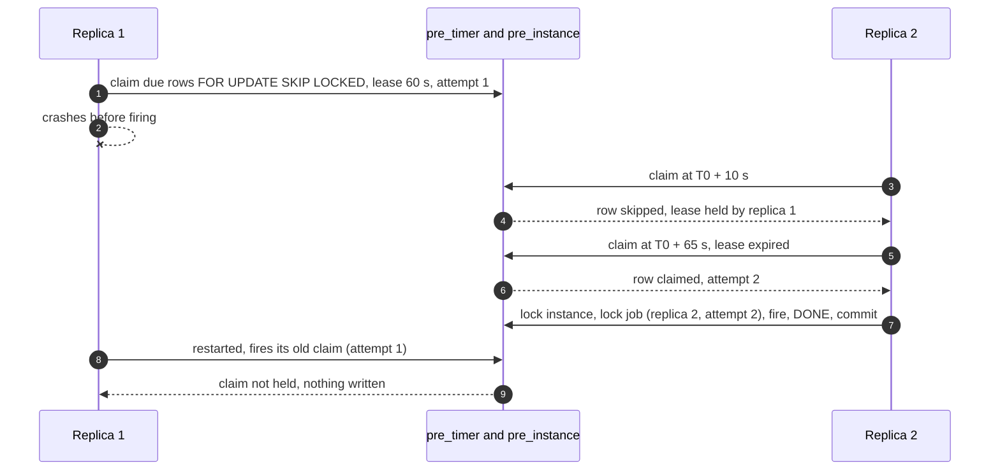
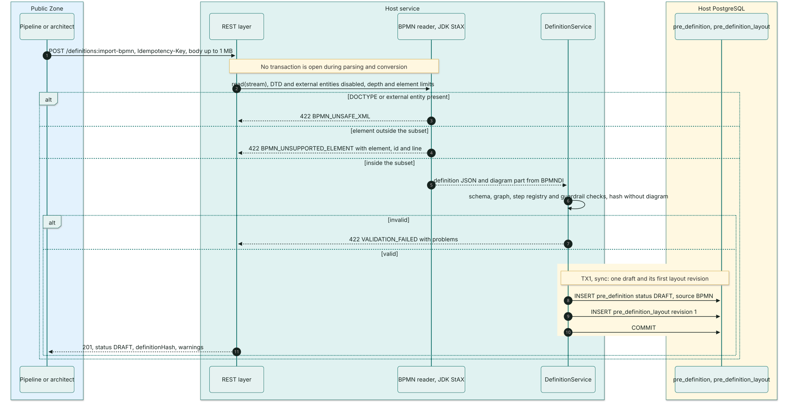
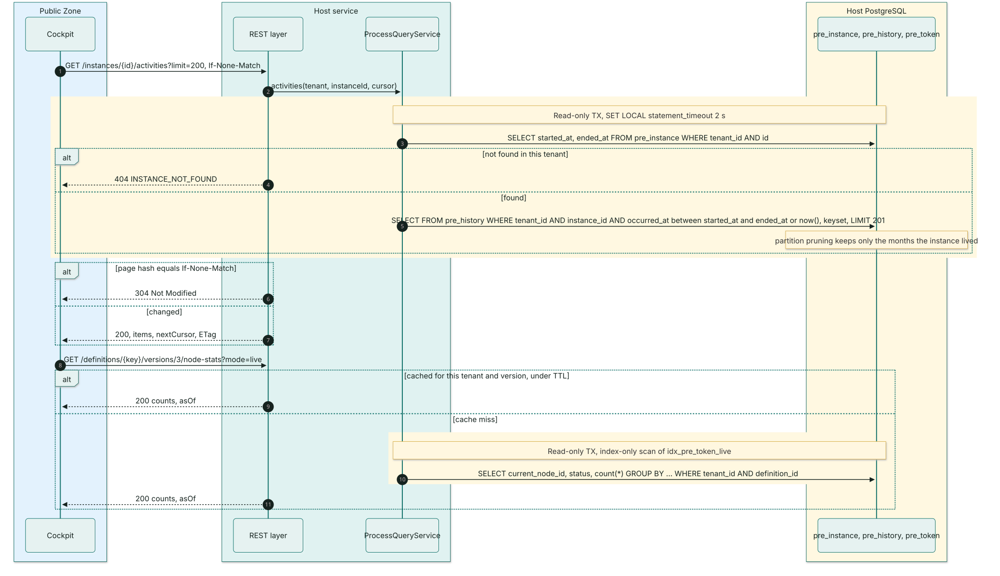
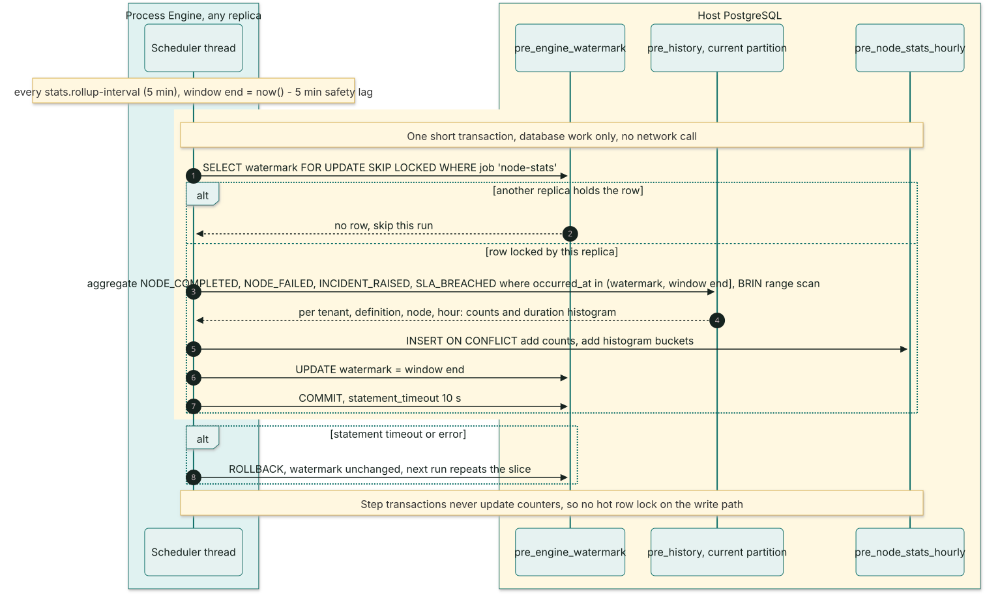

# Process Engine: Design

Status: architecture baseline (M0), updated 2026-11-18 for the cockpit direction (PD-032 to PD-042) and 2026-11-19 for the accepted ADR-0008, ADR-0009, ADR-0016, ADR-0018, ADR-0020 and ADR-0021. Conforms to ADR-0001 to ADR-0016, ADR-0017 (full BPMN 2.0 on the roadmap; the do-now items of [`standards-compliance.md`](../../docs/architecture/standards-compliance.md) section 9 are applied below and tagged with their milestone), ADR-0018 (the BPMN semantic model is canonical), ADR-0020 (execution tree with scope tokens from M2), ADR-0021 (Jackson 3 inside the core), ADR-0022 (package root), and [`docs/product/requirements.md`](../../docs/product/requirements.md). Money values follow the canonical contract in [`rule-engine/docs/DESIGN.md`](../../rule-engine/docs/DESIGN.md) section 3.4. Cross-module facts (transaction model, capacity baseline, failure table) are owned by [`docs/architecture/overview.md`](../../docs/architecture/overview.md); this document owns the Process Engine's model, DDL, APIs and read models.

Contents: 1 Context and boundaries. 2 Modules, ports and adapters. 3 Domain model and state machines. 4 Transaction model. 5 Definitions: notation, hash, diff, layout, BPMN, forms, step catalogue. 6 Java API and REST contract. 7 Storage model. 8 Read models, query limits and capacity math. 9 Failure modes. 10 Security controls. 11 Open questions.

## 1. Context and boundaries


Source: [`diagrams/security-zones.mmd`](diagrams/security-zones.mmd). Numbered edges: 1 to 4 enter through the bank's gateway; 6 to 8 run inside the host transaction; 9 to 11 are the Async Wait-State (ADR-0008), where the adapter call in 11 runs with no database connection held; 12 and 13 are events and telemetry.

`horus-process-engine` is an embeddable workflow library for Java 21 and Spring Boot 4.x hosts (3.5.x tested until 1.0, ADR-0011) on the host's PostgreSQL 14 or later (the range from 1.0 is pending PD-055). Humans (`userTask`), host services (`serviceTask`), rule-based decisions (`decision`, through the Rule Engine API) and AI agents (`agentTask`) take part in one process under explicit transaction, concurrency and compensation rules.

| Boundary | Rule |
|---|---|
| Rule Engine | `process-engine-core` depends only on the `RuleEngine` API interface, an optional bean needed only when a definition has a `decision` step or an `agentTask` guardrail. The Rule Engine never depends on the Process Engine |
| Host data | The engine owns tables prefixed `pre_` and its Flyway history `pre_schema_history`. It never reads or writes host tables |
| Network | Engine code does no network I/O (`TR-EMB-05`). Adapter calls are host code, invoked outside any engine transaction |
| Identity | Tenant from the `TenantResolver`, caller, roles and groups from the `CallerResolver`. A tenant in a request body is ignored (`TR-SEC-03`) |

Non-goals: no engine server (ADR-0004), no Elasticsearch or other secondary store, no XA or two-phase commit (ADR-0007), no CMMN; full BPMN 2.0 is not an M2 goal but a staged target after 1.0 that this design must allow without a rewrite (ADR-0017), no `GROUP BY` over history on a request path (ADR-0015), no modification of a running instance's token positions by hand.

## 2. Modules, ports and adapters


Source: [`diagrams/components.mmd`](diagrams/components.mmd).

| Module | Contents | May depend on |
|---|---|---|
| `process-engine-core` | `api`, `spi` and `internal` packages: domain model, lifecycle, graph diff, validation, ports | JDK, Jackson 3 in `internal` only (ADR-0021, `TR-EMB-07`), `bpm-expression` (value types and the `ExpressionLanguage` SPI, the only way gateway conditions are compiled and evaluated, DN-05, ADR-0027); the Rule Engine only through the `DecisionPort` for `businessRuleTask`, adapted in the starter when a `RuleEngine` bean exists |
| `process-engine-bpmn` | BPMN subset reader and writer (section 5.5) | `process-engine-core`, JDK `javax.xml.stream` only |
| `process-engine-postgres` | `JdbcClient` adapters for every driven port, Flyway scripts, `SKIP LOCKED` poller, rollup job | core, Spring JDBC, Flyway |
| `process-engine-rest` | Controllers under `/api/bpm/processes/v1`, RFC 9457 errors, ETag, idempotency filter | core, bpmn, Spring WebMvc |
| `process-engine-test` | In-memory adapters that pass the same storage contract suite, `TestClock`, `StubAgentAdapter`, `@ProcessTest` | core |
| `process-engine-spring-boot-starter` | Auto-configuration, profile guards (`TR-SEC-11`), scheduler lifecycle, Micrometer, OpenTelemetry hooks | all of the above |

ArchUnit rules in every build: core imports no `org.springframework..`, `java.sql..`, `java.net..`, `javax.script..` or `java.lang.reflect..` (`TR-EMB-03`, `TR-EMB-05`, `TR-SEC-01`); no adapter port (`ServiceAdapter`, `AgentAdapter`) is called from a class that runs inside a transaction (`TR-ASY-01`); public signatures in `..api..` and `..spi..` use only JDK, engine and JSpecify types (ADR-0016); `tools.jackson..` is allowed in `..internal..` of the core only and `com.fasterxml.jackson.databind..` nowhere in the core (ADR-0021).

## 3. Domain model and state machines

### 3.1 Aggregates

| Aggregate | Root and invariants | Table |
|---|---|---|
| Definition version | `DefinitionVersion(key, version, status, document, hash, effectiveFrom)`. Content is immutable once `PENDING_APPROVAL`; only `DRAFT` content changes. The requester never approves. Approval requires `version` greater than every `ACTIVE` version of the key | `pre_definition` |
| Layout | `LayoutRevision(definitionId, revision, layout)`. Append-only; never part of the definition hash; node ids must exist in the definition | `pre_definition_layout` |
| Instance | `ProcessInstance` with its execution tree: one root scope token, one scope token per entered `saga`, and flow tokens that name their scope token (ADR-0020). Pinned to one definition version until migrated. All transitions of one instance serialise on the `pre_instance` row lock | `pre_instance`, `pre_token` |
| Task | `HumanTask(status, assignment, form, forbiddenUsers, lockVersion)`. Four-eyes is checked in `TaskService`, so Java and REST behave the same | `pre_task` |
| Incident | `Incident(status, errorCode, retryCount, lockVersion)` | `pre_incident` |
| Job | Timer, SLA escalation, async step attempt, compensation attempt or definition effective-date job, with a lease | `pre_timer` |

Value objects: `TenantId`, `DefinitionKey`, `BusinessKey`, `IdempotencyKey`, `AttemptId`, `Money`, `ContentHash`, `NodeId`. All are records with validating constructors.

### 3.2 Definition lifecycle (ADR-0012)



Source: [`diagrams/definition-lifecycle.mmd`](diagrams/definition-lifecycle.mmd).

| From | Command | Permission | Guard | To | Side effect and event |
|---|---|---|---|---|---|
| none | `importDefinition` (`POST /definitions`, start-up classpath import) | `processes:deploy` | Schema valid, size limits (`TR-DEF-05`), step registry, guardrail contract | `DRAFT` | Next `version_num`, canonical JSON and hash stored, `diagram` part split into layout revision 1, `source` recorded |
| none | `createDraft` (`POST /definitions/{key}/drafts`) | `processes:author` | `authoring.cockpit-drafts` is `true`, else `403 DRAFT_AUTHORING_DISABLED` | `DRAFT` | Copy of the chosen version, or a minimal start-end graph |
| `DRAFT` | `updateDraft` | `processes:author` | Same setting; `If-Match` equals `lock_version` | `DRAFT` | Content and hash replaced; `updated_by` recorded |
| `DRAFT` | `validate` | `processes:author` or `processes:deploy` | None | `DRAFT` | Report only |
| `DRAFT` | `requestApproval(effectiveFrom)` | `processes:author` or `processes:deploy` | Zero validation errors; `effectiveFrom` absent (means at approval) or not in the past | `PENDING_APPROVAL` | `requested_by`, `requested_at`; `processes.definition.publish-requested.v1` |
| `PENDING_APPROVAL` | `approve(comment)` | `processes:approve` | Caller is no maker of the version under `lifecycle.approver-must-differ-from` (default `makers`: not the importer or creator, not any editor of the draft, not `requested_by`; PD-096), else `403 SELF_APPROVAL_FORBIDDEN`; no `ACTIVE` version with a higher number (`409 VERSION_SUPERSEDED`); guardrail contract re-checked | `ACTIVE` | `approved_by`, `approved_at`; job `DEFINITION_EFFECTIVE` at `effective_from`; `processes.definition.approved.v1` |
| `PENDING_APPROVAL` | `reject(reason)` | `processes:approve` | Caller is not `requested_by` (`403 SELF_APPROVAL_FORBIDDEN`, detail pointing to `:withdraw`; PD-097); reason not blank | `DRAFT` | `decision_comment`; `processes.definition.rejected.v1` |
| `PENDING_APPROVAL` | `withdraw(reason?)` (`POST .../versions/{v}:withdraw`, 0.3.0; PD-097) | `processes:author`; caller is `requested_by`, anyone else gets `403 PERMISSION_DENIED`; `If-Match`; `Idempotency-Key`; reason optional (at most 2,000 characters) | `DRAFT` | Request cleared; history row `WITHDRAWN`; `processes.definition.withdrawn.v1`; nothing published (`PRE-052`) |
| `DRAFT` | `importDefinition` in the `dev` profile with `definitions.auto-approve: true` | `processes:deploy` | Profile `dev` active and no other profile, else start-up fails (`TR-SEC-11`) | `ACTIVE` | `approved_by = system:dev-auto-approve`; `approved.v1` |
| `ACTIVE` | Effective-date job finds a newer `ACTIVE` version effective | scheduler | `effective_from <= now()` of the newer version | `RETIRED` | `processes.definition.retired.v1`. Running instances keep their version |
| `ACTIVE` | `retire(reason, confirmNoVersionInEffect)` with `horus.bpm.lifecycle.retire-approval: single` (default, PD-102) | `processes:approve` | `reason` not blank; if it is the last version in effect of the key (the effective version at that instant is this one or there is none), `horus.bpm.lifecycle.retire-last-version` (PD-101): `confirm` (default) needs `confirmNoVersionInEffect: true`, else `409 LAST_VERSION_IN_EFFECT` naming what stops; `refuse` always refuses | `RETIRED` | History row `RETIRED` with reason, `approvalMode: single` and `noVersionInEffect`; `retired.v1` with the same fields. Only new starts stop (`404 NO_EFFECTIVE_VERSION` when nothing else is in effect); running instances keep their version. A version retired before its start date has its `DEFINITION_EFFECTIVE` job cancelled in the same transaction. A version is the last in effect when the effective version of the key at that instant is this one or there is none; older versions it supersedes do not count. In one transaction under the key lock the retire checks the request, computes "last" from the selected version and answers `409` where required, so a refusal writes nothing; only then does it retire the versions the selected one supersedes (`retired_by = system:effective-date`, `superseded_by`) and then this one, as the Rule Engine does (#269). The last-version check runs under the key lock, and the `409` carries `definitionKey`, `version`, `setting` and `nextEffectiveFrom` (`PRE-053`). `four-eyes` for either setting is refused at start-up in this release |
| `ACTIVE` | `retire(reason)` with `lifecycle.retire-approval: four-eyes`, or the last version in effect with `lifecycle.retire-last-version: four-eyes` (with RE-F-49; until then start-up refuses `four-eyes`) | `processes:approve` | As above; no pending request | `ACTIVE`, retirement pending | The request is recorded with its requester and reason; the version keeps serving. A second `processes:approve` holder, never the requester (`403 SELF_APPROVAL_FORBIDDEN`), confirms it to `RETIRED` with `approvalMode: four-eyes`, or cancels it with a reason, as in Rule Engine DESIGN 3.3 |
| `DRAFT` | `retire` (withdraw a draft) | `processes:author` | None | `RETIRED` | `retired.v1` |

The effective version of a key is the `ACTIVE` version with the highest `version_num` whose `effective_from <= now()`. `POST /instances` resolves it with one lookup on `idx_pre_definition_effective`.

How the slice of #47 implements the table (0.2.0):

- Every command locks all version rows of its key (`SELECT ... FOR UPDATE` in version order), then checks status, four eyes, lock version and supersession, in that order, so a refused command writes nothing. Imports take the same lock, so a concurrent import and approval of one key serialise.
- Each transition writes one row in the append-only `pre_definition_history` (action, from and to status, actor, comment, details such as the approved `source_hash` and reader version) and hands its event to the host publisher in the same transaction; the event id derives from the version id and its new lock version. A publisher that throws rolls the transition back (`PRE-037`).
- An approval whose `effective_from` has come retires the older active versions at once. A later date schedules one `DEFINITION_EFFECTIVE` job in `pre_timer`; the replica-safe job protocol of section 4.4 fires it once, under the key lock, and it retires the versions the approved one supersedes (`retired_by = system:effective-date`, `superseded_by`). The previous version stays effective until then because selection reads `effective_from`, not the job.
- `pre_definition_history` is append-only in the database too: triggers refuse `UPDATE`, `DELETE` and `TRUNCATE` (SQLSTATE 55000), as on `rle_version_history` (`TR-OBS-01`).
- The four-eyes `CHECK` exempts the literal approver `system:dev-auto-approve`. That id is written only by the dev auto-approval and by a self-approval with maker-checker off, and the starter refuses both settings outside the `dev` profile (`PRE-022`). No caller may act under an id starting with `system:` at any entry point: import, lifecycle commands, reads, instance start and task work all answer `403 PERMISSION_DENIED`. So the exemption cannot be reached by naming a user that way, and history and events never credit the engine with a person's work. The engine's own paths (start-up import, job firing) resolve no caller.
- `maker-checker.enabled: false` (accepted on the `dev` profile only) lets a requester approve their own version; the approval is recorded with approver `system:dev-auto-approve`, so the table's four-eyes `CHECK` still holds, and the history row names the person.
- A reject clears the request (`requested_by`, `requested_at`, `effective_from`) and keeps the reason in `decision_comment`; the next request records a new requester. The requester cannot reject their own request: `403 SELF_APPROVAL_FORBIDDEN`, pointing to withdraw (PD-097, withdraw is #271), as in the Rule Engine.
- The approver differs from every maker of the version (PD-096): the importer or creator (`created_by`), every editor once draft editing exists, and the requester. `horus.bpm.lifecycle.approver-must-differ-from: requester` (the shared host setting) relaxes this to the requester only; the requester can never approve under either value.

A version is the last in effect when, at the retirement instant, the version selected for new starts is this one or there is none (PD-101, PD-102). The lower-numbered versions it supersedes are retired in the same transaction, before it, so they do not count; a version approved with a later start does not count either. The `409 LAST_VERSION_IN_EFFECT` problem body carries:
- `definitionKey` and `version`;
- `setting`;
- `nextEffectiveFrom`, the later start, or null;
- a detail such as "No version of loan-review will be in effect. New starts will fail until a new version is approved."

The check runs under the key lock that every definition command takes, so two concurrent retirements of the last two versions run one after the other and the second one sees the result of the first. The confirmation flag is needed on the call that makes the version retire while it is the last in effect: the `single` retire, the four-eyes request, or the four-eyes confirmation if the version has become the last since the request (Rule Engine DESIGN 3.3.4). Retiring a definition never touches running instances (`PRE-053`).

Approval sequence, with the self-approval and supersession refusals:


Source: [`diagrams/definition-approval.mmd`](diagrams/definition-approval.mmd).

### 3.3 Instance states



Source: [`diagrams/instance-states.mmd`](diagrams/instance-states.mmd).

| From | Trigger | Guard | To | Event |
|---|---|---|---|---|
| none | `start` | Effective version exists; business key unused for `(tenant, key)`, else the existing instance is returned (`TR-IDEM-02`) | `RUNNING` | `processes.instance.started.v1` |
| `RUNNING` | Step transition, incident retry, migration | `pre_instance` row lock | `RUNNING` | `processes.step.completed.v1` |
| `RUNNING` | Last token reaches an `end` step | None | `COMPLETED` | `processes.instance.completed.v1` |
| `RUNNING` | `cancel(reason)` | `processes:cancel` (PD-103; `processes:start` no longer grants it); `reason` not blank, at most 2,000 characters | `CANCELLED` | Under the `pre_instance` row lock, open tasks, jobs and timers are cancelled (ADR-0020). History row `INSTANCE_ENDED` whose `details` holds the actor, the reason and `CANCELLED`. `processes.instance.cancelled.v1` carries `cancelledBy` and `reason`. Running a compensation on cancel is not part of 0.2.0 (PE-F-65, 1.2) (`PRE-054`) |
| `RUNNING` | `onFailure: compensate` exhausted, or `throwCompensation` | Compensation stack not empty | `COMPENSATING` | `processes.compensation.started.v1` |
| `COMPENSATING` | Stack walked to the bottom | Every handler `DONE` or resolved | `FAILED` | `processes.instance.failed.v1` |

An open incident does not change the instance status; the affected token stays in its waiting status and the incident row records the cause.

### 3.4 Token states

Processes fork at a `parallelGateway`, so positions live in `pre_token` rows, not in a column of `pre_instance`. Every token has a kind (ADR-0020, PD-059, `TR-STD-29`):

| Kind | Created | `scope_token_id` | `current_node_id` |
|---|---|---|---|
| `SCOPE` | One root scope token at instance start; one per entry into a `saga` block | Null for the root; the enclosing scope token for a `saga` | The definition key for the root; the `saga` block id |
| `FLOW` | At start, at a fork, after a join, at the first step inside a `saga` | The scope token the position belongs to | The step the token is on |
| `MI_BODY` | From S1, for a multi-instance body | The enclosing scope token | The multi-instance activity |

Joins count only tokens of one scope token, and compensation walks only the stack of one scope token, so subprocesses, event subprocesses and multi-instance (S1) add `SCOPE` and `MI_BODY` rows without changing this table or the join and compensation code ([`standards-compliance.md`](../../docs/architecture/standards-compliance.md) section 5.1).



Source: [`diagrams/token-states.mmd`](diagrams/token-states.mmd).

| From | Trigger | To | Note |
|---|---|---|---|
| none | Instance start, or a `saga` block entered | `WAITING_SCOPE` | `SCOPE` token; the first `FLOW` token of the scope is created `ACTIVE` in the same transaction |
| `WAITING_SCOPE` | The last live `FLOW` token under the scope token completes (an `end` step for the root; the end of the block's `steps` for a `saga`) | `COMPLETED` | Root: the instance completes. `saga`: a new `FLOW` token continues at the block's `next` in the enclosing scope |
| `WAITING_SCOPE` | A step under the scope failed with `onFailure: compensate`, or `throwCompensation` ran, and the scope's stack was walked to the bottom | `COMPENSATED` | Live `FLOW` tokens under it are `CANCELLED` when the walk starts |
| `WAITING_SCOPE` | Instance cancelled, or migrated off the `saga` block | `CANCELLED` | Every live `FLOW` token under it is cancelled in the same transaction |
| none | Start, or fork at a `parallelGateway` | `ACTIVE` | `FLOW` token; one per outgoing branch, under the scope token of the gateway |
| `ACTIVE` | `userTask` reached | `WAITING_USER` | Task row created in the same transaction |
| `WAITING_USER` | Task completed | `ACTIVE` | Moves to the next step in the same transaction |
| `ACTIVE` | Async step reached | `WAITING_ASYNC` | Job row created; TX1 claims it later (section 4) |
| `WAITING_ASYNC` | TX2 accepts the result | `ACTIVE` | Guardrail and schema checks in TX2 |
| `ACTIVE` | `timer` step | `WAITING_TIMER` | Job `TIMER` at the due time |
| `WAITING_TIMER` | Timer fires | `ACTIVE` | |
| `ACTIVE` | Arrives at a converging `parallelGateway` | `JOINED` | Under the `pre_instance` row lock; the last arrival among the tokens of the same scope token creates the post-join `ACTIVE` token (`TR-ASY-03`) |
| `JOINED` | The arrival that brings the `JOINED` tokens of the same scope token on the gateway to its number of incoming flows | `COMPLETED` | Same transaction as that arrival; the first tokens in creation order are spent, so a further arrival over a loop waits for the next set. Tokens of other scope tokens are never counted (`PRE-044`) |
| `ACTIVE` | `end` step, or the end of a `saga` block's `steps` | `COMPLETED` | The scope token is checked for completion in the same transaction |
| `COMPLETED` | Compensation of the token's steps ran (for a `SCOPE` token: a later `throwCompensation` walked its stack) | `COMPENSATED` | |
| `ACTIVE`, `WAITING_USER`, `WAITING_ASYNC`, `WAITING_TIMER`, `WAITING_EVENT` | Instance cancelled, or migrated off the node | `CANCELLED` | Under the `pre_instance` row lock: open task `CANCELLED`, open job `CANCELLED`, event subscriptions of the token deleted (S2). An adapter call already running is not stopped; its TX2 finds the job `CANCELLED` and writes only `LATE_RESULT_DISCARDED` (M2, DN-10, `PRE-041`). From S1 interrupting boundary events and terminate end events use the same transition |

Every token row carries `definition_id`, copied from the instance and changed with it by migration, so live counts per node read one index (section 8.2).

Cost of scope tokens: one extra row per instance and one per `saga` entry, about 150 bytes each; at 1 million instances a month with one `saga` each, about 300 MB a month (section 8.4). The `WAITING_SCOPE` status is outside the `idx_pre_token_live` predicate, so live counts per node are unchanged.

### 3.5 Task states



Source: [`diagrams/task-states.mmd`](diagrams/task-states.mmd).

| From | Command | Permission | Guard | To |
|---|---|---|---|---|
| none | Token reaches a `userTask`, or a guardrail routes to a human | engine | None | `OPEN` |
| `OPEN` | `claim` | `processes:task:work` | Caller matches the user, one of the roles or one of the groups; not in `forbidden_users` | `CLAIMED` |
| `CLAIMED` | `unclaim` | `processes:task:work` | Caller is the claimant | `OPEN` |
| `CLAIMED` | `delegate(user)` | `processes:task:manage` | Target not in `forbidden_users` | `CLAIMED` |
| `OPEN` | `reassign(user)` | `processes:task:manage` | Target not in `forbidden_users` | `CLAIMED` |
| `CLAIMED` | `complete(result)` | `processes:task:work` | Caller is the claimant; four-eyes (`403 SELF_APPROVAL_FORBIDDEN`); result valid against the form (`422 FORM_VALIDATION_FAILED`); `If-Match` matches | `COMPLETED` |

Guards run in this order under the `pre_instance` row lock, and a refused command writes nothing: the task's `lockVersion` against `If-Match` (`409 VERSION_CONFLICT`), the status (`409 INVALID_STATE`), the claimant or the candidate (`403 TASK_NOT_ASSIGNED`), then four eyes (`403 SELF_APPROVAL_FORBIDDEN`). The change itself is a conditional `UPDATE pre_task ... WHERE lock_version = :v AND status = ...` (and `claimed_by = :caller` for unclaim and complete), so a concurrent change that slipped past the read still changes zero rows and is `409`. Claim and unclaim write a `TASK_CLAIMED` or `TASK_UNCLAIMED` history entry and hand their event to the host publisher in the same transaction (section 6.4). `GET /tasks/{id}` answers `allowedActions` for the caller, computed at read time from these guards and never stored with an idempotent answer. Claims do not expire in 0.2.0; delegate, reassign and the form check follow with their slices.
| `OPEN`, `CLAIMED` | Instance cancelled, or migrated off the step | engine | None | `CANCELLED` |

## 4. Transaction model

| Step kind | Transaction | Why |
|---|---|---|
| `decision`, gateways, `userTask` state changes, `timer` scheduling, `serviceTask` with `mode: local` | Sync: inside the caller's or the scheduler's transaction | Writes only to the host database; atomic with business state |
| `agentTask`, `serviceTask` with `mode: remote`, remote compensation handlers | Async Wait-State: TX1 claim, call with no connection, TX2 complete | A network call must never hold a connection or a row lock (ADR-0008, `TR-ASY-01`) |
| Definition lifecycle commands, layout writes | Sync, one short transaction each | Database only; validation runs before the transaction opens |
| BPMN import and export | Parse and convert outside any transaction; one insert transaction | CPU work on up to 1 MB of XML must not hold a connection |
| Rollup of node statistics | One short scheduler transaction per slice | Database only, no network; bounded by `statement_timeout` |


Source: [`diagrams/async-wait-state.mmd`](diagrams/async-wait-state.mmd). TX2 requires `status = 'CLAIMED'` as well as the lease, so a job cancelled meanwhile is never completed (DN-10). The worker claims a job only when an adapter executor slot is free, so time spent queued inside the JVM never consumes the lease. The lease is the step timeout plus `jobs.lease-margin` (default 30 s), stored per row in `pre_timer.lease_duration` so a batch claim computes `locked_until` per job in SQL.

### 4.1 `agentTask` guardrail pipeline (`TR-AGT-01` to `TR-AGT-03`)

1. Bounded inputs: `${instance.<path>}` references (schema `$defs/variableRef`) resolve into an explicit input map; fields marked `mask: true` are hashed before any history write.
2. TX1 claims; the adapter `AgentAdapter.execute(AgentInvocation)` runs with no connection, under the step `timeout`. The engine never embeds a model SDK.
3. TX2 validates the output against `outputSchema`. The result may carry optional labels (PD-014, M2): `AgentResult.labels()` is a `Map<String, String>` recorded in history and never acted on; `model` and `promptVersion` are reserved and documented, a host may add its own keys; at most `agents.labels.max-count` (16) entries, keys up to `agents.labels.max-key-length` (64) and values up to `agents.labels.max-value-length` (256) characters, which may be lowered only; a result above the bounds is a failed attempt with `AGENT_LABELS_INVALID` (`TR-AGT-02`). A violation is a failed attempt; after `retry.max` the incident `AGENT_SCHEMA_INVALID` opens.
4. TX2 evaluates `guardrails.decision` with `RuleEngine.evaluate`. Contract: hit policy `first` or `unique`, output `allow: boolean`, optional `reasons: list<string>`. Checked at import, at request-approval and at approval (`422 GUARDRAIL_CONTRACT_INVALID`). At run time a decision error or a non-complying later version counts as `allow == false` with reason `GUARDRAIL_EVALUATION_ERROR` (fail closed).
5. `allow == true` advances and records `guardrailDecisionId`. `allow == false` with `route-to-human` opens an approval task with inputs, output, `reasons` and matched rule ids; with `fail` opens an incident or starts compensation.
6. A reviewer's change to the agent output is stored as `human_override` in history for offline evaluation.

### 4.2 Saga compensation (ADR-0007, `TR-COMP-01` to `TR-COMP-03`)

A completed `serviceTask` or `agentTask` with a `compensate` handler pushes `(step_id, attempt_id, handler, input_snapshot)` onto `pre_compensation_stack` under its scope token: the enclosing `saga`'s scope token, or the root scope token outside any `saga` (ADR-0020). On `onFailure: compensate` or `throwCompensation` the stack of the failing or throwing step's scope token is walked newest first, and entries under other scope tokens are untouched (`PRE-044`); each handler call is an async job with its own retry policy and a new `attemptId`, and receives the forward step's `attemptId` as `forwardAttemptId`. `compensate: manual` opens `COMPENSATION_MANUAL_REQUIRED` instead of skipping.

### 4.3 Business calendars and migration

`BusinessCalendar` (`add`, `isBusinessTime`) computes `due_at` from working hours, time zone and holidays per tenant (`TR-CAL-01`, `TR-CAL-02`). `MigrationService` validates a plan as a dry run, then executes in batches of 100 instances, one `pre_instance` lock at a time; it updates `pre_instance.definition_id` and every token's `definition_id` in the same transaction (`TR-MIG-01`, `TR-MIG-02`). Explicit step mappings are M3 (`TR-MIG-03`).

### 4.4 Jobs and timers across replicas (`PRE-006`, `TR-PERF-05`, `TR-ASY-02`)

Every replica runs one poller thread. A poll is two kinds of short transaction, and no network call happens in either:

1. **Claim.** One statement selects due rows of every tenant (`DUE` with `next_fire_at <= now`, or `CLAIMED` with an expired `locked_until`) `ORDER BY next_fire_at LIMIT jobs.batch-size FOR UPDATE SKIP LOCKED`, and updates them to `CLAIMED`, `locked_by = jobs.replica-id`, `locked_until = now + lease_duration`, `attempt + 1`. It commits at once, so every replica sees the lease. Rows another replica is claiming are skipped, never waited for.
2. **Fire, one transaction per job.** The handler locks its aggregate first (the `pre_instance` row for a timer, the same order as every user command, so the two never deadlock), then locks the job row and checks that it is still `CLAIMED` by this replica with the same `attempt` and an unexpired lease. Only then does it apply `JobDue` to the waiting token and run the synchronous steps that follow; the job becomes `DONE` in that same transaction.



Because the firing and `DONE` commit together and the attempt number fences an old claim, a timer fires at most once; because a dead replica's lease expires, it fires at least once. A failing firing rolls back and the job is released to `DUE` after `jobs.retry-backoff` times the attempt, or `FAILED` after `jobs.max-attempts`. A timer whose instance ended, or whose token moved on, is marked `DONE` without firing. A cancelled job is never fired. The poller loop never ends silently: any `Throwable` from one poll, an `Error` included, is logged once for that poll (replica and exception class, no payload) and the next poll runs after `jobs.poll-interval`; a `VirtualMachineError` is logged, marks the `processEngineJobs` health contributor `DOWN` and stops the loop, so the orchestrator restarts the host. The health details carry the replica id and the time of the last successful poll. The intermediate timer catch event of this release takes `timeDuration` (days, hours, minutes, seconds) or `timeDate` (with an offset); cycles, calendar durations, boundary timers and the rest of the event set follow with the events stream. A step reached after a timer runs with no caller. The fire transaction acts for the job's tenant as `system:timer`, and a decision step that follows is evaluated through the `DecisionPort` in the tenant of the locked `pre_instance` row, as `system:process-engine`, through the Rule Engine's tenant-scoped entry point (ADR-0027, `PRE-055`). That entry point is not reachable by host code: it lives in the engine-to-engine package `rules.embedded`, the `RuleEngine` bean does not implement it, and the package-private decision port claims it once from the Rule Engine's `EmbeddedEngineGrant`, as the registered claimant of `system:process-engine`, and keeps it to itself. The process starter passes the grant to the port at start-up, so a later claim by host code fails. `DecisionCaller.Engine` has a package-private constructor, so only the timer path asks for engine work (#336). The identity is fixed when it is built and must be a registered engine identity; any other `system:` id is refused. That context is a parameter of the fire transaction, built only by the job handler, never a thread-local and never taken from a request, so it cannot outlive the transaction or reach another call. The caller-tenant guard for requests stays: a decision inside a request runs only when the caller's tenant is the instance's. A rule set that exists only in another tenant, or a host Rule Engine without the tenant-scoped entry point, fails the step closed and the firing rolls back (`PRE-056`). A decision row the Rule Engine has already written, for example on no match, rolls back with the firing.

**Known gap against ADR-0027, left to [#167](https://github.com/dhluong90/horus-Agentic-BPM/issues/167).** ADR-0027 gives the port an `evaluationTime` and a step `idempotencyKey`; today's `DecisionPort` has neither. The decision is evaluated at the engine clock of the firing, and it carries no idempotency key, so a firing that rolls back and fires again writes a fresh `rle_decision` row instead of replaying the first. Because the decision row commits only with the firing, no duplicate row is ever committed; the replayed `decisionId` and the pinned evaluation time follow with the full port in #167, together with `onBehalfOf` (`PRE-046`, `PRE-047`, still pending).

## 5. Definitions: notation, hash, diff, layout, BPMN, forms, step catalogue

### 5.1 Notation and canonical model (ADR-0013, ADR-0018, `TR-DEF-01`, `TR-STD-28`)

The canonical model in `process-engine-core` is the BPMN 2.0.2 semantic model: sealed records for flow nodes and sequence flows with ids, HORUS extension records for `agentTask`, guardrails, async mode, forms and SLA, and opaque foreign extensions (ADR-0018, PD-060). Our JSON (or YAML) is its canonical serialisation: the form that is stored, hashed, diffed and approved. The v1 reader maps a `process-definition.v1` document onto the model, and the canonical writer prints the model back; reading and writing a v1 document gives its RFC 8785 form unchanged, so its hash is unchanged (`PRE-043`). The format is owned by [`api/schema/process-definition.v1.schema.json`](../api/schema/process-definition.v1.schema.json). It may carry an optional `diagram` part (node positions, edge waypoints, lanes; schema [`api/schema/definition-layout.v1.schema.json`](../api/schema/definition-layout.v1.schema.json)). On import the engine stores the `diagram` part as a layout revision and removes it from `definition_json`.

Standards foundations (ADR-0017):

| Rule | Milestone |
|---|---|
| The document as received (JSON, YAML, or from M3 BPMN XML) is stored in `source_document` with `source_format` and `source_hash`; it is never executed (DN-01, `PRE-039`) | M2 |
| `expressionLanguage` names the language of every condition; only `urn:horus-bpm:expr:v1` before S1 (DN-02) | M2 |
| Step ids accept the BPMN id form `^[A-Za-z_][A-Za-z0-9_.-]*$` (at most 100), so imported BPMN ids are kept; kebab-case stays the recommended style; definition keys stay kebab-case (DN-03, `PRE-042`) | M2 |
| The v1 reader generates sequence flow ids deterministically (`<from>__<to>`, `<gateway>__b<i>`, `<gateway>__default`, `<gateway>__f<i>`); they are not part of the hash because they are derived | M2 |
| The in-memory model is the BPMN semantic model (flow nodes and sequence flows with ids, HORUS extensions for our step types); a `saga` is a `transaction` subprocess and a `callProcess` a `callActivity` in the model; the M3 BPMN subset reader and writer are built on it ([`standards-compliance.md`](../../docs/architecture/standards-compliance.md) section 3; decided 2026-11-19, PD-060) | M2 (model, `PRE-043`), M3 (BPMN reader) |

### 5.2 Content hash (`TR-DEF-04`)

`definition_hash` is the lowercase hex SHA-256 of the RFC 8785 (JSON Canonicalization Scheme) serialisation of the canonical document written from the model, with expressions printed in their normal form through the `ExpressionLanguage` printer and the `diagram` member removed (ADR-0026). It is computed in the schema version the document is stored in and never recomputed when a later schema version exists; a BPMN import produces the lowest schema version that can express the model, which keeps `PRE-034` true (DN-04). YAML is converted to JSON first. The canonicaliser is about 150 lines in `process-engine-core`, with the RFC 8785 test vectors in CI; no dependency. A pipeline compares `source_hash`, the SHA-256 of the raw bytes as received, with the SHA-256 of the committed blob (`git show <commit>:<path> | sha256sum`), so "does production match Git" is one string comparison (ADR-0026); the cockpit shows the hash on every version (PD-036).

### 5.3 Graph diff (PE-F-46)

`GraphDiff diff(base, target)` is a pure function. Nodes are matched by step `id`; edges by `(from, to, kind)` where kind is `next`, `branch[i]`, `default` or `fork`. Output: `nodesAdded`, `nodesRemoved`, `nodesChanged` (each with JSON Pointer paths and old and new values), `edgesAdded`, `edgesRemoved`. Layout is never part of the diff. Complexity O(N + E); a 500-node definition diffs in under 5 ms.

### 5.4 Layout (ADR-0013, `TR-DEF-02`, M3)

Layout revisions are append-only rows with author and time. Saving needs `processes:author` and `If-Match: "<revision>"`, and no approval, because layout never changes behaviour (principle 6 wording, PD-040). A layout may list a subset of nodes; the cockpit places the rest with automatic layout. A revision referring to a node id that is not in the definition is `422 LAYOUT_INVALID`. Size limit 256 KB. Layout writes stay allowed when `authoring.cockpit-drafts` is `false`.

### 5.5 BPMN subset import and export (ADR-0013, PE-F-41 M3, PE-F-53 M3 cut candidate)



Source: [`diagrams/bpmn-import.mmd`](diagrams/bpmn-import.mmd).

| BPMN 2.0 element | Our step | Notes |
|---|---|---|
| `startEvent` (none) | `start` | One per process |
| `endEvent` (none) | `end` | |
| `userTask` | `userTask` | `horus:assignee`, `horus:fourEyes`, `horus:form`, `horus:sla` extension attributes |
| `serviceTask` | `serviceTask` | `horus:handler`, `horus:mode`, `horus:compensate` |
| `serviceTask` with `horus:type="agentTask"` | `agentTask` | `horus:agent`, `horus:outputSchema`, `horus:guardrail` are required |
| `businessRuleTask` | `decision` | `horus:ruleSet` |
| `exclusiveGateway` with `conditionExpression` and `default` | `exclusiveGateway` | Conditions in our expression language, `language="urn:horus-bpm:expr:v1"` |
| `parallelGateway` | `parallelGateway` | |
| `intermediateCatchEvent` with `timerEventDefinition` (`timeDuration` or `timeDate`) | `timer` | |
| `callActivity` | `callProcess` | `calledElement` is the definition key |
| `transaction` subprocess | `saga` | |
| `intermediateThrowEvent` with `compensateEventDefinition` | `throwCompensation` | |
| `sequenceFlow` | `next`, `branches[]` | |
| `bpmndi:BPMNShape`, `bpmndi:BPMNEdge` | layout revision 1 | Bounds and waypoints |
| Anything else (message, signal, error and boundary events, inclusive and event-based gateways, lanes with semantics, scripts, multi-instance markers) | rejected in M3 | `422 BPMN_UNSUPPORTED_ELEMENT` naming element, `id`, line and the stage that adds it ([`standards-compliance.md`](../../docs/architecture/standards-compliance.md) section 6.1, `TR-STD-04`). From S1 every element is imported and displayed, and activation of a definition with an element not yet executable is `422 BPMN_NOT_EXECUTABLE` |
| A CMMN document | rejected | `422 CMMN_UNSUPPORTED` (ADR-0017, `TR-STD-26`) |

The reader uses `XMLInputFactory` with `SUPPORT_DTD=false` and `IS_SUPPORTING_EXTERNAL_ENTITIES=false`; any `DOCTYPE` is `422 BPMN_UNSAFE_XML`. Limits: 1 MB, nesting depth 32, 5,000 elements. Export writes the same subset with the `horus` namespace and BPMNDI from the latest layout (or from an automatic layout computed by the cockpit and sent with the request). Until layout revisions are stored (PRE-026), `SubsetBpmnWriter` generates a left-to-right layout: columns by shortest distance from the start event, rows in document order, back edges routed below the diagram. The export reads the stored source again and checks the recorded `definition_hash` before writing, the same integrity check as execution. Round trip: export then import of a definition gives the same `definition_hash`; CI checks this for every example definition and validates exported XML against the BPMN 2.0 XSD.

### 5.6 Task forms (PE-F-51, M2)

A `userTask` declares `form` as one of: a form key registered by the host through `FormRegistry`; an object `{ "schema": "<path of a JSON Schema>", "hints": { ... } }`; or `{ "link": "<URL template>" }` for the host's own screen. `GET /tasks/{id}/form` returns the resolved form ([`api/schema/task-form.v1.schema.json`](../api/schema/task-form.v1.schema.json)): JSON Schema 2020-12 limited to `string`, `integer`, `number`, `boolean`, `enum`, `date`, `datetime` and the money object; display hints (`order`, `widgets`, `labels` per locale, `readOnly`); prefilled data from declared variables, masked fields still masked; or the link. `:complete` validates the result against the same schema in the service layer (`422 FORM_VALIDATION_FAILED` with JSON Pointers). A link must be relative or match `tasks.form-link-origins`, checked at import; otherwise the import fails with a `FORM_LINK_NOT_ALLOWED` problem inside `422 VALIDATION_FAILED`.

### 5.7 Step catalogue (PE-F-52, M3)

`GET /step-catalogue` returns what an author may place on the canvas: service handlers and agent adapters registered through `StepRegistry` (name, mode, input schema, compensable), rule sets usable as `decision` steps (name, effective version, inputs, outputs), rule sets that meet the guardrail contract, calendars, form keys, and roles and groups when the host provides a `RoleCatalogue`. Handlers are registered as typed functional interfaces under a name; the engine never invokes a method by reflection (`TR-SEC-01`). Import validation uses the same registry, so a step the catalogue does not offer cannot be imported either.

### 5.8 First executable slice (0.1.0): decisions of 19 Nov 2026

The first Process Engine slice (pull request #149, on the contract of #139) settles these points. Each one stays until the slice named in its last column replaces it.

| Topic | Decision | Until |
|---|---|---|
| HORUS extension namespace | BPMN: `urn:horus-bpm:bpmn:extensions:v1`, prefix `horus`. DMN uses the same pattern: `urn:horus-bpm:dmn:extensions:v1`. A new major version of the extension vocabulary is a new URI; readers keep reading every earlier URI | Permanent |
| Behaviour registration | `BehaviorRegistry` keys behaviours by node class plus event-definition type: no definition, exactly one definition class, or `MULTIPLE` (S3). Lookup is exact; a node with no registered key is `422 BPMN_NOT_EXECUTABLE` at activation, naming the element, its id and the stage that adds it. This is the only change to the kernel contract of #139 | Permanent |
| Kernel ids | Child ids derive from the instance id and `pre_instance.seq`, so `apply` is deterministic and a replay gives the same ids. `seq` is incremented only under the instance row lock, in the transaction of the tokens it numbers. Derived ids are predictable within a tenant, so no read or write relies on id secrecy: the assignment and tenant checks are the control | Permanent |
| Import status | An import creates a `DRAFT`. It becomes `ACTIVE` only through `definitions.auto-approve`, which applies to start-up and `POST /definitions` imports alike and which start-up refuses unless `dev` is the only active profile (besides `test`). Request-publish, approve and reject arrive with the definition lifecycle slice (`PRE-018` to `PRE-021`). Until then a draft cannot be started outside `dev`, so the Process Engine in 0.1.0 is a preview for evaluation, and the release notes say so | Definition lifecycle slice (#47, 0.2.0): replaced by section 3.2 |
| Task completion | **Replaced in 0.2.0 by the task slice (#49, `PRE-051`).** In 0.1.0 `POST /tasks/{id}:complete` needed no prior claim. Since 0.2.0 only the claimant completes a `CLAIMED` task: an `OPEN` task is `409 INVALID_STATE` (claim it first) and a task claimed by another user is `403 TASK_NOT_ASSIGNED`; the regression tests are `TaskLifecycleIT.PRE_003_an_open_task_must_be_claimed_before_it_is_completed_and_nothing_is_written` and `PRE_003_a_task_claimed_by_another_officer_is_refused_with_403`. Still enforced: the caller must be a candidate (the task's user, role or group), the tenant comes from `EngineAccess`, `Idempotency-Key` and `If-Match` are required (`428`), and four eyes refuses the starter and every earlier completer at claim and at completion (`403 SELF_APPROVAL_FORBIDDEN`, `PRE-007`) | Closed |
| What is compiled | The kernel is compiled from the stored source document. The approval binds it: `source_hash` and the BPMN reader version are recorded in `processes.definition.approved.v1` (and in the dev auto-approval) and in the history row of the approval transaction. Before compiling, the engine compares the SHA-256 of the stored source with the **approved** `source_hash`; on a mismatch it refuses to start or advance that version, raises an incident on each affected instance, writes an audit entry and alerts. A reader version different from the approved one is logged at WARN with the definition and both versions. This is the interim form of ADR-0026 decision 4 (pull request #150). `definition_hash` is not presented as a behaviour hash until the canonical writer of the v1 profile exists; from then on the kernel compiles only from the stored canonical JSON, as for rule sets | Canonical writer (`PRE-043`) |
| Events | **Decided for 0.1.0 (19 Nov): handover inside the transaction.** The engine hands each event to the host's `ProcessEventPublisher` inside the transaction of the state change it reports (section 6.4), so a host can write its own outbox row atomically with the change; the engine has no outbox table. The default publisher is Spring `ApplicationEventPublisher` called in that transaction. Listener contract, also stated on the SPI: a listener that needs the event durably writes an outbox row in that transaction; a listener that only notifies (mail, UI refresh) registers with `@TransactionalEventListener(phase = AFTER_COMMIT)`, so rolled-back work never emits and delivery is at most once; a plain `@EventListener` runs in the transaction, an exception it throws rolls the state change back, and it must not do network I/O (the rule of `ServiceTaskHandler`). The audit trail (`pre_history`) is written by the engine itself and never depends on a listener. Release notes: in 0.1.0 events are durable only through a host outbox. A `pre_outbox` relayed by the engine, as the Rule Engine's `rle_decision_outbox`, is a later option and would be additive | Permanent; `pre_outbox` optional later |
| Gateway conditions | Compiled at import through an internal `ExpressionEvaluator` port with a comparison subset of `horus-expr-v1`, under the decided semantics: FEEL null logic (PD-058), `DECIMAL128` numbers, instance variables bound from JSON as `BigDecimal` and never through `double`, money compared only within one currency (number against money is a type error), and a type error failing the step. A condition that evaluates to `null` is not `true`: if no outgoing flow is selected the default flow is taken, and without one the step fails with an incident; never the first flow in document order. The parser applies the `horus-expr-v1` length, depth and node limits at import | `bpm-expression` and the `ExpressionLanguage` SPI (ADR-0027) |
| Local handlers and decisions | Run inside the caller's transaction (section 4). Each call is timed, and above `handlers.slow-call-warning` (default 200 ms) a `process.step.slow` warning names the step, the target and the elapsed time, never the inputs. The no-network rule is stated on `ServiceTaskHandler` | Permanent |
| Dependency on the Rule Engine | `process-engine-core` depends on `rule-engine-core` for now; ADR-0027 replaces this with `bpm-expression`. A `businessRuleTask` already calls a `DecisionPort` with the instance's tenant and a `DecisionCaller`: engine-owned work (a step after a timer) evaluates through `TenantScopedRuleEngine` (package `rules.embedded`, never a bean) bound to `system:process-engine`; a request still evaluates as its caller, after the caller-tenant guard. The step idempotency key, the evaluation time and `onBehalfOf` in the decision log follow with the full port (#167, section 4.4; `PRE-046`, `PRE-047`) | ADR-0027 (0.2.0) |

## 6. Java API and REST contract

### 6.1 Java API (`io.github.dhluong90.bpm.process.api`, ADR-0022)

Entry points follow ADR-0016: one interface per job, request records with builders, sealed result types, unchecked exceptions with `code()`.

```java
public interface DefinitionService {
  DefinitionVersion importDefinition(ImportRequest request);              // processes:deploy, creates DRAFT
  DefinitionVersion createDraft(DraftRequest request);                    // processes:author
  DefinitionVersion updateDraft(DefinitionRef ref, long expectedLockVersion, DefinitionDocument document);
  ValidationReport validate(DefinitionRef ref);
  // 0.2.0 (#47): each lifecycle command takes the idempotency key last; null means none.
  DefinitionVersion requestApproval(DefinitionRef ref, long expectedLockVersion, @Nullable Instant effectiveFrom,
      @Nullable String idempotencyKey);
  DefinitionVersion approve(DefinitionRef ref, long expectedLockVersion, @Nullable String comment, @Nullable String idempotencyKey);
  DefinitionVersion reject(DefinitionRef ref, long expectedLockVersion, String reason, @Nullable String idempotencyKey);
  DefinitionVersion retire(DefinitionRef ref, long expectedLockVersion, @Nullable String idempotencyKey);
  Optional<DefinitionVersion> find(DefinitionRef ref);                    // processes:read
  List<DefinitionHistoryEntry> history(DefinitionRef ref);                // processes:read, oldest first
  GraphDiff diff(DefinitionRef base, DefinitionRef target);
  LayoutRevision saveLayout(DefinitionRef ref, int expectedRevision, Layout layout);
  Optional<LayoutRevision> latestLayout(DefinitionRef ref);
}

public interface ProcessQueryService {
  Page<Activity> activities(InstanceId id, @Nullable Cursor cursor, int limit);
  NodeCounts liveNodeCounts(DefinitionRef ref);
  NodeStats windowNodeStats(DefinitionRef ref, Instant from, Instant to);
  Page<TaskSummary> tasks(TaskQuery query);
}
```

Handler results are sealed so that BPMN error events (S1) need no SPI change after the 1.0 freeze (M2, DN-09, `PRE-040`):

```java
public sealed interface HandlerResult permits HandlerResult.Completed, HandlerResult.BusinessError, HandlerResult.Failed {
  record Completed(Map<String, Object> output) implements HandlerResult {}
  record BusinessError(String code, String message) implements HandlerResult {}   // M2: incident UNHANDLED_BUSINESS_ERROR; S1: error boundary or error event subprocess
  record Failed(String errorCode, String detail, boolean retryable) implements HandlerResult {}  // technical failure: retry policy, then incident or compensation
}
```

`ProcessEngine` (start, cancel), `TaskService` (claim, unclaim, complete, delegate, reassign, form), `IncidentService`, `MigrationService` and `StepCatalogue` complete the API. The tenant and caller come from the resolvers; no method takes a tenant parameter except the batch-only `TenantScoped` variants used by host jobs.

### 6.2 REST endpoints (`/api/bpm/processes/v1`)

| Endpoint | Permission | Purpose | Idempotency and concurrency | Errors beyond the common set | Milestone |
|---|---|---|---|---|---|
| `POST /definitions` | `processes:deploy` | Import a full JSON or YAML document as the next `DRAFT`; optional `requestApproval` and `effectiveFrom` in the body | `Idempotency-Key` | `422 VALIDATION_FAILED`, `422 GUARDRAIL_CONTRACT_INVALID`, `422 DEFINITION_TOO_LARGE` | M2 |
| `POST /definitions:import-bpmn` | `processes:deploy` | Import a BPMN subset file as a `DRAFT` | `Idempotency-Key` | `422 BPMN_UNSUPPORTED_ELEMENT`, `422 BPMN_UNSAFE_XML`, `422 VALIDATION_FAILED` | M3 |
| `GET /definitions` | `processes:read` | Keys with effective version, pending count, last change | Cursor, at most 200 | | M2 |
| `POST /definitions/{key}/drafts` | `processes:author` | New draft from `fromVersion` or blank | `Idempotency-Key` | `403 DRAFT_AUTHORING_DISABLED` | M2 |
| `GET /definitions/{key}/versions/{v}` | `processes:read` | Document, status, hash, approval fields; `?include=layout` adds the latest layout; `?include=source` adds `sourceFormat`, `sourceDocument` and `sourceHash` (DN-01) | `ETag` from hash and layout revision | `404 DEFINITION_NOT_FOUND` | M2 |
| `PUT /definitions/{key}/versions/{v}` | `processes:author` | Replace draft content | `If-Match: "<lockVersion>"` | `403 DRAFT_AUTHORING_DISABLED`, `409 VERSION_CONFLICT`, `409 INVALID_STATE` | M2 |
| `POST /definitions/{key}/versions/{v}:validate` | `processes:author` or `processes:deploy` | Validation report | None | | M2 |
| `POST /definitions/{key}/versions/{v}:request-approval` | `processes:author` or `processes:deploy` | To `PENDING_APPROVAL` | `Idempotency-Key`, `If-Match` | `422 VALIDATION_FAILED`, `409 INVALID_STATE` | M2 |
| `POST /definitions/{key}/versions/{v}:approve` | `processes:approve` | To `ACTIVE` | `Idempotency-Key`, `If-Match` | `403 SELF_APPROVAL_FORBIDDEN`, `409 VERSION_SUPERSEDED`, `409 INVALID_STATE` | M2 |
| `POST /definitions/{key}/versions/{v}:reject` | `processes:approve` | Back to `DRAFT`, reason required | `Idempotency-Key`, `If-Match` | `409 INVALID_STATE` | M2 |
| `GET /definitions/{key}/versions/{v}/history` | `processes:read` | Lifecycle history, oldest first: action, statuses, actor, comment, time | None | `404 DEFINITION_NOT_FOUND` | M2 |
| `POST /definitions/{key}/versions/{v}:retire` | `processes:approve` (`ACTIVE`), `processes:author` (`DRAFT`) | To `RETIRED`; body `{ "reason": "...", "confirmNoVersionInEffect": true }`, reason required for `ACTIVE` (PD-102), the flag only for the last version in effect (PD-101) | `Idempotency-Key`, `If-Match` | `400 INPUT_INVALID`, `409 INVALID_STATE`, `409 LAST_VERSION_IN_EFFECT` | M2 |
| `GET /definitions/{key}/versions/{v}/diff?base=` | `processes:read` | Graph diff; `base` defaults to the effective version | `ETag` | | M2 |
| `GET /definitions/{key}/versions/{v}/export?format=json\|yaml\|bpmn` | `processes:read` | Export; `bpmn` is M3 | | | M2, M3 |
| `GET`, `PUT /definitions/{key}/versions/{v}/layout` | `processes:read`, `processes:author` | Latest layout; save a new revision | `If-Match: "<revision>"` on `PUT` | `409 VERSION_CONFLICT`, `422 LAYOUT_INVALID` | M3 |
| `GET /definitions/{key}/versions/{v}/layout/revisions` | `processes:read` | Revision list with author and time | Cursor | | M3 |
| `GET /definitions/{key}/versions/{v}/node-stats?mode=live` | `processes:read` | Active tokens and open incidents per node | `ETag`, `asOf` | | M2 |
| `GET /definitions/{key}/versions/{v}/node-stats?mode=window&from=&to=` | `processes:read` | Counts, p50, p95, SLA breaches per node from the rollup; window at most 31 days | `ETag`, `asOf` | `400 QUERY_INVALID` | M3 |
| `GET /step-catalogue` | `processes:author` | Section 5.7 | `ETag` | | M3 |
| `POST /instances` | `processes:start` | Start on the effective version | `Idempotency-Key`, business key | `404 NO_EFFECTIVE_VERSION` | M2 |
| `GET /instances?status=&definitionKey=&startedFrom=&startedTo=` | `processes:read` | List; `status` defaults to `RUNNING`; the range is at most 31 days | Cursor, at most 200 | `400 QUERY_INVALID` | M2 |
| `GET /instances/{id}` | `processes:read` | State, tokens, masked variables | `ETag` | `404 INSTANCE_NOT_FOUND` | M2 |
| `GET /instances/{id}/activities` | `processes:read` | Per node: entered, completed, duration, attempts, actor, incident; bounded by the instance's lifetime | Cursor, at most 200, `ETag` | `404 INSTANCE_NOT_FOUND` | M2 |
| `POST /instances/{id}:cancel` | `processes:cancel` (PD-103) | Cancel; body `{ "reason": "..." }`, required, at most 2,000 characters | `Idempotency-Key`, `If-Match` | `400 INPUT_INVALID`, `409 INVALID_STATE` | M2 |
| `GET /tasks?assignment=&status=&role=&group=&dueBefore=&slaBreached=` | `processes:task:work`; `any` needs `processes:task:manage` | Task query (section 8.2): `assignment` is one or more of `mine`, `candidate`, `any`; `status` one or more of `OPEN`, `CLAIMED`; ordered by `(dueAt, id)` | Cursor, at most 200, `ETag` | `400 QUERY_INVALID` | M2 |
| `GET /tasks/{id}`, `GET /tasks/{id}/form` | `processes:task:work` | Task context and resolved form | `ETag` | `404 TASK_NOT_FOUND` | M2 |
| `POST /tasks/{id}:claim`, `:unclaim`, `:complete` | `processes:task:work` | Section 3.5 | `Idempotency-Key`, `If-Match` | `403 SELF_APPROVAL_FORBIDDEN`, `422 FORM_VALIDATION_FAILED` | M2 |
| `POST /tasks/{id}:delegate`, `:reassign` | `processes:task:manage` | Section 3.5 | `Idempotency-Key`, `If-Match` | | M2 |
| `GET /incidents?status=OPEN&definitionKey=&nodeId=` | `processes:read` | Incident list | Cursor, at most 200, `ETag` | | M2 |
| `POST /incidents/{id}:retry`, `:resolve` | `processes:incident:manage` | Retry or resolve | `Idempotency-Key`, `If-Match` | `409 INVALID_STATE` | M2 |
| `POST /migrations`, `/{id}:validate`, `/{id}:execute` | `processes:migration:manage` | Plan, dry run, execute | `Idempotency-Key` | | M2 |

Implemented in 0.2.0 (`PRE-049`, `PRE-050`, `PRE-051`): `GET /tasks/{id}`, `POST /tasks/{id}:claim` and `:unclaim` (`If-Match` and `Idempotency-Key` required), `GET /definitions`, `GET /definitions/{key}/versions/{v}` without `include` (its `ETag` is the definition hash), `GET /instances`, `POST /instances/{id}:cancel` (`processes:cancel`; both `If-Match` and `Idempotency-Key` required, `428` without; reason required), besides the import, start, read and complete of 0.1.0. List cursors are signed with HMAC-SHA256 over tenant, filters and the last key, with one random key per database in `pre_engine_key` (section 7), so a cursor issued to another tenant or for other filters is `400 QUERY_INVALID`.

Common set on every endpoint: `400 INPUT_INVALID`, `401`, `403 FORBIDDEN` (permission), `403 TENANT_NOT_ALLOWED` (ADR-0014), `409 VERSION_CONFLICT` where `If-Match` applies, `422 IDEMPOTENCY_KEY_REUSE_MISMATCH` and `409 IDEMPOTENCY_IN_FLIGHT` with `Retry-After: 1` where `Idempotency-Key` applies (ADR-0006), `500 INTERNAL` with `correlationId` only. Bodies are RFC 9457 with `code`; `type` URIs follow ADR-0010. `lockVersion` travels as `If-Match: "<lockVersion>"` and `ETag`; `version` always means the definition version number. `/api/bpm/meta` and `/api/bpm/me` are host-level endpoints owned by [`cockpit/docs/DESIGN.md`](../../cockpit/docs/DESIGN.md) section 6; this engine contributes its feature flags there.

### 6.3 Permissions

From ADR-0010 as amended by ADR-0012: `processes:read`, `processes:deploy` (import a complete definition as a draft, the Git and pipeline path), `processes:author` (create and edit drafts, request approval, save layout, read the step catalogue), `processes:approve` (approve, reject, retire), `processes:start` (start instances), `processes:cancel` (cancel a running instance with a reason; PD-103, so starting a case and stopping one are separate duties), `processes:task:work`, `processes:task:manage`, `processes:incident:manage`, `processes:migration:manage`, `processes:calendar:manage`.

### 6.4 Events

Types follow `processes.<aggregate>.<pastTense>.v<N>`. Each is handed to the host publisher inside the transaction of the state change it reports, under the listener contract of section 5.8 (a host outbox for durable delivery, `AFTER_COMMIT` listeners for notifications); additive changes stay in `.v1`.

| Event | Payload beyond the envelope |
|---|---|
| `processes.definition.publish-requested.v1` | `definitionKey`, `version`, `definitionHash`, `requestedBy`, `effectiveFrom`, `source` |
| `processes.definition.approved.v1` | Same plus `approvedBy`, `approvedAt`, `sourceHash`, `readerVersion` (5.8) |
| `processes.definition.rejected.v1` | `definitionKey`, `version`, `rejectedBy`, `reason` |
| `processes.definition.retired.v1` | `definitionKey`, `version`, `retiredBy` or `supersededBy`; for a manual retirement also `reason`, `approvalMode` (`single` or `four-eyes`), `requestedBy` in `four-eyes` mode, and `noVersionInEffect` (PD-101, PD-102) |
| `processes.instance.cancelled.v1` | `instanceId`, `definitionKey`, `version`, `businessKey`, `cancelledBy`, `reason` (PD-103) |
| `processes.instance.started.v1`, `.completed.v1`, `.failed.v1` | `instanceId`, `definitionKey`, `version`, `businessKey` |
| `processes.step.completed.v1` | `instanceId`, `nodeId`, `attemptId`, `durationMs` |
| `processes.task.created.v1`, `processes.task.completed.v1` | `taskId`, `instanceId`, `nodeId`, assignment, `completedBy` |
| `processes.task.claimed.v1`, `processes.task.unclaimed.v1` | `taskId`, `instanceId`, `nodeId`, `assignee`, `claimedBy` or `unclaimedBy`, `definitionKey`, `version`, `businessKey`; the event id is derived from the task id and the lock version the change reaches (0.2.0) |
| `processes.incident.raised.v1`, `processes.incident.resolved.v1` | `incidentId`, `instanceId`, `nodeId`, `errorCode` |
| `processes.compensation.started.v1` | `instanceId`, `scopeId`, stack depth |

`processes.definition.deployed.v1` from the earlier baseline is removed: deploy now creates a draft, and no release has shipped.

### 6.5 Configuration (`horus.bpm.processes.*`)

| Property | Default | Meaning |
|---|---|---|
| `definitions.locations` | empty | Classpath locations imported at start-up through the `importDefinition` path, as drafts |
| `definitions.startup-tenants` | empty | Tenants the start-up import runs for; there is no principal at start-up, so the tenant is explicit. Empty means no start-up import |
| `definitions.auto-approve` | `false` | Approve imported drafts automatically, for start-up imports and for `POST /definitions` imports alike; each auto-approved import is logged at WARN with tenant and definition key. Start-up fails unless `dev` is the only active profile besides `test`, and fails whenever the removed key `definitions-auto-approve` is set at all (`TR-SEC-11`, `PRE-022`) |
| `lifecycle.approver-must-differ-from` (host property `horus.bpm.lifecycle.approver-must-differ-from`, shared with the Rule Engine) | `makers` | Shared by both engines: host property `horus.bpm.lifecycle.approver-must-differ-from` (PD-096), published as `lifecycle.approver-must-differ-from` in each engine module's `/api/bpm/meta` settings. `makers` (default): the approver differs from every maker of the version, that is the importer or creator, every editor of the draft and the requester. `requester`: the approver differs from the requester only; this relaxes a control, so it is never the default, it is logged at WARN at start-up and recorded on every approval history row. The requester can never approve under either value (`403 SELF_APPROVAL_FORBIDDEN`, with a detail naming why). Implementation: read by `ApproverMustDifferFrom` in `bpm-host-metadata` (the Rule Engine starter can read it too, #273); recorded on the history row as `details.approverMustDifferFrom` |
| `maker-checker.enabled` | `true` | `false` is refused outside the `dev` profile (`TR-SEC-11`); on `dev` it lets a requester approve their own definition version, recorded as approver `system:dev-auto-approve` (section 3.2) |
| `horus.bpm.lifecycle.retire-approval` (shared host key) | `single` | PD-102: retiring an active definition needs one `processes:approve` holder and a reason; recorded on the history row and `retired.v1`. `four-eyes` is refused at start-up until the four-eyes retirement mode is built. Published as `lifecycle.retire-approval` in `/api/bpm/meta`; read by `RetireApproval` in `bpm-host-metadata` |
| `horus.bpm.lifecycle.retire-last-version` (shared host key) | `confirm` | PD-101: retiring the last version in effect of a key needs `confirmNoVersionInEffect: true` (`confirm`) or is refused (`refuse`); `four-eyes` is refused at start-up in this release. Published as `lifecycle.retire-last-version` in `/api/bpm/meta`; read by `RetireLastVersion` in `bpm-host-metadata` |
| `lifecycle.reason-max-length` | `2000` | Longest reason (reject, retire, cancel) or approval comment; all land in the immutable history. 1 to 2,000; may be lowered, never raised (PD-103) |
| `authoring.cockpit-drafts` | `true` | `false` refuses draft creation and draft edits through `processes:author` endpoints with `403 DRAFT_AUTHORING_DISABLED`; imports with `processes:deploy`, approvals and layout writes still work (PD-036) |
| `definitions.max-nodes`, `definitions.max-bytes` | `500`, `1MB` | May be lowered, never raised (`TR-DEF-05`) |
| `tasks.form-link-origins` | empty | Origins allowed in form links; relative links are always allowed |
| `stats.live-cache-ttl`, `stats.live-cache-ttl-large` | `PT5S`, `PT15S` | Live count cache per replica; the large TTL applies when the last count exceeded `stats.live-cache-large-threshold` |
| `stats.rollup-interval`, `stats.rollup-lag`, `stats.rollup-max-slice` | `PT5M`, `PT5M`, `PT1M` | Rollup cadence, safety lag, history time per transaction |
| `stats.rollup-retention` | `P13M` | Drops whole monthly partitions of the derived rollup table |
| `query.max-page-size`, `query.statement-timeout` | `200`, `PT2S` | Page size may be lowered only; timeout per read transaction |
| `jobs.lease-margin`, `adapters.default-timeout` | `30s`, `PT30S` | ADR-0008 |
| `history.retention` | none; required outside `dev` | Whole months; drops whole monthly partitions of `pre_history` older than the period. Outside the `dev` profile start-up is refused until it is set, and a value below `history.retention-floor` or not in whole months is refused (PD-050). The process history ships in M2 and retention applies with the rule engine's in M3; before M3 nothing is deleted |
| `history.retention-floor` | `P12M` | Shortest `history.retention` accepted; a host may raise it, never lower it below the engine floor (ADR-0024, `TR-EXT-05`) |
| `jobs.timer-lease` | `60s` | Lease of timer, SLA and effective-date jobs, which make no external call (ADR-0008) |
| `jobs.enabled`, `jobs.poll-interval`, `jobs.batch-size` | `true`, `1s`, `32` | Job poller of this replica (section 4.4): one daemon thread, polls again at once while a poll fired a job; at least one replica must poll |
| `jobs.replica-id` | host name plus a random suffix | Name a replica claims jobs under (`pre_timer.locked_by`); must differ between running copies |
| `jobs.max-attempts`, `jobs.retry-backoff` | `3`, `10s` | A firing that fails rolls back and is due again after the back-off times the attempt number; after the last attempt the job is `FAILED` (incidents for jobs follow with `pre_incident`) |
| `adapters.executor-threads` | `16` | Adapter executor size per replica; a job is claimed only when a slot is free (section 4) |
| `migration.batch-size` | `100` | Instances per migration batch, one instance lock at a time (section 4.3); may be lowered only |
| `tokens.cleanup-after`, `tokens.cleanup-batch` | unset (keep), `10000` | When set, the scheduler deletes `pre_token` rows of instances ended longer ago, in batches; history keeps every transition (open question 11.3) |
| `stats.live-cache-large-threshold` | `100000` | Token count above which `stats.live-cache-ttl-large` applies |
| `query.max-range` | `P31D` | Longest time range of a list query (ADR-0015); may be lowered only |
| `idempotency.retention` | `PT24H` | How long an idempotency record answers replays |
| `lifecycle.reason-max-length` | `2000` | Longest reason a cancellation accepts (PD-103); may be lowered, never raised |
| `agents.labels.max-count`, `agents.labels.max-key-length`, `agents.labels.max-value-length` | `16`, `64`, `256` | Bounds of agent result labels (section 4.1, PD-014); may be lowered only |
| `tenancy.claim`, `tenancy.dev-tenant` | `tenant_id`, unset | Shared with the Rule Engine under `horus.bpm.*`; session-principal default resolver (ADR-0014 decision 6, PD-079) |

Extension points (ADR-0024, `TR-EXT-02`), each with an engine default registered `@ConditionalOnMissingBean`: `TenantResolver`, `CallerResolver`, `BusinessCalendar` (default 24x7), `StepRegistry`, `FormRegistry`, `RoleCatalogue` (default none), `AgentAdapter` and `ServiceAdapter` (no default; required only by definitions that use them), `OutputSchemaValidator`, `MessageAdapter` (S2), the process event publisher, and `LifecycleGuard` (default allows everything; a host guard may veto a definition, task or incident transition with its own code and can never make a refused transition succeed, `TR-EXT-06`). Approval rules, assignees, SLA durations, escalation targets, retries, timeouts and guardrails are per definition, not engine settings.

## 7. Storage model (`process-engine-postgres`)

Every table has `tenant_id` first in its primary key, unique constraints and query indexes (`TR-TEN-01`); foreign keys include `tenant_id`, so a row can never reference another tenant's row. Ids are ULIDs (`VARCHAR(26)`), times are `TIMESTAMPTZ`. Engine-internal sweeps (job poller, effective-date jobs, rollup, partition maintenance) are the only reads across tenants, and they never return rows to a caller; the tenancy rule for sweeps is the open M1 question in the architecture overview section 12.

```sql
CREATE TABLE pre_definition (
  tenant_id         TEXT        NOT NULL,
  id                VARCHAR(26) NOT NULL,
  key_name          TEXT        NOT NULL,
  version_num       INT         NOT NULL,
  status            TEXT        NOT NULL CHECK (status IN ('DRAFT','PENDING_APPROVAL','ACTIVE','RETIRED')),
  schema_version    INT         NOT NULL,
  definition_json   JSONB       NOT NULL,        -- canonical document without the diagram part
  definition_hash   CHAR(64)    NOT NULL,        -- SHA-256 of the RFC 8785 form of definition_json, in its schema version (DN-04)
  source_format     TEXT        NOT NULL CHECK (source_format IN ('JSON','YAML','BPMN_XML')),   -- M2, DN-01
  source_document   TEXT        NOT NULL,        -- as received, at most 1 MB, never executed (TR-STD-01)
  source_hash       CHAR(64)    NOT NULL,        -- SHA-256 of the source bytes
  node_count        INT         NOT NULL CHECK (node_count <= 500),
  source            TEXT        NOT NULL CHECK (source IN ('IMPORT','STARTUP','AUTHORED','BPMN')),
  effective_from    TIMESTAMPTZ,
  lock_version      BIGINT      NOT NULL DEFAULT 0,
  created_by        TEXT        NOT NULL,
  created_at        TIMESTAMPTZ NOT NULL,
  updated_by        TEXT        NOT NULL,
  updated_at        TIMESTAMPTZ NOT NULL,
  requested_by      TEXT,
  requested_at      TIMESTAMPTZ,
  approved_by       TEXT,
  approved_at       TIMESTAMPTZ,
  decision_comment  TEXT,
  retired_by        TEXT,
  retired_at        TIMESTAMPTZ,
  PRIMARY KEY (tenant_id, id),
  UNIQUE (tenant_id, key_name, version_num),
  CHECK (status <> 'ACTIVE' OR (approved_by IS NOT NULL AND effective_from IS NOT NULL)),
  CHECK (approved_by IS NULL OR approved_by <> requested_by OR approved_by = 'system:dev-auto-approve')
);
CREATE INDEX idx_pre_definition_effective
  ON pre_definition (tenant_id, key_name, status, effective_from DESC);
CREATE INDEX idx_pre_definition_pending
  ON pre_definition (tenant_id, requested_at) WHERE status = 'PENDING_APPROVAL';
-- 0.2.0 (#47, migration V7) adds requested_by, requested_at, decision_comment, retired_by, retired_at and
-- superseded_by (INT, the version that took over) as nullable columns; updated_by and updated_at come with draft
-- editing. The four-eyes CHECK is ck_pre_definition_four_eyes.

CREATE TABLE pre_definition_history (           -- append-only; one row per lifecycle transition
  tenant_id      TEXT        NOT NULL,
  id             VARCHAR(26) NOT NULL,
  definition_id  VARCHAR(26) NOT NULL,
  action         TEXT        NOT NULL CHECK (action IN ('IMPORTED','REQUESTED','APPROVED','REJECTED','RETIRED')),
  from_status    TEXT,
  to_status      TEXT        NOT NULL,
  actor_id       TEXT        NOT NULL,
  comment        TEXT,
  details        JSONB       NOT NULL DEFAULT '{}',   -- approved source_hash and reader version, supersededBy
  occurred_at    TIMESTAMPTZ NOT NULL,
  PRIMARY KEY (tenant_id, id),
  FOREIGN KEY (tenant_id, definition_id) REFERENCES pre_definition (tenant_id, id)
);
CREATE INDEX idx_pre_definition_history ON pre_definition_history (tenant_id, definition_id, occurred_at, id);

CREATE TABLE pre_definition_layout (
  tenant_id         TEXT        NOT NULL,
  definition_id     VARCHAR(26) NOT NULL,
  revision          INT         NOT NULL CHECK (revision >= 1),
  layout_json       JSONB       NOT NULL,        -- definition-layout.v1: nodes, edges, lanes
  layout_hash       CHAR(64)    NOT NULL,
  definition_hash   CHAR(64)    NOT NULL,        -- hash of the definition the layout was drawn for
  source            TEXT        NOT NULL CHECK (source IN ('IMPORT','BPMN','COCKPIT','API')),
  created_by        TEXT        NOT NULL,
  created_at        TIMESTAMPTZ NOT NULL,
  PRIMARY KEY (tenant_id, definition_id, revision),
  FOREIGN KEY (tenant_id, definition_id) REFERENCES pre_definition (tenant_id, id)
);
-- Append-only: the engine issues INSERT only. Latest = backward scan of the primary key.
-- A save inserts revision = expected + 1; a duplicate key means a concurrent save (409 VERSION_CONFLICT).

CREATE TABLE pre_instance (
  tenant_id       TEXT        NOT NULL,
  id              VARCHAR(26) NOT NULL,
  definition_id   VARCHAR(26) NOT NULL,
  definition_key  TEXT        NOT NULL,
  definition_ver  INT         NOT NULL,
  business_key    TEXT,
  status          TEXT        NOT NULL CHECK (status IN ('RUNNING','COMPLETED','COMPENSATING','CANCELLED','FAILED')),
  variables       JSONB       NOT NULL,
  seq             BIGINT      NOT NULL DEFAULT 0,   -- kernel id counter, incremented only under this row's lock and written in the transaction of the tokens it numbers (5.8)
  lock_version    BIGINT      NOT NULL DEFAULT 0,
  started_by      TEXT,
  started_at      TIMESTAMPTZ NOT NULL,
  ended_at        TIMESTAMPTZ,
  PRIMARY KEY (tenant_id, id),
  FOREIGN KEY (tenant_id, definition_id) REFERENCES pre_definition (tenant_id, id)
);
CREATE UNIQUE INDEX uq_pre_instance_business_key
  ON pre_instance (tenant_id, definition_key, business_key) WHERE business_key IS NOT NULL;
CREATE INDEX idx_pre_instance_status
  ON pre_instance (tenant_id, status, started_at DESC);
CREATE INDEX idx_pre_instance_definition
  ON pre_instance (tenant_id, definition_key, status, started_at DESC);

CREATE TABLE pre_token (
  tenant_id       TEXT        NOT NULL,
  id              VARCHAR(26) NOT NULL,
  instance_id     VARCHAR(26) NOT NULL,
  definition_id   VARCHAR(26) NOT NULL,          -- copy of pre_instance.definition_id, updated by migration
  parent_token_id VARCHAR(26),                    -- token that forked or created this one (lineage)
  token_kind      TEXT        NOT NULL CHECK (token_kind IN ('SCOPE','FLOW','MI_BODY')),  -- MI_BODY from S1 (ADR-0020)
  scope_token_id  VARCHAR(26),                    -- enclosing scope token; null only for the root scope token
  current_node_id TEXT        NOT NULL,          -- step id; definition key for the root scope; saga block id for a saga scope
  status          TEXT        NOT NULL CHECK (status IN ('ACTIVE','WAITING_USER','WAITING_ASYNC','WAITING_TIMER','WAITING_EVENT','WAITING_SCOPE','JOINED','COMPLETED','COMPENSATED','CANCELLED')),  -- WAITING_EVENT used from S2
  activity_instance_id VARCHAR(26),              -- one activation of an activity; boundary jobs and subscriptions key on it (ADR-0020)
  locals          JSONB,                          -- scope-local variables and data objects; null when none; same size limit, masking and retention as variables (5.8)
  entered_at      TIMESTAMPTZ NOT NULL,          -- when the token reached current_node_id
  created_at      TIMESTAMPTZ NOT NULL,
  PRIMARY KEY (tenant_id, id),
  FOREIGN KEY (tenant_id, instance_id) REFERENCES pre_instance (tenant_id, id),
  FOREIGN KEY (tenant_id, scope_token_id) REFERENCES pre_token (tenant_id, id),
  CHECK ((token_kind = 'SCOPE' AND status IN ('WAITING_SCOPE','COMPLETED','COMPENSATED','CANCELLED'))
      OR (token_kind = 'FLOW' AND status <> 'WAITING_SCOPE' AND scope_token_id IS NOT NULL)
      OR token_kind = 'MI_BODY')
);
CREATE INDEX idx_pre_token_instance ON pre_token (tenant_id, instance_id, status);
CREATE INDEX idx_pre_token_scope ON pre_token (tenant_id, scope_token_id, status);   -- join counts and scope completion
CREATE UNIQUE INDEX uq_pre_token_root
  ON pre_token (tenant_id, instance_id) WHERE token_kind = 'SCOPE' AND scope_token_id IS NULL;   -- one root per instance
CREATE INDEX idx_pre_token_live
  ON pre_token (tenant_id, definition_id, status, current_node_id)
  WHERE status IN ('ACTIVE','WAITING_USER','WAITING_ASYNC','WAITING_TIMER','WAITING_EVENT');

CREATE TABLE pre_task (
  tenant_id       TEXT        NOT NULL,
  id              VARCHAR(26) NOT NULL,
  instance_id     VARCHAR(26) NOT NULL,
  token_id        VARCHAR(26) NOT NULL,
  definition_id   VARCHAR(26) NOT NULL,
  node_id         TEXT        NOT NULL,
  task_kind       TEXT        NOT NULL CHECK (task_kind IN ('USER_TASK','APPROVAL_TASK')),
  assignee_user   TEXT,                          -- declared user, or the claimant
  assignee_role   TEXT,
  assignee_group  TEXT,
  forbidden_users JSONB       NOT NULL DEFAULT '[]',
  form_ref        JSONB,                         -- resolved form key, schema path and hints, or link
  context_payload JSONB       NOT NULL,          -- masked fields stored as keyed hashes
  status          TEXT        NOT NULL CHECK (status IN ('OPEN','CLAIMED','COMPLETED','CANCELLED')),
  due_at          TIMESTAMPTZ,
  lock_version    BIGINT      NOT NULL DEFAULT 0,
  completed_by    TEXT,
  created_at      TIMESTAMPTZ NOT NULL,
  completed_at    TIMESTAMPTZ,
  PRIMARY KEY (tenant_id, id),
  FOREIGN KEY (tenant_id, instance_id) REFERENCES pre_instance (tenant_id, id),
  FOREIGN KEY (tenant_id, token_id) REFERENCES pre_token (tenant_id, id)
);
CREATE INDEX idx_pre_task_mine
  ON pre_task (tenant_id, assignee_user, due_at, id) WHERE status IN ('OPEN','CLAIMED');
CREATE INDEX idx_pre_task_role
  ON pre_task (tenant_id, assignee_role, due_at, id) WHERE status = 'OPEN' AND assignee_role IS NOT NULL;
CREATE INDEX idx_pre_task_group
  ON pre_task (tenant_id, assignee_group, due_at, id) WHERE status = 'OPEN' AND assignee_group IS NOT NULL;
CREATE INDEX idx_pre_task_open_due
  ON pre_task (tenant_id, due_at, id) WHERE status IN ('OPEN','CLAIMED');

CREATE TABLE pre_timer (
  tenant_id       TEXT        NOT NULL,
  id              VARCHAR(26) NOT NULL,
  instance_id     VARCHAR(26),                   -- null for DEFINITION_EFFECTIVE jobs
  definition_id   VARCHAR(26),
  token_id        VARCHAR(26),
  job_kind        TEXT        NOT NULL CHECK (job_kind IN ('TIMER','SLA_ESCALATION','ASYNC_AGENT','ASYNC_SERVICE','COMPENSATION','DEFINITION_EFFECTIVE')),
  node_id         TEXT,
  status          TEXT        NOT NULL CHECK (status IN ('DUE','CLAIMED','DONE','FAILED','CANCELLED')),   -- CANCELLED: M2, DN-10
  next_fire_at    TIMESTAMPTZ NOT NULL,
  lease_duration  INTERVAL    NOT NULL,          -- step timeout + jobs.lease-margin, or jobs.timer-lease
  locked_by       TEXT,
  locked_until    TIMESTAMPTZ,
  attempt         INT         NOT NULL DEFAULT 0,
  max_attempts    INT         NOT NULL DEFAULT 3,
  attempt_id      VARCHAR(26),
  payload         JSONB       NOT NULL DEFAULT '{}',
  created_at      TIMESTAMPTZ NOT NULL,
  completed_at    TIMESTAMPTZ,                   -- DONE, FAILED or CANCELLED
  PRIMARY KEY (tenant_id, id),
  FOREIGN KEY (tenant_id, instance_id) REFERENCES pre_instance (tenant_id, id),
  FOREIGN KEY (tenant_id, definition_id) REFERENCES pre_definition (tenant_id, id),
  CHECK (status <> 'CLAIMED' OR (locked_by IS NOT NULL AND locked_until IS NOT NULL)),
  CHECK (job_kind = 'DEFINITION_EFFECTIVE' OR (instance_id IS NOT NULL AND token_id IS NOT NULL))
);
CREATE INDEX idx_pre_timer_poll
  ON pre_timer (next_fire_at, locked_until) WHERE status IN ('DUE','CLAIMED');   -- engine sweep, crosses tenants
CREATE INDEX idx_pre_timer_instance
  ON pre_timer (tenant_id, instance_id) WHERE status IN ('DUE','CLAIMED');

CREATE TABLE pre_incident (
  tenant_id       TEXT        NOT NULL,
  id              VARCHAR(26) NOT NULL,
  instance_id     VARCHAR(26) NOT NULL,
  definition_id   VARCHAR(26) NOT NULL,
  token_id        VARCHAR(26),
  node_id         TEXT        NOT NULL,
  error_code      TEXT        NOT NULL,
  cause_summary   TEXT        NOT NULL,
  retry_count     INT         NOT NULL DEFAULT 0,
  status          TEXT        NOT NULL CHECK (status IN ('OPEN','RESOLVED')),
  lock_version    BIGINT      NOT NULL DEFAULT 0,
  created_at      TIMESTAMPTZ NOT NULL,
  resolved_at     TIMESTAMPTZ,
  PRIMARY KEY (tenant_id, id),
  FOREIGN KEY (tenant_id, instance_id) REFERENCES pre_instance (tenant_id, id)
);
CREATE INDEX idx_pre_incident_open ON pre_incident (tenant_id, created_at DESC, id) WHERE status = 'OPEN';
CREATE INDEX idx_pre_incident_node ON pre_incident (tenant_id, definition_id, node_id) WHERE status = 'OPEN';

CREATE TABLE pre_history (
  tenant_id       TEXT        NOT NULL,
  occurred_at     TIMESTAMPTZ NOT NULL,
  id              VARCHAR(26) NOT NULL,
  instance_id     VARCHAR(26) NOT NULL,
  definition_id   VARCHAR(26) NOT NULL,
  event_type      TEXT        NOT NULL,          -- INSTANCE_STARTED, NODE_ENTERED, NODE_COMPLETED, NODE_FAILED,
                                                 -- TASK_CLAIMED, TASK_COMPLETED, INCIDENT_RAISED, INCIDENT_RESOLVED,
                                                 -- SLA_BREACHED, COMPENSATION_STARTED, COMPENSATED, MIGRATED, INSTANCE_ENDED,
                                                 -- TOKEN_CANCELLED, LATE_RESULT_DISCARDED (M2, DN-10)
  node_id         TEXT,
  actor_id        TEXT,
  attempt_id      VARCHAR(26),
  duration_ms     BIGINT,                        -- set on NODE_COMPLETED and NODE_FAILED
  details         JSONB       NOT NULL,          -- masked agent inputs and outputs, decision id, override diff
  PRIMARY KEY (tenant_id, occurred_at, id)
) PARTITION BY RANGE (occurred_at);
CREATE TABLE pre_history_default PARTITION OF pre_history DEFAULT;
CREATE TABLE pre_history_2027_01 PARTITION OF pre_history
  FOR VALUES FROM ('2027-01-01 00:00:00+00') TO ('2027-02-01 00:00:00+00');   -- created by the scheduler 7 days ahead
CREATE INDEX idx_pre_history_instance ON pre_history (tenant_id, instance_id, occurred_at, id);
CREATE INDEX idx_pre_history_time_brin ON pre_history USING brin (occurred_at);   -- rollup slices

CREATE TABLE pre_node_stats_hourly (
  tenant_id         TEXT        NOT NULL,
  definition_id     VARCHAR(26) NOT NULL,
  bucket_start      TIMESTAMPTZ NOT NULL,        -- hour, UTC
  node_id           TEXT        NOT NULL,
  entered_count     BIGINT      NOT NULL DEFAULT 0,
  completed_count   BIGINT      NOT NULL DEFAULT 0,
  failed_count      BIGINT      NOT NULL DEFAULT 0,
  incident_count    BIGINT      NOT NULL DEFAULT 0,
  sla_breach_count  BIGINT      NOT NULL DEFAULT 0,
  duration_sum_ms   BIGINT      NOT NULL DEFAULT 0,
  duration_hist     INT[]       NOT NULL,        -- 64 buckets, bucket k covers [10 ms * 2^(k/2), 10 ms * 2^((k+1)/2))
  updated_at        TIMESTAMPTZ NOT NULL,
  PRIMARY KEY (tenant_id, definition_id, bucket_start, node_id),
  CHECK (cardinality(duration_hist) = 64)
) PARTITION BY RANGE (bucket_start);
CREATE TABLE pre_node_stats_hourly_default PARTITION OF pre_node_stats_hourly DEFAULT;

CREATE TABLE pre_engine_watermark (            -- engine-internal, one row per sweep job, no tenant data
  job_name        TEXT        PRIMARY KEY,       -- 'node-stats'
  watermark       TIMESTAMPTZ NOT NULL,
  updated_by      TEXT        NOT NULL,
  updated_at      TIMESTAMPTZ NOT NULL
);

CREATE TABLE pre_compensation_stack (
  tenant_id         TEXT        NOT NULL,
  id                VARCHAR(26) NOT NULL,
  instance_id       VARCHAR(26) NOT NULL,
  scope_token_id    VARCHAR(26) NOT NULL,        -- saga scope token, or the root scope token (ADR-0020)
  seq               INT         NOT NULL,        -- push order within the scope token; walked in descending order
  step_id           TEXT        NOT NULL,
  forward_attempt_id VARCHAR(26) NOT NULL,
  handler           TEXT        NOT NULL,        -- registered handler name, or 'manual'
  input_snapshot    JSONB       NOT NULL,
  status            TEXT        NOT NULL CHECK (status IN ('PENDING','RUNNING','DONE','FAILED','MANUAL')),
  pushed_at         TIMESTAMPTZ NOT NULL,
  completed_at      TIMESTAMPTZ,
  PRIMARY KEY (tenant_id, id),
  UNIQUE (tenant_id, instance_id, scope_token_id, seq),
  FOREIGN KEY (tenant_id, instance_id) REFERENCES pre_instance (tenant_id, id),
  FOREIGN KEY (tenant_id, scope_token_id) REFERENCES pre_token (tenant_id, id)
);

CREATE TABLE pre_idempotency (
  tenant_id       TEXT        NOT NULL,
  operation       TEXT        NOT NULL,
  idempotency_key TEXT        NOT NULL,
  request_hash    CHAR(64)    NOT NULL,
  status_code     INT         NOT NULL,
  response_body   JSONB       NOT NULL,
  expires_at      TIMESTAMPTZ NOT NULL,
  PRIMARY KEY (tenant_id, operation, idempotency_key)
);

-- Engine secrets, one row per purpose; 'cursor-hmac' signs list cursors (section 6.2). Not tenant data: the MAC
-- covers the tenant. Created at start-up after the migrations; never returned or logged.
CREATE TABLE pre_engine_key (
  name        TEXT        NOT NULL PRIMARY KEY,
  key_bytes   BYTEA       NOT NULL CHECK (octet_length(key_bytes) >= 32),
  created_at  TIMESTAMPTZ NOT NULL
);

CREATE TABLE pre_calendar (
  tenant_id       TEXT        NOT NULL,
  id              VARCHAR(26) NOT NULL,
  calendar_key    TEXT        NOT NULL,
  timezone        TEXT        NOT NULL,
  weekly_hours    JSONB       NOT NULL,
  PRIMARY KEY (tenant_id, id),
  UNIQUE (tenant_id, calendar_key)
);

CREATE TABLE pre_holiday (
  tenant_id       TEXT        NOT NULL,
  id              VARCHAR(26) NOT NULL,
  calendar_id     VARCHAR(26) NOT NULL,
  holiday_date    DATE        NOT NULL,
  description     TEXT,
  PRIMARY KEY (tenant_id, id),
  UNIQUE (tenant_id, calendar_id, holiday_date),
  FOREIGN KEY (tenant_id, calendar_id) REFERENCES pre_calendar (tenant_id, id)
);
```

Migration rules (`TR-OPS-01`, `TR-OPS-02`): forward-only scripts in `pre_schema_history`; every DDL statement runs with `SET lock_timeout = '5s'`; indexes on populated tables are created `CONCURRENTLY` in their own script; columns are added nullable or with a constant default, back-filled in batches of 10,000, then constrained in the next minor release. Partition creation creates the monthly table standalone with a matching `CHECK` constraint and then runs `ATTACH PARTITION`, which takes only `SHARE UPDATE EXCLUSIVE` on the parent.

## 8. Read models, query limits and capacity math (ADR-0015)

Targets, not measurements, on the reference shape of the architecture overview section 8: one replica with a 20-connection pool, PostgreSQL on 4 vCPU, 1 ms round trip.

### 8.1 Rules for every read

| Rule | Detail | Verified by |
|---|---|---|
| Tenant and a bound | Every list query has `tenant_id` and either a leading-index equality (instance, definition, assignee) or a time range of at most 31 days | CI query-plan check: `EXPLAIN (FORMAT JSON)` of every registered query on a seeded database fails on a sequential scan of a table above 10,000 rows or on more partitions than the bound allows (`TR-PERF-07`) |
| Pages | Keyset cursor, default 50, at most 200; `limit` above 200 is `400 QUERY_INVALID`; no `OFFSET`; no exact totals, a count is shown as "200+" | REST tests |
| Time per read | Read-only transaction with `SET LOCAL statement_timeout = '2s'` | Fault test with a slowed database |
| History | `pre_history` is read only for one instance, bounded by its lifetime, or by the rollup job in one-minute slices. Never `GROUP BY` over history on a request path | ArchUnit rule on the query registry; query-plan check |
| Counters | No counter is updated inside a step transaction | Code review rule; SQL capture test of a transition shows no `UPDATE` of a statistics table |



Source: [`diagrams/cockpit-reads.mmd`](diagrams/cockpit-reads.mmd).

### 8.2 Read model math

| Read | Path | Cost model | Baseline | 10x and what to do |
|---|---|---|---|---|
| Activities of one instance | PK lookup of `pre_instance`, then `idx_pre_history_instance` in the partitions between `started_at` and `ended_at` | About 3 buffer reads per partition probed | Instance alive 3 months: 4 partitions, 12 buffer reads, under 5 ms. Unbounded with 24 months kept: 24 probes and planning over 24 partitions, about 15 ms; with 10 years kept, 120 probes, 50 ms or more | Bound is mandatory (`TR-PERF-08`); 10x the history volume does not change the per-instance cost |
| Live counts per node | Index-only scan of `idx_pre_token_live` for one `(tenant, definition)` | About 90 bytes per entry: 100,000 live tokens = 9 MB, 1,100 index pages; 20 to 60 ms when pages are all-visible, up to about 150 ms with heap fetches | 500 operators, 20 percent on a diagram, 15 s refresh = 7 requests/s per host; 5 s cache per `(tenant, version)` and about 20 distinct versions in view: at most 4 queries/s x 60 ms = 0.24 busy connections | Above 100,000 tokens the cache TTL becomes 15 s and the response carries `asOf` (`TR-PERF-09`); at 1 million tokens a scan is about 600 ms, so the 15 s TTL limits it to 0.04 busy connections per version |
| Open incidents per node | `idx_pre_incident_node` | Small: open incidents are hundreds | Under 2 ms | Unchanged |
| Window stats per node | PK range on `pre_node_stats_hourly` for `(tenant, definition, bucket_start range)` | 20 nodes x 720 hours (31 days) = 14,400 rows, histograms merged in SQL | About 15 ms | 500 nodes x 720 hours = 360,000 rows, about 200 ms: the 31-day cap holds this; longer windows need a daily rollup (open question 11.4) |
| Task query, one user | `idx_pre_task_mine`, `idx_pre_task_role` per role, `idx_pre_task_group` per group, each `LIMIT 51` ordered by `(due_at, id)`, merged in Java | About 0.3 ms per index range | User with 5 roles and 3 groups: 9 ranges, about 3 ms | 10x open tasks does not change it: each range stops after 51 rows |
| SLA breaches | The same indexes with `due_at < now()` | Same | Same | Same |
| Federated cockpit load | 10 hosts, 500 operators, inbox refresh 30 s, incidents 60 s | 500 / 30 = 17 inbox and 8 incident requests/s per host; about 3 ms and 1 ms of database time | 0.06 busy connections per host. `ETag` and `304` save payload and serialisation, not the query | 2,000 operators: 67 inbox requests/s, 0.2 busy connections. The limit is the identity provider and the browser, see the cockpit design section 9 |

### 8.3 Rollup job math (PE-F-49, `TR-PERF-10`)



Source: [`diagrams/rollup-job.mmd`](diagrams/rollup-job.mmd).

| Item | Baseline: 1,000 transitions/s sustained | 10x |
|---|---|---|
| Rows read per slice of `stats.rollup-max-slice` (1 min) | About 60,000 `NODE_COMPLETED` and related rows, about 30 MB of recently written heap, found through the BRIN index | 600,000 rows, 300 MB |
| Time per slice transaction | About 0.2 s, one connection | About 2 s, inside the 10 s `statement_timeout` |
| Load per 5-minute run | 5 slices, about 1 s of one connection: 0.3 percent of the pool's time | 10 s of one connection: 3 percent |
| Rows written per slice | One upsert per `(tenant, definition, node, hour)` touched: about 1,000 | About 10,000 |
| Lag | `stats.rollup-lag` 5 min plus up to one interval of 5 min: at most 10 min behind | Same, while a run finishes inside its interval; a run that does not stops after 60 s and the next continues from the watermark |
| Storage | 50 versions x 20 nodes active = 1,000 rows/hour x about 420 bytes = 10 MB/day, 3.7 GB/year | 37 GB/year; retention `P13M` by dropping monthly partitions |

The rollup only adds counts and histogram buckets, so a repeated slice after a crash would double-count; the watermark update in the same transaction prevents that. A history row from a transaction that stays open longer than the 5-minute safety lag is not counted; the rollup is an operational view, and the audit record remains `pre_history`. Percentiles come from the merged histogram: bucket boundaries grow by a factor of the square root of 2, so a reported p50 or p95 is within 19 percent of the true value.

### 8.4 Write path and storage math

| Resource | Baseline | 10x | Action |
|---|---|---|---|
| Sync transitions | 1,000/s x about 2 ms = 2 busy connections (`TR-PERF-04`) | 20 busy: the whole pool | 3 replicas, or batch history inserts |
| `pre_history` | 1,000 rows/s x 500 bytes = 43 GB/day at a sustained peak | 430 GB/day | Monthly partitions; size from the daily average; retention pending PD-050 |
| `pre_token` | 1 million instances/month x (10 flow tokens + 1 root scope token + 1 `saga` scope token) x 150 bytes = 1.8 GB/month, mostly ended; scope tokens add 300 MB/month (ADR-0020) | 18 GB/month | The partial index holds live tokens only; removal of tokens of ended instances is open question 11.3 |
| Definition validation | 500 nodes, 1 MB: parse about 10 ms, graph checks under 5 ms, one Rule Engine lookup per guardrail | Same per definition | Runs before the transaction opens |
| Layout | 200 nodes x 60 bytes = 12 KB per revision; 100 revisions = 1.2 MB per version | Same | 256 KB cap per revision |
| Async steps | 100 concurrent 10 s calls = 0 connections while waiting | 1,000 concurrent: still 0; the adapter executor (16 threads by default) is the limit | Claim only when a slot is free |

Latency budget per cockpit read (`TR-PERF-08`, p99 150 ms per host): authentication and tenant resolution 5 ms, query 30 ms, serialisation 5 ms, the rest is network and queueing.

## 9. Failure modes

| Scenario | Blast radius | Detection | Recovery |
|---|---|---|---|
| Two approvers approve the same version at once | One version | `lock_version` predicate updates 0 rows for the second | `409 VERSION_CONFLICT`; the first approval stands |
| Approver is the requester, through any API | None | Service-layer check, and the table `CHECK` as a second line | `403 SELF_APPROVAL_FORBIDDEN`; nothing written |
| An older draft is approved after a newer version went live | One key | Approval guard | `409 VERSION_SUPERSEDED`; the author creates a new draft from the effective version |
| Replica dies before the effective-date job runs | One key, until the lease expires | Lease on `pre_timer` | Another replica claims the job after `jobs.timer-lease`; the previous version stays effective until then because effective selection reads `effective_from`, not the job |
| Concurrent layout saves | One layout | Duplicate primary key on `revision` | `409 VERSION_CONFLICT`; the cockpit reloads and shows the newer revision |
| Malicious BPMN (entity expansion, deep nesting) | One request | Reader limits, DTD refused | `422 BPMN_UNSAFE_XML`; no transaction was opened |
| Host database restored to an earlier point in time (PD-044, `TR-DR-01`, `TR-DR-02`) | Every instance changed after the restore point | Jobs `CLAIMED` with `locked_until` from before the restore; adapter calls whose TX2 was lost | No engine step: start-up adds at most 5 s; expired leases are reclaimed by the normal poller and retried with a new `attemptId`, so adapters must be idempotent by `attemptId`; the host reconciles side effects and consumers tolerate events for state the restore removed. Proven by the 1.0 restore test |
| Instance cancelled while an adapter call runs | One step | TX2 finds the job `CANCELLED` | Result discarded and recorded as `LATE_RESULT_DISCARDED` with the attempt id; the external effect, if any, is the host's to reconcile by `attemptId` (DN-10) |
| Handler returns a business error before S1 | One step | `HandlerResult.BusinessError` | Incident `UNHANDLED_BUSINESS_ERROR` with the code; retry or resolve as any incident (DN-09) |
| Rollup slice times out | Statistics only | `statement_timeout` | Rollback; watermark unchanged; next run repeats; metric `horus_pre_rollup_lag_seconds` alerts above 15 min |
| Rollup partition for next month missing | Rollup inserts | Default partition receives rows | Partition job creates months 7 days ahead and moves stragglers |
| Cockpit drafts turned off in production | Authoring endpoints | Setting | `403 DRAFT_AUTHORING_DISABLED`; imports from the pipeline still create drafts |
| Unbounded list query added by a contributor | Host database | CI query-plan check | Build fails before merge |
| Host database fails over | All engine work in flight | Transactions roll back | Callers retry with the same idempotency key; jobs resume after their leases expire (`TR-ASY-02`) |

## 10. Security controls

| Control | Where | Verified by |
|---|---|---|
| Maker-checker for definitions: requester never approves; outside `dev` the starter refuses auto-approve and disabled maker-checker | `DefinitionService`, starter | `PRE-019`, `PRE-022` (`TR-SEC-04`, `TR-SEC-11`) |
| Cockpit draft authoring can be turned off per environment | `DefinitionService` | `PRE-023` (`TR-DEF-04`) |
| Tenant from the resolver; `X-Tenant-Id` accepted only within the token's allowed tenants | Shared tenant resolver (ADR-0014) | `PRE-038` (`TR-SEC-03`) |
| Another tenant's resource answers `404`; composite foreign keys forbid cross-tenant references | Every query and table | Two-tenant tests (`TR-TEN-01`, `TR-TEN-02`) |
| XML hardening for BPMN | `process-engine-bpmn` | `PRE-033` (`TR-DEF-01`) |
| Form links restricted to relative paths or listed origins | Import validation | `PRE-031` |
| Masked variables stay masked in activities, task context and forms | Query service | `PRE-012`, `PRE-027` (`TR-SEC-05`) |
| Step catalogue needs `processes:author`; it lists names and schemas, never configuration values or secrets | REST | `PRE-032` |
| Bounded reads and statement timeouts limit the cost any caller can impose | Query registry | `PRE-030` (`TR-PERF-07`) |
| No reflection: handlers are registered typed functions | `StepRegistry` | ArchUnit (`TR-SEC-01`) |

## 11. Open questions

| # | Question | Recommendation | Owner and gate |
|---|---|---|---|
| 11.1 | Nested `callProcess` compensation: does a parent's failure compensate a completed child automatically? | Only through an explicit `saga` scope in the parent | Maintainers, M2 start |
| 11.2 | Should the approver also differ from every identity that edited the draft, for both engines? | **Decided 2026-11-20 (PD-096):** yes. The approver differs from every maker (importer or creator, every editor, requester) under `lifecycle.approver-must-differ-from`, default `makers`; section 3.2 and `PRE-019` | Closed |
| 11.3 | Remove tokens of instances ended more than 30 days ago? `pre_token` is not an audit table; history keeps every transition | Made configurable on 2026-11-19 (`tokens.cleanup-after`, unset by default, ADR-0024); recommended value `P30D` | Maintainers, M2 |
| 11.4 | Windows longer than 31 days for the heatmap need a daily rollup table | Defer to after 1.0 unless a pilot asks | Architect, M3 |
| 11.5 | Migration plan storage (`pre_migration`) has no DDL yet | DDL before M2 execution work | Maintainers, M2 |
| 11.6 | Which JSON library major `*-core` uses (ADR-0011) | **Decided** 2026-11-19 (PD-071 option 1, ADR-0021): Jackson 3 in `internal` only; engine REST bodies use the engine's mapper (`PRE-045`). Condition: the Spring Boot 3.5 coexistence test passes in Sprint 1, or option 3 (no JSON library in the core) returns | Closed; the condition is checked by the maintainers in the first parsing pull request |
| 11.7 | P2: scope tokens in M2 (ADR-0020) | **Decided** 2026-11-19 (PD-059 option 1): applied in sections 3.4, 4.2 and 7 (`PRE-044`, `TR-STD-29`) | Closed |
| 11.8 | P3: BPMN semantic model as the in-memory model (ADR-0018) | **Decided** 2026-11-19 (PD-060 option 2): applied in section 5.1 (`PRE-043`, `TR-STD-28`) | Closed |
