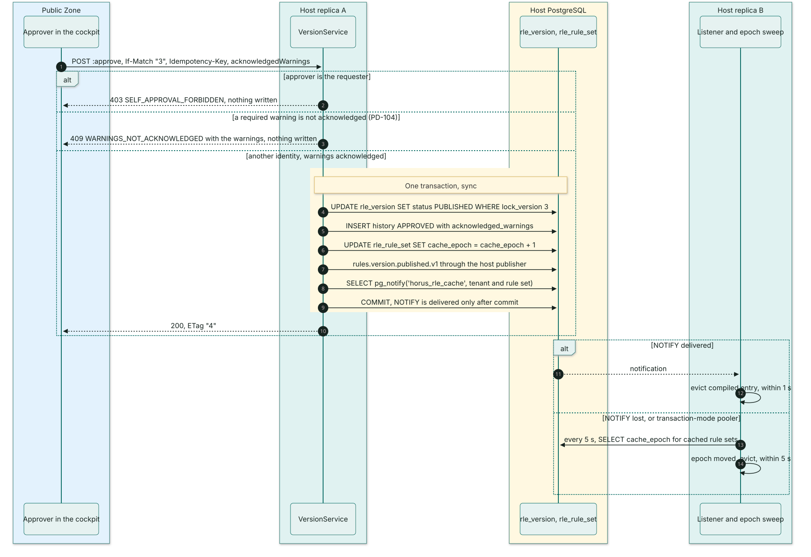
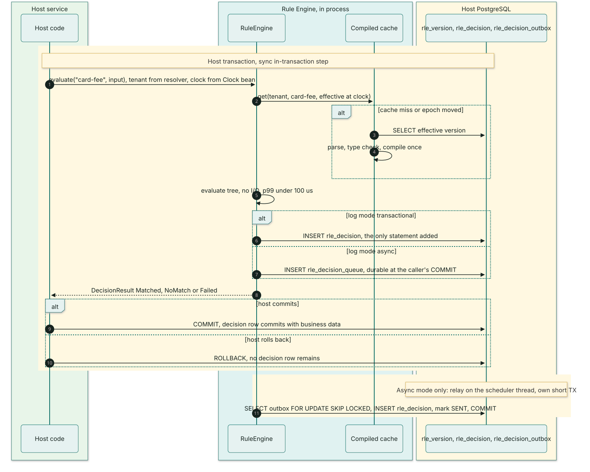

# Rule Engine: Design

Status: architecture baseline (M0), updated 2026-11-18. Conforms to ADR-0001 to ADR-0006, ADR-0010 (contract conventions), ADR-0011 (Spring Boot 4.x baseline), ADR-0014 (tenant switching and host metadata), the proposed ADR-0009 (cache coherence) and the proposed ADR-0016 (Java API conventions), ADR-0017 (full DMN on the roadmap; the do-now items of [`standards-compliance.md`](../../docs/architecture/standards-compliance.md) section 9 are applied below and tagged with their milestone), the proposed ADR-0018 (canonical DMN model) and ADR-0019 (FEEL strategy), and to [`docs/product/requirements.md`](../../docs/product/requirements.md). Cross-module facts are owned by [`docs/architecture/overview.md`](../../docs/architecture/overview.md).

Contents: 1 Context and boundaries. 2 Modules, ports and adapters. 3 Domain model and compiler. 4 Java API and REST contract. 5 Storage model. 6 Runtime mechanics and capacity math. 7 Open questions.

## 1. Context and boundaries



Source: [`diagrams/security-zones.mmd`](diagrams/security-zones.mmd). Edges 6 to 8 run inside the host transaction: the evaluation and its one decision row commit or roll back with the host's business data. Edge 9 is the cache coherence path (ADR-0009). The engine makes no call to core or external systems; edge 10 is host code.

`horus-rule-engine` is an embeddable, deterministic decision-table library for Java 21 and 25 hosts on Spring Boot 4.x (every 4.x minor in open-source support; 3.5.x tested until 1.0, ADR-0011) and PostgreSQL 14 or later (the range from 1.0 is pending PD-055).

- **Inbound callers:** host Java services (`RuleEngine` interface), the optional REST controllers (`/api/bpm/rules/v1`), and the cockpit.
- **Outbound dependencies:** host `DataSource` and `PlatformTransactionManager` through Spring `JdbcClient`, host security context (`TenantResolver`, `CallerResolver`), host event publisher (`RuleEventPublisher`), `MeterRegistry` and an optional OpenTelemetry `Tracer`.
- **State ownership:** only tables prefixed `rle_` (prefix configurable with `horus.bpm.rules.schema-prefix`) and the Flyway history table `rle_schema_history` (`TR-EMB-06`).
- **Explicit non-goals:** no standalone server (ADR-0004), no JPA or Hibernate, no SpEL, MVEL or Groovy scripting (ADR-0003, `TR-SEC-01`), no network I/O (`TR-EMB-05`), no cross-tenant inheritance at evaluation time.

## 2. Modules, ports and adapters


Source: [`diagrams/components.mmd`](diagrams/components.mmd).

| Module | Contents | May depend on |
|---|---|---|
| `rule-engine-core` | `api`, `spi` and `internal` packages: parser, type checker, compiler, evaluator, `Money`, ports | JDK and the JSON library fixed by ADR-0011 (open question 7.1) |
| `rule-engine-postgres` | `JdbcClient` adapters, Flyway `rle_*`, `LISTEN` and epoch sweep, partition maintenance, outbox relay | core, Spring JDBC, Flyway |
| `rule-engine-rest` | Controllers under `/api/bpm/rules/v1`, RFC 9457 errors, idempotency filter | core, Spring WebMvc |
| `rule-engine-test` | In-memory adapters passing the storage contract suite, `TestClock`, `@RuleSetTest`, row coverage report | core |
| `rule-engine-spring-boot-starter` | Auto-configuration, profile guards, scheduler, Micrometer | all of the above |

Enforced by ArchUnit (`TR-EMB-03`, `TR-EMB-05`, `TR-SEC-01`): `rule-engine-core` imports no `org.springframework..`, `java.sql..`, `java.net..`, `javax.script..` or `java.lang.reflect.Method`; `rule-engine-postgres` imports no HTTP client or `java.net.http..`; public signatures in `..api..` and `..spi..` use only JDK, engine and JSpecify types (ADR-0011, ADR-0016).

## 3. Domain model and compiler (`rule-engine-core`)

### 3.1 Immutable rule set and typed tree
- `RuleSetDefinition` (`record`): `schemaVersion`, `expressionLanguage` (only `urn:horus-bpm:expr:v1` before S1), `timeZone` (IANA zone id, default `UTC`; M1, DN-06), `ruleSetName`, `version` (the rule set version number, 1, 2, 3; never the optimistic lock), `hitPolicy` (`FIRST | UNIQUE | COLLECT`), `collectAggregate` (`NONE | SUM | MIN | MAX | COUNT`), `moneyRounding` (default `HALF_EVEN`), `effectiveFrom` (`Instant`), `inputs` (`List<InputSchema>`), `outputs` (`List<OutputSchema>`), `rules` (`List<RuleRow>`), `canonicalHash` (SHA-256).
- `Expr` (`sealed interface`):
  - `LiteralExpr(ValueType type, Object value)`
  - `VarRefExpr(int slotIndex, String name, ValueType type)` *(bound to slot index at compile time)*
  - `UnaryExpr(UnaryOp op, Expr operand)`
  - `BinaryExpr(BinaryOp op, Expr left, Expr right)`
  - `InListExpr(Expr target, List<Expr> elements, boolean negated)`
  - `BetweenExpr(Expr target, Expr low, Expr high)`
  - `IsNullExpr(Expr target, boolean negated)`
  - `CallExpr(String functionName, List<Expr> args, PureFunction impl)`
- `Money` (`record(String currency, long minorUnits)`, scale derived from the currency): the canonical contract is section 3.4.
- The definition document format is owned by `rule-engine/api/schema/rule-set.v1.schema.json` (JSON Schema 2020-12). `tools/validate-examples.sh` checks every YAML example in `wiki/` against it.
- **Decision model identity (M1, DN-08).** A rule set is a DMN decision model (`definitions`) named after the rule set with exactly one decision, a decision table with the rule set's name. If ADR-0018 is accepted, `RuleSetDefinition` is built as that DMN-shaped model (`Definitions`, `Decision`, `DecisionTable`, `InputClause`, `OutputClause`, `Rule`) by the v1 reader, so DRDs with several decisions (S1) extend the model instead of replacing it ([`standards-compliance.md`](../../docs/architecture/standards-compliance.md) section 3.6).
- **Hash identity (M1, DN-04).** `canonical_hash` is the SHA-256 of the RFC 8785 form of the document in the schema version it is stored in. It is never recomputed when a later schema version exists; upgrading is an author action that creates a new draft. A DMN XML import (RE-F-30, M3) produces the lowest schema version that can express the model, so a v1 rule set exported to DMN and imported again keeps its hash.

### 3.2 Two-phase compilation and slot-indexed evaluation
1. **Compile & Static Type-Check (Save / Publish):**
   - Recursive-descent parser builds `Expr` tree without reflection.
   - Type-checker binds every identifier to an integer input slot `0..K-1`, verifies operand types (`string`, `integer`, `decimal`, `boolean`, `date`, `datetime`, `money`, `list<T>`), validates `RuleFunctionRegistry` signatures, pre-compiles bounded regexes, and computes static reachability / overlap warnings.
   - Invalid expressions fail validation and cannot transition to `PENDING_APPROVAL` or `PUBLISHED` (`TR-DET-02`).
2. **Runtime Evaluation (`< 100 µs` hot path):**
   - Map `DecisionInput` into `Object[] slots` once; evaluate compiled `CompiledRuleSet` tree with zero regex compilation and zero `HashMap` lookups per row.
   - Pass explicit `Clock` / `Instant evaluationTime` so `today()` and `now()` are deterministic (`TR-DET-01`, `TR-DET-05`). `today()` is the date of the evaluation instant in the rule set's `timeZone` (default `UTC`); the zone is part of the versioned definition, so the decision row's version identifies it (M1, DN-06, `RLE-022`).
3. **Semantics aligned with FEEL (M1, DN-07, ADR-0019 proposed).** These rules were unspecified and are fixed now so that every expression has a FEEL equivalent with the same result ([`standards-compliance.md`](../../docs/architecture/standards-compliance.md) sections 4.3 and 4.4, `RLE-021`):
   - Numbers: `integer` and `decimal` are declared constraints on one number type, evaluated as `BigDecimal` with `MathContext.DECIMAL128` (34 significant digits, `HALF_EVEN`); `7 / 2` is `3.5`; division by zero is `EVALUATION_ERROR`.
   - `round(x, scale)` rounds half-even. Money arithmetic keeps its own rounding (`moneyRounding`, section 3.4).
   - `matches(s, p)` is an unanchored search with the XPath `fn:matches` regex dialect: no back-references, no look-around; bounded as `TR-SEC-02`.
   - Strings compare by Unicode code point. `datetime` is a FEEL `date and time` with offset `Z` (Java `Instant`).
   - Null: today `RLE-006` (any comparison with `null` is `false`). FEEL three-valued logic (`5 != null` is `true`; `not(null)` is `null`, so not matched) is pending decision P1; if accepted it applies from M1 and `RLE-006` changes for `!=` and `not`.
   - Regex evaluation wraps input in a bounded `InterruptibleCharSequence` enforcing `evaluation.regex-timeout-ms` (`50 ms` default, `TR-SEC-02`).

### 3.3 Version lifecycle



Source: [`diagrams/version-lifecycle.mmd`](diagrams/version-lifecycle.mmd).

| From State | Command / Trigger | Guard | To State | Side Effect / Event |
|---|---|---|---|---|
| *(none)* | `createDraft` / `importYaml` | Valid schema & tenant | `DRAFT` | Assign sequential `version`, store canonical JSON + hash |
| `DRAFT` | `updateDraft` | `lockVersion` matches (`If-Match`) | `DRAFT` | Re-validate AST; reject if parse/type errors on publish prep |
| `DRAFT` | `requestPublish(effectiveFrom)` | Zero validation errors; valid `Idempotency-Key` | `PENDING_APPROVAL` | Freeze snapshot; record `requested_by`; emit `rules.version.publish-requested.v1` |
| `PENDING_APPROVAL` | `approve(comment)` | `approverId != requestedBy` (`TR-SEC-04`); `rules:approve`; `lockVersion` matches | `PUBLISHED` | Set `published_at`, `approved_by`; emit `rules.version.published.v1` + `pg_notify` + increment `cache_epoch` |
| `PENDING_APPROVAL` | `reject(reason)` | `rules:approve`; `lockVersion` matches | `DRAFT` | Record rejection comment; allow edits; emit `rules.version.rejected.v1` |
| `PUBLISHED` | Newer version becomes effective | `new.effectiveFrom <= now` | `RETIRED` | Emit `rules.version.retired.v1`; keep readable forever for explain/replay |
| `PUBLISHED` | `retire` | `rules:approve` | `RETIRED` | Emit `rules.version.retired.v1`; increment `cache_epoch`; `pg_notify` after commit |

Event types follow `<module>.<aggregate>.<pastTense>.v<N>`, with module `rules` for this engine and `processes` for the Process Engine. The Rule Engine emits exactly these types: `rules.version.publish-requested.v1`, `rules.version.published.v1`, `rules.version.rejected.v1`, `rules.version.retired.v1`, and `rules.decision.evaluated.v1` (off by default, `events.decision-evaluated`). A breaking payload change publishes a `.v2` type alongside `.v1`; additive fields stay in `.v1`.

Optimistic locking uses `lockVersion` (column `lock_version`), sent as `If-Match: "<lockVersion>"` or a `lockVersion` body field and returned as `ETag: "<lockVersion>"`. It is unrelated to `version`, the rule set version number.

Approval, cache invalidation after commit, and the epoch fallback when a notification is lost:



Source: [`diagrams/publish-approval.mmd`](diagrams/publish-approval.mmd).

### 3.4 Money contract (canonical)

This section is the single statement of how money is represented; the Process Engine and the cockpit use the same contract.

| Surface | Unit | Example | Rule |
|---|---|---|---|
| Java factories | Named in the method | `Money.ofMinor("VND", 5000000)`, `Money.ofMinor("USD", 1250)`, `Money.ofMajor("USD", "12.50")` | `ofMinor(String currency, long minorUnits)`; `ofMajor(String currency, String amount)` takes a decimal string, never a `double`. `ofMajor` rejects more fraction digits than the currency scale (`"12.505"` USD, `"10.5"` VND) with `IllegalArgumentException`; construction never rounds. There is no constructor without a unit in its name |
| JSON (REST, events, decision log, canonical definition JSON) | Minor units | `{ "currency": "USD", "amount": 1250 }` is 12.50 USD; `{ "currency": "VND", "amount": 5000000 }` is 5 000 000 VND | Always the object `{currency, amount}`. `currency` is an ISO 4217 alphabetic code; `amount` is a JSON integer in minor units within plus or minus 2^53 - 1 so JavaScript clients read it exactly. A float, a string amount or a value outside that range is `400 INPUT_INVALID` |
| Expression literals (`when`, `then`, gateway conditions) | Major units with the currency scale | `12.50 USD` (1 250 minor), `5000000 VND` (5 000 000 minor, VND has scale 0) | More fraction digits than the currency scale (`12.505 USD`, `10.5 VND`) is a publish-time validation error. The literal is converted to minor units at compile time |
| Currency scale | ISO 4217 minor unit | USD 2, VND 0, JPY 0, KWD 3 | From `java.util.Currency#getDefaultFractionDigits`; a currency without a defined minor unit (for example `XAU`) is rejected unless the host registers a scale |
| Arithmetic | Exact in minor units | `money + money`, `money - money` (same currency), `money * number`, `money / number` | Mixed currencies are `EVALUATION_ERROR` at run time and a validation error when both sides are literals (`TR-DET-03`). `money / money` is rejected at publish time. Results of `*` and `/` round to the currency scale with the rule set's `moneyRounding`, default `HALF_EVEN`; the mode is part of the versioned definition, so replay is deterministic |

### 3.5 Expression language SPI and value mapping (M1, DN-05)

The parser and evaluator are reached through one interface in `com.horus.bpm.rules.api.expr`, so a second language (FEEL, ADR-0019) registers beside the first and the Process Engine never depends on parser classes:

```java
public interface ExpressionLanguage {
  String id();                                                     // "urn:horus-bpm:expr:v1"; FEEL from S1
  CompiledExpression compile(String source, TypeEnvironment types); // throws ExpressionInvalidException with position
}
public interface CompiledExpression {
  ValueType resultType();
  EvaluationProfile profile();                                     // COMPILED in M1; GENERAL for full FEEL
  Object evaluate(EvaluationContext context);                      // clock, zone, slots, functions, step budget
}
```

Java value mapping in `api` (ADR-0016), fixed now so FEEL types are additive later:

| Type | Java | From |
|---|---|---|
| `string`, `boolean` | `String`, `Boolean` | M1 |
| `integer`, `decimal` (FEEL number) | `Long` or `BigDecimal` on input; always `BigDecimal` on output | M1 |
| `date`, `datetime` | `LocalDate`, `Instant` | M1 |
| `money` | `Money` | M1 |
| `list<T>` | `List<T>` (immutable) | M1 |
| FEEL `time`, zoned `date and time` | `LocalTime` or `OffsetTime`, `OffsetDateTime` or `ZonedDateTime` | S1 |
| FEEL days and time duration, years and months duration | `Duration`, `Period` | S1 |
| FEEL context | `Map<String, Object>` (immutable, insertion order) | S2 |
| FEEL range | `Range` record | S2 |

## 4. Java API and REST contract

### 4.1 Java API (`com.horus.bpm.rules.api`)
```java
public interface RuleEngine {
  DecisionResult evaluate(String ruleSet, DecisionInput input);
  DecisionResult evaluate(String ruleSet, int version, DecisionInput input);
  DecisionResult evaluate(DecisionRequest request); // clock, idempotencyKey, correlationId; tenant override for batch jobs only
  <T> T evaluateAs(String ruleSet, DecisionInput input, Class<T> outputType); // throws instead of returning Failed
}
```
`DecisionRequest` carries an optional `decision` (the id of a decision inside the decision model) in its builder before the 1.0 freeze; in M1 it may be absent or equal to the rule set name, anything else is `400 INPUT_INVALID`; from S1 it selects a decision of a DRD (DN-08). `DecisionResult.outcome()` is a sealed type (`Matched`, `NoMatch`, `Failed`). `UNIQUE_HIT_VIOLATION` and `EVALUATION_ERROR` are returned as `Failed` with a `code()`, because they are logged decisions; `evaluateAs` throws `DecisionFailedException` with the same code (ADR-0016). Outbound SPIs, each with an engine default that is `@ConditionalOnMissingBean` in the starter: `TenantResolver`, `CallerResolver`, `RuleFunctionRegistry`, `RuleEventPublisher`. Time comes from the host's `java.time.Clock` bean when it has exactly one, otherwise `Clock.systemUTC()`; the starter never registers a `Clock` bean. That clock is the default of `DecisionRequest.clock` and drives partition creation and the health check (`TR-DET-01`).

### 4.2 REST endpoints (`/api/bpm/rules/v1`)

Permissions follow ADR-0010: `rules:evaluate`, `rules:read`, `rules:author`, `rules:approve`, `rules:simulate`, `rules:log:read`. One permission per endpoint, checked with `@PreAuthorize`; the host maps the strings to its roles.

| Endpoint | Permission | Idempotency and concurrency | Error codes |
|---|---|---|---|
| `POST /decisions/{ruleSet}:evaluate` | `rules:evaluate` | Optional `Idempotency-Key` | `400 INPUT_INVALID`, `404 NO_EFFECTIVE_VERSION`, `422 UNIQUE_HIT_VIOLATION`, `422 EVALUATION_ERROR` |
| `POST /decisions/{ruleSet}/versions/{v}:evaluate` | `rules:simulate` (draft version or custom `clock`), otherwise `rules:evaluate` | Optional `Idempotency-Key` | `403 CLOCK_NOT_ALLOWED`, `404 VERSION_NOT_FOUND`, `422 UNIQUE_HIT_VIOLATION`, `422 EVALUATION_ERROR` |
| `POST /decisions/{ruleSet}:evaluate-batch` | `rules:evaluate` | At most 1,000 items; `Idempotency-Key`; per-item outcome in a `207`-style body with `200` status | `400 INPUT_INVALID`, `404 NO_EFFECTIVE_VERSION`; item errors `UNIQUE_HIT_VIOLATION`, `EVALUATION_ERROR` |
| `POST /rule-sets/{name}/versions/{v}:simulate` | `rules:simulate` | Sample inputs, at most 1,000 sets; writes no decision row (`RLE-016`) | `400 INPUT_INVALID`, `404 VERSION_NOT_FOUND`, `422 VALIDATION_FAILED` |
| `GET /rule-sets`, `GET /rule-sets/{name}` | `rules:read` | Cursor, at most 200 | `404 RULE_SET_NOT_FOUND` |
| `GET /rule-sets/{name}/versions/{v}` | `rules:read` | `ETag`; `?include=source` adds `sourceFormat`, `sourceDocument` and `sourceHash` (M1, DN-01) | `404 VERSION_NOT_FOUND` |
| `POST /rule-sets`, `POST /rule-sets/{name}/versions`, `PUT /rule-sets/{name}/versions/{v}` | `rules:author` | `Idempotency-Key` on `POST`; `If-Match: "<lockVersion>"` on `PUT` | `400 INPUT_INVALID`, `409 RULE_SET_EXISTS`, `409 VERSION_CONFLICT`, `422 VALIDATION_FAILED` |
| `POST /rule-sets/{name}/versions/{v}:request-publish` | `rules:author` | `Idempotency-Key`; `If-Match` | `409 VERSION_CONFLICT`, `409 INVALID_STATE`, `422 VALIDATION_FAILED` |
| `POST /rule-sets/{name}/versions/{v}:approve`, `:reject`, `:retire` | `rules:approve` | `Idempotency-Key`; `If-Match`; approver is not the requester | `403 SELF_APPROVAL_FORBIDDEN`, `409 INVALID_STATE`, `409 VERSION_CONFLICT` |
| `GET /decisions/{id}`, `GET /decisions/{id}/explain`, `GET /decisions` | `rules:log:read` | Cursor; `GET /decisions` requires a rule set and a time range of at most 31 days (ADR-0015); masked inputs stay hashed | `400 QUERY_INVALID`, `404 DECISION_NOT_FOUND` |

All errors are RFC 9457 `application/problem+json` with `code`, `detail` and `correlationId`; `type` is `https://github.com/dhluong90/horus-Agentic-BPM/wiki/Common-Error-Codes#<code in lower case>` (ADR-0010). `409` is used only for state conflicts a client resolves by reloading; `UNIQUE_HIT_VIOLATION` is `422` because it is an authoring defect in the published rule set (ADR-0010, PD-008). Every endpoint that accepts `Idempotency-Key` also returns `422 IDEMPOTENCY_KEY_REUSE_MISMATCH` for a key reused with a different request hash and `409 IDEMPOTENCY_IN_FLIGHT` with `Retry-After: 1` while the first request runs (ADR-0006, `RLE-014`). Every endpoint returns `403 TENANT_NOT_ALLOWED` when `X-Tenant-Id` names a tenant outside the token's allowed list (ADR-0014, `RLE-018`).

### 4.3 Host metadata

The starter contributes the `rules` entry of `GET /api/bpm/meta` (engine version, API version `v1`, feature flags such as `rules.simulation`, `rules.replay`, `rules.grid-editor`) and the `rules:*` permissions the caller holds to `GET /api/bpm/me`. Both endpoints and their contract are owned by [`cockpit/docs/DESIGN.md`](../../cockpit/docs/DESIGN.md) section 6 and ship in M1 (X-F-22, `RLE-019`).

### 4.4 Configuration (`horus.bpm.rules.*`)

| Property | Default | Meaning |
|---|---|---|
| `definitions`, `definitions-tenant` | empty, `default` | Rule sets loaded from the classpath at start-up as drafts |
| `definitions-auto-publish` | `false` | Refused unless the `dev` profile is active |
| `maker-checker.enabled` | `true` | `false` refused outside the `dev` profile |
| `decision-log.mode` | `transactional` | `transactional` or `async` (outbox) |
| `decision-log.retention` | unset (keep everything) | ISO 8601 period. When set, the scheduler drops whole monthly partitions of `rle_decision` that lie entirely before `now() - retention` (ADR-0010). The default and a minimum are pending PD-050 |
| `decision-log.partitions-ahead` | `P7D` | How far ahead monthly partitions are created |
| `cache.max-entries`, `cache.epoch-check-interval`, `cache.listen-notify` | `1000`, `PT5S`, `true` | ADR-0009 |
| `evaluation.regex-timeout-ms` | `50` | `TR-SEC-02` |

There is no `clock` property. A fixed instant in configuration could reach production and freeze effective-version selection and partition months, and it would bypass the `rules:simulate` check that guards a caller-chosen instant. Tests declare a fixed `Clock` bean (or use `TestClock` from `rule-engine-test`); a single decision reasons about another instant through `DecisionRequest.clock` (section 4.1).

## 5. Storage model (`rule-engine-postgres`)

Every table has `tenant_id` first in its primary key, unique constraints and indexes (`TR-TEN-01`); foreign keys include `tenant_id`, so a row can never reference another tenant's row. Ids are ULIDs (`VARCHAR(26)`), times `TIMESTAMPTZ` in UTC. Engine-internal sweeps (partition maintenance, outbox relay, idempotency cleanup) are the only reads across tenants and never return rows to a caller.

```sql
CREATE TABLE rle_rule_set (
  tenant_id       TEXT        NOT NULL,
  id              VARCHAR(26) NOT NULL,
  name            TEXT        NOT NULL,
  description     TEXT,
  cache_epoch     BIGINT      NOT NULL DEFAULT 1,
  created_at      TIMESTAMPTZ NOT NULL,
  PRIMARY KEY (tenant_id, id),
  UNIQUE (tenant_id, name)
);

CREATE TABLE rle_version (
  tenant_id         TEXT        NOT NULL,
  id                VARCHAR(26) NOT NULL,
  rule_set_id       VARCHAR(26) NOT NULL,
  version_num       INT         NOT NULL,
  status            TEXT        NOT NULL CHECK (status IN ('DRAFT','PENDING_APPROVAL','PUBLISHED','RETIRED')),
  hit_policy        TEXT        NOT NULL CHECK (hit_policy IN ('FIRST','UNIQUE','COLLECT')),
  effective_from    TIMESTAMPTZ,
  canonical_json    JSONB       NOT NULL,
  canonical_hash    CHAR(64)    NOT NULL,        -- SHA-256 of RFC 8785 form, in the stored schema version (DN-04)
  source_format     TEXT        NOT NULL CHECK (source_format IN ('JSON','YAML','DMN_XML')),   -- M1, DN-01
  source_document   TEXT        NOT NULL,        -- the document as received, never executed (TR-STD-01)
  source_hash       CHAR(64)    NOT NULL,        -- SHA-256 of the source bytes
  lock_version      BIGINT      NOT NULL DEFAULT 0,
  requested_by      TEXT,
  requested_at      TIMESTAMPTZ,
  approved_by       TEXT,
  approved_at       TIMESTAMPTZ,
  approval_comment  TEXT,
  created_at        TIMESTAMPTZ NOT NULL,
  PRIMARY KEY (tenant_id, id),
  UNIQUE (tenant_id, rule_set_id, version_num),
  FOREIGN KEY (tenant_id, rule_set_id) REFERENCES rle_rule_set (tenant_id, id),
  CHECK (approved_by IS NULL OR approved_by <> requested_by OR approved_by = 'system:dev-auto-publish')
);
CREATE INDEX idx_rle_version_effective
  ON rle_version (tenant_id, rule_set_id, status, effective_from DESC);

CREATE TABLE rle_rule (
  tenant_id       TEXT        NOT NULL,
  id              VARCHAR(26) NOT NULL,
  version_id      VARCHAR(26) NOT NULL,
  row_order       INT         NOT NULL,
  rule_id         TEXT        NOT NULL,
  when_expr_json  JSONB       NOT NULL,
  then_expr_json  JSONB       NOT NULL,
  PRIMARY KEY (tenant_id, id),
  UNIQUE (tenant_id, version_id, rule_id),
  FOREIGN KEY (tenant_id, version_id) REFERENCES rle_version (tenant_id, id)
);

-- Append-only decision log, range-partitioned by month from the first migration (ADR-0010, PD-004).
CREATE TABLE rle_decision (
  tenant_id        TEXT        NOT NULL,
  created_at       TIMESTAMPTZ NOT NULL,
  id               VARCHAR(26) NOT NULL,
  rule_set_name    TEXT        NOT NULL,
  version_num      INT         NOT NULL,
  hit_policy       TEXT        NOT NULL,
  outcome          TEXT        NOT NULL CHECK (outcome IN ('OK','UNIQUE_HIT_VIOLATION','EVALUATION_ERROR')),  -- OK with no matched rule is NoMatch,
  error_code       TEXT,
  masked_inputs    JSONB       NOT NULL,        -- inputs with mask=true stored as keyed HMAC-SHA256
  outputs          JSONB,
  matched_rule_ids JSONB       NOT NULL,
  caller_id        TEXT,
  correlation_id   TEXT,
  eval_clock       TIMESTAMPTZ NOT NULL,
  duration_micros  BIGINT      NOT NULL,
  log_mode         TEXT        NOT NULL CHECK (log_mode IN ('TRANSACTIONAL','ASYNC')),
  PRIMARY KEY (tenant_id, created_at, id)
) PARTITION BY RANGE (created_at);

-- Catches rows outside every monthly partition, so an insert never fails for lack of a partition.
CREATE TABLE rle_decision_default PARTITION OF rle_decision DEFAULT;

-- Created by the first migration for the current and the next month, then by the scheduler 7 days ahead.
-- Created standalone with a CHECK constraint and attached, so ATTACH skips the validation scan
-- and takes SHARE UPDATE EXCLUSIVE on the parent instead of ACCESS EXCLUSIVE.
CREATE TABLE rle_decision_2027_01 (LIKE rle_decision INCLUDING DEFAULTS INCLUDING CONSTRAINTS);
ALTER TABLE rle_decision_2027_01 ADD CONSTRAINT rle_decision_2027_01_range
  CHECK (created_at >= '2027-01-01 00:00:00+00' AND created_at < '2027-02-01 00:00:00+00');
ALTER TABLE rle_decision ATTACH PARTITION rle_decision_2027_01
  FOR VALUES FROM ('2027-01-01 00:00:00+00') TO ('2027-02-01 00:00:00+00');

CREATE INDEX idx_rle_decision_lookup
  ON rle_decision (tenant_id, rule_set_name, created_at DESC, outcome);

CREATE TABLE rle_decision_outbox (
  tenant_id       TEXT        NOT NULL,
  id              VARCHAR(26) NOT NULL,
  payload         JSONB       NOT NULL,
  status          TEXT        NOT NULL CHECK (status IN ('PENDING','CLAIMED','SENT')),
  locked_by       TEXT,
  locked_until    TIMESTAMPTZ,
  created_at      TIMESTAMPTZ NOT NULL,
  PRIMARY KEY (tenant_id, id)
);
CREATE INDEX idx_rle_outbox_poll                 -- engine sweep, crosses tenants
  ON rle_decision_outbox (created_at, locked_until) WHERE status IN ('PENDING','CLAIMED');

CREATE TABLE rle_idempotency (
  tenant_id       TEXT        NOT NULL,
  operation       TEXT        NOT NULL,
  idempotency_key TEXT        NOT NULL,
  request_hash    CHAR(64)    NOT NULL,
  status_code     INT         NOT NULL,
  response_body   JSONB       NOT NULL,
  expires_at      TIMESTAMPTZ NOT NULL,
  PRIMARY KEY (tenant_id, operation, idempotency_key)
);
CREATE INDEX idx_rle_idempotency_expiry ON rle_idempotency (expires_at);   -- engine sweep, crosses tenants
```

Partition maintenance (`TR-OPS-04`, `RLE-017`):


Source: [`diagrams/partition-maintenance.mmd`](diagrams/partition-maintenance.mmd).

| Rule | Detail |
|---|---|
| Boundaries | Calendar months in UTC, half-open `[first day, first day of next month)`; names `rle_decision_YYYY_MM` |
| Creation | Daily and at start-up, months up to `now() + decision-log.partitions-ahead` (7 days); one replica at a time through a transaction-scoped advisory lock (no session state, `TR-OPS-05`); `lock_timeout = 5s`, retried on the next run |
| Default partition | Should stay empty. If it holds rows of a month being created, they are copied into the new partition and removed from the default in the same transaction before `ATTACH`; this moves rows without losing any. Gauge `horus_rle_partition_default_rows` alerts above 0 |
| Retention | Only when `decision-log.retention` is set: partitions whose upper bound is before `now() - retention` are dropped with `lock_timeout = 2s`. With retention unset nothing is dropped. No row is ever deleted by date (`TR-OBS-01`) |
| Lock impact | `ATTACH` takes `SHARE UPDATE EXCLUSIVE` on the parent and does not block inserts. `DROP TABLE` of a partition takes `ACCESS EXCLUSIVE` on the parent; inserts queue behind it for at most the 2 s `lock_timeout`, once a month |

## 6. Runtime mechanics and capacity math



Source: [`diagrams/evaluate-decision.mmd`](diagrams/evaluate-decision.mmd). Evaluation is a sync in-transaction step: it adds one insert to the caller's transaction and never calls the network, so nothing in this engine needs the Async Wait-State.

- **Cache coherence (ADR-0009):** on `approve` and `retire` the same transaction increments `rle_rule_set.cache_epoch` and calls `pg_notify('horus_rle_cache', ...)`, delivered after commit. A listener evicts the compiled entry; the epoch sweep every `cache.epoch-check-interval` (5 s) is the fallback behind transaction-mode poolers (`TR-ASY-04`).

Targets, not measurements, on the reference shape (one replica, 20-connection pool, PostgreSQL on 4 vCPU):

| Resource | Baseline | Cost model | 10x | Action |
|---|---|---|---|---|
| Evaluation CPU | 200-row `first` table, cached | 15 to 40 us p50, under 100 us p99 (`TR-PERF-01`) | Same per call; 10x rate is 10x CPU | Add replicas; no database cost |
| Pool, transactional log | 2,000 decisions/s per replica | 1.5 ms per insert = 3 busy connections | 20,000/s = 30 busy, above the pool | `decision-log.mode: async` for that path, or replicas |
| Decision log growth | 2,000/s at a sustained peak, about 1.2 KB per row | 207 GB/day at peak; size from the daily average | 2 TB/day | Monthly partitions; retention drops whole months |
| Monthly partition size | Average of 200 decisions/s over a month | 200 x 2.6 million s = 518 million rows x 1.2 KB = about 620 GB per partition | 6.2 TB per partition | The 200/s average is a planning input to confirm with pilots; the partition count stays 12 a year, and a dropped month frees its space at once |
| Compiled cache | 2,000 entries x 75 KB unbounded = 150 MB | Bounded at `cache.max-entries` 1,000: 75 MB | 20,000 entries: still 75 MB | Eviction keeps the heap flat (`TR-PERF-06`) |
| Epoch sweep | 50 cached tenants, every 5 s | 10 indexed reads/s per replica | 500 tenants x 10 replicas: 1,000 reads/s | Sweep only tenants evaluated since the last sweep |
| `GET /decisions` | One rule set, at most 31 days, page 200 | `idx_rle_decision_lookup` range in at most 2 partitions | Same per request | ADR-0015 bounds |
| Partition `DROP` | Once a month | Inserts wait at most 2 s | Same | Run in the host's quiet hours with `decision-log.retention-window` if needed (open question 7.4) |

## 7. Open questions

| # | Question | Recommendation | Owner and gate |
|---|---|---|---|
| 7.1 | Which JSON library major does `*-core` use, given Spring Boot 4 defaults to Jackson 3 and 3.5 uses Jackson 2 (ADR-0011)? | **Decision needed.** Recommendation: `*-core` uses Jackson 3 (`tools.jackson`) internally only. Jackson 2 and 3 have different packages and coexist on one classpath; on a 3.5 host the engine brings Jackson 3 as a private dependency and the REST module reads request bodies with the engine's own mapper rather than the host's message converters. No Jackson type appears in `api` or `spi` (ADR-0016) | Architect, M1 start |
| 7.2 | Maven `groupId`: `com.horus.bpm` or `io.github.dhluong90.bpm` | Decide before Central Portal registration | Maintainers, before the M1 publish |
| 7.3 | Default async outbox flush cadence: batch size 100 or 500 | Measure in the M1 JMH and Testcontainers runs | Maintainers, M1 exit |
| 7.4 | Should partition drops run only in a configured window? | Add `decision-log.retention-window` only if a pilot reports insert stalls | Architect, M2 |
| 7.5 | P1: adopt FEEL three-valued null logic in M1 (changes `RLE-006` for `!=` and `not`) | **Decision needed.** Accept, before M1 code; a later change breaks replay ([`standards-compliance.md`](../../docs/architecture/standards-compliance.md) section 9.2) | Product owner, M1 start |
| 7.6 | P3: build `RuleSetDefinition` as the DMN-shaped model of ADR-0018 | **Decision needed.** Accept; about 3 days in M1 | Product owner, M1 start |
