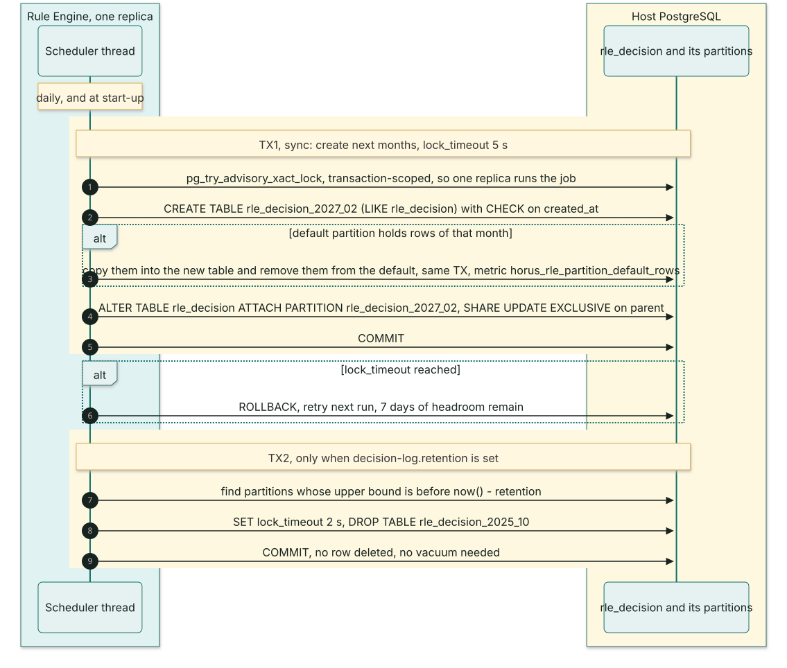

# Rule Engine: Design

Status: architecture baseline (M0), updated 2026-11-18 and 2026-11-19 for the accepted ADR-0009, ADR-0016, ADR-0018, ADR-0019 and the new ADR-0021 to ADR-0023. Conforms to ADR-0001 to ADR-0006, ADR-0009 (cache coherence), ADR-0010 (contract conventions), ADR-0011 (Spring Boot 4.x baseline), ADR-0014 (tenant switching and host metadata), ADR-0016 (Java API conventions), ADR-0017 (full DMN on the roadmap; the do-now items of [`standards-compliance.md`](../../docs/architecture/standards-compliance.md) section 9 are applied below and tagged with their milestone), ADR-0018 (the DMN semantic model is canonical), ADR-0019 (HORUS-built FEEL; FEEL null semantics from M1, PD-058), ADR-0021 (Jackson 3 inside the core), ADR-0022 (package root) and ADR-0023 (fixed table names), and to [`docs/product/requirements.md`](../../docs/product/requirements.md). Cross-module facts are owned by [`docs/architecture/overview.md`](../../docs/architecture/overview.md).

Contents: 1 Context and boundaries. 2 Modules, ports and adapters. 3 Domain model and compiler. 4 Java API and REST contract. 5 Storage model. 6 Runtime mechanics and capacity math. 7 Open questions.

## 1. Context and boundaries


Source: [`diagrams/security-zones.mmd`](diagrams/security-zones.mmd). Edges 6 to 8 run inside the host transaction: the evaluation and its one decision row commit or roll back with the host's business data. Edge 9 is the cache coherence path (ADR-0009). The engine makes no call to core or external systems; edge 10 is host code.

`horus-rule-engine` is an embeddable, deterministic decision-table library for Java 21 and 25 hosts on Spring Boot 4.x (every 4.x minor in open-source support; 3.5.x tested until 1.0, ADR-0011) and PostgreSQL 14 or later (the range from 1.0 is pending PD-055).

- **Inbound callers:** host Java services (`RuleEngine` interface), the optional REST controllers (`/api/bpm/rules/v1`), and the cockpit.
- **Outbound dependencies:** host `DataSource` and `PlatformTransactionManager` through Spring `JdbcClient`, host security context (`TenantResolver`, `CallerResolver`), host event publisher (`RuleEventPublisher`), `MeterRegistry` and an optional OpenTelemetry `Tracer`.
- **State ownership:** only tables named `rle_*` and the Flyway history table `rle_schema_history` (`TR-EMB-06`). The names are fixed; there is no prefix property (ADR-0023). If an adopter needs isolation later, the path is a dedicated PostgreSQL schema as an additive option, which leaves migration checksums unchanged.
- **Explicit non-goals:** no standalone server (ADR-0004), no JPA or Hibernate, no SpEL, MVEL or Groovy scripting (ADR-0003, `TR-SEC-01`), no network I/O (`TR-EMB-05`), no cross-tenant inheritance at evaluation time.

## 2. Modules, ports and adapters



Source: [`diagrams/components.mmd`](diagrams/components.mmd).

| Module | Contents | May depend on |
|---|---|---|
| `rule-engine-core` | `api`, `spi` and `internal` packages: parser, type checker, compiler, evaluator, `Money`, ports | JDK and Jackson 3 in `internal` only (ADR-0021, `TR-EMB-07`) |
| `rule-engine-postgres` | `JdbcClient` adapters, Flyway `rle_*`, `LISTEN` and epoch sweep, partition maintenance, outbox relay | core, Spring JDBC, Flyway |
| `rule-engine-rest` | Controllers under `/api/bpm/rules/v1`, RFC 9457 errors, idempotency filter | core, Spring WebMvc |
| `rule-engine-test` | In-memory adapters passing the storage contract suite, `TestClock`, `@RuleSetTest`, row coverage report | core |
| `rule-engine-spring-boot-starter` | Auto-configuration, profile guards, scheduler, Micrometer | all of the above |

Enforced by ArchUnit (`TR-EMB-03`, `TR-EMB-05`, `TR-SEC-01`): `rule-engine-core` imports no `org.springframework..`, `java.sql..`, `java.net..`, `javax.script..` or `java.lang.reflect.Method`; `rule-engine-postgres` imports no HTTP client or `java.net.http..`; public signatures in `..api..` and `..spi..` use only JDK, engine and JSpecify types (ADR-0011, ADR-0016); `tools.jackson..` is allowed in `..internal..` of the core only and `com.fasterxml.jackson.databind..` nowhere in the core (ADR-0021).

## 3. Domain model and compiler (`rule-engine-core`)

### 3.1 Immutable rule set and typed tree
- `RuleSetDefinition` (`record`): `schemaVersion`, `expressionLanguage` (only `urn:horus-bpm:expr:v1` before S1), `timeZone` (IANA zone id, default `UTC`; M1, DN-06), `ruleSetName`, `version` (the rule set version number, 1, 2, 3; never the optimistic lock), `hitPolicy` (`FIRST | UNIQUE | COLLECT`), the aggregate of each `collect` output (`NONE | SUM | MIN | MAX | COUNT`, declared per output as `collect:` in `rule-set.v1.schema.json`; `OutputClause.aggregate` in the model, #18), `moneyRounding` (default `HALF_EVEN`), `inputs` (`List<InputSchema>`), `outputs` (`List<OutputSchema>`), `rules` (`List<RuleRow>`), `canonicalHash` (SHA-256).
- `Expr` (`sealed interface`):
  - `LiteralExpr(ValueType type, Object value)`
  - `VarRefExpr(int slotIndex, String name, ValueType type)` *(bound to slot index at compile time)*
  - `UnaryExpr(UnaryOp op, Expr operand)`
  - `BinaryExpr(BinaryOp op, Expr left, Expr right)`
  - `InListExpr(Expr target, List<Expr> elements, boolean negated)`
  - `BetweenExpr(Expr target, Expr low, Expr high)`
  - `IsNullExpr(Expr target, boolean negated)`
  - `CallExpr(String functionName, List<Expr> args, PureFunction impl)`
- `Money` (`record(String currency, long minorUnits)`, scale derived from the currency): the canonical contract is section 3.4.
- The definition document format is owned by `rule-engine/api/schema/rule-set.v1.schema.json` (JSON Schema 2020-12). `tools/validate-examples.sh` checks every YAML example in `wiki/` against it.
- **Decision model identity (M1, DN-08).** A rule set is a DMN decision model (`definitions`) named after the rule set with exactly one decision, a decision table with the rule set's name. `RuleSetDefinition` is built as that DMN-shaped model (`Definitions`, `Decision`, `DecisionTable`, `InputClause`, `OutputClause`, `Rule`) by the v1 reader, so DRDs with several decisions (S1) extend the model instead of replacing it (ADR-0018, PD-060, [`standards-compliance.md`](../../docs/architecture/standards-compliance.md) section 3.6). The canonical writer prints the model back as the rule set's canonical JSON; for a v1 document the result is its RFC 8785 form unchanged, so `canonical_hash` does not depend on the model (`RLE-024`, `TR-STD-28`).
- **Effective date is version metadata, not content (M1).** `effectiveFrom` is stored in `rle_version.effective_from`, never in `canonical_json`, and is not part of `canonical_hash`. A document may still carry `effectiveFrom` (the v1 schema allows it): import moves the value to the draft's `effective_from` as the proposed date and removes it from the canonical document; the source document keeps it (`TR-STD-01`); `:request-publish` may override it, and from then on it is frozen with the version, shown to the approver and carried in `rules.version.publish-requested.v1` and `rules.version.published.v1`. Export never writes it. So the same rules scheduled for different dates in two environments have one hash, a date change is not a content change in the diff, and an exported version imports back with its hash (`RLE-032`). A pipeline that checks Git against production compares `source_hash` with the SHA-256 of the committed blob, and `canonical_hash` for behaviour (ADR-0026); it removes nothing before hashing.
- **Error mode per model (PD-066).** `errorMode` (`strict` or `spec`) is a declared property of the decision model, part of the canonical document and the hash, default `strict` for v1 rule sets and `spec` for imported DMN models. Changing it is a new version under four-eyes; each decision records the mode it used and replays with it; the cockpit decision view shows it. Guardrails fail closed in both modes; that is not a setting. `spec` evaluates from M3, when DMN table import ships (RE-F-30); before that a document that declares `spec` is refused at import with a message naming the milestone (`TR-STD-04`). The v1 schema gains the optional member `errorMode` additively.
- **Hash identity (M1, DN-04, ADR-0026).** `canonical_hash` is the SHA-256 of the RFC 8785 form of the canonical document written from the model, with every cell and value printed in the normal form of ADR-0026 decision 2 (non-integer numbers as strings with their scale, never through `double`; the column name dropped only when it is the left operand; escaped strings without Unicode normalisation; the M1 `datetime` in `Z`; money at the currency scale), without `effectiveFrom`, in the schema version it is stored in. The compiled rule set is built only by parsing the stored `canonical_json`; import refuses a model that does not survive `parse(print(model))`, and loading refuses to serve a version whose `canonical_json` no longer hashes to `canonical_hash` (`EVALUATION_ERROR` naming the failed integrity check, alert and audit entry). Git comparison uses `source_hash`. It is never recomputed when a later schema version exists; upgrading is an author action that creates a new draft. A DMN XML import (RE-F-30, M3) produces the lowest schema version that can express the model, so a v1 rule set exported to DMN and imported again keeps its hash, in any authoring style (`RLE-045`).

### 3.2 Two-phase compilation and slot-indexed evaluation
1. **Compile & Static Type-Check (Save / Publish):**
   - Recursive-descent parser builds `Expr` tree without reflection.
   - Type-checker binds every identifier to an integer input slot `0..K-1`, verifies operand types (`string`, `integer`, `decimal`, `boolean`, `date`, `datetime`, `money`, `list<T>`), validates `RuleFunctionRegistry` signatures, pre-compiles bounded regexes, and computes static reachability / overlap warnings.
   - Invalid expressions fail validation and cannot transition to `PENDING_APPROVAL` or `PUBLISHED` (`TR-DET-02`).
2. **Runtime Evaluation (`< 100 µs` hot path):**
   - Map `DecisionInput` into `Object[] slots` once; evaluate compiled `CompiledRuleSet` tree with zero regex compilation and zero `HashMap` lookups per row.
   - Pass explicit `Clock` / `Instant evaluationTime` so `today()` and `now()` are deterministic (`TR-DET-01`, `TR-DET-05`). `today()` is the date of the evaluation instant in the rule set's `timeZone` (default `UTC`); the zone is part of the versioned definition, so the decision row's version identifies it (M1, DN-06, `RLE-022`).
3. **Semantics aligned with FEEL (M1, DN-07, ADR-0019).** These rules were unspecified and are fixed now so that every expression has a FEEL equivalent with the same result ([`standards-compliance.md`](../../docs/architecture/standards-compliance.md) sections 4.3 and 4.4, `RLE-021`):
   - Numbers: `integer` and `decimal` are declared constraints on one number type, evaluated as `BigDecimal` with `MathContext.DECIMAL128` (34 significant digits, `HALF_EVEN`); `7 / 2` is `3.5`; division by zero is `EVALUATION_ERROR`.
   - `round(x, scale)` rounds half-even. Money arithmetic keeps its own rounding (`moneyRounding`, section 3.4).
   - `matches(s, p)` is an unanchored search with the XPath `fn:matches` regex dialect: no back-references, no look-around; bounded as `TR-SEC-02`.
   - Strings compare by Unicode code point. `datetime` is a FEEL `date and time` with offset `Z` (Java `Instant`).
   - Null (PD-058, from M1, `RLE-006`): FEEL three-valued logic. `<`, `<=`, `>`, `>=`, arithmetic and functions with a `null` operand give `null`, except `coalesce`, which exists to handle `null`. `x between a and b` is `x >= a and x <= b` (DMN 1.5), evaluated as `and` is: a null target gives `null`, and a null bound gives `false` when the other comparison is already `false`. `==` and `!=` are two-valued: `null == null` is `true`, `null == 'GOLD'` is `false`, `null != 'GOLD'` is `true`. `x in [...]` is `true` only when an element equals `x` (FEEL `list contains`), so it is `false` for a null `x` unless the list holds `null`, and `x not in [...]` (FEEL `not(x in [...])`) is its negation. `is null` and `is not null` are always `true` or `false`. `and`, `or` and `not` follow the FEEL truth tables: `false and null` is `false`, `true and null` is `null`, `true or null` is `true`, `false or null` is `null`, `not(null)` is `null`. A `when` cell or a gateway condition matches only when it evaluates to `true`; `null` never matches. The type checker reports a warning, not an error, when an input that may be null is used with `!=` or `not in`, because those now match a missing value.
   - Regex evaluation wraps input in a bounded `InterruptibleCharSequence` enforcing `evaluation.regex-timeout-ms` (`50 ms` default, `TR-SEC-02`).

### 3.3 Version lifecycle


Source: [`diagrams/version-lifecycle.mmd`](diagrams/version-lifecycle.mmd).

| From State | Command / Trigger | Guard | To State | Side Effect / Event |
|---|---|---|---|---|
| *(none)* | `POST /rule-sets` (new rule set) or `POST /rule-sets/{name}/versions` (document, or `?copyOf={v}`) | Valid schema; document `ruleSet` equals `{name}`; `rules:author` | `DRAFT` | Next `version_num`; canonical JSON and hash stored; `effectiveFrom` of the document moved to `effective_from` (section 3.1); history row `CREATED`; emit `rules.version.created.v1` (minimal outbox row from #1) |
| `DRAFT` | `updateDraft` | `lockVersion` matches (`If-Match`) | `DRAFT` | Re-validate; content and hash replaced |
| `DRAFT` | `requestPublish(effectiveFrom)` | Zero validation errors; `effectiveFrom` absent (means at approval) or not in the past; valid `Idempotency-Key` | `PENDING_APPROVAL` | Freeze snapshot and effective date; record `requested_by`, `requested_at`; history row `REQUESTED`; emit `rules.version.publish-requested.v1` |
| `PENDING_APPROVAL` | `approve(comment)` | The approver is no maker of the version: not `created_by`, not `requested_by`; only the author may replace a draft, so there is no other editor (PD-096, `TR-SEC-04`), else `403 SELF_APPROVAL_FORBIDDEN`. The Rule Engine always applies `makers`, whatever `lifecycle.approver-must-differ-from` says: its `V2` constraint `rle_version_four_eyes` refuses an approval by the author in the database, and in the Rule Engine `requester` mode would only let the author approve their own content once someone else requested it, which is the case four eyes exists to stop. Its `/api/bpm/meta` setting therefore reports `makers`, and a host that sets `requester` for the Process Engine gets one WARN saying the Rule Engine keeps `makers` (architecture decision, #273); `rules:approve`; `lockVersion` matches | `PUBLISHED` | Set `approved_at`, `approved_by`, `approval_comment`, and `effective_from = approved_at` when it was absent; history row `APPROVED`; emit `rules.version.published.v1`; increment `cache_epoch`; `pg_notify` after commit. If `effective_from <= now`, the versions it supersedes are retired in the same transaction (row below) |
| `PENDING_APPROVAL` | `reject(reason)` | `rules:approve`; caller is not `requested_by` (`403 SELF_APPROVAL_FORBIDDEN`, detail pointing to `:withdraw`; PD-089); `reason` not blank (at most 2,000 characters, else `400 INPUT_INVALID`); `lockVersion` matches | `DRAFT` | Clear `requested_by`, `requested_at`; history row `REJECTED` with actor and reason; emit `rules.version.rejected.v1` |
| `PENDING_APPROVAL` | `withdraw(reason?)` (`POST .../versions/{v}:withdraw`, PD-089) | `rules:author`; caller is `requested_by`, anyone else, an approver included, gets `403 PERMISSION_DENIED`; `reason` optional (at most 2,000 characters); `lockVersion` matches (`If-Match`); `Idempotency-Key` | `DRAFT` | Clear `requested_by`, `requested_at`; history row `WITHDRAWN` with actor and the reason if given; emit `rules.version.withdrawn.v1`; the effective version is unchanged and nothing is published |
| `PUBLISHED` | Superseded: a newer `PUBLISHED` version of the rule set has `effective_from <= now` | Conditional update, exactly once across replicas (section 3.3.2) | `RETIRED` | `retired_at = now`; history row `RETIRED`, actor `system`, reason `SUPERSEDED`; emit `rules.version.retired.v1` with `supersededBy`; keep readable forever for explain and replay |
| `PUBLISHED` | `retire(reason)` with `lifecycle.retire-approval: single` (default, M1) | `rules:approve`; `reason` not blank (at most 2,000 characters); `lockVersion` matches. One identity is enough (ADR-0025, PD-080); the PD-012 emergency path governs publication and does not apply | `RETIRED` | `retired_at = now`; history row `RETIRED` with actor, reason and `approval_mode = single`; emit `rules.version.retired.v1`; increment `cache_epoch`; `pg_notify` after commit. Older `PUBLISHED` versions with `effective_from <= now` are retired in the same transaction as `SUPERSEDED`, so a retire never brings an older version back |
| `PUBLISHED` | `retire(reason)` with `lifecycle.retire-approval: four-eyes` (M3) | As above; no pending request exists (`409 INVALID_STATE` otherwise) | `PUBLISHED`, retirement pending | `retire_requested_by`, `retire_requested_at`, `retire_reason` set; history row `RETIRE_REQUESTED`; emit `rules.version.retire-requested.v1`. The version keeps serving; selection does not read the request |
| `PUBLISHED`, retirement pending | `confirmRetire()` | `rules:approve`; caller is not `retire_requested_by` (`403 SELF_APPROVAL_FORBIDDEN`); `lockVersion` matches | `RETIRED` | Same effects as the `single` row, with actor the confirmer, the requester and reason from the request, and `approval_mode = four-eyes` |
| `PUBLISHED`, retirement pending | `cancelRetire(reason)` | `rules:approve`; reason not blank | `PUBLISHED` | Request columns cleared; history row `RETIRE_CANCELLED` |

Event types follow `<module>.<aggregate>.<pastTense>.v<N>`, with module `rules` for this engine and `processes` for the Process Engine. The Rule Engine emits exactly these types: `rules.version.created.v1` (a draft was imported; minimal outbox row from #1), `rules.version.publish-requested.v1`, `rules.version.published.v1`, `rules.version.rejected.v1`, `rules.version.retire-requested.v1` (from M3, `four-eyes` mode), `rules.version.retired.v1` (with `approvalMode`: `single`, `four-eyes` or `system`), and `rules.decision.evaluated.v1` (off by default, `events.decision-evaluated`). A breaking payload change publishes a `.v2` type alongside `.v1`; additive fields stay in `.v1`.

| Event | Payload beyond the envelope (`eventId`, `eventType`, `occurredAt`, `tenantId`, `correlationId`, `causationId`, `producer`, `schemaVersion`) |
|---|---|
| `rules.version.publish-requested.v1` | `ruleSet`, `version`, `canonicalHash`, `requestedBy`, `effectiveFrom` (null when the version takes effect at approval); schema `rule-engine/api/schema/rules.version.publish-requested.v1.schema.json` |
| `rules.version.published.v1` | `ruleSet`, `version`, `canonicalHash`, `effectiveFrom`, `requestedBy`, `approvedBy`; schema `rule-engine/api/schema/rules.version.published.v1.schema.json` |
| `rules.version.rejected.v1` | `ruleSet`, `version`, `rejectedBy`, `reason` |
| `rules.version.withdrawn.v1` | `ruleSet`, `version`, `withdrawnBy`, `reason` (null when none was given) |
| `rules.version.retire-requested.v1` (M3, `four-eyes` mode) | `ruleSet`, `version`, `requestedBy`, `reason`; the request instant is the envelope's `occurredAt` |
| `rules.version.retired.v1` | `ruleSet`, `version`, `retiredBy` (`system` when superseded), `reason` (`SUPERSEDED` when superseded), `supersededBy` (version or null), `retiredAt`, `approvalMode` (`single`, `four-eyes` or `system`), `requestedBy` (the four-eyes requester, else null) |
| `rules.decision.evaluated.v1` | `decisionId`, `ruleSet`, `version`, `outcome` |

Envelope in 0.1.0: every outbox payload carries `eventType`, `tenantId`, `occurredAt` and `actor` next to the fields above, and the event id is the outbox row id (`rle_decision_outbox.id`, a ULID). `eventId`, `correlationId`, `causationId`, `producer` and `schemaVersion` are not sent in 0.1.0; they arrive later as additive fields within each `.v1` type (#239).

A host that wants tamper evidence for approvals relays these events to a store outside the database administrator's control (an append-only log or a separate audit system) and reconciles the stored versions against it, because rows in the host database, outbox included, can be changed by whoever administers it. The publication events carry `canonicalHash`, `effectiveFrom`, `requestedBy` and `approvedBy` for that purpose.

Optimistic locking uses `lockVersion` (column `lock_version`), sent as `If-Match: "<lockVersion>"` or a `lockVersion` body field and returned as `ETag: "<lockVersion>"`. It is unrelated to `version`, the rule set version number.

Approval, cache invalidation after commit, and the epoch fallback when a notification is lost:


Source: [`diagrams/publish-approval.mmd`](diagrams/publish-approval.mmd).

#### 3.3.1 Effective version at an instant (ADR-0025)

The effective version of a rule set at instant `T` (the decision's clock) is the version with the highest `version_num` among those that were approved (`approved_at IS NOT NULL`; approval fills an absent `effective_from` with the approval instant), have `effective_from <= T`, and were not retired at `T` (`retired_at IS NULL OR retired_at > T`). The status column is not read. So:

- A newer version takes over at its effective date on every replica whether or not the superseded version's status has changed yet (`RLE-008`, `RLE-027`).
- A version retired by hand stops being selected from `retired_at` on, and stays selected for any clock before it: evaluating with `clock = 2027-02-01T09:00:00Z` (`rules:simulate`) selects `tet-fee-waiver` v1 retired on 2027-02-17, because it was effective then (`RLE-026`). A retire cannot be back-dated; `retired_at` is the transaction's clock.
- Replay never selects: it uses the logged version number (`TR-DET-05`), so a retired version always replays.

The lookup reads `idx_rle_version_effective`; a rule set has tens of versions, so the scan is a few index entries.

#### 3.3.2 Automatic retirement of superseded versions (ADR-0025, `TR-OPS-05`)

Status `RETIRED` and its event are bookkeeping; selection does not depend on them. Two paths write them, both in an ordinary transaction with no advisory lock and no session state:

1. **At approval.** When the approved version's `effective_from` is not after the approval instant, the approve transaction also runs the statement below for its rule set.
2. **Lifecycle sweep.** The starter's scheduler thread runs the statement every `lifecycle.sweep-interval` (default `PT1M`) across tenants (an engine-internal sweep, like partition maintenance), with the engine `Clock` as `:now`:

```sql
UPDATE rle_version old
   SET status = 'RETIRED', retired_at = :now, lock_version = old.lock_version + 1
  FROM rle_version newer
 WHERE old.status = 'PUBLISHED'
   AND newer.tenant_id = old.tenant_id AND newer.rule_set_id = old.rule_set_id
   AND newer.status = 'PUBLISHED' AND newer.version_num > old.version_num
   AND newer.effective_from <= :now
RETURNING old.tenant_id, old.id, old.rule_set_id, old.version_num, newer.version_num AS superseded_by;
```

In the same transaction, for each returned row only, the engine inserts the history row (`RETIRED`, actor `system`, reason `SUPERSEDED`), emits `rules.version.retired.v1` with `supersededBy`, and increments `cache_epoch`. Exactly once across replicas: under `READ COMMITTED`, a second replica's `UPDATE` waits on the first one's row lock, re-checks `old.status = 'PUBLISHED'` on the committed row, finds `RETIRED` and returns nothing, so it writes no history row and no event. Retirement at evaluation time was rejected: evaluation is a read plus one insert in the host's transaction, and a status write there would put a row lock on the hottest path. The status may lag the effective date by up to one sweep interval; no decision is affected.

#### 3.3.3 Lifecycle history

`rle_version` holds the current state; every transition also appends one row to `rle_version_history` (section 5, migration `V3`, #147) in the transition's own transaction: `CREATED`, `REQUESTED`, `APPROVED`, `REJECTED`, `RETIRED`, with actor, reason or comment, the status before and after, and the `lockVersion` after. A version rejected twice and approved on the third request keeps all three requests, both rejection reasons and the approval comment; `approval_comment` on `rle_version` is only the latest approval's copy. `GET /rule-sets/{name}/versions/{v}/history` returns the rows oldest first (`rules:read`). Migration `V3` creates the table and backfills one `CREATED` row per version that existed before it (actor `created_by`, or `system` when it was not recorded); their later transitions were not recorded and are not invented. Migration `V4` adds triggers that refuse `UPDATE`, `DELETE` and `TRUNCATE` on the table (SQLSTATE `55000`), so the trail is append-only in the database, not only by convention; hosts that separate migration and runtime roles also revoke those rights from the runtime role. During a rolling upgrade to the release with `V3`, replicas still on the old release write no history rows, so request and approval transitions made in that window are missing for good; drain lifecycle commands until every replica runs the new release if the gap matters.

### 3.4 Money contract (canonical)

This section is the single statement of how money is represented; the Process Engine and the cockpit use the same contract.

| Surface | Unit | Example | Rule |
|---|---|---|---|
| Java factories | Named in the method | `Money.ofMinor("VND", 5000000)`, `Money.ofMinor("USD", 1250)`, `Money.ofMajor("USD", "12.50")` | `ofMinor(String currency, long minorUnits)`; `ofMajor(String currency, String amount)` takes a decimal string, never a `double`. `ofMajor` rejects more fraction digits than the currency scale (`"12.505"` USD, `"10.5"` VND) with `IllegalArgumentException`; construction never rounds. There is no constructor without a unit in its name |
| JSON (REST, events, decision log, canonical definition JSON) | Minor units | `{ "currency": "USD", "amount": 1250 }` is 12.50 USD; `{ "currency": "VND", "amount": 5000000 }` is 5 000 000 VND | Always the object `{currency, amount}`. `currency` is an ISO 4217 alphabetic code; `amount` is a JSON integer in minor units within plus or minus 2^53 - 1 so JavaScript clients read it exactly. A float, a string amount or a value outside that range is `400 INPUT_INVALID` |
| Expression literals (`when`, `then`, gateway conditions) | Major units with the currency scale | `12.50 USD` (1 250 minor), `5000000 VND` (5 000 000 minor, VND has scale 0) | More fraction digits than the currency scale (`12.505 USD`, `10.5 VND`) is a publish-time validation error. The literal is converted to minor units at compile time |
| Currency scale | ISO 4217 minor unit | USD 2, VND 0, JPY 0, KWD 3 | From `java.util.Currency#getDefaultFractionDigits`; a currency without a defined minor unit (for example `XAU`) is rejected unless the host registers a scale |
| Arithmetic | Exact in minor units | `money + money`, `money - money` (same currency), `money * number`, `money / number` | Mixed currencies are `EVALUATION_ERROR` at run time and a validation error when both sides are literals (`TR-DET-03`). `money / money` is rejected at publish time. Results of `*` and `/` round to the currency scale with the rule set's `moneyRounding`, default `HALF_EVEN`; the mode is part of the versioned definition, so replay is deterministic |

### 3.5 Expression language SPI and value mapping (M1, DN-05)

The parser and evaluator are reached through one interface, in `io.github.dhluong90.bpm.expr.api` of the `bpm-expression` library that both engines depend on (ADR-0027), so a second language (FEEL, ADR-0019) registers beside the first and the Process Engine never depends on parser classes:

```java
public interface ExpressionLanguage {
  String id();                                                     // "urn:horus-bpm:expr:v1"; FEEL from S1
  CompiledExpression compile(String source, TypeEnvironment types); // throws ExpressionInvalidException with position
}
public interface CompiledExpression {
  ValueType resultType();
  EvaluationProfile profile();                                     // COMPILED in M1; GENERAL for full FEEL
  Object evaluate(EvaluationContext context);                      // clock, zone, slots, functions, step budget
}
```

Java value mapping in `api` (ADR-0016), fixed now so FEEL types are additive later:

| Type | Java | From |
|---|---|---|
| `string`, `boolean` | `String`, `Boolean` | M1 |
| `integer`, `decimal` (FEEL number) | `Long` or `BigDecimal` on input; always `BigDecimal` on output | M1 |
| `date`, `datetime` | `LocalDate`, `Instant` | M1 |
| `money` | `Money` | M1 |
| `list<T>` | `List<T>` (immutable) | M1 |
| FEEL `time`, zoned `date and time` | `LocalTime` or `OffsetTime`, `OffsetDateTime` or `ZonedDateTime` | S1 |
| FEEL days and time duration, years and months duration | `Duration`, `Period` | S1 |
| FEEL context | `Map<String, Object>` (immutable, insertion order) | S2 |
| FEEL range | `Range` record | S2 |

## 4. Java API and REST contract

### 4.1 Java API (`io.github.dhluong90.bpm.rules.api`, ADR-0022)
```java
public interface RuleEngine {
  DecisionResult evaluate(String ruleSet, DecisionInput input);
  DecisionResult evaluate(String ruleSet, int version, DecisionInput input);
  DecisionResult evaluate(DecisionRequest request); // clock, idempotencyKey, correlationId; tenant override for batch jobs only
  <T> T evaluateAs(String ruleSet, DecisionInput input, Class<T> outputType); // throws instead of returning Failed
}
```
`DecisionRequest` carries an optional `decision` (the id of a decision inside the decision model) in its builder before the 1.0 freeze; in M1 it may be absent or equal to the rule set name, anything else is `400 INPUT_INVALID`; from S1 it selects a decision of a DRD (DN-08). `DecisionResult.outcome()` is a sealed type (`Matched`, `NoMatch`, `Failed`). `UNIQUE_HIT_VIOLATION` and `EVALUATION_ERROR` are returned as `Failed` with a `code()`, because they are logged decisions; `evaluateAs` throws `DecisionFailedException` with the same code (ADR-0016). Outbound SPIs, each with an engine default that is `@ConditionalOnMissingBean` in the starter (ADR-0024, `TR-EXT-02`): `TenantResolver` (default: the `tenancy.claim` attribute of the authenticated principal, session or token; never anything the browser sends, PD-079), `CallerResolver`, `MaskingPolicy` (default: the `masking.*` and `decision-log.mask-default` settings of section 4.4; returns the tenant's `MaskingKey` and masking default), `RuleFunctionRegistry`, `RuleEventPublisher`, `CurrencyRegistry` (default: ISO 4217 scales from the JDK; a host adds or overrides a currency's scale, for example `XAU`), `DecisionExplainer` (default: the English template of section 4.7) and `LifecycleGuard` (default: allows everything; a host guard may veto a transition with its own code, for example to require a change ticket on retire, and can never make a refused transition succeed, `TR-EXT-06`). Time comes from the host's `java.time.Clock` bean when it has exactly one, otherwise `Clock.systemUTC()`; the starter never registers a `Clock` bean. That clock is the default of `DecisionRequest.clock` and drives partition creation and the health check (`TR-DET-01`).

Permissions are checked in `VersionService` and `RuleEngine` through `CallerResolver`, not only over REST: `rules:author` for import and request-publish, `rules:approve` for approve, `rules:read` for reads, `rules:evaluate` for evaluation; the approver must be neither the requester nor the author (`created_by`). Until the shared permission seam (#133) lands, the starter's defaults follow the host contract: `TenantResolver` asks the host's `io.github.dhluong90.bpm.host.spi.TenantResolver`, with the same tenant format and token-claim checks as `/api/bpm/me`, and `CallerResolver` grants `rules:*` authorities plus `horus.bpm.rules.security.role-permissions`, so the services allow exactly what `/api/bpm/me` lists. The seam replaces both defaults without touching the services.

### 4.2 REST endpoints (`/api/bpm/rules/v1`)

Permissions follow ADR-0010: `rules:evaluate`, `rules:read`, `rules:author`, `rules:approve`, `rules:simulate`, `rules:log:read`, `rules:log:search-masked` (the masked-input search only; `rules:log:read` does not imply it and no role holds it unless the host grants it). One permission per endpoint, checked with `@PreAuthorize`; the host maps the strings to its roles.

| Endpoint | Permission | Idempotency and concurrency | Error codes |
|---|---|---|---|
| `POST /decisions/{ruleSet}:evaluate` | `rules:evaluate` | Optional `Idempotency-Key`; body at most 1,048,576 bytes (`RLE-044`) | `400 INPUT_INVALID`, `404 NO_EFFECTIVE_VERSION`, `413 PAYLOAD_TOO_LARGE`, `422 UNIQUE_HIT_VIOLATION`, `422 EVALUATION_ERROR` |
| `POST /decisions/{ruleSet}/versions/{v}:evaluate` | `rules:simulate` (draft version or custom `clock`), otherwise `rules:evaluate` | Optional `Idempotency-Key` | `403 CLOCK_NOT_ALLOWED`, `404 VERSION_NOT_FOUND`, `422 UNIQUE_HIT_VIOLATION`, `422 EVALUATION_ERROR` |
| `POST /decisions/{ruleSet}:evaluate-batch` | `rules:evaluate` | At most 1,000 items; `Idempotency-Key`; per-item outcome in a `207`-style body with `200` status | `400 INPUT_INVALID`, `404 NO_EFFECTIVE_VERSION`; item errors `UNIQUE_HIT_VIOLATION`, `EVALUATION_ERROR` |
| `POST /rule-sets/{name}/versions/{v}:simulate` | `rules:simulate` | Sample inputs, at most 1,000 sets; writes no decision row (`RLE-016`) | `400 INPUT_INVALID`, `404 VERSION_NOT_FOUND`, `422 VALIDATION_FAILED` |
| `GET /rule-sets`, `GET /rule-sets/{name}` | `rules:read` | Signed keyset cursor by name (byte order), `limit` 1 to `query.max-page-size` (default 50, at most 200); each item: `ruleSet`, `latestVersion`, `latestStatus`, `publishedVersion` (the version selected at the host clock, section 3.3.1, or null), `lastChangedAt` (latest version timestamp or history row) (`RLE-039`) | `400 QUERY_INVALID` (limit or cursor), `404 RULE_SET_NOT_FOUND` |
| `GET /rule-sets/{name}/versions` | `rules:read` | Keyset cursor by version number, newest first, same `limit`; items carry the lifecycle fields and `allowedActions`, never the definition (`RLE-040`) | `400 QUERY_INVALID`, `404 RULE_SET_NOT_FOUND` |
| `GET /rule-sets/{name}/versions/{v}` | `rules:read` | `ETag`; `?include=source` adds `sourceFormat`, `sourceDocument` and `sourceHash` (M1, DN-01). Every version response carries `allowedActions` for the caller (`RLE-043`) | `404 VERSION_NOT_FOUND` |
| `GET /rule-sets/{name}/versions/{v}/history` | `rules:read` | Lifecycle history rows oldest first (section 3.3.3) | `404 VERSION_NOT_FOUND` |
| `GET /rule-sets/{name}/versions/{v}/diff?base={w}` | `rules:read` | Row-level diff of two versions of one rule set (section 4.5); writes nothing | `400 INPUT_INVALID` (`base` missing or equal to `v`), `404 RULE_SET_NOT_FOUND`, `404 VERSION_NOT_FOUND` |
| `GET /rule-sets/{name}/versions/{v}/export?format=yaml\|json` | `rules:read` | Canonical document, default `yaml` (section 4.6); `ETag: "<lockVersion>"`; writes nothing | `400 INPUT_INVALID` (other `format`), `404 VERSION_NOT_FOUND` |
| `POST /rule-sets` (create the rule set and its version 1 from a document), `POST /rule-sets/{name}/versions` (next version from a document, or `?copyOf={v}` with no body), `PUT /rule-sets/{name}/versions/{v}` (replace a draft) | `rules:author` | `Content-Type: application/yaml` or `application/json`; `Idempotency-Key` on `POST`; `If-Match: "<lockVersion>"` on `PUT`; a refused document stores nothing (`RLE-033`) | `400 INPUT_INVALID` (document `ruleSet` differs from `{name}`), `409 RULE_SET_EXISTS`, `409 VERSION_CONFLICT`, `422 VALIDATION_FAILED` with `violations` naming row and column |
| `POST /rule-sets/{name}/versions/{v}:request-publish` | `rules:author` | `Idempotency-Key`; `If-Match` | `409 VERSION_CONFLICT`, `409 INVALID_STATE`, `422 VALIDATION_FAILED` |
| `POST /rule-sets/{name}/versions/{v}:approve` | `rules:approve` | `Idempotency-Key`; `If-Match`; approver is not the requester; body at most 16,384 bytes (`RLE-044`) | `403 SELF_APPROVAL_FORBIDDEN`, `409 INVALID_STATE`, `409 VERSION_CONFLICT`, `413 PAYLOAD_TOO_LARGE` |
| `POST /rule-sets/{name}/versions/{v}:confirm-retire` (M3, `four-eyes` mode) | `rules:approve` | `Idempotency-Key`; `If-Match`; confirmer is not the requester | `403 SELF_APPROVAL_FORBIDDEN`, `409 INVALID_STATE` (no pending request, or mode `single`), `409 VERSION_CONFLICT` |
| `POST /rule-sets/{name}/versions/{v}:cancel-retire` (M3) | `rules:approve` | `Idempotency-Key`; `If-Match`; body `{ "reason": "..." }` | `400 INPUT_INVALID`, `409 INVALID_STATE`, `409 VERSION_CONFLICT` |
| `POST /rule-sets/{name}/versions/{v}:reject`, `:retire` | `rules:approve` | `Idempotency-Key`; `If-Match`; body `{ "reason": "..." }` required, at most 16,384 bytes; the requester gets `403 SELF_APPROVAL_FORBIDDEN` and withdraws instead (PD-089, section 3.3). `:reject` ships in #147; `:retire` with its feature | `400 INPUT_INVALID` (blank or longer than `lifecycle.reason-max-length`), `409 INVALID_STATE`, `409 VERSION_CONFLICT`, `413 PAYLOAD_TOO_LARGE` |
| `GET /decisions/{id}`, `GET /decisions/{id}/explain`, `GET /decisions` | `rules:log:read` | Cursor; `GET /decisions` requires a rule set and a time range of at most 31 days (ADR-0015); masked inputs stay hashed; explain is built from the row and the stored version only (section 4.7) | `400 QUERY_INVALID`, `404 DECISION_NOT_FOUND` |
| `POST /decisions:find-by-masked-input` | `rules:log:search-masked` | Body `{ ruleSet, input, value, from, to, limit? }`, at most 16,384 bytes; the plain `value` travels in the body so it never sits in a URL or an access log. The engine fingerprints it with the caller's tenant key (section 4.4, `masking.*`) and compares fingerprints only, `masked_inputs ->> input = 'hmac:<keyId>:<hex>'` inside tenant, rule set and period on `idx_rle_decision_lookup`; period at most 31 days, `limit` 1 to `query.max-page-size` (default 50), newest first, `truncated: true` when more match (RLE-012). The value is fingerprinted with every key the tenant holds (`MaskingPolicy.searchKeys`), so rows written before a key rotation are found. Writes nothing to the decision log; writes one audit entry `rules.decision-log.masked-input-searched.v1` to the outbox in the same transaction (actor, tenant, rule set, input, period, matches, key ids, correlation id; never the value or a fingerprint) | `400 QUERY_INVALID` (period, limit, unknown member, tenant without a key), `413 PAYLOAD_TOO_LARGE`, `429 RATE_LIMITED` with `Retry-After` past `masking.search.max-per-minute` (audited with `outcome = RATE_LIMITED`) |
| Every endpoint | | An unexpected failure | `500 INTERNAL_ERROR` with `correlationId` only: no stack trace, class name, SQL or table name; the same `correlationId` is in the server log (`TR-SEC-08`, `RLE-036`) |

`422 VALIDATION_FAILED` carries `violations` (at most 100, with `violationsTruncated` when more were found), at least one entry of `{ ruleId, column, message }` in document order (`RLE-041`): `ruleId` is the rule (row) and `column` the input or output name, either null when the problem is outside them, and `message` has no location prefix. The compiler checks every cell before it answers, so one response lists every cell problem; a structural problem (an unknown property, a missing key) stops reading and is the only entry. Bodies are read through a bounded reader: a declared `Content-Length` over the limit is refused before reading, and otherwise at most one byte past the limit is read (`413 PAYLOAD_TOO_LARGE`, `RLE-044`); the limits are `EngineDefaults.COMMAND_BODY_MAX_BYTES` (16,384) for `:approve` and `:reject`, `EngineDefaults.EVALUATE_BODY_MAX_BYTES` (1,048,576) for `:evaluate`, and `RuleSetReader.MAX_SOURCE_BYTES` (1,048,576) for imports. Every endpoint checks its permission before it reads the body. The approval comment is optional but bounded by `lifecycle.reason-max-length`, like the reason, because it is stored in the history.

List cursors are `base64url("<list>:<last key>")` plus the first 16 bytes of HMAC-SHA256 over tenant, scope (the rule set, for a version list) and payload. The key is one random 32-byte secret per database in `rle_engine_key` (migration `V5`). The starter creates or reads it once at start-up, after the migrations, in one short transaction outside any request (`INSERT ... ON CONFLICT DO NOTHING`, then `SELECT`), so replicas that start together all hold the same key; a database user without SELECT and INSERT on `rle_engine_key` fails start-up with a message naming the table. Requests only read memory: signing and verifying cost one HMAC, and a forged, edited, cross-list or cross-tenant cursor is `400 QUERY_INVALID` before any transaction or connection is opened. A daemon thread re-reads the key every 5 minutes (`EngineDefaults.CURSOR_KEY_REFRESH`) in a read-only transaction and swaps it in; the holder keeps the previous key, so cursors issued just before a change still verify for one period. No request path suspends a transaction or takes a second connection (architecture decision on #152). Rotation is not offered in 0.1.0. When `migrate-on-start` is `false` and the schema is not current, the key is not loaded and list calls answer `503 SCHEMA_NOT_READY` naming the schema state; no request creates the key. A name that cannot be a rule set name (a NUL byte, upper case, over 100 characters) is `404 RULE_SET_NOT_FOUND` before any query runs. Any other exception in an engine controller is `500 INTERNAL_ERROR` with only a `correlationId`, logged with the same id; a failure Spring already classifies as 4xx keeps its status as `INPUT_INVALID` (`RLE-036`).

Violations are ordered rule by rule; within a rule the conditions, then the outputs, each in the order written, nested `any` and `all` groups after the plain conditions. Cell-level problems (an unknown input or output, a condition that is not a non-empty string, a cell of the wrong JSON type) are reported by the compiler on their cell, so they never hide later cells.

`allowedActions` is a hint computed at response time from the version's status, `createdBy`, `requestedBy`, the caller and the caller's permissions (`VersionActions`): `request-publish` on a draft for `rules:author`; `approve` on a pending version for `rules:approve` when the caller is neither requester nor author; `reject` on a pending version for `rules:approve` when the caller is not the requester (PD-089). It is never stored with an idempotency record, so a replay shows the caller's current actions. Commands check again and are the authority.

A caller without the endpoint's permission gets `403 PERMISSION_DENIED`; an unauthenticated call, or one whose tenant cannot be resolved, gets `401 UNAUTHENTICATED`. The REST module checks the permission against the caller's `rules:*` authorities itself, so it does not depend on the host enabling method security. All errors are RFC 9457 `application/problem+json` with `code`, `detail` and `correlationId`; `type` is `https://github.com/dhluong90/horus-Agentic-BPM/wiki/Common-Error-Codes#<code in lower case>` (ADR-0010). `409` is used only for state conflicts a client resolves by reloading; `UNIQUE_HIT_VIOLATION` is `422` because it is an authoring defect in the published rule set (ADR-0010, PD-008). Every endpoint that accepts `Idempotency-Key` also returns `422 IDEMPOTENCY_KEY_REUSE_MISMATCH` for a key reused with a different request hash and `409 IDEMPOTENCY_IN_FLIGHT` with `Retry-After: 1` while the first request runs (ADR-0006, `RLE-014`). Every endpoint returns `403 TENANT_NOT_ALLOWED` when `X-Tenant-Id` names a tenant outside the token's allowed list (ADR-0014, `RLE-018`).

### 4.3 Host metadata

The starter contributes the `rules` entry of `GET /api/bpm/meta` (engine version, API version `v1`, feature flags such as `rules.simulation`, `rules.replay`, `rules.grid-editor`) and the `rules:*` permissions the caller holds to `GET /api/bpm/me`. Both endpoints and their contract are owned by [`cockpit/docs/DESIGN.md`](../../cockpit/docs/DESIGN.md) section 6 and ship in M1 (X-F-22, `RLE-019`).

### 4.4 Configuration (`horus.bpm.rules.*`)

| Property | Default | Meaning |
|---|---|---|
| `definitions`, `definitions-tenant` | empty, `default` | Rule sets loaded from the classpath at start-up as drafts |
| `definitions-auto-publish` | `false` | Refused unless the `dev` profile is active |
| `maker-checker.enabled` | `true` | `false` refused outside the `dev` profile |
| `decision-log.mode` | `transactional` | `transactional` keeps the decision row in the business transaction; `async` (outbox) for high-volume hosts. `async` ships in M2 (RE-F-15, PD-075); in M1 only `transactional` is accepted and `async` fails start-up naming the milestone |
| `authoring.cockpit-drafts` | `false` in 0.1.0 (PD-094; back to `true` when replacing a draft in place, #165, ships) | Rule set draft creation and editing from the cockpit (CK-F-43, PD-075, PD-036, PD-094). `false` refuses `POST .../versions?copyOf=` and `PUT .../versions/{v}` from `rules:author` callers with `403 DRAFT_AUTHORING_DISABLED`, hides the edit actions in the cockpit, and leaves import with a document, approvals and simulation working; a host that keeps production changes in Git sets it per environment. Shown in `/api/bpm/meta` as `authoring.cockpit-drafts` in the `rules` module's settings, always present and boolean; a client that does not find it treats it as off. In 0.1.0 the cockpit is the only enforcement point, because the two refused operations arrive with #165 |
| `readings.style` | `sentence` | Style of plain-language readings of rules and of explanation `text` (CK-F-44, PD-077): `sentence` (patterns from the message catalogue) or `shorthand` (`tier: GOLD, PLATINUM`). If sentences miss the M1 checkpoint of 8 Jan 2027, M1 ships with `shorthand` only and the property accepts only that value until sentences ship. Shown in `/api/bpm/meta` as `rules.readings.style` |
| `explain.default-language` | `en` | Language of `text` when the request names none available (PD-027, PD-077) |
| `publication.require-simulation-report` | `false` | From M3 (RE-F-23, PD-022): when `true`, per host or per rule set (`publication.require-simulation-report.rule-sets`), `:request-publish` is refused with `422 VALIDATION_FAILED` unless a stored simulation report of the draft is attached. Off by default; in M1 the approver runs the simulation herself |
| `decision-log.retention` | none; required outside `dev` from M3 | Whole months, ISO 8601 (`P12M`, `P120M`). The scheduler drops whole monthly partitions of `rle_decision` that lie entirely before `now() - retention` (ADR-0010). From M3, outside the `dev` profile, start-up is refused until it is set, and a value below `decision-log.retention-floor` or not in whole months is refused naming the property (PD-050, decided by the product owner). The `dev` profile needs no value and drops nothing. Before M3 nothing is deleted and the property is ignored with a start-up note |
| `decision-log.partitions-ahead` | `P7D` | How far ahead monthly partitions are created |
| `cache.max-entries`, `cache.epoch-check-interval`, `cache.listen-notify` | `1000`, `PT5S`, `true` | ADR-0009 |
| `evaluation.regex-timeout-ms` | `50` | `TR-SEC-02` |
| `evaluation.max-input-scale` | `34` | Absolute scale bound of number inputs, `0` to `34`, lower only; precision is always at most 34 digits (`EngineDefaults`, ADR-0024) |
| `evaluation.reject-undeclared-inputs` | `true` | Refuse undeclared input names with `INPUT_INVALID`; undeclared inputs are never logged |
| `evaluation.max-rows` | `5000` | Rules per version, checked at import; lower only |
| `evaluation.max-output-bytes` | `1048576` | Estimated JSON size of one decision's outputs, checked as `collect` values accumulate; a breach is a logged `EVALUATION_ERROR`; lower only |
| `evaluation.max-string-length` | `65536` | String inputs (`INPUT_INVALID`) and strings built by `+` (`EVALUATION_ERROR`); lower only. The three limits bound the heap one decision can use, which every tenant of the host shares |
| `idempotency.retention` | `PT24H` | Lifetime of idempotency records, `PT1M` to `P30D` |
| `evaluation.max-batch`, `simulation.max-inputs` | `1000`, `1000` | Items per `:evaluate-batch` and per `:simulate`; may be lowered, never raised |
| `query.max-range`, `query.max-page-size`, `query.statement-timeout` | `P31D`, `200`, `PT2S` | Bounds of `GET /decisions` and list reads (ADR-0015); range and page size may be lowered only |
| `idempotency.retention` | `PT24H` | How long an idempotency record answers replays |
| `tenancy.claim` | `tenant_id` | Attribute of the session principal, or claim of a validated token, that the default `TenantResolver` reads (PD-079, ADR-0014 decision 6). No header-based resolver is shipped; a host replaces the resolver with its own bean |
| `tenancy.dev-tenant` | unset | Fixed tenant in the `dev` profile only; start-up is refused when set outside `dev` |
| `lifecycle.reason-required`, `lifecycle.reason-max-length` | `true`, `2000` | Reason on `:reject` and `:retire`; a host may make it optional for reject only, never for retire (a retire must say why, ADR-0025) |
| `lifecycle.system-actor` | `system` | Actor recorded for automatic supersession |
| `decision-log.retention-floor` | `P12M` | Shortest `decision-log.retention` accepted (PD-050); a host may raise it to its own policy, never set it below `P12M` (`TR-EXT-05`) |
| `lifecycle.retire-approval` | `single` | Approval mode of manual retirement (PD-080, ADR-0025): `single` (one `rules:approve` holder with a reason) or `four-eyes` (a second holder confirms; from M3). Shown in `/api/bpm/meta` settings and recorded on each retirement event and history row. Independent of the PD-012 emergency publication path |
| `lifecycle.approver-must-differ-from` (host property `horus.bpm.lifecycle.approver-must-differ-from`) | `makers` | Shared by both engines: host property `horus.bpm.lifecycle.approver-must-differ-from` (PD-096), published as `lifecycle.approver-must-differ-from` in each engine module's `/api/bpm/meta` settings. `makers` (default): the approver differs from every maker of the version, that is the importer or creator, every editor of the draft and the requester. `requester`: the approver differs from the requester only; this relaxes a control, so it is never the default, it is logged at WARN at start-up and recorded on every approval history row. The requester can never approve under either value (`403 SELF_APPROVAL_FORBIDDEN`, with a detail naming why) |
| `lifecycle.sweep-interval` | `PT1M` | How often the scheduler retires superseded versions (section 3.3.2); status only, never selection |
| `masking.hmac-key` | unset | Base64 key for HMAC-SHA256 of masked inputs; at least 32 bytes after decoding. Start-up fails when a loaded rule set masks an input and the key is missing, not Base64 or shorter than 32 bytes; the message names `horus.bpm.rules.masking.hmac-key` and the rule set, never the value. Shared with the Process Engine as `horus.bpm.masking.hmac-key` when both run in one host. The value is never logged, returned, put in an event or used as a metric tag (`TR-SEC-10`, `RLE-035`) |
| `masking.hmac-key-id`, `masking.tenants.<tenant>.hmac-key-id` | `k1` | Label of the key, 1 to 32 letters, digits, `_` or `-`, stored in every fingerprint (`hmac:<keyId>:<hex>`) so a row always says which key made it. Not secret. Change it with the key. Rotation (several keys per tenant, retiring old ones) is a follow-up; `MaskingPolicy.searchKeys` already lets a host bean hold old keys for search |
| `masking.tenants.<tenant>.hmac-key` | unset | The tenant's own key, same format; a tenant with this setting never uses the host key, even when its own value is invalid. A host that keeps one key per tenant in a vault declares a `MaskingPolicy` bean instead (`@ConditionalOnMissingBean`), which replaces all `masking.*` settings |
| `decision-log.mask-default` (per host, overridable per tenant) | `false` | Whether an input that declares no `mask` is masked in the decision log (PD-099). An input declaring `mask: true` is always masked and one declaring `mask: false` never is, whatever this says. A change of the value for a host or tenant is logged at start-up with the old and new value, and the value in force is shown in `/api/bpm/meta` (PD-099 mitigation 4, #283) |
| `decision-log.require-explicit-mask` (per host, overridable per tenant) | `false` | Strict mode (PD-099 mitigation 2, #283): when `true`, every input must declare `mask: true` or `mask: false`, and an undeclared input is a `422 VALIDATION_FAILED` at import and at request-publish, naming the input. Off by default because it adds a control rather than relaxing one (PD-074); a bank turns it on for production. Independently of this setting, an undeclared input whose name matches the configurable personal-data name patterns gets a warning on import and on the publication request, and the version diff shows each input's masking status (mitigations 1 and 3) |
| `masking.search.max-per-minute`, `masking.tenants.<tenant>.search.max-per-minute` | `30` | Masked-input searches one caller may run per minute on one replica, at least `1`; it cannot be switched off (#24, architect condition (c)). Past it the search is refused with `429 RATE_LIMITED` and `Retry-After`, and an audit entry with `outcome = RATE_LIMITED` is written. The count is in memory per replica, a sliding window on the engine clock |

There is no `clock` property. A fixed instant in configuration could reach production and freeze effective-version selection and partition months, and it would bypass the `rules:simulate` check that guards a caller-chosen instant. Tests declare a fixed `Clock` bean (or use `TestClock` from `rule-engine-test`); a single decision reasons about another instant through `DecisionRequest.clock` (section 4.1).

### 4.5 Version diff (`RLE-028`)

`GET /rule-sets/{name}/versions/{v}/diff?base={w}` compares the canonical models of two versions of the same rule set (section 3.1, `RLE-024`); source text, comments and `effectiveFrom` never show as content changes. Any statuses may be compared. Rows are matched by rule id, never by position:

| `change` | Meaning |
|---|---|
| `ADDED` | Rule id only in `v`; `position` is its 1-based place in `v` |
| `REMOVED` | Rule id only in `w`; `basePosition` is its place in `w` |
| `CHANGED` | Same rule id, different `when` or `then` cells; `fields` lists `{ "path", "from", "to" }` with JSON Pointer paths into the row (`/then/fee`, `/when/tier`) and canonical values (money as `{ "currency", "amount" }` in minor units) |
| `MOVED` | Same rule id, same cells, and its order relative to the other common rows changed. The moved set is the smallest one: the common rule ids not in the longest common subsequence of the two orders. Inserting or removing rows never moves the rows around them. A row that is both moved and changed is `CHANGED` with `"moved": true`. Under `first` order is behaviour, so the cockpit shows `MOVED` as a change that needs review |

```json
{ "ruleSet": "card-fee", "version": 2, "base": 1,
  "canonicalHash": "4be1...", "baseCanonicalHash": "9c07...", "sourceHashChanged": true,
  "effectiveFrom": { "from": "2026-11-01T00:00:00Z", "to": null },
  "header": [ { "path": "/hitPolicy", "from": "first", "to": "first", "changed": false } ],
  "inputs": { "added": [], "removed": [], "changed": [] }, "outputs": { "added": [], "removed": [], "changed": [] },
  "rows": [
    { "ruleId": "R2", "change": "CHANGED", "position": 2, "basePosition": 2,
      "fields": [ { "path": "/then/fee", "from": { "currency": "VND", "amount": 30000 }, "to": { "currency": "VND", "amount": 0 } } ] },
    { "ruleId": "R6", "change": "ADDED", "position": 3 } ],
  "unchangedCount": 2 }
```

`header` lists only changed members (hit policy, aggregate, time zone, money rounding, expression language); the example shows the shape. `effectiveFrom` is reported as version metadata beside the content diff. Rows are ordered by `position` in `v`, then removed rows by `basePosition`; field order follows the canonical document, so the same request returns a byte-identical body. Cost: two canonical documents of at most 1,000 rows, O(n log n) for the subsequence, under 5 ms.

### 4.6 Export and import (`RLE-032`, `RLE-033`)

| Rule | Detail |
|---|---|
| Export path | `GET /rule-sets/{name}/versions/{v}/export?format=yaml\|json`, default `yaml`; any other value is `400 INPUT_INVALID`. A query parameter rather than `Accept`, so a download link, a log line and a cache key all name the format |
| JSON content | The canonical document, RFC 8785 bytes, written from the model; `Content-Disposition: attachment; filename="<name>-v<v>.json"` |
| YAML content | The same model as YAML 1.2 with keys in canonical order; comments of the source are not reproduced (they stay available through `?include=source`) |
| Never exported | Tenant, status, `lockVersion`, `effectiveFrom`, requester, approver, comments and decision data |
| Import paths | `POST /rule-sets` creates the rule set and version 1 (`409 RULE_SET_EXISTS` when the name exists); `POST /rule-sets/{name}/versions` creates the next version (`400 INPUT_INVALID` when the document's `ruleSet` differs from `{name}`, `404 RULE_SET_NOT_FOUND` when it does not exist). Both store the file as the source document (`TR-STD-01`) and arrive as `DRAFT` |
| Round trip | Export then import gives the same `canonical_hash` in any tenant, because the hash excludes `effectiveFrom` and the writer prints the canonical form |
| Refusal | Validation runs before the transaction opens; a refused document writes no version, no source and no idempotency success record |

### 4.7 Decision explanation (`RLE-030`, `RLE-031`, PD-027, PD-077)

The explanation is built from the `rle_decision` row and the stored version it names. Nothing is evaluated: every condition of a matched row was `true` by definition, so the engine formats the recorded value and the cell's test. Rows that did not match are not explained, because showing why they failed would mean evaluating again, which is impossible for masked inputs and would be a second evaluation path that could disagree with the first. The cockpit shows the whole table with the matched rows marked (`CKP-005`).

```json
{ "decisionId": "D7", "ruleSet": "card-fee", "version": 1, "hitPolicy": "FIRST", "outcome": "OK", "errorCode": null,
  "clock": "2026-11-20T10:00:00Z",
  "matched": [ { "ruleId": "R2", "position": 2,
      "conditions": [ { "input": "txCount", "test": ">= 3", "value": 5, "masked": false, "missing": false, "result": true } ],
      "outputs": { "fee": { "currency": "VND", "amount": 10000 } } } ],
  "outputs": { "fee": { "currency": "VND", "amount": 10000 } },
  "reasons": [ { "code": "RULE_MATCHED", "params": { "ruleId": "R2", "version": 1 } } ],
  "text": "Rule R2 of card-fee version 1 matched because txCount is 5, which is at least 3. Result: fee 10000 VND." }
```

| Rule | Detail |
|---|---|
| Contract | `matched`, `outputs` and `reasons` are the contract. Reason codes: `RULE_MATCHED`, `NO_RULE_MATCHED`, `UNIQUE_HIT_VIOLATION`, `EVALUATION_ERROR`, `VALUE_MISSING`, `VALUE_MASKED`, each with named parameters |
| Language | `text` is rendered from `reasons` through a message catalogue per language, shared with the plain-language readings (CK-F-44, PD-027, PD-077): English and Vietnamese ship, `?lang=` or `Accept-Language` chooses among available catalogues, default `explain.default-language` (`en`), and a missing entry falls back to English. A host overrides or adds entries, or a whole language, by placing a catalogue resource on its classpath, with no code; a `DecisionExplainer` bean replaces the renderer entirely. `reasons` never change. The cockpit renders `reasons` with the same catalogue format and does not parse `text` |
| Numbers in `text` | Locale-neutral, as in the expression language: plain digits with no grouping, `.` as the decimal mark, money in major units with the currency code (`10000 VND`, `12.50 USD`), dates and instants in ISO 8601. Grouping such as `10,000` or `10.000` is the cockpit's job per locale. JSON fields keep canonical values (money in minor units) |
| Masked inputs | `value` is the stored `hmac:<keyId>:<hex>`, `masked: true`, reason `VALUE_MASKED`; the plain value is never available to the engine at explain time |
| Null inputs | `missing: true` and reason `VALUE_MISSING`; text "income has no value" |
| No match | `matched: []`, reason `NO_RULE_MATCHED`, no outputs |
| Failures | `UNIQUE_HIT_VIOLATION` lists every matched row (the log stores them, section 5); `EVALUATION_ERROR` names the error code and, when recorded, the row |
| Stability | Same decision, same bytes: the version is immutable and the template is versioned with the engine; a template change ships only in a minor release and is listed in the release notes |

### 4.8 Metrics

Micrometer names, exported to Prometheus with the usual suffixes; no tenant, rule set or input value is ever a tag value unless listed.

| Micrometer name | Type | Prometheus | Tags |
|---|---|---|---|
| `horus.rle.cache.size` | Gauge | `horus_rle_cache_size` | none |
| `horus.rle.cache.evictions` | Counter | `horus_rle_cache_evictions_total` | `cause` (`size`, `epoch`, `notify`) |
| `horus.rle.partition.default.rows` | Gauge | `horus_rle_partition_default_rows` | none |
| `horus.rle.lifecycle.retired` | Counter | `horus_rle_lifecycle_retired_total` | `reason` (`SUPERSEDED`, `MANUAL`) |

## 5. Storage model (`rule-engine-postgres`)

Every table has `tenant_id` first in its primary key, unique constraints and indexes (`TR-TEN-01`); foreign keys include `tenant_id`, so a row can never reference another tenant's row. Ids are ULIDs (`VARCHAR(26)`), times `TIMESTAMPTZ` in UTC. Engine-internal sweeps (partition maintenance, outbox relay, idempotency cleanup) are the only reads across tenants and never return rows to a caller.

```sql
CREATE TABLE rle_rule_set (
  tenant_id       TEXT        NOT NULL,
  id              VARCHAR(26) NOT NULL,
  name            TEXT        NOT NULL,
  description     TEXT,
  cache_epoch     BIGINT      NOT NULL DEFAULT 1,
  created_at      TIMESTAMPTZ NOT NULL,
  PRIMARY KEY (tenant_id, id),
  UNIQUE (tenant_id, name)
);

CREATE TABLE rle_version (
  tenant_id         TEXT        NOT NULL,
  id                VARCHAR(26) NOT NULL,
  rule_set_id       VARCHAR(26) NOT NULL,
  version_num       INT         NOT NULL,
  status            TEXT        NOT NULL CHECK (status IN ('DRAFT','PENDING_APPROVAL','PUBLISHED','RETIRED')),
  hit_policy        TEXT        NOT NULL CHECK (hit_policy IN ('FIRST','UNIQUE','COLLECT')),
  effective_from    TIMESTAMPTZ,                 -- version metadata, never in canonical_json; set to approved_at when absent at approval
  canonical_json    JSONB       NOT NULL,        -- without effectiveFrom (section 3.1); JSONB reorders keys, so reads write the RFC 8785 form again
  canonical_hash    CHAR(64)    NOT NULL,        -- SHA-256 of RFC 8785 form, in the stored schema version (DN-04)
  source_format     TEXT        NOT NULL CHECK (source_format IN ('JSON','YAML','DMN_XML')),   -- M1, DN-01
  source_document   TEXT        NOT NULL,        -- the document as received, never executed (TR-STD-01); UTF-8 only, no NUL or BOM (ADR-0026)
  source_hash       CHAR(64)    NOT NULL,        -- SHA-256 of the raw request bytes, before any decoding
  lock_version      BIGINT      NOT NULL DEFAULT 0,
  requested_by      TEXT,
  requested_at      TIMESTAMPTZ,
  approved_by       TEXT,
  approved_at       TIMESTAMPTZ,
  approval_comment  TEXT,                        -- latest approval only; full history in rle_version_history
  retired_at        TIMESTAMPTZ,                 -- added by the next migration (additive); selection reads it (section 3.3.1)
  retire_requested_by TEXT,                      -- four-eyes retirement request (M3, PD-080); selection never reads it
  retire_requested_at TIMESTAMPTZ,
  retire_reason     TEXT,
  created_at        TIMESTAMPTZ NOT NULL,
  PRIMARY KEY (tenant_id, id),
  UNIQUE (tenant_id, rule_set_id, version_num),
  FOREIGN KEY (tenant_id, rule_set_id) REFERENCES rle_rule_set (tenant_id, id),
  CHECK (approved_by IS NULL OR approved_by <> requested_by OR approved_by = 'system:dev-auto-publish')
);
CREATE INDEX idx_rle_version_effective
  ON rle_version (tenant_id, rule_set_id, status, effective_from DESC);

-- Append-only lifecycle history (section 3.3.3); one row per transition, in the transition's transaction.
CREATE TABLE rle_version_history (
  tenant_id         TEXT        NOT NULL,
  id                VARCHAR(26) NOT NULL,
  version_id        VARCHAR(26) NOT NULL,
  action            TEXT        NOT NULL CHECK (action IN ('CREATED','REQUESTED','APPROVED','REJECTED','WITHDRAWN','RETIRE_REQUESTED','RETIRE_CANCELLED','RETIRED')),
  from_status       TEXT,
  to_status         TEXT        NOT NULL,
  actor             TEXT        NOT NULL,        -- caller id, or 'system' for supersession
  reason            TEXT,                        -- reject and retire reason, approval comment, or 'SUPERSEDED'
  superseded_by     INT,                         -- version_num, for automatic retirement
  approval_mode     TEXT        CHECK (approval_mode IN ('single','four-eyes','system')),  -- RETIRED rows: mode in force (PD-080)
  lock_version      BIGINT      NOT NULL,        -- after the transition
  occurred_at       TIMESTAMPTZ NOT NULL,
  PRIMARY KEY (tenant_id, id),
  FOREIGN KEY (tenant_id, version_id) REFERENCES rle_version (tenant_id, id)
);
CREATE INDEX idx_rle_version_history_version ON rle_version_history (tenant_id, version_id, occurred_at);
CREATE INDEX idx_rle_version_published           -- lifecycle sweep, crosses tenants (section 3.3.2)
  ON rle_version (tenant_id, rule_set_id, version_num) WHERE status = 'PUBLISHED';

CREATE TABLE rle_rule (
  tenant_id       TEXT        NOT NULL,
  id              VARCHAR(26) NOT NULL,
  version_id      VARCHAR(26) NOT NULL,
  row_order       INT         NOT NULL,
  rule_id         TEXT        NOT NULL,
  when_expr_json  JSONB       NOT NULL,
  then_expr_json  JSONB       NOT NULL,
  PRIMARY KEY (tenant_id, id),
  UNIQUE (tenant_id, version_id, rule_id),
  FOREIGN KEY (tenant_id, version_id) REFERENCES rle_version (tenant_id, id)
);

-- Append-only decision log, range-partitioned by month from the first migration (ADR-0010, PD-004).
CREATE TABLE rle_decision (
  tenant_id        TEXT        NOT NULL,
  created_at       TIMESTAMPTZ NOT NULL,
  id               VARCHAR(26) NOT NULL,
  rule_set_name    TEXT        NOT NULL,
  version_num      INT         NOT NULL,
  hit_policy       TEXT        NOT NULL,
  outcome          TEXT        NOT NULL CHECK (outcome IN ('OK','UNIQUE_HIT_VIOLATION','EVALUATION_ERROR')),  -- OK with no matched rule is NoMatch,
  error_code       TEXT,
  masked_inputs    JSONB       NOT NULL,        -- inputs with mask=true stored as keyed HMAC-SHA256
  outputs          JSONB,
  matched_rule_ids JSONB       NOT NULL,        -- every matched row, also for UNIQUE_HIT_VIOLATION; [] for no match and EVALUATION_ERROR
  caller_id        TEXT,
  correlation_id   TEXT,
  eval_clock       TIMESTAMPTZ NOT NULL,
  duration_micros  BIGINT      NOT NULL,
  log_mode         TEXT        NOT NULL CHECK (log_mode IN ('TRANSACTIONAL','ASYNC')),
  PRIMARY KEY (tenant_id, created_at, id)
) PARTITION BY RANGE (created_at);

-- Catches rows outside every monthly partition, so an insert never fails for lack of a partition.
CREATE TABLE rle_decision_default PARTITION OF rle_decision DEFAULT;

-- Created by the first migration for the current and the next month, then by the scheduler 7 days ahead.
-- Created standalone with a CHECK constraint and attached, so ATTACH skips the validation scan
-- and takes SHARE UPDATE EXCLUSIVE on the parent instead of ACCESS EXCLUSIVE.
CREATE TABLE rle_decision_2027_01 (LIKE rle_decision INCLUDING DEFAULTS INCLUDING CONSTRAINTS);
ALTER TABLE rle_decision_2027_01 ADD CONSTRAINT rle_decision_2027_01_range
  CHECK (created_at >= '2027-01-01 00:00:00+00' AND created_at < '2027-02-01 00:00:00+00');
ALTER TABLE rle_decision ATTACH PARTITION rle_decision_2027_01
  FOR VALUES FROM ('2027-01-01 00:00:00+00') TO ('2027-02-01 00:00:00+00');

CREATE INDEX idx_rle_decision_lookup
  ON rle_decision (tenant_id, rule_set_name, created_at DESC, outcome);

CREATE TABLE rle_decision_outbox (
  tenant_id       TEXT        NOT NULL,
  id              VARCHAR(26) NOT NULL,
  payload         JSONB       NOT NULL,
  status          TEXT        NOT NULL CHECK (status IN ('PENDING','CLAIMED','SENT')),
  locked_by       TEXT,
  locked_until    TIMESTAMPTZ,
  created_at      TIMESTAMPTZ NOT NULL,
  PRIMARY KEY (tenant_id, id)
);
CREATE INDEX idx_rle_outbox_poll                 -- engine sweep, crosses tenants
  ON rle_decision_outbox (created_at, locked_until) WHERE status IN ('PENDING','CLAIMED');

CREATE TABLE rle_idempotency (
  tenant_id       TEXT        NOT NULL,
  operation       TEXT        NOT NULL,
  idempotency_key TEXT        NOT NULL,
  request_hash    CHAR(64)    NOT NULL,
  status_code     INT         NOT NULL,
  response_body   JSONB       NOT NULL,
  expires_at      TIMESTAMPTZ NOT NULL,
  PRIMARY KEY (tenant_id, operation, idempotency_key)
);
CREATE INDEX idx_rle_idempotency_expiry ON rle_idempotency (expires_at);   -- engine sweep, crosses tenants

-- Engine-internal secrets (V5), not tenant data: one row per purpose, today 'cursor-hmac' (section 4.2).
CREATE TABLE rle_engine_key (
  name        TEXT        NOT NULL PRIMARY KEY,
  key_bytes   BYTEA       NOT NULL CHECK (octet_length(key_bytes) >= 32),
  created_at  TIMESTAMPTZ NOT NULL
);
```

Partition maintenance (`TR-OPS-04`, `RLE-017`):



Source: [`diagrams/partition-maintenance.mmd`](diagrams/partition-maintenance.mmd).

| Rule | Detail |
|---|---|
| Boundaries | Calendar months in UTC, half-open `[first day, first day of next month)`; names `rle_decision_YYYY_MM` |
| Creation | Daily and at start-up, months up to `now() + decision-log.partitions-ahead` (7 days); one replica at a time through a transaction-scoped advisory lock (no session state, `TR-OPS-05`); `lock_timeout = 5s`, retried on the next run |
| Default partition | Should stay empty. If it holds rows of a month being created, they are copied into the new partition and removed from the default in the same transaction before `ATTACH`; this moves rows without losing any. Gauge `horus_rle_partition_default_rows` alerts above 0 |
| Retention | From M3 (PD-050): partitions whose upper bound is before `now() - decision-log.retention` are dropped with `lock_timeout = 2s`; the period is required outside `dev`, in whole months, at least `P12M`. In `dev`, and before M3, nothing is dropped. No row is ever deleted by date (`TR-OBS-01`) |
| Lock impact | `ATTACH` takes `SHARE UPDATE EXCLUSIVE` on the parent and does not block inserts. `DROP TABLE` of a partition takes `ACCESS EXCLUSIVE` on the parent; inserts queue behind it for at most the 2 s `lock_timeout`, once a month |

## 6. Runtime mechanics and capacity math


Source: [`diagrams/evaluate-decision.mmd`](diagrams/evaluate-decision.mmd). Evaluation is a sync in-transaction step: it adds one insert to the caller's transaction and never calls the network, so nothing in this engine needs the Async Wait-State.


Source: [`diagrams/masked-inputs.mmd`](diagrams/masked-inputs.mmd). **Masked inputs (RLE-012, RLE-035).** An input with `mask: true`, or one that declares nothing when the tenant masks by default, is written to `masked_inputs` as `hmac:<keyId>:<hex>`: the HMAC-SHA256, under the tenant's `MaskingKey`, of the value's plain form (a string as its UTF-8 bytes; a number as its digits without trailing zeros; money as `VND:50000000`; a boolean, date or datetime as its ISO text). A null value stays null. The token is `hmac:<keyId>:<hex>`; the key id is a host label, never the key. The key never leaves `MaskingKey` (no accessor, redacted `toString`). An output that reads a masked input is refused at import, or fails the decision closed when the input is masked only by the tenant default (`MASKED_INPUT_IN_OUTPUT`), so outputs never carry the plain value. Without a key the decision fails closed instead of logging plain text, and the start-up check refuses a host where that could happen. The lookup fingerprints the auditor's plain value with the caller's tenant key, so fingerprints of two tenants with different keys never match. Key rotation is not offered: rows keep the fingerprint of the key in force when they were written.

**The masked-input search is a lookup of personal data, and with low-entropy identifiers also a test of whether a person was decided on.** It therefore needs its own permission, `rules:log:search-masked`, held by no role by default (the example host grants it to one operations role only); it is limited to `masking.search.max-per-minute` searches per caller per replica (default 30, at least 1, never off), answered `429 RATE_LIMITED` with `Retry-After` past it; and every search, refused or not, leaves one audit entry without the value (architect conditions (a) and (c) on #255). The limit is per replica: with N replicas a caller can reach N times the limit, which the audit trail shows.

**Decided non-change: no domain separation in the fingerprint.** The HMAC message is the value's plain form only, not tenant, rule set or input. Per-tenant keys already keep two tenants' tokens of one value apart, and the key id in the token keeps rotation possible; adding the tenant or input to the message would only matter for tenants that share the host key, and it would remove the property that an auditor can compute a token from a plain value with the tenant's key (`RLE-035`). Decided by the architect on #255; revisit only if tenants are expected to share a key.

- **Cache coherence (ADR-0009):** on `approve` and `retire` the same transaction increments `rle_rule_set.cache_epoch` and calls `pg_notify('horus_rle_cache', ...)`, delivered after commit. A listener evicts the compiled entry; the epoch sweep every `cache.epoch-check-interval` (5 s) is the fallback behind transaction-mode poolers (`TR-ASY-04`).

Targets, not measurements, on the reference shape (one replica, 20-connection pool, PostgreSQL on 4 vCPU):

| Resource | Baseline | Cost model | 10x | Action |
|---|---|---|---|---|
| Evaluation CPU | 200-row `first` table, cached | 15 to 40 us p50, under 100 us p99 (`TR-PERF-01`) | Same per call; 10x rate is 10x CPU | Add replicas; no database cost |
| Pool, transactional log | 2,000 decisions/s per replica | 1.5 ms per insert = 3 busy connections | 20,000/s = 30 busy, above the pool | `decision-log.mode: async` for that path, or replicas |
| Decision log growth | 2,000/s at a sustained peak, about 1.2 KB per row | 207 GB/day at peak; size from the daily average | 2 TB/day | Monthly partitions; retention drops whole months |
| Monthly partition size | Average of 200 decisions/s over a month | 200 x 2.6 million s = 518 million rows x 1.2 KB = about 620 GB per partition | 6.2 TB per partition | The 200/s average is a planning input to confirm with pilots; the partition count stays 12 a year, and a dropped month frees its space at once |
| Compiled cache | 2,000 entries x 75 KB unbounded = 150 MB | Bounded at `cache.max-entries` 1,000: 75 MB | 20,000 entries: still 75 MB | Eviction keeps the heap flat (`TR-PERF-06`) |
| Lifecycle sweep | 1,000 published versions across all tenants, every `PT1M` | One index-only scan of `idx_rle_version_published` (about 1,000 entries, under 5 ms) and normally zero rows updated | 10,000 published versions: about 20 ms a minute, 0.03 percent of one connection | None needed; the interval can be raised |
| Epoch sweep | 50 cached tenants, every 5 s | 10 indexed reads/s per replica | 500 tenants x 10 replicas: 1,000 reads/s | Sweep only tenants evaluated since the last sweep |
| `GET /decisions` | One rule set, at most 31 days, page 200 | `idx_rle_decision_lookup` range in at most 2 partitions | Same per request | ADR-0015 bounds |
| Partition `DROP` | Once a month | Inserts wait at most 2 s | Same | Run in the host's quiet hours with `decision-log.retention-window` if needed (open question 7.4) |

## 7. Open questions

| # | Question | Recommendation | Owner and gate |
|---|---|---|---|
| 7.1 | Which JSON library major does `*-core` use, given Spring Boot 4 defaults to Jackson 3 and 3.5 uses Jackson 2 (ADR-0011)? | **Decided** 2026-11-19 (PD-071 option 1, ADR-0021): Jackson 3 (`tools.jackson`) in `internal` only, as the core's only compile dependency. On a 3.5 host the engine brings Jackson 3 as a private dependency and the REST module reads and writes bodies with the engine's own mapper rather than the host's message converters (`RLE-023`, `TR-EMB-07`). No Jackson type appears in `api` or `spi` (ADR-0016). Condition: the Spring Boot 3.5 coexistence test passes in the first parsing pull request of Sprint 1; otherwise option 3 (no JSON library in the core, a parsed-tree port with one adapter per Jackson major) returns before that pull request merges | Closed; condition checked by the maintainers in Sprint 1 |
| 7.2 | Maven `groupId` and Java package root | **Decided** 2026-11-19 (PD-070 option 1, ADR-0022): `io.github.dhluong90.bpm` for the `groupId` and the Java package root; the rename in code lands before Sprint 1 code and the namespace is registered before the release slice of Sprint 3 | Closed; rename and registration by the maintainers |
| 7.3 | Default async outbox flush cadence: batch size 100 or 500 | Measure in the M1 JMH and Testcontainers runs | Maintainers, M1 exit |
| 7.4 | Should partition drops run only in a configured window? | Add `decision-log.retention-window` only if a pilot reports insert stalls | Architect, M2 |
| 7.5 | P1: adopt FEEL three-valued null logic in M1 (changes `RLE-006` for `!=`, `not` and `not in`) | **Decided** 2026-11-19 (PD-058 option 1): applied in section 3.2 (`RLE-006`, `RLE-021`, `TR-STD-02`) | Closed |
| 7.6 | P3: build `RuleSetDefinition` as the DMN-shaped model of ADR-0018 | **Decided** 2026-11-19 (PD-060 option 2): applied in section 3.1 (`RLE-024`, `TR-STD-28`) | Closed |

### Open design work from the delegated decisions of 2026-11-19

| # | Item | Plan | Owner and gate |
|---|---|---|---|
| 7.7 | Where the spreadsheet shorthand conversion runs (`GOLD, PLATINUM`, `>= 50000000 VND`, `18 to 65`) and the CSV header and quoting rules (PD-043, CK-F-35, CK-F-43) | Recommendation: in `rule-engine-core` behind a `ShorthandParser` used by import, the cockpit cell editor and the CSV reader, so one grammar and one message catalogue serve all three; CSV per RFC 4180, UTF-8 with BOM accepted, header row of input and output names | Architect, before CK-F-43 is sized (7 Dec 2026) |
| 7.8 | Reading contract UX-API-01: plain-language readings of rules in both styles, per language, from the same catalogue as explanations (PD-056, PD-077) | Endpoint `GET .../versions/{v}/readings?lang=` returning structured reading tokens and the rendered text; catalogue format shared with section 4.7 | Architect, M1 week 1 |
| 7.9 | Mapping of nested And, Or and Not groups of the builder lens to table rows, where a row is a conjunction of cells (PD-076, CK-F-45) | Disjunctive normal form expansion into rows, bounded by a row limit; a group that cannot be expressed in the table is refused with a plain message, never stored in a second format | Architect, before CK-F-45 is sized (M3) |
| 7.10 | Tenant purge against monthly partitions (PD-051, `TR-TEN-03`) | Per-partition `DELETE ... WHERE tenant_id` in batches under the four-eyes purge job, with the purge record in its own table; cost math before 1.1 planning | Architect, 1.1 planning |
| 7.11 | Partition sealing mechanism and its cost at 2,000 inserts per second (PD-052, `TR-OBS-09`) | Seal at partition close only (no insert-path cost): an ordered hash over `(created_at, id, row hash)`; `SealStore` extension point with a table default | Architect, 1.1 planning |
| 7.12 | Licence check of shipped artifacts separately from tools, and the allow-list file (PD-053, PD-064, `TR-LIC-01`) | Allow-list in `tools/`; CI inspects the dependency trees of shipped artifacts and of the cockpit bundle only | QA and architect, M1 |
| 7.13 | Deprecation annotations and the API compatibility check (PD-054, `TR-API-09`) | japicmp against the last release on `api` and `spi` from 0.2; `@Deprecated(since, forRemoval)` rule in ArchUnit | Maintainers, M2 |

### Design questions closed on 2026-11-19 for `RLE-025` to `RLE-036` and `CKP-030`

| # | Question | Decision | Where |
|---|---|---|---|
| Q1 | Diff path and shape | `GET /rule-sets/{name}/versions/{v}/diff?base={w}`; rows matched by rule id; `ADDED`, `REMOVED`, `CHANGED`, `MOVED`, where the moved set is the common rows outside the longest common subsequence, so inserts never move neighbours; changed and moved is `CHANGED` with `moved: true`; JSON Pointer field paths | 4.5, `RLE-028` |
| Q2 | Export path | `GET /rule-sets/{name}/versions/{v}/export?format=yaml\|json`, default `yaml`, other values `400 INPUT_INVALID`; `Accept` is not used | 4.6, `RLE-032` |
| Q3 | Is `effectiveFrom` in the canonical document | No. Version metadata in `effective_from`; removed from the canonical document and the hash at import; frozen at request-publish and shown to the approver; never exported. The round-trip hash holds | 3.1, `RLE-032` |
| Q4 | Who may retire a live version | Setting `lifecycle.retire-approval` (PD-080): `single` by default, one `rules:approve` holder with a mandatory reason; `four-eyes` from M3. In `single` mode, an event and a history row; no four-eyes, because a retire only stops behaviour; older versions are retired with it, so nothing comes back. Separate from the PD-012 emergency path, which is about publishing | 3.3, ADR-0025, `RLE-026` |
| Q5 | Self-reject | Superseded by PD-089 (19 Nov): the requester takes a request back with `:withdraw` (`rules:author`), and `:reject` by the requester is `403 SELF_APPROVAL_FORBIDDEN`, so the audit trail keeps "the author took it back" apart from "an approver refused it" | 3.3, 4.2, `RLE-025`, `RLE-046` |
| Q6 | Automatic retirement | Conditional `UPDATE ... RETURNING` at approval (when effective at once) and in a sweep every `lifecycle.sweep-interval`; exactly once through the row lock and the status predicate, no advisory or session lock (`TR-OPS-05`); actor `system`, reason `SUPERSEDED`; not at evaluation time | 3.3.2, ADR-0025, `RLE-027` |
| Q7 | Past-clock evaluation of a hand-retired version | Selection is time-aware through `retired_at`: a version is selected for clocks before its retirement and never after; replay uses the logged version | 3.3.1, `RLE-026` |
| Q8 | Rejection history | Append-only `rle_version_history`, one row per transition; `approval_comment` keeps only the latest approval | 3.3.3, 5 |
| Q9 | Explanation language and numbers | Structured `matched` and `reasons` are the contract; `text` is one English rendering; the cockpit renders `reasons` in English or Vietnamese. Numbers in `text` are locale-neutral (no grouping, `.` decimal, major units with currency code) | 4.7, `RLE-030` |
| Q10 | Explain earlier non-matching rows | No. Only matched rows; no re-evaluation, which masked inputs make impossible | 4.7, `RLE-031` |
| Q11 | `matched_rule_ids` on `UNIQUE_HIT_VIOLATION` | Yes, every matched row; `[]` for no match and `EVALUATION_ERROR` | 5, `RLE-031` |
| Q12 | Heap margin and metric name | Hard gates: entry count and evictions. Heap: retained heap after full GC at round 10 within 10 percent or 8 MB of round 2, whichever is larger, median of three measurements. Counter `horus.rle.cache.evictions`, Prometheus `horus_rle_cache_evictions_total` | 4.8, `RLE-034` |
| Q13 | `INTERNAL_ERROR` missing from the matrix | Added as an every-endpoint row in 4.2 | 4.2, `RLE-036` |
| Q14 | Masking key setting | `horus.bpm.rules.masking.hmac-key` (shared `horus.bpm.masking.hmac-key`), Base64, at least 32 bytes decoded | 4.4, `RLE-035` |

