# Agent autonomy ladder and evaluation guide

How much freedom should an agent step have, and what must you measure before you give it more? This guide answers both for an `agentTask`. It is for the people who own an agent step in a bank: the engineer who configures it, the risk owner who approves it and the operator who watches it.

Status: the engine records everything this guide measures (since 0.2.0) and replays recorded answers against a changed guardrail (M3). The rungs and the evaluation bar are guidance. The engine has no setting called "autonomy" and enforces no percentage. Before 1.0 the ceiling is rung 3; rung 4 is not offered.

## The idea in one picture

An agent's freedom is set by two things you already own: the guardrail rule set (which answers pass without a person) and the process design (who decides next). To give an agent more freedom, you publish a new guardrail version. A second person approves it, as for any rule change ([[Rule Engine Versioning and Publishing]]).

```mermaid
flowchart LR
    classDef rung fill:#E0F2F1,stroke:#00796B,color:#16231F
    classDef off fill:#EEEEEE,stroke:#9E9E9E,color:#424242

    R0["Rung 0 Observe<br/>agent runs, a person decides"]:::rung
    R1["Rung 1 Suggest<br/>every answer is reviewed"]:::rung
    R2["Rung 2 Act with a risk gate<br/>answers that pass every rule complete"]:::rung
    R3["Rung 3 Act and report<br/>most answers complete, host samples"]:::rung
    R4["Rung 4 End to end<br/>not offered before 1.0"]:::off

    R0 -->|"evidence meets the bar:<br/>new guardrail version, second approver"| R1
    R1 -->|same step again| R2
    R2 -->|same step again| R3
    R3 -.-> R4
    R3 -->|"input, model or rule changed:<br/>move down one rung"| R2
```



Read the diagram as a loop. You collect evidence at the current rung and check it against the bar. If it passes, you publish the next guardrail version. If it does not, you stay. When the inputs change (a new document type, a new model version, a new regulation) you go down one rung and measure again.

## What the engine enforces at every rung

The rungs differ in how often a person looks. They do not differ in the checks. At every rung the engine:

- validates each answer against the step's output schema;
- runs the guardrail rule set on it, and treats a guardrail error as `allow: false`;
- records inputs (masked ones as keyed fingerprints), the answer masked by the schema, the guardrail decision id, the matched rule ids and the latency;
- sends a refused answer to a four-eyes review task (the starter of the instance and whoever reported the answer cannot take it), or fails the step, as `onViolation` says.

The details of the step are in [[Guarded agent steps|Guarded-Agent-Steps]]. The guardrail rule set can be as strict or as loose as you publish it; the engine cannot tell which rung you intend.

## The rungs

The example is the loan document assessment from [`examples/rule-and-process`](https://github.com/dhluong90/horus-Agentic-BPM/tree/main/examples/rule-and-process): an agent reads a loan application's documents and answers with a `riskScore` (0 to 100) and a `recommendation` (`APPROVE`, `REFER` or `DECLINE`). The process is [`loan-document-assessment.bpmn`](https://github.com/dhluong90/horus-Agentic-BPM/blob/main/examples/rule-and-process/src/test/resources/processes/loan-document-assessment.bpmn) and the guardrail is [`agent-output-guardrails.yaml`](https://github.com/dhluong90/horus-Agentic-BPM/blob/main/examples/rule-and-process/src/test/resources/rules/agent-output-guardrails.yaml).

| Rung | The agent may | A person | How you configure it | Evidence to collect before moving up |
|---|---|---|---|---|
| 0 Observe | Run on real cases. Its answer is recorded and nothing downstream relies on it | Decides every case as before | Process design plus a guardrail version that allows every schema-valid answer. Follow [[Run an agent step in shadow|Agent-Shadow-Mode]] | Agent answers set against the human decisions on the same cases |
| 1 Suggest | Draft every decision | Reviews every case. A corrected answer is recorded as `HUMAN_OVERRIDE` | A guardrail whose last row returns `allow: false` | How often reviewers change the draft, and what kind of errors they find |
| 2 Act with a risk gate | Complete the cases that pass every rule | Handles every case a rule refuses | A guardrail that allows only what passes every rule. This is the shipped example file | Seeded critical errors are all caught; rules stable; no critical incident |
| 3 Act and report | Complete most cases inside the schema and the rules | Reviews refusals, and a sample of completed cases that the host draws | As rung 2, with more cases allowed. The engine has no sampling: your host picks the sample from history | Failure modes known and covered by regression cases |
| 4 End to end | Not offered before 1.0 | | | |

Rung 4 is not offered because every agent answer must pass rules a person can audit. Rung 3 is the ceiling.

### Rung 2 in the example

The shipped guardrail has three rows (hit policy `first`). A decline never needs a second look, a risk score of 70 or more is refused, and everything else passes:

```yaml
schemaVersion: 1
ruleSet: agent-output-guardrails
description: Guardrails on the document assessment of a loan application
hitPolicy: first

inputs:
  - { name: riskScore,      type: integer }
  - { name: recommendation, type: string }
  - { name: summary,        type: string }

outputs:
  - { name: allow,   type: boolean }
  - { name: reasons, type: string }

rules:
  - id: R1                  # a decline never needs a second look
    when: { recommendation: "== 'DECLINE'" }
    then: { allow: "true", reasons: "''" }
  - id: R2
    when: { riskScore: ">= 70" }
    then: { allow: "false", reasons: "'HIGH_RISK_SCORE'" }
  - id: R3
    when: {}
    then: { allow: "true", reasons: "''" }
```

With a naive assessor that always answers `APPROVE`, the example's test `GuardedAgentTaskIT` shows both outcomes. A loan of 1.5 billion VND gets risk score 85; R2 refuses it and a compliance reviewer gets a four-eyes task carrying the rule id `R2`, the inputs and the answer. The reviewer who changes it to `REFER` leaves one `HUMAN_OVERRIDE` row with the reason. A smaller loan gets risk score 20; R3 allows it, one `ASYNC_RESULT_ACCEPTED` row is written and the loan moves to underwriting.

### Rung 1 in the example

Rung 1 is a version of the same rule set that refuses every answer, so that nothing passes by itself:

```yaml
rules:
  - id: R1
    when: {}
    then: { allow: "false", reasons: "'HUMAN_REVIEW_REQUIRED'" }
```

Publish it as a version of `agent-output-guardrails`, with the same `inputs` and `outputs` as above. Every answer then becomes a four-eyes review task for the reviewer named in the process. Going from rung 1 to rung 2 means publishing the three-row version as a newer version, approved by a second person.

Moving down works the same way: publish the stricter rule set as a new version. There is no switch that lowers one step's autonomy outside the version lifecycle.

## The evaluation checklist

The engine gives you the records and the replay. The sample, the labels and the decision to move are yours. The bar below is the recommended one from the product requirements; the engine checks none of these percentages.

| Rung to reach | Recommended bar, measured by you on 30 to 50 labelled cases that include malformed and adversarial inputs |
|---|---|
| 1 Suggest | Review of every case. Accuracy is not asked for yet |
| 2 Act with a risk gate | 95 percent correct, and every seeded critical error caught by the schema or the guardrail |
| 3 Act and report | 99.5 percent correct, and zero critical bypasses |

Work through these steps before each move up.

1. **Build the labelled set.** Take 30 to 50 real or realistic cases with the correct answer written down by an expert. Add malformed answers (not JSON, a missing field, a wrong type) and adversarial inputs (a document that tries to instruct the model). Mark the errors that would hurt a customer as critical and seed some of them.
2. **Check the schema and the guardrail on the labelled answers.** Simulate the candidate guardrail on the agent's labelled answers, as described in [[Rule Engine: simulate and test|Rule-Engine-Simulation-and-Testing]]. A critical error that the schema and the rules let through is a rule to add, not a reason to promote.
3. **Run the agent on live cases at the current rung** and let the engine record each answer. Do not widen anything until you have enough cases to see the failure modes. As a guide, collect for at least two weeks at rung 0 and about four weeks at rung 1.
4. **Read the numbers from history** (next section). At rung 1 the override rate is the first measure: how often a reviewer changes the draft.
5. **Replay the candidate guardrail over what the step already recorded** (section below), so you know how many answers the next version would let through unchecked and how many of those a reviewer had corrected.
6. **Publish the next guardrail version.** A second person approves it. Keep the evidence you used with the approval.
7. **Watch the first period at the new rung, and be ready to move down.** If a critical error gets through, or the input, the model or the regulation changes, go down one rung.

A changed prompt or a new model is not replayed by the engine, because it holds masked inputs only as keyed fingerprints and never calls a model. Re-run those cases from your own harness: your adapter calls the model on selected cases outside the engine, and you compare the answers with your labels.

## Read the numbers from history

Each answer leaves a row in the history table `pre_history` of your host database (`ASYNC_RESULT_ACCEPTED`, `ASYNC_RESULT_REFUSED`) and each reviewer completion of a refused answer leaves `HUMAN_OVERRIDE` with a `changes` document that lists each changed field. This query gives, per week for the last four weeks, how many answers passed, how many went to a reviewer and how many a reviewer corrected, for the example step `assess-documents`:

```sql
SELECT date_trunc('week', occurred_at)::date AS week,
       count(*) FILTER (WHERE event_type = 'ASYNC_RESULT_ACCEPTED')                                  AS allowed,
       count(*) FILTER (WHERE event_type = 'ASYNC_RESULT_REFUSED' AND details ->> 'route' = 'review') AS sent_to_reviewer,
       count(*) FILTER (WHERE event_type = 'HUMAN_OVERRIDE' AND details -> 'changes' <> '{}'::jsonb)  AS corrected_by_reviewer
FROM pre_history
WHERE tenant_id = 'acme'
  AND node_id = 'assess-documents'
  AND event_type IN ('ASYNC_RESULT_ACCEPTED', 'ASYNC_RESULT_REFUSED', 'HUMAN_OVERRIDE')
  AND occurred_at >= now() - interval '28 days'
GROUP BY 1
ORDER BY 1;
```

Replace `acme` with your tenant. The override rate is `corrected_by_reviewer` divided by `sent_to_reviewer`. A `HUMAN_OVERRIDE` row with an empty `changes` is a reviewer who approved the answer as it was.

What the history rows hold, by event:

| Event | Details you can read |
|---|---|
| `ASYNC_RESULT_ACCEPTED` | `inputs` (a masked input as `hmac:<keyId>:<hex>`), `output` masked by the schema, `outputFields`, `latencyMs`, `labels` (`model`, `promptVersion`, token counts, your own keys) |
| `ASYNC_RESULT_REFUSED` | `code`, `reasons`, `ruleIds`, `guardrailDecisionId`, `route` (`review` or `incident`), the masked `output`, `inputs` |
| `HUMAN_OVERRIDE` | `reviewedBy`, `refusedReportedBy`, `refusedAttemptId`, `code`, `guardrailDecisionId`, `reason`, the reviewer's masked `output` and `changes` with `from` and `to` per field |

Fields the schema marks `mask: true` are `***` in history. They cannot be compared later, so keep a masked field out of a comparison that you need.

`labels` is how you tell which model and prompt version produced an answer. Return `model` and `promptVersion` from the adapter with `AdapterResult.completed(output, labels)`; the engine never acts on them, and you can group the numbers above by them.

## Replay a candidate guardrail before you publish it

A user with `processes:agent:replay` replays a step's recorded answers against a candidate rule set version, usually a draft. The example asks what version 2 of `agent-output-guardrails` would have done to the November answers of `assess-documents`:

```bash
curl -s -X POST http://localhost:8080/api/bpm/processes/v1/agent-replays \
  -H 'Content-Type: application/json' -H 'Idempotency-Key: replay-nov-1' \
  -d '{"definitionKey": "loan-document-assessment", "nodeId": "assess-documents",
       "from": "2026-11-01", "to": "2026-11-30",
       "candidate": {"ruleSet": "agent-output-guardrails", "version": 2}}'
```

Expected: `202` with a run whose `status` is `QUEUED`. The job poller replays it in pages of 500. Read the run with `GET /agent-replays/{id}` until `status` is `COMPLETED`. Its `summary` counts `cases`, `unchanged`, `newlyAllowed`, `newlyRefused`, `newlyRoutedToReview`, `overriddenByReviewer`, `notReplayed` and `withMaskedFields`. `GET /agent-replays/{id}/cases` lists one line per answer with the recorded and the candidate outcome and the matched rule ids, and never an output value.

How to read the summary when you consider moving up:

- `newlyAllowed` is the number of answers the candidate lets through that the recorded version did not.
- `overriddenByReviewer` is the part of those that a reviewer had corrected. Each one is a case where the candidate would have let a wrong answer through unchecked. Look at these first.
- `withMaskedFields` counts answers with a masked field; that field is left out of the check.

A replay never calls a model or an adapter, never writes history or a decision, and never moves an instance. It reads only your tenant, covers at most 31 days, and refuses a period with more than 50,000 recorded answers (`REPLAY_TOO_LARGE`). Reports are deleted after 30 days and are not audit records. The permission, endpoints and limits are in [[Process Engine API|Process-Engine-API]].

The replay compares with what happened under the recorded version. Its `OVERRIDDEN_BY_REVIEWER` flag knows only reviewers who corrected a refused answer. It does not know a human decision made on an ordinary task; for that, compare the two records yourself, as [[Run an agent step in shadow|Agent-Shadow-Mode]] shows.

## What the engine does not do

- It does not enforce a rung, an accuracy figure or a sampling rate.
- It has no built-in sampling of completed steps. Your host draws the sample from history.
- It does not replay a changed prompt or model. A host harness does.
- It does not offer rung 4 before 1.0.

## Related pages

- [[Guarded agent steps|Guarded-Agent-Steps]]: the step, its schema, guardrail, history and incidents
- [[Run an agent step in shadow|Agent-Shadow-Mode]]: rung 0 on the example process
- [[Rule Engine Versioning and Publishing]]: how a guardrail change is approved
- [[Rule Engine: simulate and test|Rule-Engine-Simulation-and-Testing]]: try a draft on sample inputs
- [[Process Engine API|Process-Engine-API]]: the replay endpoints and their permission
