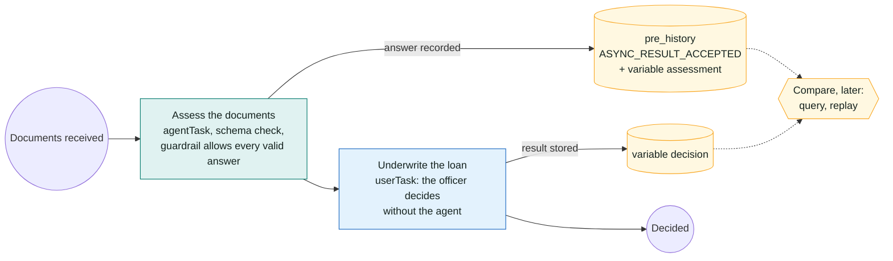

# Run an agent step in shadow

Shadow means the agent runs on real cases and its answer is recorded, while a person makes the decision. You compare the two before you let the agent act. In the [[autonomy ladder|Agent-Autonomy-Ladder-and-Eval-Guide]] this is rung 0.

**The engine has no shadow switch.** There is no `mode: shadow` on an `agentTask`. Shadow is a way of building the process and the guardrail, using what the engine already records. This guide shows that pattern on the loan document assessment of [`examples/rule-and-process`](https://github.com/dhluong90/horus-Agentic-BPM/tree/main/examples/rule-and-process). The limits of the pattern are listed at the end; read them before you rely on it.

Before 1.0 the autonomy ceiling is rung 3. Rung 4, end to end with no sampling, is not offered.

## What you build



The path of the case is the human path: the agent step is followed by the officer's task, and the officer decides on the case, not on the agent's answer. The agent's answer is kept beside the decision. Afterwards you compare them, and replay a stricter guardrail over the recorded answers.

## Before you start

- A host with the Process Engine and the Rule Engine, as in `examples/rule-and-process`.
- An `AgentAdapter` bean named `documents.assess`. The example host's main application does not include one; the test `GuardedAgentTaskIT` registers a `StubAgentAdapter` with that name. In your host, the adapter calls your model.
- Roles: someone who can import and approve a process definition and a rule set (two different people), and a holder of `processes:agent:replay` for the replay step.

To see the engine do what this guide describes, run the example's test from a fresh clone, at the repository root. It needs Docker, for PostgreSQL in Testcontainers:

```bash
mvn -B -pl examples/rule-and-process -am verify -Dcockpit.bundle.skip=true -Dtest=NoSuchTest \
  -Dit.test=GuardedAgentTaskIT -Dsurefire.failIfNoSpecifiedTests=false -Dfailsafe.failIfNoSpecifiedTests=false
```

`-Dcockpit.bundle.skip=true` skips the cockpit web bundle, which this test does not use, and `-Dtest=NoSuchTest` skips the unit tests of the modules built on the way. Expected: `Tests run: 3, Failures: 0, Errors: 0, Skipped: 0` for `GuardedAgentTaskIT`, and `BUILD SUCCESS`. It takes about a minute once the dependencies are downloaded.

## 1. The process

Use the example process as it is. [`loan-document-assessment.bpmn`](https://github.com/dhluong90/horus-Agentic-BPM/blob/main/examples/rule-and-process/src/test/resources/processes/loan-document-assessment.bpmn) has the agent step `assess-documents` followed by the officer's user task `underwrite`:

```xml
<bpmn:serviceTask id="assess-documents" name="Assess the documents" horus:type="agentTask"
                  horus:agent="documents.assess" horus:timeout="PT30S" horus:resultVariable="assessment">
  ...
  <horus:guardrail decision="agent-output-guardrails" onViolation="route-to-human"
                   reviewer="role:COMPLIANCE_REVIEWER"/>
</bpmn:serviceTask>
<bpmn:userTask id="underwrite" name="Underwrite the loan" horus:assignee="role:CARD_OFFICER" horus:resultVariable="decision"/>
```

Two parts make it shadow. The officer decides at `underwrite` from the case, and your task form or the officer's procedure does not use `assessment`. And the guardrail never stops a valid answer, which is the next step.

## 2. The guardrail: allow every valid answer

Publish this as the first version of `agent-output-guardrails`. It declares the same inputs and outputs as the example, with a single row that allows everything. The engine still checks each answer against the output schema first:

```yaml
schemaVersion: 1
ruleSet: agent-output-guardrails
description: Shadow guardrail for the document assessment, allows every schema-valid answer
hitPolicy: first

inputs:
  - { name: riskScore,      type: integer }
  - { name: recommendation, type: string }
  - { name: summary,        type: string }

outputs:
  - { name: allow,   type: boolean }
  - { name: reasons, type: string }

rules:
  - id: R1
    when: {}
    then: { allow: "true", reasons: "''" }
```

The deploy-time check still applies. The rule set must be in force in your tenant before you deploy the process, with the output `allow` and with inputs that the step's output schema declares; otherwise the deploy is refused with `422 GUARDRAIL_CONTRACT_INVALID`.

Publication is four-eyes: one person requests, another approves ([[Rule Engine Versioning and Publishing]]). Then deploy and approve the process definition ([[Process Engine API|Process-Engine-API]]).

The risk gate you intend to use later (the example's `agent-output-guardrails.yaml`, which refuses a risk score of 70 or more) is not in force yet. Keep it as a draft of version 2; step 5 replays against it.

## 3. Run cases

Start an instance for each real case, with your host's credentials added to the call. The request is the one `GuardedAgentTaskIT` sends:

```bash
curl -s -X POST http://localhost:8080/api/bpm/processes/v1/instances \
  -H 'Content-Type: application/json' -H 'Idempotency-Key: start-LOAN-AGENT-0002' \
  -d '{"definitionKey": "loan-document-assessment", "businessKey": "LOAN-AGENT-0002",
       "variables": {"applicationId": "LOAN-AGENT-0002", "amount": 200000000}}'
```

Expected: `201` with the instance `id`. The engine parks the agent step and calls your adapter with no database transaction open. When the answer arrives, the engine checks it against the output schema and the guardrail, writes one history row and moves the case to `underwrite`. The test's assessor answers `{"riskScore": 20, "recommendation": "APPROVE", "summary": "..."}` for a loan under one billion VND.

Check the case:

```bash
curl -s http://localhost:8080/api/bpm/processes/v1/instances/<id>
```

Expected: the variable `assessment` holds `riskScore` 20 and `recommendation` `APPROVE`, and the only open task is `underwrite`. In the test this is `PRE_010_an_answer_the_guardrail_allows_moves_the_loan_on_without_a_review`: one `ASYNC_RESULT_ACCEPTED` row and no `HUMAN_OVERRIDE`.

An officer then claims and completes `underwrite` as for any task, with the officer's own decision as the `result` ([[Process Engine API|Process-Engine-API]]). That result is stored in the variable `decision`.

Under this guardrail a high-risk answer, for example a risk score of 85 on a loan of 1.5 billion VND, is also allowed and the case still goes to the officer. Under the example's risk gate it would have gone to a compliance reviewer instead. Seeing which cases the gate would have stopped is the point of step 5.

## 4. Read the agent's answer next to the human decision

The agent's answer is in the history table `pre_history` of your host database. The officer's decision is in the instance's `variables`. One query puts them on a row for each completed case:

```sql
SELECT i.business_key,
       h.details -> 'output'     AS agent_output,
       i.variables -> 'decision' AS human_decision
FROM pre_history h
JOIN pre_instance i ON i.tenant_id = h.tenant_id AND i.id = h.instance_id
WHERE h.tenant_id = 'acme'
  AND h.node_id = 'assess-documents'
  AND h.event_type = 'ASYNC_RESULT_ACCEPTED'
  AND i.status = 'COMPLETED'
ORDER BY h.occurred_at;
```

Replace `acme` with your tenant. Expected: one row per completed case. `agent_output` for the case above reads `{"summary": "***", "riskScore": 20, "recommendation": "APPROVE"}`. The summary is `***` because the schema marks it `mask: true`, so the history never keeps its text. `human_decision` is whatever the officer submitted.

The engine does not compare the two. What counts as agreement, for example the agent's `recommendation` against the officer's outcome, depends on your decision form, so you write that comparison. For a first look, export the rows and count the cases where the two differ, and read those cases.

The history row also holds `latencyMs`, the `inputs` (masked ones as keyed fingerprints) and the `labels` your adapter returned, such as `model` and `promptVersion`. Group by those to compare model versions ([[Guarded agent steps|Guarded-Agent-Steps]], History and overrides).

## 5. Replay the risk gate over the shadow period

To learn what the real guardrail would have done to every recorded answer, replay it as the candidate. Version 1 is the shadow guardrail in force; version 2 is the risk gate:

```bash
curl -s -X POST http://localhost:8080/api/bpm/processes/v1/agent-replays \
  -H 'Content-Type: application/json' -H 'Idempotency-Key: shadow-replay-1' \
  -d '{"definitionKey": "loan-document-assessment", "nodeId": "assess-documents",
       "from": "2026-11-01", "to": "2026-11-30",
       "candidate": {"ruleSet": "agent-output-guardrails", "version": 2}}'
```

Expected: `202` with a run in status `QUEUED`. Read `GET /api/bpm/processes/v1/agent-replays/{id}` until it is `COMPLETED`. In the summary, `newlyRoutedToReview` is the number of shadow answers that the risk gate would have sent to a compliance reviewer, here those with a risk score of 70 or more; `unchanged` is the number it would have allowed. `GET /agent-replays/{id}/cases` lists each case, so you can open the ones a person decided differently from the agent.

A replay calls no model and writes nothing; it reads the answers history already holds. The period is at most 31 days and one run covers at most 50,000 answers. See [[Agent autonomy ladder and evaluation guide|Agent-Autonomy-Ladder-and-Eval-Guide]] for how to read the summary.

## 6. Decide whether to move up

When the comparison from step 4 and the replay from step 5 meet the bar in the [[evaluation checklist|Agent-Autonomy-Ladder-and-Eval-Guide]], publish the risk gate as version 2 of the rule set. A second person approves it. From then on the example behaves as rung 2: a risk score of 70 or more goes to a four-eyes review task for the compliance role, and the rest completes. Rung 1, in which every answer is reviewed, uses a guardrail that refuses every answer; both are described in the ladder guide.

Moving from rung 0 changes who relies on the agent. Decide, before you publish, whether the `underwrite` step still needs the officer to decide independently, and if the process changes, import and approve the new definition version too.

## Limits of this pattern

- **No shadow flag.** Nothing in the engine marks a step as shadow, and the cockpit and the API show it as an ordinary agent step. Name the process and the rule set so that people can tell.
- **The agent step still blocks the case.** The step runs before `underwrite`. A timeout or a schema failure that exhausts its retries opens an incident, and the officer's task is not created until the step completes. Retries are `horus:retry` or the runner defaults; see [[Guarded agent steps|Guarded-Agent-Steps]], Retry and incidents.
- **The answer is a process variable.** The agent's answer is stored in the instance variable `assessment`, which anyone with `processes:read` can read, including the officer. The engine cannot hide it from the human step. Keep it out of the officer's form to avoid anchoring.
- **A refused answer is not shadow.** If you keep any rule that refuses answers while you run rung 0, a refused answer goes to a four-eyes review task and the case waits for it. Keep the guardrail at allow-all until you intend to move up.
- **The comparison is yours.** The engine records both sides and compares neither. The replay's `OVERRIDDEN_BY_REVIEWER` flag covers only reviewers who corrected a refused answer, not a decision made on a normal task.
- **Masked fields cannot be compared or replayed.** A field the schema masks is `***` in history; a replay leaves it out and counts the answer under `withMaskedFields`.
- **A changed prompt or model is not replayed by the engine.** Re-run selected cases from your own harness and compare their answers with the recorded ones. The `model` and `promptVersion` labels tell you which version produced which answer.
- **No rung 4.** Rung 3 is the ceiling before 1.0.

## Related pages

- [[Agent autonomy ladder and evaluation guide|Agent-Autonomy-Ladder-and-Eval-Guide]]: the rungs, the bar and the numbers
- [[Guarded agent steps|Guarded-Agent-Steps]]: the step, its guardrail and its history
- [[Process Engine API|Process-Engine-API]]: instances, tasks and the replay endpoints
- [[Rule Engine Versioning and Publishing]]: how a guardrail version is approved
