# Architecture

One sentence: two libraries in your service, your PostgreSQL, a static cockpit, adapters for agents and services. Everything below follows from the [[Principles]].

## System context

- The engines run inside the host JVM and use the host's `DataSource` and transactions.
- The cockpit is static assets talking to the host's optional REST layer.
- Agents and other services are reached through adapters the host registers. The engines never call the network.

## Modules

| Artifact | Role |
|---|---|
| `*-core` | Model, parser and compiler, evaluator, lifecycle, storage and log SPIs. Java 21 and Jackson only. |
| `*-postgres` | Storage on Spring JDBC, Flyway migrations for `rle_*` / `pre_*`. |
| `*-spring-boot-starter` | Auto-configuration, engine bean, transactions, tenant resolver, metrics. |
| `*-rest` | Controllers and OpenAPI document. |
| `*-test` | In-memory storage, JUnit 5 extension, fixed clock, coverage report. |
| `cockpit`, `cockpit-spring-boot-starter` | React build; served by the host or standalone. |
| `bpm-bom` | Pins all module versions. |

Rule Engine never depends on Process Engine. Process Engine depends only on the Rule Engine API interface and runs without it when no `decision` step is used.

## Rule Engine: authoring and evaluation

- Validate and compile once per version; cache the compiled tree per JVM.
- Resolve the effective version for the decision's clock, so scheduled changes and replays behave identically.
- Write the decision log in the caller's transaction (default) or through an outbox (`async`).

## Process Engine: instance lifecycle (milestone 2)

- Steps run in the host's transaction; service side effects commit or roll back with engine state.
- Mutating operations are idempotent by key; instances may carry a unique business key; stale task completions are rejected by optimistic locking (ADR-0006).
- Steps with external effects declare `compensate` handlers; on failure the engine runs them in reverse order, each with retry and incidents (ADR-0007).
- SLA deadlines are computed through a `BusinessCalendar` SPI (working hours and holidays), not by adding physical time.
- Running instances can be migrated to a newer definition version through a validated plan, in batches, with history.
- Timers and jobs are rows claimed with `SELECT … FOR UPDATE SKIP LOCKED`; correct across replicas without an external scheduler.
- A failed step becomes an **incident** with cause, retry count and resolution actions.
- Agent steps: see [[Process Engine Overview]].

## Storage
| Engine | Tables (prefix in the host database) |
|---|---|
| Rule Engine | `rle_rule_set`, `rle_version`, `rle_rule`, `rle_decision`, `rle_decision_outbox`, `rle_idempotency` |
| Process Engine | `pre_definition`, `pre_instance`, `pre_task`, `pre_timer`, `pre_history`, `pre_incident`, `pre_idempotency`, `pre_calendar`, `pre_holiday`, `pre_migration` |

Every table carries `tenant_id` first in its indexes. Definitions are stored normalised and as a canonical JSON document whose hash is part of the version identity. Append-only tables can be partitioned by month. Migrations are forward-only and ship with the module.

## Contracts
| Layer | Audience | Stability |
|---|---|---|
| Java API and SPIs | host developers | semver; deprecations overlap one minor release |
| REST `/api/bpm/rules/v1`, `/api/bpm/processes/v1` | cockpit, remote callers | versioned path; OpenAPI per release |
| Definition formats (YAML, JSON) | authors, tooling | schema versioned; old schemas import forever |
| Events | host audit and analytics | additive only |

## Deployment shapes

Engines are stateless beyond the database. Compiled versions are cached per replica and invalidated by version events.

## Deliberately absent
Separate engine process · message broker requirement · search index · built-in identity provider · scripting engine · full BPMN 2.0 or DMN FEEL.
