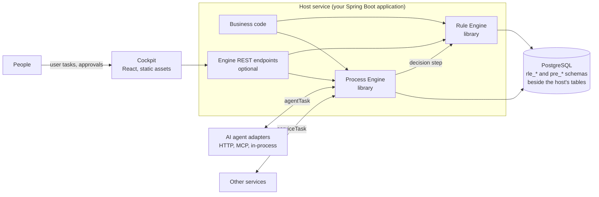
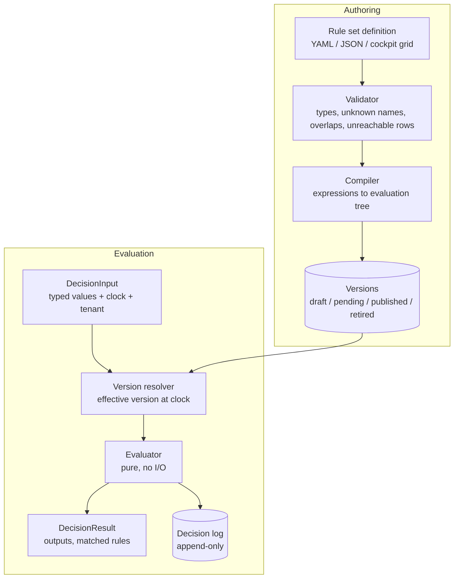
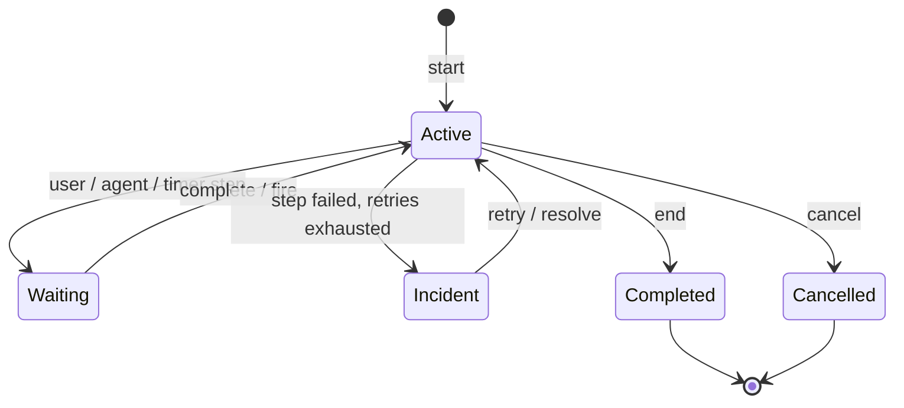

# Architecture

## System context

The engines are libraries inside the host. The cockpit is a static web application talking to the host's engine endpoints. Agents and external services are reached through adapters that the host registers; the engines never call the network themselves.

## Module structure
Each engine is split so that the core has no framework dependency.

| Artifact | Contents | Depends on |
|---|---|---|
| `rule-engine-core` | Definition model, parser and compiler for the expression language, evaluator, version lifecycle, storage SPI, decision log SPI | Java 21 only (plus Jackson for JSON) |
| `rule-engine-postgres` | Storage and decision-log implementation on JDBC and PostgreSQL, Flyway migrations for `rle_*` | core, JDBC, Flyway |
| `rule-engine-spring-boot-starter` | Auto-configuration, `RuleEngine` bean, transaction integration, security-context tenant resolver, metrics | core, postgres, Spring Boot |
| `rule-engine-rest` | REST controllers, OpenAPI document, DTOs | starter, Spring Web |
| `rule-engine-test` | In-memory storage, JUnit 5 extension, fixed clock, coverage reporter | core, JUnit 5 |
| `process-engine-*` | Same shape: core, postgres, starter, rest, test | may depend on `rule-engine-core` API only |
| `cockpit` | React application built to static assets; `cockpit-spring-boot-starter` serves them under the host's authentication | engine REST APIs |
| `bpm-bom` | Bill of materials pinning all module versions | |

Rule Engine never depends on Process Engine. Process Engine depends on the Rule Engine **API** (an interface) and works without a Rule Engine present when no `decision` step is used.

## Rule Engine internals

- **Compile once**: a published version is compiled to an evaluation tree and cached per JVM; evaluation never parses text.
- **Resolve by clock**: the effective version is chosen for the decision's clock, so scheduled changes and replays behave the same.
- **Log in the transaction**: by default the decision log row is written in the caller's transaction; `async` mode uses an outbox table and a background writer.

## Process Engine internals (milestone 2)

- **Instance state machine** stored as rows; each transition is one row in history.
- **Steps run in the host's transaction**: a service step calls a host bean; its side effects commit or roll back with the engine state.
- **Timers and jobs** are rows claimed with `SELECT … FOR UPDATE SKIP LOCKED` by a scheduler thread in each host instance; no external scheduler, safe across multiple host replicas.
- **Agent steps** hand a bounded input to a host-registered adapter, wait for a structured result, validate it against the declared schema and the guardrail rule set, then continue, route to a human, or raise an incident.
- **Incidents** are first-class: a failed step becomes an incident with cause, retry count and resolution actions visible in the cockpit.

## Storage model
- One prefixed schema per engine in the host database: `rle_rule_set`, `rle_version`, `rle_rule`, `rle_decision`, `rle_decision_outbox`; `pre_definition`, `pre_instance`, `pre_task`, `pre_timer`, `pre_history`, `pre_incident`.
- Every table has `tenant_id`; every index that serves a query starts with it.
- Definitions are stored normalised for querying and as a canonical JSON document for export and hashing; a version's hash is part of its identity.
- Append-only tables are partitioned by month when the host enables it; the engine ships the partition management migration.
- Engine migrations are forward-only and versioned with the module; a module release states the migrations it adds.

## API layers
| Layer | Audience | Stability |
|---|---|---|
| Java API (`RuleEngine`, `ProcessEngine`, SPIs) | host developers | semantic versioning, deprecations overlap one minor release |
| REST API (`/api/bpm/rules`, `/api/bpm/processes`) | cockpit, remote callers | versioned path (`v1`), OpenAPI document published with each release |
| Definition formats (YAML/JSON) | authors, tooling | schema versioned; older schema versions import forever |
| Events (`RuleEventPublisher`, `ProcessEventPublisher`) | host audit and analytics | additive changes only |

## Tenancy and security model
Tenant comes from the host's security context, a trusted gateway header, or a custom resolver; never from a request body. Permissions are named strings the host maps to its roles (`rules:evaluate`, `rules:author`, `rules:approve`, `processes:operate`, …). Maker-checker is enforced in the service layer, below the REST layer. Inputs marked for masking are stored as keyed hashes.

## Deployment shapes
| Shape | What runs where |
|---|---|
| Single service | host service with both starters; cockpit served by the host at `/bpm/cockpit` |
| Several services, one cockpit | each service embeds the engines it needs; a standalone cockpit is configured with the list of service endpoints and switches between them |
| Multiple replicas | engines are stateless beyond the database; timers and jobs are claimed with row locks; compiled versions are cached per replica and invalidated by version events |

## What is deliberately absent
A separate engine process, a message broker requirement, a search index, a built-in identity provider, a scripting engine, BPMN 2.0 or DMN FEEL completeness. Each absence follows from the [[Principles]].
