# How to use the cockpit

Embed the cockpit in your service or host it standalone, then perform the operator tasks it offers: review and approve rule versions, simulate, read the decision log, and (from 0.2) edit tables and operate processes.

Design preview: Rule Engine screens describe the Cockpit 0.1 target; the grid editor and Process Engine screens describe the Cockpit 0.2 target. Scope per version is owned by the [[Roadmap]].

## What it is

A React application built to static assets. It keeps no state and has no backend of its own; it talks only to the REST layer of your service (ADR-0005). Authentication and permissions are your service's; see [[Multi-Tenancy and Security]] and the permission list in [[Rule Engine Configuration]].

## Embed it in your service

Add the starter next to the engine starter:

```xml
<dependency>
  <groupId>com.horus.bpm</groupId>
  <artifactId>cockpit-spring-boot-starter</artifactId>
  <version>0.1.0</version>
</dependency>
```

Open `http://localhost:8080/bpm/cockpit`. Expected: the Rule sets screen lists `loan-eligibility` (from [[Getting Started]]) with its effective version.

| Property | Default | Meaning |
|---|---|---|
| `horus.bpm.cockpit.path` | `/bpm/cockpit` | Path under which the host serves the assets |

Theming is through CSS variables. Labels exist in English and Vietnamese and can be extended (TR-UI-04).

## Host it standalone



1. Download the cockpit archive of the matching release and serve it from any static web server.
2. Point it at your service with one base URL per service (TR-UI-01).
3. Allow the cockpit's origin in your service's CORS configuration; the cockpit calls `/api/bpm/rules/v1` and, from 0.2, `/api/bpm/processes/v1` directly.

## Rule Engine tasks (Cockpit 0.1)

| Task | Screen | What you do | What you see |
|---|---|---|---|
| Check which version is live | Rule sets | Open the list | Effective version, pending approvals, last change per rule set |
| Read a version | Editor | Open a version | YAML or JSON view; import and export buttons |
| Compare two versions | Editor, Diff | Pick two versions | Added, removed and changed rows and columns side by side |
| Try a draft | Simulation | Paste rows or upload a CSV, run | Outputs and matched rule id per row; nothing is logged |
| Approve or reject a change | Approvals | Open a pending version, read diff and simulation report, approve or reject with a comment | Status changes to published or back to draft. Your own request shows a disabled Approve button; the API refuses it regardless (TR-SEC-04) |
| Investigate a decision | Decisions | Filter by rule set, period, outcome, rule id or output value; open an entry | The rule table with the matched row highlighted, and the plain-language explanation. Masked inputs stay masked |

Authoring in 0.1 is by YAML or JSON import; see [[Rule Engine Authoring Decision Tables]].

## Rule Engine tasks added in Cockpit 0.2

| Task | What you do | What you see |
|---|---|---|
| Edit a table in a grid | Change typed cells, validate | Validation messages bound to the row and cell; publication request blocked until errors are fixed |
| Replay history through a draft | Choose "Replay last N decisions" in Simulation | Count and breakdown of changed outcomes |

## Process Engine tasks (Cockpit 0.2)

| Area | What you can do |
|---|---|
| Definitions and instances | Browse versions; open an instance and see its current step and history timeline |
| Task queues | See tasks per role; claim, complete, reassign |
| Agent tasks | Inspect bounded inputs, the JSON Schema verdict, the agent's output and the guardrail rules that fired; approve or override an escalated task with a reason |
| Incidents | Read cause and retry count; retry or resolve |
| Compensation runs | See which handlers ran, in which order, with which result |
| SLA | List breaches; edit business calendars (working hours, holidays) per tenant |
| Instance migration | Create a plan, run the dry run, execute in batches with progress |

Behaviour behind these screens is described in [[Process Engine Overview]].

## Troubleshooting

| Symptom | Cause | Fix |
|---|---|---|
| Blank page at `/bpm/cockpit` | Starter missing, or a different `horus.bpm.cockpit.path` | Check the dependency and the property |
| Standalone cockpit shows "cannot reach service" | CORS not allowed, or wrong base URL | Allow the cockpit origin in the host; check the base URL |
| Approve button disabled for you | You requested this publication | Ask a different identity with `rules:approve` |
| Decisions screen is empty or forbidden | You lack `rules:log:read` | Map the permission to your role |
| Inputs shown as `***` | They are declared `mask: true` | Expected; the plaintext is never stored (TR-SEC-05) |
