# Concepts

| Term | Meaning |
|---|---|
| **Rule set** | A named decision, for example `loan-eligibility`, with typed inputs and outputs. The unit that callers evaluate. |
| **Version** | An immutable snapshot of a rule set's rules. Versions move through `draft → published → retired`. Exactly one version is effective at any instant for a tenant. |
| **Rule** | One row of a decision table: a `when` (conditions per input) and a `then` (values per output). |
| **Hit policy** | How multiple matching rules combine: `first` (first match in order wins), `unique` (exactly one must match, otherwise an error), `collect` (all matches, outputs aggregated into lists or by a function). |
| **Expression** | A condition or output written in the safe expression language. No code execution. See [[Rule Engine Expression Language]]. |
| **Decision** | One evaluation of a rule set version against a set of inputs, producing outputs and a record in the decision log. |
| **Decision log** | Append-only record of every decision: tenant, rule set, version, inputs, matched rules, outputs, caller, timestamp. The audit trail. |
| **Simulation** | Evaluating a draft version against sample inputs or against the decision log of the current version, to see what would change before publishing. |
| **Maker-checker** | Publishing a version requires a second identity to approve. Enforced in the engine, not only in the UI. |
| **Tenant** | An isolation boundary. Rule sets, versions and decisions are always scoped to a tenant. |
| **Process** (Process Engine) | A definition of steps (tasks, gateways, timers) through which an instance moves. Tasks can be performed by a person, a service or an AI agent. |
| **Business key** | A caller-chosen identifier for an instance, unique per tenant and definition (for example a loan application number). Starting again with the same key returns the existing instance. |
| **Idempotency key** | A caller-chosen key on any mutating call. A replay within the retention window returns the original result and has no second effect. |
| **Compensation** | Declared undo handlers run in reverse order when a later step fails after earlier steps already committed effects in other systems. |
| **Business calendar** | Working hours and holidays used to compute SLA deadlines (for example 4 business hours), supplied through an SPI. |
| **Instance migration** | Moving running instances from one definition version to another with a validated step mapping. |

## Lifecycle of a rule set version

Decisions record the version they used, so a retired version can still explain a past decision.

## What the engines are not
Not a BPMN 2.0 or DMN FEEL implementation, not a server you deploy separately, not a workflow for infrastructure (use a CI system for that).
