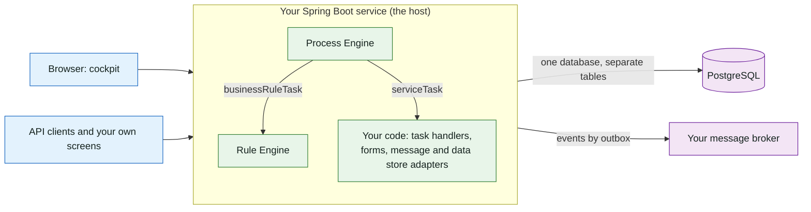
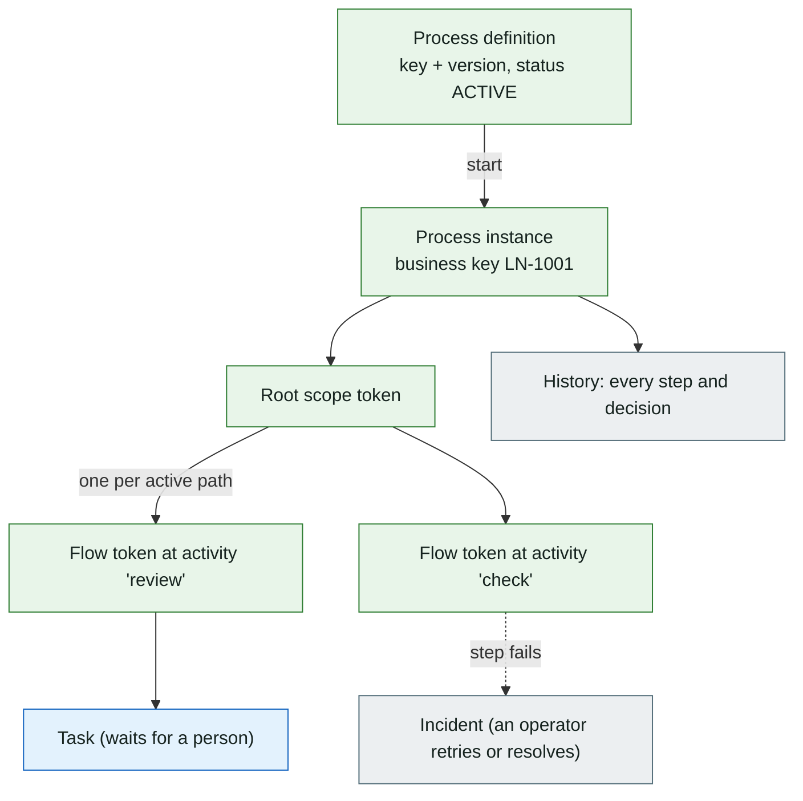
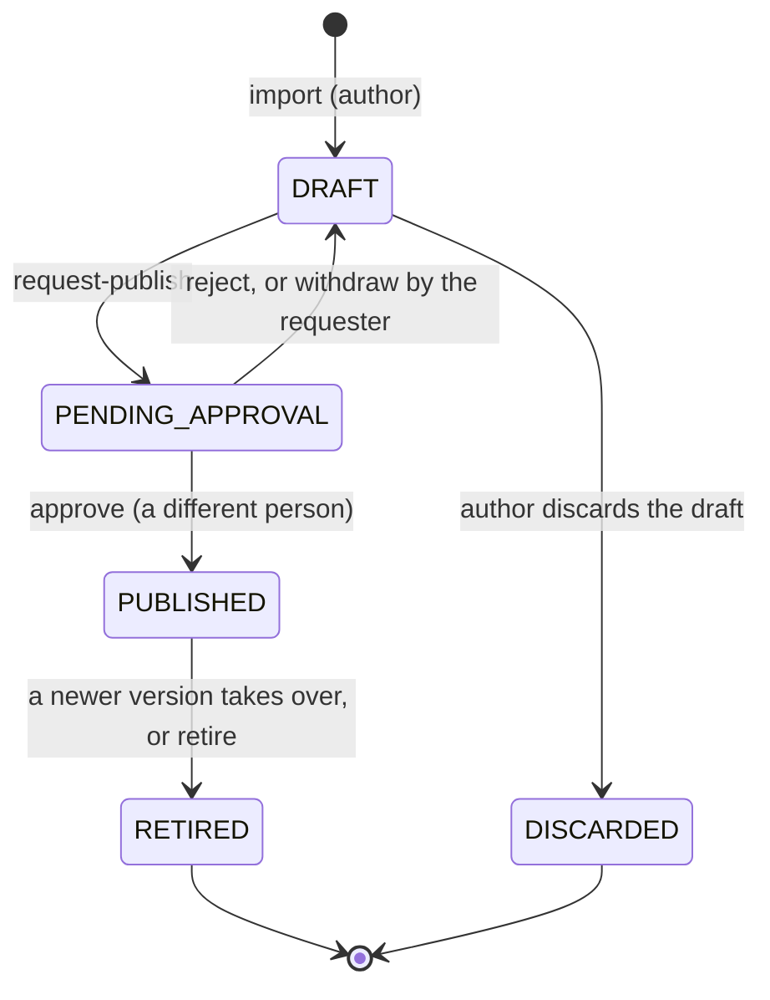

# Concepts

Horus BPM is two libraries and a dashboard. The Process Engine runs BPMN processes. The Rule Engine runs decision tables. The cockpit is the screen for authors, approvers and operators. You add them to your own Spring Boot service; there is no separate server to run, and they use your PostgreSQL database with their own tables (`pre_*` for processes, `rle_*` for rules).

This page defines the terms used everywhere else in the wiki. Other pages link here instead of redefining them.

The engine never calls out on its own. It calls the code you register (the SPIs, below), and it never listens to your broker: your code hands it messages through the REST API or the Java API.

## How the process terms fit together

A definition is the plan. An instance is one run of it. A token marks where the instance is, inside a scope.

| Term | Meaning |
|---|---|
| Activity | One step of the model: a task, event or gateway. Its `id` in the BPMN file is the `nodeId` you see in the API. |
| Scope | The container a token lives in: the whole process, a sub-process, or a multi-instance body. A scope has its own token, so cancelling or compensating a scope affects only what is inside it. |
| Version | Each import of a changed file is a new version of the same key. A running instance keeps the version it started with. |

## Rule set versions and four-eyes approval

- **Effective date.** A published version decides from its `effectiveFrom`. A future date means scheduled.
- **Four-eyes, two layers.** First, roles are separate: authoring and approving are different permissions (`rules:author` and `rules:approve`). A caller without the approve permission gets `403 PERMISSION_DENIED`. Second, a person who holds the approve permission still cannot approve their own work. For rules, the person who requested the publication or authored the version is refused; for process definitions, migrations and incident resolutions, the person who requested the change is refused. Both get `403 SELF_APPROVAL_FORBIDDEN`, whatever other roles they hold.
- **Reviewed hash.** The approver sends the hash of the content they read (`expectedCanonicalHash` for rules, `expectedDefinitionHash` for processes). If the content changed after review, the approval fails. Without a hash it fails with `CONTENT_HASH_REQUIRED`.
- **Withdraw and roll back.** The requester can withdraw a request. A rollback is a new version carrying old content, because history is never rewritten. See [[Rule Engine Versioning and Publishing]].

## Safe retries and concurrent edits

| Header | Use | Without it |
|---|---|---|
| `Idempotency-Key` | A caller-chosen key on a command. A replay with the same key returns the first answer and does nothing twice (ADR-0006). | `428` or `400`, by endpoint |
| `If-Match` | The version you read: the `lockVersion` or `ETag` of the thing you change. A stale value is `409 VERSION_CONFLICT`: reload and decide again. | `428 PRECONDITION_REQUIRED` |

## Tenants

Every definition, instance, rule set and decision belongs to one tenant. The tenant comes from the signed-in user (a token claim or your own resolver), never from a request body, and another tenant's object is answered as not found. See [[Multi-Tenancy and Security]].

## Audit trail and history

Rule decisions go to the append-only decision log, in the same transaction as the evaluation. Process steps, approvals and operator actions go to the process history. Both name who acted and when, and neither is ever edited. See [[Rule Engine Decision Log and Audit]].

## Migration plans

A migration plan moves the running instances of one definition version to another. It is validated by a dry run, proposed by one person and approved by a second before any instance moves.

## What your host provides (the SPIs)

An SPI is a Java interface you implement and register as a Spring bean. The engine finds it by name.

| SPI | You provide | Used for |
|---|---|---|
| `ServiceTaskHandler` | Code for a `serviceTask` | Calling your own services; see [[Guide: Task Handlers and Forms]] |
| `FormRegistry` | Form schemas by reference | The form a user task shows |
| `MessageAdapter` | Sending an outgoing message | Send tasks and message end events (usually writes to an outbox) |
| `DataStoreAdapter` | Reading and writing a named data store | BPMN data stores |
| `ServiceAdapter` | A remote step that answers later | Callbacks from a bureau or payment rail |
| `AssigneeDirectory`, `RoleCatalogue` | Who may take a task, which roles exist | Task assignment checks |
| `BusinessCalendar` | Working hours and holidays | SLA deadlines |
| `AgentAdapter` | An AI agent call | [[Guarded Agent Steps]] |

## Rule Engine terms

| Term | Meaning |
|---|---|
| Rule set | A named decision, for example `loan-eligibility`, with typed inputs and outputs. The unit that callers evaluate. |
| Version | An immutable snapshot of a rule set's rules. A version is in one of five states: draft, pending approval, published, retired, discarded (see below). At most one version of a rule set is effective per tenant at any instant. |
| Rule | One row of a decision table: a `when` (one condition per input) and a `then` (one value per output). Each row has a stable id such as `R2`. |
| Hit policy | How the engine combines several matching rows. `first`: the first match in row order wins. `unique`: exactly one row must match, otherwise the decision fails. `collect`: every matching row contributes, and outputs become lists or aggregates. |
| Expression | A condition or output value written in the expression language. It is data, parsed at publish time into a closed set of operations; it cannot call code. Reference: [[Rule Engine Expression Language]]. |
| Clock | The instant a decision reasons about. It selects the effective version and feeds `today()` and `now()`. It defaults to the system time and can be set explicitly for simulation and replay. |
| Decision | One evaluation of a rule set version against one set of inputs. It produces outputs, the matched rule ids and one record in the decision log. |
| Decision log | The append-only record of every decision: tenant, rule set, version, inputs, matched rules, outputs, caller, clock. It is the audit trail. How-to: [[Rule Engine Decision Log and Audit]]. |
| Effective date | The `effectiveFrom` instant from which a published version decides. A version with a future date is scheduled and becomes effective without any further action. |
| Maker-checker | Publishing a version needs two identities: one requests or authors, a different one approves. The engine enforces it; the cockpit only reflects it. |
| Simulation | Evaluating a draft version against sample inputs, or against past decisions of the effective version, to see what would change. A simulation never writes to the decision log. |
| Masking | Marking an input `mask: true` so the decision log stores a keyed hash instead of the value. The hash still allows exact-match search. |
| Tenant | The isolation boundary. Rule sets, versions and decisions always belong to exactly one tenant; there is no cross-tenant read. |
| Idempotency key | A caller-chosen key on a mutating call. A replay with the same key inside the retention window returns the original result and has no second effect (ADR-0006). |

## Lifecycle of a version

| State | Editable | Evaluable | Leaves the state when |
|---|---|---|---|
| Draft | Yes | Only by simulation | An author requests publication, or discards the draft |
| Pending approval | No | Only by simulation | A second identity approves (to published) or rejects (back to draft) |
| Published | No | Yes, from its effective date | A later version becomes effective, or an approver retires it (one approver with a reason by default; a host can require a second approver from M3) |
| Discarded | No | No | Never; an author discarded the draft before it was requested for publication |
| Retired | No | No, but it still explains the decisions it made | Never; history is not rewritten |

The decision log records the version each decision used, so a retired version can still explain a past decision.

## Process Engine terms

| Term | Meaning |
|---|---|
| Process definition | A versioned description of steps (tasks, gateways, timers) that an instance moves through. Running instances pin the version they started with. Every definition has a diagram view (see Diagram). |
| Diagram | The graphical view of a process definition or instance. Every definition has one; when no layout is stored, the cockpit lays it out automatically. The layout is stored apart from the definition, so moving a box changes no behaviour and needs no approval. An instance's diagram shows its current tokens. |
| Token | A marker for where an instance is in its definition. An instance has one token per active path, so parallel branches hold several tokens at once. |
| Process instance | One execution of a definition, for example one loan application. |
| Task | A step that waits for a participant. A user task waits for a person, a service task for host code, an agent task for an AI agent. |
| Agent task (`agentTask`) | A step performed by an AI agent through an adapter the host registers. The agent receives bounded inputs and must return output that validates against a JSON Schema and passes a guardrail rule set; otherwise the engine routes the step to a human or fails it. The engine never embeds a model. |
| Guardrail | A rule set that the engine evaluates on an agent's output before the process continues. |
| Business key | A caller-chosen identifier for an instance, unique per tenant and definition, for example a loan application number. Starting again with the same key returns the existing instance. |
| Incident | A failed step with its cause, retry count and the actions an operator can take (retry, resolve). |
| Compensation | Declared undo handlers that run in reverse order when a later step fails after earlier steps committed effects in other systems (ADR-0007). |
| Saga | A block of steps that compensate together. |
| Business calendar | Working hours, holidays and time zone per tenant, used to compute SLA deadlines such as 4 business hours. Supplied through an SPI. |
| Instance migration | Moving running instances from one definition version to another with a validated step mapping. |

Behaviour of these terms is described in [[Process Engine Overview]].

## What the engines are not

Not yet a full BPMN 2.0 or DMN implementation. BPMN 2.0 and DMN are the models, and the engines' JSON is their canonical serialisation; each release executes exactly what the [standards compliance](https://github.com/dhluong90/horus-Agentic-BPM/blob/main/docs/architecture/standards-compliance.md) page lists, and full execution arrives in stages after 1.0. Never CMMN. Not a server you deploy separately, not a workflow tool for infrastructure. Not built for one business: business behaviour is configured, not coded into the engines (principle 13). The reasons are in [[Principles]] and [[FAQ]].
