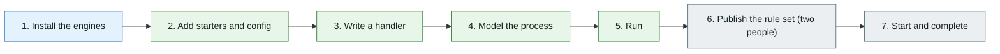

# Getting Started: your own service

In about 20 minutes you add both engines to a Spring Boot service, deploy a BPMN file, publish a rule set with a second person's approval, start a process that calls the rule set, and complete the user task it creates. Every step below was run on a clean build.



You need JDK 21 or later, Maven 3.9 or later, Docker, curl and jq. These steps were run on Spring Boot 4.1; the supported lines are in [[Technical Requirements]].

## 1. Install the engines

The artifacts are not on Maven Central yet. Build them from a clone into your local Maven repository:

<!-- guide: skip -->
```bash
git clone https://github.com/dhluong90/horus-Agentic-BPM.git
cd horus-Agentic-BPM
mvn -B -q -pl process-engine/process-engine-spring-boot-starter,rule-engine/rule-engine-spring-boot-starter -am install -DskipTests -Dcockpit.bundle.skip=true
```

Expected: no output, and the folder `~/.m2/repository/io/github/dhluong90/bpm/process-engine-spring-boot-starter` exists. The version is `0.3.0-SNAPSHOT`. Then start PostgreSQL for your service:

<!-- guide: skip -->
```bash
docker run -d --name loans-pg -e POSTGRES_DB=loans -e POSTGRES_USER=horus \
  -e POSTGRES_PASSWORD=change-me -p 5499:5432 postgres:16-alpine
```

## 2. Create the service

Create a Spring Boot project named `loans` (package `com.example.loans`) with Web, JDBC, Security, PostgreSQL and Flyway, or use an existing one. Add the two starters to `pom.xml`:

```xml
<properties>
  <horus.version>0.3.0-SNAPSHOT</horus.version>
</properties>
<dependencies>
<dependency>
  <groupId>io.github.dhluong90.bpm</groupId>
  <artifactId>rule-engine-spring-boot-starter</artifactId>
  <version>${horus.version}</version>
</dependency>
<dependency>
  <groupId>io.github.dhluong90.bpm</groupId>
  <artifactId>process-engine-spring-boot-starter</artifactId>
  <version>${horus.version}</version>
</dependency>
</dependencies>
```

Configuration, `src/main/resources/application.yaml`:

```yaml
spring:
  datasource:
    url: ${HORUS_DB_URL:jdbc:postgresql://localhost:5432/loans}
    username: ${HORUS_DB_USERNAME:horus}
    password: ${HORUS_DB_PASSWORD:}
horus:
  bpm:
    host-id: loans
    tenancy:
      dev-tenant: demo
    rules:
      security:
        role-permissions:
          ROLE_LOAN_OFFICER: [rules:read, rules:author, rules:evaluate]
          ROLE_PRICING_APPROVER: [rules:read, rules:approve]
    processes:
      definitions:
        auto-approve: true
        locations: classpath:processes/loan-application.bpmn
        startup-tenants: [demo]
      security:
        role-permissions:
          ROLE_LOAN_OFFICER: [processes:read, processes:deploy, processes:start, processes:task:work]
```

| Setting | Meaning |
|---|---|
| `tenancy.dev-tenant` | Every user without a tenant runs as tenant `demo`. `dev` profile only. |
| `definitions.auto-approve` | Imports BPMN files as `ACTIVE` without approval. `dev` profile only. |
| `definitions.locations` and `startup-tenants` | The BPMN files to import at start-up, and the tenants to import them for. Without `startup-tenants` nothing is imported. |
| `role-permissions` | The permissions each of your Spring roles holds, per engine. The engines check permissions, never role names. |

All properties are in [[Guide: embedding in Spring Boot|Guide-Embedding-in-Spring-Boot]].

The host owns sign-in. For local work, two in-memory users with HTTP Basic, in `SecurityConfig.java`:

```java
package com.example.loans;

import org.springframework.context.annotation.Bean;
import org.springframework.context.annotation.Configuration;
import org.springframework.security.config.Customizer;
import org.springframework.security.config.annotation.web.builders.HttpSecurity;
import org.springframework.security.core.userdetails.User;
import org.springframework.security.crypto.factory.PasswordEncoderFactories;
import org.springframework.security.provisioning.InMemoryUserDetailsManager;
import org.springframework.security.web.SecurityFilterChain;

/** Development only: two in-memory users with HTTP Basic. A real host signs users in with its own identity provider. */
@Configuration
class SecurityConfig {

    @Bean
    SecurityFilterChain security(HttpSecurity http) throws Exception {
        return http.authorizeHttpRequests(r -> r.requestMatchers("/actuator/health").permitAll().anyRequest().authenticated())
                .httpBasic(Customizer.withDefaults())
                .csrf(csrf -> csrf.disable())
                .build();
    }

    @Bean
    InMemoryUserDetailsManager users() {
        var encoder = PasswordEncoderFactories.createDelegatingPasswordEncoder();
        return new InMemoryUserDetailsManager(
                User.withUsername("ana").password(encoder.encode("dev-only")).roles("LOAN_OFFICER").build(),
                User.withUsername("ben").password(encoder.encode("dev-only")).roles("LOAN_OFFICER", "PRICING_APPROVER").build());
    }
}
```

## 3. Write a task handler

A handler is a bean with a name. The BPMN refers to the name, never to the class. A business error is a returned result, not an exception:

```java
package com.example.loans;

import io.github.dhluong90.bpm.process.spi.HandlerResult;
import io.github.dhluong90.bpm.process.spi.ServiceCall;
import io.github.dhluong90.bpm.process.spi.ServiceTaskHandler;
import java.util.Map;
import org.springframework.stereotype.Component;

/** Step "bureau.score". Registered by name; the BPMN refers to the name, never to this class. */
@Component
class BureauScoreHandler implements ServiceTaskHandler {

    @Override
    public String name() {
        return "bureau.score";
    }

    @Override
    public HandlerResult handle(ServiceCall call) {
        Object customerId = call.inputs().get("customerId");
        if (customerId == null || customerId.toString().isBlank()) {
            return new HandlerResult.BusinessError("CUSTOMER_ID_MISSING", "The application has no customer id");
        }
        return HandlerResult.completed(Map.of("score", 720));
    }
}
```

## 4. Model the process

Save as `src/main/resources/processes/loan-application.bpmn`. You can draw it in Camunda Modeler instead and add the `horus:` attributes ([[Guide: modelling in BPMN|Guide-Modelling-BPMN]]):

```xml
<?xml version="1.0" encoding="UTF-8"?>
<bpmn:definitions xmlns:bpmn="http://www.omg.org/spec/BPMN/20100524/MODEL"
                  xmlns:xsi="http://www.w3.org/2001/XMLSchema-instance"
                  xmlns:horus="urn:horus-bpm:bpmn:extensions:v1"
                  id="Definitions_loan-application" targetNamespace="urn:example:loans"
                  expressionLanguage="urn:horus-bpm:expr:v1">
  <bpmn:process id="loan-application" name="Loan application" isExecutable="true">
    <bpmn:startEvent id="start" name="Application received"/>
    <bpmn:serviceTask id="score" name="Get bureau score" horus:handler="bureau.score" horus:resultVariable="bureau">
      <bpmn:extensionElements>
        <horus:input name="customerId" value="${instance.customerId}"/>
      </bpmn:extensionElements>
    </bpmn:serviceTask>
    <bpmn:businessRuleTask id="check" name="Check eligibility" horus:ruleSet="loan-eligibility" horus:resultVariable="decision">
      <bpmn:extensionElements>
        <horus:input name="age" value="${instance.age}"/>
        <horus:input name="income" value="${instance.income}"/>
      </bpmn:extensionElements>
    </bpmn:businessRuleTask>
    <bpmn:exclusiveGateway id="eligible" name="Eligible?" default="eligible__review"/>
    <bpmn:userTask id="review" name="Officer reviews" horus:assignee="role:LOAN_OFFICER" horus:resultVariable="review"/>
    <bpmn:endEvent id="end-done" name="Reviewed"/>
    <bpmn:endEvent id="end-declined" name="Declined"/>
    <bpmn:sequenceFlow id="f1" sourceRef="start" targetRef="score"/>
    <bpmn:sequenceFlow id="f2" sourceRef="score" targetRef="check"/>
    <bpmn:sequenceFlow id="f3" sourceRef="check" targetRef="eligible"/>
    <bpmn:sequenceFlow id="eligible__declined" name="not eligible" sourceRef="eligible" targetRef="end-declined">
      <bpmn:conditionExpression xsi:type="bpmn:tFormalExpression" language="urn:horus-bpm:expr:v1">decision.eligible == false</bpmn:conditionExpression>
    </bpmn:sequenceFlow>
    <bpmn:sequenceFlow id="eligible__review" name="eligible" sourceRef="eligible" targetRef="review"/>
    <bpmn:sequenceFlow id="f4" sourceRef="review" targetRef="end-done"/>
  </bpmn:process>
</bpmn:definitions>
```

The rule task passes `age` and `income` to the rule set `loan-eligibility` and stores the answer in `decision`. The gateway reads `decision.eligible`.

## 5. Build and run

<!-- guide: skip -->
```bash
mvn -B -q package -DskipTests
SPRING_PROFILES_ACTIVE=dev HORUS_DB_URL=jdbc:postgresql://localhost:5499/loans HORUS_DB_PASSWORD=change-me \
  java -jar target/loans-0.0.1.jar
```

Expected in the log: `Process definition loan-application v1 ACTIVE for tenant demo` and `Started LoansApplication`. Three `WARN` lines about the `dev` relaxations are normal.

## 6. Publish the rule set with two people

Starting now would fail with `RULE_SET_NOT_FOUND`, because the rule set does not exist yet. Save this as `loan-eligibility.yaml`:

```yaml
schemaVersion: 1
ruleSet: loan-eligibility
hitPolicy: first
inputs:
  - { name: age,    type: integer }
  - { name: income, type: money }
outputs:
  - { name: eligible, type: boolean }
  - { name: reason,   type: string }
rules:
  - id: R1
    when: { age: "< 18" }
    then: { eligible: false, reason: "'UNDER_AGE'" }
  - id: R2
    when: { income: "< 5000000 VND" }
    then: { eligible: false, reason: "'LOW_INCOME'" }
  - id: R3
    when: {}
    then: { eligible: true, reason: "'OK'" }
```

Ana imports it and asks for approval. Ben approves exactly the content he read:

<!-- guide: skip -->
```bash
R=localhost:8080/api/bpm/rules/v1
curl -s -u ana:dev-only -X POST $R/rule-sets -H 'Content-Type: application/yaml' \
  -H 'Idempotency-Key: loans-1' --data-binary @loan-eligibility.yaml
curl -s -u ana:dev-only -X POST $R/rule-sets/loan-eligibility/versions/1:request-publish
HASH=$(curl -s -u ben:dev-only $R/rule-sets/loan-eligibility/versions/1 | jq -r .canonicalHash)
curl -s -u ben:dev-only -X POST $R/rule-sets/loan-eligibility/versions/1:approve \
  -H 'If-Match: "1"' -H 'Content-Type: application/json' \
  -d '{"comment":"Checked","expectedCanonicalHash":"'$HASH'"}'
```

Expected: `"status":"DRAFT"`, then `"status":"PENDING_APPROVAL"`, then `"status":"PUBLISHED"`. If Ana sends the approval, the answer is `403 PERMISSION_DENIED`, because her role lacks `rules:approve`. A person who holds the permission but made the request gets `403 SELF_APPROVAL_FORBIDDEN`.

## 7. Start the process and complete the task

<!-- guide: skip -->
```bash
B=localhost:8080/api/bpm/processes/v1
curl -s -u ana:dev-only -X POST $B/instances -H 'Content-Type: application/json' \
  -d '{"definitionKey":"loan-application","businessKey":"LN-1","variables":{"customerId":"C-1","age":30,"income":{"currency":"VND","amount":9000000}}}' \
  | tee instance.json | jq -c '{id,status,variables,tasks}'
```

Expected: `"status":"RUNNING"`, `"bureau":{"score":720}`, a `decision` of `{"reason":"OK","eligible":true,...}` and one `OPEN` task on node `review`. The handler ran, the rule set was evaluated and logged, and the token waits at the user task, all in one transaction.

Claim and complete the task. In zsh write `${T}:claim`, not `$T:claim`: zsh reads `:c` after a variable as a modifier and the call fails with `405`.

<!-- guide: skip -->
```bash
T=$(jq -r '.tasks[0].id' instance.json)
curl -s -u ana:dev-only -X POST "$B/tasks/${T}:claim" -H 'If-Match: "0"' -H 'Idempotency-Key: l-1'
curl -s -u ana:dev-only -X POST "$B/tasks/${T}:complete" -H 'If-Match: "1"' -H 'Idempotency-Key: l-2' \
  -H 'Content-Type: application/json' -d '{"result":{"approved":true}}'
curl -s -u ana:dev-only $B/instances/$(jq -r .id instance.json) | jq -c '{status}'
```

Expected: `"status":"CLAIMED"`, then `"status":"COMPLETED"` for the task, then `{"status":"COMPLETED"}` for the instance. Send the start request again with the same `businessKey` and you get `200` and the same instance, not a second one.

Clean up with `docker rm -f loans-pg`.

## Next

- The example host with its models and cockpit: [[Getting Started: run the example host|Getting-Started]].
- All guides: [[Developer guides|Guides]].
- Something failed: [[Troubleshooting]].
