# Getting Started

In about 30 minutes you run the example host from a clone, import a decision table, approve it as a second person, price one card transaction, and open the logged decision in the cockpit.

The host is [`examples/rule-engine-only`](https://github.com/dhluong90/horus-Agentic-BPM/tree/main/examples/rule-engine-only): a Spring Boot service that embeds the Rule Engine and the cockpit, with demo users and a table named `card-fee`. To run it as containers with one command instead, see [Deploying with Docker Compose](https://github.com/dhluong90/horus-Agentic-BPM/blob/main/docs/DEPLOYING.md).

```mermaid
flowchart LR
  A["1. Clone"]:::client --> B["2. Start PostgreSQL"]:::external
  B --> C["3. Build and start the host"]:::host
  C --> D["4. Import card-fee as hoa"]:::host
  D --> E["5. Approve as minh"]:::host
  E --> F["6. Evaluate as tuan"]:::host
  F --> G["7. Open the decision in the cockpit"]:::obs
  classDef client fill:#E3F2FD,stroke:#1565C0,color:#16231F
  classDef host fill:#E8F5E9,stroke:#2E7D32,color:#16231F
  classDef external fill:#F3E5F5,stroke:#6A1B9A,color:#16231F
  classDef obs fill:#ECEFF1,stroke:#546E7A,color:#16231F
```



## Before you start

| You need | Version | Check |
|---|---|---|
| JDK | 21 or later | `java -version` |
| Maven | 3.9 or later | `mvn -v` |
| Node and npm | Node 22 | `node -v` (only for the cockpit bundle) |
| Docker | any recent | `docker ps` |
| git, curl, jq | any | `jq --version` |

Ports 8080 (the host) and 5440 (PostgreSQL) must be free. If 8080 is taken, set `PORT` in step 3 and use the same port in the other steps.

## 1. Clone

<!-- guide: skip -->
```bash
git clone https://github.com/dhluong90/horus-Agentic-BPM.git
cd horus-Agentic-BPM
```

## 2. Start PostgreSQL

```bash
docker run -d --name horus-pg -e POSTGRES_DB=horus -e POSTGRES_USER=horus \
  -e POSTGRES_PASSWORD=change-me -p 5440:5432 postgres:16-alpine
```

Expected: one container id. The database is empty; the host creates its tables on start.

## 3. Build and start the host

Build the cockpit bundle, then the host. The build prints nothing when it succeeds:

```bash
npm --prefix cockpit/web ci && npm --prefix cockpit/web run build
mvn -B -q -pl examples/rule-engine-only -am package -DskipTests
ls examples/rule-engine-only/target/*.jar
```

Expected: the last line names the jar, `examples/rule-engine-only/target/example-rule-engine-only-<version>.jar`.

Start the host in a second terminal. The `dev` profile turns on the demo users, with the password you set. The last property gives the approvers permission to read the decision log, so that Minh can open the decision in step 7:

<!-- guide: background -->
```bash
SPRING_PROFILES_ACTIVE=dev HORUS_DB_URL=jdbc:postgresql://localhost:5440/horus \
  HORUS_DB_PASSWORD=change-me HORUS_DEMO_PASSWORD=demo-only \
  java -jar examples/rule-engine-only/target/example-rule-engine-only-*.jar \
  '--horus.bpm.rules.security.role-permissions[ROLE_PRICING_APPROVER]=rules:read,rules:approve,rules:simulate,rules:log:read'
```

Expected in the log: three `WARN` lines (demo users are on, decision log retention is unset, the dev tenant is fixed) and `Started RuleEngineOnlyApplication in 2.3 seconds`. Those warnings are normal on a laptop. Check it from the first terminal:

```bash
curl -s localhost:8080/actuator/health
```

Expected:

```json
{"groups":["liveness","readiness"],"status":"UP"}
```

## 4. Import the table as Hoa

Hoa is an author. The file [`card-fee.yaml`](https://github.com/dhluong90/horus-Agentic-BPM/blob/main/examples/rule-engine-only/src/main/resources/rules/card-fee.yaml) prices a monthly card fee by customer tier. The import stores it as a draft.

```bash
H=localhost:8080/api/bpm/rules/v1
curl -s -u hoa:demo-only -X POST $H/rule-sets -H 'Content-Type: application/yaml' \
  -H 'Idempotency-Key: qs-import-1' \
  --data-binary @examples/rule-engine-only/src/main/resources/rules/card-fee.yaml
```

Expected (shortened): `"ruleSet":"card-fee","version":1,"status":"DRAFT"` and `"canonicalHash":"596414cd75b2ef85719562ae8014a3f26bad0527ee2d6ef191377aec572f9142"`.

Ask for approval:

```bash
curl -s -u hoa:demo-only -X POST $H/rule-sets/card-fee/versions/1:request-publish
```

Expected (shortened): `"status":"PENDING_APPROVAL"`.

## 5. Approve as Minh

The author cannot approve her own change. Minh, a second person, reads the version, keeps its hash, and approves exactly that content:

```bash
HASH=$(curl -s -u minh:demo-only $H/rule-sets/card-fee/versions/1 | jq -r .canonicalHash)
curl -s -u minh:demo-only -X POST $H/rule-sets/card-fee/versions/1:approve \
  -H 'If-Match: "1"' -H 'Content-Type: application/json' \
  -d '{"comment":"Fees checked against the tariff","expectedCanonicalHash":"'$HASH'"}'
```

Expected (shortened): `"status":"PUBLISHED"` and an `effectiveFrom` of the moment you ran it.

## 6. Evaluate as Tuan

Tuan is a teller and may only evaluate. He prices a Gold customer with five transactions:

```bash
curl -s -u tuan:demo-only -X POST $H/decisions/card-fee:evaluate \
  -H 'Content-Type: application/json' -d '{"inputs":{"tier":"GOLD","txCount":5}}' | tee decision.json
ID=$(jq -r .decisionId decision.json); echo $ID
```

Expected (your `decisionId` and times differ):

```json
{"decisionId":"01M819G5TQ2FMX2NDAZFZG3RM2","ruleSet":"card-fee","version":1,"evalClock":"2026-11-22T09:30:51.607750Z","evaluatedAt":"2026-11-22T09:30:51.607750Z","clockChosen":false,"pinned":false,"outcome":"MATCHED","matched":true,"matchedRuleIds":["R1"],"outputs":{"fee":{"currency":"VND","amount":0}}}
```

Rule `R1` matched and the fee is 0 VND. The decision is already in the log, written in the same transaction as the request.

## 7. See the decision

Open `http://localhost:8080/bpm/cockpit/#/decisions/` followed by the id from step 6, and sign in as `minh` with `demo-only`. The page shows the matched row and a reading in words. The same reading from the command line:

```bash
curl -s -u minh:demo-only $H/decisions/$ID/explain
```

Expected (shortened): `"text":"Rule R1 of card-fee version 1 matched because tier is GOLD, which equals GOLD. Result: fee 0 VND."`

Check the log itself:

```bash
docker exec horus-pg psql -U horus -d horus -c 'SELECT count(*) FROM rle_decision'
```

Expected: a count of `1`. Every further evaluation adds exactly one row.

## Clean up

Stop the host with Ctrl-C in its terminal, then:

```bash
docker rm -f horus-pg
rm decision.json
```

## Troubleshooting

| Symptom | Cause | Fix |
|---|---|---|
| The host fails with a connection error | PostgreSQL is not up, or `HORUS_DB_URL` has another port | `docker ps` shows `horus-pg` on `5440`; wait a few seconds and start again |
| `401` on every curl | `HORUS_DEMO_PASSWORD` differs from the password in the command, or the `dev` profile is off | Use the same password in both places; set `SPRING_PROFILES_ACTIVE=dev` |
| `403 SELF_APPROVAL_FORBIDDEN` in step 5 | The approval was sent as `hoa` | Send it as `minh` |
| `400 CONTENT_HASH_REQUIRED` | `expectedCanonicalHash` is missing | Read `$HASH` first, as in step 5 |
| `404 NO_EFFECTIVE_VERSION` in step 6 | Step 5 did not finish | Check `curl -s -u minh:demo-only $H/rule-sets/card-fee/versions/1` shows `PUBLISHED` |
| Cockpit shows 404 or a blank page | The cockpit bundle was not built before the jar | Repeat the build in step 3 |
| The host stops with "drop the schema and start again" | The database was made by a build before the 1.0 schema baseline (#479); no upgrade is supported before 1.0 | Reset it: `docker exec horus-pg psql -U horus -d horus -c 'DROP SCHEMA public CASCADE; CREATE SCHEMA public'`, then start the host again (a database with real data needs a dump and reload) |
| The cockpit says you cannot read decisions | The host started without the last property of step 3 | Restart with it |

More errors are in [[Common Error Codes]].

## Next

- Change the table without a deployment: [[Rule Engine Versioning and Publishing]].
- Check a change before approving it: [[Rule Engine Simulation and Testing]].
- Every screen of the cockpit: [[Cockpit]].
- The terms used above: [[Concepts]].
- The other walkthroughs of this host (simulate, replay, retire, DMN import) are in its [README](https://github.com/dhluong90/horus-Agentic-BPM/blob/main/examples/rule-engine-only/README.md).

## Add the engine to your own service

Design preview: describes the 0.1 target. The artifacts named in this part are not published yet, so its steps cannot be run today.

Before you start, you need Java 21, Maven 3.9 or later, PostgreSQL 14 or later on `localhost:5432` (or run `docker run --name horus-pg2 -e POSTGRES_PASSWORD=horus -e POSTGRES_DB=loans -p 5432:5432 -d postgres:16`) and curl. Supported platform versions are in [[Technical Requirements]] (TR-EMB-02).

### 1. Create the service

Generate a Spring Boot 4.x or 3.5.x project with the Web dependency (for example from `start.spring.io`, group `com.example`, artifact `loans`), or use an existing service.

### 2. Add the starters

In `pom.xml`:

```xml
<dependencies>
  <dependency>
    <groupId>io.github.dhluong90.bpm</groupId>
    <artifactId>rule-engine-spring-boot-starter</artifactId>
    <version>0.1.0</version>
  </dependency>
  <dependency>
    <groupId>io.github.dhluong90.bpm</groupId>
    <artifactId>rule-engine-test</artifactId>
    <version>0.1.0</version>
    <scope>test</scope>
  </dependency>
</dependencies>
```

The starter runs its own Flyway migrations in your database; its tables are always named `rle_*`. There is nothing else to install.

The engine reads definitions and REST bodies with its own JSON library (Jackson 3, private to the engine). On a Spring Boot 3.5 host it sits next to your Jackson 2 without changing it. Your `spring.jackson.*` settings apply to your own endpoints only; engine endpoints always use camelCase names, ISO 8601 dates and the money object of [[Rule Engine Decision API]].

### 3. Configure

`src/main/resources/application.yaml`:

```yaml
spring:
  profiles:
    active: dev                             # development only; see the note below
  datasource:
    url: jdbc:postgresql://localhost:5432/loans
    username: postgres
    password: horus

horus:
  bpm:
    rules:
      definitions: classpath:rules/**/*.yaml
      definitions-tenant: demo
      definitions-auto-publish: true        # dev profile only; see the note below
    tenancy:                                # shared by both engines, so under horus.bpm
      dev-tenant: demo                      # dev profile only; every call without a tenant runs as tenant demo
```

`definitions-auto-publish: true` publishes the files you load at start-up without the maker-checker approval, and `tenancy.dev-tenant: demo` runs every call as tenant `demo` without an identity provider. The starter accepts both only in the `dev` profile and refuses to start with them anywhere else. Outside `dev` the tenant comes from the signed-in user ([[Multi-Tenancy and Security]]). In every other environment a version becomes effective only through the steps in [[Rule Engine Versioning and Publishing]]. All properties are listed in [[Rule Engine Configuration]].

### 4. Write the decision table

`src/main/resources/rules/loan-eligibility.yaml`:

```yaml
schemaVersion: 1
ruleSet: loan-eligibility
hitPolicy: first
inputs:
  - { name: age,     type: integer }
  - { name: income,  type: money }
  - { name: country, type: string }
outputs:
  - { name: eligible, type: boolean }
  - { name: reason,   type: string }
rules:
  - id: R1
    when: { age: "< 18" }
    then: { eligible: false, reason: "'UNDER_AGE'" }
  - id: R2
    when: { income: "< 5000000 VND" }
    then: { eligible: false, reason: "'LOW_INCOME'" }
  - id: R3
    when: { country: "not in ['VN', 'SG', 'ID']" }
    then: { eligible: false, reason: "'UNSUPPORTED_COUNTRY'" }
  - id: R4
    when: {}
    then: { eligible: true, reason: "'OK'" }
```

Every `then` value is an expression, so a text output needs inner quotes: `"'UNDER_AGE'"` is the text `UNDER_AGE`, while a bare `"UNDER_AGE"` would be read as the name of an input. `schemaVersion: 1` names the definition format. Rows are checked top to bottom and the first match wins (`hitPolicy: first`). The empty `when: {}` on R4 matches everything, so R4 is the default. The full format is in [[Rule Engine Authoring Decision Tables]].

### 5. Evaluate from a unit test

This step needs no database. `src/test/java/com/example/loans/LoanEligibilityTest.java`:

```java
package com.example.loans;

import io.github.dhluong90.bpm.rules.test.RuleSetTest;
import io.github.dhluong90.bpm.rules.test.RuleSetUnderTest;
import io.github.dhluong90.bpm.expr.api.Money;
import org.junit.jupiter.api.Test;
import java.util.Map;
import static org.assertj.core.api.Assertions.assertThat;

@RuleSetTest("rules/loan-eligibility.yaml")
class LoanEligibilityTest {

  @Test
  void adult_in_vietnam_with_income_is_eligible(RuleSetUnderTest rules) {
    var r = rules.evaluate(Map.of("age", 25, "income", Money.ofMinor("VND", 8_000_000), "country", "VN"));
    assertThat(r.matchedRuleIds()).containsExactly("R4");
    assertThat(r.output("eligible", Boolean.class)).isTrue();
  }

  @Test
  void minor_is_rejected_before_income_is_checked(RuleSetUnderTest rules) {
    var r = rules.evaluate(Map.of("age", 17, "income", Money.ofMinor("VND", 8_000_000), "country", "VN"));
    assertThat(r.matchedRuleIds()).containsExactly("R1");
    assertThat(r.output("reason", String.class)).isEqualTo("UNDER_AGE");
  }
}
```

Run it:

```bash
./mvnw -q test
```

Expected: `Tests run: 2, Failures: 0, Errors: 0`.

### 6. Evaluate over HTTP

Start the service:

```bash
./mvnw spring-boot:run
```

Expected: the application starts on port 8080 and the log shows Flyway applying the `rle_` migrations. Confirm the tables:

```bash
psql -h localhost -U postgres -d loans -c '\dt rle_*'
```

Expected: the `rle_*` tables listed in [[Architecture]] under Storage.

Evaluate the effective version:

```bash
curl -s -X POST http://localhost:8080/api/bpm/rules/v1/decisions/loan-eligibility:evaluate \
  -H 'Content-Type: application/json' \
  -d '{ "inputs": { "age": 25, "income": { "currency": "VND", "amount": 8000000 }, "country": "VN" } }'
```

Expected (`200 OK`; your `decisionId` and timestamps differ):

```json
{ "decisionId": "01JD2X8K3N4P5Q6R7S8T9V0W1X", "ruleSet": "loan-eligibility", "version": 1, "hitPolicy": "first",
  "outputs": { "eligible": true, "reason": "OK" }, "matchedRuleIds": ["R4"],
  "evaluatedAt": "2026-11-18T09:12:44Z", "durationMicros": 85 }
```

Change `"age": 25` to `"age": 17` and run the command again. Expected: `"matchedRuleIds": ["R1"]` and `"reason": "UNDER_AGE"`.

Every REST call requires an authenticated principal with the `rules:evaluate` permission. If your project includes Spring Security, pass credentials of a user that holds that permission (for example `-u dev:dev`). Fields, headers and error codes are in [[Rule Engine Decision API]].

### 7. Evaluate from your own code

```java
@Service
class LoanService {
  private final RuleEngine rules;
  LoanService(RuleEngine rules) { this.rules = rules; }

  boolean isEligible(Applicant a) {
    DecisionResult r = rules.evaluate("loan-eligibility", DecisionInput.of(
        "age", a.age(),
        "income", Money.ofMinor("VND", a.monthlyIncomeMinorUnits()),
        "country", a.country()));
    return r.output("eligible", Boolean.class);
  }
}
```

The decision is written to the decision log in your transaction. Both the HTTP call and this call appear in [[Rule Engine Decision Log and Audit]] with their matched rule ids.

### Troubleshooting for your own service

| Symptom | Cause | Fix |
|---|---|---|
| `404 NO_EFFECTIVE_VERSION` | The file was loaded as a draft but not published, or it was loaded under another tenant | Check `definitions-auto-publish: true`, and that `definitions-tenant` equals `tenancy.dev-tenant`; or publish through [[Rule Engine Versioning and Publishing]] |
| `400 INPUT_INVALID` | An input is missing or has the wrong type, for example `income` sent as a number instead of `{ "currency", "amount" }` | Match the `inputs` declared in the table |
| `401` or `403` on the curl call | No principal, or the principal lacks `rules:evaluate` | Pass credentials of a user with the permission; see [[Rule Engine Configuration]] |
| Flyway fails at start-up | The database user cannot create tables | Grant `CREATE` on the schema, or set `migrate-on-start: false` and run the migrations yourself |
| The host's own Flyway fails with "Found non-empty schema(s) ... but no schema history table" | The host added Flyway after the engine's `rle_*` tables existed | See "Install order" below |

## Install order

The engine keeps its migrations in `rle_schema_history` and never reads or writes the host's `flyway_schema_history`.

| Situation | What happens | What you do |
|---|---|---|
| New service, host Flyway and engine together | The host's Flyway runs first, then the engine records a baseline at version 0 and applies its migrations | Nothing |
| Existing database with host tables, engine added | The engine baselines its own history at version 0 below its first migration, so every engine migration runs | Nothing |
| Engine tables exist, host adds Flyway later | Flyway refuses a schema that is not empty but has no history table | For that first run set `spring.flyway.baseline-on-migrate=true` and `spring.flyway.baseline-version=0`. With Spring's default baseline version `1`, Flyway would record your own `V1` as the baseline and never run it |
