# Getting Started: run the example host

In about 30 minutes you run the example host from a clone, import a decision table, approve it as a second person, price one card transaction, and open the logged decision in the cockpit.

The host is [`examples/rule-engine-only`](https://github.com/dhluong90/horus-Agentic-BPM/tree/main/examples/rule-engine-only): a Spring Boot service that embeds the Rule Engine and the cockpit, with demo users and a table named `card-fee`. To run it as containers with one command instead, see [Deploying with Docker Compose](https://github.com/dhluong90/horus-Agentic-BPM/blob/main/docs/DEPLOYING.md).

```mermaid
flowchart LR
  A["1. Clone"]:::client --> B["2. Start PostgreSQL"]:::external
  B --> C["3. Build and start the host"]:::host
  C --> D["4. Import card-fee as hoa"]:::host
  D --> E["5. Approve as minh"]:::host
  E --> F["6. Evaluate as tuan"]:::host
  F --> G["7. Open the decision in the cockpit"]:::obs
  classDef client fill:#E3F2FD,stroke:#1565C0,color:#16231F
  classDef host fill:#E8F5E9,stroke:#2E7D32,color:#16231F
  classDef external fill:#F3E5F5,stroke:#6A1B9A,color:#16231F
  classDef obs fill:#ECEFF1,stroke:#546E7A,color:#16231F
```



## Before you start

| You need | Version | Check |
|---|---|---|
| JDK | 21 or later | `java -version` |
| Maven | 3.9 or later | `mvn -v` |
| Node and npm | Node 22 | `node -v` (only for the cockpit bundle) |
| Docker | any recent | `docker ps` |
| git, curl, jq | any | `jq --version` |

Ports 8080 (the host) and 5440 (PostgreSQL) must be free. If 8080 is taken, set `PORT` in step 3 and use the same port in the other steps.

## 1. Clone

<!-- guide: skip -->
```bash
git clone https://github.com/dhluong90/horus-Agentic-BPM.git
cd horus-Agentic-BPM
```

## 2. Start PostgreSQL

```bash
docker run -d --name horus-pg -e POSTGRES_DB=horus -e POSTGRES_USER=horus \
  -e POSTGRES_PASSWORD=change-me -p 5440:5432 postgres:16-alpine
```

Expected: one container id. The database is empty; the host creates its tables on start.

## 3. Build and start the host

Build the cockpit bundle, then the host. The build prints nothing when it succeeds:

```bash
npm --prefix cockpit/web ci && npm --prefix cockpit/web run build
mvn -B -q -pl examples/rule-engine-only -am package -DskipTests
ls examples/rule-engine-only/target/*.jar
```

Expected: the last line names the jar, `examples/rule-engine-only/target/example-rule-engine-only-<version>.jar`.

Start the host in a second terminal. The `dev` profile turns on the demo users, with the password you set. The last property gives the approvers permission to read the decision log, so that Minh can open the decision in step 7:

<!-- guide: background -->
```bash
SPRING_PROFILES_ACTIVE=dev HORUS_DB_URL=jdbc:postgresql://localhost:5440/horus \
  HORUS_DB_PASSWORD=change-me HORUS_DEMO_PASSWORD=demo-only \
  java -jar examples/rule-engine-only/target/example-rule-engine-only-*.jar \
  '--horus.bpm.rules.security.role-permissions[ROLE_PRICING_APPROVER]=rules:read,rules:approve,rules:simulate,rules:log:read'
```

Expected in the log: three `WARN` lines (demo users are on, decision log retention is unset, the dev tenant is fixed) and `Started RuleEngineOnlyApplication in 2.3 seconds`. Those warnings are normal on a laptop. Check it from the first terminal:

```bash
curl -s localhost:8080/actuator/health
```

Expected:

```json
{"groups":["liveness","readiness"],"status":"UP"}
```

## 4. Import the table as Hoa

Hoa is an author. The file [`card-fee.yaml`](https://github.com/dhluong90/horus-Agentic-BPM/blob/main/examples/rule-engine-only/src/main/resources/rules/card-fee.yaml) prices a monthly card fee by customer tier. The import stores it as a draft.

```bash
H=localhost:8080/api/bpm/rules/v1
curl -s -u hoa:demo-only -X POST $H/rule-sets -H 'Content-Type: application/yaml' \
  -H 'Idempotency-Key: qs-import-1' \
  --data-binary @examples/rule-engine-only/src/main/resources/rules/card-fee.yaml
```

Expected (shortened): `"ruleSet":"card-fee","version":1,"status":"DRAFT"` and `"canonicalHash":"596414cd75b2ef85719562ae8014a3f26bad0527ee2d6ef191377aec572f9142"`.

Ask for approval:

```bash
curl -s -u hoa:demo-only -X POST $H/rule-sets/card-fee/versions/1:request-publish
```

Expected (shortened): `"status":"PENDING_APPROVAL"`.

## 5. Approve as Minh

The author cannot approve her own change. Minh, a second person, reads the version, keeps its hash, and approves exactly that content:

```bash
HASH=$(curl -s -u minh:demo-only $H/rule-sets/card-fee/versions/1 | jq -r .canonicalHash)
curl -s -u minh:demo-only -X POST $H/rule-sets/card-fee/versions/1:approve \
  -H 'If-Match: "1"' -H 'Content-Type: application/json' \
  -d '{"comment":"Fees checked against the tariff","expectedCanonicalHash":"'$HASH'"}'
```

Expected (shortened): `"status":"PUBLISHED"` and an `effectiveFrom` of the moment you ran it.

## 6. Evaluate as Tuan

Tuan is a teller and may only evaluate. He prices a Gold customer with five transactions:

```bash
curl -s -u tuan:demo-only -X POST $H/decisions/card-fee:evaluate \
  -H 'Content-Type: application/json' -d '{"inputs":{"tier":"GOLD","txCount":5}}' | tee decision.json
ID=$(jq -r .decisionId decision.json); echo $ID
```

Expected (your `decisionId` and times differ):

```json
{"decisionId":"01M819G5TQ2FMX2NDAZFZG3RM2","ruleSet":"card-fee","version":1,"evalClock":"2026-11-22T09:30:51.607750Z","evaluatedAt":"2026-11-22T09:30:51.607750Z","clockChosen":false,"pinned":false,"outcome":"MATCHED","matched":true,"matchedRuleIds":["R1"],"outputs":{"fee":{"currency":"VND","amount":0}}}
```

Rule `R1` matched and the fee is 0 VND. The decision is already in the log, written in the same transaction as the request.

## 7. See the decision

Open `http://localhost:8080/bpm/cockpit/#/decisions/` followed by the id from step 6, and sign in as `minh` with `demo-only`. The page shows the matched row and a reading in words. The same reading from the command line:

```bash
curl -s -u minh:demo-only $H/decisions/$ID/explain
```

Expected (shortened): `"text":"Rule R1 of card-fee version 1 matched because tier is GOLD, which equals GOLD. Result: fee 0 VND."`

Check the log itself:

```bash
docker exec horus-pg psql -U horus -d horus -c 'SELECT count(*) FROM rle_decision'
```

Expected: a count of `1`. Every further evaluation adds exactly one row.

## Clean up

Stop the host with Ctrl-C in its terminal, then:

```bash
docker rm -f horus-pg
rm decision.json
```

## Troubleshooting

| Symptom | Cause | Fix |
|---|---|---|
| The host fails with a connection error | PostgreSQL is not up, or `HORUS_DB_URL` has another port | `docker ps` shows `horus-pg` on `5440`; wait a few seconds and start again |
| `401` on every curl | `HORUS_DEMO_PASSWORD` differs from the password in the command, or the `dev` profile is off | Use the same password in both places; set `SPRING_PROFILES_ACTIVE=dev` |
| `403 SELF_APPROVAL_FORBIDDEN` in step 5 | The approval was sent as `hoa` | Send it as `minh` |
| `400 CONTENT_HASH_REQUIRED` | `expectedCanonicalHash` is missing | Read `$HASH` first, as in step 5 |
| `404 NO_EFFECTIVE_VERSION` in step 6 | Step 5 did not finish | Check `curl -s -u minh:demo-only $H/rule-sets/card-fee/versions/1` shows `PUBLISHED` |
| Cockpit shows 404 or a blank page | The cockpit bundle was not built before the jar | Repeat the build in step 3 |
| The host stops with "drop the schema and start again" | The database was made by a build before the 1.0 schema baseline (#479); no upgrade is supported before 1.0 | Reset it: `docker exec horus-pg psql -U horus -d horus -c 'DROP SCHEMA public CASCADE; CREATE SCHEMA public'`, then start the host again (a database with real data needs a dump and reload) |
| The cockpit says you cannot read decisions | The host started without the last property of step 3 | Restart with it |

More errors are in [[Common Error Codes]].

## Next

- Change the table without a deployment: [[Rule Engine Versioning and Publishing]].
- Check a change before approving it: [[Rule Engine Simulation and Testing]].
- Every screen of the cockpit: [[Cockpit]].
- The terms used above: [[Concepts]].
- Add both engines to your own Spring Boot service, with a process and a decision: [[Getting Started: your own service|Getting-Started-Your-Own-Service]].
- The other walkthroughs of this host (simulate, replay, retire, DMN import) are in its [README](https://github.com/dhluong90/horus-Agentic-BPM/blob/main/examples/rule-engine-only/README.md).
