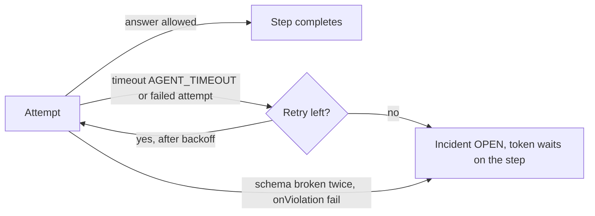

# Guarded agent steps (`agentTask`)

An `agentTask` is a process step performed by an AI agent. The agent's output cannot move the process forward until it has passed two deterministic checks: a JSON Schema and a rule set that you own. When a rule fires, the step goes to a human approver or fails.

Status: the agent step with its output schema, guardrail rule set and four-eyes review imports and runs since 0.2.0, with a stub adapter for tests and demos ([In BPMN today](#in-bpmn-today)), and so do per-step retry with incidents, input masking, labels and human overrides ([Retry and incidents](#retry-and-incidents), [History and overrides](#history-and-overrides)). The deploy-time guardrail contract check follows in M2 (target 26 March 2027); milestone M3 (1.0, target 21 May 2027) adds adapters and planning depth. See [What ships when](#what-ships-when) and [[Feature status|Feature-Status]].

## In BPMN today

An agent step is a `serviceTask` with `horus:type="agentTask"`. The schema and the guardrail are part of the definition, so the definition hash and its approval cover them, and a change to either is a new version.

```xml
<bpmn:serviceTask id="assess-documents" name="Assess the documents" horus:type="agentTask"
                  horus:agent="documents.assess" horus:timeout="PT30S" horus:resultVariable="assessment">
  <bpmn:extensionElements>
    <horus:input name="applicationId" value="${instance.applicationId}"/>
    <horus:input name="requestedAmount" value="${instance.amount}"/>
    <horus:input name="nationalId" value="${instance.nationalId}" mask="true"/>
    <horus:outputSchema>{"type": "object", "required": ["riskScore", "recommendation"], "additionalProperties": false,
      "properties": {"riskScore": {"type": "integer", "minimum": 0, "maximum": 100},
                     "recommendation": {"type": "string", "enum": ["APPROVE", "REFER", "DECLINE"]},
                     "summary": {"type": "string", "maxLength": 500, "mask": true}}}</horus:outputSchema>
    <horus:guardrail decision="agent-output-guardrails" onViolation="route-to-human" reviewer="role:COMPLIANCE_REVIEWER"/>
    <horus:retry max="2" backoff="PT1S"/>
  </bpmn:extensionElements>
</bpmn:serviceTask>
```

| Part | Rule |
|---|---|
| `horus:agent` | The name of an `AgentAdapter` bean in the host; an unknown name is refused at import (`AGENT_NOT_REGISTERED`) |
| `<horus:outputSchema>` | A JSON object in the engine's JSON Schema subset (`type`, `properties`, `required`, `additionalProperties` true or false, `enum`, `const`, numeric bounds, `minLength`, `maxLength`, `items`, `minItems`, `maxItems`); `mask: true` keeps a field's value out of the history. Any other keyword is refused at import (`GUARD_SPEC_INVALID`) |
| `<horus:guardrail>` | `decision` names the guardrail rule set. `onViolation` is `route-to-human` (the default; needs a `reviewer` as `role:`, `user:` or `group:`) or `fail`. A review is always four-eyes: `fourEyes` other than `true` is refused |
| `<horus:retry>` | Optional. `max` is the retries after the first attempt (0 to 20, so `max="2"` is three attempts); `backoff` is the delay before each retry. Without it the agent runner's `runners.async-agent.max-attempts` and `retry-backoff` apply. Refused at import with `RETRY_INVALID` |
| `mask="true"` on `<horus:input>` | The agent receives the value; history and the review task keep only its keyed fingerprint |
| Host | Needs the Rule Engine; without it the import is refused with `BPMN_NOT_EXECUTABLE` |

At run time the step parks an agent job, the engine calls your adapter with no transaction open, and the answer is checked in the result transaction:

| Answer | Outcome |
|---|---|
| Meets the schema, guardrail allows | The step completes; the history records the answer masked by the schema, with the guardrail decision id and the matched rule |
| Breaks the schema the first time | Asked again once (`runners.async-agent.schema-retries`, default 1) as a new attempt |
| Breaks the schema again | Refused with `AGENT_SCHEMA_INVALID`, then `onViolation` |
| Guardrail says `allow: false` | Refused with `GUARDRAIL_VIOLATION`: a four-eyes review task for the reviewer, carrying the reasons, the rule ids, the inputs and the masked answer. The starter of the instance and whoever reported the refused answer cannot take it. The reviewer's answer, checked against the schema, completes the step |

Your adapter receives an `AgentInvocation`. Key the model call by `modelCallKey()` (the attempt id), so the retry after a malformed answer is a fresh generation. Key side effects outside the model by `idempotencyKey()` (the job id), which stays the same on every attempt. `outputSchema()` is the step's output schema without the `mask` annotations: pass it to your model's structured-output option to avoid most schema failures. The engine still checks every answer against the full schema, and your adapter never sees the guardrail.

Return the answer with `AdapterResult.completed(output, labels)` to say how it was produced: `model`, `promptVersion`, `usage.inputTokens` and `usage.outputTokens` are reserved label keys, and you may add your own. Labels never carry personal data and the engine takes no decision from them.

The engine builds `AgentInvocation` and may add components in a minor release, so read it through its accessors. In tests, build one with `AgentInvocations.builder()` (and a service call with `AdapterCalls.builder()`) from `process-engine-test`. `StubAgentAdapter` in `process-engine-test` answers with canned outputs for tests and demos; `examples/rule-and-process` runs this step end to end (`GuardedAgentTaskIT`).

### Retry and incidents



An attempt with no answer within `horus:timeout` fails with `AGENT_TIMEOUT` and is tried again after `backoff`. When no retry is left, the job fails and an incident opens in the same transaction: `error_code` (`AGENT_TIMEOUT`, `AGENT_SCHEMA_INVALID`, `GUARDRAIL_VIOLATION` with `onViolation="fail"`, or the adapter's code), `retry_count`, the attempts after the first, and a cause built from codes only. History records `INCIDENT_RAISED` and the event `processes.incident.raised.v1` is published. The token waits on the step. Read open incidents with `IncidentService.openIncidents(instanceId)`; retrying and resolving them by API follows with incident management.

A schema failure has its own retry, `runners.async-agent.schema-retries` (default 1), so `max` is kept for timeouts and other failures.

A business error (`AdapterResult.BusinessError`) is final: the job fails on that attempt with no retry, and the incident's `error_code` is `UNHANDLED_BUSINESS_ERROR`, with the business code in the cause, in `INCIDENT_RAISED` and in the event (`businessCode`). The adapter's message is never stored.

An answer that arrives too late changes nothing. This covers an attempt whose lease ended, an attempt another attempt took over, a step that already completed, and a job that failed with an incident. Every such report gets `DISCARDED`. It writes no history row, runs no guardrail decision, opens no task and leaves an open incident open. Reporting it again gives the same answer. For a job that was cancelled with its instance, one `LATE_RESULT_DISCARDED` entry records the attempt.

### History and overrides

Each answer leaves one history row, `ASYNC_RESULT_ACCEPTED` or `ASYNC_RESULT_REFUSED`, with:

| Field | What it holds |
|---|---|
| `inputs` | The inputs the agent received; a `mask="true"` input as `hmac:<keyId>:<hex>` under the tenant's Rule Engine masking key, the same token the decision log keeps, or `***` without a key |
| `output`, `outputFields` | The answer, masked by the schema's `mask: true` fields; undeclared fields are `***` |
| `guardrailDecisionId`, `ruleIds` | The guardrail decision in the Rule Engine log and the rules that matched |
| `latencyMs` | From the claim to the result |
| `labels` | What the agent reported about its answer, such as `model`, `promptVersion`, `usage.inputTokens` and `usage.outputTokens`, as the adapter returned them with `AdapterResult.completed(output, labels)`; the engine never acts on them. At most `agents.labels.max-count` (16) labels, keys up to 64 and values up to 256 characters; above that the attempt fails with `AGENT_LABELS_INVALID` and is retried |

A step that declares memory also has `memory` in these rows: the facts the agent received from earlier steps, with masked fields as keyed fingerprints (see [Memory from earlier steps](#memory-from-earlier-steps)).

When a reviewer completes the review task of a refused answer, history records `HUMAN_OVERRIDE`: the reviewer, who reported the refused answer and which attempt, the refusal code, the guardrail decision id, the reason (`reason` in the completion body), the reviewer's answer masked the same way, and `changes` with `from` and `to` for each field the reviewer changed. The reviewer's answer must meet the output schema, and the review is always four-eyes.

### Memory from earlier steps

An agent step can receive a small, declared set of facts from earlier agent steps of the same case, instead of the whole case:

```xml
<horus:memory from="extract-id" fields="fullName,dob" as="applicant"/>
<horus:memory from="screen-sanctions" fields="hits" as="screening" required="false"/>
```

The adapter reads them with `invocation.memory()`, for example `{ applicant: { fullName, dob }, screening: { hits: 0 } }`.

The rules:
- **Declared fields only.** Only the listed fields go out. A field path may be nested (`document.issuer`, at most four levels), and wildcards are refused.
- **Earlier agent steps only.** `from` must be an agent step that is upstream of this step and whose output schema declares the fields.
- **The recorded result.** The source is the step's recorded result: the accepted answer, or the reviewer's answer after a refusal. A refused answer never enters memory.
- **Resolved once.** The engine resolves memory when the step is reached, inside that transaction, and stores it with the job. Every attempt, including a retry after a timeout, sends the same facts. The model call is still keyed by the attempt id and side effects by the job id.
- **Masked fields need a declaration.** A field the source schema marks `mask: true` is refused at import unless the entry says `includeMasked="true"`. The flag is part of the definition, so the diff and the second person's approval show it. The agent then receives the plain value, and history keeps only its keyed fingerprint.
- **Bounded.** `agents.memory.max-entries` (16) caps the entries per step and is checked at import. `agents.memory.max-bytes` (16 KiB of canonical JSON) caps the size and is checked when the step is reached. Both may be lowered, never raised.
- **Failures stop the step before any call.** A larger memory fails the step with `AGENT_MEMORY_TOO_LARGE`. A `required` entry (the default) whose step has no recorded result, for example because the case took another branch, fails it with `AGENT_MEMORY_MISSING`. Either failure is not retryable and opens an incident, and the adapter is never called. With `required="false"` the entry is left out and listed under `memoryMissing` in history.
- **Same case, same tenant.** Memory reads only the recorded results of its own instance, in the instance's tenant. There is no memory across cases or customers, and no long-term or vector store.

## The problem

| Problem | What goes wrong without a control |
|---|---|
| Agent output is plausible but can be wrong | A misread document or an invented field flows into the next step and changes a customer's outcome |
| Instructions in a prompt are not a control | "Do not approve expired documents" in a prompt is a request to the model. An auditor cannot verify it, and a crafted input can override it |
| Model calls are slow | A 10-second call inside a database transaction holds a connection for 10 seconds. With 100 concurrent calls, a 20-connection pool runs out at the 20th |
| Someone must answer for each outcome | After the fact, you need to show what the agent saw, what it returned, which rule decided, and who approved |

## How the guardrail works


```yaml
- id: assess-documents
  type: agentTask
  agent: kyc-document-reviewer           # adapter registered by the host (in-process bean or HTTP)
  inputs: { documents: "${instance.documents}", customerType: "${instance.customerType}" }
  outputSchema: schemas/document-assessment.json
  guardrails:
    decision: kyc-document-guardrails    # Rule Engine rule set evaluated on the agent's output
    onViolation: route-to-human          # or fail
  timeout: PT5M
  retry: { max: 2, backoff: PT30S }
```

| Stage | Where it runs | Outcome |
|---|---|---|
| 1. Resolve the bounded inputs; mask inputs flagged `mask="true"` | Transaction 1 | Only the declared inputs reach the agent. Masked inputs are stored in history as keyed fingerprints |
| 2. Claim the step with a lease, commit | Transaction 1 | The step waits; no lock and no connection is kept |
| 3. Call the adapter under `timeout` | Outside any transaction | Raw output and latency, or a timeout |
| 4. Validate the output against `outputSchema` | Transaction 2 | Invalid output counts as a failed attempt (`AGENT_SCHEMA_INVALID`) |
| 5. Evaluate the guardrail rule set on the output | Transaction 2, in process | `allow: true`: the process continues. Violation with `route-to-human`: an approval task carrying the inputs, the output and the matched rule ids. Violation with `fail`: an incident or compensation |
| 6. Retries exhausted | Transaction 2 | An incident with `AGENT_TIMEOUT` or `AGENT_SCHEMA_INVALID` and the retry count |
| 7. A human edits or rejects the output on the approval task | Task completion | The difference between agent output and human decision is recorded in history (`HUMAN_OVERRIDE`), with both identities and the reason |

Rules the engine enforces:

| Rule | Requirement |
|---|---|
| The process cannot continue until the output validates and the guardrail allows it | `TR-AGT-01`, `PRE-010` |
| The identity that triggered the step cannot approve its escalation | `PRE-007` |
| Inputs, output, schema result, guardrail decision id and adapter latency are recorded; masked inputs are hashed | `TR-AGT-02`, `PRE-012` |
| No adapter or model call runs inside a database transaction or while a row lock is held | `TR-ASY-01`, `PRE-009` |
| A result that arrives after its lease expired is discarded; another attempt owns the step | `TR-ASY-02` |
| The engine never embeds a model and never calls the network itself; your adapter does | `TR-AGT-03` |

The engine's share of an agent step is the two short transactions, about 10 ms in total. 100 concurrent agent calls of 10 seconds each hold no database connection while they wait ([[Architecture]] section 8).

### A guardrail is an ordinary rule set

The guardrail is a Rule Engine rule set with hit policy `first` or `unique`. It must declare the output `allow` (boolean) and may declare `reasons` (a string); the engine reads no other output. Its inputs are fields of the agent's answer, so each must be declared in the step's `outputSchema` with a compatible type. Deploying a process definition whose guardrail rule set is missing in your tenant, has no version in effect or breaks this contract fails with `422 GUARDRAIL_CONTRACT_INVALID`, naming the step and the failed check, and nothing is written. The same check runs when approval is requested and at approval, so a guardrail changed after import is caught before the process goes live. Publish the guardrail rule set before you deploy the process. At run time the check fails closed: a decision error counts as `allow: false` with reason `GUARDRAIL_EVALUATION_ERROR` and follows `onViolation`.

Because it is a rule set, it has everything a rule set has:

- versions, effective dates and a decision log entry for every check;
- a second approver for every change: loosening a guardrail needs the same four-eyes approval as changing a fee;
- simulation of a draft before publication; replay of past checks is planned for M3.

Your compliance team reads the guardrail as a table, not as code or prompt text.

## Autonomy ladder

Give an agent the least autonomy at which its mistakes are cheap, and widen it only on evidence. In HORUS, each step up the ladder is a new version of the guardrail rule set, approved by a second person.

| Rung | The agent may | The human | How to configure it | Move up when |
|---|---|---|---|---|
| 0. Observe | Produce output that nothing downstream uses | Does the work as before | Process design: the agent's output goes to history only, and a `userTask` decides | Output matches the human decision over at least two weeks |
| 1. Suggest | Draft every decision | Reviews and approves every case; each edit is recorded as `human_override` | Guardrail's last row returns a violation for every case, so every step routes to a human | Reviewers accept most drafts unchanged for about four weeks, and missed problems stay below your threshold |
| 2. Act with a risk gate | Complete low-risk cases | Handles escalations: low confidence, high value, any rule hit | Guardrail allows only cases that pass every rule; the rest route to a human | Escalation rules stable, no critical incident |
| 3. Act and report | Complete all cases inside the schema and rules | Audits a sample and the exceptions | Guardrail allows most cases; the host samples completed steps from history for review. The engine has no built-in sampling | Failure modes known and covered by regression tests |
| 4. End to end | Resolve cases fully inside policy | Samples for quality | As rung 3, with a smaller sample | Matches or beats the human baseline on your evaluation set |

When the input changes (a new document type, a new country, a new regulation, a new model version), move down one rung until the agent is measured again.

For regulated decisions, start at rung 1. Human override rate, read from history, is the first measure of whether to move up.

## Worked example: KYC document review

A bank's onboarding process asks an agent to read identity documents. The agent returns a structured assessment; a guardrail decides whether a person must look.

### 1. The output schema

`schemas/document-assessment.json` requires these fields. An output that misses one, or has the wrong type, fails stage 4.

```json
{
  "documentType": "PASSPORT",
  "nameMatches": true,
  "expiryDate": "2031-05-01",
  "tamperingSuspected": false,
  "confidence": 0.97
}
```

### 2. The guardrail rule set

```yaml
schemaVersion: 1
ruleSet: kyc-document-guardrails
hitPolicy: first
inputs:
  - { name: documentType,       type: string,  allowed: [NATIONAL_ID, PASSPORT, OTHER] }
  - { name: nameMatches,        type: boolean }
  - { name: expiryDate,         type: date }
  - { name: tamperingSuspected, type: boolean }
  - { name: confidence,         type: decimal }
outputs:
  - { name: allow,   type: boolean }
  - { name: reasons, type: "list<string>" }
rules:
  - id: R1
    when: { tamperingSuspected: "== true" }
    then: { allow: false, reasons: "['TAMPERING_SUSPECTED']" }
  - id: R2
    when: { nameMatches: "== false" }
    then: { allow: false, reasons: "['NAME_MISMATCH']" }
  - id: R3
    when: { expiryDate: "< today()" }
    then: { allow: false, reasons: "['DOCUMENT_EXPIRED']" }
  - id: R4
    when: { documentType: "== 'OTHER'" }
    then: { allow: false, reasons: "['UNSUPPORTED_DOCUMENT']" }
  - id: R5
    when: { confidence: "< 0.90" }
    then: { allow: false, reasons: "['LOW_CONFIDENCE']" }
  - id: R6
    when: {}
    then: { allow: true }
```

This is version 2, at rung 2. Version 1, at rung 1, was identical except that R6 returned `allow: false` with reason `HUMAN_REVIEW_REQUIRED`, so every case went to a person. Publishing version 2 needed a second approver. From M3 the approver can first replay the checks made under version 1 to see how many cases version 2 would have let through.

### 3. Three runs

| Run | Agent output | Guardrail | What happens |
|---|---|---|---|
| A | Passport, name matches, expires 2031-05-01, no tampering, confidence 0.97 | R6, allow | The process continues. History holds the hashed inputs, the output, schema result `PASS`, the guardrail decision id and the latency |
| B | National ID, name matches, valid, no tampering, confidence 0.72 | R5, reason `LOW_CONFIDENCE` | An approval task is created for the compliance role, carrying the inputs, the output and rule id `R5`. The reviewer opens the scan, finds that the agent misread the expiry date, corrects `expiryDate` and approves. History records the `human_override` difference |
| C | The adapter returns text that is not valid JSON on every attempt | None: stage 4 fails | Each failure counts as an attempt; the step is retried after 30 seconds. When retries are exhausted, an incident `AGENT_SCHEMA_INVALID` opens with its retry count. An operator fixes the cause and retries the incident from the cockpit |

If the adapter does not answer within 5 minutes (`timeout: PT5M`), the attempt fails the same way and the incident code is `AGENT_TIMEOUT`.

## What you own and what the engine owns

| You own | The engine owns |
|---|---|
| The adapter that calls a model, an HTTP service or, from M3, an MCP tool | Calling your adapter outside any transaction, with timeout, retry and lease |
| The prompt, the model and its version | Nothing about prompts or models; it never embeds or calls one |
| The output schema | Validating every output against it |
| The guardrail rule set and its approvers | Evaluating it on every output; enforcing four-eyes on its changes |
| Your evaluation set and the decision to move up the ladder | Recording inputs, outputs, guardrail decisions and human overrides so you can measure |

## What ships when

| Capability | M2 (Process Engine 0.1, target 26 Mar 2027) | M3 (1.0, target 21 May 2027) |
|---|---|---|
| Adapters | Adapter SPI: in-process bean and HTTP | MCP tool adapter; reference adapters for common LLM APIs in `examples/` (outside the engine artifacts) |
| Checks | JSON Schema validation; guardrail rule set; `onViolation: route-to-human` or `fail` | Same checks, also applied to agent-chosen steps |
| Reliability | Async wait-state, timeout, retry, incidents | |
| Audit | Inputs (masked fields hashed), output, schema result, guardrail decision, latency, human override | |
| Cockpit | Agent task inspector: inputs, schema verdict, output, fired rules; approve or override with a reason (Cockpit 0.2) | |
| Agent context | Bounded inputs per step | Bounded context passed as agent memory |
| Planning | One agent call per step | Agent chooses steps inside a bounded block, under the same guardrails |
| Evaluation | History and human overrides available for your own analysis | Offline runner that replays recorded agent traces and human overrides against a changed prompt or guardrail |

Multi-agent planning is a candidate after 1.0 ([[Roadmap]]). Dates are targets, not commitments; [[Feature status|Feature-Status]] links to the current state of each item.

## Related pages

- [[Process Engine Overview]]: execution model, async wait-state, incidents, compensation
- [[Architecture]]: transaction model and connection math
- [[Rule Engine Versioning and Publishing]]: how a guardrail change is approved
- [[Multi-Tenancy and Security]]: four-eyes and audit controls
- [[Concepts]]: agent task and guardrail definitions
