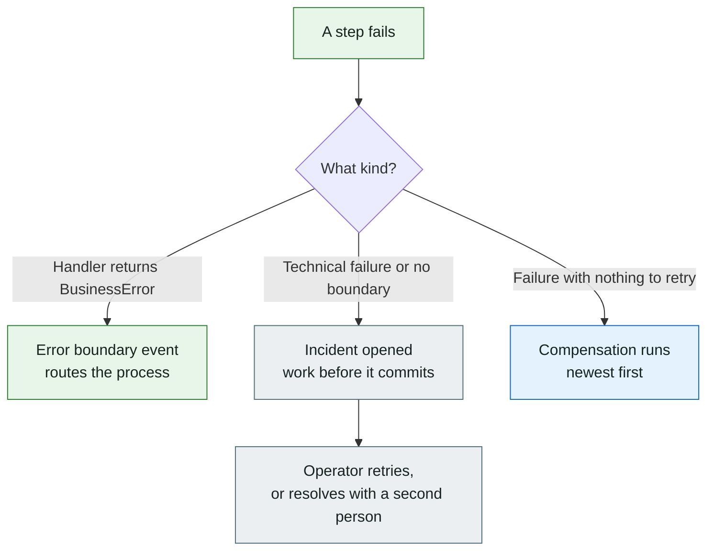

# Guide: errors and compensation

A step can fail in three ways, and each has its own handling.



## Business errors

Return `new HandlerResult.BusinessError("REFUND_LIMIT_EXCEEDED", "...")` from a handler and attach an error boundary event with that code to the step. The process takes the boundary path and no incident opens. The `card-dispute` model of the example host does this: start it with `"amountMinor":6000000` and a senior-approval task opens. See its [README](https://github.com/dhluong90/horus-Agentic-BPM/blob/main/examples/rule-and-process/README.md).

## Incidents

A failed step with no boundary leaves an incident and the work before it stays committed. List and act:

```bash
curl -s -u hoa:demo-pass "localhost:8080/api/bpm/processes/v1/incidents?status=OPEN"
```

| Action | Call | Needs |
|---|---|---|
| Retry | `POST /incidents/{id}:retry` with `{"reason":"..."}` | `processes:incident:manage`, `If-Match`, `Idempotency-Key` |
| Resolve by hand | `POST /incidents/{id}:resolve` with the output the step should have produced | A second person approves (`:approve-resolution`); the proposer gets `SELF_APPROVAL_FORBIDDEN` |

A start that fails before the first wait state rolls back completely: you get `422 STEP_FAILED` with the step and a `reason`, and no instance exists. Retry the same request after fixing the cause; the same business key or `Idempotency-Key` is safe to reuse.

## Compensation

When a later step fails after earlier steps changed other systems, compensation undoes them in reverse order. Mark the undo task `isForCompensation="true"`, attach a compensation boundary event to the step it undoes, and end the failing path with a compensation or cancel end event:

```xml
<bpmn:boundaryEvent id="hold-undo" attachedToRef="hold-funds" cancelActivity="false">
  <bpmn:compensateEventDefinition/>
</bpmn:boundaryEvent>
<bpmn:serviceTask id="release-hold-activity" isForCompensation="true" horus:handler="release-funds"/>
```

The models `fund-transfer` and `loan-payout` show a whole transaction. The undo handlers are yours and must be idempotent; a compensation that fails opens an incident. Design: [[Process Engine Overview]] (Compensation) and ADR-0007.
