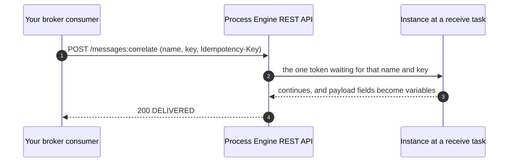

# Guide: messages, signals and timers

A process waits for three things from outside: a message for one instance, a signal for many, or a time. The engine never listens to your broker. Your code passes messages in through the API.



## Messages

Declare the message once at the top of the file and name its key variable on the waiting step:

```xml
<bpmn:message id="m-received" name="payment-received"/>
<bpmn:receiveTask id="wait-for-payment" messageRef="m-received" horus:correlationKey="orderId">
  <bpmn:extensionElements>
    <horus:output name="paymentRef" from="reference"/>
  </bpmn:extensionElements>
</bpmn:receiveTask>
```

The instance must hold `orderId` as a variable. Deliver the message:

```bash
curl -s -u hoa:demo-pass -X POST localhost:8080/api/bpm/processes/v1/messages:correlate \
  -H 'Content-Type: application/json' -H 'Idempotency-Key: m-1' \
  -d '{"messageName":"payment-received","correlationKey":"ORD-1","payload":{"reference":"TT-1"}}'
```

Expected: `{"outcome":"DELIVERED","instanceId":"...","nodeId":"wait-for-payment"}`. This is the `order-payment` model of the example host, started with `{"definitionKey":"order-payment","businessKey":"ORD-1","variables":{"orderId":"ORD-1","amount":"1250000"}}`.

| Answer | Meaning |
|---|---|
| `DELIVERED` | One token was waiting; it continued |
| `STARTED` | Nothing waited, and exactly one definition starts on that message: a new instance started with the key as business key |
| `422 MESSAGE_NOT_CORRELATED` | Nothing waits and nothing starts. The message is not stored; send it again when the instance waits |
| `409 MESSAGE_CORRELATION_AMBIGUOUS` | Two tokens wait for the same name and key. Nothing ran |

A catch step with no `horus:correlationKey` is refused at import as `CORRELATION_KEY_REQUIRED`. Outgoing messages (send tasks, message end events) go to your `MessageAdapter`; write them to an outbox table in the same transaction.

## Signals

`POST /signals` with `{"name":"rate-card-updated"}` and an `Idempotency-Key` wakes every waiter of that name in your tenant and starts every definition with a signal start. The answer is `202` with `waiters` and `startedInstances`.

## Timers

Timers are BPMN timer events with `timeDuration` (`PT2H`, `P2D`) or `timeDate`:

```xml
<bpmn:boundaryEvent id="assess-overdue" attachedToRef="assess" cancelActivity="false">
  <bpmn:timerEventDefinition><bpmn:timeDuration>P2D</bpmn:timeDuration></bpmn:timerEventDefinition>
</bpmn:boundaryEvent>
```

`cancelActivity="false"` lets the task stay open while the reminder path runs. Timers live in `pre_timer`. Each copy of your service polls with a lease, so a timer fires once across replicas, and a crashed copy's timers are taken over ([[Process Engine Overview]], Timers and jobs with leases). For a demo, the example host shortens three timers to one minute in the `dev` profile. SLA deadlines in working hours come from your `BusinessCalendar`.
