# HORUS Agentic BPM

**Embeddable Process Engine and Rule Engine for Java and Spring Boot, with a cockpit. Humans, services and AI agents are first-class participants.**

> Design preview. This wiki is the public specification, written before the code. APIs may change until 1.0. Licence: free for noncommercial use (PolyForm Noncommercial 1.0.0); commercial use under a HORUS licence.

Two libraries inside your service, your PostgreSQL, one static cockpit. No engine cluster, no search index, no separate identity.

## Read in this order
| Page | Answers |
|---|---|
| [[Getting Started]] | How do I evaluate my first decision table in ten minutes? |
| [[Concepts]] | What are rule sets, versions, hit policies, decisions, processes? |
| [[Principles]] | What rules decide the design trade-offs? |
| [[Architecture]] | How is it built, where does state live, how does it deploy? |
| [[Technical Requirements]] | What must be true before a release ships? |
| [[Technical Stack]] | What is it built with, and what was rejected? |
| [[Roadmap]] | What ships when, up to 1.0? |

## Rule Engine guide
[[Authoring|Rule Engine Authoring Decision Tables]] · [[Expression Language|Rule Engine Expression Language]] · [[Decision API|Rule Engine Decision API]] · [[Versioning|Rule Engine Versioning and Publishing]] · [[Simulation|Rule Engine Simulation and Testing]] · [[Decision Log|Rule Engine Decision Log and Audit]] · [[Configuration|Rule Engine Configuration]]

## Process Engine
[[Process Engine Overview]] — scope and the `agentTask` step (milestone 2 and 3).

## Operate and contribute
[[Cockpit]] · [[Multi Tenancy and Security]] · [[FAQ]] · [[Contributing]] · [[Release Notes]]

## Why "Agentic"
Classic BPM assigns steps to people and systems. Here an AI agent can take a step too, with bounded inputs, a schema for its output, a rule set that checks that output deterministically, and a human approval when the rules say so. Autonomy inside rails that compliance can read.
