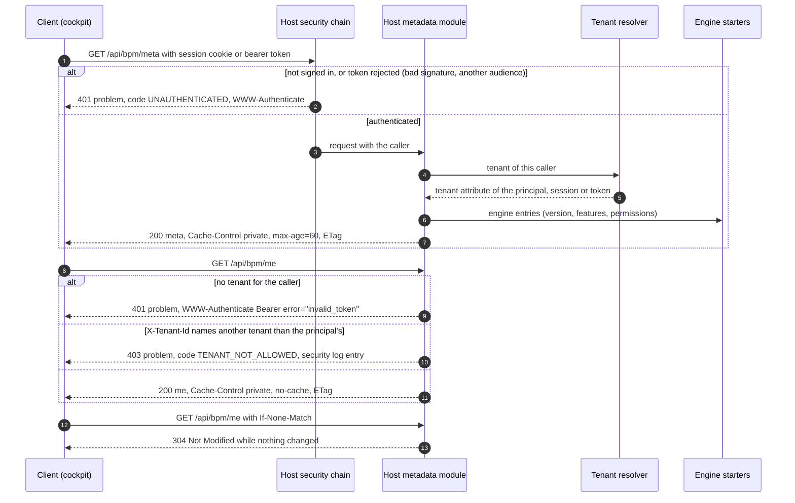
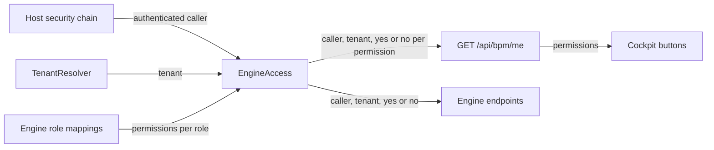

# Host Metadata and Permissions

Every host that embeds an engine answers two requests: `GET /api/bpm/meta` says which engines the host runs and what they can do, and `GET /api/bpm/me` says who the caller is, which tenant the request belongs to and which engine permissions the caller holds. The cockpit reads both before it shows a screen; any other client can too. _Built for the Rule Engine (not yet released). The Process Engine adds its entry with 0.1 (M2)._

## What a host adds

Nothing beyond the engine starter and its own security. The starter brings the small host metadata module `bpm-host-metadata`, which serves both endpoints once per host, whatever engines run in it. The endpoints are active when the host is a servlet application with Spring MVC and Spring Security; `horus.bpm.host-metadata.enabled=false` turns off these two endpoints and nothing else. The controls the engine endpoints rely on stay on whatever the switch says: the `no-store` header on engine responses, the tenant resolver, the [one access check](#one-access-check-for-me-and-the-engine-endpoints) and the problem responses.

The host owns its security chain, so it adds one call that makes engine errors RFC 9457 problem details. Every other path keeps the host's own behaviour, for example a redirect to its sign-in page:

```java
@Bean
SecurityFilterChain hostSecurity(HttpSecurity http) {
    var bpm = PathPatternRequestMatcher.withDefaults().matcher("/api/bpm/**");
    http.authorizeHttpRequests(requests -> requests.anyRequest().authenticated())
        .oauth2ResourceServer(server -> server.jwt(Customizer.withDefaults()))
        .exceptionHandling(exceptions -> exceptions
            .defaultAuthenticationEntryPointFor(new BpmProblemAuthenticationEntryPoint(), bpm)
            .defaultAccessDeniedHandlerFor(new BpmProblemAccessDeniedHandler(), bpm));
    return http.build();
}
```

Both classes are in `io.github.dhluong90.bpm.host.autoconfigure`, and the module also registers one bean of each, built from `horus.bpm.security.challenge`, so a chain can inject them and send the same challenge as the endpoints. Without them the host's own handlers answer, usually with an empty `401` body or a redirect. Even a chain that lets every request through never exposes data: the endpoints check the caller themselves and answer `401` as a problem.

## How a client uses the two endpoints



The client turns screens on by the feature flags in `/meta` and the permissions in `/me`, never by comparing version numbers. Every endpoint still checks its own permission, so hiding a screen is a convenience, not the control.

## `GET /api/bpm/meta`

Requires an authenticated caller with a tenant, and no permission. Schema: [`bpm-meta.v1.schema.json`](https://github.com/dhluong90/horus-Agentic-BPM/blob/main/cockpit/api/schema/bpm-meta.v1.schema.json).

```json
{
  "schemaVersion": 1,
  "hostId": "rule-engine-only",
  "modules": [
    { "module": "rules", "engineVersion": "0.1.0-SNAPSHOT", "apiVersion": "v1", "features": [] }
  ],
  "tenancy": { "switching": false },
  "limits": { "maxPageSize": 200 }
}
```

| Field | Value today |
|---|---|
| `hostId` | `horus.bpm.host-id`, omitted when unset; at most 40 characters |
| `modules[]` | One entry per engine in the host. The Rule Engine contributes `rules`; no `processes` entry until the Process Engine 0.1 |
| `engineVersion` | The version of the engine starter the host was built with |
| `features` | Empty: a flag such as `rules.simulation` is added with the feature it announces, so a client never offers a screen whose endpoints are missing |
| `settings` | Omitted when the engine has none |
| `tenancy.switching` | `false`: tenant switching arrives in M2 |
| `limits.maxPageSize` | `200`, the largest page of any engine list |

## `GET /api/bpm/me`

Requires an authenticated caller with a tenant, and no permission. Schema: [`bpm-me.v1.schema.json`](https://github.com/dhluong90/horus-Agentic-BPM/blob/main/cockpit/api/schema/bpm-me.v1.schema.json).

```json
{
  "schemaVersion": 1,
  "user": { "id": "lan", "displayName": "Lan Nguyen" },
  "tenant": { "current": "bank-a", "allowed": ["bank-a"] },
  "permissions": ["rules:read", "rules:author"],
  "roles": ["ROLE_PRICING_AUTHOR"],
  "groups": []
}
```

| Field | Source |
|---|---|
| `user.id` | The principal name; for a JWT, the `sub` claim unless the host's converter says otherwise |
| `user.displayName` | Claim `name`, else `preferred_username`; omitted when neither is present |
| `tenant.current` | The tenant the request resolved to; see [Tenant](#tenant) |
| `tenant.allowed` | The current tenant only, until tenant switching arrives in M2 |
| `permissions` | Engine permissions the caller holds, in each engine's order; see [Permissions](#permissions) |
| `roles` | The caller's host roles that an engine role mapping names, sorted. Other host roles are left out, so the host's role model does not reach the browser |
| `groups` | Claim `groups` when the token has one, otherwise empty |

A caller with no engine permission gets `200` with `"permissions": []`, not an error.

## Permissions

`/me` lists a permission when the caller holds it in either way:

1. **As an authority.** The principal has the permission string itself, for example a token whose `permissions` claim the host's converter turns into authorities.
2. **Through a role mapping.** The principal has a host authority that the engine's role mapping grants it for:

```yaml
horus.bpm.rules.security.role-permissions:
  ROLE_PRICING_AUTHOR:   [rules:read, rules:author]
  ROLE_PRICING_APPROVER: [rules:read, rules:approve]
```

Only the permissions of the engines installed in the host are ever listed: `rules:evaluate`, `rules:read`, `rules:author`, `rules:approve`, `rules:simulate`, `rules:log:read`, `rules:masked:search` and `rules:pin` for the Rule Engine, and the `processes:*` permissions of [[Process Engine Overview]], `processes:cancel` included, for the Process Engine. A misspelt authority (`rules:delete`), a process permission on a host without the Process Engine, or an OAuth2 scope never appears. A role mapping that grants an unknown permission, such as `rules:aprove`, stops the host at start-up with a message naming it.

`/me` and the engine endpoints apply the mapping in one place, described next.

## One access check for `/me` and the engine endpoints

`/me` never decides on its own. Every engine endpoint and `/me` ask the same bean, `EngineAccess` in `io.github.dhluong90.bpm.host.spi`: who is calling, in which tenant, and whether they hold a permission. `/me` lists exactly the permissions for which that bean answers yes, so the cockpit never shows a button the engine refuses, or hides one it allows.



| Method | Answers |
|---|---|
| `currentCaller()` | The caller of the current request: user id, display name, tenant, authorities and groups. The tenant checks below run here; a refusal is `EngineAccessDeniedException` with `UNAUTHENTICATED` or `TENANT_NOT_ALLOWED` |
| `hasPermission(caller, "rules:approve")` | Yes when the caller holds the permission as an authority or through the engine's role mapping. A permission no installed engine declares is a programming error and throws `IllegalArgumentException` |
| `requirePermission("rules:approve")` | The caller, or `EngineAccessDeniedException` with `PERMISSION_DENIED` |

When an engine endpoint lets the refusal through, the module answers with the same problem body `/me` sends. Within one request the caller is resolved once, so an operation that asks several times writes at most one `tenant.switch.refused` or `tenant.unresolved` entry. A refused permission writes one entry too:

```text
permission.denied permission=rules:approve user=lan tenant=bank-a correlationId=01M7S1RASFFAP0S0R1G9GDDZW3 clientCorrelationId=-
```

The engines resolve no tenant and read no role mapping themselves; an architecture test fails the build if engine code does.

A host may replace the check with its own `EngineAccess` bean, for example to ask an entitlement service that is kept in memory. `/me` then reports from the host's bean too. The bean must be thread-safe and must not call the network on each request.

## Tenant

A `TenantResolver` finds the tenant of each request (PD-079). The engines' default reads the `horus.bpm.tenancy.claim` attribute (default `tenant_id`) of the authenticated principal, so a validated bearer token and a server-side session principal from an OIDC or OAuth2 login are handled alike. That covers the cockpit embedded in a bank's own web application as well as a standalone cockpit with tokens.

| Principal | Tenant |
|---|---|
| Carries the `tenancy.claim` attribute (token claim or session attribute) | That attribute |
| Carries none, for example after a form, SAML or LDAP sign-in | The host declares its own `TenantResolver` bean, which replaces the default and reads the host's user type or directory, `CallerContext.principal()` |
| Carries none, on a developer machine | `horus.bpm.tenancy.dev-tenant`, accepted on the `dev` profile only; start-up is refused when it is set elsewhere |

```java
@Bean
TenantResolver hostTenantResolver(BankUserDirectory directory) {
    return caller -> caller.principal() instanceof BankUser user
            ? Optional.of(user.tenant())
            : directory.tenantOf(caller.principalName());
}
```

The engines ship no resolver that reads a request header, and `CallerContext` offers no headers: in a browser any header can be set by script, and a header set by a misconfigured gateway would expose one tenant's data to another tenant's operator. A host that writes such a resolver owns that risk. The former settings `horus.bpm.tenancy.resolver` and `horus.bpm.tenancy.trusted-gateway` stop the start-up with a message, so a host that used them notices.

Whatever the resolver, these rules hold:

| Rule | Answer |
|---|---|
| No tenant for the principal | `401 UNAUTHENTICATED` with `WWW-Authenticate: Bearer error="invalid_token"` and a security log entry `tenant.unresolved`; nothing is read |
| The principal carries the tenant attribute and a host resolver returns another tenant | `403 TENANT_NOT_ALLOWED` |
| An `X-Tenant-Id` header, the tenant switch request, differs from the resolved tenant (switching is off until M2) | `403 TENANT_NOT_ALLOWED` |
| The tenant is not 1 to 64 letters, digits, `.`, `_` or `-`, starting with a letter or digit | `403 TENANT_NOT_ALLOWED` |
| A tenant in a query parameter, a body or any other header | Ignored |

Every refusal writes one entry on the logger `io.github.dhluong90.bpm.security`:

```text
tenant.switch.refused reason=switching-off user=lan%40bank-a.vn tokenTenant=bank-a requestedTenant=bank-b correlationId=01M7RT1NNKHDP8JWFNE563SNP6 clientCorrelationId=-
```

`reason` is `switching-off`, `differs-from-token-tenant` or `invalid-tenant`. Values are percent-encoded outside letters, digits, `.`, `_` and `-`, and cut at 128 characters, so a value cannot forge another field and can still be read back.

## Headers and errors

| Header | Value |
|---|---|
| `Cache-Control` | `/meta`: `private, max-age=60`. `/me`: `private, no-cache`, so the browser asks again every time (cheaply, with `If-None-Match`) and a revoked role or a sign-out is never shown from cache. Errors: `no-store` |
| `ETag` | A weak validator of the body; send it back as `If-None-Match` to get `304` |
| `Vary` | On `/me`: `Authorization, Cookie, X-Tenant-Id` |
| `X-Correlation-Id` | A ULID issued by the host for every request, also in every problem body. A caller's own `X-Correlation-Id` is never adopted; it is logged as `clientCorrelationId` |
| `WWW-Authenticate` | On every `401`. `Bearer` by default (`horus.bpm.security.challenge`); for a caller without a tenant a bearer challenge adds `error="invalid_token"` |

Every other response under `/api/bpm/**` gets `Cache-Control: no-store` from the same module: the rule engine and process engine APIs, their problem answers, and any unmapped `/api/bpm/...` path. The header is set before the endpoint runs, so success, problem and `304` answers all carry it, and it stays on when the metadata endpoints are switched off. Host endpoints outside `/api/bpm/**` keep whatever caching the host gives them (`TR-SEC-09`).

| Status | `code` | When |
|---|---|---|
| `401` | [UNAUTHENTICATED](Common-Error-Codes#unauthenticated) | No principal, a rejected token (another audience, a bad signature), or no tenant for the caller |
| `403` | [TENANT_NOT_ALLOWED](Common-Error-Codes#tenant_not_allowed) | `X-Tenant-Id` names another tenant than the principal's, or the tenant is outside the allowed format |
| `403` | [PERMISSION_DENIED](Common-Error-Codes#permission_denied) | The host's chain refuses the request, for example a session call without its CSRF token (`BpmProblemAccessDeniedHandler`) |

A client must not repeat the sign-in more than once on `UNAUTHENTICATED` with `error="invalid_token"`: the same account gets the same token and the same answer. The cockpit treats a `401` on `/me` as "no access to this service" and does not sign in again.

```json
{
  "type": "https://github.com/dhluong90/horus-Agentic-BPM/wiki/Common-Error-Codes#unauthenticated",
  "title": "Authentication required",
  "status": 401,
  "code": "UNAUTHENTICATED",
  "detail": "Sign in, or send a token issued for this host.",
  "instance": "/api/bpm/meta",
  "correlationId": "01M7RR0S1MJ2AFNEK9G00A9E1N"
}
```

## Properties

| Property | Default | Meaning |
|---|---|---|
| `horus.bpm.host-id` | unset | Id clients show for this host, 1 to 40 characters |
| `horus.bpm.host-metadata.enabled` | `true` | `false` turns off `/api/bpm/meta` and `/api/bpm/me` only, for hosts that already serve them another way. The `no-store` header, the tenant resolver, `EngineAccess` and the problem responses stay on |
| `horus.bpm.tenancy.claim` | `tenant_id` | Attribute of the authenticated principal, token claim or session attribute, that carries the tenant; always compared with the resolved tenant |
| `horus.bpm.tenancy.dev-tenant` | unset | Fixed tenant for principals that carry none; `dev` profile only |
| `horus.bpm.security.challenge` | `Bearer` | `WWW-Authenticate` value of a `401` the endpoints raise themselves |
| `horus.bpm.rules.security.role-permissions` | empty | Host authority to `rules:*` permissions |

## Try it

The example host [`examples/rule-engine-only`](https://github.com/dhluong90/horus-Agentic-BPM/tree/main/examples/rule-engine-only) has two demo users on the `dev` profile, Lan (pricing author) and Minh (pricing approver), with the password from `HORUS_DEMO_PASSWORD`. They carry no tenant attribute, so the example sets `horus.bpm.tenancy.dev-tenant: bank-a` for the `dev` profile. They sign in with the host's form and then call the endpoints with the session, as the embedded cockpit does:

```bash
P=choose-one   # the HORUS_DEMO_PASSWORD the host was started with
CSRF=$(curl -s -c jar -b jar localhost:8080/login | sed -n 's/.*name="_csrf" type="hidden" value="\([^"]*\)".*/\1/p')
curl -s -c jar -b jar -o /dev/null -d "username=lan&password=$P&_csrf=$CSRF" localhost:8080/login
curl -s -b jar localhost:8080/api/bpm/me
# {"schemaVersion":1,"user":{"id":"lan"},"tenant":{"current":"bank-a","allowed":["bank-a"]},"permissions":["rules:read","rules:author"],"roles":["ROLE_PRICING_AUTHOR"],"groups":[]}
curl -s -i localhost:8080/api/bpm/meta
# HTTP/1.1 401, WWW-Authenticate: Bearer, Content-Type: application/problem+json, "code":"UNAUTHENTICATED"
```

The OpenAPI 3.1 document for both endpoints is [`bpm-host-metadata/api/openapi.yaml`](https://github.com/dhluong90/horus-Agentic-BPM/blob/main/bpm-host-metadata/api/openapi.yaml); it references the two schemas above.
