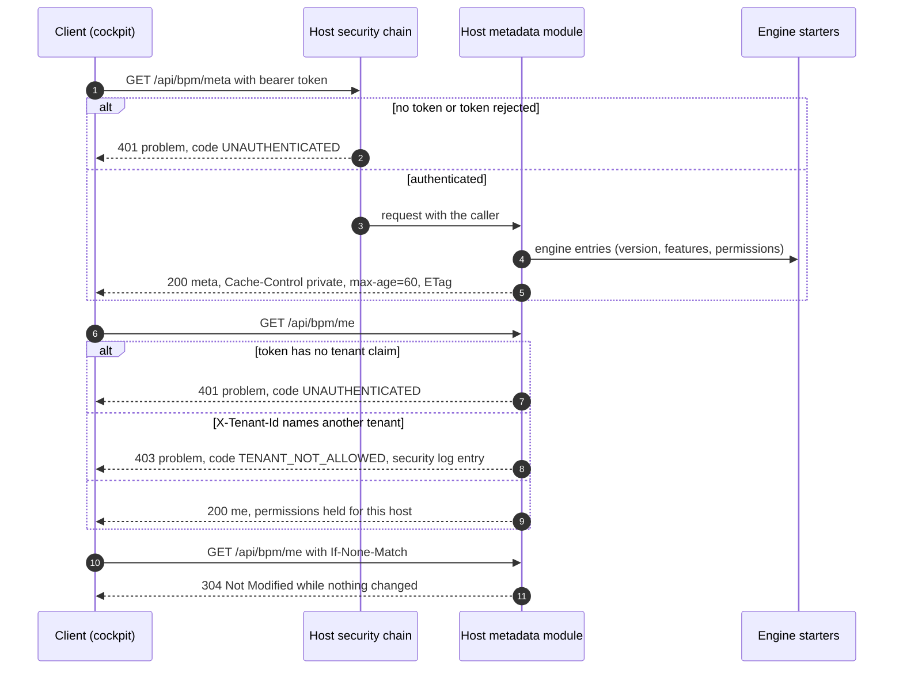

# Host Metadata and Permissions

Every host that embeds an engine answers two requests: `GET /api/bpm/meta` says which engines the host runs and what they can do, and `GET /api/bpm/me` says who the caller is, which tenant the request belongs to and which engine permissions the caller holds. The cockpit reads both before it shows a screen; any other client can too. _Built for the Rule Engine (not yet released). The Process Engine adds its entry with 0.1 (M2)._

## What a host adds

Nothing beyond the engine starter and its own security. The starter brings the small host metadata module `bpm-host-metadata`, which serves both endpoints once per host, whatever engines run in it. The endpoints are active when the host is a servlet application with Spring MVC and Spring Security.

The host owns its security chain, so it adds one call that makes engine errors RFC 9457 problem details:

```java
@Bean
SecurityFilterChain hostSecurity(HttpSecurity http) {
    var bpm = PathPatternRequestMatcher.withDefaults().matcher("/api/bpm/**");
    http.authorizeHttpRequests(requests -> requests.anyRequest().authenticated())
        .oauth2ResourceServer(server -> server.jwt(Customizer.withDefaults()))
        .exceptionHandling(exceptions -> exceptions
            .defaultAuthenticationEntryPointFor(new BpmProblemAuthenticationEntryPoint(), bpm)
            .defaultAccessDeniedHandlerFor(new BpmProblemAccessDeniedHandler(), bpm));
    return http.build();
}
```

Both classes are in `com.horus.bpm.host.autoconfigure`. Without them the host's own handlers answer, usually with an empty `401` body.

## How a client uses the two endpoints



The client turns screens on by the feature flags in `/meta` and the permissions in `/me`, never by comparing version numbers. Every endpoint still checks its own permission, so hiding a screen is a convenience, not the control.

## `GET /api/bpm/meta`

Requires an authenticated caller and no permission. Schema: [`bpm-meta.v1.schema.json`](https://github.com/dhluong90/horus-Agentic-BPM/blob/main/cockpit/api/schema/bpm-meta.v1.schema.json).

```json
{
  "schemaVersion": 1,
  "hostId": "rule-engine-only",
  "modules": [
    { "module": "rules", "engineVersion": "0.1.0-SNAPSHOT", "apiVersion": "v1", "features": [] }
  ],
  "tenancy": { "switching": false },
  "limits": { "maxPageSize": 200 }
}
```

| Field | Value today |
|---|---|
| `hostId` | `horus.bpm.host-id`, omitted when unset; at most 40 characters |
| `modules[]` | One entry per engine in the host. The Rule Engine contributes `rules`; no `processes` entry until the Process Engine 0.1 |
| `engineVersion` | The version of the engine starter the host was built with |
| `features` | Empty: a flag such as `rules.simulation` is added with the feature it announces, so a client never offers a screen whose endpoints are missing |
| `settings` | Omitted when the engine has none |
| `tenancy.switching` | `false`: tenant switching arrives in M2 |
| `limits.maxPageSize` | `200`, the largest page of any engine list |

## `GET /api/bpm/me`

Requires an authenticated caller and no permission. Schema: [`bpm-me.v1.schema.json`](https://github.com/dhluong90/horus-Agentic-BPM/blob/main/cockpit/api/schema/bpm-me.v1.schema.json).

```json
{
  "schemaVersion": 1,
  "user": { "id": "lan", "displayName": "Lan Nguyen" },
  "tenant": { "current": "bank-a", "allowed": ["bank-a"] },
  "permissions": ["rules:read", "rules:author"],
  "roles": ["ROLE_PRICING_ANALYST"],
  "groups": []
}
```

| Field | Source |
|---|---|
| `user.id` | The principal name; for a JWT, the `sub` claim unless the host's converter says otherwise |
| `user.displayName` | Claim `name`, else `preferred_username`; omitted when neither is present |
| `tenant.current` | The tenant the request resolved to; see [Tenant](#tenant) |
| `tenant.allowed` | The current tenant only, until tenant switching arrives in M2 |
| `permissions` | Engine permissions the caller holds, in each engine's order; see [Permissions](#permissions) |
| `roles` | The caller's `ROLE_` authorities, sorted |
| `groups` | Claim `groups` when the token has one, otherwise empty |

A caller with no engine permission gets `200` with `"permissions": []`, not an error.

## Permissions

`/me` lists a permission when the caller holds it in either way:

1. **As an authority.** The principal has the permission string itself, for example a token whose `permissions` claim the host's converter turns into authorities.
2. **Through a role mapping.** The principal has a host authority that the engine's role mapping grants it for:

```yaml
horus.bpm.rules.security.role-permissions:
  ROLE_PRICING_ANALYST:  [rules:read, rules:author]
  ROLE_PRICING_APPROVER: [rules:read, rules:approve]
```

Only the permissions of the engines installed in the host are ever listed: `rules:evaluate`, `rules:read`, `rules:author`, `rules:approve`, `rules:simulate`, `rules:log:read` for the Rule Engine. A misspelt authority (`rules:delete`), a process permission on a host without the Process Engine, or an OAuth2 scope never appears. A role mapping that grants an unknown permission, such as `rules:aprove`, stops the host at start-up with a message naming it.

The mapping is read today for `/me`. The Rule Engine's own endpoints use the same mapping when they arrive with 0.1.

## Tenant

| `horus.bpm.tenancy.resolver` | Tenant from | Use when |
|---|---|---|
| `security-context` (default) | The token claim `horus.bpm.tenancy.claim` (default `tenant_id`) | OIDC hosts |
| `header:X-Tenant-Id` | The header, set by a trusted gateway after authentication | Behind a gateway; local development. Outside the `dev` profile the host logs a warning at start-up |

A tenant in a query parameter or a body is ignored. With `security-context`, a request whose token has no tenant claim is `401 UNAUTHENTICATED`. An `X-Tenant-Id` header that differs from the token tenant is `403 TENANT_NOT_ALLOWED`, and the host writes the security log entry `tenant.switch.refused user=<user> requestedTenant=<tenant> correlationId=<id>` on the logger `com.horus.bpm.security`. A header equal to the token tenant is accepted.

## Headers and errors

| Header | Value |
|---|---|
| `Cache-Control` | `private, max-age=60` on `200`; `no-store` on errors |
| `ETag` | A weak validator of the body; send it back as `If-None-Match` to get `304` |
| `Vary` | `Authorization, Cookie, X-Tenant-Id` on `/me`, whose body depends on the caller |
| `X-Correlation-Id` | Your value when it is 1 to 64 letters, digits, `.`, `_` or `-`; otherwise a new ULID. The same value is in every problem body |

| Status | `code` | When |
|---|---|---|
| `401` | [UNAUTHENTICATED](Common-Error-Codes#unauthenticated) | No principal, a rejected token, or no tenant for the caller |
| `403` | [TENANT_NOT_ALLOWED](Common-Error-Codes#tenant_not_allowed) | `X-Tenant-Id` names a tenant other than the token tenant |
| `403` | [PERMISSION_DENIED](Common-Error-Codes#permission_denied) | The host's chain refuses the request (`BpmProblemAccessDeniedHandler`) |

```json
{
  "type": "https://github.com/dhluong90/horus-Agentic-BPM/wiki/Common-Error-Codes#unauthenticated",
  "title": "Authentication required",
  "status": 401,
  "code": "UNAUTHENTICATED",
  "detail": "Sign in, or send a token issued for this host.",
  "instance": "/api/bpm/meta",
  "correlationId": "01M7RR0S1MJ2AFNEK9G00A9E1N"
}
```

## Properties

| Property | Default | Meaning |
|---|---|---|
| `horus.bpm.host-id` | unset | Id clients show for this host, 1 to 40 characters |
| `horus.bpm.tenancy.resolver` | `security-context` | `security-context` or `header:<name>` |
| `horus.bpm.tenancy.claim` | `tenant_id` | Token claim that carries the tenant |
| `horus.bpm.rules.security.role-permissions` | empty | Host authority to `rules:*` permissions |

## Try it

The example host [`examples/rule-engine-only`](https://github.com/dhluong90/horus-Agentic-BPM/tree/main/examples/rule-engine-only) has two demo users on the `dev` profile, Lan (pricing analyst) and Minh (pricing approver):

```bash
curl -s -u lan:lan   -H 'X-Tenant-Id: bank-a' localhost:8080/api/bpm/me
# {"schemaVersion":1,"user":{"id":"lan"},"tenant":{"current":"bank-a","allowed":["bank-a"]},"permissions":["rules:read","rules:author"],"roles":["ROLE_PRICING_ANALYST"],"groups":[]}
curl -s -u minh:minh -H 'X-Tenant-Id: bank-a' localhost:8080/api/bpm/me
# ... "permissions":["rules:read","rules:approve"],"roles":["ROLE_PRICING_APPROVER"] ...
curl -s -i localhost:8080/api/bpm/meta
# HTTP/1.1 401, Content-Type: application/problem+json, "code":"UNAUTHENTICATED"
```

The OpenAPI 3.1 document for both endpoints is [`bpm-host-metadata/api/openapi.yaml`](https://github.com/dhluong90/horus-Agentic-BPM/blob/main/bpm-host-metadata/api/openapi.yaml); it references the two schemas above.
